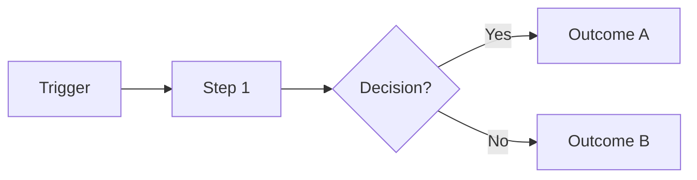

# Business Requirements Document (BRD)

## {{Project Title}}

> **Document:** Business Requirements Document  ·  **Version:** {{1.0}}  ·  **Status:** {{Draft / In Review / Approved}}
> **Project type:** Personal Project (Skill Development)  ·  **Date:** {{DD-MMM-YYYY}}
> **Author:** Jojo George (jojogeorge3344@gmail.com)
> © {{YYYY}} Jojo George. All rights reserved.

---

## Document Control

### Revision History

| Version | Date | Author | Summary of changes |
|---|---|---|---|
| 1.0 | {{DD-MMM-YYYY}} | Jojo George | Initial version |

### Approvals / Sign-off

| Role | Name | Decision | Date |
|---|---|---|---|
| Product owner | {{Name}} | {{Approved / Changes requested}} | {{Date}} |
| Reviewer | {{Name}} | {{…}} | {{Date}} |

### Related Documents

| Document | Location |
|---|---|
| Development Plan (screen-wise) | {{TF - Documents/Screens Wise Feature Development Plan/}} |
| FRD / Functional workflows | {{path}} |
| TDD / HLD / LLD | {{TF - Documents/TF - TDD/ · TF - HLD/ · TF - LLD/}} |

---

## Index

1. Project Overview
2. Stakeholders & User Roles
3. Scope
4. Business Process / Workflows
5. Screen-by-Screen Requirements
6. Business Rules
7. Non-Functional Requirements
8. Data Requirements
9. Integrations & External Dependencies
10. Reporting Requirements
11. Recommended Technology Stack (optional)
12. Assumptions, Constraints & Dependencies
13. Risks
14. Acceptance Criteria
15. Requirements Traceability Matrix
16. Project Deliverables
17. Glossary
18. Project Summary

---

## 1. Project Overview

### 1.1 Introduction
{{2–4 sentences: what the system is, who uses it, and the business problem it solves.}}

### 1.2 Business Problem / Current Situation
{{How the work is done today and what goes wrong (missed deadlines, no visibility, manual tracking …).}}

### 1.3 Project Objectives

| ID | Objective | Success measure |
|---|---|---|
| OBJ-01 | {{Simplify …}} | {{Measurable outcome, e.g. "Managers assign a task in under 1 minute"}} |
| OBJ-02 | {{…}} | {{…}} |

### 1.4 Expected Benefits
- {{Benefit to the organisation}}
- {{Benefit to each user group}}

---

## 2. Stakeholders & User Roles

### 2.1 Stakeholders

| Stakeholder | Interest / responsibility |
|---|---|
| {{Project owner}} | {{Defines priorities, approves the BRD}} |
| {{End users}} | {{…}} |

### 2.2 User Roles

| Role | Description | Main responsibilities | Access level |
|---|---|---|---|
| {{Administrator}} | {{…}} | {{…}} | {{Full system}} |
| {{Manager}} | {{…}} | {{…}} | {{Team / authorized scope}} |
| {{Employee}} | {{…}} | {{…}} | {{Own records only}} |

---

## 3. Scope

### 3.1 In Scope
- {{Feature / module 1}}
- {{Feature / module 2}}

### 3.2 Out of Scope (this release)
- {{Explicitly excluded item}} – {{reason / future phase}}

### 3.3 Modules Overview

| # | Module | Purpose | Screens |
|---|---|---|---|
| 1 | {{Authentication}} | {{…}} | {{Login, …}} |
| 2 | {{…}} | {{…}} | {{…}} |

---

## 4. Business Process / Workflows

### 4.1 {{Main workflow name, e.g. Automatic Deadline Notification Workflow}}

**Trigger:** {{What starts it}}  ·  **Actors:** {{Roles involved}}

| Step | Actor / System | Action | Result |
|---|---|---|---|
| 1 | {{Manager}} | {{Creates a task}} | {{Task saved, assignee notified}} |
| 2 | {{System}} | {{…}} | {{…}} |

**Example:** {{A worked example with real-looking dates/values.}}

**Exceptions / alternate flows:**
- {{What happens if … }}

### 4.2 {{Next workflow}}
{{Repeat the structure above.}}

---

## 5. Screen-by-Screen Requirements

> Repeat this block for every screen. Number screens in order (SCREEN 1, SCREEN 2 …) and functional requirements per
> screen as `FR-<screen>.<n>` (e.g. FR-8.3) so they can be traced.

### SCREEN {{n}}: {{Screen Title}}

| Field | Value |
|---|---|
| **Screen name** | {{User Login}} |
| **Module** | {{Authentication}} |
| **Access** | {{All registered users / Administrator / …}} |
| **Priority** | {{Must / Should / Could}} |

**Purpose**
{{One or two sentences: why this screen exists.}}

**Screen Elements**
- {{Field / list / filter / button}}
- {{…}}

**Functional Requirements**

| ID | Requirement | Priority |
|---|---|---|
| FR-{{n}}.1 | The system shall {{…}}. | {{Must}} |
| FR-{{n}}.2 | The system shall {{…}}. | {{Should}} |

**Validations & Messages**

| Situation | Rule / message |
|---|---|
| {{Required field empty}} | {{"Title is required."}} |

**Expected Result**
{{What the user can achieve once the screen works correctly.}}

---

## 6. Business Rules

| ID | Rule | Applies to |
|---|---|---|
| BR-1 | {{Only authenticated users can access the system.}} | {{All screens}} |
| BR-2 | {{…}} | {{…}} |

---

## 7. Non-Functional Requirements

| ID | Category | Requirement | Measure / target |
|---|---|---|---|
| NFR-1 | Performance | {{Pages load quickly under normal office use}} | {{e.g. < 2 s for 95% of requests}} |
| NFR-2 | Security | {{Passwords stored hashed; role-based access}} | {{…}} |
| NFR-3 | Usability | {{Responsive layout; clear validation messages}} | {{…}} |
| NFR-4 | Reliability | {{Scheduled jobs resume after restart without duplicates}} | {{…}} |
| NFR-5 | Maintainability | {{Modular, layered code; documented}} | {{…}} |
| NFR-6 | Compatibility | {{Latest Chrome, Edge, Firefox}} | {{…}} |
| NFR-7 | Backup & Recovery | {{Data can be backed up and restored}} | {{…}} |
| NFR-8 | Accessibility | {{Keyboard navigation, readable contrast}} | {{…}} |

---

## 8. Data Requirements

| Entity / data set | Purpose | Key fields | Retention / rules |
|---|---|---|---|
| {{Users}} | {{Accounts and roles}} | {{Name, email, role, status}} | {{Soft delete; email unique}} |
| {{Tasks}} | {{…}} | {{…}} | {{…}} |

---

## 9. Integrations & External Dependencies

| System / service | Purpose | Required? | Notes |
|---|---|---|---|
| {{Email / SMTP, AI provider, …}} | {{…}} | {{Optional}} | {{Behaviour when unavailable}} |

---

## 10. Reporting Requirements

| Report | Audience | Filters | Output formats |
|---|---|---|---|
| {{Task summary}} | {{Admin, Manager}} | {{Date range, project, employee, status}} | {{Screen, CSV}} |

---

## 11. Recommended Technology Stack (optional)

> A BRD states *what* is needed; keep this section a recommendation. The final choice belongs in the TDD.

| Component | Recommended technology | Reason |
|---|---|---|
| {{Backend}} | {{…}} | {{…}} |

---

## 12. Assumptions, Constraints & Dependencies

| Type | Description |
|---|---|
| Assumption | {{Single organisation; users have modern browsers}} |
| Constraint | {{Single-server deployment; offline demo possible}} |
| Dependency | {{…}} |

---

## 13. Risks

| ID | Risk | Impact | Likelihood | Mitigation |
|---|---|---|---|---|
| R-1 | {{Missed reminders if the scheduler stops}} | {{High}} | {{Low}} | {{Resume from stored state; duplicate guard}} |

---

## 14. Acceptance Criteria

| ID | Criterion | Verified by |
|---|---|---|
| AC-1 | {{Users log in and land on the dashboard for their role.}} | {{SCREEN 1, FR-1.x}} |
| AC-2 | {{…}} | {{…}} |

---

## 15. Requirements Traceability Matrix

| Objective | Business rule(s) | Screen(s) | Functional requirement(s) | Acceptance criterion |
|---|---|---|---|---|
| OBJ-01 | {{BR-…}} | {{SCREEN …}} | {{FR-…}} | {{AC-…}} |

---

## 16. Project Deliverables

| # | Deliverable | Format |
|---|---|---|
| 1 | Complete application source code | Repository |
| 2 | Database schema and initialization scripts | {{…}} |
| 3 | BRD, FRD, Development Plan, Specs, TDD, HLD, LLD | Markdown, DOCX, PDF |
| 4 | Test cases and test results | {{…}} |
| 5 | Sample data for demonstration | {{…}} |

---

## 17. Glossary

| Term | Meaning |
|---|---|
| {{Recipient}} | {{Any user configured to receive reminders for a task}} |

---

## 18. Project Summary
{{A short closing paragraph restating the system, its main value, and the key workflows it delivers.}}

---
© {{YYYY}} Jojo George. All rights reserved. Unauthorized copying or distribution of this document is prohibited.
