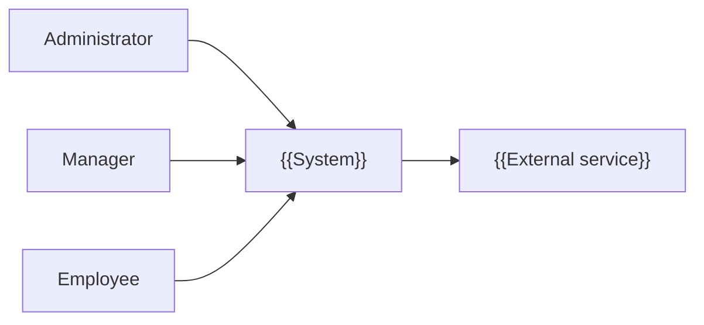
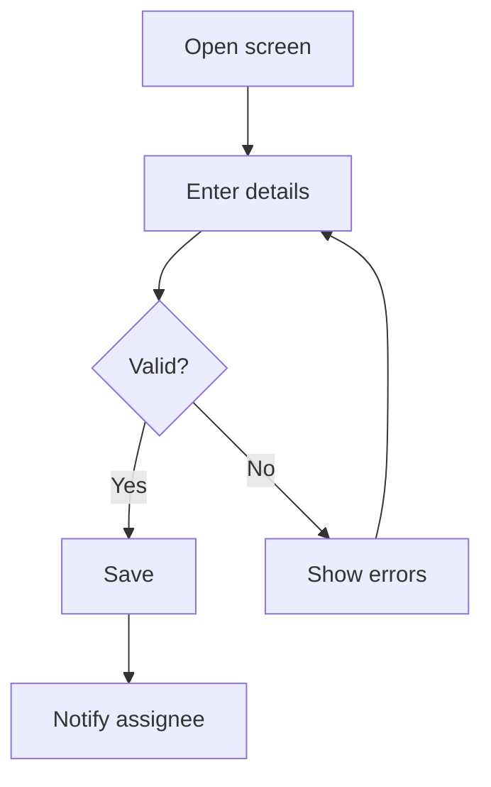
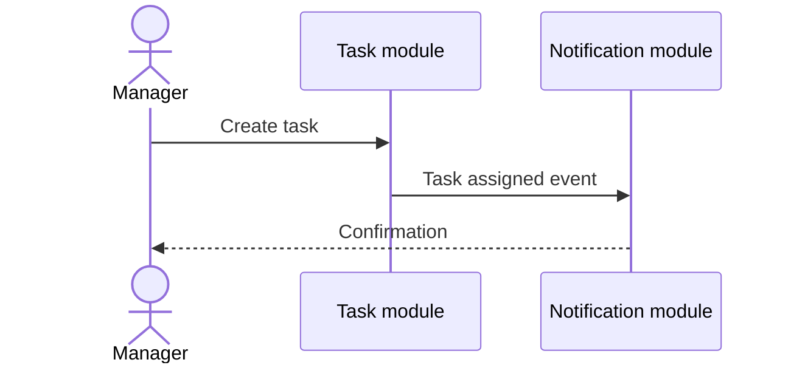

# Functional Requirements Document (FRD)

## {{Project Title}}

> **Document:** Functional Requirements Document  ·  **Version:** {{1.0}}  ·  **Status:** {{Draft / In Review / Approved}}
> **Project type:** Personal Project (Skill Development)  ·  **Date:** {{DD-MMM-YYYY}}
> **Author:** Jojo George (jojogeorge3344@gmail.com)
> **Based on:** {{BRD-<Project>.md v1.0}}
> © {{YYYY}} Jojo George. All rights reserved.

---

## Document Control

### Revision History

| Version | Date | Author | Summary of changes |
|---|---|---|---|
| 1.0 | {{DD-MMM-YYYY}} | Jojo George | Initial version |

### Related Documents

| Document | Purpose | Location |
|---|---|---|
| BRD | Business needs this FRD details | {{Requirements/BRD-….md}} |
| Development Plan | Screen-wise build plan | {{Requirements/Screens Wise Feature Development Plan/}} |
| HLD / LLD / TDD | Technical design | {{Artifacts/…}} |

---

## 1. Introduction

### 1.1 Purpose
{{What this FRD specifies: the detailed, testable behaviour of every module and screen of the system.}}

### 1.2 Scope
{{Modules covered; what is out of scope (link to BRD §3.2).}}

### 1.3 Audience
{{Developers, testers, reviewers, product owner.}}

### 1.4 Conventions
- Requirement IDs: `FR-<MOD>-<nn>` (e.g. `FR-TASK-07`). Use cases: `UC-<MOD>-<nn>`. Business rules: `BR-n` (from the BRD).
- Priority: **Must / Should / Could** (MoSCoW).
- "The system shall …" = mandatory behaviour; "should" = recommended.

### 1.5 Definitions & Abbreviations

| Term | Meaning |
|---|---|
| {{Scope}} | {{Own / Team / Organization data visibility}} |

---

## 2. System Overview

### 2.1 Module Map

| Code | Module | Child modules | Primary roles |
|---|---|---|---|
| {{AUTH}} | {{Authentication}} | {{Login, Account recovery, MFA}} | {{All users}} |
| {{TASK}} | {{Task Monitoring}} | {{Task list, Board, Workload}} | {{Manager, Employee}} |

### 2.2 Context Diagram

---

## 3. User Roles & Permissions

### 3.1 Roles

| Role | Description | Data scope |
|---|---|---|
| {{Administrator}} | {{…}} | {{Organization}} |
| {{Manager}} | {{…}} | {{Team}} |
| {{Employee}} | {{…}} | {{Own}} |

### 3.2 Permission Matrix (functional view)

| Module › Function | Permission key | Administrator | Manager | Employee | Custom role |
|---|---|:---:|:---:|:---:|:---:|
| {{Tasks › Create task}} | `{{tasks.create}}` | {{Granted}} | {{Granted}} | {{Denied}} | {{Configurable}} |

---

## 4. Functional Requirements by Module

> Repeat section 4.x for every module, and 4.x.y for every child module / screen.

### 4.1 Module: {{Module Name}} ({{CODE}})

**Purpose:** {{One or two sentences.}}  ·  **BRD reference:** {{BRD §5 SCREEN n, BR-n}}

#### 4.1.1 Screen: {{Screen Name}}

| Field | Value |
|---|---|
| Route / location | {{/tasks}} |
| Access | {{Roles / permission keys}} |
| Entry points | {{Menu item, link from …}} |

**Screen elements**

| Element | Type | Description | Mandatory | Visible to |
|---|---|---|:---:|---|
| {{Title}} | {{Text input}} | {{Task title}} | Yes | {{Users with `tasks.create`}} |
| {{Save}} | {{Button}} | {{Saves the task}} | – | {{…}} |

**Functional requirements**

| ID | Requirement | Priority | Permission | BRD trace |
|---|---|---|---|---|
| FR-{{CODE}}-01 | The system shall {{…}}. | Must | `{{key}}` | {{FR-8.1 / BR-3}} |
| FR-{{CODE}}-02 | The system shall {{…}}. | Should | `{{key}}` | {{…}} |

**Use case: UC-{{CODE}}-01 – {{Name}}**

| Item | Detail |
|---|---|
| Actor | {{Manager}} |
| Preconditions | {{Signed in; holds `tasks.create`}} |
| Trigger | {{Clicks "Create task"}} |
| Main flow | 1. {{…}} 2. {{…}} 3. {{…}} |
| Alternate flows | {{A1: copy an existing task …}} |
| Exceptions | {{E1: deadline before start date → validation error}} |
| Postconditions | {{Task saved; assignee notified; history recorded}} |

**Field validations**

| Field | Rule | Error message |
|---|---|---|
| {{Deadline}} | {{Required; after start date}} | {{"Deadline must be after the start date."}} |

**Business rules applied:** {{BR-…}}

**Notifications / side effects**

| Event | Who is notified | Channel |
|---|---|---|
| {{Task assigned}} | {{Assignee}} | {{In-app, Mail}} |

**Messages**

| Situation | Message |
|---|---|
| Success | {{…}} |
| No permission | {{"You do not have permission to perform this action."}} |

---

## 5. Cross-Module Workflows

### 5.1 {{Workflow name}}

| Step | Module | Actor / System | Action | FR reference |
|---|---|---|---|---|
| 1 | {{TASK}} | {{Manager}} | {{Creates task}} | {{FR-TASK-01}} |
| 2 | {{NOTIF}} | {{System}} | {{Sends reminder}} | {{FR-NOTIF-04}} |

---

## 6. Reports & Exports

| Report | Module | Filters | Columns | Export | Access |
|---|---|---|---|---|---|
| {{Task summary}} | {{Reports}} | {{Date, project, employee}} | {{…}} | {{CSV}} | `{{reports.view}}` |

---

## 7. Notifications & Messages Catalogue

| Code | Trigger | Recipients | Channel | Text |
|---|---|---|---|---|
| {{N-01}} | {{Task assigned}} | {{Assignee}} | {{In-app}} | {{"You have been assigned …"}} |

---

## 8. Data Requirements (functional view)

| Data item | Description | Created by | Rules |
|---|---|---|---|
| {{Task code}} | {{Unique readable ID}} | {{System}} | {{Format TSK-000001; never reused}} |

---

## 9. Non-Functional Requirements (functional impact)

| ID | Requirement | Affects |
|---|---|---|
| NFR-{{n}} | {{Lists load within 2 s for 1,000 rows}} | {{Task list, Reports}} |

---

## 10. Assumptions & Open Issues

| Type | Description | Owner |
|---|---|---|
| Assumption | {{…}} | {{…}} |
| Open issue | {{…}} | {{…}} |

---

## 11. Requirements Traceability Matrix

| BRD item | FRD requirement(s) | Screen | Use case | Test case |
|---|---|---|---|---|
| {{BRD FR-8.1}} | {{FR-TASK-01, FR-TASK-02}} | {{Create Task}} | {{UC-TASK-01}} | {{TC-…}} |

---

## 12. Approvals

| Role | Name | Decision | Date |
|---|---|---|---|
| Product owner | {{Name}} | {{…}} | {{Date}} |

---
© {{YYYY}} Jojo George. All rights reserved. Unauthorized copying or distribution of this document is prohibited.
