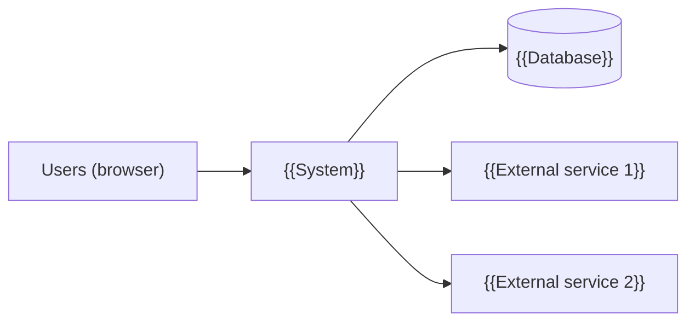
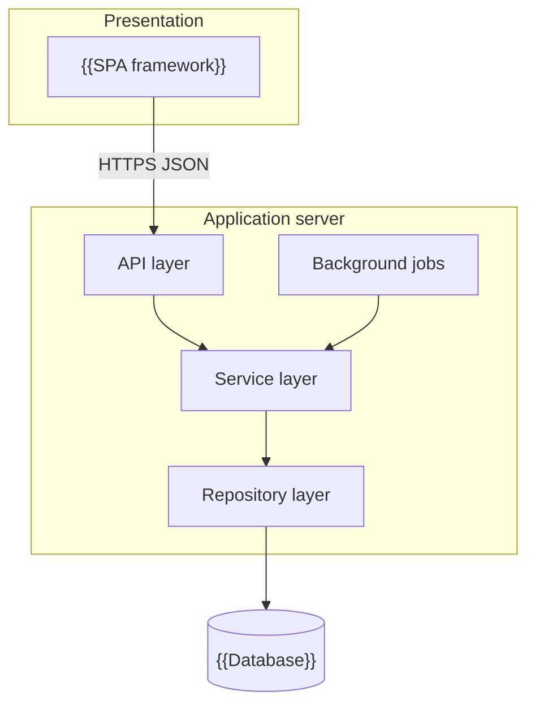
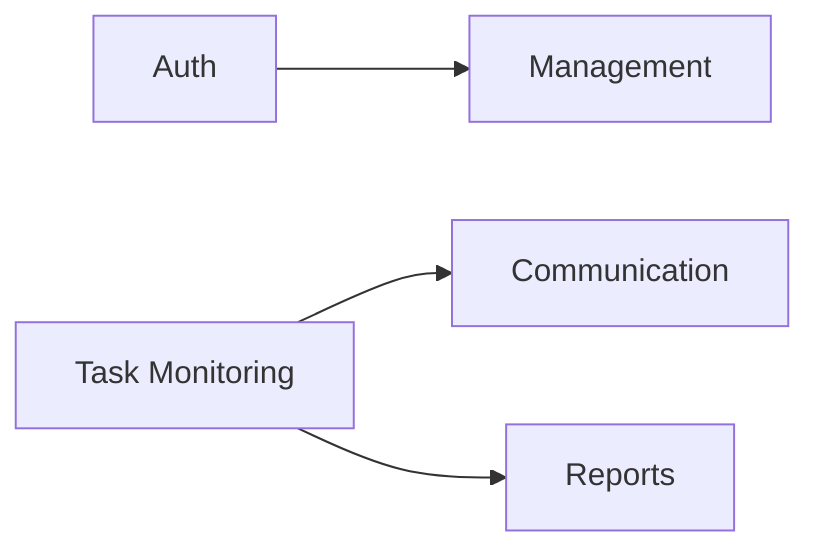
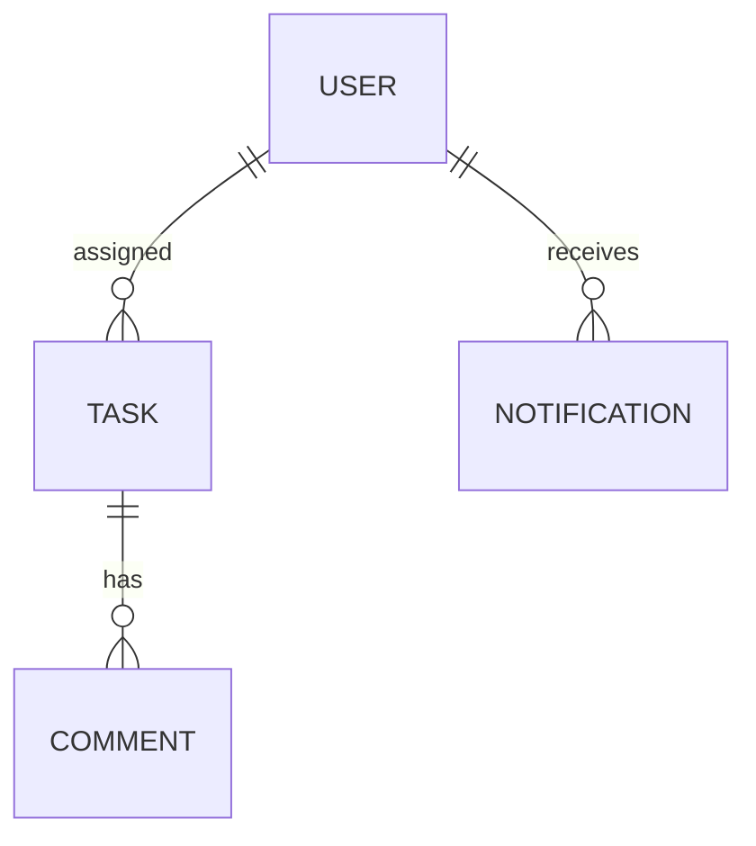
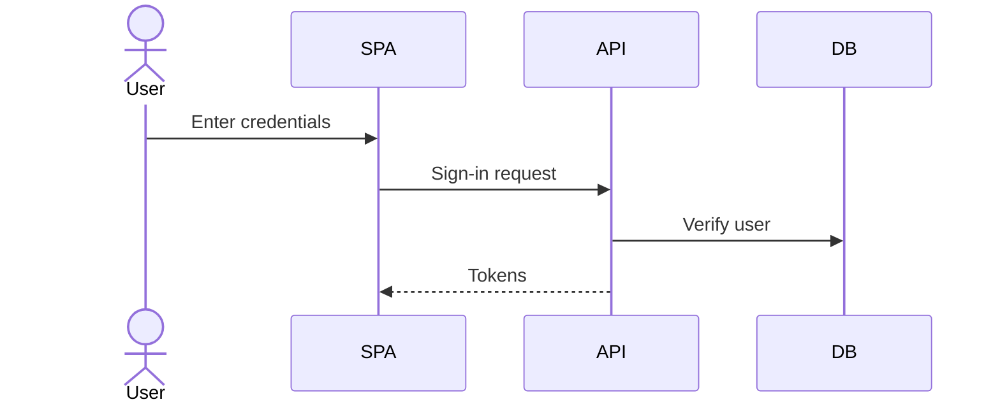
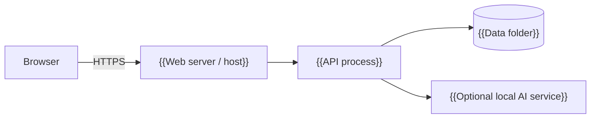

# High-Level Design (HLD)

## {{Project Title}}

> **Document:** High-Level Design  ·  **Version:** {{1.0}}  ·  **Status:** {{Draft / In Review / Approved}}
> **Project type:** Personal Project (Skill Development)  ·  **Date:** {{DD-MMM-YYYY}}
> **Author:** Jojo George (jojogeorge3344@gmail.com)
> **Based on:** {{BRD v1.0, FRD v1.0}}
> © {{YYYY}} Jojo George. All rights reserved.

---

## Document Control

| Version | Date | Author | Summary of changes |
|---|---|---|---|
| 1.0 | {{DD-MMM-YYYY}} | Jojo George | Initial version |

**Related documents:** BRD · FRD · LLD · TDD · Specs ({{paths}})

---

## 1. Introduction

### 1.1 Purpose
{{What this HLD describes: the overall architecture, major components, their responsibilities and interactions,
technology choices and deployment — not class- or table-level detail (see LLD).}}

### 1.2 Scope
{{Systems and modules covered; what is out of scope.}}

### 1.3 Audience
{{Reviewers, technical leads, developers, operations.}}

### 1.4 Definitions & Abbreviations

| Term | Meaning |
|---|---|
| {{SPA}} | {{Single Page Application}} |

---

## 2. System Context

### 2.1 Context Diagram

### 2.2 Actors & External Systems

| Actor / system | Interaction | Protocol |
|---|---|---|
| {{Users}} | {{Use the web app}} | {{HTTPS}} |
| {{AI provider}} | {{Chat completions}} | {{HTTPS / REST}} |

---

## 3. Architecture Goals, Constraints & Principles

### 3.1 Quality Goals

| Goal | How the architecture supports it |
|---|---|
| {{Maintainability}} | {{Layered, module-based structure enforced by tests}} |
| {{Security}} | {{…}} |
| {{Reliability}} | {{…}} |

### 3.2 Constraints
- {{Single-server deployment; file-based database}}

### 3.3 Architecture Principles
- {{Clean architecture: Controller → Service → Repository}}
- {{…}}

---

## 4. Architecture Overview

### 4.1 Architecture Style
{{e.g. Three-tier SPA + REST API, layered (clean) backend, background worker.}}

### 4.2 Logical Architecture

### 4.3 Layers & Responsibilities

| Layer | Responsibility | May call |
|---|---|---|
| Presentation | {{UI, routing, guards}} | API |
| API / Controllers | {{HTTP only}} | Services |
| Services | {{Business rules}} | Repositories, Integrations |
| Repositories | {{Data access}} | Database |
| Integrations | {{External services, tokens, storage}} | External systems |

---

## 5. Component / Module Design

| Module | Responsibility | Key components (high level) | Depends on |
|---|---|---|---|
| {{Authentication}} | {{Sign-in, MFA, sessions}} | {{Auth API, token service, MFA service}} | {{Users data}} |
| {{…}} | {{…}} | {{…}} | {{…}} |

### 5.1 Module Interaction

---

## 6. Data Architecture (high level)

### 6.1 Data Stores

| Store | Technology | Holds | Notes |
|---|---|---|---|
| {{Main database}} | {{SQLite}} | {{Users, tasks, …}} | {{Single file; backup policy}} |
| {{File storage}} | {{Local folder}} | {{Attachments}} | {{…}} |

### 6.2 Main Data Domains

### 6.3 Data Flow
{{How data moves for the main use cases (create task → reminder → notification).}}

---

## 7. Integration Design

| Integration | Direction | Purpose | Failure behaviour |
|---|---|---|---|
| {{AI provider}} | Outbound | {{Assistant answers}} | {{User told; no automatic switch}} |

---

## 8. Key Flows (high level)

### 8.1 {{Flow name, e.g. Sign-in}}

### 8.2 {{Next flow}}

---

## 9. Security Architecture

| Concern | Approach |
|---|---|
| Authentication | {{JWT + refresh cookie, MFA}} |
| Authorization | {{Permission-based RBAC, resource checks}} |
| Data protection | {{Hashing, key protection, secrets handling}} |
| Transport | {{HTTPS, CORS}} |
| Auditing | {{What is logged}} |

---

## 10. Technology Stack

| Area | Technology | Version | Reason |
|---|---|---|---|
| {{Backend}} | {{…}} | {{…}} | {{…}} |
| {{Frontend}} | {{…}} | {{…}} | {{…}} |
| {{Database}} | {{…}} | {{…}} | {{…}} |

---

## 11. Deployment Architecture

| Environment | Purpose | Notes |
|---|---|---|
| Development | {{Local}} | {{Ports, dev proxy}} |
| Production | {{…}} | {{…}} |

---

## 12. Non-Functional Design

| Area | Design decision |
|---|---|
| Performance | {{Indexes, paging}} |
| Scalability | {{Single instance; limits}} |
| Reliability | {{Restart-safe jobs}} |
| Availability | {{…}} |
| Maintainability | {{Structure rules, tests}} |
| Observability | {{Logging}} |
| Backup & Recovery | {{…}} |

---

## 13. Design Decisions

| ID | Decision | Alternatives considered | Rationale |
|---|---|---|---|
| D-1 | {{…}} | {{…}} | {{…}} |

---

## 14. Risks, Assumptions & Open Issues

| Type | Description | Mitigation / owner |
|---|---|---|
| Risk | {{…}} | {{…}} |

---

## 15. Traceability (requirements → components)

| BRD/FRD item | Module / component | Section |
|---|---|---|
| {{FR-TASK-01}} | {{Task Monitoring › Task service}} | {{§5}} |

---
© {{YYYY}} Jojo George. All rights reserved. Unauthorized copying or distribution of this document is prohibited.
