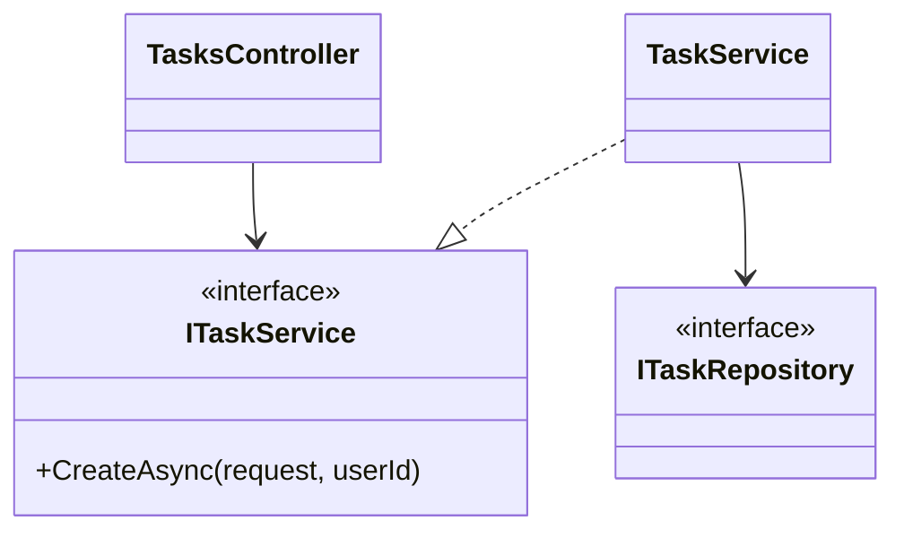
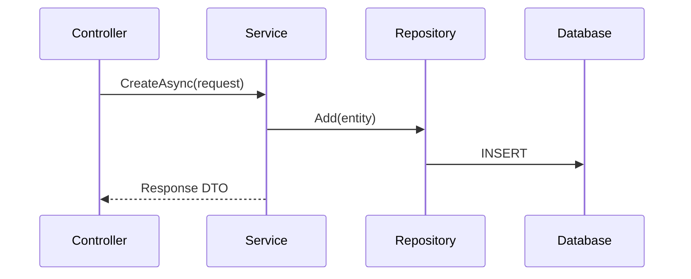
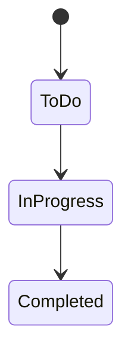
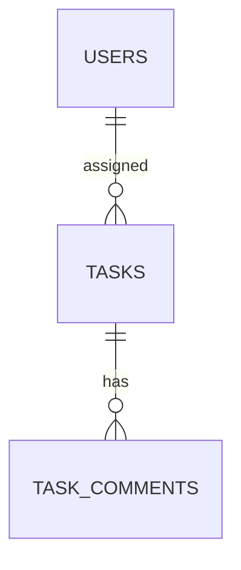

# Low-Level Design (LLD)

## {{Project Title}}

> **Document:** Low-Level Design  ·  **Version:** {{1.0}}  ·  **Status:** {{Draft / In Review / Approved}}
> **Project type:** Personal Project (Skill Development)  ·  **Date:** {{DD-MMM-YYYY}}
> **Author:** Jojo George (jojogeorge3344@gmail.com)
> **Based on:** {{HLD v1.0, FRD v1.0}}
> © {{YYYY}} Jojo George. All rights reserved.

---

## Document Control

| Version | Date | Author | Summary of changes |
|---|---|---|---|
| 1.0 | {{DD-MMM-YYYY}} | Jojo George | Initial version |

**Related documents:** BRD · FRD · HLD · TDD · Specs ({{paths}})

---

## 1. Introduction

### 1.1 Purpose
{{Detailed design of every module: classes and layers, database tables, API contracts, algorithms, validation and
error handling, security checks — enough to implement or maintain the code.}}

### 1.2 Scope & Conventions
- {{Modules covered}}
- Naming: {{`*Controller`, `I*Service`/`*Service`, `I*Repository`/`*Repository`, DTOs `*Request`/`*Response`}}
- API base path: {{`/api/v1`}}; JSON {{camelCase}}; errors as {{ProblemDetails}}

---

## 2. Code Structure

### 2.1 Backend Folder Layout

```
{{Api project}}/
  Controllers/<Module>/
  Services/<Module>/<SubModule>/
  Repositories/<Module>/<SubModule>/
  Dtos/<Module>/<SubModule>/   (+ Validators/)
  Models/Entities, Models/Enums
  Integrations/, Middleware/, Filters/, Authorization/, Config/, Common/, Persistence/
```

### 2.2 Frontend Folder Layout

```
src/app/modules/<module>/<sub-module>/{pages,components,services,models,utils}
src/app/shared/, layouts/, routes/, config/
```

### 2.3 Layer Rules

| Rule | Enforced by |
|---|---|
| {{Controller → Service → Repository only}} | {{ArchitectureTests}} |

---

## 3. Cross-Cutting Design

| Concern | Design |
|---|---|
| Validation | {{FluentValidation via global filter}} |
| Error handling | {{Exception → status code table}} |
| Transactions | {{Unit of work committed by the service}} |
| Authorization | {{Permission policies + resource handler}} |
| Logging | {{…}} |
| Time & time zone | {{UTC storage; app time zone at the edge}} |

### 3.1 Exception → HTTP Status

| Exception | Status | When |
|---|---|---|
| {{BusinessRuleException}} | 400 | {{…}} |
| {{ForbiddenException}} | 403 | {{…}} |
| {{NotFoundException}} | 404 | {{…}} |
| {{ConflictException}} | 409 | {{…}} |

---

## 4. Module Designs

> Repeat section 4.x for every module, and 4.x.y for every child module.

### 4.1 Module: {{Module Name}}

#### 4.1.1 Child module: {{Child Name}}

**Class / file inventory**

| Layer | Type | File | Responsibility |
|---|---|---|---|
| Controller | `{{TasksController}}` | `{{Controllers/Monitoring/TasksController.cs}}` | {{HTTP routing}} |
| Service | `{{ITaskService}}` / `{{TaskService}}` | `{{Services/…}}` | {{Business rules}} |
| Repository | `{{ITaskRepository}}` / `{{TaskRepository}}` | `{{Repositories/…}}` | {{Queries}} |
| DTOs | `{{CreateTaskRequest}}`, `{{TaskDetailsDto}}` | `{{Dtos/…}}` | {{Contracts}} |
| Validator | `{{CreateTaskRequestValidator}}` | `{{Dtos/…/Validators}}` | {{Input rules}} |
| Frontend page | `{{TaskCreateComponent}}` | `{{modules/…/pages}}` | {{Screen}} |
| Frontend service | `{{TaskService}}` | `{{modules/…/services}}` | {{HTTP calls}} |

**Class diagram**



**API contracts**

| # | Method | Route | Permission / policy | Request | Response | Status codes |
|---|---|---|---|---|---|---|
| 1 | {{POST}} | `{{/api/v1/tasks}}` | `{{tasks.create}}` | `{{CreateTaskRequest}}` | `{{TaskDetailsDto}}` | {{201, 400, 403}} |

**Request / response example**

```json
{{ "title": "Prepare monthly report", "assigneeId": 12, "deadline": "2026-11-15T17:00:00Z" }}
```

**Service logic – `{{CreateAsync}}`**
1. {{Validate input (validator runs in filter).}}
2. {{Check permission / scope.}}
3. {{Apply business rules (BR-…).}}
4. {{Persist through repository; commit unit of work.}}
5. {{Write activity log; publish notification.}}
6. {{Return DTO.}}

**Sequence diagram**



**Repository methods**

| Method | Query / purpose | Notes |
|---|---|---|
| `{{GetPagedAsync(filter)}}` | {{Filtered page}} | {{AsNoTracking; indexes used}} |

**Validation rules**

| Field | Rule | Message |
|---|---|---|
| {{Title}} | {{Required, max 200}} | {{"Title is required."}} |

**Error cases**

| Case | Exception | Status |
|---|---|---|
| {{Task not found}} | {{NotFoundException}} | 404 |

**State machine (if any)**



---

## 5. Database Design

### 5.1 ER Diagram



### 5.2 Tables

> One table per entity.

#### `{{Tasks}}` ({{Task}})

| Column | Type | Null | Key / index | Default | Description |
|---|---|:---:|---|---|---|
| Id | {{int}} | No | PK | identity | {{…}} |
| {{TaskCode}} | {{string(20)}} | No | Unique | – | {{…}} |

### 5.3 Indexes, Constraints & Triggers

| Object | Definition | Purpose |
|---|---|---|
| {{IX_Tasks_AssigneeId_Status}} | {{(AssigneeId, Status)}} | {{List filter}} |

### 5.4 Enumerations

| Enum | Values | Stored as |
|---|---|---|
| {{TaskStatus}} | {{ToDo, InProgress, …}} | {{text}} |

### 5.5 Migrations

| Migration | Change |
|---|---|
| {{20261012124843_AddTasks}} | {{…}} |

---

## 6. Algorithms & Background Jobs

| Job / algorithm | Trigger / schedule | Steps | Idempotency |
|---|---|---|---|
| {{Reminder scheduler}} | {{Every 1 minute}} | {{…}} | {{Unique index on (…)}} |

---

## 7. Security Design (detailed)

| Item | Implementation |
|---|---|
| Password hashing | {{…}} |
| Tokens | {{Access lifetime, refresh rotation, cookie flags}} |
| Permission checks | {{Policy per endpoint; resource handler}} |
| Secrets | {{Where stored; never logged}} |

---

## 8. Configuration

| Key | Default | Purpose |
|---|---|---|
| {{Application:Timezone}} | {{Asia/Kolkata}} | {{…}} |
| {{Jwt:Key}} | `<secret>` | {{…}} |

---

## 9. Testing Design

| Area | Test class / file | Type | Covers |
|---|---|---|---|
| {{Tasks}} | {{TaskServiceTests.cs}} | Unit | {{Rules}} |

---

## 10. Known Limitations & Open Issues

- {{…}}

---

## 11. Traceability (FRD → code)

| FRD requirement | Endpoint / class | Test |
|---|---|---|
| {{FR-TASK-01}} | {{POST /api/v1/tasks · TaskService.CreateAsync}} | {{TasksEndpointsTests}} |

---
<sub>© {{YYYY}} Jojo George. All rights reserved. Unauthorized copying or distribution of this document is prohibited.</sub>
