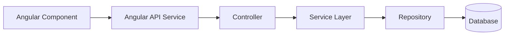
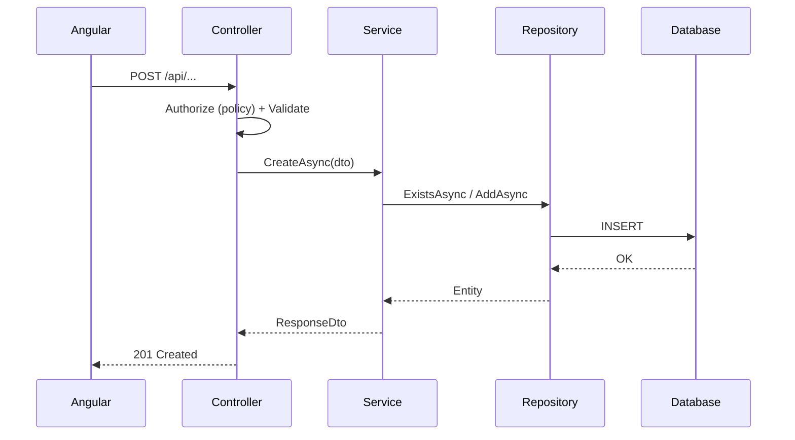

# <Module Name> Module – Technical Documentation

> **Project:** TaskFlow – Intelligent Task Allocation & Tracking System
> **Module:** <Module Name>  ·  **Child Modules:** <Child 1>, <Child 2>
> **Version:** 1.0  ·  **Last Updated:** <DD-MMM-YYYY>
> **Backend:** ASP.NET Core Web API (.NET)  ·  **Frontend:** Angular  ·  **Database:** <SQL Server / PostgreSQL>
> **Author:** Jojo George (jojogeorge3344@gmail.com)
> © 2026 Jojo George. All rights reserved.

---

## 1. Technical Overview
<Short description of how the module is built and its main responsibilities.>

## 2. Architecture Flow


## 3. Backend File Structure

| Layer | Path | Files |
|-------|------|-------|
| Controller | `TaskFlow.Api/Controllers/<Module>/` | `<X>Controller.cs` |
| Service | `TaskFlow.Api/Services/<Module>/<Child>/` | `I<X>Service.cs`, `<X>Service.cs` |
| Repository | `TaskFlow.Api/Repositories/<Module>/<Child>/` | `I<X>Repository.cs`, `<X>Repository.cs` |
| DTOs | `TaskFlow.Api/Dtos/<Module>/<Child>/` | `<X>RequestDto.cs`, `<X>ResponseDto.cs` |
| Validators | `TaskFlow.Api/Dtos/<Module>/Validators/` | `<X>Validator.cs` |
| Entities | `TaskFlow.Api/Models/Entities/` | `<Entity>.cs` |
| Enums | `TaskFlow.Api/Models/Enums/` | `<Enum>.cs` |
| Authorization | `TaskFlow.Api/Authorization/` | `<Policy / Handler>.cs` |

## 4. Frontend File Structure

| Type | Path | Purpose |
|------|------|---------|
| Page component | `src/app/modules/<module>/<child>/pages/` | <...> |
| Child components | `src/app/modules/<module>/<child>/components/` | <...> |
| API service | `src/app/modules/<module>/<child>/services/` | HTTP calls |
| Models | `src/app/modules/<module>/<child>/models/` | TypeScript interfaces |
| Route / Guard | `<path>` | Permission check before routing |

---

## 5. Child Module: <Child Module Name>
*(Repeat this section for every child module.)*

### 5.1 API Endpoints

| # | Method | Endpoint | Description | Permission (Policy) | Request DTO | Response DTO |
|---|--------|----------|-------------|---------------------|-------------|--------------|
| 1 | GET | `/api/<module>/<child>` | List (paged, filtered) | `<x.view>` | Query params | `PagedResult<XDto>` |
| 2 | GET | `/api/<module>/<child>/{id}` | Get by id | `<x.view>` | – | `XDto` |
| 3 | POST | `/api/<module>/<child>` | Create | `<x.create>` | `CreateXDto` | `XDto` |
| 4 | PUT | `/api/<module>/<child>/{id}` | Update | `<x.update>` | `UpdateXDto` | `XDto` |
| 5 | PATCH | `/api/<module>/<child>/{id}/status` | Activate / Deactivate | `<x.status>` | `StatusDto` | `204 No Content` |

### 5.2 Request / Response Samples
```json
// POST /api/<module>/<child>
{ "field1": "value", "field2": 1 }
```
```json
// 201 Created
{ "id": 10, "field1": "value", "createdAt": "2026-10-31T10:00:00Z" }
```

### 5.3 Service Layer Logic
**Method:** `<MethodName>Async(<Dto> dto, <CurrentUser> user)`
1. Validate input.
2. Check business rules (e.g., duplicate check, data scope).
3. Map DTO → Entity.
4. Call repository and save changes.
5. Write the activity / audit log and trigger notifications or mail.
6. Return the mapped response DTO.

### 5.4 Repository Layer

| Method | Description | Query Notes |
|--------|-------------|-------------|
| `GetPagedAsync(filter)` | Paged list | `AsNoTracking`, filters, sorting |
| `<Method>` | <...> | <...> |

### 5.5 Sequence Diagram


---

## 6. Database Design

| Table | Column | Type | Constraints | Description |
|-------|--------|------|-------------|-------------|
| `<Table>` | `Id` | int | PK, Identity | <...> |
| `<Table>` | `<Column>` | <type> | <Unique / Not Null / FK> | <...> |

**Relationships**
- `<TableA>.<FkColumn> → <TableB>.Id` (FK, <Cascade / Restrict>)

## 7. Security & Authorization
- **Authentication:** JWT bearer token + refresh token.
- **Authorization:** Permission-based policies; keys are defined in `PermissionCatalog.cs`.
- **Data scope:** Own / Team / Organization, resolved by `<scope selector>`.
- **Frontend:** Route guard plus a permission directive that hides buttons and menu items.

| Permission Key | Endpoint(s) | UI Element Controlled |
|----------------|-------------|-----------------------|
| `<key>` | `GET /api/...` | <Menu item, list page> |

## 8. Validations & Error Handling

| Rule | Layer | HTTP Code | Error Message |
|------|-------|-----------|---------------|
| Required field missing | Validator | 400 | <...> |
| Duplicate record | Service | 409 | <...> |
| No permission | Policy | 403 | Forbidden |
| Record not found | Service | 404 | <...> |

Errors are returned by the global exception middleware in the standard API response format.

## 9. Integrations / Side Effects
- **Notifications:** <event → notification type>
- **Email:** <template used>
- **Activity Log:** <action recorded>
- **AI Assistant:** <tools exposed to the Assistant module, if any>

## 10. Configuration

| Key (`appsettings.json`) | Purpose | Default |
|--------------------------|---------|---------|
| `<Section:Key>` | <...> | <...> |

## 11. Testing

| Test Type | File / Location | Covers |
|-----------|-----------------|--------|
| Unit | `tests/<...>/<X>ServiceTests.cs` | Business rules |
| Integration | `tests/<...>` | Endpoints + authorization |

## 12. Known Limitations / Future Enhancements
- <...>

---
<sub>© 2026 Jojo George. All rights reserved. Unauthorized copying or distribution of this document is prohibited.</sub>
