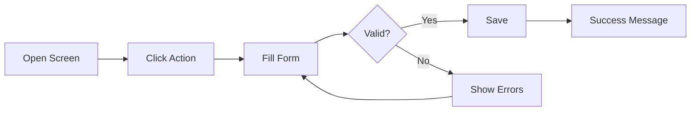

# <Module Name> Module – Functional Workflow

> **Project:** TaskFlow – Intelligent Task Allocation & Tracking System
> **Module:** <Module Name>  ·  **Child Modules:** <Child 1>, <Child 2>
> **Version:** 1.0  ·  **Last Updated:** <DD-MMM-YYYY>
> **Author:** Jojo George (jojogeorge3344@gmail.com)
> © 2026 Jojo George. All rights reserved.

---

## 1. Module Overview
<2–3 lines: what this module is and why it exists in TaskFlow.>

## 2. Purpose / Business Value
- <Problem it solves>
- <Benefit to the organization>

## 3. Who Can Access This Module

| Role          | Can See Module | Can Use Module | Access Level (Own / Team / Organization) |
|---------------|:--------------:|:--------------:|------------------------------------------|
| Administrator | ✅ | ✅ | Organization |
| Manager       | ✅ | ✅ | Team |
| Employee      | ✅ / ❌ | ✅ / ❌ | Own |
| Custom Role   | Configurable | Configurable | As granted |

## 4. Screens in This Module

| # | Screen Name | Menu Path | Purpose | Visible To |
|---|-------------|-----------|---------|------------|
| 1 | <Screen>    | <Menu → Item> | <...> | <Roles> |

---

## 5. Child Module: <Child Module Name>
*(Repeat this section for every child module.)*

### 5.1 Screen: <Screen Name>
**Purpose:** <One line.>
**Who can see this screen:** <Roles>
**Required permission:** `<permission.key>`

**Screen Elements**
- <List / grid>
- <Search box, filters>
- <Buttons: Add, Edit, Activate/Deactivate…>

### 5.2 Functionalities

| # | Functionality | Purpose | Who Can See | Who Can Use | Permission Required | Scope |
|---|---------------|---------|-------------|-------------|---------------------|-------|
| 1 | <View records> | <...> | <Roles> | <Roles> | `<key>` | Own / Team / Org |
| 2 | <Create record> | <...> | <Roles> | <Roles> | `<key>` | Org |
| 3 | <...> | <...> | <...> | <...> | `<key>` | <...> |

### 5.3 Step-by-Step Workflow – <Functionality Name>
*(Repeat for each main functionality.)*

1. User opens **<Menu → Screen>**.
2. User clicks **<Button>**.
3. System shows **<form / popup>**.
4. User enters <fields> and clicks **Save**.
5. System validates the data → saves → shows *"<success message>"*.
6. <Notification / email / activity log triggered, if any.>

**Flow Diagram**

### 5.4 Business Rules & Validations
- <e.g., Email must be unique.>
- <e.g., An employee with related tasks cannot be deleted, only deactivated.>

### 5.5 Messages Shown to the User

| Situation | Message |
|-----------|---------|
| Success | <...> |
| Validation error | <...> |
| No permission | You do not have permission to perform this action. |

---

## 6. Permission Summary (Module Level)

| Permission Key | Description | Administrator | Manager | Employee | Custom Role |
|----------------|-------------|:-------------:|:-------:|:--------:|:-----------:|
| `<key>` | <...> | Granted | Granted | Denied | Configurable |
| `<key>` | <...> | Always On | Always On | Always On | Always On |

## 7. Related Modules
- **<Module>** – <how they connect>

## 8. Expected Outcome
<What the user can achieve once this module works correctly.>

---
© 2026 Jojo George. All rights reserved. Unauthorized copying or distribution of this document is prohibited.
