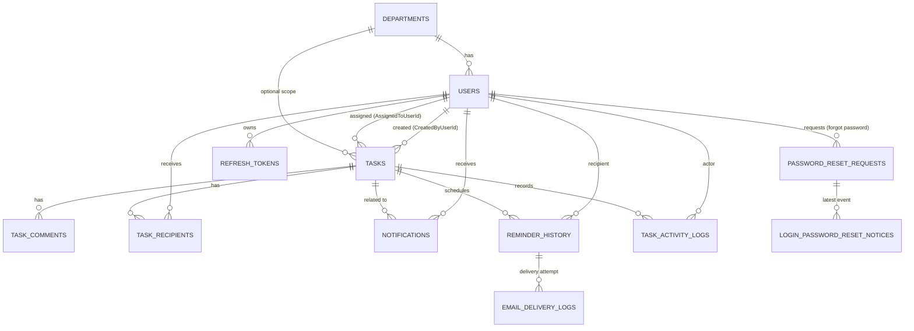

# Technical Design Document (TDD)

## TaskFlow – Intelligent Task Allocation & Tracking System

| Field | Value |
|---|---|
| Document | Technical Design Document |
| Version | 1.0 |
| Status | Draft |
| Basis | `BRD for Task management.docx` (v1.0) + `screens/01..20` |
| Chosen stack | ASP.NET Core (.NET), SQLite, Angular |
| Project type | MCA Academic Mini Project |
| Date | 2026-10-11 |

> This TDD translates the approved BRD into an implementation design. Where the BRD
> recommends Python Flask + SQLAlchemy + APScheduler, this document re-targets the same
> requirements onto the chosen stack (ASP.NET Core + EF Core + Angular) as requested by
> the project owner. Requirements, business rules and screen behaviour are **not** changed;
> only the implementation technology is mapped (see §4.3).

---

## 1. Introduction

### 1.1 Purpose
This document specifies the architecture, data model, API, module design and cross-cutting
concerns for TaskFlow so it can be implemented with ASP.NET Core, SQLite and Angular.

### 1.2 Intended Audience
Developer(s) implementing the project, project guide/reviewer, and the examiner evaluating
the design.

### 1.3 Scope
Covers the 20 screens, the automatic deadline-notification workflow, business rules,
non-functional requirements, database requirements and acceptance criteria defined in the
BRD. Excludes optional/future features beyond the BRD (see §21).

### 1.4 Definitions
- **SPA** – Single Page Application (Angular).
- **API** – ASP.NET Core Web API (REST/JSON).
- **Scheduler** – background service that generates deadline reminders.
- **Recipient** – any user configured to receive reminders for a task.

---

## 2. Design Goals & Constraints

### 2.1 Goals (from BRD §1.2)
1. Simplify employee task allocation.
2. Monitor progress of assigned tasks.
3. Reduce missed deadlines via automatic notifications.
4. Notify assigned employee and selected recipients about approaching deadlines.
5. Help managers identify pending and overdue tasks.
6. Improve manager–employee communication (comments).
7. Maintain a history of task updates and changes.
8. Generate reports for planning; support CSV export.

### 2.2 Constraints
- Single-server deployment; SQLite file database (no separate DBMS) — BRD §7.
- Must be demonstrable offline; email is optional (in-app notifications must always work) — BRD §3.4.
- Consistent application timezone for all deadline comparisons — BRD BR-16.
- Scheduler must resume after restart without duplicating reminders — BRD §5.4, §3.5.
- Role-based access control; no cross-user access to tasks/notifications — BRD §5.2, BR-13.

### 2.3 Key design decisions (summary)
| # | Decision | Rationale |
|---|---|---|
| D1 | Three-tier SPA + REST API | Clear separation, matches maintainability NFR |
| D2 | EF Core Code-First migrations on SQLite | Reproducible schema, matches "database schema and initialization scripts" deliverable |
| D3 | JWT bearer auth (API) + Angular route guards | Stateless, standard for SPA; supports RBAC requirement |
| D4 | `BackgroundService` + DB dedup index as reminder engine | No external broker; duplicate-safe; restarts safely |
| D5 | Compute `overdue` at query time from status+deadline | Single source of truth, avoids stale flags |
| D6 | Soft-delete (IsDeleted) for entities with history | Protects historical records (BR-18) |

---

## 3. System Architecture

### 3.1 High-level view

```
┌──────────────────────────────┐        HTTPS / JSON        ┌───────────────────────────────────────┐
│  Angular SPA (browser)       │  ───────────────────────►  │  ASP.NET Core Web API (.NET)          │
│  - standalone components     │   Bearer JWT                │  ┌─────────────────────────────────┐  │
│  - route guards, HTTP        │  ◄───────────────────────   │  │ Controllers (thin)              │  │
│  - services (REST client)    │        JSON + errors        │  ├─────────────────────────────────┤  │
│  - Chart.js, CDK drag-drop   │                             │  │ Application services + validators│ │
└──────────────────────────────┘                             │  ├─────────────────────────────────┤  │
                                                             │  │ Domain entities / rules          │ │
        ▲                                                    │  ├─────────────────────────────────┤  │
        │  HTTP long-poll / refresh                          │  │ Infrastructure (EF Core, SMTP)   │ │
        │                                                    │  └─────────────────────────────────┘  │
        │                                                    │   ┌──────────────────────────────┐    │
        │                                                    │   │ ReminderSchedulerService     │    │
        │                                                    │   │ (BackgroundService, ~1 min)  │    │
        │                                                    │   └──────────────┬───────────────┘    │
        │                                                    └──────────────────┼────────────────────┘
        │                                                                       │
        │                              ┌────────────────────┐   ┌───────────────▼──────────────┐
        └────── notifications ─────────│  SQLite (taskflow.db)│◄──│ EF Core DbContext (scoped)  │
                                       └────────────────────┘   └──────────────────────────────┘
                                                                       │ SMTP (optional)
                                                                       ▼
                                                               External SMTP server
```

### 3.2 Runtime components
1. **Angular SPA** — UI for all 20 screens, talks only to the API.
2. **Web API** — authentication, authorization, business rules, reporting, CSV export.
3. **Scheduler hosted service** — scans tasks periodically, creates reminders/notifications.
4. **SQLite database** — single file with all tables (§7).
5. **SMTP** — optional outbound email; failures never block in-app notifications.

### 3.3 Request lifecycle (typical)
`HTTP request → CORS/HTTPS → Authentication (JWT) → Authorization (role/policy) → Controller →
Service (validation + business rules) → EF Core → SQLite → DTO → JSON response`.

---

## 4. Technology Stack & Rationale

### 4.1 Chosen stack
| Layer | Technology | Version (recommended) | Purpose |
|---|---|---|---|
| Backend runtime | .NET | 8 LTS or later (recommend 10 LTS) | API host |
| Web framework | ASP.NET Core Web API | matching .NET | REST endpoints |
| ORM | Entity Framework Core | matching .NET | Data access, migrations |
| Database | SQLite | 3.x | Persistent store |
| Scheduler | `Microsoft.Extensions.Hosting.BackgroundService` | built-in | Deadline reminders |
| Validation | FluentValidation | latest | Input validation |
| Auth | JWT (Microsoft.AspNetCore.Authentication.JwtBearer) | latest | Tokens/RBAC |
| Password hashing | ASP.NET Core `PasswordHasher<T>` (PBKDF2) | built-in | Secure hashing |
| Logging | Serilog | latest | Structured logs |
| Frontend | Angular | latest stable (20+) | SPA |
| UI kit | Custom CSS design tokens + `.tf-*` primitives in `src/styles.css` (no CSS framework installed) | n/a | Layout and components; inline SVG icons |
| Charts | Chart.js via ng2-charts | latest | Dashboard/report charts |
| Drag & drop | Angular CDK | matching Angular | Kanban board |
| Backend tests | xUnit + WebApplicationFactory | latest | Unit/integration |
| Frontend tests | Jasmine/Karma (unit) + Playwright (e2e) | latest | UI tests |

### 4.2 Why this stack fits the BRD
- EF Core + migrations directly satisfy "database schema and initialization scripts" (§9).
- A hosted service satisfies "scheduler resumes after restart" (§5.4) without extra infra.
- Angular guards/interceptors enforce role-based routing and attach the JWT.
- The BRD lists Bootstrap (§6); this design uses shared custom CSS tokens and primitives instead, which cover the same responsive layout needs without a framework dependency (see change `app-shell-and-admin-ui`, D4).

### 4.3 Mapping from the BRD's recommended stack
| BRD component | BRD choice | This design |
|---|---|---|
| Backend | Python Flask | ASP.NET Core Web API |
| ORM | SQLAlchemy | EF Core |
| Scheduled reminders | APScheduler | `BackgroundService` scheduler |
| Authentication | Flask sessions + hashing | JWT + `PasswordHasher` |
| Frontend | HTML/CSS/JS/Bootstrap | Angular + custom CSS tokens |
| Charts | Chart.js | Chart.js (via ng2-charts) |
| Email | SMTP | SMTP via `System.Net.Mail` |
| Testing | Pytest | xUnit + Playwright |

---

## 5. Solution Structure

### 5.1 Repository layout
```
taskflow/
├─ backend/
│  ├─ TaskFlow.sln
│  ├─ src/
│  │  ├─ TaskFlow.Api/               # controllers, middleware, Program.cs, DI
│  │  ├─ TaskFlow.Application/       # services, DTOs, validators, interfaces
│  │  ├─ TaskFlow.Domain/            # entities, enums, domain rules
│  │  └─ TaskFlow.Infrastructure/    # EF Core DbContext, migrations, email, scheduler
│  └─ tests/
│     ├─ TaskFlow.UnitTests/
│     └─ TaskFlow.IntegrationTests/
├─ frontend/                         # Angular workspace
├─ database/
│  ├─ taskflow.db                    # created at runtime
│  └─ seed/                          # demo data scripts
└─ docs/
   └─ TDD-TaskFlow.md
```

### 5.2 Layer responsibilities (backend)
| Project | Contains | Depends on |
|---|---|---|
| `TaskFlow.Domain` | Entities, enums, pure business rules | — |
| `TaskFlow.Application` | Service interfaces + implementations, DTOs, validators, mapping | Domain |
| `TaskFlow.Infrastructure` | `AppDbContext`, repositories, migrations, SMTP sender, scheduler | Application, Domain |
| `TaskFlow.Api` | Controllers, auth setup, middleware, DI composition, `Program.cs` | Application, Infrastructure |

Dependency direction: `Api → Application → Domain`; `Infrastructure → Application/Domain`.

### 5.3 Frontend layout (Angular)
```
frontend/src/app/
├─ core/            # auth service, guards, interceptors, models, api base
│  └─ layout/       # application shell (header + side menu), nav-items.ts, icons
├─ shared/          # reusable UI: shared/ui (confirm dialog, drawer, toasts)
├─ features/
│  ├─ auth/         # login
│  ├─ dashboard/    # admin / manager / employee dashboards
│  ├─ employees/    # employee management
│  ├─ departments/  # department management
│  ├─ tasks/        # list, create, details, kanban, comments, reassign
│  ├─ notifications/
│  ├─ settings/     # reminder, email, application settings
│  ├─ workload/
│  ├─ reports/
│  ├─ activity/     # task activity history
│  └─ profile/
└─ app.routes.ts    # lazy-loaded routes (§12.3)
```

Authenticated screens are child routes of the shell route (`ShellComponent`, guarded by
`authGuard`; each child keeps its `roleGuard`), and each adds its menu entry to
`core/layout/nav-items.ts`. Styling uses the custom CSS tokens and `.tf-*` primitives in
`src/styles.css`; no CSS framework is installed.

---

## 6. Backend Design

### 6.1 Cross-cutting concerns
- **Validation** — FluentValidation validators per request DTO; server-side validation is
  authoritative (NFR §5.2), frontend validation is UX only.
- **Error handling** — global exception middleware returning RFC-7807 `ProblemDetails`.
  Standard error envelope: `{ type, title, status, detail, errors[] }`.
- **Mapping** — entity ↔ DTO mapping (manual mappers or AutoMapper).
- **Logging** — Serilog request logging; never log passwords or SMTP credentials (BR-…, §5.2).
- **CORS** — allow only the Angular origin(s) from configuration.
- **API versioning** — URL segment `/api/v1/...` (future-proofing).

### 6.2 Service catalogue
| Service | Responsibility |
|---|---|
| `AuthService` | Login, credential validation, JWT issue, change password |
| `UserService` | Employee CRUD, activate/deactivate, profile, duplicate-email guard |
| `DepartmentService` | Department CRUD, safe delete guard |
| `TaskService` | Create/edit/reassign tasks, status transitions, overdue computation |
| `TaskCommentService` | Add/list comments, activity logging |
| `TaskRecipientService` | Manage recipient rules (always include assignee) |
| `TaskActivityService` | Append + query immutable activity records |
| `NotificationService` | Create/read/read-all, unread counts, dedup keys |
| `ReminderService` | Build reminder schedule, generate reminder events (called by scheduler) |
| `EmailSender` | SMTP send, logging, failure handling |
| `DashboardService` | Role-scoped dashboard statistics |
| `WorkloadService` | Per-employee active/high-priority/overdue/completed counts |
| `ReportService` | Filtered report aggregates + CSV export |
| `SettingsService` | Read/write reminder, email (non-secret), application settings |

### 6.3 Authorization model (scope rules)
- **Administrator** — full system; employee/department management; application settings;
  all dashboards/reports.
- **Manager** — create/edit/reassign tasks within their authorized scope; recipient
  management; workload and reports; monitor tasks.
- **Employee** — view **only** their own assigned/related tasks; update status of assigned
  tasks; comment; view own notifications/profile.

Enforced at two levels:
1. **Role-based** — `[Authorize(Roles = "Administrator,Manager")]` + named policies.
2. **Resource-based** — a policy/handler (e.g. `TaskAccessHandler`) checks ownership
   (assignee, creator, recipient, or manager role). Never trust IDs from the client alone.

---

## 7. Data Model

### 7.1 Entity-relationship overview



### 7.2 Tables

#### `users`
| Column | Type | Constraints |
|---|---|---|
| Id | INTEGER / GUID | PK |
| EmployeeCode | TEXT | unique (optional display code) |
| FullName | TEXT | required |
| Username | TEXT | unique, required |
| Email | TEXT | unique, required, validated |
| PasswordHash | TEXT | required (PBKDF2) |
| Role | TEXT | enum: Administrator/Manager/Employee |
| DepartmentId | INTEGER | FK → departments, nullable |
| IsActive | INTEGER | bool, default true |
| CreatedAt | DATETIME | UTC |
| UpdatedAt | DATETIME | UTC |
| LastLoginAt | DATETIME | nullable |
| IsDeleted | INTEGER | bool, default false |
| MustChangePassword | INTEGER | bool, default false (administrator-issued password: must change at next sign-in) |

#### `departments`
| Column | Type | Constraints |
|---|---|---|
| Id | INTEGER | PK |
| Name | TEXT | unique, required |
| Description | TEXT | nullable |
| CreatedAt | DATETIME | UTC |
| IsDeleted | INTEGER | bool |

#### `tasks`
| Column | Type | Constraints |
|---|---|---|
| Id | INTEGER | PK |
| TaskCode | TEXT | unique, auto e.g. `TSK-000123` |
| Title | TEXT | required |
| Description | TEXT | nullable |
| AssignedToUserId | INTEGER | FK → users, required |
| CreatedByUserId | INTEGER | FK → users, required |
| DepartmentId | INTEGER | FK → departments, nullable |
| Priority | TEXT | enum: Low/Medium/High/Critical |
| StartDate | DATETIME | required |
| Deadline | DATETIME | required, > StartDate |
| EstimatedHours | DECIMAL | required, > 0 |
| Status | TEXT | enum: ToDo/InProgress/Blocked/Completed/Cancelled |
| FirstReminderDays | INTEGER | e.g. 2 |
| SecondReminderDays | INTEGER | e.g. 1 |
| OverdueReminderFrequency | TEXT | e.g. `Daily` |
| CreatedAt | DATETIME | UTC |
| UpdatedAt | DATETIME | UTC |
| CompletedAt | DATETIME | nullable |
| CancelledAt | DATETIME | nullable |
| RowVersion | BLOB/INTEGER | concurrency token (optional) |
| IsDeleted | INTEGER | bool |

> `Status` values map to Kanban columns: ToDo→To Do, InProgress→In Progress,
> Blocked→Blocked, Completed→Completed (Screen 10). `Cancelled` items drop off the board.

#### `task_comments`
| Column | Type | Constraints |
|---|---|---|
| Id | INTEGER | PK |
| TaskId | INTEGER | FK → tasks, required |
| AuthorUserId | INTEGER | FK → users, required |
| Body | TEXT | required, non-empty |
| CreatedAt | DATETIME | UTC |

#### `task_recipients`
| Column | Type | Constraints |
|---|---|---|
| Id | INTEGER | PK |
| TaskId | INTEGER | FK → tasks |
| UserId | INTEGER | FK → users |
| IsPrimaryAssignee | INTEGER | bool |
| AddedByUserId | INTEGER | FK → users, nullable |
| CreatedAt | DATETIME | UTC |
| — | — | **unique (TaskId, UserId)** |

#### `notifications`
| Column | Type | Constraints |
|---|---|---|
| Id | INTEGER | PK |
| UserId | INTEGER | FK → users (recipient) |
| TaskId | INTEGER | FK → tasks, nullable |
| Type | TEXT | enum: TaskAssigned/Reminder/DueToday/Overdue/Reassigned/Comment |
| Message | TEXT | required |
| DedupKey | TEXT | unique per user+event (see §11.4) |
| IsRead | INTEGER | bool |
| CreatedAt | DATETIME | UTC |
| ReadAt | DATETIME | nullable |

#### `reminder_history`
| Column | Type | Constraints |
|---|---|---|
| Id | INTEGER | PK |
| TaskId | INTEGER | FK → tasks |
| RecipientUserId | INTEGER | FK → users |
| ReminderType | TEXT | enum: TwoDaysBefore/OneDayBefore/DueToday/Overdue |
| ScheduledFor | DATETIME | UTC slot |
| ProcessedAt | DATETIME | nullable |
| Status | TEXT | enum: Pending/Sent/Failed/Skipped |
| DeliveryAttempts | INTEGER | default 0 |
| — | — | **unique (TaskId, RecipientUserId, ReminderType, ScheduledFor)** |

#### `email_delivery_logs`
| Column | Type | Constraints |
|---|---|---|
| Id | INTEGER | PK |
| ReminderHistoryId | INTEGER | FK → reminder_history, nullable |
| RecipientEmail | TEXT | required |
| Subject | TEXT | required |
| Status | TEXT | enum: Sent/Failed |
| ErrorMessage | TEXT | nullable |
| AttemptedAt | DATETIME | UTC |

#### `task_activity_logs`
| Column | Type | Constraints |
|---|---|---|
| Id | INTEGER | PK |
| TaskId | INTEGER | FK → tasks |
| ActorUserId | INTEGER | FK → users |
| ActionType | TEXT | enum: Created/Assigned/Reassigned/StatusChanged/DeadlineChanged/PriorityChanged/Completed/CommentAdded/Updated/Deleted |
| FieldName | TEXT | nullable |
| OldValue | TEXT | nullable |
| NewValue | TEXT | nullable |
| Notes | TEXT | nullable (e.g. reassignment reason) |
| CreatedAt | DATETIME | UTC (immutable) |

#### `application_settings`
Key/value store (flexible for Screen 20 + Screen 13/14 non-secret values).
| Column | Type | Constraints |
|---|---|---|
| Id | INTEGER | PK |
| Key | TEXT | unique, required |
| Value | TEXT | required |
| Category | TEXT | e.g. Application/Reminder/Notification |
| UpdatedByUserId | INTEGER | FK → users, nullable |
| UpdatedAt | DATETIME | UTC |

Seeded keys: `Application.Name`, `Application.Timezone`, `Task.DefaultPriority`,
`Reminder.Enabled`, `Reminder.FirstDays`, `Reminder.SecondDays`, `Reminder.OverdueFrequency`,
`Notification.EmailEnabled`, `Notification.Email.SmtpHost`, `Notification.Email.SmtpPort`,
`Notification.Email.Sender`.

> **SMTP password is never stored here** — it is read from environment variables / user-secrets (§16).

#### `refresh_tokens` (auth support)
| Column | Type | Constraints |
|---|---|---|
| Id | INTEGER | PK |
| UserId | INTEGER | FK → users |
| TokenHash | TEXT | required |
| ExpiresAt | DATETIME | UTC |
| RevokedAt | DATETIME | nullable |
| CreatedAt | DATETIME | UTC |

#### `password_reset_requests`
Admin-assisted password recovery (Requirement 18). No password material is ever stored here.
| Column | Type | Constraints |
|---|---|---|
| Id | INTEGER | PK |
| ReferenceId | TEXT/GUID | unique, public reference for UI/audit |
| UserId | INTEGER | FK → users (requester), cascade |
| Origin | TEXT | enum: LoginScreen/ProfileScreen |
| Status | TEXT | enum: Pending/Completed/Failed |
| CreatedAt | DATETIME | UTC |
| CompletedAt | DATETIME | nullable |
| ProcessedByUserId | INTEGER | FK → users (admin), nullable, SET NULL |
| FailureReason | TEXT | nullable, max 500 |
| AdminNotifiedAt | DATETIME | nullable |
| UserNotifiedAt | DATETIME | nullable |
| TemporaryPasswordIssued | INTEGER | bool, true once an administrator-issued password was set |

#### `login_password_reset_notices`
Login Screen credential notice for one account (any request origin); stays until the next successful sign-in or a password update from the Login Screen (no time limit).
| Column | Type | Constraints |
|---|---|---|
| Id | INTEGER | PK |
| UserId | INTEGER | FK → users, **unique (one notice per account, latest reset event)** |
| PasswordResetRequestId | INTEGER | FK → password_reset_requests |
| CreatedAt | DATETIME | UTC |
| ClearedAt | DATETIME | nullable (set on next successful sign-in) |

### 7.3 Enumerations
- `Role`: Administrator, Manager, Employee
- `TaskPriority`: Low, Medium, High, Critical
- `TaskStatus`: ToDo, InProgress, Blocked, Completed, Cancelled
- `NotificationType`: TaskAssigned, Reminder, DueToday, Overdue, Reassigned, Comment
- `ReminderType`: TwoDaysBefore, OneDayBefore, DueToday, Overdue
- `ReminderStatus`: Pending, Sent, Failed, Skipped
- `EmailStatus`: Sent, Failed
- `ActivityAction`: Created, Assigned, Reassigned, StatusChanged, DeadlineChanged, PriorityChanged, Completed, CommentAdded, Updated, Deleted
- `PasswordResetOrigin`: LoginScreen, ProfileScreen
- `PasswordResetStatus`: Pending, Completed, Failed

### 7.4 Indexes & constraints
- Unique: `users.Email`, `users.Username`, `departments.Name`, `tasks.TaskCode`,
  `task_recipients(TaskId,UserId)`, `reminder_history(TaskId,RecipientUserId,ReminderType,ScheduledFor)`,
  `notifications.DedupKey`, `application_settings.Key`,
  `password_reset_requests.ReferenceId`, `login_password_reset_notices.UserId`.
- Indexes for filters/queries: `tasks(AssignedToUserId, Status, Deadline)`,
  `tasks(Status, Deadline)`, `notifications(UserId, IsRead)`, `task_activity_logs(TaskId, CreatedAt)`,
  `password_reset_requests(Status)`, `password_reset_requests(UserId, CreatedAt)`.
- FKs with `ON DELETE RESTRICT` (delete blocked when dependent history exists) — BR-18.
- Use EF Core global query filter `IsDeleted == false` for soft-deleted entities.

### 7.5 Date, time and timezone
- All timestamps stored in **UTC**.
- A single configured timezone (`Application.Timezone`) is applied when evaluating
  "due today" and displaying/rendering deadlines (BR-16).
- **Overdue** is derived: `Deadline < nowUtc AND Status NOT IN (Completed, Cancelled)` (BR-9).
  Not stored, so it can never go stale.

### 7.6 Soft delete policy
Entities referenced by history (`users`, `departments`, `tasks`) are soft-deleted
(`IsDeleted = true`) to protect historical/audit records (BR-18). Deactivation
(`IsActive = false`) is separate and blocks login (BR-17).

---

## 8. API Design

### 8.1 Conventions
- Base path `/api/v1`. JSON only. `camelCase` payloads.
- Auth: `Authorization: Bearer <jwt>`.
- Success: standard HTTP status + DTO. Errors: `ProblemDetails` (§6.1).
- List endpoints: query params `page`, `pageSize`, `sort`, plus resource filters; return
  `{ items, total, page, pageSize }`.
- Idempotency/dedup where relevant (reminders, notifications).

### 8.2 Auth & profile
| Method | Route | Access | Purpose |
|---|---|---|---|
| POST | `/api/v1/auth/login` | Anonymous | Validate credentials, issue JWT (+ refresh) |
| POST | `/api/v1/auth/refresh` | Refresh token | Issue new access token |
| POST | `/api/v1/auth/logout` | Authenticated | Revoke refresh token |
| GET | `/api/v1/auth/me` | Authenticated | Current user + role |
| POST | `/api/v1/auth/change-password` | Authenticated | Change own password (requires current) |

### 8.3 Employees & departments
| Method | Route | Access | Purpose |
|---|---|---|---|
| GET | `/api/v1/users` | Admin | List/search/filter employees |
| GET | `/api/v1/users/{id}` | Admin, self | Employee details |
| POST | `/api/v1/users` | Admin | Create employee |
| PUT | `/api/v1/users/{id}` | Admin | Update employee |
| PATCH | `/api/v1/users/{id}/status` | Admin | Activate/deactivate |
| PUT | `/api/v1/users/me` | Authenticated | Update own allowed fields |
| GET | `/api/v1/departments` | Admin, Manager | List departments (+ counts) |
| POST | `/api/v1/departments` | Admin | Create department |
| PUT | `/api/v1/departments/{id}` | Admin | Edit department |
| DELETE | `/api/v1/departments/{id}` | Admin | Safe delete (blocked if employees) |
| GET | `/api/v1/departments/{id}/employees` | Admin, Manager | Department employees |

### 8.4 Tasks
| Method | Route | Access | Purpose |
|---|---|---|---|
| GET | `/api/v1/tasks` | Authorized scope | List/filter (employee, status, priority, deadline, search) |
| POST | `/api/v1/tasks` | Admin, Manager | Create task |
| GET | `/api/v1/tasks/{id}` | Task access policy | Task details |
| PUT | `/api/v1/tasks/{id}` | Manager/creator | Edit task |
| PATCH | `/api/v1/tasks/{id}/status` | Assignee/Manager | Change status |
| POST | `/api/v1/tasks/{id}/reassign` | Manager | Reassign + reason |
| GET | `/api/v1/tasks/{id}/comments` | Task access policy | List comments |
| POST | `/api/v1/tasks/{id}/comments` | Task access policy | Add comment |
| GET | `/api/v1/tasks/{id}/recipients` | Manager | List recipients |
| PUT | `/api/v1/tasks/{id}/recipients` | Manager | Set additional recipients |
| GET | `/api/v1/tasks/{id}/activity` | Task access policy | Activity history |
| DELETE | `/api/v1/tasks/{id}` | Admin, Manager | Soft delete |

Example `POST /api/v1/tasks` body:
```json
{
  "title": "Prepare Monthly Report",
  "description": "Compile October figures",
  "assignedToUserId": 12,
  "priority": "High",
  "startDate": "2026-10-13T09:00:00Z",
  "deadline": "2026-10-15T17:00:00Z",
  "estimatedHours": 6,
  "additionalRecipientIds": [7],
  "reminder": { "firstReminderDays": 2, "secondReminderDays": 1, "overdueFrequency": "Daily" }
}
```

### 8.5 Notifications, dashboard, workload, reports, settings
| Method | Route | Access | Purpose |
|---|---|---|---|
| GET | `/api/v1/notifications` | Authenticated | Own notifications (+ type/read filters) |
| GET | `/api/v1/notifications/unread-count` | Authenticated | Unread badge |
| PATCH | `/api/v1/notifications/{id}/read` | Owner | Mark one read |
| POST | `/api/v1/notifications/read-all` | Owner | Mark all read |
| GET | `/api/v1/dashboard/admin` | Admin | Admin stats |
| GET | `/api/v1/dashboard/manager` | Manager | Manager stats |
| GET | `/api/v1/dashboard/employee` | Employee | Personal stats |
| GET | `/api/v1/workload` | Admin, Manager | Workload per employee |
| GET | `/api/v1/reports/tasks` | Admin, Manager | Filtered report aggregates |
| GET | `/api/v1/reports/tasks/export` | Admin, Manager | CSV export (streamed) |
| GET | `/api/v1/activity` | Admin, Manager | Cross-task activity (filters) |
| GET | `/api/v1/settings/reminders` | Admin, Manager | Reminder settings |
| PUT | `/api/v1/settings/reminders` | Admin, Manager | Save reminder settings |
| GET | `/api/v1/settings/email` | Admin | Email config (**no password**) |
| PUT | `/api/v1/settings/email` | Admin | Save non-secret email config |
| POST | `/api/v1/settings/email/test` | Admin | Send test email |
| GET | `/api/v1/settings/application` | Admin | Application settings |
| PUT | `/api/v1/settings/application` | Admin | Save + record activity |

---

## 9. Authentication & Authorization

### 9.1 Login flow (Screen 1)
1. Client posts credentials to `/auth/login`.
2. Server loads user by email/username; **rejects if `IsActive = false`** (BR-17) or `IsDeleted`.
3. Password verified against PBKDF2 hash (`PasswordHasher`).
4. On success: issue short-lived access JWT (roles, userId, scope) + refresh token.
5. Update `LastLoginAt`; return user + role → Angular routes to the role dashboard.
6. On failure: generic error message (no user-enumeration), HTTP 401.

### 9.2 Token handling
- Access token: short-lived (e.g. 30 min), signed with a server secret (env var).
- Refresh token: hashed in `refresh_tokens`, rotated on use; revocable on logout.
- Client stores access token in memory; refresh token in an **HttpOnly, Secure, SameSite**
  cookie to mitigate XSS/CSRF.

### 9.3 RBAC & resource policies
| Policy | Rule |
|---|---|
| `AdminOnly` | Role = Administrator |
| `ManagerOrAdmin` | Role ∈ {Administrator, Manager} |
| `TaskAccess` | Assignee OR creator OR recipient OR (Manager with scope) |
| `TaskManage` | Manager/Admin within scope (create/edit/reassign) |
| `NotificationOwner` | `Notification.UserId == currentUserId` |

Resource rules implement BR-7, BR-8, BR-13, BR-14 and the acceptance criterion
"Unauthorized access is prevented".

### 9.4 Password & account rules
- Passwords hashed with PBKDF2 (never stored/returned in plain text).
- Change password requires the current password (Screen 19).
- Employees cannot change their own `Role` or `IsActive` (Screen 19).
- Duplicate email addresses are rejected on create/update (Screen 5).

---

## 10. Business Logic

### 10.1 Task creation (Screen 8, §3.1)
Validations (server-side, authoritative):
- `Title` required; `AssignedToUserId` required and active; `Deadline` required.
- `Deadline > StartDate` (BR/§3.2, FR-10).
- `EstimatedHours` is a positive number (FR-11).
- Priority ∈ {Low, Medium, High, Critical}.
Steps:
1. Generate unique `TaskCode`.
2. Insert task; add assignee to `task_recipients` (always, BR-5/FR-13) plus additional
   recipients selected by the manager (BR-6/FR-14).
3. Insert `task_activity_logs` record (`Created`) + `Assigned`.
4. Create an in-app notification for the assignee (`TaskAssigned`).
5. Scheduler will pick the task up on its next run to build reminders (§11).

### 10.2 Status transitions (Screens 9, 10)
Allowed transitions (also see Appendix A):
- `ToDo → InProgress | Blocked | Cancelled`
- `InProgress → Blocked | Completed | Cancelled`
- `Blocked → InProgress | Cancelled`
- `Completed` and `Cancelled` are terminal for reminders (BR-10).
On change: update DB, write `StatusChanged` activity, set `CompletedAt`/`CancelledAt`,
and **stop future reminders** for Completed/Cancelled tasks (BR-10/FR-9).
Reject unauthorized changes (BR-7/BR-8, Screen 10 FR-6).

### 10.3 Editing & deadline change (Screen 9)
- Manager/creator may edit. Changing `Deadline`, `Priority`, or assignment writes an
  activity record (`DeadlineChanged`/`PriorityChanged`) and **recalculates future
  reminders** (§11.5).

### 10.4 Reassignment (Screen 15)
1. Require confirmation and a reason (FR-2, FR-3).
2. Record `OldAssignee → NewAssignee`, actor, timestamp in activity (`Reassigned`) (FR-3/4).
3. Preserve comments/history (FR-6, BR-11).
4. Notify the new assignee (`Reassigned`); update recipient rules (assignee always
   included) (FR-7, FR-8).

### 10.5 Comments (Screen 11)
- Reject empty comments (FR-4). Store author + timestamp. Comments are immutable
  (preserve previous, FR-5). Optionally write a `CommentAdded` activity entry (FR-7).

### 10.6 Status derivation for display
Per task, expose `derivedState ∈ {Upcoming, DueToday, Overdue, Completed, Cancelled}`
(Screen 9 FR-8) computed from UTC now + `Application.Timezone` + status/deadline.

### 10.7 Delete / referential safety
- Users/departments/tasks referenced by history are soft-deleted; hard delete blocked when
  dependent rows exist (Screen 5 FR-9, Screen 6 FR-6, BR-18).

---

## 11. Notification & Reminder Engine

### 11.1 Scheduler
- `ReminderSchedulerService : BackgroundService` runs on a timer (default every 1 minute).
- Each tick opens a **scoped** `DbContext`, queries incomplete tasks with
  `Deadline` within the reminder horizon, and invokes `ReminderService.Generate(...)`.
- On startup the service simply resumes scanning — no in-memory state is required, so
  restart safety (§5.4) is inherent.

### 11.2 Reminder schedule (BRD §3.2)
| Event | Action |
|---|---|
| Task assigned | Notify assigned employee |
| Two days before deadline | Send reminder |
| One day before deadline | Send reminder |
| On deadline day | Send due-today reminder |
| After deadline | Send overdue reminder once per day |
| Task completed | Stop deadline reminders |
| Task cancelled | Stop deadline reminders |
| Deadline changed | Recalculate future reminders |

Intervals are configurable (defaults 2 days / 1 day / deadline-day / daily overdue) and can
be changed without editing source code (Screen 13 FR-4) via `application_settings`.

### 11.3 Channels
- **In-app** — insert `notifications` row (always) and increment unread count.
- **Email** (optional) — send via SMTP if enabled; log to `email_delivery_logs`.
- If email fails, the in-app notification is retained and the failure is recorded
  (BR-15, §3.4, Screen 14 FR-6/FR-7).

### 11.4 Duplicate prevention (§3.5, BR-14)
- A reminder event is uniquely identified by
  `(TaskId, RecipientUserId, ReminderType, ScheduledFor)`.
- The generator computes a deterministic `ScheduledFor` slot (e.g. midnight of the target
  day in the app timezone) and a `DedupKey` for notifications.
- Inserting into `reminder_history` relies on the **unique index** — a duplicate insert
  throws and is ignored. This makes multiple scheduler runs idempotent.
- Reminders whose computed time is already in the past are skipped (Screen 13 FR-6).

### 11.5 Recalculation rules
- On deadline change or reassignment: mark future `Pending` reminders for the task
  `Skipped`, then regenerate against the new deadline/recipients.
- On completion/cancellation: mark future `Pending` reminders `Skipped` (BR-10).
- Reminder recipients = `task_recipients` (assignee always present) (BR-5).

### 11.6 Reminder history query (Screen 20 / audit)
`reminder_history` preserves task, type, scheduled time, recipient, processing status and
delivery attempts, supporting the "maintain reminder history" requirement (Screen 13 FR-9).

---

## 12. Frontend Design

### 12.1 Core infrastructure
| Element | Responsibility |
|---|---|
| `AuthService` | Login/logout, token storage, current user signal |
| `AuthInterceptor` | Attach `Authorization: Bearer`; handle 401 → refresh/redirect |
| `AuthGuard` / `RoleGuard` | Block unauthenticated / wrong-role routes |
| API services | One typed service per feature (tasks, users, notifications, …) |
| `NotificationService` | Poll unread count for the bell badge |
| Shared components | Cards, data tables, pagination, confirm dialog, form controls |

### 12.2 State & UI
- Prefer Angular **signals** for local/feature state; RxJS for HTTP and streams.
- Custom CSS tokens and `.tf-*` primitives in `styles.css` (CSS grid/flex, 992px/768px/576px breakpoints) for responsive layout (NFR §5.6).
- Chart.js (`ng2-charts`) for dashboards (Screen 2/3, Screen 16) and reports (Screen 17).
- Angular CDK drag-drop for the Kanban board (Screen 10).
- Client-side validation mirrors, but never replaces, server validation.

### 12.3 Routing (screen → route)
| Screen | Route | Component (feature) | Guard |
|---|---|---|---|
| 1 Login | `/login` | `LoginComponent` | public |
| 2 Admin Dashboard | `/admin` | `AdminDashboardComponent` | Admin |
| 3 Manager Dashboard | `/manager` | `ManagerDashboardComponent` | Manager |
| 4 Employee Dashboard | `/me` | `EmployeeDashboardComponent` | Employee |
| 5 Employee Management | `/employees` | `EmployeeListComponent` | Admin |
| 6 Department Management | `/departments` | `DepartmentListComponent` | Admin |
| 7 Task List | `/tasks` | `TaskListComponent` | Auth |
| 8 Create Task | `/tasks/new` | `TaskCreateComponent` | Manager/Admin |
| 9 Task Details | `/tasks/:id` | `TaskDetailsComponent` | TaskAccess |
| 10 Kanban Board | `/board` | `KanbanComponent` | Auth |
| 11 Task Comments | `/tasks/:id/discussion` | `TaskDiscussionComponent` | TaskAccess |
| 12 Notification Center | `/notifications` | `NotificationCenterComponent` | Auth |
| 13 Reminder Settings | `/settings/reminders` | `ReminderSettingsComponent` | Admin/Manager |
| 14 Email Settings | `/settings/email` | `EmailSettingsComponent` | Admin |
| 15 Task Reassignment | `/tasks/:id/reassign` | `ReassignComponent` | Manager |
| 16 Employee Workload | `/workload` | `WorkloadComponent` | Admin/Manager |
| 17 Reports | `/reports` | `ReportsComponent` | Admin/Manager |
| 18 Activity History | `/tasks/:id/activity` (`/activity`) | `ActivityComponent` | TaskAccess / Manager |
| 19 User Profile | `/profile` | `ProfileComponent` | Auth |
| 20 Application Settings | `/settings/application` | `AppSettingsComponent` | Admin |

Feature routes are **lazy-loaded**; the dashboard selection after login is driven by the
user's role.

---

## 13. Screen-to-Implementation Traceability

| Screen | Key backend services | Key API endpoints |
|---|---|---|
| 1 Login | AuthService | `/auth/login`, `/auth/me` |
| 2 Admin Dashboard | DashboardService | `/dashboard/admin` |
| 3 Manager Dashboard | DashboardService | `/dashboard/manager` |
| 4 Employee Dashboard | DashboardService | `/dashboard/employee` |
| 5 Employee Mgmt | UserService | `/users*` |
| 6 Department Mgmt | DepartmentService | `/departments*` |
| 7 Task List | TaskService, ReportService | `/tasks` |
| 8 Create Task | TaskService, TaskRecipientService | `/tasks` |
| 9 Task Details | TaskService, TaskActivityService | `/tasks/{id}`, `/tasks/{id}/activity` |
| 10 Kanban Board | TaskService | `/tasks`, `/tasks/{id}/status` |
| 11 Comments | TaskCommentService | `/tasks/{id}/comments` |
| 12 Notifications | NotificationService | `/notifications*` |
| 13 Reminder Settings | SettingsService, ReminderService | `/settings/reminders` |
| 14 Email Settings | SettingsService, EmailSender | `/settings/email`, `/settings/email/test` |
| 15 Reassignment | TaskService | `/tasks/{id}/reassign` |
| 16 Workload | WorkloadService | `/workload` |
| 17 Reports | ReportService | `/reports/tasks`, `/reports/tasks/export` |
| 18 Activity History | TaskActivityService | `/tasks/{id}/activity`, `/activity` |
| 19 User Profile | UserService, AuthService | `/users/me`, `/auth/change-password` |
| 20 App Settings | SettingsService | `/settings/application` |

---

## 14. Security Design (NFR §5.2)

| Requirement | Design control |
|---|---|
| Secure password hashing | PBKDF2 via `PasswordHasher<T>` |
| Role-based access control | JWT roles + named policies (§9.3) |
| Server-side input validation | FluentValidation on all write DTOs |
| CSRF protection | API uses Bearer tokens; refresh cookie is `SameSite=Strict` + `HttpOnly` |
| Secure session management | Short-lived access token; rotating/revocable refresh tokens |
| Protection against unauthorized record access | Resource-based `TaskAccess` policy; ownership checks in services |
| Safe database queries | EF Core parameterised queries (no string concatenation of SQL) |
| Secure handling of email credentials | SMTP password from env vars/user-secrets; never stored/returned/logged |

Additional: HTTPS enforced; CORS restricted to known origins; generic auth errors to avoid
user enumeration; structured logs exclude secrets and passwords.

---

## 15. Non-Functional Design

| Area (NFR) | Design approach |
|---|---|
| Performance (§5.1) | Indexed filter columns; pagination; async EF Core; aggregated single-query dashboard/report endpoints |
| Reliability (§5.4) | SQLite persistence; scheduler resumes from DB with no in-memory state; dedup index; transactional writes |
| Usability (§5.3) | Responsive layout (shared CSS primitives); clear validation messages; confirmation dialogs for destructive/reassign actions |
| Maintainability (§5.5) | Layered solution; separate auth/task/notification/report/database logic; DI; unit tests |
| Compatibility (§5.6) | Modern desktop browsers; responsive breakpoints for smaller screens |
| Backup/Recovery (§5.7) | Documented SQLite backup/restore procedure (§17) |

---

## 16. Configuration & Deployment

### 16.1 Configuration sources
- `appsettings.json` — non-secret defaults (connection string, CORS origins, token lifetime).
- Environment variables / .NET user-secrets — secrets: JWT signing key, SMTP password.
- `application_settings` table — runtime-editable, non-secret settings (Screens 13/14/20).

### 16.2 Key settings (illustrative)
```jsonc
{
  "ConnectionStrings": { "Default": "Data Source=../database/taskflow.db" },
  "Jwt": { "Issuer": "TaskFlow", "AccessTokenMinutes": 30, "RefreshTokenDays": 7 },
  "Cors": { "AllowedOrigins": [ "http://localhost:4200" ] },
  "Reminder": { "ScanIntervalMinutes": 1 },
  "TimeZone": "India Standard Time"
}
```

### 16.3 Build & run
- **Backend:** `dotnet ef database update` then `dotnet run` (applies migrations, seeds admin).
- **Frontend:** `npm install` then `ng serve` (dev) / `ng build` (production).
- **Serving:** deploy Angular `dist` either as static files served by the API or a static
  host; API behind HTTPS.
- **Seeding:** initial Administrator account + demo departments/employees/tasks for the
  "sample data for demonstration" deliverable (§9).

### 16.4 Migration & init scripts (deliverable §9)
EF Core migrations are the schema scripts; a `database/seed` folder holds demo data.

---

## 17. Backup & Recovery (NFR §5.7)

- **Backup:** stop writes briefly (or use SQLite online backup) and copy `taskflow.db`, or
  run `VACUUM INTO 'backup-<date>.db'` for a consistent snapshot.
- **Restore:** replace `taskflow.db` with a backup while the app is stopped, then restart.
- Document both steps in the deployment guide. Optionally schedule a daily
  `VACUUM INTO` to a dated backup file.

---

## 18. Testing Strategy

> Test cases and test results are a required deliverable (§9). This section is a summary;
> a detailed test plan can be produced separately.

| Level | Tooling | Coverage focus |
|---|---|---|
| Backend unit | xUnit + Moq | Task rules (deadline>start, positive duration), status transitions, dedup key, overdue derivation, authorization rules |
| Backend integration | `WebApplicationFactory` + temp SQLite | Auth/RBAC, task CRUD, notifications, reassignment history, reminder generation idempotency |
| Frontend unit | Jasmine/Karma | Services, guards, component logic |
| End-to-end | Playwright | Login by role → create task → status change → reminder/notification → report export |

Critical scenarios to verify: duplicate reminders are never created across repeated
scheduler runs; completed/cancelled tasks stop reminders; email failure still yields an
in-app notification; unauthorized users cannot read others' tasks/notifications.

---

## 19. Acceptance Criteria Mapping (BRD §8)

| Acceptance criterion | Where satisfied |
|---|---|
| Users log in with appropriate roles | §9.1, Screen 1 |
| Admins manage employee accounts | §8.3, Screen 5 |
| Managers create and assign tasks | §10.1, Screen 8 |
| Employees view/update assigned tasks | §9.3, §10.2, Screens 4/9 |
| Upcoming & overdue tasks shown correctly | §7.5, §10.6 |
| Deadline reminders generated automatically | §11 |
| Assignee + selected recipients receive reminders | §10.1, §11.5 |
| In-app notifications work when email fails | §11.3 |
| Completed/cancelled tasks stop reminders | §10.2, §11.5 |
| Duplicate reminders prevented | §11.4 |
| Reassignment preserves history | §10.4 |
| Managers view workload summaries | §8.5, Screen 16 |
| Reports filterable and exportable | §8.5, Screen 17 |
| Unauthorized access prevented | §9.3, §14 |
| App continues after restart with history preserved | §11.1, §17 |

---

## 20. Risks, Assumptions & Open Questions

### 20.1 Risks
| Risk | Impact | Mitigation |
|---|---|---|
| Scheduler double-send under concurrency | Duplicate notifications | Unique dedup index (§11.4); single instance |
| SQLite write contention | Slow writes under load | WAL mode; low office concurrency; async + short transactions |
| Timezone drift between client and server | Wrong overdue/due-today | Server-side UTC + single app timezone (BR-16) |
| SMTP unavailable | Missed emails | In-app notification always created (BR-15) |

### 20.2 Assumptions
- Single API instance (no distributed scheduler needed).
- Default reminder intervals: 2 days, 1 day, deadline day, daily overdue.
- Reports/task access for managers is scoped to their authorized tasks (per BRD wording).

### 20.3 Open questions
- Is a Manager's scope global or limited to a department? (BRD says "authorized scope".)
- Access token lifetime and whether single-session logout is required.
- Any required CSV column set for the report export.

---

## 21. Future Enhancements (out of current scope)
- Real-time notifications via SignalR/WebSockets.
- Fine-grained permissions matrix per department.
- File attachments on tasks, recurring tasks, calendar integration.
- Password reset via email tokens.

---

## Appendix A — Task status transition diagram

```
        ┌────────┐
        │  ToDo  │
        └───┬────┘
   ┌────────┼─────────┐
   ▼        ▼         ▼
┌────────────┐   ┌─────────┐   ┌───────────┐
│ InProgress │◄─►│ Blocked │   │ Cancelled │ (terminal)
└─────┬──────┘   └────┬────┘   └───────────┘
      │               │
      ▼               ▼
 ┌───────────┐   (back to InProgress)
 │ Completed │  (terminal for reminders)
 └───────────┘
```

## Appendix B — Reminder slot calculation (example)

For a task with deadline `2026-10-15T17:00Z` and defaults (2 days / 1 day / due day / daily
overdue), with `Application.Timezone = India Standard Time`:

| Reminder type | Scheduled slot (local) | Recipients |
|---|---|---|
| TwoDaysBefore | 2026-10-13 (start of day) | assignee + recipients |
| OneDayBefore | 2026-10-14 (start of day) | assignee + recipients |
| DueToday | 2026-10-15 (start of day) | assignee + recipients |
| Overdue | 2026-10-16, 17, 18 … (daily) | assignee + recipients |

Each slot produces at most one `reminder_history` row per recipient (dedup guarantee).
