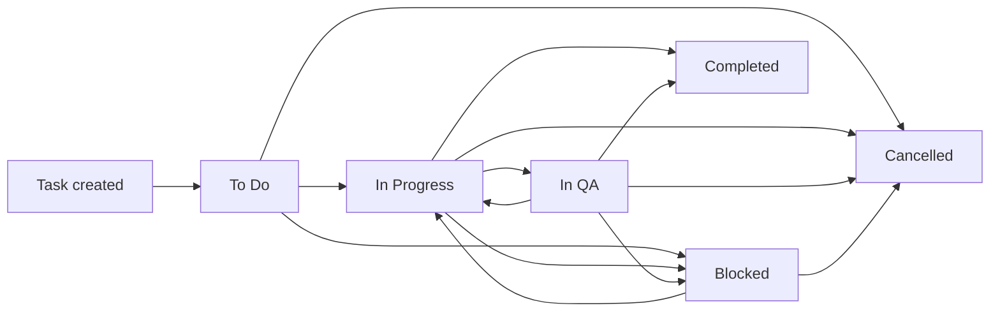
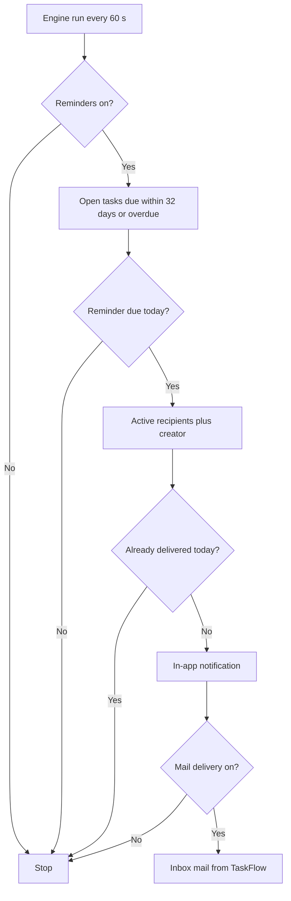
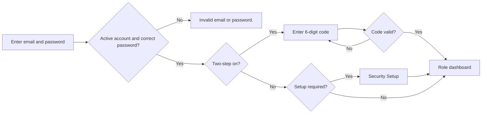
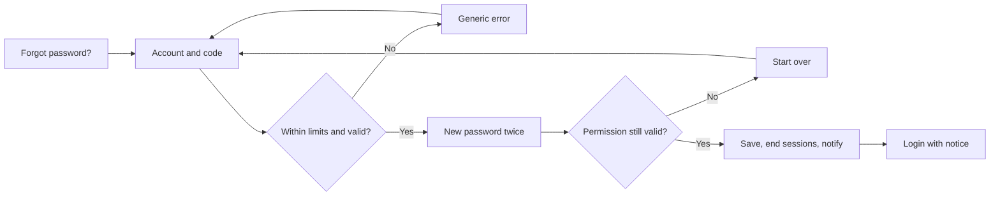

# Business Requirements Document (BRD)

## TaskFlow – Intelligent Task Allocation & Tracking System

> **Document:** Business Requirements Document – Overall (all modules)  ·  **Version:** 1.0  ·  **Status:** Approved
> **Project type:** Personal Project (Skill Development)  ·  **Date:** 31-Oct-2026
> **Author:** Jojo George (jojogeorge3344@gmail.com)
> © 2026 Jojo George. All rights reserved.

---

## Document Control

### Revision History

| Version | Date | Author | Summary of changes |
|---|---|---|---|
| 1.0 | 31-Oct-2026 | Jojo George | Initial version of the overall BRD: whole-system view, global rules, NFRs and acceptance criteria, Authentication and Legal requirements, index of the 16 sub-module BRDs. Rewrites the original BRD into the fixed template and records the changes made since. |
| 1.0 | 31-Oct-2026 | Jojo George | Approved and signed off; baselined as the agreed business requirements. |
| 1.0 | 31-Oct-2026 | Jojo George | Editorial only: Related Documents paths updated to the `TF - Documents` folder layout; no requirement changed, sign-off unchanged. |

### Approvals / Sign-off

| Role | Name | Decision | Date |
|---|---|---|---|
| Product owner | Jojo George | Approved | 31-Oct-2026 |
| Reviewer | Jojo George | Approved | 31-Oct-2026 |

### Related Documents

| Document | Location |
|---|---|
| Original BRD | `BRD for Task management.docx` (v1.0) |
| Development Plan (screen-wise, 20 screens) | `TF - Documents/Screens Wise Feature Development Plan/` |
| Sub-module BRDs (16) | See section 3.4 (links relative to this file) |
| FRD – Overall | `../../FRD/00-Overall/FRD-TaskFlow-Overall.md` |
| Functional / technical module workflow docs | `TaskFlow Proj/TFWorkflow/App WF in MD/` and `TaskFlow Proj/TFTechnicalWorkflow/Tech WF in MD/` |
| TDD / HLD / LLD | `TF - Documents/TF - TDD/TDD-TaskFlow.md`; `../../HLD/00-Overall/HLD-TaskFlow-Overall.md`; `../../LLD/00-Overall/LLD-TaskFlow-Overall.md` |

### How this document is organised

This overall BRD holds everything that is shared by the whole system: roles, scope, the main workflows, global business
rules (`BR-nn`), global non-functional requirements (`NFR-nn`), global acceptance criteria (`AC-nn`) and the
requirements of **Authentication** and **Legal**, which have no sub-module BRD. Requirements of every other screen are in
the sub-module BRDs listed in section 3.4 (`REQ-<CODE>-nn`); they are summarised here in one line each and are not
repeated.

---

## Index

1. Project Overview
2. Stakeholders & User Roles
3. Scope
4. Business Process / Workflows
5. Screen-by-Screen Requirements
6. Business Rules
7. Non-Functional Requirements
8. Data Requirements
9. Integrations & External Dependencies
10. Reporting Requirements
11. Recommended Technology Stack (optional)
12. Assumptions, Constraints & Dependencies
13. Risks
14. Acceptance Criteria
15. Requirements Traceability Matrix
16. Project Deliverables
17. Glossary
18. Project Summary

---

## 1. Project Overview

### 1.1 Introduction
TaskFlow is a web-based office task management application. Managers create tasks, assign them to employees, set
priorities, start dates, deadlines and estimated hours, and follow progress until the work is done. Employees see their
own tasks, update status, log worked hours and discuss the work in task comments. TaskFlow reminds everyone involved
automatically before a deadline, on the deadline day and while a task is overdue, and gives dashboards, workload
figures, activity history and reports so that nothing is missed.

### 1.2 Business Problem / Current Situation
Without a shared system, tasks are handed out by word of mouth, chat or e-mail. Nobody has one list of who is doing what
and by when, deadlines are remembered (or forgotten) by individuals, and managers find out about late work only when it
is already late. Workload is invisible, so some people are overloaded while others wait. Changes to a task (new
deadline, new assignee) are not recorded, and reports have to be counted by hand. Access to information is not
controlled: anyone with a password can see everything, and a stolen password is enough to get in.

### 1.3 Project Objectives

| ID | Objective | Success measure |
|---|---|---|
| OBJ-01 | Simplify employee task allocation. | A manager creates and assigns a task on one screen; the assignee is notified as soon as it is saved. |
| OBJ-02 | Monitor the progress of assigned tasks. | Every task has exactly one of six statuses and the same status is shown in the Task List, the Board and the dashboards. |
| OBJ-03 | Reduce missed deadlines through automatic reminders. | With the default settings every open task gets reminders 2 days and 1 day before the deadline, on the deadline day and every day while overdue, without anyone acting. |
| OBJ-04 | Notify the assignee and selected recipients about approaching deadlines. | The assignee, each additional recipient and the task creator receive each reminder exactly once. |
| OBJ-05 | Help managers identify pending and overdue work and workload imbalance. | Dashboards and Employee Workload show pending, overdue and high-load figures for the user's scope; a click opens the matching tasks. |
| OBJ-06 | Improve communication between managers and employees. | Task comments, in-app notifications and internal Mail are available inside TaskFlow; nothing has to be sent outside it. |
| OBJ-07 | Maintain a history of task updates and changes. | Every important task change is recorded with who made it, when, and the old and new value. |
| OBJ-08 | Generate reports for better work planning. | Authorised users filter task totals and export the filtered tasks to CSV. |
| OBJ-09 | Protect access to the organisation's data. | No one uses TaskFlow without a password and an authenticator code; each user sees only the data their permissions allow; old sessions end after any security change. |
| OBJ-10 | Let the organisation configure TaskFlow without changing code. | Reminder defaults, timezone, default priority, notifications, roles and the AI provider are changed from Settings screens. |
| OBJ-11 | Give users self-service help with their work. | TFA answers "how do I…?" questions and prepares actions that run only after the user confirms them. |
| OBJ-12 | Make ownership, terms of use and privacy clear to everyone. | The five legal documents can be opened from the footer of every main screen, also before sign-in. |

### 1.4 Expected Benefits
- **Organisation:** fewer missed deadlines, one reliable record of all work and its history, and reports without manual counting.
- **Administrators:** one place to manage people, departments, projects, roles and settings; access is controlled by permissions and protected by two-step verification.
- **Managers:** quick task assignment, early warning of overdue and delayed work, visible team workload and a recorded reason for every reassignment.
- **Employees:** a personal list of their own work and deadlines, automatic reminders, and a place to discuss each task.
- **All users:** self-service password recovery and profile updates, internal Mail, and an assistant that explains how TaskFlow works.

---

## 2. Stakeholders & User Roles

### 2.1 Stakeholders

| Stakeholder | Interest / responsibility |
|---|---|
| Project owner (Jojo George) | Defines priorities, owns TaskFlow and its legal documents, approves this BRD. |
| Administrators | Maintain people, departments, projects, roles and system settings; help users who lost their authenticator. |
| Managers | Assign and follow up work, reassign tasks, review workload and reports, set reminder defaults. |
| Employees | Carry out assigned work, update status and hours, discuss tasks, act on reminders. |
| Custom-role users | People whose access is tailored by an administrator from the permission catalogue. |
| Visitors (not signed in) | Sign in, recover a password, read the legal documents. |

### 2.2 User Roles

| Role | Description | Main responsibilities | Access level |
|---|---|---|---|
| Administrator | System role holding every permission in the catalogue. | Manage employees (including MFA reset), departments, projects and positions; all settings and roles; all tasks and reports. | Organisation (full system) |
| Manager | System role for people who lead work. | Create, edit, reassign tasks and manage recipients; view workload, reports and project details; manage reminder settings. | Team for tasks and the team dashboard; organisation for reports and workload (see the sub-module BRDs) |
| Employee | System role for people who carry out work. | View own tasks, change status, log hours, comment; use notifications, Mail, profile and TFA. | Own records only |
| Custom Role | Role created by an administrator from the fixed permission catalogue. | Whatever the granted permissions allow. | As granted: Own, Team or Organisation |
| Visitor | Anyone who is not signed in. | Sign in, recover a password, read legal documents. | Public pages only |

The system roles (Administrator, Manager, Employee) cannot be changed. Every user holds exactly one role.

### 2.3 Default Permissions by Module (summary)

The permission catalogue has 64 permissions (see the sub-module BRDs for each key). "Always On" permissions belong to
every role and cannot be removed; custom roles receive only what an administrator grants.

| Module | Administrator | Manager | Employee | Custom Role |
|---|---|---|---|---|
| Authentication, Legal | Public (no permission) | Public | Public | Public |
| Dashboard (5) | All | Own and team dashboard, analytics, filters | Own dashboard, analytics, filters | Own dashboard Always On; others configurable |
| TaskFlow Monitoring (17) | All | All except delete task | Own tasks, status change, comments, activity history, board | Own tasks Always On; others configurable |
| TaskFlow Management (18) | All | View employees, departments and projects only | None | Configurable |
| Communication (6) | All | All (own mailbox and notifications) | All (own mailbox and notifications) | Configurable |
| Reports (2) | View and export | View and export | None | Configurable |
| Settings (10) | All | Reminder settings only | None | Configurable; "give the Administrator role" is never assignable |
| My Profile (4) | Always On | Always On | Always On | Always On |
| TFA Assistant (2) | Chat and confirm actions | Chat and confirm actions | Chat and confirm actions | Configurable |

---

## 3. Scope

### 3.1 In Scope
- Sign-in with email or username and password, mandatory two-step verification with an authenticator app and backup codes, self-service password recovery, secure sessions and sign-out.
- Role-specific dashboards with analytics, filters and drill-down to the matching tasks.
- Employee, department and project management, including positions and project allocation percentages.
- Task creation and assignment, status tracking with fixed transitions, deadlines and estimated hours, worked hours, notification recipients, reassignment with a reason, soft delete.
- Task comments and a full activity history.
- Kanban board and employee workload.
- In-app notifications, automatic deadline reminders, and internal Mail between TaskFlow users.
- Task reports with filters and CSV export.
- Application settings, reminder settings, role configuration with custom roles, and TFA (AI provider) settings.
- My Profile, change password and self-service two-step verification.
- TFA, the TaskFlow Assistant, with confirm-before-acting actions, help topics, audit log, rate limits and voice input.
- Legal documents and the ownership footer.

### 3.2 Out of Scope (this release)
- Sending e-mail or SMS outside TaskFlow (SMTP configuration of the original Screen 14) – superseded by internal Mail; nothing leaves TaskFlow.
- Several organisations (tenants) in one installation – TaskFlow serves one organisation.
- Running more than one application server at the same time – a single instance is assumed.
- Automatic scheduled backups – backups are an operational task with a documented procedure.
- Editing legal documents from the application – the content is fixed in the application.
- Password reset by e-mail link or by an administrator choosing a password – recovery uses the authenticator app; an administrator can only reset two-step verification.

### 3.3 Modules Overview

| # | Module | Purpose | Screens | Specified in |
|---|---|---|---|---|
| 1 | Authentication | Sign in, two-step verification, account recovery, security setup, sessions | Login, Account Recovery, Security Setup | This document, SCREEN 1–3 |
| 2 | Dashboard | Role-specific summary and analytics | Administrator, Manager, Employee Dashboard | BRD-Dashboard |
| 3 | TaskFlow Monitoring | Tasks, comments, history, board, workload | Task List, Create Task, Task Details, Reassign Task, Task Discussion, Activity History, Board, Employee Workload | BRD-Task-Management, BRD-Board, BRD-Employee-Workload |
| 4 | TaskFlow Management | Master data: people, departments, projects | Employee Management, Department Management, Project Management, Project Details | BRD-Employee-Management, BRD-Department-Management, BRD-Project-Management |
| 5 | Communication | Notifications, reminder engine, internal Mail | Notification Center, Mail | BRD-Notification, BRD-Mail |
| 6 | Reports | Task totals and CSV export | Task Reports | BRD-Reports |
| 7 | Settings | Organisation-wide configuration | Reminder, Application, TFA Settings, Role Configuration | BRD-Reminder-Settings, BRD-Application-Settings, BRD-TFA-Settings, BRD-Role-Configuration |
| 8 | My Profile | Own account, password, two-step verification | My Profile, Change Password | BRD-My-Profile |
| 9 | TFA Assistant | AI assistant panel on every signed-in screen | TFA Panel, Action Card | BRD-Assistant |
| 10 | Legal | Legal documents and ownership footer | Five legal pages, legal footer | This document, SCREEN 4–5 |

### 3.4 Module Index – Sub-module BRDs

Each sub-module BRD uses its code in its IDs (`OBJ-`, `REQ-`, `BR-`, `NFR-`, `R-`, `AC-<CODE>-nn`) and refers to the
global rules of section 6 of this document in words.

| # | Code | Module | Sub-module | Sub-module BRD |
|---|---|---|---|---|
| 0 | ALL | (all) | Overall, incl. Authentication and Legal | This document |
| 1 | DASH | Dashboard | Dashboard | [BRD-Dashboard](../01-Dashboard/01.1-Dashboard/BRD-Dashboard.md) |
| 2 | TASK | TaskFlow Monitoring | Task Management (incl. comments and activity history) | [BRD-Task-Management](../02-TaskFlow-Monitoring/02.1-Task-Management/BRD-Task-Management.md) |
| 3 | WORK | TaskFlow Monitoring | Employee Workload | [BRD-Employee-Workload](../02-TaskFlow-Monitoring/02.2-Employee-Workload/BRD-Employee-Workload.md) |
| 4 | BOARD | TaskFlow Monitoring | Board | [BRD-Board](../02-TaskFlow-Monitoring/02.3-Board/BRD-Board.md) |
| 5 | EMP | TaskFlow Management | Employee Management | [BRD-Employee-Management](../03-TaskFlow-Management/03.1-Employee-Management/BRD-Employee-Management.md) |
| 6 | PROJ | TaskFlow Management | Project Management (incl. positions) | [BRD-Project-Management](../03-TaskFlow-Management/03.2-Project-Management/BRD-Project-Management.md) |
| 7 | DEPT | TaskFlow Management | Department Management | [BRD-Department-Management](../03-TaskFlow-Management/03.3-Department-Management/BRD-Department-Management.md) |
| 8 | MAIL | Communication | Mail | [BRD-Mail](../04-Communication/04.1-Mail/BRD-Mail.md) |
| 9 | NOTIF | Communication | Notification (incl. reminder engine) | [BRD-Notification](../04-Communication/04.2-Notification/BRD-Notification.md) |
| 10 | RPT | Reports | Reports | [BRD-Reports](../05-Reports/05.1-Reports/BRD-Reports.md) |
| 11 | REM | Settings | Reminder Settings | [BRD-Reminder-Settings](../06-Settings/06.1-Reminder-Settings/BRD-Reminder-Settings.md) |
| 12 | APP | Settings | Application Settings | [BRD-Application-Settings](../06-Settings/06.2-Application-Settings/BRD-Application-Settings.md) |
| 13 | TFAS | Settings | TFA Settings | [BRD-TFA-Settings](../06-Settings/06.3-TFA-Settings/BRD-TFA-Settings.md) |
| 14 | ROLE | Settings | Role Configuration | [BRD-Role-Configuration](../06-Settings/06.4-Role-Configuration/BRD-Role-Configuration.md) |
| 15 | PROF | My Profile | My Profile (profile, change password, two-step verification) | [BRD-My-Profile](../07-My-Profile/07.1-My-Profile/BRD-My-Profile.md) |
| 16 | TFA | TFA Assistant | Assistant | [BRD-Assistant](../08-TFA-Assistant/08.1-Assistant/BRD-Assistant.md) |

Authentication requirements in this document use `REQ-AUTH-nn`; Legal requirements use `REQ-LEGAL-nn`.

### 3.5 Change from Original BRD (system level)

| Original BRD item | Current requirement | Detailed in |
|---|---|---|
| Screen 1 – password-only login | Password plus mandatory two-step verification (authenticator app, 10 backup codes); self-service recovery with an authenticator code | SCREEN 1–3 |
| Fixed roles Administrator / Manager / Employee | Permission-based access from a fixed catalogue; read-only system roles plus custom roles | BRD-Role-Configuration |
| Screen 8 "initial status" | Every task starts as To Do; status changes follow fixed transitions | BRD-Task-Management |
| Task statuses To Do, In Progress, Blocked, Completed, Cancelled | **In QA** added; the Board has five columns (To Do, In Progress, In QA, Blocked, Completed) | BRD-Task-Management, BRD-Board |
| Screen 14 – Email Notification Settings (SMTP) | **Superseded** by internal Mail; reminders can be copied into the recipient's Mail inbox ("Also deliver reminders to Mail" on Reminder Settings) | BRD-Mail, BRD-Reminder-Settings |
| Reminder recipients = task recipients | Task recipients (assignee always one) **plus the task creator**, active users only | 4.2, BRD-Notification |
| Fixed reminder schedule | First and second reminder per task (0–30 days), due-today, overdue Daily or Weekly; defaults in Reminder Settings | BRD-Reminder-Settings |
| Screen 19 "require the current password" | Password change confirmed with an authenticator or backup code; signs the user out everywhere | BRD-My-Profile |
| Screen 20 default reminder intervals | Kept on Reminder Settings, linked from Application Settings | BRD-Application-Settings |
| Department filters on Screens 5, 16, 17 | Project filters; projects with positions and allocation percentages added | BRD-Employee-Workload, BRD-Reports |
| Not in the original BRD | Projects and positions, departments with managers, Role Configuration, TFA assistant and TFA Settings, internal Mail, Security Setup, Account Recovery, Legal pages | Section 3.4 |

---

## 4. Business Process / Workflows

### 4.1 Task Lifecycle Workflow

**Trigger:** A user with "create tasks" saves a new task  ·  **Actors:** Manager or Administrator, Employee (assignee), recipients, System

| Step | Actor / System | Action | Result |
|---|---|---|---|
| 1 | Manager | Creates a task with title, project, assignee, priority, start date, deadline, estimated hours, optional recipients and reminder days | Task saved as **To Do** with a unique code (e.g. `TSK-000042`); creator and creation time recorded |
| 2 | System | Records "Task created" and "Assigned to …" in the activity history and notifies the assignee | Assignee sees the task in My Tasks, the Board and the dashboard |
| 3 | Employee | Moves the task to **In Progress** (Task Details or Board) and logs worked hours | Status change and hours recorded; recipients notified of hours |
| 4 | Employee / Manager | Discuss the task in comments | Comments recorded and notified; history updated |
| 5 | Employee | Moves the task to **In QA** when the work is ready to be checked, or to **Blocked** when it cannot continue | Status recorded in the history |
| 6 | Manager | Reassigns the task if needed, with a reason | Previous and new assignee recorded; new assignee notified; history kept |
| 7 | Employee / Manager | Moves the task to **Completed** (or **Cancelled**) | Completion (or cancel) time stored; reminders stop; the status is final |

Allowed status moves: To Do → In Progress, Blocked or Cancelled; In Progress → In QA, Blocked, Completed or Cancelled;
In QA → In Progress, Blocked, Completed or Cancelled; Blocked → In Progress or Cancelled. Completed and Cancelled are final.
Overdue is not a status: a task is overdue while its deadline has passed and it is neither Completed nor Cancelled.

**Example:** On 10-Oct-2026 the manager Anita creates "Prepare Monthly Report" (Project: Finance Ops, priority High,
start 10-Oct-2026 09:00, deadline 15-Oct-2026 17:00, estimate 8 hours) for Rahul, with Priya as additional recipient.
TaskFlow saves it as `TSK-000042`, To Do. Rahul moves it to In Progress on 12-Oct and logs 3 hours; on 14-Oct he moves it
to In QA; Anita checks it and moves it to Completed on 15-Oct at 11:00. The history shows every step with user and time,
and no further reminders are sent.

**Exceptions / alternate flows:**
- A move that is not allowed (for example Completed → In Progress) is refused and the reason is shown.
- An inactive employee cannot be chosen as assignee; a deadline before the start date or an estimate of 0 hours is refused.
- Deleting a task (Administrator by default) hides it from every list but keeps its comments and history.

Details: [BRD-Task-Management](../02-TaskFlow-Monitoring/02.1-Task-Management/BRD-Task-Management.md),
[BRD-Board](../02-TaskFlow-Monitoring/02.3-Board/BRD-Board.md).

### 4.2 Automatic Deadline Reminder Workflow

**Trigger:** The reminder engine runs when the application starts and then every 60 seconds  ·  **Actors:** System, assignee, recipients, task creator

| Step | Actor / System | Action | Result |
|---|---|---|---|
| 1 | System | Checks whether "Send deadline reminders" is on in Reminder Settings | Off: nothing happens |
| 2 | System | Finds every open task (not Completed, Cancelled or deleted) due within 32 days or already overdue | List of candidate tasks |
| 3 | System | Decides, using the application timezone, whether a reminder is due **today**: first reminder, second reminder, due today (before the deadline time), or overdue (daily or weekly) | Reminder type for today, or none |
| 4 | System | Works out the recipients: the task's notification recipients (the assignee is always one) plus the creator, active users only | Recipient list |
| 5 | System | Skips any reminder already delivered today for that task, person and type | No duplicates |
| 6 | System | Creates the in-app notification; when "Also deliver reminders to Mail" is on, also puts a mail from "TaskFlow" in the person's Inbox | Recipients are reminded |
| 7 | System | If the task was completed, cancelled, deleted or given a new deadline in the meantime, writes nothing | Reminders follow the current task |

**Example:** Default settings (first reminder 2 days, second 1 day, deadline-day reminder on, overdue Daily, Mail on).
Task "Prepare Monthly Report" for Rahul, created by Anita, extra recipient Priya, deadline 15-Oct-2026 17:00 (Asia/Kolkata).
On 13-Oct Rahul, Priya and Anita each receive the first reminder; on 14-Oct the second; on 15-Oct, before 17:00, the
due-today reminder; from 16-Oct an overdue reminder every day while the task stays open. Each reminder appears under the
bell and in each person's Mail inbox exactly once, even though the engine runs every minute and the server is restarted
on 14-Oct. When Rahul completes the task on 16-Oct, the overdue reminders stop.

**Exceptions / alternate flows:**
- A day that has already ended is never back-filled; only reminders due today are sent.
- If the first and second reminder fall on the same day, only one reminder is sent that day.
- Inactive or deleted users receive no reminders.
- A failed run is logged and the next run continues.

Details: [BRD-Notification](../04-Communication/04.2-Notification/BRD-Notification.md),
[BRD-Reminder-Settings](../06-Settings/06.1-Reminder-Settings/BRD-Reminder-Settings.md).

### 4.3 Sign-in with Two-Step Verification (MFA) Workflow

**Trigger:** A user opens TaskFlow and signs in  ·  **Actors:** Any registered user, System

| Step | Actor / System | Action | Result |
|---|---|---|---|
| 1 | User | Enters email (or username) and password on the Login screen | – |
| 2 | System | Checks that the account exists, is active and the password is correct | Any failure: "Invalid email or password." |
| 3 | System | If two-step verification is on, asks for the 6-digit code instead of opening a session | Code step shown; the sign-in step is valid for 5 minutes |
| 4 | User | Enters the current code from the authenticator app | Correct, unused code: session opens. 5 wrong codes: locked for 5 minutes |
| 5 | System | If two-step verification is required but not yet set up, opens Security Setup and blocks every other screen | User must finish setup |
| 6 | User | Security Setup: confirms details, re-enters password, scans the QR code, enters the first code, saves 10 backup codes | Two-step verification is on |
| 7 | System | Opens the user's dashboard (Administrator, Manager, or personal; custom roles by their dashboard permissions) | User works in TaskFlow |

**Example:** Priya's account is created by the administrator. At her first sign-in on 20-Oct-2026 she enters
`priya@taskflow.com` and her password; TaskFlow opens "Let's secure your account". She confirms her mobile number
+919876543210, re-enters her password, scans the QR code with Microsoft Authenticator, enters 482913 and downloads her
10 backup codes. She lands on her personal dashboard. The next day she signs in with her password and the current code.

**Exceptions / alternate flows:**
- A code that was already used, or a sign-in step older than 5 minutes, is refused: "The code is incorrect, or the sign-in has expired. Try again or sign in again."
- A user who forgot the password uses Account Recovery (SCREEN 2) with an authenticator code.
- A user who lost both phone and backup codes asks an administrator to reset two-step verification (Employee Management); all of that user's sessions end.

### 4.4 Self-Service Account Recovery Workflow

**Trigger:** A user clicks **Forgot password?** on the Login screen  ·  **Actors:** User with two-step verification on, System

| Step | Actor / System | Action | Result |
|---|---|---|---|
| 1 | User | Enters email or username and the current authenticator code | – |
| 2 | System | Checks attempt limits, account, two-step status and code | Any failure: one generic message |
| 3 | System | Grants a single-use reset permission valid for 10 minutes | New-password step shown |
| 4 | User | Enters and confirms a new password (6–128 characters) | – |
| 5 | System | Saves the password, ends every session of the user, cancels other reset permissions, sends a System notification | User signs in with the new password |

**Example:** On 22-Oct-2026 Rahul forgets his password. He enters `rahul` and the code 905117, chooses a new password
and confirms it within 10 minutes. His laptop session that was still open is signed out, he receives the notification
"Your password was reset with your authenticator app. If this was not you, contact an administrator now." and signs in
again with the new password.

**Exceptions / alternate flows:**
- More than 5 attempts for one account, or 20 from one network address, within 5 minutes: "Too many attempts. Try again in a few minutes."
- Users without two-step verification must ask an administrator.

---

## 5. Screen-by-Screen Requirements

### 5.1 Screen Map (user-journey order)

Full requirement blocks are given below only for Authentication and Legal screens (no sub-module BRD). Every other
screen is specified in the sub-module BRD named in the last column.

| # | Screen | Module | Access | Original BRD screen | Specified in |
|---|---|---|---|---|---|
| 1 | Login (with two-step verification step) | Authentication | Everyone (public) | 1 | SCREEN 1 below |
| 2 | Account Recovery | Authentication | Everyone (public); works with two-step on | – (new) | SCREEN 2 below |
| 3 | Security Setup | Authentication | Signed-in users with setup pending | – (new) | SCREEN 3 below |
| 4 | Administrator Dashboard – organisation summary and analytics | Dashboard | Administrator; `dashboard.view.organization` | 2 | [BRD-Dashboard](../01-Dashboard/01.1-Dashboard/BRD-Dashboard.md) |
| 5 | Manager Dashboard – team summary, delayed work, team workload | Dashboard | Manager; `dashboard.view.team` | 3 | [BRD-Dashboard](../01-Dashboard/01.1-Dashboard/BRD-Dashboard.md) |
| 6 | Employee Dashboard – own tasks, deadlines, projects | Dashboard | Every signed-in user | 4 | [BRD-Dashboard](../01-Dashboard/01.1-Dashboard/BRD-Dashboard.md) |
| 7 | Task List – search, filter and page through accessible tasks | TaskFlow Monitoring | All signed-in users (scope by permission) | 7 | [BRD-Task-Management](../02-TaskFlow-Monitoring/02.1-Task-Management/BRD-Task-Management.md) |
| 8 | Create Task – create, assign or copy a task | TaskFlow Monitoring | `tasks.create` | 8 | [BRD-Task-Management](../02-TaskFlow-Monitoring/02.1-Task-Management/BRD-Task-Management.md) |
| 9 | Task Details – full information, edit, status, hours | TaskFlow Monitoring | Users who can access the task | 9 | [BRD-Task-Management](../02-TaskFlow-Monitoring/02.1-Task-Management/BRD-Task-Management.md) |
| 10 | Reassign Task – new assignee with a reason | TaskFlow Monitoring | `tasks.reassign` | 15 | [BRD-Task-Management](../02-TaskFlow-Monitoring/02.1-Task-Management/BRD-Task-Management.md) |
| 11 | Task Discussion – post, edit, delete comments | TaskFlow Monitoring | Users who can access the task | 11 | [BRD-Task-Management](../02-TaskFlow-Monitoring/02.1-Task-Management/BRD-Task-Management.md) |
| 12 | Activity History – filtered change history | TaskFlow Monitoring | `tasks.activity.view` | 18 | [BRD-Task-Management](../02-TaskFlow-Monitoring/02.1-Task-Management/BRD-Task-Management.md) |
| 13 | Board – status columns with drag and drop | TaskFlow Monitoring | `board.view` | 10 | [BRD-Board](../02-TaskFlow-Monitoring/02.3-Board/BRD-Board.md) |
| 14 | Employee Workload – task counts and allocation per employee | TaskFlow Monitoring | `workload.view` | 16 | [BRD-Employee-Workload](../02-TaskFlow-Monitoring/02.2-Employee-Workload/BRD-Employee-Workload.md) |
| 15 | Employee Management – list, details panel (incl. Reset MFA), add/edit | TaskFlow Management | Administrator; employee action permissions | 5 | [BRD-Employee-Management](../03-TaskFlow-Management/03.1-Employee-Management/BRD-Employee-Management.md) |
| 16 | Department Management – list, add/edit, manage members | TaskFlow Management | Administrator; department action permissions | 6 | [BRD-Department-Management](../03-TaskFlow-Management/03.3-Department-Management/BRD-Department-Management.md) |
| 17 | Project Management and Project Details – projects, teams, positions | TaskFlow Management | Administrator; Manager read only; `projects.view` | – (new) | [BRD-Project-Management](../03-TaskFlow-Management/03.2-Project-Management/BRD-Project-Management.md) |
| 18 | Notification Center (with header bell) – own notifications | Communication | `notifications.view` | 12 | [BRD-Notification](../04-Communication/04.2-Notification/BRD-Notification.md) |
| 19 | Mail and Compose panel – private internal mailbox | Communication | `mail.read`, `mail.compose` | 14 (superseded, replaced by Mail) | [BRD-Mail](../04-Communication/04.1-Mail/BRD-Mail.md) |
| 20 | Task Reports – filtered totals and CSV export | Reports | `reports.view`, `reports.export` | 17 | [BRD-Reports](../05-Reports/05.1-Reports/BRD-Reports.md) |
| 21 | Reminder Settings – reminder on/off, defaults, Mail delivery | Settings | `settings.reminders.manage` | 13 | [BRD-Reminder-Settings](../06-Settings/06.1-Reminder-Settings/BRD-Reminder-Settings.md) |
| 22 | Application Settings – name, timezone, default priority, notifications | Settings | `settings.application.manage` | 20 | [BRD-Application-Settings](../06-Settings/06.2-Application-Settings/BRD-Application-Settings.md) |
| 23 | TFA Settings – AI model, server, keys, connection test | Settings | `settings.ai.view` | – (new) | [BRD-TFA-Settings](../06-Settings/06.3-TFA-Settings/BRD-TFA-Settings.md) |
| 24 | Role Configuration – roles and permissions | Settings | `roles.manage` | – (new) | [BRD-Role-Configuration](../06-Settings/06.4-Role-Configuration/BRD-Role-Configuration.md) |
| 25 | My Profile, Change Password, Two-Step Verification (self-service) | My Profile | All signed-in users (Always On) | 19 | [BRD-My-Profile](../07-My-Profile/07.1-My-Profile/BRD-My-Profile.md) |
| 26 | TFA Panel, How-to Help, Action Card, Voice Controls | TFA Assistant | `assistant.chat`, `assistant.actions.confirm` | – (new) | [BRD-Assistant](../08-TFA-Assistant/08.1-Assistant/BRD-Assistant.md) |
| 27 | Legal Document Pages (Copyright, Terms, Privacy, Disclaimer, Licences) | Legal | Everyone (public) | – (new) | SCREEN 4 below |
| 28 | Legal Footer and Ownership Notice | Legal | Everyone | – (new) | SCREEN 5 below |

### SCREEN 1: Login (with Two-Step Verification step)

| Field | Value |
|---|---|
| **Screen name** | Login (Sign in) and Two-step verification |
| **Module** | Authentication |
| **Access** | Everyone who is not signed in (Visitor); completed by Administrator, Manager, Employee and Custom Role users with an active account |
| **Priority** | Must |

**Purpose**
Let a registered, active user sign in securely, with the authenticator code as a second step, and open the dashboard
that fits the user's role. The session opened here is kept alive and ended safely.

**Screen Elements**
- TaskFlow logo ("TF"), title **TaskFlow** and subtitle "Sign in to continue".
- Notice area explaining why the user was sent back to sign in.
- **Email** field (pre-filled with the identifier last used on this device) and **Password** field with **Show password / Hide password**.
- Error message area, **Sign in** button ("Signing in…" while working), **Forgot password?** link.
- Two-step step: title **Two-step verification**, "Enter the 6-digit code from your authenticator app.", **Authentication code** field, **Verify** button, **← Back to sign in** link.
- **Sign out** icon in the header account area of every signed-in screen.
- Legal footer.

**Functional Requirements**

| ID | Requirement | Priority |
|---|---|---|
| REQ-AUTH-01 | The system shall let a user sign in with their username or email address and their password. | Must |
| REQ-AUTH-02 | The system shall show the same message "Invalid email or password." for an unknown account, an inactive or deleted account and a wrong password. | Must |
| REQ-AUTH-03 | The system shall store passwords only as secure hashes and upgrade an old hash on the next successful sign-in. | Must |
| REQ-AUTH-04 | The system shall not open a session after a correct password when two-step verification is on, but ask for the 6-digit authenticator code. | Must |
| REQ-AUTH-05 | The system shall keep the sign-in step valid for 5 minutes and invalidate it earlier when the account's password, recovery or MFA reset changes. | Must |
| REQ-AUTH-06 | The system shall accept each authenticator code only once, together with codes from one 30-second step before or after the current one. | Must |
| REQ-AUTH-07 | The system shall lock code checking for 5 minutes after 5 wrong codes in a row. | Must |
| REQ-AUTH-08 | The system shall open, after sign-in, the page originally asked for if it is inside TaskFlow, otherwise the dashboard for the user: Administrator → Administrator Dashboard, Manager → Manager Dashboard, custom roles → the widest dashboard their permissions allow, everyone else → the personal dashboard. | Must |
| REQ-AUTH-09 | The system shall send a user whose two-step verification is required but not set up to Security Setup after sign-in. | Must |
| REQ-AUTH-10 | The system shall record the time of the last successful sign-in. | Should |
| REQ-AUTH-11 | The system shall let the user show and hide the typed password. | Should |
| REQ-AUTH-12 | The system shall pre-fill the Email field with the identifier last used on the same device. | Could |
| REQ-AUTH-13 | The system shall keep the user signed in across page reloads with a 30-minute access pass that is renewed silently using a 7-day renewal cookie that page scripts cannot read. | Must |
| REQ-AUTH-14 | The system shall replace the renewal cookie at every renewal so that a used, expired or revoked cookie cannot be used again. | Must |
| REQ-AUTH-15 | The system shall check the session every 15 seconds and when the browser tab becomes visible, and apply role and permission changes without a new sign-in. | Must |
| REQ-AUTH-16 | The system shall refuse, on every request, a session whose user is inactive or deleted or whose security stamp has changed. | Must |
| REQ-AUTH-17 | The system shall end the session and revoke the renewal cookie when the user clicks **Sign out**, and open the Login screen. | Must |
| REQ-AUTH-18 | The system shall show the Login screen with a notice explaining the reason when a session ends. | Should |

**Validations & Messages**

| Situation | Rule / message |
|---|---|
| Email empty | "Email is required." |
| Email not valid | "Enter a valid email address." |
| Password empty | "Password is required." |
| Identifier or password too long | Server accepts at most 256 characters for the identifier and 128 for the password. |
| Wrong credentials / inactive or deleted account | "Invalid email or password." |
| Code empty | "Enter the code to continue." |
| Wrong or expired code | "The code is incorrect, or the sign-in has expired. Try again or sign in again." |
| Too many wrong codes | "Too many wrong codes. Try again in a few minutes." |
| Code failed (no server message) | "That code did not work. Check the code and try again." |
| Session ended or renewal failed | "Your session has ended, for example because your username or password was changed. Please sign in again." |
| Credentials changed | "Your username or password was changed. Sign in again with your new details." |
| After password reset | "Your password has been reset. Sign in with your new password." |

> ⚠️ To be confirmed: the Login form asks for a valid email address although the server also accepts a username; and the
> server accepts an unused backup code at sign-in, but the code box takes only 6 characters while backup codes have the
> form `XXXXX-XXXXX`.
>
> ⚠️ To be confirmed: password sign-in itself has no attempt limit (only the code step is limited); whether a limit is required.

**Change from original BRD:** Screen 1 asked for password sign-in only. Two-step verification is now mandatory, sessions
are renewed and re-checked continuously, and every failure gives one message.

**Expected Result**
Every registered, active user signs in with password and authenticator code and lands on the dashboard for their role,
while wrong details, inactive accounts and guessed codes are refused without revealing which accounts exist.

### SCREEN 2: Account Recovery (Forgot your password?)

| Field | Value |
|---|---|
| **Screen name** | Forgot your password? |
| **Module** | Authentication |
| **Access** | Everyone (Visitor); usable by Administrator, Manager, Employee and Custom Role users who have two-step verification on |
| **Priority** | Must |

**Purpose**
Let a user who forgot the password choose a new one without an administrator, proving identity with the current code
from the authenticator app.

**Screen Elements**
- Title **Forgot your password?** with a short explanation.
- Step 1: **Email or username**, **Code from your authenticator app**, **Continue**, and the note "This works if you turned on two-step verification from your Profile. If you did not, ask an administrator to set a new password for you."
- Step 2: "Code verified. Choose a new password for your account.", **New password**, **Confirm new password**, **Reset password**, **Start over** (only when the reset is refused).
- **← Back to sign in** link and legal footer.

**Functional Requirements**

| ID | Requirement | Priority |
|---|---|---|
| REQ-AUTH-19 | The system shall let a user prove identity with their email or username and the current 6-digit authenticator code. | Must |
| REQ-AUTH-20 | The system shall offer recovery only for active accounts that have two-step verification on. | Must |
| REQ-AUTH-21 | The system shall not accept a backup code as a recovery factor. | Must |
| REQ-AUTH-22 | The system shall show the same message for every verification failure, so it never reveals whether an account exists or has two-step verification on. | Must |
| REQ-AUTH-23 | The system shall limit verification to 5 attempts per account and 20 per network address within any 5 minutes. | Must |
| REQ-AUTH-24 | The system shall not count wrong recovery codes toward the account's sign-in code lockout, and shall still refuse an account that is already locked for codes. | Must |
| REQ-AUTH-25 | The system shall grant a reset permission that is valid for 10 minutes and can be used once, and cancel the user's other open reset permissions when one is used. | Must |
| REQ-AUTH-26 | The system shall require a new password of 6 to 128 characters, entered twice identically. | Must |
| REQ-AUTH-27 | The system shall end every session of the user when the password is reset. | Must |
| REQ-AUTH-28 | The system shall send the account owner a System notification after a successful reset. | Must |
| REQ-AUTH-29 | The system shall return the user to the Login screen with a success notice after the reset. | Should |
| REQ-AUTH-30 | The system shall offer **Start over** when the reset permission has expired or was already used. | Should |

**Validations & Messages**

| Situation | Rule / message |
|---|---|
| Identifier empty | "Email or username is required." |
| Code missing or not 6 digits | "Enter the 6-digit code from the app." |
| Wrong account / code / no two-step verification | "The details are incorrect, or the code has expired. Check them and try again." |
| Too many attempts | "Too many attempts. Try again in a few minutes." |
| Verification failed (no server message) | "Could not verify the code. Please try again." |
| Password length wrong | "Use at least 6 and at most 128 characters." |
| Passwords differ | "Passwords do not match." |
| Reset permission used or expired | "This reset link is no longer valid. Start again from the login page." |
| Reset failed (no server message) | "Could not reset your password. Please try again." |
| Notification to the owner | "Your password was reset with your authenticator app. If this was not you, contact an administrator now." |

**Change from original BRD:** New screen. No password, code or link is sent by e-mail or SMS; the authenticator app is the only recovery factor.

**Expected Result**
A user who forgets the password resets it alone in a few minutes; the old password and every old session stop working
at once, and the owner is told in case the reset was not theirs.

### SCREEN 3: Security Setup (Let's secure your account)

| Field | Value |
|---|---|
| **Screen name** | Let's secure your account |
| **Module** | Authentication |
| **Access** | Administrator, Manager, Employee and Custom Role users who are signed in and have not yet set up two-step verification (anyone else is sent to their dashboard) |
| **Priority** | Must |

**Purpose**
Mandatory first stop for every user without two-step verification: confirm personal details, connect an authenticator
app and save backup codes. Until this is done the rest of TaskFlow stays closed.

**Screen Elements**
- Progress list **Your details**, **Authenticator app**, **Backup codes** (on small screens "Step N of 3").
- Step 1: "Welcome, (first name)", read-only Employee code, Username, Role, Projects, Managers; **Full name**, **Email** (name part with fixed `@taskflow.com`), **Mobile number**; **Sign out** and **Save and continue**.
- Step 2: **Current password** with Show/Hide, **Show my QR code**; QR code, typed key with **Copy key**, **6-digit code**, **Start over**, **Verify and turn on**.
- Step 3: "Two-step verification is on", 10 backup codes, **Copy all**, **Download**, check box "I have saved my backup codes somewhere safe.", **Open TaskFlow**.
- Loading state and error box "We could not load your details." with **Try again**.

**Functional Requirements**

| ID | Requirement | Priority |
|---|---|---|
| REQ-AUTH-31 | The system shall require two-step verification for every user by default. | Must |
| REQ-AUTH-32 | The system shall refuse every screen and function except sign-in, the user's own profile and the setup steps while setup is pending, with "Set up two-step verification to continue." | Must |
| REQ-AUTH-33 | The system shall let the user confirm and save full name, email and mobile number before securing the account. | Must |
| REQ-AUTH-34 | The system shall require the current password before showing a new setup key and QR code, limited to 5 attempts in 5 minutes. | Must |
| REQ-AUTH-35 | The system shall let the user copy the setup key when the QR code cannot be scanned. | Should |
| REQ-AUTH-36 | The system shall turn on two-step verification only after a correct 6-digit code from the app; a backup code is not accepted for this. | Must |
| REQ-AUTH-37 | The system shall refuse to start setup again while two-step verification is on. | Must |
| REQ-AUTH-38 | The system shall create exactly 10 single-use backup codes and show them only once, with copy and download options. | Must |
| REQ-AUTH-39 | The system shall keep **Open TaskFlow** disabled until the user confirms that the backup codes are saved, then open the user's dashboard. | Must |
| REQ-AUTH-40 | The system shall store the setup key encrypted and the backup codes only as hashes. | Must |
| REQ-AUTH-41 | The system shall let the user sign out without finishing setup. | Should |

**Validations & Messages**

| Situation | Rule / message |
|---|---|
| Full name empty (max 200 characters) | "Enter your full name." |
| Email name part invalid | "Use letters, digits, dot, underscore or hyphen before @taskflow.com." |
| Email in use | "Email already exists." |
| Same email and mobile exist | "A user with this email and mobile number already exists." |
| Mobile number empty | "Enter your mobile number." |
| Mobile number format | "Use international format, for example +919876543210." |
| Password empty / wrong | "Enter your password." / "Current password is incorrect." |
| Too many password attempts | "Too many attempts. Try again in a few minutes." |
| Code missing or not 6 digits | "Enter the 6-digit code from the app." |
| Wrong code | "The code is incorrect or has expired." |
| Code lockout | "Too many wrong codes. Try again in a few minutes." |
| Setup already on | "Authenticator MFA is already on. Turn it off first to set it up again." |
| No key yet | "Start the setup first to get a key." |
| Copy failed | "Could not copy. Select the text and copy it by hand." |
| Any other page while setup pending | "Set up two-step verification to continue." |

> ⚠️ To be confirmed: regenerating backup codes is available in the system but no screen offers it.
>
> ⚠️ To be confirmed: after an administrator resets an employee's two-step verification (Employee Management), the
> confirmation text says the employee "can sign in with just their password", while with two-step verification required
> the employee is sent to Security Setup on the next sign-in.

**Change from original BRD:** New screen (two-step verification was not in the original BRD).

**Expected Result**
No one uses TaskFlow until the account is protected by an authenticator app and backup codes.

### SCREEN 4: Legal Document Pages

| Field | Value |
|---|---|
| **Screen name** | Copyright Notice, Terms of Use, Privacy Policy, Disclaimer, Third-Party Licence Notices |
| **Module** | Legal |
| **Access** | Everyone – Visitor, Administrator, Manager, Employee and Custom Role (no sign-in, no permission) |
| **Priority** | Must |

**Purpose**
Publish TaskFlow's five legal documents so that everyone knows who owns TaskFlow, the conditions of use, what data is
kept and which open-source components it uses.

**Screen Elements**
- Top bar with "TF" mark, "TaskFlow — Intelligent Task Allocation & Tracking System" and a back link (**Back to the application** or **Back to sign in**).
- Heading: title, one-line summary, "Last updated: 21 October 2026 · © 2026 Jojo George. All Rights Reserved."
- **Contents** box listing the sections (Copyright 8, Terms 14, Privacy 11, Disclaimer 7, Licences 3).
- Document body with paragraphs, lists, notes and tables ("What we collect" in Privacy, "Third-party components" in Licences).
- Ownership line at the foot of the page.

**Functional Requirements**

| ID | Requirement | Priority |
|---|---|---|
| REQ-LEGAL-01 | The system shall publish five legal documents: Copyright Notice, Terms of Use, Privacy Policy, Disclaimer and Third-Party Licence Notices, each on its own page. | Must |
| REQ-LEGAL-02 | The system shall open the legal pages without sign-in and without any permission. | Must |
| REQ-LEGAL-03 | The system shall show on each page the title, summary, last-updated date, ownership line and a contents list that jumps to each section. | Must |
| REQ-LEGAL-04 | The system shall insert the owner name, year, contact email, rights statement and application name from one owner record into every document. | Must |
| REQ-LEGAL-05 | The system shall send a signed-in user back to their dashboard (Administrator → Administrator Dashboard, Manager → Manager Dashboard, others → personal dashboard) and a visitor back to the Login screen. | Should |
| REQ-LEGAL-06 | The system shall show "Legal document not found" when no document matches the page. | Should |
| REQ-LEGAL-07 | The system shall keep the documents read-only; they cannot be edited from the application and opening them creates no record, notification or mail. | Must |
| REQ-LEGAL-08 | The Privacy Policy shall state what data TaskFlow keeps, why, where it is stored, who can see it, how it is protected and how long it is kept. | Must |
| REQ-LEGAL-09 | The Terms of Use and Privacy Policy shall state that, when a cloud AI model is chosen, the question and the task details behind it are sent to that provider. | Must |
| REQ-LEGAL-10 | The Disclaimer shall state that assistant output and allocation suggestions are advisory only and must be checked before acting on them. | Must |

**Validations & Messages**

| Situation | Rule / message |
|---|---|
| Document not found | "Legal document not found" / "The document you requested is not available." / "Choose one of the documents from the footer, or back to sign in." (or "back to the application" when signed in) |
| Back link | "Back to the application" (signed in) / "Back to sign in" (not signed in) |

> ⚠️ To be confirmed: an address under `/legal/` that is not one of the five documents is currently sent to the Login
> screen by the application's catch-all route, so the "not found" message may not be reached.

**Change from original BRD:** New screens (not in the original BRD).

**Expected Result**
Anyone, signed in or not, can read the five documents, jump between sections and return to the right place.

### SCREEN 5: Legal Footer and Ownership Notice

| Field | Value |
|---|---|
| **Screen name** | Legal footer (part of other screens) |
| **Module** | Legal |
| **Access** | Everyone – Visitor (Login, Account Recovery) and all signed-in roles (every in-app screen) |
| **Priority** | Must |

**Purpose**
Show the ownership statement and one-click links to the legal documents at the bottom of every main screen.

**Screen Elements**
- Ownership line "© 2026 Jojo George. All Rights Reserved. · TaskFlow — Intelligent Task Allocation & Tracking System."
- Links **Copyright**, **Terms of Use**, **Privacy Policy**, **Disclaimer**, **Licences**.
- Browser tab title and page details (author, copyright, description).

**Functional Requirements**

| ID | Requirement | Priority |
|---|---|---|
| REQ-LEGAL-11 | The system shall show the legal footer with the ownership line at the bottom of the Login screen, the Account Recovery screen and every signed-in screen. | Must |
| REQ-LEGAL-12 | The system shall show the five document links in the footer, always in the order Copyright, Terms of Use, Privacy Policy, Disclaimer, Licences. | Must |
| REQ-LEGAL-13 | The system shall use the same owner record for the footer and the documents, so the ownership statement is identical everywhere. | Must |
| REQ-LEGAL-14 | The system shall not show the footer on the legal pages, which carry their own ownership line. | Could |
| REQ-LEGAL-15 | The system shall set the browser page title "TaskFlow — Intelligent Task Allocation & Tracking System" and the author, copyright and description details when the application starts. | Should |

**Validations & Messages**

| Situation | Rule / message |
|---|---|
| Ownership line | "© 2026 Jojo George. All Rights Reserved. · TaskFlow — Intelligent Task Allocation & Tracking System." |
| Validation / no permission | Not applicable (read-only, public). |

**Change from original BRD:** New (not in the original BRD).

**Expected Result**
The ownership statement and the five links appear the same way on every main screen and in the browser page details.

---

## 6. Business Rules

Global rules that apply to every module. Sub-module BRDs add their own rules (`BR-<CODE>-nn`).

| ID | Rule | Applies to |
|---|---|---|
| BR-01 | Only signed-in, active users can use TaskFlow; only Login, Account Recovery and the Legal pages are public. | All screens |
| BR-02 | Deactivated and deleted users cannot sign in, and their open sessions stop working on the next request. | Authentication, Employee Management |
| BR-03 | Two-step verification with an authenticator app is mandatory for every user; until it is set up, every screen except Security Setup and the own profile is closed. | All signed-in screens |
| BR-04 | Access is decided by permissions: every role is a set of permissions from one fixed catalogue, checked by the server on every request; a role change applies on the user's next action. | All modules |
| BR-05 | The system roles Administrator, Manager and Employee cannot be changed; custom roles can. "Always On" permissions (own dashboard, own tasks, own profile) cannot be removed. | Role Configuration |
| BR-06 | Data is shown in the scope the user's permissions allow: Own, Team or Organisation. | Dashboards, tasks, board, reports, workload |
| BR-07 | Every task has a unique code generated automatically (`TSK-` followed by six digits). | Tasks |
| BR-08 | Every task has an assigned active employee, a project, a start date, a deadline later than the start date and estimated hours greater than 0; deadline and estimated hours are stored separately. | Tasks |
| BR-09 | The assigned employee is always a notification recipient of the task; authorised users may add up to 50 more recipients. | Tasks, reminders |
| BR-10 | Only authorised users can create, edit, reassign, delete or manage recipients of tasks; employees update only tasks they can access. | Tasks, board |
| BR-11 | A task starts as To Do and changes status only along the allowed moves (section 4.1); Completed and Cancelled are final. | Tasks, board |
| BR-12 | A task is overdue when its deadline has passed and it is neither Completed nor Cancelled; overdue is worked out when needed, never stored. | Tasks, dashboards, reports, reminders |
| BR-13 | Completed and cancelled tasks receive no further deadline reminders. | Reminders |
| BR-14 | The reminder schedule is configurable without changing code; the defaults are 2 days and 1 day before the deadline, the deadline day, and daily while overdue. | Reminder Settings, reminders |
| BR-15 | Each reminder (task, person, reminder type and day) is delivered at most once, however often the engine runs or the application restarts. | Reminders |
| BR-16 | Reminders go to the task's recipients and its creator, active users only. | Reminders |
| BR-17 | One application timezone (default Asia/Kolkata) decides which calendar day a deadline falls on for every user. | Tasks, dashboards, reminders, reports |
| BR-18 | A reassignment needs a reason and keeps the task's comments and history. | Tasks |
| BR-19 | Important task changes are recorded in an activity history that ordinary users cannot change or delete. | Tasks |
| BR-20 | No user, including an Administrator, can see another user's notifications, mail or assistant conversation; such records are reported as not found. | Communication, TFA |
| BR-21 | Records that carry history (tasks, employees, projects, departments) are removed by soft delete so that historical information is kept. | Tasks, Management |
| BR-22 | Dashboards, the Task List and reports use the same rules for pending, in progress, completed and overdue. | Dashboards, tasks, reports |
| BR-23 | Messages stay inside TaskFlow: in-app notifications and internal Mail only; nothing is sent by external e-mail or SMS. | Communication, Authentication |
| BR-24 | Every employee email uses the fixed `@taskflow.com` domain and is unique. | Employee Management, My Profile, Security Setup |
| BR-25 | A password change, a password reset and an administrator MFA reset end every session of the user. | Authentication, My Profile, Employee Management |
| BR-26 | The last active Administrator cannot be deactivated, deleted or moved to another role, and nobody can delete their own account. | Employee Management |
| BR-27 | TFA never acts on its own: every prepared action runs only after the user confirms it, only within the user's own permissions, and every outcome is recorded. | TFA Assistant |
| BR-28 | Passwords, authenticator keys and AI provider keys are never shown again or logged; passwords are hashed and keys encrypted; TFA refuses passwords and keys typed into the chat. | All modules |
| BR-29 | The legal documents and the ownership footer are public and identical for everyone. | Legal |

**Change from original BRD (rules):**

| Original rule | Current rule | Change |
|---|---|---|
| 1 | BR-07 | Kept; code format `TSK-` plus six digits |
| 2, 3, 4 | BR-08 | Kept; project and estimate greater than 0 added |
| 5, 6 | BR-09, BR-16 | Extended: the creator also receives reminders; at most 50 extra recipients |
| 7, 8 | BR-10 | Kept |
| 9 | BR-12 | Kept; overdue is derived, never stored |
| 10 | BR-13 | Kept |
| 11 | BR-14 | Kept |
| 12 | BR-18 | Kept; a reason is required |
| 13 | BR-19 | Kept |
| 14 | BR-20 | Extended to mail and assistant conversations |
| 15 | BR-15 | Kept |
| 16 | BR-23 | Replaced: no external e-mail; in-app notifications are always created and a Mail copy is optional |
| 17 | BR-17 | Kept |
| 18 | BR-02 | Kept |
| 19 | BR-21 | Kept (soft delete) |
| 20 | BR-22 | Kept |
| – | BR-01, BR-03 – BR-06, BR-11, BR-24 – BR-29 | New |

---

## 7. Non-Functional Requirements

| ID | Category | Requirement | Measure / target |
|---|---|---|---|
| NFR-01 | Performance | Long lists are shown in pages. | Tasks and notifications 20 rows per page by default, at most 100; Mail 25 per page. |
| NFR-02 | Performance | Dashboards and reports show totals calculated by the server, not by the browser. | ⚠️ To be confirmed: a response-time target (for example seconds per screen) has not been set. |
| NFR-03 | Performance | The CSV export of a report is limited. | At most 50,000 rows per export. |
| NFR-04 | Security | Passwords are stored only as salted hashes; new passwords have 6 to 128 characters. | No plain-text password stored, shown or logged. |
| NFR-05 | Security | Two-step verification (time-based 6-digit codes, 10 single-use backup codes) is required for everyone and enforced by the server, not only by the screens. | No function except sign-in, own profile and setup works before setup. |
| NFR-06 | Security | Sessions are short and renewable. | Access pass 30 minutes; renewal cookie 7 days, HttpOnly, Secure, SameSite Strict, replaced at each renewal. |
| NFR-07 | Security | Guessing is throttled. | 5 wrong codes lock for 5 minutes; recovery 5 per account and 20 per address in 5 minutes; current-password re-entry 5 per 5 minutes; TFA 20 messages per minute per user. |
| NFR-08 | Security | All input is validated by the server and database queries are safe against injection. | Every write is validated; invalid input returns field messages. |
| NFR-09 | Security | Protection against unauthorised record access. | Another user's task, mail, notification or conversation is refused or reported as not found. |
| NFR-10 | Security | Secrets are protected. | AI provider keys and authenticator keys encrypted with a key ring kept outside the database; only the last 4 characters of a key are ever shown. |
| NFR-11 | Privacy | Data stays on the organisation's server unless a cloud AI model is chosen. | Users see a notice the first time a cloud model is used; the local model is the default. |
| NFR-12 | Usability | Clear, consistent screens for users with basic computer knowledge. | Every refused action shows a message; destructive actions and every TFA action ask for confirmation; menus show only what the user may use. |
| NFR-13 | Reliability | Tasks, history, notifications and reminder history are stored permanently. | Data survives a restart of the application. |
| NFR-14 | Reliability | The reminder engine resumes after a restart without duplicates. | First run at start-up, then every 60 seconds; a failed run is logged and the next run continues; no reminder delivered twice. |
| NFR-15 | Maintainability | The application is modular and layered with separate authentication, tasks, notifications, reports and data logic, and the structure is checked automatically. | Structure rules run with the automated tests. |
| NFR-16 | Compatibility | Works in modern desktop browsers with a responsive layout for smaller screens. | Voice input needs Chrome or Edge; typing always works. The server runs on Windows, Linux and macOS. |
| NFR-17 | Backup & Recovery | All stored data lives in one data folder with a documented backup and restore procedure. | Database and mail attachments backed up together; encryption key ring backed up separately. |
| NFR-18 | Accessibility | Screens can be used with the keyboard and are readable. | ⚠️ To be confirmed: no accessibility target has been defined. |
| NFR-19 | Observability | Every request is logged without its content. | Method, path, status, time, user and trace id; refused authorisations and TFA action outcomes are recorded. |
| NFR-20 | Offline operation | TaskFlow works without the internet. | Notifications, Mail and the local AI model need no external service; only cloud AI providers need the internet. |

---

## 8. Data Requirements

| Entity / data set | Purpose | Key fields | Retention / rules |
|---|---|---|---|
| Users | Sign-in accounts and employee details | Employee code, full name, username, email, mobile number, role, active flag, last sign-in | Soft delete; email on `@taskflow.com` and unique; username unique |
| Security records | Sessions, password reset permissions, authenticator key, backup codes | Renewal token, expiry, used/revoked time; encrypted key; hashed codes | Tokens and codes stored only as hashes; reset permission 10 minutes, single use |
| Roles and permissions | Access control | Role name, system flag, granted permissions | Permission catalogue fixed; system roles read-only; a role in use cannot be deleted |
| Departments | Group people; source of managers | Name, description, managers, employees | Soft delete; unique name; cannot be deleted while it has members |
| Projects, positions and allocations | Teams and time share | Project name, description, members, position, allocation %, project-manager flag | Soft delete; at most 100% per person across projects; every team has a project manager |
| Tasks | Work items | Code, title, description, project, assignee, creator, priority, start date, deadline, estimated and worked hours, status, reminder days, overdue frequency, completed and cancelled time | Soft delete; code unique; overdue derived |
| Task recipients | Who is notified about a task | Task, person | Assignee always included; at most 50 more |
| Task comments | Discussion | Task, author, text, created and edited time | Soft delete; only the author edits or deletes |
| Task activity history | Record of changes | Task, event type, user, old value, new value, message, time | Append-only; not editable by ordinary users |
| Notifications | In-app alerts | Person, task, type, message, read flag, time | Never deleted, only marked read; private to the owner |
| Reminder history | Duplicate prevention | Task, recipient, reminder type, scheduled day, status, processed time | One row per task, person, type and day |
| Internal mail | Messages between users | Conversation, sender or "TaskFlow", subject, body, recipients (To/Cc), per-person folder and flags, attachments | Private per mailbox; attachments stored in the data folder |
| Application settings | Organisation-wide configuration | Name, timezone, default priority, notifications, reminder defaults, editor, time | Non-secret values only; editor and time recorded |
| AI provider settings and models | TFA configuration | Provider, enabled flag, model, server address, encrypted key, last 4 characters | Keys encrypted, never returned |
| Assistant conversations, actions and audit | TFA history and safeguards | Person, messages, prepared action, status, expiry, outcome | Own conversation only; actions expire after 10 minutes; one audit record per outcome |

---

## 9. Integrations & External Dependencies

| System / service | Purpose | Required? | Notes |
|---|---|---|---|
| Authenticator app (for example Google Authenticator, Microsoft Authenticator, Authy) | Two-step verification codes and account recovery | Required for every user | Works offline on the user's phone; lost phone → backup codes or administrator MFA reset |
| Ollama (local AI server) | TFA answers on the organisation's own server | Optional | On by default for new installations; nothing leaves the server. Without it TFA shows a provider message and the rest of TaskFlow works |
| Google Gemini, OpenAI GPT (cloud AI) | Alternative TFA models | Optional | Need an API key entered in TFA Settings and the internet; questions and task details are sent to the provider |
| Browser speech recognition and speech output | TFA voice input and read-aloud | Optional | Chrome or Edge; no audio is stored by TaskFlow |
| Local file storage (data folder) | Database, mail attachments, encryption key ring | Required | Created at start-up; the application stops with a clear message if it cannot write there |
| External e-mail (SMTP) | – | Not used | Original Screen 14 superseded by internal Mail |

---

## 10. Reporting Requirements

| Report | Audience | Filters | Output formats |
|---|---|---|---|
| Task Reports – total, completed, pending, overdue and completion summary | Administrator, Manager, custom roles with `reports.view` | Deadline range, employee, project, status, priority | Screen; CSV (`reports.export`) |
| Dashboard analytics – by status, priority, deadline, time, department, employee, manager, project | Administrator (organisation), Manager (team), every user (own) | Dashboard filters and period chips | Screen, with drill-down to the Task List |
| Employee Workload – active, high-priority, overdue, completed per employee, projects and allocation | Administrator, Manager | Project, employee | Screen |
| Activity History – task changes | Users with `tasks.activity.view` who can access the task | Activity filters | Screen |

Details: [BRD-Reports](../05-Reports/05.1-Reports/BRD-Reports.md), [BRD-Dashboard](../01-Dashboard/01.1-Dashboard/BRD-Dashboard.md),
[BRD-Employee-Workload](../02-TaskFlow-Monitoring/02.2-Employee-Workload/BRD-Employee-Workload.md),
[BRD-Task-Management](../02-TaskFlow-Monitoring/02.1-Task-Management/BRD-Task-Management.md).

---

## 11. Recommended Technology Stack (optional)

> A BRD states *what* is needed; this section is a recommendation. The final choice is recorded in the TDD.

| Component | Recommended technology | Reason |
|---|---|---|
| Backend | .NET 10, ASP.NET Core Web API, FluentValidation | Typed, layered, server-side validation and permission checks |
| Frontend | Angular 19 (TypeScript 5.7, RxJS), Chart.js with ng2-charts, Angular CDK (drag and drop), qrcode | Single-page application with charts, a drag-and-drop board and QR codes for setup |
| Database | SQLite through Entity Framework Core 10 | Single file, easy to back up, schema created automatically |
| Authentication | Token-based sessions with a renewal cookie; password hashing; time-based authenticator codes | Secure sessions and mandatory two-step verification |
| Scheduled reminders | Background service inside the application | No external scheduler; resumes after restart |
| AI assistant | Ollama (local) by default; Google Gemini or OpenAI GPT optional | Free local option; cloud by choice |
| Testing | xUnit unit and integration tests; Jasmine and Karma for the frontend | Automated checks of rules, endpoints and structure |

**Change from original BRD:** The original recommended Python Flask, Bootstrap, SQLAlchemy, APScheduler, SMTP and Pytest.
SQLite and Chart.js are kept; the rest was replaced by the stack above, and SMTP was dropped.

---

## 12. Assumptions, Constraints & Dependencies

| Type | Description |
|---|---|
| Assumption | TaskFlow serves one organisation; users have a modern desktop browser and a phone with an authenticator app. |
| Assumption | All deadlines are compared in one application timezone (default Asia/Kolkata). |
| Assumption | Reminder defaults are first reminder 2 days, second 1 day, deadline-day reminder on, overdue daily; each task can choose its own values when it is created. |
| Assumption | Development installations may create three demonstration accounts (Administrator, Manager, Employee); this is off by default elsewhere. |
| Constraint | Single application server and a single SQLite database file; sign-in throttles and the assistant rate limit are kept in memory and reset on restart. |
| Constraint | All stored data lives in one data folder (default `C:\TaskFlow` on Windows). |
| Constraint | Every email address uses the `@taskflow.com` domain. |
| Dependency | Authenticator app on each user's phone. |
| Dependency | Optional: Ollama for the local assistant; internet and an API key for cloud AI providers. |

---

## 13. Risks

| ID | Risk | Impact | Likelihood | Mitigation |
|---|---|---|---|---|
| R-01 | Reminders run twice if more than one server instance is started. | Medium | Low | Database prevents duplicate reminders; single instance assumed. |
| R-02 | Loss of the encryption key ring. | High | Low | Back up the key ring separately; otherwise AI keys must be re-entered and every user needs an MFA reset. |
| R-03 | A user loses phone and backup codes. | Medium | Medium | Administrator MFA reset ends sessions and lets the user set up again. |
| R-04 | Task details leave the server when a cloud AI model is used. | Medium | Medium | Local model is the default; notice on first cloud use; passwords and keys are blocked in chat. |
| R-05 | Wrong "due today" or "overdue" because of different timezones. | Medium | Low | One application timezone on the server; unknown timezone falls back to UTC so reminders never stop. |
| R-06 | Password guessing at sign-in, which has no attempt limit. | Medium | Low | Code step required for every account; ⚠️ To be confirmed whether a password attempt limit is needed. |
| R-07 | Upgrades that change data irreversibly (for example email domain change). | High | Low | Back up before every upgrade. |
| R-08 | Slow writes when many users work at the same time on one SQLite file. | Medium | Low | Short transactions; reminder runs skip already delivered reminders before writing. |
| R-09 | Managers see organisation-wide reports and workload, wider than their team. | Medium | Medium | Documented in BRD-Reports and BRD-Employee-Workload; ⚠️ To be confirmed whether a team limit is required. |

---

## 14. Acceptance Criteria

| ID | Criterion | Verified by |
|---|---|---|
| AC-01 | Administrator, Manager, Employee and custom-role users sign in and land on the dashboard for their role. | SCREEN 1, REQ-AUTH-01, REQ-AUTH-08 – REQ-AUTH-12; AC-DASH-01 |
| AC-02 | A wrong password, an unknown account and an inactive or deleted account all get "Invalid email or password." and no session. | SCREEN 1, REQ-AUTH-02, REQ-AUTH-03; AC-EMP-03 |
| AC-03 | With two-step verification on, a session opens only after a valid, unused code; a reused code is refused; 5 wrong codes lock code entry for 5 minutes; a sign-in step older than 5 minutes is refused. | SCREEN 1, REQ-AUTH-04 – REQ-AUTH-07 |
| AC-04 | A session survives a reload, renews itself, applies role changes within 15 seconds, ends on Sign out and after a password or MFA reset, and the user then sees the matching notice. | SCREEN 1, REQ-AUTH-13 – REQ-AUTH-18; AC-ROLE-11 |
| AC-05 | A user with two-step verification resets a forgotten password with an authenticator code; every failure shows the same message; the 6th attempt in 5 minutes is refused; the reset permission expires after 10 minutes; old sessions end and the owner is notified. | SCREEN 2, REQ-AUTH-19 – REQ-AUTH-30; AC-NOTIF-09 |
| AC-06 | A new user cannot open any screen until Security Setup is finished; setup needs the current password and a valid code; 10 backup codes are shown once; Open TaskFlow is enabled only after confirming they are saved. | SCREEN 3, REQ-AUTH-31 – REQ-AUTH-41; AC-PROF-12, AC-PROF-13 |
| AC-07 | Administrators manage employee accounts, including activation, deletion protections and MFA reset. | AC-EMP-01 – AC-EMP-13 |
| AC-08 | Managers create and assign tasks with a unique code; the assignee is notified. | AC-TASK-06, AC-TASK-09 |
| AC-09 | Employees view their tasks and update them: status (allowed moves only), worked hours and comments. | AC-TASK-01, AC-TASK-12, AC-TASK-13, AC-TASK-16, AC-BOARD-03 |
| AC-10 | Upcoming, due-today and overdue tasks are shown correctly in the application timezone, with the same figures on dashboards, list and reports. | AC-TASK-03, AC-DASH-05, AC-DASH-12, AC-RPT-02 |
| AC-11 | Deadline reminders are generated automatically on the default schedule. | AC-NOTIF-11, AC-REM-08 |
| AC-12 | The assignee, every recipient and the creator receive each reminder; inactive users receive none. | AC-NOTIF-12 |
| AC-13 | In-app reminder notifications are always created when reminders run; a Mail copy is added only when "Also deliver reminders to Mail" is on. | AC-NOTIF-15, AC-REM-05 |
| AC-14 | Completed and cancelled tasks stop receiving reminders. | AC-NOTIF-14, AC-TASK-12 |
| AC-15 | Duplicate reminders are prevented, also after a restart. | AC-NOTIF-13 |
| AC-16 | Task reassignment requires a reason and preserves comments and history. | AC-TASK-15 |
| AC-17 | Managers view workload summaries with high-load highlighting. | AC-WORK-01 – AC-WORK-04 |
| AC-18 | Reports can be filtered and exported to CSV. | AC-RPT-05, AC-RPT-11 |
| AC-19 | Unauthorised access is prevented: menus are hidden, addresses redirect to the dashboard, the server refuses the request, and other users' notifications and mail are reported as not found. | AC-EMP-02, AC-RPT-01, AC-REM-11, AC-NOTIF-07, AC-MAIL-06 |
| AC-20 | After a restart of the server, tasks, history and reminder history are preserved and reminders continue without duplicates. | AC-NOTIF-13, AC-NOTIF-16 |
| AC-21 | Reminder defaults, timezone, default priority, notifications and roles are changed from Settings without code changes and take effect without restart. | AC-REM-09, AC-APP-05, AC-ROLE-05 |
| AC-22 | Users exchange internal mail privately; nothing is sent outside TaskFlow. | AC-MAIL-06, AC-MAIL-13 |
| AC-23 | TFA prepared actions run only after confirmation and within the user's permissions, and every outcome is audited. | AC-TFA-09, AC-TFA-10, AC-TFA-17 |
| AC-24 | Anyone, signed in or not, opens each of the five legal documents from the footer, uses the contents list and returns with the back link; opening them creates no record. | SCREEN 4, REQ-LEGAL-01 – REQ-LEGAL-07 |
| AC-25 | The Privacy Policy, Terms of Use and Disclaimer contain the data, cloud-AI and advisory statements. | SCREEN 4, REQ-LEGAL-08 – REQ-LEGAL-10 |
| AC-26 | The footer with the same ownership line and five links in fixed order appears on Login, Account Recovery and every signed-in screen, not on the legal pages, and the browser tab shows the TaskFlow title. | SCREEN 5, REQ-LEGAL-11 – REQ-LEGAL-15 |

**Change from original BRD:** Original acceptance criteria 1–15 map to AC-01 and AC-07 – AC-20. Original criterion 8 ("in-app
notifications remain available when email delivery fails") is now AC-13. AC-02 – AC-06 and AC-21 – AC-26 are new.

---

## 15. Requirements Traceability Matrix

| Objective | Business rule(s) | Screen(s) | Functional requirement(s) | Acceptance criterion |
|---|---|---|---|---|
| OBJ-01 | BR-07, BR-08, BR-09, BR-10 | Screen map 8–10 | REQ-TASK-* (BRD-Task-Management) | AC-08 |
| OBJ-02 | BR-11, BR-12, BR-22 | Screen map 4–9, 13 | REQ-TASK-*, REQ-BOARD-*, REQ-DASH-* | AC-09, AC-10 |
| OBJ-03 | BR-12, BR-13, BR-14, BR-15, BR-17 | Screen map 18, 21 | REQ-NOTIF-*, REQ-REM-* | AC-11, AC-14, AC-15, AC-20 |
| OBJ-04 | BR-09, BR-16, BR-23 | Screen map 8, 18, 19 | REQ-TASK-*, REQ-NOTIF-*, REQ-MAIL-* | AC-12, AC-13 |
| OBJ-05 | BR-06, BR-12, BR-22 | Screen map 4–6, 14 | REQ-DASH-*, REQ-WORK-* | AC-10, AC-17 |
| OBJ-06 | BR-20, BR-23 | Screen map 11, 18, 19 | REQ-TASK-*, REQ-NOTIF-*, REQ-MAIL-* | AC-22 |
| OBJ-07 | BR-18, BR-19, BR-21 | Screen map 10, 12 | REQ-TASK-* | AC-16 |
| OBJ-08 | BR-06, BR-22 | Screen map 20 | REQ-RPT-* | AC-18 |
| OBJ-09 | BR-01, BR-02, BR-03, BR-25, BR-28 | SCREEN 1 | REQ-AUTH-01 – REQ-AUTH-18 | AC-01, AC-02, AC-03, AC-04 |
| OBJ-09 | BR-03, BR-23, BR-25 | SCREEN 2 | REQ-AUTH-19 – REQ-AUTH-30 | AC-05 |
| OBJ-09 | BR-03, BR-24, BR-28 | SCREEN 3 | REQ-AUTH-31 – REQ-AUTH-41 | AC-06 |
| OBJ-09 | BR-04, BR-05, BR-06, BR-20, BR-24, BR-26 | Screen map 15–17, 24, 25 | REQ-EMP-*, REQ-DEPT-*, REQ-PROJ-*, REQ-ROLE-*, REQ-PROF-* | AC-07, AC-19 |
| OBJ-10 | BR-04, BR-05, BR-14, BR-17 | Screen map 21–24 | REQ-REM-*, REQ-APP-*, REQ-TFAS-*, REQ-ROLE-* | AC-21 |
| OBJ-11 | BR-27, BR-28 | Screen map 23, 26 | REQ-TFA-*, REQ-TFAS-* | AC-23 |
| OBJ-12 | BR-01, BR-29 | SCREEN 4 | REQ-LEGAL-01 – REQ-LEGAL-10 | AC-24, AC-25 |
| OBJ-12 | BR-29 | SCREEN 5 | REQ-LEGAL-11 – REQ-LEGAL-15 | AC-26 |

`REQ-<CODE>-*` stands for the requirements of the sub-module BRD with that code (section 3.4); their detailed
traceability is in section 15 of each sub-module BRD.

---

## 16. Project Deliverables

| # | Deliverable | Format |
|---|---|---|
| 1 | Complete application source code (backend API and Angular frontend) | Repository |
| 2 | Database schema (created by migrations at start-up) and initial data (permission catalogue, system roles, AI models) | Code-first migrations and seeders |
| 3 | BRD (overall and 16 sub-modules), FRD, Development Plan, module workflow docs, TDD, HLD, LLD | Markdown, DOCX, PDF |
| 4 | Installation and setup instructions, administrator account setup, backup and restore procedure | README (Markdown) |
| 5 | Test cases and test results | Automated unit and integration tests and their reports |
| 6 | Sample data for demonstration (three development accounts) | Seed option in development configuration |
| 7 | Legal documents (Copyright, Terms, Privacy, Disclaimer, Licences) | Pages inside the application |
| 8 | Demonstration-ready application | Running installation |

---

## 17. Glossary

| Term | Meaning |
|---|---|
| Assignee | The employee a task is assigned to; always a notification recipient. |
| Recipient | Any user configured to receive notifications and reminders for a task. |
| Creator | The user who created a task; also receives its reminders. |
| Two-step verification (MFA) | Sign-in that needs the password and a 6-digit code from an authenticator app. |
| Backup code | One of 10 single-use codes, form `XXXXX-XXXXX`, for use when the phone is not at hand. |
| Security Setup | The mandatory first-time screen that turns on two-step verification. |
| Reset permission | Single-use permission, valid 10 minutes, to set a new password after account recovery. |
| Session | The signed-in state, made of a 30-minute access pass and a 7-day renewal cookie. |
| Security stamp | Value that changes after a password change, reset or MFA reset and ends all old sessions. |
| Permission | A named right from the fixed catalogue (for example `tasks.create`). |
| Always On | A permission every role holds that cannot be removed. |
| Custom role | A role created by an administrator from the permission catalogue. |
| Scope (Own / Team / Organisation) | How much data a user sees: own records, the team's records, or everything. |
| Team | For a Manager: active people in a department they manage or on a project where they are project manager. |
| In QA | Task status for work that is finished and being checked. |
| Overdue | Deadline passed and task neither Completed nor Cancelled; never stored. |
| Reminder engine | Background process that sends deadline reminders every 60 seconds. |
| Internal Mail | Private mailbox between TaskFlow users; replaces external e-mail. |
| TFA | TaskFlow Assistant, the AI assistant panel. |
| Action Card | TFA card showing a prepared action that runs only after **Confirm**. |
| Application timezone | The single timezone used for all deadline days (default Asia/Kolkata). |

---

## 18. Project Summary
**TaskFlow – Intelligent Task Allocation & Tracking System** brings task assignment, progress tracking, automatic
deadline reminders, workload monitoring, internal communication and reporting into one web application. Its main
business value is that every task has one owner, one deadline and one recorded history, and that everyone involved is
reminded on time, exactly once, without manual follow-up. Access is protected by mandatory two-step verification and
permission-based roles, the organisation configures reminders, timezone, roles and its AI assistant from the screen, and
the legal documents make ownership and data handling clear to every user. The key workflows are the task lifecycle,
the automatic deadline reminders and secure sign-in with two-step verification; each module's detail is in the 16
sub-module BRDs indexed in section 3.4.

---
© 2026 Jojo George. All rights reserved. Unauthorized copying or distribution of this document is prohibited.
