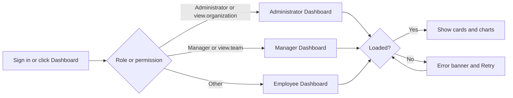
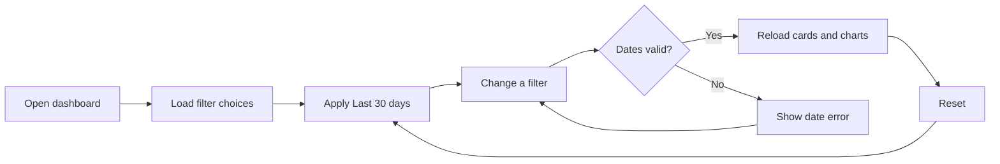
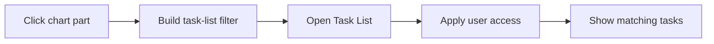
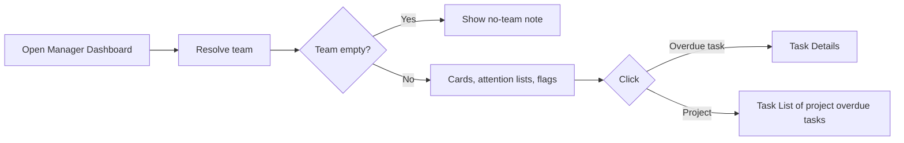
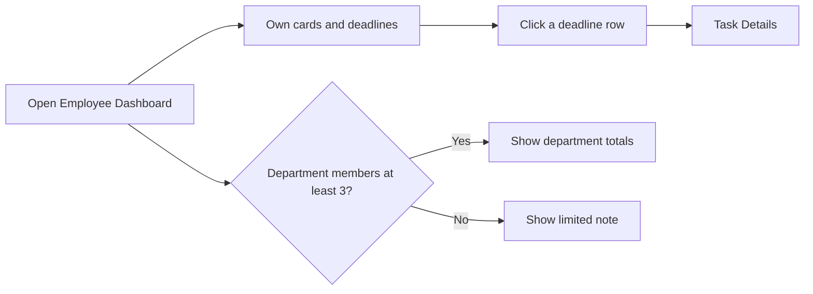

# Business Requirements Document – Dashboard

## TaskFlow – Intelligent Task Allocation & Tracking System

> **Document:** Business Requirements Document (sub-module 1 – DASH)  ·  **Version:** 1.0  ·  **Status:** Approved
> **Project type:** Personal Project (Skill Development)  ·  **Date:** 31-Oct-2026
> **Author:** Jojo George (jojogeorge3344@gmail.com)
> © 2026 Jojo George. All rights reserved.

---

## Document Control

### Revision History

| Version | Date | Author | Summary of changes |
|---|---|---|---|
| 1.0 | 31-Oct-2026 | Jojo George | Initial version of the Dashboard sub-module BRD (Administrator, Manager and Employee dashboards), written from the original BRD Screens 2–4 and TaskFlow as built |
| 1.0 | 31-Oct-2026 | Jojo George | Approved and signed off; baselined as the agreed business requirements. |
| 1.0 | 31-Oct-2026 | Jojo George | Editorial only: Related Documents paths updated to the `TF - Documents` folder layout; no requirement changed, sign-off unchanged. |

### Approvals / Sign-off

| Role | Name | Decision | Date |
|---|---|---|---|
| Product owner | Jojo George | Approved | 31-Oct-2026 |
| Reviewer | Jojo George | Approved | 31-Oct-2026 |

### Related Documents

| Document | Location |
|---|---|
| Overall BRD (roles, objectives, global rules in section 6, global NFRs) | `../../00-Overall/BRD-TaskFlow-Overall.md` |
| Original BRD (Screens 2, 3, 4) | `BRD for Task management.docx` (v1.0) |
| Development Plan (screen-wise) | `TF - Documents/Screens Wise Feature Development Plan/02-admin-dashboard.md`, `03-manager-dashboard.md`, `04-employee-dashboard.md` |
| FRD – Dashboard | `../../../FRD/01-Dashboard/01.1-Dashboard/FRD-Dashboard.md` |
| HLD – Dashboard | `../../../HLD/01-Dashboard/01.1-Dashboard/HLD-Dashboard.md` |
| LLD – Dashboard | `../../../LLD/01-Dashboard/01.1-Dashboard/LLD-Dashboard.md` |
| Functional workflow (module docs) | Dashboard module – child modules 02.1 Overview and 02.2 Analytics |
| TDD | `TF - Documents/TF - TDD/TDD-TaskFlow.md` (v2.0) |

> Global objectives, rules and NFRs are defined in the overall BRD (`../../00-Overall/BRD-TaskFlow-Overall.md`, rules in
> section 6). Each global rule used here is quoted and linked so this document can be read on its own.

---

## Index

1. Project Overview
2. Stakeholders & User Roles
3. Scope
4. Business Process / Workflows
5. Screen-by-Screen Requirements
6. Business Rules
7. Non-Functional Requirements
8. Data Requirements
9. Integrations & External Dependencies
10. Reporting Requirements
11. Recommended Technology Stack (optional)
12. Assumptions, Constraints & Dependencies
13. Risks
14. Acceptance Criteria
15. Requirements Traceability Matrix
16. Project Deliverables
17. Glossary
18. Project Summary

---

## 1. Project Overview

### 1.1 Introduction
The Dashboard is the first screen a user sees after signing in to TaskFlow. It shows a summary of task work at the level
the user may see: the whole organisation for an Administrator, the manager's own team for a Manager, and only the user's
own tasks for an Employee. Every chart part can be clicked to open the matching tasks in the Task List, so each figure can
be checked.

### 1.2 Business Problem / Current Situation
Without a dashboard, people must open the Task List and count tasks by hand to know how much work is pending, in progress,
completed or overdue. Managers cannot quickly see who is overloaded or which projects are slipping, and employees can miss
deadlines that are close. Figures counted by hand on different screens often disagree.

### 1.3 Project Objectives

| ID | Objective | Success measure | Supports overall objective |
|---|---|---|---|
| OBJ-DASH-01 | Send every user to the dashboard that matches their role and permissions | 100 % of sign-ins and **Dashboard** menu clicks open the correct dashboard; a user is never shown a dashboard above their level | Monitor task progress |
| OBJ-DASH-02 | Show the state of work at a glance | Total, completed, in-progress, pending, overdue and completion % are visible on the first screen without opening the Task List | Monitor task progress; Identify pending and overdue tasks |
| OBJ-DASH-03 | Help administrators and managers find delayed work and overloaded people | The 5 most overdue team tasks, the 5 projects needing attention and the "High workload" / "Overdue" flags are shown without any search | Identify pending and overdue tasks |
| OBJ-DASH-04 | Help employees act on close deadlines | Up to 10 open tasks that are overdue or due in the next 7 days are listed, soonest first | Reduce missed deadlines |
| OBJ-DASH-05 | Make every figure checkable and consistent | Clicking any chart part opens exactly the tasks it counts in the Task List | Identify pending and overdue tasks; Reports for work planning |
| OBJ-DASH-06 | Keep each person's data private to the right audience | An Employee never sees a colleague's name or task; a Manager never sees figures outside the team | Monitor task progress |

### 1.4 Expected Benefits
- **Organisation:** one consistent view of workload by department, manager, employee and project.
- **Administrators:** compare departments, managers, employees and projects over any date range.
- **Managers:** spot overloaded team members and delayed work early, and open the tasks directly.
- **Employees:** see their own deadlines, progress and project share, while colleagues' workloads stay private.

---

## 2. Stakeholders & User Roles

### 2.1 Stakeholders

| Stakeholder | Interest / responsibility |
|---|---|
| Project owner (Jojo George) | Defines priorities and approves this BRD |
| Administrators | Monitor the whole organisation; grant dashboard permissions in Role Configuration |
| Managers | Monitor their team's work and deadlines |
| Employees | Follow their own tasks and deadlines |

### 2.2 User Roles

| Role | Description | Main responsibilities on the Dashboard | Access level |
|---|---|---|---|
| Administrator | Runs the system and its settings | Reviews organisation-wide figures; may also open the Manager Dashboard | Organisation |
| Manager | Leads one or more departments or projects | Reviews team figures, delayed work and team workload | Team |
| Employee | Works on assigned tasks | Reviews own tasks, deadlines, performance and department totals | Own records only |
| Custom Role | Role created by an Administrator | Uses the dashboard level its permissions allow | Organisation if it holds `dashboard.view.organization`, Team if it holds `dashboard.view.team`, otherwise Own |

**Dashboard permissions (default grants)**

| Permission | Meaning | Administrator | Manager | Employee | Custom Role |
|---|---|:-:|:-:|:-:|:-:|
| `dashboard.view.own` | View my dashboard | Always On | Always On | Always On | Always On |
| `dashboard.view.team` | View team dashboard | Granted | Granted | Not granted | Configurable |
| `dashboard.view.organization` | View organisation dashboard | Granted | Not granted | Not granted | Configurable |
| `dashboard.analytics.view` | View charts and figures | Granted | Granted | Granted | Configurable |
| `dashboard.filters.use` | Use dashboard filters | Granted | Granted | Granted | Configurable |

---

## 3. Scope

### 3.1 In Scope
- One **Dashboard** menu item that opens the right dashboard for each user.
- Administrator Dashboard: organisation summary cards, analytics sections and filter bar.
- Manager Dashboard: team summary cards, team performance summary, team workload with flags, filter bar.
- Employee Dashboard: own summary cards, upcoming deadlines, personal performance, my projects, department overview.
- Drill-down from any chart part to the matching tasks in the Task List.

### 3.2 Out of Scope (this release)
- Recent system / task activity feeds on the dashboards – not built; activity is on the Task Details screen.
- Recent notifications on the Employee Dashboard – not built; notifications are in the Notification Center.
- Quick task-creation button on the Manager Dashboard – not built; tasks are created from the Task List.
- Per-card or per-chart permissions for custom roles – only the five dashboard permissions exist.
- Creating or changing any data from the dashboard – the dashboard is read-only.

### 3.3 Modules Overview

| # | Module | Purpose | Screens |
|---|---|---|---|
| 1 | Dashboard (Overview) | Route each user to their dashboard; summary cards; Manager team summary; Employee deadlines and department overview | Administrator Dashboard, Manager Dashboard, Employee Dashboard |
| 2 | Dashboard (Analytics) | Charts, filter bar, period chips and drill-down on the same three screens | (sections of the three dashboards) |

### 3.4 Change from Original BRD

| Original BRD (Screens 2–4) | Current requirement |
|---|---|
| Admin: "Active employees" card | Replaced by **Employees**, **Managers**, **Departments** and **Projects** cards |
| Admin: "Recent system activity" / recent employee and task activity | Not provided (out of scope, 3.2) |
| Admin: navigation to Employee and Department Management from the dashboard | Provided by the side menu, not by dashboard links |
| Admin: "open relevant records from dashboard cards" | Provided by chart drill-down to the Task List |
| Manager: "Tasks due today" and "Upcoming deadlines" cards | Not on the Manager Dashboard; the dashboard lists the most overdue tasks instead |
| Manager: recent task activity, quick task creation button | Not provided (out of scope, 3.2) |
| Manager: filter by employee, priority and status | Filters are date range, date basis, project and employee; priority and status are reached by clicking the donut charts |
| Employee: "My tasks due today" card | Shown as "Due today" badges in the Upcoming deadlines list |
| Employee: recent notifications, recently updated tasks, shortcut to update progress | Not provided; each deadline row opens Task Details |
| Employee Dashboard access "Employee" | Every signed-in user has an Employee Dashboard (`dashboard.view.own` is Always On) |
| New (not in original) | Analytics charts, filter bar, period chips, team workload flags, department overview with privacy limit, drill-down |

---

## 4. Business Process / Workflows

### 4.1 Open My Dashboard

**Trigger:** User signs in (after any security setup) or clicks **Dashboard** in the side menu  ·  **Actors:** All users, System

| Step | Actor / System | Action | Result |
|---|---|---|---|
| 1 | User | Signs in or clicks **Dashboard** | Request to open the dashboard |
| 2 | System | Decides the dashboard: Administrator → Administrator Dashboard; Manager → Manager Dashboard; other roles → Administrator Dashboard if they hold `dashboard.view.organization`, else Manager Dashboard if they hold `dashboard.view.team`, else Employee Dashboard | Correct dashboard chosen |
| 3 | System | If the user typed the address of a dashboard they may not open, sends them to their own dashboard without a message | No unauthorised figures shown |
| 4 | System | Shows placeholders, then loads cards and charts | Dashboard shown |
| 5 | System | On a load failure shows an error banner with **Retry** | User can reload |

**Example:** Meera has a custom role "Team Lead" holding `dashboard.view.team` but not `dashboard.view.organization`.
She signs in on 31-Oct-2026 and lands on the Manager Dashboard. She types the Administrator Dashboard address and is
taken back to the Manager Dashboard with no message.

**Exceptions / alternate flows:**
- Network or server error → *"Could not load analytics. Check your connection and try again."* (Administrator / Manager) or
  *"Could not load your dashboard. Check your connection and try again."* (Employee), with **Retry**.

### 4.2 Filter Dashboard Analytics (Administrator / Manager)

**Trigger:** User changes a filter on the Administrator or Manager Dashboard  ·  **Actors:** Administrator, Manager, System

| Step | Actor / System | Action | Result |
|---|---|---|---|
| 1 | System | Loads the filter choices (for a Manager only the team's employees and in-scope projects) and applies Last 30 days by Created date | Default view |
| 2 | User | Picks a preset or From / To dates, a date basis, and optionally Department, Project, Manager or Employee | New filter |
| 3 | System | Checks the dates on the screen | Error message if invalid |
| 4 | System | Reloads every card and chart and updates the subtitle (e.g. "Last 7 days by deadline") | Filtered figures |
| 5 | User | Clicks **Reset** | Back to the default filter |

**Example:** The Administrator picks **Previous month** (01-Sep-2026 to 30-Sep-2026), Date basis **Deadline** and
Department **Engineering**. All ten cards and the charts reload for Engineering tasks whose deadline fell in September.

**Exceptions / alternate flows:**
- A date missing → *"Choose both a start and an end date."*; end before start → *"The end date cannot be before the start date."*; no reload.
- A Manager's filter naming an employee outside the team is refused; the dashboard shows the load-error banner.

### 4.3 Drill Down from a Chart

**Trigger:** User clicks a chart part (donut slice, bar segment, deadline bar, trend point, project or manager count)  ·  **Actors:** All users, System

| Step | Actor / System | Action | Result |
|---|---|---|---|
| 1 | User | Clicks a chart part | Drill-down requested |
| 2 | System | Opens the Task List with the dashboard filters plus the clicked part (e.g. bucket "Overdue", priority "High") | Task List opens with a drill-down banner |
| 3 | System | Limits the list again to the tasks the user may see | Exactly the counted tasks are shown |

**Example:** The "Overdue" slice of the Manager's status donut shows 4. The Manager clicks it and the Task List shows the
same 4 team tasks.

**Exceptions / alternate flows:**
- The user's task access is narrower than the dashboard count → the Task List shows only the tasks the user may open.

### 4.4 Review Team Performance (Manager)

**Trigger:** Manager opens the Manager Dashboard  ·  **Actors:** Manager, System

| Step | Actor / System | Action | Result |
|---|---|---|---|
| 1 | System | Works out the team: active members of the departments the manager runs plus members of projects where the manager is flagged project manager (the manager is not counted) | Team known |
| 2 | System | If the team is empty shows the no-team note | Manager knows to ask an Administrator |
| 3 | System | Shows team cards, the most overdue tasks with days overdue, and projects needing attention | Delayed work visible |
| 4 | System | Flags members with "High workload" or "Overdue" in the workload table | Overloaded people visible |
| 5 | Manager | Clicks an overdue task or a project | Task Details, or Task List with that project's overdue tasks |

**Example:** Priya manages a team of 6 with 27 open tasks (average 4.5). Arun has 9 open tasks: 9 ≥ 5 and 9 ≥ 6.75
(1.5 × 4.5), so he is flagged **High workload**. Arun also has 1 task 3 days overdue, so he is flagged **Overdue** and the
task appears in "Most overdue tasks" as "3 days overdue".

**Exceptions / alternate flows:**
- An Administrator opening the Manager Dashboard without a team sees *"This dashboard shows one manager's team. Organisation-wide figures are on the Administrator Dashboard."*

### 4.5 Check My Deadlines and Department (Employee)

**Trigger:** User opens the Employee Dashboard  ·  **Actors:** Employee (any signed-in user), System

| Step | Actor / System | Action | Result |
|---|---|---|---|
| 1 | System | Shows own cards and up to 10 open tasks that are overdue or due in the next 7 days, soonest first | Close deadlines visible |
| 2 | User | Clicks a deadline row | Task Details opens |
| 3 | User | Clicks a period chip (Last 7 days, Last 30 days, This month) | Personal performance trend and "completed in this period" reload |
| 4 | System | Shows the Department overview for the user's first department (by name), or a note if it has fewer than 3 active members | Department totals without colleague details |

**Example:** On 31-Oct-2026 (application timezone Asia/Kolkata) Ravi sees TF-104 "Due today", TF-117 "Due tomorrow",
TF-120 "In 3 days" and TF-098 "2 days overdue". His department "Design" has 2 active members, so he sees only
*"Departments with fewer than 3 members do not show task figures."*

**Exceptions / alternate flows:**
- No tasks → *"You have no tasks yet. New assignments will appear here."*; nothing due → *"Nothing is due in the next 7 days."*
- Not in any department → *"No department assigned"*.

---

## 5. Screen-by-Screen Requirements

### SCREEN 1: Administrator Dashboard

| Field | Value |
|---|---|
| **Screen name** | Administrator Dashboard (original BRD Screen 2) |
| **Module** | Dashboard (Overview, Analytics) |
| **Access** | Administrator; Custom Role holding `dashboard.view.organization` |
| **Priority** | Must |

**Purpose**
Give the Administrator an organisation-wide summary of people, projects and task work, with analytics and filters.

**Screen Elements**
- Header "Administrator Dashboard", "Welcome back, *name*", subtitle "Organisation-wide analytics · *range* by *date basis*".
- Filter bar: preset chips (Today, Last 7 days, Last 30 days, This month, Previous month, Custom range), From / To dates,
  Date basis (Created date, Deadline, Completed date), Department, Project, Manager, Employee, **Reset**.
- Ten summary cards: Employees, Managers, Departments, Projects, Total tasks, Completed, In progress, Pending, Overdue, Completion (%).
- Sections: Department-wise tasks, Employee-wise workload, Task status & priority, Completion trend, Deadlines,
  Manager-wise teams, Project-wise progress.
- Error banner with **Retry**; empty-state note.

**Functional Requirements**

| ID | Requirement | Priority |
|---|---|---|
| REQ-DASH-01 | The system shall provide one **Dashboard** menu item that opens the dashboard matching the user's role and permissions (rule in 4.1, step 2). | Must |
| REQ-DASH-02 | The system shall open the user's dashboard automatically after sign-in. | Must |
| REQ-DASH-03 | The system shall send a user who opens a dashboard above their level to their own dashboard without a message. | Must |
| REQ-DASH-04 | The system shall show placeholders on the cards while the dashboard loads. | Should |
| REQ-DASH-05 | The system shall show an error banner with a **Retry** button when the dashboard cannot be loaded. | Must |
| REQ-DASH-06 | The system shall show ten summary cards: Employees, Managers, Departments, Projects, Total tasks, Completed, In progress, Pending, Overdue and Completion (%). | Must |
| REQ-DASH-07 | The system shall count on the **Employees** card the active users whose role cannot view all tasks. | Must |
| REQ-DASH-08 | The system shall count on the **Managers** card the users holding the Manager system role. | Must |
| REQ-DASH-09 | The system shall show task status and task priority as two donut charts. | Must |
| REQ-DASH-10 | The system shall show a completion trend of tasks created versus completed per day for ranges up to 31 days. | Should |
| REQ-DASH-11 | The system shall show the completion trend per week (weeks start on Monday) for ranges longer than 31 days. | Should |
| REQ-DASH-12 | The system shall show open tasks by deadline window: Overdue, Due today, Next 7 days, Later. | Must |
| REQ-DASH-13 | The system shall show department-wise tasks as bars stacked by status, with a "No department" row when needed. | Should |
| REQ-DASH-14 | The system shall show employee-wise workload for the top 10 people by open tasks. | Should |
| REQ-DASH-15 | The system shall let the Administrator switch between **View all *n* employees with tasks** and **Show top 10**. | Could |
| REQ-DASH-16 | The system shall show manager-wise teams with Manager, Depts, Staff, Projects and task counts. | Should |
| REQ-DASH-17 | The system shall show project-wise progress with a "Projected end" equal to the latest task deadline in the project. | Should |
| REQ-DASH-18 | The system shall show the filter bar only to users holding `dashboard.filters.use`. | Must |
| REQ-DASH-19 | The system shall apply the default filter Last 30 days (ending today) by Created date. | Must |
| REQ-DASH-20 | The system shall let the user filter by date preset or custom From / To dates. | Must |
| REQ-DASH-21 | The system shall let the user choose the date basis: Created date, Deadline or Completed date. | Must |
| REQ-DASH-22 | The system shall let the Administrator filter by Department, Project, Manager and Employee. | Should |
| REQ-DASH-23 | The system shall reject a date range of 3660 days or more. | Should |
| REQ-DASH-24 | The system shall reload every card and chart and update the subtitle when a valid filter is applied. | Must |
| REQ-DASH-25 | The system shall return to the default filter when **Reset** is clicked. | Should |
| REQ-DASH-26 | The system shall open the Task List with the dashboard filters plus the clicked part when a chart part is clicked. | Must |
| REQ-DASH-27 | The system shall show in a drill-down exactly the tasks the dashboard counted, limited to the tasks the user may see. | Must |
| REQ-DASH-28 | The system shall show an empty-state note when no task matches the filters. | Should |

**Validations & Messages**

| Situation | Rule / message |
|---|---|
| Start or end date missing | "Choose both a start and an end date." |
| End date before start date | "The end date cannot be before the start date." |
| Dashboard failed to load (also any filter the server refuses) | "Could not load analytics. Check your connection and try again." |
| No task matches | "No tasks match these filters. Try a wider date range or reset the filters." |
| Empty chart / empty trend | "No tasks match these filters." / "No tasks were created or completed in this period." |
| No projects / no managers | "No projects match these filters." / "No managers match these filters." |
| No permission for this dashboard | No message – the user is taken to their own dashboard |

**Expected Result**
The Administrator understands the overall state of the organisation's work from one screen and can open the exact tasks
behind any figure.

### SCREEN 2: Manager Dashboard

| Field | Value |
|---|---|
| **Screen name** | Manager Dashboard (original BRD Screen 3) |
| **Module** | Dashboard (Overview, Analytics) |
| **Access** | Manager; Custom Role holding `dashboard.view.team`; Administrator (by direct address) |
| **Priority** | Must |

**Purpose**
Help managers monitor their team's work, delayed tasks and team workload.

**Screen Elements**
- Header "Manager Dashboard", "Welcome back, *name*", subtitle "Team analytics · *range* by *date basis*".
- Filter bar without Department and Manager fields.
- Six summary cards: Team tasks, Completed, In progress, Pending, Overdue, Completion (%).
- Team performance summary: "Most overdue tasks" (up to 5) and "Projects needing attention" (up to 5).
- Task status & priority donuts, Project-wise progress, Employee-wise workload table (Open, Done, Overdue, Completion,
  Flag, Tasks-by-status bar).
- No-team note.

**Functional Requirements**

| ID | Requirement | Priority |
|---|---|---|
| REQ-DASH-29 | The system shall show six summary cards: Team tasks, Completed, In progress, Pending, Overdue and Completion (%). | Must |
| REQ-DASH-30 | The system shall define the team as the active members of the departments the manager runs plus the members of projects where the manager is flagged project manager, excluding the manager. | Must |
| REQ-DASH-31 | The system shall show a no-team note when the manager has nobody on the team. | Must |
| REQ-DASH-32 | The system shall show a different note to an Administrator who opens the Manager Dashboard without a team. | Could |
| REQ-DASH-33 | The system shall list up to 5 most overdue team tasks with their days overdue. | Must |
| REQ-DASH-34 | The system shall open Task Details when a task in "Most overdue tasks" is clicked. | Must |
| REQ-DASH-35 | The system shall list up to 5 projects with overdue team tasks under "Projects needing attention". | Should |
| REQ-DASH-36 | The system shall open the Task List with that project's overdue tasks when a project in "Projects needing attention" is clicked. | Should |
| REQ-DASH-37 | The system shall show the team's task status and priority donuts and project-wise progress. | Must |
| REQ-DASH-38 | The system shall show an employee-wise workload table with Open, Done, Overdue, Completion, Flag and a tasks-by-status bar for each team member. | Must |
| REQ-DASH-39 | The system shall flag a member **High workload** when their open tasks are at least 5 and at least 1.5 × the team average. | Must |
| REQ-DASH-40 | The system shall flag a member **Overdue** when they have any overdue task. | Must |
| REQ-DASH-41 | The system shall compare a single filtered employee with the whole team's average. | Should |
| REQ-DASH-42 | The system shall show the Manager's filter bar without the Department and Manager fields. | Must |
| REQ-DASH-43 | The system shall offer in the Manager's filter only the team's employees and the projects in the manager's scope. | Must |
| REQ-DASH-44 | The system shall refuse a filter naming an employee outside the team or a project outside the manager's scope. | Must |
| REQ-DASH-45 | The system shall let an Administrator open the Manager Dashboard by its direct address. | Could |

**Validations & Messages**

| Situation | Rule / message |
|---|---|
| Manager has no team | "You have no team yet. Ask an administrator to assign departments or direct reports to you." |
| Administrator opens the Manager Dashboard (no team) | "This dashboard shows one manager's team. Organisation-wide figures are on the Administrator Dashboard." |
| Nothing overdue | "Nothing is overdue for the team." |
| No team tasks match | "No team tasks match these filters. Try a wider date range or reset the filters." |
| No team members to show | "No team members to show. Ask an administrator to assign departments or direct reports to you." |
| Filter refused or load failed | "Could not load analytics. Check your connection and try again." |
| Date errors | Same as SCREEN 1 |

**Expected Result**
Managers quickly identify pending work, overloaded employees and tasks requiring attention in their own team.

### SCREEN 3: Employee Dashboard

| Field | Value |
|---|---|
| **Screen name** | Employee Dashboard (original BRD Screen 4) |
| **Module** | Dashboard (Overview, Analytics) |
| **Access** | Employee; every signed-in user (Administrator, Manager, Custom Role) through `dashboard.view.own` |
| **Priority** | Must |

**Purpose**
Give each user a personal view of their own tasks, deadlines, progress and projects.

**Screen Elements**
- Header "Employee Dashboard", "Welcome back, *name*", subtitle "Your tasks, projects and progress · *period*".
- Period chips Last 7 days, Last 30 days (default), This month, with the note "Only your own data is shown."
- Six summary cards: My tasks, Completed, In progress, Pending, Overdue, Completion (%).
- Overall task summary: progress bar, "*n* completed · *n* outstanding · *n*%", status and priority donuts.
- Upcoming deadlines & overdue list; Personal performance trend; My projects; Department overview.

**Functional Requirements**

| ID | Requirement | Priority |
|---|---|---|
| REQ-DASH-46 | The system shall show six summary cards: My tasks, Completed, In progress, Pending, Overdue and Completion (%). | Must |
| REQ-DASH-47 | The system shall show on the Employee Dashboard only the signed-in user's own tasks. | Must |
| REQ-DASH-48 | The system shall show an overall task summary with a progress bar, "*n* completed · *n* outstanding · *n*%" and status and priority donuts. | Should |
| REQ-DASH-49 | The system shall list up to 10 open tasks that are overdue or due within the next 7 days, soonest first. | Must |
| REQ-DASH-50 | The system shall show on each deadline row the task code, title, priority, deadline and a badge ("Due today", "Due tomorrow", "In *n* days", "Overdue", "*n* days overdue"). | Must |
| REQ-DASH-51 | The system shall open Task Details when a deadline row is clicked. | Must |
| REQ-DASH-52 | The system shall offer period chips Last 7 days, Last 30 days (default) and This month. | Should |
| REQ-DASH-53 | The system shall show a personal performance trend of tasks created versus completed per day for the chosen period, with "*n* completed in this period". | Should |
| REQ-DASH-54 | The system shall apply the chosen period only to the personal performance trend and its completed count. | Should |
| REQ-DASH-55 | The system shall list under "My projects" the projects where the user has tasks or is allocated, with progress of the user's own tasks only. | Should |
| REQ-DASH-56 | The system shall show a Department overview with aggregate task figures for the user's first department by name. | Should |
| REQ-DASH-57 | The system shall never show a colleague's name or task in the Department overview. | Must |
| REQ-DASH-58 | The system shall show no department figures when the department has fewer than 3 active members. | Must |

**Validations & Messages**

| Situation | Rule / message |
|---|---|
| Dashboard failed to load | "Could not load your dashboard. Check your connection and try again." (with **Retry**) |
| No tasks | "You have no tasks yet. New assignments will appear here." |
| No upcoming deadlines | "Nothing is due in the next 7 days." |
| Empty personal trend | "You created or completed no tasks in this period." |
| No projects | "You have no projects yet." |
| Small department | "Departments with fewer than 3 members do not show task figures." |
| Not in any department | "No department assigned" |

**Expected Result**
Employees understand what work they need to complete and which deadlines need attention, without seeing colleagues' data.

---

## 6. Business Rules

| ID | Rule | Applies to |
|---|---|---|
| BR-DASH-01 | A task is counted only if it is not deleted and not cancelled. | All dashboards |
| BR-DASH-02 | Each counted task is in exactly one bucket: **Completed** if its status is Completed; else **Overdue** if its deadline has passed; else **In progress** if its status is In Progress or In QA; else **Pending** (To Do, Blocked). Applies the global rule "a task is overdue when its deadline has passed and it is not completed or cancelled" ([overall BRD §6](../../00-Overall/BRD-TaskFlow-Overall.md)). | All cards and charts; Task List drill-down |
| BR-DASH-03 | Completion % = completed ÷ all counted tasks, rounded to the nearest whole number; 0 % when there are no tasks. | All dashboards |
| BR-DASH-04 | A task belongs to a person if they are its assignee or one of its recipients. | Manager and Employee dashboards |
| BR-DASH-05 | "Today", "due today" and "next 7 days" use the application timezone, so they match the deadline reminders. Applies the global rule "consistent timezone for deadline comparisons" ([overall BRD §6](../../00-Overall/BRD-TaskFlow-Overall.md)). | All dashboards |
| BR-DASH-06 | The date basis decides which task date must fall in the range; the completion trend always uses created and completed dates. | SCREEN 1, SCREEN 2 |
| BR-DASH-07 | The three view permissions are levels: Organisation includes Team, Team includes Own; `dashboard.view.own` is always on. | Dashboard routing |
| BR-DASH-08 | Charts and figures need `dashboard.analytics.view`; the filter bar needs `dashboard.filters.use`; period chips need no filter permission. | All dashboards |
| BR-DASH-09 | The Manager Dashboard covers only the manager's team; the Employee Dashboard covers only the user's own tasks. Applies the global rule "only authorised users access records" ([overall BRD §6](../../00-Overall/BRD-TaskFlow-Overall.md)). | SCREEN 2, SCREEN 3 |
| BR-DASH-10 | The Department overview shows only aggregate figures and none at all for departments with fewer than 3 active members. | SCREEN 3 |
| BR-DASH-11 | The dashboard is read-only: it creates no notification, email or activity entry. | All dashboards |
| BR-DASH-12 | A drill-down shows the same tasks the chart part counted, using the same bucket rules. Applies the global rule "dashboards and reports use consistent calculation rules" ([overall BRD §6](../../00-Overall/BRD-TaskFlow-Overall.md)). | All dashboards, Task List |

---

## 7. Non-Functional Requirements

Global NFRs (performance, security, usability, compatibility, accessibility) in the overall BRD apply. Sub-module specifics:

| ID | Category | Requirement | Measure / target |
|---|---|---|---|
| NFR-DASH-01 | Security | Dashboard scope is enforced by the server, not only by hiding screens | A Manager request for an employee outside the team is refused; an Employee cannot request another user's data |
| NFR-DASH-02 | Privacy | Small departments cannot be used to infer one colleague's workload | No department figures below 3 active members |
| NFR-DASH-03 | Consistency | Dashboard counts and Task List drill-down agree | Drill-down count = chart count for the same user |
| NFR-DASH-04 | Usability | Every empty or failed section shows a plain-language message and a recovery action | Messages in section 5; **Retry** on load errors |
| NFR-DASH-05 | Performance | The dashboard shows aggregated figures, not lists of all tasks | > ⚠️ To be confirmed: a measured load-time target (e.g. seconds for a given task volume) has not been set |
| NFR-DASH-06 | Capacity | Filter ranges stay bounded | Date range shorter than 3660 days; top 10 employees by default |

---

## 8. Data Requirements

The dashboard stores no data of its own; it reads the following business data.

| Entity / data set | Purpose | Key fields | Retention / rules |
|---|---|---|---|
| Tasks | All task figures | Code, title, status, priority, deadline, created date, completed date, assignee, project | Deleted and cancelled tasks are not counted |
| Task recipients | Ownership of tasks for Manager and Employee figures | Task, recipient user | A recipient counts as an owner of the task |
| Users | Employees and Managers cards, team members, names | Name, role, active status | Only active users count on the Employees card and in teams |
| Departments and members | Department-wise figures, manager teams, department overview | Name, manager, members | Fewer than 3 active members → no figures |
| Projects and allocations | Project figures, manager scope, My projects | Name, members, project-manager flag | Projected end = latest task deadline |
| Application settings | "Today" and day windows | Application timezone | Default Asia/Kolkata |

---

## 9. Integrations & External Dependencies

| System / service | Purpose | Required? | Notes |
|---|---|---|---|
| Task List (Task Management sub-module) | Drill-down target and Task Details | Required | Applies the user's own access rules |
| Role Configuration (Settings) | Grants the five dashboard permissions | Required | Changes take effect for the role's users |
| Application Settings | Application timezone | Required | Decides "today" |

No external (third-party) service is used.

---

## 10. Reporting Requirements

| Report | Audience | Filters | Output formats |
|---|---|---|---|
| Administrator Dashboard analytics | Administrator, Custom Role with `dashboard.view.organization` | Date range, date basis, department, project, manager, employee | Screen |
| Manager Dashboard analytics | Manager, Custom Role with `dashboard.view.team`, Administrator | Date range, date basis, project, employee (team only) | Screen |
| Employee Dashboard analytics | Every signed-in user | Period (Last 7 days, Last 30 days, This month) | Screen |

File export of task figures is provided by the Reports sub-module (`../../05-Reports/05.1-Reports/BRD-Reports.md`).

---

## 11. Recommended Technology Stack (optional)

_Not applicable for this sub-module._ The recommended stack is in the overall BRD.

---

## 12. Assumptions, Constraints & Dependencies

| Type | Description |
|---|---|
| Assumption | Each user belongs to zero or more departments; the Department overview uses the first by name. |
| Assumption | Managers are linked to their team through departments they run and projects where they are flagged project manager; no separate "direct reports" relation exists. |
| Constraint | Thresholds are fixed, not configurable: default range 30 days, maximum range 3660 days, daily trend up to 31 days, top 10 employees, attention lists of 5, upcoming list of 10, 7-day deadline window, High workload at 5 open tasks and 1.5 × average, department minimum 3 active members. |
| Dependency | Task Management (Task List, Task Details), Employee / Department / Project Management, Application Settings, Role Configuration. |

---

## 13. Risks

| ID | Risk | Impact | Likelihood | Mitigation |
|---|---|---|---|---|
| R-DASH-01 | A role without `dashboard.analytics.view` opens a dashboard and sees only the generic load error | Medium | Low | Grant the permission with the view keys; > ⚠️ To be confirmed: whether the screen should show a "no permission" message instead |
| R-DASH-02 | Filter errors from the server (range too long, employee outside the team) look like a connection problem | Low | Medium | Validate dates on screen first; > ⚠️ To be confirmed: show the server's message |
| R-DASH-03 | The team on the Manager Dashboard differs from the team used by the Administrator's Manager filter and "Manager-wise teams" | Medium | Medium | > ⚠️ To be confirmed: the single team definition to use |
| R-DASH-04 | Administrator trend counts tasks completed in the range even if later reopened, while the Employee trend counts only tasks still completed | Low | Medium | > ⚠️ To be confirmed: one rule for both trends |

---

## 14. Acceptance Criteria

| ID | Criterion | Verified by |
|---|---|---|
| AC-DASH-01 | Administrator, Manager, Employee and a custom role each land on the correct dashboard after sign-in and from the menu. | SCREEN 1, REQ-DASH-01, REQ-DASH-02 |
| AC-DASH-02 | A user typing a dashboard address above their level is taken to their own dashboard. | SCREEN 1, REQ-DASH-03 |
| AC-DASH-03 | A load failure shows the error banner; **Retry** reloads the dashboard. | SCREEN 1, REQ-DASH-04, REQ-DASH-05 |
| AC-DASH-04 | The Administrator Dashboard shows the ten cards with the counting rules of BR-DASH-01 to BR-DASH-03. | SCREEN 1, REQ-DASH-06 – REQ-DASH-08 |
| AC-DASH-05 | Status, priority, trend, deadlines, department, employee, manager and project sections show correct figures for a known data set. | SCREEN 1, REQ-DASH-09 – REQ-DASH-17 |
| AC-DASH-06 | Filters, default, date validation, range limit and **Reset** behave as stated. | SCREEN 1, REQ-DASH-18 – REQ-DASH-25, REQ-DASH-28 |
| AC-DASH-07 | Clicking any chart part opens the Task List with exactly the counted tasks. | SCREEN 1, REQ-DASH-26, REQ-DASH-27 |
| AC-DASH-08 | The Manager Dashboard shows only the team's figures and the no-team notes when the team is empty. | SCREEN 2, REQ-DASH-29 – REQ-DASH-32, REQ-DASH-37 |
| AC-DASH-09 | Most overdue tasks and projects needing attention are listed (up to 5 each) and open the right targets. | SCREEN 2, REQ-DASH-33 – REQ-DASH-36 |
| AC-DASH-10 | A member with 9 open tasks in a team averaging 4.5 is flagged High workload; a member with an overdue task is flagged Overdue. | SCREEN 2, REQ-DASH-38 – REQ-DASH-41 |
| AC-DASH-11 | A Manager cannot select or request an employee or project outside the team; an Administrator can open the Manager Dashboard. | SCREEN 2, REQ-DASH-42 – REQ-DASH-45 |
| AC-DASH-12 | The Employee Dashboard shows only the user's own figures, the summary and up to 10 deadline rows with correct badges that open Task Details. | SCREEN 3, REQ-DASH-46 – REQ-DASH-51 |
| AC-DASH-13 | Period chips change only the personal trend and its completed count; My projects shows own-task progress. | SCREEN 3, REQ-DASH-52 – REQ-DASH-55 |
| AC-DASH-14 | The Department overview shows totals without colleague details, and only the note for a department of fewer than 3 active members. | SCREEN 3, REQ-DASH-56 – REQ-DASH-58 |

---

## 15. Requirements Traceability Matrix

| Objective | Business rule(s) | Screen(s) | Functional requirement(s) | Acceptance criterion |
|---|---|---|---|---|
| OBJ-DASH-01 | BR-DASH-07, BR-DASH-08 | SCREEN 1, 2, 3 | REQ-DASH-01, REQ-DASH-02, REQ-DASH-03, REQ-DASH-04, REQ-DASH-05, REQ-DASH-45 | AC-DASH-01, AC-DASH-02, AC-DASH-03, AC-DASH-11 |
| OBJ-DASH-02 | BR-DASH-01, BR-DASH-02, BR-DASH-03, BR-DASH-05, BR-DASH-06 | SCREEN 1 | REQ-DASH-06, REQ-DASH-07, REQ-DASH-08, REQ-DASH-09, REQ-DASH-10, REQ-DASH-11, REQ-DASH-12, REQ-DASH-13, REQ-DASH-14, REQ-DASH-15, REQ-DASH-16, REQ-DASH-17, REQ-DASH-18, REQ-DASH-19, REQ-DASH-20, REQ-DASH-21, REQ-DASH-22, REQ-DASH-23, REQ-DASH-24, REQ-DASH-25, REQ-DASH-28 | AC-DASH-04, AC-DASH-05, AC-DASH-06 |
| OBJ-DASH-02 | BR-DASH-01, BR-DASH-02, BR-DASH-03, BR-DASH-04 | SCREEN 2, 3 | REQ-DASH-29, REQ-DASH-37, REQ-DASH-46, REQ-DASH-48, REQ-DASH-52, REQ-DASH-53, REQ-DASH-54 | AC-DASH-08, AC-DASH-12, AC-DASH-13 |
| OBJ-DASH-03 | BR-DASH-02, BR-DASH-04, BR-DASH-09 | SCREEN 2 | REQ-DASH-30, REQ-DASH-31, REQ-DASH-32, REQ-DASH-33, REQ-DASH-34, REQ-DASH-35, REQ-DASH-36, REQ-DASH-38, REQ-DASH-39, REQ-DASH-40, REQ-DASH-41 | AC-DASH-08, AC-DASH-09, AC-DASH-10 |
| OBJ-DASH-04 | BR-DASH-05 | SCREEN 3 | REQ-DASH-49, REQ-DASH-50, REQ-DASH-51 | AC-DASH-12 |
| OBJ-DASH-05 | BR-DASH-02, BR-DASH-12 | SCREEN 1, 2 | REQ-DASH-26, REQ-DASH-27 | AC-DASH-07 |
| OBJ-DASH-06 | BR-DASH-09, BR-DASH-10, BR-DASH-11 | SCREEN 2, 3 | REQ-DASH-42, REQ-DASH-43, REQ-DASH-44, REQ-DASH-47, REQ-DASH-55, REQ-DASH-56, REQ-DASH-57, REQ-DASH-58 | AC-DASH-11, AC-DASH-12, AC-DASH-13, AC-DASH-14 |

---

## 16. Project Deliverables

| # | Deliverable | Format |
|---|---|---|
| 1 | Administrator, Manager and Employee dashboards (source code) | Repository |
| 2 | Dashboard BRD, FRD, HLD, LLD | Markdown |
| 3 | Unit and integration tests for counters, analytics, scopes, drill-down and isolation | Repository (test projects) |
| 4 | Sample data that fills every dashboard section | Seed data |

---

## 17. Glossary

| Term | Meaning |
|---|---|
| Bucket | One of Completed, Overdue, In progress, Pending; each counted task is in exactly one |
| Date basis | The task date that must fall in the filter range: Created date, Deadline or Completed date |
| Drill-down | Opening the Task List with the filter of the clicked chart part |
| Team | Active members of the departments a manager runs plus members of projects where the manager is flagged project manager |
| Recipient | A user configured to be notified about a task; counts as an owner of it on dashboards |
| Projected end | The latest task deadline in a project (projects have no deadline of their own) |
| High workload | At least 5 open tasks and at least 1.5 × the team's average |

---

## 18. Project Summary
The Dashboard sub-module gives every TaskFlow user one screen that shows their work at the right level – organisation,
team or own. It counts tasks with one set of bucket and timezone rules, highlights overdue work, overloaded people and close
deadlines, keeps colleagues' data private, and lets the user click through to the exact tasks behind every figure.

---
© 2026 Jojo George. All rights reserved. Unauthorized copying or distribution of this document is prohibited.
