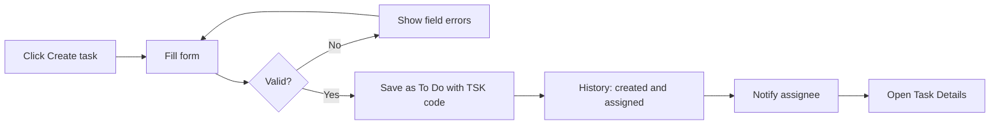
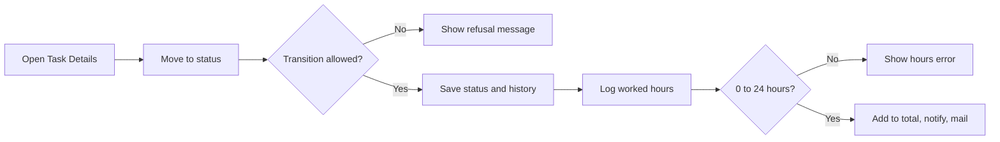
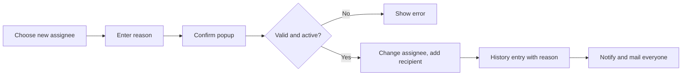
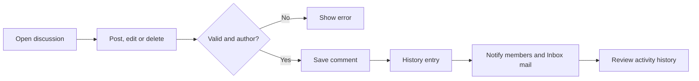

# Business Requirements Document – Task Management

## TaskFlow – Intelligent Task Allocation & Tracking System

> **Document:** Business Requirements Document (sub-module 02.1 Task Management, code `TASK`)  ·  **Version:** 1.0  ·  **Status:** Approved
> **Project type:** Personal Project (Skill Development)  ·  **Date:** 31-Oct-2026
> **Author:** Jojo George (jojogeorge3344@gmail.com)
> © 2026 Jojo George. All rights reserved.

---

## Document Control

### Revision History

| Version | Date | Author | Summary of changes |
|---|---|---|---|
| 1.0 | 31-Oct-2026 | Jojo George | Initial version, rewritten from the original BRD (Screens 7, 8, 9, 11, 15 and 18) to match TaskFlow as built |
| 1.0 | 31-Oct-2026 | Jojo George | Approved and signed off; baselined as the agreed business requirements. |
| 1.0 | 31-Oct-2026 | Jojo George | Editorial only: Related Documents paths updated to the `TF - Documents` folder layout; no requirement changed, sign-off unchanged. |

### Approvals / Sign-off

| Role | Name | Decision | Date |
|---|---|---|---|
| Product owner | Jojo George | Approved | 31-Oct-2026 |
| Reviewer | Jojo George | Approved | 31-Oct-2026 |

### Related Documents

| Document | Location |
|---|---|
| Overall BRD (roles, global rules `BR-nn`, global NFRs, Auth, Legal) | `../../00-Overall/BRD-TaskFlow-Overall.md` |
| Sibling BRDs – Employee Workload, Board | `../02.2-Employee-Workload/BRD-Employee-Workload.md`, `../02.3-Board/BRD-Board.md` |
| Original BRD | `BRD for Task management.docx` (v1.0) – Screens 7, 8, 9, 11, 15, 18 and section 3 |
| Development Plan (screen-wise) | `TF - Documents/Screens Wise Feature Development Plan/` – files `07`, `08`, `09`, `11`, `15`, `18` |
| FRD | `../../../FRD/02-TaskFlow-Monitoring/02.1-Task-Management/FRD-Task-Management.md` |
| HLD / LLD | `../../../HLD/02-TaskFlow-Monitoring/02.1-Task-Management/HLD-Task-Management.md`, `../../../LLD/02-TaskFlow-Monitoring/02.1-Task-Management/LLD-Task-Management.md` |
| Functional workflow docs | `04-Monitoring/04.1-Task-Management.md`, `04-Monitoring/04.2-Comments-and-Activity-History.md` |
| TDD | `TDD-TaskFlow.md` (v2.0) |

---

## Index

1. Project Overview
2. Stakeholders & User Roles
3. Scope
4. Business Process / Workflows
5. Screen-by-Screen Requirements
6. Business Rules
7. Non-Functional Requirements
8. Data Requirements
9. Integrations & External Dependencies
10. Reporting Requirements
11. Recommended Technology Stack (optional)
12. Assumptions, Constraints & Dependencies
13. Risks
14. Acceptance Criteria
15. Requirements Traceability Matrix
16. Project Deliverables
17. Glossary
18. Project Summary

---

## 1. Project Overview

### 1.1 Introduction
Task Management is the core of the TaskFlow Monitoring module. Users list, search and filter the tasks they may see.
Administrators and Managers create, copy, edit and reassign tasks, and Administrators delete them. Assignees log worked
hours and move their tasks through the allowed statuses. Every task has one discussion and one unchangeable activity
history.

### 1.2 Business Problem / Current Situation
Without a shared task record, work is handed out by mail or word of mouth. Nobody knows who owns a task, which deadline
applies or what its status is. Changes of owner or deadline are not recorded, conversations about a task are scattered,
and managers cannot tell how much effort a task still needs.

### 1.3 Project Objectives
Sub-module objectives; they support the global objectives in section 1.3 of the overall BRD (`../../00-Overall/BRD-TaskFlow-Overall.md`).

| ID | Objective | Success measure (this sub-module) |
|---|---|---|
| OBJ-TASK-01 | Simplify employee task allocation | A Manager creates and assigns a task on one screen; the assignee is notified as soon as it is saved |
| OBJ-TASK-02 | Monitor the progress of assigned tasks | Every task shows its status, stage and worked hours against the estimate on one screen |
| OBJ-TASK-03 | Help managers identify pending and overdue tasks | Overdue tasks are marked "Overdue" and highlighted in the list without opening them |
| OBJ-TASK-04 | Improve communication between managers and employees | Comments are kept on the task and everyone on the task is notified of each comment |
| OBJ-TASK-05 | Maintain a history of task updates and changes | Every create, assignment, reassignment, status, deadline, priority, hours, comment and delete action appears in the activity history with who and when |

### 1.4 Expected Benefits
- One owner, one deadline and one status per task, visible to everyone who may see the task.
- Managers move work to someone else with a recorded reason, without losing the task's history.
- Employees see only their own tasks and can update status and worked hours themselves.
- Administrators get a reliable audit trail, including corrections of worked hours.

---

## 2. Stakeholders & User Roles

### 2.1 Stakeholders

| Stakeholder | Interest / responsibility |
|---|---|
| Project owner (Jojo George) | Defines priorities, approves this BRD |
| Managers | Create, assign, edit and reassign their team's tasks |
| Employees | Work on assigned tasks, update status, log hours, comment |
| Administrators | Oversee all tasks, delete tasks, correct worked-hours entries |

### 2.2 User Roles

| Role | Description | Main responsibilities | Access level |
|---|---|---|---|
| Administrator | System owner | All task actions, including delete and worked-hours corrections | Organization (all tasks) |
| Manager | Leads a team (departments they manage, projects where they are project manager) | Create, copy, edit, reassign tasks; change status; comment | Team, plus tasks they created, are assigned or are notified about |
| Employee | Works on tasks | View own tasks, change status, log hours on own tasks, comment | Own (tasks they are assigned, created or are notified about) |
| Custom role | Role defined in Role Configuration | As granted by the task permissions | Own by default; Team or Organization when "View all tasks" (`tasks.view.all`) is granted |

---

## 3. Scope

### 3.1 In Scope
- Task List with search, filters, paging and dashboard drill-down.
- Create Task and Copy Task, with additional recipients and reminder intervals.
- Task Details: view, edit, change status, log worked hours, delete.
- Reassign Task with a mandatory reason.
- Task Discussion: post, edit and delete own comments.
- Activity History: automatic recording, filtered viewing, Administrator worked-hours corrections.

### 3.2 Out of Scope (this release)
- Choosing an initial status on Create – every task starts as To Do.
- Changing reminder intervals after a task is created – the edit form has no reminder fields.
- Changing a task's additional recipients on a screen after creation – the "Manage task recipients" permission exists, but there is no screen for it.
- The Board (see `../02.3-Board/BRD-Board.md`) and Employee Workload (see `../02.2-Employee-Workload/BRD-Employee-Workload.md`).
- Sending deadline reminders – owned by Notification (`../../04-Communication/04.2-Notification/BRD-Notification.md`); this sub-module only stores each task's reminder intervals.

### 3.3 Modules Overview

| # | Module | Purpose | Screens |
|---|---|---|---|
| 1 | Task Management (TaskFlow Monitoring) | Keep and act on tasks | Task List, Create Task, Task Details, Reassign Task |
| 2 | Comments & Activity History (part of Task Management) | Discuss a task and audit its changes | Task Discussion, Activity History |

### 3.4 Change from original BRD

| Original BRD | Current requirement (as built) |
|---|---|
| Statuses To Do, In Progress, Blocked, Completed, Cancelled | An **In QA** status is added between In Progress and Completed, with a fixed transition table (BR-TASK-03) |
| Screen 8 "Initial status" field | No status field; every new task starts as **To Do** |
| Screen 8 has no project | **Project** is required on every task |
| Screen 8 "Assigned employee" from all employees | On Create, only active users with the **Employee** role can be chosen; on Reassign, any active user except the current assignee |
| Screen 14 SMTP email for task messages | Reassignment and worked-hours changes send **internal mail** (Mail sub-module) and in-app notifications |
| Screen 15 "Reassignment reason" listed as an element only | The reason is **required** (up to 500 characters) and is shown to everyone notified |
| Not in original | **Copy task**, **worked-hours tracking** (log hours, remaining effort), **soft delete** by Administrators, **edit/delete own comments**, **Administrator worked-hours correction** in the history, **dashboard drill-down** into the list |
| Screen 9 "Stop reminders when completed or cancelled" | Still required; delivered by the reminder engine in Notification |

---

## 4. Business Process / Workflows

### 4.1 Create and Assign a Task

**Trigger:** A Manager or Administrator needs work done  ·  **Actors:** Manager / Administrator, Employee, System

| Step | Actor / System | Action | Result |
|---|---|---|---|
| 1 | Manager | Opens Task List and clicks **Create task** (or **Copy** on an existing task) | Create form opens with default priority and reminder intervals |
| 2 | Manager | Enters project, title, assignee, priority, start, deadline, estimated hours, optional recipients and reminders | Form filled |
| 3 | System | Validates the form | Errors shown next to fields, or the task is saved |
| 4 | System | Saves the task as **To Do** with a code such as `TSK-000123`; adds the assignee as a recipient | Task visible to authorised users |
| 5 | System | Records "Task created" and "Assigned to …" in the history | Audit trail started |
| 6 | System | Notifies the assignee in-app ("A task was assigned to you: …") | Assignee informed |

**Example:** On 31-Oct-2026 the Manager creates "Prepare Monthly Report" in project "Finance Ops", assigns Rahul, adds
Priya as a recipient, priority High, start 31-Oct-2026 10:00, deadline 15-Nov-2026 17:00, estimate 6 hours, first
reminder 2 days and second reminder 1 day before the deadline, overdue reminders Daily. The task is saved as `TSK-000123`
(To Do); Rahul receives "A task was assigned to you: Prepare Monthly Report"; the toast reads "TSK-000123 created and
assigned to Rahul".

**Exceptions / alternate flows:**
- Deadline not after start → "Deadline must be after the start date."; nothing is saved.
- Assignee or project inactive → "The assigned employee does not exist or is not active." / "The selected project does not exist."
- Copy of a task whose assignee can no longer be assigned → form opens with "Copied from TSK-…, but … can no longer be assigned. Choose another employee."

### 4.2 Work a Task (Status and Worked Hours)

**Trigger:** The assignee starts or finishes work  ·  **Actors:** Employee (assignee), Manager, System

| Step | Actor / System | Action | Result |
|---|---|---|---|
| 1 | Employee | Opens Task Details | Only the allowed next statuses are offered under **Move to** |
| 2 | Employee | Clicks a status, e.g. In Progress | System checks the transition table |
| 3 | System | Saves the status, records "Status changed from X to Y" | Toast "TSK-… moved to Y" |
| 4 | Employee | Enters hours in **Log hours** | System checks 0 < hours ≤ 24 |
| 5 | System | Adds the hours to the worked total, records "Worked hours logged: Xh (total)" | Worked and Remaining updated |
| 6 | System | Notifies the assignee and recipients in-app and by internal mail | Manager sees effort used |
| 7 | Employee | Moves the task to Completed | Completion time stored; reminders stop |

**Example:** Rahul moves `TSK-000123` from To Do to In Progress on 03-Nov-2026, logs 2 hours, then 3 hours on 05-Nov-2026
(total 5 of 6 hours, Remaining 1 hour). Rahul and Priya (assignee and recipient) receive "… added 3h of worked time (was 2h) …". On
06-Nov-2026 Rahul moves the task to In QA, the Manager moves it to Completed, and no further reminders are sent.

**Exceptions / alternate flows:**
- Disallowed move (e.g. Completed → In Progress) → "Cannot move a task from Completed to InProgress."
- A user who is neither the assignee nor holds "Edit tasks" tries to log hours → "Only the assignee can log hours on this task."
- Two people save worked hours at the same time → "The task's worked hours changed while you were saving. Please try again."

### 4.3 Reassign a Task

**Trigger:** The assignee is unavailable or overloaded  ·  **Actors:** Manager / Administrator, System

| Step | Actor / System | Action | Result |
|---|---|---|---|
| 1 | Manager | Task Details → **Reassign task** tab → **Choose new assignee** | Reassign screen opens |
| 2 | Manager | Picks the new person and enters a reason | "What happens next" lists everyone who will be told |
| 3 | Manager | Clicks **Reassign** and confirms "Reassign task?" | Request sent |
| 4 | System | Checks permission, reason and that the person is active | Assignee changed; new assignee added as recipient |
| 5 | System | Records "Reassigned from A to B. Reason: …" | History and comments kept |
| 6 | System | Notifies new and previous assignee, recipients and the actor, in-app and by internal mail | Toast "Task reassigned" |

**Example:** Rahul is on leave from 08-Nov-2026. The Manager reassigns `TSK-000123` to Asha with the reason "Rahul on
leave until 20-Nov". Asha, Rahul and Priya are notified; the history shows "Reassigned from Rahul to Asha. Reason: Rahul
on leave until 20-Nov".

**Exceptions / alternate flows:**
- Reason empty → "A reassignment reason is required."
- Target user inactive → "The target employee does not exist or is not active."

### 4.4 Discuss a Task and Review Its History

**Trigger:** Someone on the task has a question or needs to see what changed  ·  **Actors:** All roles with task access, System

| Step | Actor / System | Action | Result |
|---|---|---|---|
| 1 | User | Opens the **Discussion** tab and **Open full discussion →** | Comments listed oldest first |
| 2 | User | Posts, edits or deletes one of their own comments | System checks the text and authorship |
| 3 | System | Saves the change and records "New comment added" / "Comment edited" / "Comment deleted" | History updated |
| 4 | System | Notifies the assignee, recipients and the actor; places a system mail in their Inbox when mail is enabled | Everyone on the task informed |
| 5 | User | Opens **Activity history** and filters by event, person, date or text | Matching entries with old and new values |

**Example:** Priya posts "Please include the October variance table." on `TSK-000123`. Rahul (assignee) and Priya (recipient and author) receive
"Priya added a comment on "Prepare Monthly Report": "Please include the October variance table."" and an Inbox mail
"Comment added: Prepare Monthly Report". The history shows "New comment added" by Priya at the posting time.

**Exceptions / alternate flows:**
- Empty comment → rejected with a "must not be empty" message.
- Editing someone else's comment → "Only the author can edit this comment."
- Administrator correction of a worked-hours entry → the system rebuilds the running totals and records an "Administrative" entry such as "Administrator changed a worked-hours entry from 3h to 2h; worked total is now 5h".

---

## 5. Screen-by-Screen Requirements

### SCREEN 1: Task List

| Field | Value |
|---|---|
| **Screen name** | Task Management (users who can view all tasks) / My Tasks (everyone else) |
| **Module** | TaskFlow Monitoring → Task Management, or Task Management → My Tasks |
| **Access** | All signed-in users (Administrator, Manager, Employee, Custom role); content follows the user's task scope |
| **Priority** | Must |
| **Development plan ref** | Original Screen 7 |

**Purpose**
Show every task the user may access, with search, filters and paging, so relevant tasks are found from one screen.

**Screen Elements**
- Count text, e.g. "1–20 of 57 tasks", with " match the current filters" when filters are active.
- **Board view** and **Create task** buttons.
- Filters: Search ("Task code or title"), Employee, Project, Status, Priority, Deadline from, Deadline to, **Reset**.
- Dashboard drill-down banner "Opened from the dashboard: …" with **Show all tasks**.
- Columns: Code, Title (link), Project, Assignee, Creator, Priority, Start, Deadline (with stage chip), Est. hours, Status.
- Row actions: **Copy task**, **Delete**.
- Pager: Previous, Next, "Page X of Y".

**Functional Requirements**

| ID | Requirement | Priority |
|---|---|---|
| REQ-TASK-01 | The system shall show each user only the tasks in their task scope: own (assigned, created or notified), team (Manager) or organization (Administrator). | Must |
| REQ-TASK-02 | The system shall order the list by deadline, soonest first, and show 20 tasks per page with Previous, Next and "Page X of Y". | Must |
| REQ-TASK-03 | The system shall search by task code or title and refresh the list 300 ms after typing stops. | Must |
| REQ-TASK-04 | The system shall filter by status, priority, project and a deadline from/to range, combining all chosen filters. | Must |
| REQ-TASK-05 | The system shall offer the Employee filter only to users who can view all tasks. | Should |
| REQ-TASK-06 | The system shall show a stage chip (Overdue, Due today, Upcoming) on each deadline and highlight overdue rows. | Must |
| REQ-TASK-07 | The system shall open the list filtered to exactly the tasks a dashboard chart segment counted, with a banner and a **Show all tasks** button. | Should |
| REQ-TASK-08 | The system shall open Task Details when the user clicks a task title. | Must |
| REQ-TASK-09 | The system shall show **Create task** and **Copy task** only to users with "Create tasks" and **Delete** only to users with "Delete tasks". | Must |
| REQ-TASK-10 | The system shall title the page "Task Management" for users who can view all tasks and "My Tasks" for everyone else. | Could |

**Validations & Messages**

| Situation | Rule / message |
|---|---|
| List failed to load | "Could not load tasks. Check your connection and try again." |
| No result for filters | "No tasks match these filters" with **Clear filters** |
| No tasks at all | "No tasks yet" / "Tasks assigned to you will appear here." |
| No permission for an action | The button is hidden; the server refuses a direct attempt |

**Expected Result**
Users find and open the tasks relevant to them without navigating through multiple screens.

### SCREEN 2: Create Task

| Field | Value |
|---|---|
| **Screen name** | Create Task |
| **Module** | Task Management (Task List → **Create task**) |
| **Access** | Administrator, Manager; Custom role with "Create tasks" (`tasks.create`) |
| **Priority** | Must |
| **Development plan ref** | Original Screen 8 |

**Purpose**
Create a task, assign it to an employee and set who is reminded and when.

**Screen Elements**
- Project*, Title*, Description.
- Assigned employee*, Priority* (Low, Medium, High, Critical).
- Start date*, Deadline* (date and time), Estimated hours*.
- **Additional recipients** checklist with the hint "The assigned employee is always notified."
- **Reminders**: First reminder, Second reminder, "After the deadline" (Daily / Weekly).
- **Cancel** and **Create task** buttons; copy notice "Copied from TSK-…. Check the dates before creating."

**Functional Requirements**

| ID | Requirement | Priority |
|---|---|---|
| REQ-TASK-11 | The system shall generate a unique task code `TSK-` followed by the 6-digit task number, e.g. `TSK-000042`. | Must |
| REQ-TASK-12 | The system shall require Project, Title, Assigned employee, Priority, Start date, Deadline and Estimated hours. | Must |
| REQ-TASK-13 | The system shall limit Title to 200 characters and Description to 4000 characters. | Must |
| REQ-TASK-14 | The system shall offer priorities Low, Medium, High and Critical, preselecting the default priority from Application Settings. | Must |
| REQ-TASK-15 | The system shall preset Start date to now and Deadline to now plus 3 days. | Should |
| REQ-TASK-16 | The system shall reject a deadline that is not later than the start date. | Must |
| REQ-TASK-17 | The system shall reject estimated hours that are not greater than 0. | Must |
| REQ-TASK-18 | The system shall save every new task with status To Do. | Must |
| REQ-TASK-19 | The system shall always include the assignee as a recipient and allow up to 50 additional recipients chosen from active users. | Must |
| REQ-TASK-20 | The system shall let the creator set the first and second reminder (0 to 30 days before the deadline) and the overdue frequency (Daily or Weekly), prefilled from Reminder Settings. | Must |
| REQ-TASK-21 | The system shall accept only an active assignee and an active project. | Must |
| REQ-TASK-22 | The system shall list only active users with the Employee role in the Assigned employee drop-down. | Must |
| REQ-TASK-23 | The system shall record the creator and creation time and add "Task created" and "Assigned to …" history entries. | Must |
| REQ-TASK-24 | The system shall notify the assignee in-app with "A task was assigned to you: …". | Must |
| REQ-TASK-25 | The system shall prefill the form from an existing task when **Copy task** is used and show the copy notice. | Should |

**Validations & Messages**

| Situation | Rule / message |
|---|---|
| Required field empty | "Project is required." · "Title is required." · "Select the employee to assign." · "Start date is required." · "Deadline is required." · "Estimated hours are required." |
| Too long | "Title must be 200 characters or fewer." · "Description must be 4000 characters or fewer." |
| Deadline not after start | "Deadline must be after the start date." |
| Estimate not positive | "Estimated hours must be a positive number." |
| Too many recipients | "A task can have at most 50 additional recipients." |
| Reminder order | "The second reminder cannot come before the first reminder." |
| Inactive assignee / project | "The assigned employee does not exist or is not active." · "The selected project does not exist." |
| Unknown recipient | "One or more recipients do not exist." |
| No permission | "Your role is not allowed to create tasks." |
| Success | "TSK-000123 created and assigned to `<name>`" |

**Expected Result**
A new task is created as To Do, the assignee is told, and the task becomes visible to authorised users.

### SCREEN 3: Task Details

| Field | Value |
|---|---|
| **Screen name** | Task Details |
| **Module** | Task Management (Task List or Board → click a task) |
| **Access** | Assignee, creator and recipients of the task; Manager for team tasks; Administrator; Custom role per task scope |
| **Priority** | Must |
| **Development plan ref** | Original Screen 9 |

**Purpose**
Show everything about one task and let authorised users edit it, change its status, log hours or delete it.

**Screen Elements**
- Header: task code, project, stage chip; **Copy**, **Delete**, **Edit task** buttons.
- Details card: description, project, assignee, created by, priority, start date, deadline, estimated hours, worked hours, status, last updated, "Also notified".
- Edit form: Title, Description, Priority, Start date, Deadline, Estimated hours, Worked hours; **Cancel** / **Save changes**.
- Tabs: **Discussion**, **Activity history**, **Reassign task**.
- Side panel: **Time tracking** (Estimated, Worked, Remaining, **Log hours**, "View hours in activity history") and **Move to** status buttons.

**Functional Requirements**

| ID | Requirement | Priority |
|---|---|---|
| REQ-TASK-26 | The system shall show the task code, title, description, project, assignee, creator, priority, start date, deadline, estimated hours, worked hours, status, last updated time and the "Also notified" recipients. | Must |
| REQ-TASK-27 | The system shall show the stage Upcoming, Due today, Overdue or Completed, worked out in the application time zone each time the task is shown. | Must |
| REQ-TASK-28 | The system shall let users with "Edit tasks" change title, description, priority, start date, deadline, estimated hours and worked hours. | Must |
| REQ-TASK-29 | The system shall record "Deadline updated", "Priority updated" and "Worked hours logged" history entries when those values change on edit. | Must |
| REQ-TASK-30 | The system shall offer under **Move to** only the statuses allowed from the current status and refuse any other move. | Must |
| REQ-TASK-31 | The system shall store the completion time when a task is completed and the cancel time when it is cancelled. | Should |
| REQ-TASK-32 | The system shall let the assignee, or a user with "Edit tasks", log between more than 0 and 24 hours per entry and add them to the worked total. | Must |
| REQ-TASK-33 | The system shall show Estimated, Worked and Remaining hours in Time tracking. | Should |
| REQ-TASK-34 | The system shall notify the assignee and recipients in-app and by internal mail when worked hours change. | Should |
| REQ-TASK-35 | The system shall refuse a worked-hours save that clashes with another save and ask the user to try again. | Should |
| REQ-TASK-36 | The system shall show the latest 3 comments in the Discussion tab and, for users with "View task history", the latest 4 history entries. | Should |
| REQ-TASK-37 | The system shall let users with "Delete tasks" delete a task after the confirmation "Delete task?", hiding it everywhere while keeping its comments and history. | Must |
| REQ-TASK-38 | The system shall stop deadline reminders for a task once it is Completed or Cancelled. | Must |

**Validations & Messages**

| Situation | Rule / message |
|---|---|
| Edit saved | "Task updated" |
| Edit hours too small | "Enter at least 0.5 hours." |
| Invalid hours entry | "Enter the hours worked (greater than 0)." · "Hours must be greater than 0 and at most 24 per entry." |
| Not allowed to log hours | "Only the assignee can log hours on this task." |
| Disallowed status move | "Cannot move a task from Completed to InProgress." (statuses vary) |
| Concurrent hours save | "The task's worked hours changed while you were saving. Please try again." |
| No access | "You do not have access to this task." · "Your role is not allowed to edit tasks." |
| Status changed | "TSK-000123 moved to InProgress" |
| Hours logged | "3h logged" |
| Deleted | "TSK-000123 deleted" |

**Expected Result**
Authorised users see a task's full information and progress and act on it within their permissions.

### SCREEN 4: Reassign Task

| Field | Value |
|---|---|
| **Screen name** | Reassign Task |
| **Module** | Task Management (Task Details → **Reassign task** → **Choose new assignee**) |
| **Access** | Administrator, Manager; Custom role with "Reassign tasks" (`tasks.reassign`) |
| **Priority** | Must |
| **Development plan ref** | Original Screen 15 |

**Purpose**
Give a task to another person and record why, without losing its history.

**Screen Elements**
- Step "1 · Who takes over?": Current and New cards, "Search people…", list of active users.
- Step "2 · Why is it moving?": **Reason** with the hint that it is "recorded in the activity history and shown to everyone notified".
- "What happens next" list.
- **Cancel** and **Reassign** buttons; confirmation popup.

**Functional Requirements**

| ID | Requirement | Priority |
|---|---|---|
| REQ-TASK-39 | The system shall let the user search and pick any active user except the current assignee as the new assignee. | Must |
| REQ-TASK-40 | The system shall require a reason of up to 500 characters. | Must |
| REQ-TASK-41 | The system shall ask for confirmation ("Reassign task?") before saving. | Must |
| REQ-TASK-42 | The system shall record "Reassigned from A to B. Reason: …" with the user who did it and the time. | Must |
| REQ-TASK-43 | The system shall add the new assignee as a recipient and keep all existing comments and history. | Must |
| REQ-TASK-44 | The system shall notify the new assignee, the previous assignee, the recipients and the user in-app and by internal mail. | Must |
| REQ-TASK-45 | The system shall list, before saving, everyone who will be told about the reassignment. | Could |

**Validations & Messages**

| Situation | Rule / message |
|---|---|
| Reason missing | "A reassignment reason is required." |
| Target inactive | "The target employee does not exist or is not active." |
| No permission | "Your role is not allowed to reassign tasks." |
| Confirmation | "Reassign task?" – "… will move from A to B. The new assignee will be notified." |
| Success | "Task reassigned" |

**Expected Result**
Tasks move to another person with a recorded reason, and nobody loses track of them.

### SCREEN 5: Task Discussion

| Field | Value |
|---|---|
| **Screen name** | Task Discussion |
| **Module** | Task Management – Comments (Task Details → **Open full discussion →**) |
| **Access** | Users who can access the task (Administrator, Manager, Employee, Custom role per task scope); writing needs the comment permissions |
| **Priority** | Must |
| **Development plan ref** | Original Screen 11 |

**Purpose**
Let the people on a task talk about it in one place, next to the task.

**Screen Elements**
- Comment history (author initials and name, time, "(edited)").
- Comment box and post, edit and delete actions.

> ⚠️ To be confirmed: the exact layout and button labels of the full discussion page; its page file is not in the reviewed code snapshot. The requirements below come from the Task Details tab, the server rules and the in-app help.

**Functional Requirements**

| ID | Requirement | Priority |
|---|---|---|
| REQ-TASK-46 | The system shall list comments oldest first, with author, time and an "(edited)" mark on edited comments. | Must |
| REQ-TASK-47 | The system shall let users with "Post task comments" add a comment that is not empty and at most 4000 characters. | Must |
| REQ-TASK-48 | The system shall let only the author edit or delete a comment, and only with the matching permission. | Should |
| REQ-TASK-49 | The system shall hide a deleted comment while the history keeps an excerpt of up to 200 characters. | Should |
| REQ-TASK-50 | The system shall record "New comment added", "Comment edited" or "Comment deleted" in the history. | Must |
| REQ-TASK-51 | The system shall notify the assignee, every recipient and the author in-app, and place a system mail in their Inbox when mail is enabled. | Should |

**Validations & Messages**

| Situation | Rule / message |
|---|---|
| Empty comment | "Comment must not be empty." |
| Not the author | "Only the author can edit this comment." · "Only the author can delete this comment." |
| Task missing | "Task not found." |
| No comments | "No comments yet" |
| Notification | `<name>` added a comment on "`<task>`": "`<excerpt>`" (also edited, deleted) |
| Mail subject | "Comment added: `<task>`" / "Comment edited: `<task>`" / "Comment deleted: `<task>`" |

**Expected Result**
Employees and managers communicate about task progress without relying on separate messages.

### SCREEN 6: Activity History

| Field | Value |
|---|---|
| **Screen name** | Activity History |
| **Module** | Task Management – Activity (Task Details → **Open full history →**) |
| **Access** | Users with "View task history" (`tasks.activity.view`) who can access the task – Administrator, Manager, Employee by default; Custom role as granted |
| **Priority** | Must |
| **Development plan ref** | Original Screen 18 |

**Purpose**
Keep an unchangeable, time-ordered record of everything that happened to a task.

**Screen Elements**
- Entries: event type, user who acted, old value, new value, time.
- Filters: event type, person, from date, to date, text search.
- For Administrators: correct or remove a "Worked hours logged" entry.

> ⚠️ To be confirmed: the exact layout and controls of the full activity page; its page file is not in the reviewed code snapshot.

**Functional Requirements**

| ID | Requirement | Priority |
|---|---|---|
| REQ-TASK-52 | The system shall record history entries automatically for task created, assigned, reassigned, status changed, deadline changed, priority changed, completed, comment added, edited and deleted, worked hours logged, recipients updated, task deleted and administrator corrections. | Must |
| REQ-TASK-53 | The system shall show the entries in chronological order with the user who acted, the old value, the new value and the time. | Must |
| REQ-TASK-54 | The system shall filter entries by event type, person, from/to date (a date without time covers the whole day) and message text. | Should |
| REQ-TASK-55 | The system shall show the history only to users with "View task history" who can access the task. | Must |
| REQ-TASK-56 | The system shall prevent users from changing or deleting history entries, except the Administrator correction in REQ-TASK-57. | Must |
| REQ-TASK-57 | The system shall let the Administrator role change or delete a "Worked hours logged" entry, rebuild the worked total and record an "Administrative" entry. | Could |
| REQ-TASK-58 | The system shall open the history filtered to worked-hours entries from the Time tracking link. | Could |

**Validations & Messages**

| Situation | Rule / message |
|---|---|
| Bad correction | "Hours must be greater than 0 and at most 24 per entry." · "This entry did not add hours, so it can only be deleted." |
| No entries | "No activity yet" |
| No permission | The Activity history tab is hidden; a direct attempt is refused |

**Expected Result**
Users see what changed, who changed it and when; Administrators can fix a wrong hours entry and the fix stays on record.

---

## 6. Business Rules

Global rules from the [overall BRD, section 6](../../00-Overall/BRD-TaskFlow-Overall.md#6-business-rules) that apply here: unique task ID; every task has an assigned employee and a
deadline; estimate and deadline stored separately; the assignee is always notified; additional recipients are chosen
by an authorised manager; only authorised users create, modify, reassign or manage tasks; employees update only tasks
they may manage; the overdue definition; no reminders for completed or cancelled tasks; reassignment keeps history;
important changes are recorded; one application time zone; no deletion that damages history.

| ID | Rule | Applies to |
|---|---|---|
| BR-TASK-01 | A Manager's team is the active people in a department the Manager manages or on a project where the Manager is flagged as project manager; the Manager also sees tasks they created, are assigned or are notified about. | Screens 1, 3, 4 |
| BR-TASK-02 | When a Manager opens the list from a dashboard drill-down, only the team's tasks are shown. | Screen 1 |
| BR-TASK-03 | Allowed status moves: To Do → In Progress, Blocked or Cancelled; In Progress → In QA, Blocked, Completed or Cancelled; In QA → In Progress, Blocked, Completed or Cancelled; Blocked → In Progress or Cancelled; Completed and Cancelled are final; choosing the same status is always allowed. | Screen 3, Board |
| BR-TASK-04 | The stage (Upcoming, Due today, Overdue, Completed) is worked out when the task is shown, in the application time zone, and is never stored. | Screens 1, 3 |
| BR-TASK-05 | The assignee is always a recipient and is never removed; at most 50 additional recipients; every recipient must exist. | Screens 2, 4 |
| BR-TASK-06 | Reminder days are 0 to 30 (0 = on the deadline day); the second reminder cannot come before the first; empty fields take the Reminder Settings defaults. | Screen 2 |
| BR-TASK-07 | One worked-hours entry is more than 0 and at most 24 hours; only the assignee or a holder of "Edit tasks" may log hours. | Screen 3 |
| BR-TASK-08 | Deleting a task is a soft delete: it disappears from every list, but comments and history are kept. Only "Delete tasks" holders (Administrator by default) may delete. | Screens 1, 3 |
| BR-TASK-09 | A reassignment needs a reason of up to 500 characters, and the new assignee must be active. | Screen 4 |
| BR-TASK-10 | Only the author can edit or delete a comment, whatever permissions the user holds. | Screen 5 |
| BR-TASK-11 | History entries cannot be changed or deleted, except that the Administrator role can correct or remove "Worked hours logged" entries; each correction is itself recorded. | Screen 6 |
| BR-TASK-12 | Deleted users are never notified; in-app notifications are skipped when they are switched off in Application Settings; comment mail is skipped when mail is switched off. | Screens 2–5 |

---

## 7. Non-Functional Requirements

The global NFRs in the overall BRD apply. Requirements specific to this sub-module:

| ID | Category | Requirement | Measure / target |
|---|---|---|---|
| NFR-TASK-01 | Performance | The task list is paged | 20 tasks per page by default, at most 100 per page; search refreshes 300 ms after typing stops |
| NFR-TASK-02 | Security | Task scope and every action permission are checked on the server, not only by hiding buttons | A direct request outside the user's scope or permission is refused |
| NFR-TASK-03 | Usability | Destructive or far-reaching actions ask for confirmation; validation messages are shown next to the field | Delete and Reassign always show a confirmation popup |
| NFR-TASK-04 | Reliability | A failed notification or mail does not undo the task change | The task change is kept and the failure is logged |
| NFR-TASK-05 | Reliability | Simultaneous worked-hours saves do not lose hours | The second save is refused with a "try again" message |
| NFR-TASK-06 | Maintainability | The status rules are defined once and shared by Task Details and the Board | One transition table (BR-TASK-03) |
| NFR-TASK-07 | Compatibility | As global NFRs | Overall BRD |
| NFR-TASK-08 | Accessibility | As global NFRs | Overall BRD |

---

## 8. Data Requirements

| Entity / data set | Purpose | Key fields | Retention / rules |
|---|---|---|---|
| Task | The unit of work | Task code, project, title, description, assignee, creator, priority, start date, deadline, estimated hours, worked hours, status, completed/cancelled time, reminder intervals | Soft delete; code unique; created and updated times kept |
| Task recipient | People notified about a task | Task, user | Assignee always included; at most 50 additional |
| Task comment | Discussion | Task, author, text, time, edited mark | Soft delete; at most 4000 characters |
| Activity history entry | Audit trail | Task, event type, message, old value, new value, user, time | Never changed by users (except Administrator worked-hours corrections, which are recorded) |

---

## 9. Integrations & External Dependencies

| System / service | Purpose | Required? | Notes |
|---|---|---|---|
| Notification (in-app) | Assignment, reassignment, worked-hours and comment notifications | Required | Skipped when switched off in Application Settings |
| Mail (internal) | Reassignment and worked-hours mail; comment system mail in the Inbox | Optional | Best effort; a failure never undoes the task change |
| Reminder engine (Notification) | Sends deadline reminders from each task's reminder intervals | Required | Stops for Completed and Cancelled tasks |
| Management (Employees, Projects, Departments) | Assignees, recipients, projects, Manager team | Required | Inactive users and projects cannot be chosen |
| Settings (Application, Reminder) | Default priority, time zone, reminder defaults | Required | – |
| Dashboard | Drill-down into the task list | Optional | Same counting rules as the chart |
| TaskFlow Assistant (TFA) | Reads the user's tasks ("get my tasks", "prioritise tasks") | Optional | Uses the same task scope |

---

## 10. Reporting Requirements

_Not applicable for this sub-module._ Task reports are specified in `../../05-Reports/05.1-Reports/BRD-Reports.md`.

---

## 11. Recommended Technology Stack (optional)

_Not applicable for this sub-module._ The recommended stack is in the overall BRD.

---

## 12. Assumptions, Constraints & Dependencies

| Type | Description |
|---|---|
| Assumption | Global objectives and business rules are defined in the overall BRD (`../../00-Overall/BRD-TaskFlow-Overall.md`, sections 1.3 and 6) and are referenced here by description, not by number |
| Assumption | Managers' teams are defined in Management (department managers, project-manager flags) |
| Constraint | Reminder intervals and additional recipients can be set only when a task is created |
| Constraint | Only Employee-role users can be picked as assignee on Create; any active user on Reassign |
| Dependency | Creating a task also needs read access to employees, projects and Reminder Settings; reassigning needs read access to employees |
| Dependency | The discussion and activity full pages: ⚠️ To be confirmed – layout not verified (page files not in the reviewed snapshot) |

---

## 13. Risks

| ID | Risk | Impact | Likelihood | Mitigation |
|---|---|---|---|---|
| R-TASK-01 | A holder of "Delete tasks" can delete a task outside their scope, because delete is not checked against task scope | High | Low | Only Administrators hold the permission by default; add a scope check to delete |
| R-TASK-02 | A Manager can read and write comments and history of another team's task by direct request (team limit applies on screen only) | Medium | Low | Add the team check to comment and history access |
| R-TASK-03 | The **Move to** buttons show even without "Update task status"; the server then refuses | Low | Medium | Hide the buttons without the permission |
| R-TASK-04 | Custom-role users and Managers cannot be chosen as assignee on Create | Medium | Medium | Assign through Reassign; widen the Create list in a later release |
| R-TASK-05 | Reminder intervals cannot be changed after creation | Medium | Medium | Set intervals carefully on Create; add editing in a later release |
| R-TASK-06 | Clearing worked hours in the edit form records a worked-hours change to 0 | Low | Low | Administrator correction in the history (REQ-TASK-57) |

---

## 14. Acceptance Criteria

| ID | Criterion | Verified by |
|---|---|---|
| AC-TASK-01 | An Employee sees only own tasks, a Manager the team's tasks plus own, an Administrator all tasks. | SCREEN 1, REQ-TASK-01, REQ-TASK-10 |
| AC-TASK-02 | The list pages at 20 rows ordered by deadline, and search and filters narrow it correctly. | SCREEN 1, REQ-TASK-02, REQ-TASK-03, REQ-TASK-04, REQ-TASK-05 |
| AC-TASK-03 | Overdue tasks show "Overdue" and are highlighted; stages use the application time zone. | SCREENS 1, 3, REQ-TASK-06, REQ-TASK-27 |
| AC-TASK-04 | A list opened from a dashboard segment shows exactly the tasks the segment counted. | SCREEN 1, REQ-TASK-07 |
| AC-TASK-05 | Actions are visible only with their permission, and clicking a title opens Task Details. | SCREEN 1, REQ-TASK-08, REQ-TASK-09 |
| AC-TASK-06 | A Manager creates a task with all required fields; it is saved as To Do with a unique `TSK-` code. | SCREEN 2, REQ-TASK-11, REQ-TASK-12, REQ-TASK-14, REQ-TASK-15, REQ-TASK-18, REQ-TASK-22 |
| AC-TASK-07 | Invalid input (missing fields, long title, deadline before start, estimate 0, inactive assignee) is rejected with the listed messages. | SCREEN 2, REQ-TASK-13, REQ-TASK-16, REQ-TASK-17, REQ-TASK-21 |
| AC-TASK-08 | The assignee is always a recipient, at most 50 extra recipients are accepted, and reminder intervals follow BR-TASK-06. | SCREEN 2, REQ-TASK-19, REQ-TASK-20 |
| AC-TASK-09 | After create, the history shows "Task created" and "Assigned to …" and the assignee is notified; Copy prefills the form. | SCREEN 2, REQ-TASK-23, REQ-TASK-24, REQ-TASK-25 |
| AC-TASK-10 | Task Details shows all listed fields, recipients, the latest comments and history entries. | SCREEN 3, REQ-TASK-26, REQ-TASK-36 |
| AC-TASK-11 | An "Edit tasks" holder edits a task, and deadline, priority and hours changes appear in the history. | SCREEN 3, REQ-TASK-28, REQ-TASK-29 |
| AC-TASK-12 | Only allowed status moves succeed; completion and cancel times are stored; reminders stop after Completed or Cancelled. | SCREEN 3, REQ-TASK-30, REQ-TASK-31, REQ-TASK-38 |
| AC-TASK-13 | The assignee logs 3 hours; Worked and Remaining update; 0 or 25 hours is refused; recipients are notified and mailed; a clashing save is refused. | SCREEN 3, REQ-TASK-32, REQ-TASK-33, REQ-TASK-34, REQ-TASK-35 |
| AC-TASK-14 | An Administrator deletes a task after confirmation; it disappears from every list while its comments and history stay. | SCREEN 3, REQ-TASK-37 |
| AC-TASK-15 | A Manager reassigns a task to an active user with a reason after confirming; the history shows both names and the reason; everyone listed is notified and mailed. | SCREEN 4, REQ-TASK-39, REQ-TASK-40, REQ-TASK-41, REQ-TASK-42, REQ-TASK-43, REQ-TASK-44, REQ-TASK-45 |
| AC-TASK-16 | Users post comments shown oldest first; empty comments are refused; only the author edits or deletes; a deleted comment is hidden. | SCREEN 5, REQ-TASK-46, REQ-TASK-47, REQ-TASK-48, REQ-TASK-49 |
| AC-TASK-17 | Each comment change is recorded in the history and notified to the assignee and recipients. | SCREEN 5, REQ-TASK-50, REQ-TASK-51 |
| AC-TASK-18 | The history lists every listed event with user, old and new value and time, can be filtered, and is visible only with "View task history". | SCREEN 6, REQ-TASK-52, REQ-TASK-53, REQ-TASK-54, REQ-TASK-55, REQ-TASK-58 |
| AC-TASK-19 | Ordinary users cannot change history; an Administrator correction of an hours entry updates the total and adds an "Administrative" entry. | SCREEN 6, REQ-TASK-56, REQ-TASK-57 |

---

## 15. Requirements Traceability Matrix

| Objective | Business rule(s) | Screen(s) | Functional requirement(s) | Acceptance criterion |
|---|---|---|---|---|
| OBJ-TASK-01 | Global (overall §6), BR-TASK-05, BR-TASK-06 | SCREEN 2 | REQ-TASK-11, REQ-TASK-12, REQ-TASK-13, REQ-TASK-14, REQ-TASK-15, REQ-TASK-16, REQ-TASK-17, REQ-TASK-18, REQ-TASK-21, REQ-TASK-22 | AC-TASK-06, AC-TASK-07 |
| OBJ-TASK-01 | Global (overall §6), BR-TASK-05, BR-TASK-06 | SCREEN 2 | REQ-TASK-19, REQ-TASK-20, REQ-TASK-23, REQ-TASK-24, REQ-TASK-25 | AC-TASK-08, AC-TASK-09 |
| OBJ-TASK-01 | Global (overall §6), BR-TASK-09 | SCREEN 4 | REQ-TASK-39, REQ-TASK-40, REQ-TASK-41, REQ-TASK-42, REQ-TASK-43, REQ-TASK-44, REQ-TASK-45 | AC-TASK-15 |
| OBJ-TASK-02 | Global (overall §6), BR-TASK-01, BR-TASK-02 | SCREEN 1 | REQ-TASK-01, REQ-TASK-02, REQ-TASK-03, REQ-TASK-04, REQ-TASK-05, REQ-TASK-07, REQ-TASK-08, REQ-TASK-09, REQ-TASK-10 | AC-TASK-01, AC-TASK-02, AC-TASK-04, AC-TASK-05 |
| OBJ-TASK-02 | Global (overall §6), BR-TASK-03, BR-TASK-07, BR-TASK-08 | SCREEN 3 | REQ-TASK-26, REQ-TASK-28, REQ-TASK-30, REQ-TASK-31, REQ-TASK-32, REQ-TASK-33, REQ-TASK-34, REQ-TASK-35, REQ-TASK-36, REQ-TASK-37, REQ-TASK-38 | AC-TASK-10, AC-TASK-11, AC-TASK-12, AC-TASK-13, AC-TASK-14 |
| OBJ-TASK-03 | Global (overall §6), BR-TASK-04 | SCREENS 1, 3 | REQ-TASK-06, REQ-TASK-27 | AC-TASK-03 |
| OBJ-TASK-04 | BR-TASK-10, BR-TASK-12 | SCREEN 5 | REQ-TASK-46, REQ-TASK-47, REQ-TASK-48, REQ-TASK-49, REQ-TASK-50, REQ-TASK-51 | AC-TASK-16, AC-TASK-17 |
| OBJ-TASK-05 | Global (overall §6), BR-TASK-11 | SCREENS 3, 6 | REQ-TASK-29, REQ-TASK-52, REQ-TASK-53, REQ-TASK-54, REQ-TASK-55, REQ-TASK-56, REQ-TASK-57, REQ-TASK-58 | AC-TASK-11, AC-TASK-18, AC-TASK-19 |

---

## 16. Project Deliverables

| # | Deliverable | Format |
|---|---|---|
| 1 | Task List, Create Task, Task Details, Reassign Task, Task Discussion and Activity History screens and their server functions | Repository (source code) |
| 2 | Task, recipient, comment and activity history data structures with migrations | Repository (database migrations) |
| 3 | BRD, FRD, HLD and LLD for Task Management | Markdown |
| 4 | Unit and integration tests for task rules, validation, permissions, deletion, worked hours and comment notifications | Repository (automated tests) |
| 5 | Sample tasks for demonstration | Seed data |

---

## 17. Glossary

| Term | Meaning |
|---|---|
| Task code | Automatic identifier `TSK-` plus the 6-digit task number, e.g. `TSK-000042` |
| Task scope | The set of tasks a user may see: Own, Team or Organization |
| Team (Manager) | Active people in departments the Manager manages or on projects where the Manager is project manager |
| Recipient | A user notified about a task; the assignee is always one |
| Stage | Upcoming, Due today, Overdue or Completed, worked out from the deadline and status when shown |
| Worked hours | Hours logged against a task; Remaining = estimated minus worked |
| Soft delete | The record is hidden from every list but kept for history |
| Activity history | The time-ordered record of changes to a task |
| Drill-down | Opening the task list from a dashboard chart segment, showing the tasks it counted |

---

## 18. Project Summary
Task Management gives TaskFlow one reliable record per task: who owns it, when it is due, what state it is in and how
much effort it has used. Managers create, copy, edit and reassign tasks with a recorded reason, Administrators delete
them safely, and assignees move their work through the allowed statuses and log their hours. Every task has one
discussion that notifies everyone involved and an activity history that shows what changed, who changed it and when.

---
© 2026 Jojo George. All rights reserved. Unauthorized copying or distribution of this document is prohibited.
