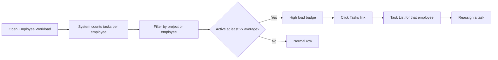

# Business Requirements Document – Employee Workload

## TaskFlow – Intelligent Task Allocation & Tracking System

> **Document:** Business Requirements Document (sub-module 02.2 Employee Workload, code `WORK`)  ·  **Version:** 1.0  ·  **Status:** Approved
> **Project type:** Personal Project (Skill Development)  ·  **Date:** 31-Oct-2026
> **Author:** Jojo George (jojogeorge3344@gmail.com)
> © 2026 Jojo George. All rights reserved.

---

## Document Control

### Revision History

| Version | Date | Author | Summary of changes |
|---|---|---|---|
| 1.0 | 31-Oct-2026 | Jojo George | Initial version, rewritten from the original BRD (Screen 16) to match TaskFlow as built |
| 1.0 | 31-Oct-2026 | Jojo George | Approved and signed off; baselined as the agreed business requirements. |
| 1.0 | 31-Oct-2026 | Jojo George | Editorial only: Related Documents paths updated to the `TF - Documents` folder layout; no requirement changed, sign-off unchanged. |

### Approvals / Sign-off

| Role | Name | Decision | Date |
|---|---|---|---|
| Product owner | Jojo George | Approved | 31-Oct-2026 |
| Reviewer | Jojo George | Approved | 31-Oct-2026 |

### Related Documents

| Document | Location |
|---|---|
| Overall BRD (roles, global rules `BR-nn`, global NFRs) | `../../00-Overall/BRD-TaskFlow-Overall.md` |
| Sibling BRDs – Task Management, Board | `../02.1-Task-Management/BRD-Task-Management.md`, `../02.3-Board/BRD-Board.md` |
| Original BRD | `BRD for Task management.docx` (v1.0) – Screen 16 |
| Development Plan (screen-wise) | `TF - Documents/Screens Wise Feature Development Plan/16-employee-workload-screen.md` |
| FRD | `../../../FRD/02-TaskFlow-Monitoring/02.2-Employee-Workload/FRD-Employee-Workload.md` |
| HLD / LLD | `../../../HLD/02-TaskFlow-Monitoring/02.2-Employee-Workload/HLD-Employee-Workload.md`, `../../../LLD/02-TaskFlow-Monitoring/02.2-Employee-Workload/LLD-Employee-Workload.md` |
| Functional workflow doc | `04-Monitoring/04.4-Employee-Workload.md` |
| TDD | `TDD-TaskFlow.md` (v2.0) |

---

## Index

1. Project Overview
2. Stakeholders & User Roles
3. Scope
4. Business Process / Workflows
5. Screen-by-Screen Requirements
6. Business Rules
7. Non-Functional Requirements
8. Data Requirements
9. Integrations & External Dependencies
10. Reporting Requirements
11. Recommended Technology Stack (optional)
12. Assumptions, Constraints & Dependencies
13. Risks
14. Acceptance Criteria
15. Requirements Traceability Matrix
16. Project Deliverables
17. Glossary
18. Project Summary

---

## 1. Project Overview

### 1.1 Introduction
Employee Workload shows how open work is spread across employees. For each person it shows active, high-priority,
overdue and completed task counts, their project allocations, and a "High load" badge for people carrying much more than
average. Administrators and Managers use it to balance work and jump to a person's tasks.

### 1.2 Business Problem / Current Situation
Managers hand out work without seeing how much each person already carries. Some employees are overloaded while others
are under-used, and overdue work is noticed only when a deadline is already missed.

### 1.3 Project Objectives
Sub-module objectives; they support the global objectives in section 1.3 of the overall BRD (`../../00-Overall/BRD-TaskFlow-Overall.md`).

| ID | Objective | Success measure (this sub-module) |
|---|---|---|
| OBJ-WORK-01 | Simplify employee task allocation | A Manager sees every employee's active load on one screen before assigning or reassigning work |
| OBJ-WORK-02 | Help managers identify pending and overdue tasks | Each employee's overdue count is shown and highlighted when greater than 0 |
| OBJ-WORK-03 | Generate reports for better work planning | Project allocation percentages are shown next to task counts, and the list can be narrowed to one project |

### 1.4 Expected Benefits
- Overloaded and under-used employees are spotted before deadlines slip.
- Planning uses both project allocation and actual open tasks.
- One click leads from a busy person to their task list, where work can be reassigned.

---

## 2. Stakeholders & User Roles

### 2.1 Stakeholders

| Stakeholder | Interest / responsibility |
|---|---|
| Project owner (Jojo George) | Defines priorities, approves this BRD |
| Managers | Balance work across employees |
| Administrators | Oversee load across the organization |
| Employees | Benefit from fair distribution (no access to this screen by default) |

### 2.2 User Roles

| Role | Description | Main responsibilities | Access level |
|---|---|---|---|
| Administrator | System owner | Review load, filter, open an employee's tasks | Organization |
| Manager | Leads a team | Review load, filter, open an employee's tasks | Organization (the list is not narrowed to the team; the task list opened from it follows the Manager's normal task scope) |
| Employee | Works on tasks | Is listed on the screen; cannot open it by default | No access |
| Custom role | Role defined in Role Configuration | As granted by "View workload" (`workload.view`), "Use workload filters" (`workload.filters.use`) and "Open an employee's tasks" (`workload.tasks.open`) | Organization when granted |

---

## 3. Scope

### 3.1 In Scope
- Employee Workload screen with per-employee task counts and project allocations.
- Average active load and "High load" highlighting.
- Project and Employee filters.
- Link from a row to that employee's task list.

### 3.2 Out of Scope (this release)
- Department column and Department filter – replaced by project allocations and the Project filter.
- A separate workload summary chart – replaced by a per-row workload bar and the header summary; workload charts are on the Dashboard.
- Changing or reassigning tasks on this screen – done on Task Details / Reassign Task (`../02.1-Task-Management/BRD-Task-Management.md`).
- Limiting the list to a Manager's own team.

### 3.3 Modules Overview

| # | Module | Purpose | Screens |
|---|---|---|---|
| 1 | Employee Workload (TaskFlow Monitoring) | See how open work is spread across employees | Employee Workload |

### 3.4 Change from original BRD

| Original BRD (Screen 16) | Current requirement (as built) |
|---|---|
| Department column | **Projects** column (project name and allocation %) and **Allocated %** total |
| Filter by department and employee | Filter by **Project** and **Employee** |
| Workload summary chart | Header summary ("N employees · average X active tasks") and a workload bar per row |
| "Highlight employees with unusually high active task counts" | Defined as: active count at least **twice the average** of the rows shown ("High load" badge) |
| Not specified | The list shows active users whose role cannot view all tasks (the Employee role by default), across the whole organization |

---

## 4. Business Process / Workflows

### 4.1 Review and Balance Workload

**Trigger:** A Manager plans new work or checks for overload  ·  **Actors:** Manager / Administrator, System

| Step | Actor / System | Action | Result |
|---|---|---|---|
| 1 | Manager | Opens **TaskFlow Monitoring → Employee Workload** | System loads the employee list |
| 2 | System | Counts active, high-priority, overdue and completed tasks per employee and the average active load | Table, header summary and legend shown |
| 3 | Manager | Optionally picks a **Project** or an **Employee** | List narrowed |
| 4 | System | Marks rows with at least twice the average active load as "High load" | Overloaded people stand out |
| 5 | Manager | Clicks **Tasks →** on a busy row | Task List opens filtered to that employee |
| 6 | Manager | Reassigns a task on Task Details (Task Management) | Load moves to another person |

**Example:** On 31-Oct-2026 the list shows 5 employees with 4, 2, 1, 1 and 12 active tasks. The average is 4 active
tasks ("5 employees · average 4 active tasks"). Asha has 12 active tasks (12 ≥ 8), 3 of them overdue, so her row carries
"High load" and the overdue count is highlighted. The Manager clicks **Tasks →** on Asha's row, opens `TSK-000123` and
reassigns it to Rahul, who has 1 active task.

**Exceptions / alternate flows:**
- No employee allocated to the chosen project → "No employees to show – There are no active employees in this project."
- Load failure → "Could not load the workload. Check your connection and try again."
- User without "View workload" → the menu item is hidden and the screen sends the user back to their dashboard.

---

## 5. Screen-by-Screen Requirements

### SCREEN 1: Employee Workload

| Field | Value |
|---|---|
| **Screen name** | Employee Workload |
| **Module** | TaskFlow Monitoring → Employee Workload |
| **Access** | Administrator, Manager; Custom role with "View workload" (`workload.view`); Employee: no access by default |
| **Priority** | Must |
| **Development plan ref** | Original Screen 16 |

**Purpose**
Show how open work is spread across employees so managers can balance it.

**Screen Elements**
- Header: "N employees · average X active tasks".
- Filters: **Project**, **Employee**, **Reset**.
- Table: Employee (with "High load" badge), Projects (name and %), Allocated %, Active, High priority, Overdue, Completed, workload bar, **Tasks →** link.
- Legend: "Highlighted rows carry at least twice the average active load (X active tasks)."

**Functional Requirements**

| ID | Requirement | Priority |
|---|---|---|
| REQ-WORK-01 | The system shall list every active user whose role cannot view all tasks (the Employee role by default), ordered by name. | Must |
| REQ-WORK-02 | The system shall show each employee's Active count: tasks that are not completed, cancelled or deleted. | Must |
| REQ-WORK-03 | The system shall show each employee's High priority count: active tasks with High or Critical priority. | Must |
| REQ-WORK-04 | The system shall show each employee's Overdue count (active tasks past their deadline) and highlight it when greater than 0. | Must |
| REQ-WORK-05 | The system shall show each employee's Completed count. | Must |
| REQ-WORK-06 | The system shall list employees with no tasks with zero counts. | Should |
| REQ-WORK-07 | The system shall show each employee's project allocations (project name and percentage) and the Allocated % total. | Should |
| REQ-WORK-08 | The system shall show the number of employees listed and their average active tasks in the header. | Should |
| REQ-WORK-09 | The system shall mark with a "High load" badge every row whose active count is at least twice the average of the rows shown, when the average is above 0, and explain this in the legend. | Must |
| REQ-WORK-10 | The system shall show a workload bar per row, scaled to the busiest row shown. | Could |
| REQ-WORK-11 | The system shall filter by Project, showing only people allocated to that project. | Should |
| REQ-WORK-12 | The system shall filter by Employee and offer **Reset** to clear both filters. | Should |
| REQ-WORK-13 | The system shall show the filters only to users with "Use workload filters". | Should |
| REQ-WORK-14 | The system shall open the Task List filtered to the employee from the row's **Tasks →** link, shown only to users with "Open an employee's tasks"; the user's own task scope still applies. | Must |
| REQ-WORK-15 | The system shall show the menu item and screen only to users with "View workload" and refuse the data to anyone else. | Must |
| REQ-WORK-16 | The system shall cover the whole organization, not only a Manager's team. | Must |
| REQ-WORK-17 | The system shall not change any data from this screen. | Should |

**Validations & Messages**

| Situation | Rule / message |
|---|---|
| Load failed | "Could not load the workload. Check your connection and try again." |
| No rows | "No employees to show – There are no active employees in this project." |
| Legend | "Highlighted rows carry at least twice the average active load (X active tasks)." |
| No permission | Menu item hidden; the screen sends the user to their dashboard; the data is refused |

**Expected Result**
Managers and Administrators see workload imbalances and overdue work across employees and open a person's tasks to
rebalance them.

---

## 6. Business Rules

Global rules from the [overall BRD, section 6](../../00-Overall/BRD-TaskFlow-Overall.md#6-business-rules) that apply here: only authorised users manage tasks; the overdue definition; one
application time zone; dashboard statistics and reports use consistent calculation rules.

| ID | Rule | Applies to |
|---|---|---|
| BR-WORK-01 | Active = not completed, cancelled or deleted; High priority = active and High or Critical; Overdue = active and deadline passed; Completed = status Completed. | SCREEN 1 |
| BR-WORK-02 | Listed people are active users whose role does not hold "View all tasks"; inactive users are never listed. | SCREEN 1 |
| BR-WORK-03 | "High load" = active count at least twice the average active count of the rows currently shown; no badge when the average is 0. | SCREEN 1 |
| BR-WORK-04 | Allocated % is the sum of the person's project allocation percentages. | SCREEN 1 |
| BR-WORK-05 | The **Tasks →** link never widens what the user may see: the Task List applies the user's own task scope. | SCREEN 1 |
| BR-WORK-06 | Workload, filters and the **Tasks →** link need "View workload"; filters and link also need their own permissions, each of which requires "View workload". | SCREEN 1 |

---

## 7. Non-Functional Requirements

The global NFRs in the overall BRD apply. Requirements specific to this sub-module:

| ID | Category | Requirement | Measure / target |
|---|---|---|---|
| NFR-WORK-01 | Performance | Counts are calculated in one request for all listed employees | One load per screen open or Project change; the Employee filter works without reloading |
| NFR-WORK-02 | Security | The workload data is refused without "View workload" | A direct request without the permission is refused |
| NFR-WORK-03 | Usability | Overload and overdue work stand out without reading every number | "High load" badge, highlighted Overdue, legend |
| NFR-WORK-04 | Reliability | The screen is read-only | No data is changed by viewing or filtering |
| NFR-WORK-05 | Maintainability | Workload counts use the same active, overdue and priority definitions as the Dashboard and Reports | BR-WORK-01 and the global calculation-consistency rule (overall BRD, section 6) |
| NFR-WORK-06 | Compatibility | As global NFRs | Overall BRD |
| NFR-WORK-07 | Accessibility | As global NFRs | Overall BRD |

---

## 8. Data Requirements

This sub-module stores no data of its own; it reads the data below.

| Entity / data set | Purpose | Key fields | Retention / rules |
|---|---|---|---|
| Users | Listed employees | Name, active flag, role | Only active users whose role lacks "View all tasks" |
| Project allocations | Projects column, Allocated %, Project filter | User, project, position, allocation % | Owned by Employee and Project Management |
| Tasks | The four counts | Assignee, status, priority, deadline, deleted flag | Owned by Task Management; deleted tasks are not counted |

---

## 9. Integrations & External Dependencies

| System / service | Purpose | Required? | Notes |
|---|---|---|---|
| Task Management | Task data for counts; target of the **Tasks →** link | Required | `../02.1-Task-Management/BRD-Task-Management.md` |
| Employee / Project Management | Employees and project allocations | Required | Allocations are maintained there |
| Role Configuration | Workload permissions; which roles hold "View all tasks" decides who is listed | Required | – |
| Notifications / Mail | – | Not used | Read-only screen |

---

## 10. Reporting Requirements

_Not applicable for this sub-module._ Workload is an on-screen view; exportable reports are in
`../../05-Reports/05.1-Reports/BRD-Reports.md`.

---

## 11. Recommended Technology Stack (optional)

_Not applicable for this sub-module._ The recommended stack is in the overall BRD.

---

## 12. Assumptions, Constraints & Dependencies

| Type | Description |
|---|---|
| Assumption | Global objectives and business rules are defined in the overall BRD (`../../00-Overall/BRD-TaskFlow-Overall.md`, sections 1.3 and 6) and are referenced here by description, not by number |
| Assumption | Project allocations are kept up to date in Management |
| Constraint | The list is organization-wide; a Manager also sees employees outside the team |
| Constraint | "High load" is relative to the rows shown, so it changes with the filters |
| Dependency | Who is listed depends on which roles hold "View all tasks" in Role Configuration |

---

## 13. Risks

| ID | Risk | Impact | Likelihood | Mitigation |
|---|---|---|---|---|
| R-WORK-01 | The filter and **Tasks →** permissions are enforced only on the screen; the Project filter works by direct request without "Use workload filters" | Low | Low | The data itself still needs "View workload"; add a server check later |
| R-WORK-02 | A Manager sees load counts of employees outside the team | Medium | High | Accepted for this release (REQ-WORK-16); the task list keeps the team limit |
| R-WORK-03 | A role that holds "View all tasks" only through an older permission name could still be listed as an employee | Low | Low | Keep role permissions current in Role Configuration |
| R-WORK-04 | Managers expecting a Department view (original BRD) do not find it | Low | Medium | Use the Project filter; department views are on the Dashboard |

---

## 14. Acceptance Criteria

| ID | Criterion | Verified by |
|---|---|---|
| AC-WORK-01 | Only active users whose role cannot view all tasks are listed, by name, including those with no tasks (zero counts). | SCREEN 1, REQ-WORK-01, REQ-WORK-06 |
| AC-WORK-02 | For a sample employee, Active, High priority, Overdue and Completed match the task data, and Overdue greater than 0 is highlighted. | SCREEN 1, REQ-WORK-02, REQ-WORK-03, REQ-WORK-04, REQ-WORK-05 |
| AC-WORK-03 | Projects and Allocated % match the employee's allocations. | SCREEN 1, REQ-WORK-07 |
| AC-WORK-04 | With 5 employees averaging 4 active tasks, a person with 8 or more active tasks shows "High load"; the header and legend show the average; bars scale to the busiest row. | SCREEN 1, REQ-WORK-08, REQ-WORK-09, REQ-WORK-10 |
| AC-WORK-05 | Picking a project lists only people allocated to it; picking an employee shows only that person; Reset clears both; filters are hidden without "Use workload filters". | SCREEN 1, REQ-WORK-11, REQ-WORK-12, REQ-WORK-13 |
| AC-WORK-06 | **Tasks →** opens the Task List for that employee, within the user's own task scope, and is hidden without "Open an employee's tasks". | SCREEN 1, REQ-WORK-14 |
| AC-WORK-07 | An Employee cannot see the menu item or the data; a Manager sees the whole organization; nothing is changed by using the screen. | SCREEN 1, REQ-WORK-15, REQ-WORK-16, REQ-WORK-17 |

---

## 15. Requirements Traceability Matrix

| Objective | Business rule(s) | Screen(s) | Functional requirement(s) | Acceptance criterion |
|---|---|---|---|---|
| OBJ-WORK-01 | BR-WORK-02, BR-WORK-03, BR-WORK-05 | SCREEN 1 | REQ-WORK-01, REQ-WORK-02, REQ-WORK-06, REQ-WORK-08, REQ-WORK-09, REQ-WORK-10, REQ-WORK-14 | AC-WORK-01, AC-WORK-02, AC-WORK-04, AC-WORK-06 |
| OBJ-WORK-02 | Global (overall §6), BR-WORK-01 | SCREEN 1 | REQ-WORK-03, REQ-WORK-04, REQ-WORK-05 | AC-WORK-02 |
| OBJ-WORK-03 | BR-WORK-04 | SCREEN 1 | REQ-WORK-07, REQ-WORK-11, REQ-WORK-12, REQ-WORK-13 | AC-WORK-03, AC-WORK-05 |
| OBJ-WORK-01 | Global (overall §6), BR-WORK-06 | SCREEN 1 | REQ-WORK-15, REQ-WORK-16, REQ-WORK-17 | AC-WORK-07 |

---

## 16. Project Deliverables

| # | Deliverable | Format |
|---|---|---|
| 1 | Employee Workload screen and its server function | Repository (source code) |
| 2 | BRD, FRD, HLD and LLD for Employee Workload | Markdown |
| 3 | Unit and integration tests for workload counts, custom roles and loading the workload data | Repository (automated tests) |
| 4 | Sample employees, allocations and tasks for demonstration | Seed data |

---

## 17. Glossary

| Term | Meaning |
|---|---|
| Active task | A task that is not completed, cancelled or deleted |
| High priority task | An active task with High or Critical priority |
| Overdue task | An active task whose deadline has passed |
| Allocation | A person's share (percentage) of a project, with a position |
| Allocated % | The sum of a person's project allocations |
| High load | Active count at least twice the average of the rows shown |
| Task scope | The set of tasks a user may see: Own, Team or Organization |

---

## 18. Project Summary
Employee Workload gives Administrators and Managers one view of how open work is spread across employees: active,
high-priority, overdue and completed counts next to project allocations, with overloaded people flagged. From any row
they open that person's tasks and rebalance work through Task Management, reducing missed deadlines caused by uneven
allocation.

---
© 2026 Jojo George. All rights reserved. Unauthorized copying or distribution of this document is prohibited.
