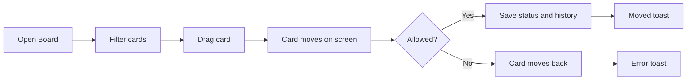

# Business Requirements Document – Board

## TaskFlow – Intelligent Task Allocation & Tracking System

> **Document:** Business Requirements Document (sub-module 02.3 Board, code `BOARD`)  ·  **Version:** 1.0  ·  **Status:** Approved
> **Project type:** Personal Project (Skill Development)  ·  **Date:** 31-Oct-2026
> **Author:** Jojo George (jojogeorge3344@gmail.com)
> © 2026 Jojo George. All rights reserved.

---

## Document Control

### Revision History

| Version | Date | Author | Summary of changes |
|---|---|---|---|
| 1.0 | 31-Oct-2026 | Jojo George | Initial version, rewritten from the original BRD (Screen 10) to match TaskFlow as built |
| 1.0 | 31-Oct-2026 | Jojo George | Approved and signed off; baselined as the agreed business requirements. |
| 1.0 | 31-Oct-2026 | Jojo George | Editorial only: Related Documents paths updated to the `TF - Documents` folder layout; no requirement changed, sign-off unchanged. |

### Approvals / Sign-off

| Role | Name | Decision | Date |
|---|---|---|---|
| Product owner | Jojo George | Approved | 31-Oct-2026 |
| Reviewer | Jojo George | Approved | 31-Oct-2026 |

### Related Documents

| Document | Location |
|---|---|
| Overall BRD (roles, global rules `BR-nn`, global NFRs) | `../../00-Overall/BRD-TaskFlow-Overall.md` |
| Sibling BRDs – Task Management, Employee Workload | `../02.1-Task-Management/BRD-Task-Management.md`, `../02.2-Employee-Workload/BRD-Employee-Workload.md` |
| Original BRD | `BRD for Task management.docx` (v1.0) – Screen 10 |
| Development Plan (screen-wise) | `TF - Documents/Screens Wise Feature Development Plan/10-kanban-board-screen.md` |
| FRD | `../../../FRD/02-TaskFlow-Monitoring/02.3-Board/FRD-Board.md` |
| HLD / LLD | `../../../HLD/02-TaskFlow-Monitoring/02.3-Board/HLD-Board.md`, `../../../LLD/02-TaskFlow-Monitoring/02.3-Board/LLD-Board.md` |
| Functional workflow doc | `04-Monitoring/04.3-Kanban-Board.md` |
| TDD | `TDD-TaskFlow.md` (v2.0) |

---

## Index

1. Project Overview
2. Stakeholders & User Roles
3. Scope
4. Business Process / Workflows
5. Screen-by-Screen Requirements
6. Business Rules
7. Non-Functional Requirements
8. Data Requirements
9. Integrations & External Dependencies
10. Reporting Requirements
11. Recommended Technology Stack (optional)
12. Assumptions, Constraints & Dependencies
13. Risks
14. Acceptance Criteria
15. Requirements Traceability Matrix
16. Project Deliverables
17. Glossary
18. Project Summary

---

## 1. Project Overview

### 1.1 Introduction
The Board (Kanban) shows the tasks a user may access as status columns. Users with the status permission drag a card to
another column to change the task's status, and click a card to open its details. It gives everyone a quick visual
picture of where work stands.

### 1.2 Business Problem / Current Situation
A list of tasks does not show at a glance how much work is waiting, in progress, in testing, blocked or done. Updating a
status means opening each task, and late work is easy to overlook.

### 1.3 Project Objectives
Sub-module objectives; they support the global objectives in section 1.3 of the overall BRD (`../../00-Overall/BRD-TaskFlow-Overall.md`).

| ID | Objective | Success measure (this sub-module) |
|---|---|---|
| OBJ-BOARD-01 | Monitor the progress of assigned tasks | All accessible tasks are visible by status on one screen, with a count per column |
| OBJ-BOARD-02 | Help managers identify pending and overdue tasks | Overdue cards are highlighted on the board |
| OBJ-BOARD-03 | Maintain a history of task updates and changes | Every accepted card move appears in the task's activity history |

### 1.4 Expected Benefits
- One visual overview of work by stage for every role.
- Fastest way to update a status: one drag, same rules and history as Task Details.
- Late work stands out without opening tasks.

---

## 2. Stakeholders & User Roles

### 2.1 Stakeholders

| Stakeholder | Interest / responsibility |
|---|---|
| Project owner (Jojo George) | Defines priorities, approves this BRD |
| Managers | Follow their team's progress, move tasks |
| Employees | Move their own tasks through the stages |
| Administrators | Overview of all work |

### 2.2 User Roles

| Role | Description | Main responsibilities | Access level |
|---|---|---|---|
| Administrator | System owner | View, filter, move any task | Organization (all tasks) |
| Manager | Leads a team | View, filter, move team tasks | Team, plus tasks they created, are assigned or are notified about |
| Employee | Works on tasks | View, filter, move own tasks | Own (tasks they are assigned, created or are notified about) |
| Custom role | Role defined in Role Configuration | As granted by "View board" (`board.view`), "Use board filters" (`board.filters.use`) and "Update task status" (`tasks.status.change`) | Follows the user's task scope |

---

## 3. Scope

### 3.1 In Scope
- Board screen with five status columns and task cards.
- Drag-and-drop status change using the Task Management status rules.
- Project, Assignee, Status and Deadline filters.
- Refresh and open-task-from-card.

### 3.2 Out of Scope (this release)
- A Cancelled column – cancelled tasks are not shown on the board.
- Re-ordering cards within a column – the order always follows the deadline.
- Paging of the board – all accessible tasks are loaded at once.
- Notifications for a status change – status changes are recorded in the history only.
- Editing task details on the board – done on Task Details (`../02.1-Task-Management/BRD-Task-Management.md`).

### 3.3 Modules Overview

| # | Module | Purpose | Screens |
|---|---|---|---|
| 1 | Board (TaskFlow Monitoring) | See tasks by status and move them | Board (Kanban) |

### 3.4 Change from original BRD

| Original BRD (Screen 10) | Current requirement (as built) |
|---|---|
| Four columns: To Do, In Progress, Blocked, Completed | Five columns: To Do, In Progress, **In QA**, Blocked, Completed |
| Cancelled status not mentioned | Cancelled tasks have no column and are not shown |
| Card shows ID, title, assignee, priority, deadline, status | Card shows code, priority, title, **project**, assignee and deadline; the column gives the status |
| No filters | Filters for Project, Assignee, Status and Deadline range |
| "Refresh the board" | A **Refresh** button reloads the latest statuses |

---

## 4. Business Process / Workflows

### 4.1 Move a Card to a New Status

**Trigger:** Work on a task moves to its next stage  ·  **Actors:** Employee / Manager / Administrator, System

| Step | Actor / System | Action | Result |
|---|---|---|---|
| 1 | User | Opens **Board** | Accessible tasks shown by status, ordered by deadline |
| 2 | User | Optionally filters by project, assignee, status or deadline | Cards narrowed |
| 3 | User | Drags a card to another column | Card moves on screen at once |
| 4 | System | Checks the permission, task access and the status rules | Move accepted or refused |
| 5 | System | Saves the status and records "Status changed from X to Y" ("Task completed" when completed) | Toast "TSK-… moved to Y" |
| 6 | System | On refusal, returns the card to its column | Error toast with the reason |

**Example:** On 03-Nov-2026 Rahul opens the board, filters by project "Finance Ops" and drags `TSK-000123` "Prepare
Monthly Report" from To Do to In Progress. The toast reads "TSK-000123 moved to In Progress" and the task history shows
"Status changed from ToDo to InProgress". On 06-Nov-2026 he drags it to In QA. Later he tries to drag a Completed card
back to In Progress; the card returns to Completed and the toast reads "Cannot move a task from Completed to InProgress.".

**Exceptions / alternate flows:**
- User without "Update task status" → cards cannot be dragged.
- Server error → the card returns and the toast reads "Could not move TSK-000123.".
- Load failure → "Could not load the board. Try again."
- Card clicked → Task Details opens; Back returns to the board.

---

## 5. Screen-by-Screen Requirements

### SCREEN 1: Board (Kanban)

| Field | Value |
|---|---|
| **Screen name** | Board |
| **Module** | TaskFlow Monitoring → Board (users who can view all tasks), or Task Management → Board (everyone else) |
| **Access** | Administrator, Manager, Employee; Custom role with "View board" (`board.view`); content follows the user's task scope |
| **Priority** | Must |
| **Development plan ref** | Original Screen 10 |

**Purpose**
Show accessible tasks as status columns and let users drag a card to change its status.

**Screen Elements**
- Header: "N tasks across 5 stages" and **Refresh**.
- Filter row: Project, Assignee, Status, Deadline from, Deadline to, **Clear filters**.
- Columns: To Do, In Progress, In QA, Blocked, Completed, each with a count.
- Cards: task code, priority, title, project, assignee, deadline; overdue cards and deadlines highlighted.
- Empty column text "Drop tasks here".

**Functional Requirements**

| ID | Requirement | Priority |
|---|---|---|
| REQ-BOARD-01 | The system shall show the tasks in the user's task scope (own, team or organization) in the columns To Do, In Progress, In QA, Blocked and Completed, with a count per column. | Must |
| REQ-BOARD-02 | The system shall not show cancelled or deleted tasks on the board. | Must |
| REQ-BOARD-03 | The system shall show on each card the task code, priority, title, project, assignee and deadline. | Must |
| REQ-BOARD-04 | The system shall highlight overdue cards and their deadlines. | Must |
| REQ-BOARD-05 | The system shall order cards in each column by deadline and not allow manual re-ordering within a column. | Should |
| REQ-BOARD-06 | The system shall show the total, e.g. "N tasks across 5 stages". | Could |
| REQ-BOARD-07 | The system shall let users with "Update task status" drag a card to another column to change the task's status, and disable dragging for everyone else. | Must |
| REQ-BOARD-08 | The system shall apply the same status rules as Task Details and refuse any move they do not allow, showing the reason. | Must |
| REQ-BOARD-09 | The system shall move the card on screen at once and return it to its column if the move is refused or fails. | Should |
| REQ-BOARD-10 | The system shall confirm an accepted move with "TSK-… moved to `<status>`". | Should |
| REQ-BOARD-11 | The system shall record "Status changed from X to Y", and "Task completed" when moved to Completed, in the task's history. | Must |
| REQ-BOARD-12 | The system shall filter by project, status and an inclusive deadline from/to range, combining all chosen filters. | Should |
| REQ-BOARD-13 | The system shall offer the Assignee filter only to users who can view all tasks. | Should |
| REQ-BOARD-14 | The system shall show the filter row only to users with "Use board filters". | Should |
| REQ-BOARD-15 | The system shall show "Drop tasks here" in an empty column and "No tasks match the current filters." when filters hide every task. | Could |
| REQ-BOARD-16 | The system shall reload the latest statuses when the user clicks **Refresh**. | Must |
| REQ-BOARD-17 | The system shall open Task Details when a card is clicked, with Back returning to the board. | Must |
| REQ-BOARD-18 | The system shall show the Board menu item and screen only to users with "View board" and send others back to their dashboard. | Must |

**Validations & Messages**

| Situation | Rule / message |
|---|---|
| Move accepted | "TSK-000123 moved to In Progress" |
| Move not allowed | "Cannot move a task from Completed to InProgress." (statuses vary) |
| Move failed (other) | "Could not move TSK-000123." |
| Load failed | "Could not load the board. Try again." |
| Filters hide all cards | "No tasks match the current filters." |
| No permission | Menu item hidden; the screen sends the user back to their dashboard |

**Expected Result**
Users see their accessible tasks by status at a glance, spot overdue cards, and move tasks to their next allowed status
by dragging, with every move recorded.

---

## 6. Business Rules

Global rules from the [overall BRD, section 6](../../00-Overall/BRD-TaskFlow-Overall.md#6-business-rules) that apply here: only authorised users modify tasks; employees update only tasks
they may manage; the overdue definition; important changes are recorded; one application time zone.

| ID | Rule | Applies to |
|---|---|---|
| BR-BOARD-01 | The board shows exactly the tasks of the user's task-list scope (Own, Team or Organization). | SCREEN 1 |
| BR-BOARD-02 | A card move follows BR-TASK-03: Completed and Cancelled are final, so Completed cards cannot be moved out. | SCREEN 1 |
| BR-BOARD-03 | A card is overdue when its deadline has passed and it is not completed or cancelled. | SCREEN 1 |
| BR-BOARD-04 | All filters work together (AND); the deadline range includes both end dates. | SCREEN 1 |
| BR-BOARD-05 | "Use board filters" requires "View board"; the Assignee filter also requires "View all tasks". | SCREEN 1 |
| BR-BOARD-06 | Dropping a card in its own column changes nothing. | SCREEN 1 |

---

## 7. Non-Functional Requirements

The global NFRs in the overall BRD apply. Requirements specific to this sub-module:

| ID | Category | Requirement | Measure / target |
|---|---|---|---|
| NFR-BOARD-01 | Performance | Filtering does not reload data | Filters apply on screen to the loaded tasks; one load per open or Refresh |
| NFR-BOARD-02 | Security | Status permission, task access and status rules are checked on the server for every move | A refused move leaves the task unchanged |
| NFR-BOARD-03 | Usability | Moves feel immediate and failures are visible | Card moves at once; on refusal it returns and a message explains why |
| NFR-BOARD-04 | Reliability | The board never shows a status the server did not accept | Refused moves are rolled back on screen |
| NFR-BOARD-05 | Maintainability | One set of status rules for board and Task Details | Shared transition table (BR-TASK-03) |
| NFR-BOARD-06 | Compatibility | Drag-and-drop works in the supported browsers | As global NFRs in the overall BRD |
| NFR-BOARD-07 | Accessibility | As global NFRs | Overall BRD |

---

## 8. Data Requirements

This sub-module stores no data of its own.

| Entity / data set | Purpose | Key fields | Retention / rules |
|---|---|---|---|
| Tasks | Cards and their columns | Code, title, project, assignee, priority, deadline, status, completed time, deleted flag | Owned by Task Management; the status is updated on a move |
| Activity history entries | Record of each move | Task, event type, old and new status, user, time | Owned by Task Management; never changed by users |

---

## 9. Integrations & External Dependencies

| System / service | Purpose | Required? | Notes |
|---|---|---|---|
| Task Management | Tasks, task scope, status rules, history, Task Details | Required | `../02.1-Task-Management/BRD-Task-Management.md` |
| Role Configuration | Board and status permissions | Required | – |
| Settings (Application) | Application time zone for overdue | Required | – |
| Notifications / Mail | – | Not used | Status changes send no notification |

---

## 10. Reporting Requirements

_Not applicable for this sub-module._ Status reports are in `../../05-Reports/05.1-Reports/BRD-Reports.md`.

---

## 11. Recommended Technology Stack (optional)

_Not applicable for this sub-module._ The recommended stack is in the overall BRD.

---

## 12. Assumptions, Constraints & Dependencies

| Type | Description |
|---|---|
| Assumption | Global objectives and business rules are defined in the overall BRD (`../../00-Overall/BRD-TaskFlow-Overall.md`, sections 1.3 and 6) and are referenced here by description, not by number |
| Assumption | The number of accessible tasks stays small enough to load the whole board at once |
| Constraint | No Cancelled column; no manual card order |
| Dependency | Task Management for scope, status rules and history |

---

## 13. Risks

| ID | Risk | Impact | Likelihood | Mitigation |
|---|---|---|---|---|
| R-BOARD-01 | Large task volumes slow the board, because it is not paged | Medium | Low | Use filters; add paging or server filtering in a later release |
| R-BOARD-02 | "Use board filters" is enforced only on the screen | Low | Low | Filters only narrow data the user may already see |
| R-BOARD-03 | Cancelled tasks are invisible on the board | Low | Medium | Find them in the Task List with the Status filter |
| R-BOARD-04 | The Task List **Board view** button is shown even without "View board"; the board then sends the user back | Low | Medium | Hide the button without the permission |

---

## 14. Acceptance Criteria

| ID | Criterion | Verified by |
|---|---|---|
| AC-BOARD-01 | An Employee, a Manager and an Administrator each see their own scope of tasks in five columns with correct counts; cancelled and deleted tasks are absent. | SCREEN 1, REQ-BOARD-01, REQ-BOARD-02, REQ-BOARD-06 |
| AC-BOARD-02 | Cards show code, priority, title, project, assignee and deadline, ordered by deadline; overdue cards are highlighted. | SCREEN 1, REQ-BOARD-03, REQ-BOARD-04, REQ-BOARD-05 |
| AC-BOARD-03 | Dragging To Do → In Progress saves the status, shows "TSK-… moved to In Progress" and adds a "Status changed" entry to the history. | SCREEN 1, REQ-BOARD-07, REQ-BOARD-10, REQ-BOARD-11 |
| AC-BOARD-04 | Dragging Completed → In Progress is refused, the card returns and the reason is shown; without "Update task status" cards cannot be dragged. | SCREEN 1, REQ-BOARD-07, REQ-BOARD-08, REQ-BOARD-09 |
| AC-BOARD-05 | Filters narrow the cards with AND and inclusive dates; Assignee appears only for view-all users; the filter row is hidden without "Use board filters"; empty states show. | SCREEN 1, REQ-BOARD-12, REQ-BOARD-13, REQ-BOARD-14, REQ-BOARD-15 |
| AC-BOARD-06 | Refresh shows a status changed elsewhere; clicking a card opens Task Details and Back returns to the board; without "View board" the screen is not reachable. | SCREEN 1, REQ-BOARD-16, REQ-BOARD-17, REQ-BOARD-18 |

---

## 15. Requirements Traceability Matrix

| Objective | Business rule(s) | Screen(s) | Functional requirement(s) | Acceptance criterion |
|---|---|---|---|---|
| OBJ-BOARD-01 | Global (overall §6), BR-BOARD-01, BR-BOARD-02, BR-BOARD-06 | SCREEN 1 | REQ-BOARD-01, REQ-BOARD-02, REQ-BOARD-03, REQ-BOARD-05, REQ-BOARD-06, REQ-BOARD-07, REQ-BOARD-08, REQ-BOARD-09, REQ-BOARD-10 | AC-BOARD-01, AC-BOARD-02, AC-BOARD-03, AC-BOARD-04 |
| OBJ-BOARD-01 | BR-BOARD-04, BR-BOARD-05 | SCREEN 1 | REQ-BOARD-12, REQ-BOARD-13, REQ-BOARD-14, REQ-BOARD-15, REQ-BOARD-16, REQ-BOARD-17, REQ-BOARD-18 | AC-BOARD-05, AC-BOARD-06 |
| OBJ-BOARD-02 | Global (overall §6), BR-BOARD-03 | SCREEN 1 | REQ-BOARD-04 | AC-BOARD-02 |
| OBJ-BOARD-03 | Global (overall §6) | SCREEN 1 | REQ-BOARD-11 | AC-BOARD-03 |

---

## 16. Project Deliverables

| # | Deliverable | Format |
|---|---|---|
| 1 | Board screen with drag-and-drop and filters | Repository (source code) |
| 2 | BRD, FRD, HLD and LLD for the Board | Markdown |
| 3 | Tests for the shared status transition rules | Repository (automated tests) |
| 4 | Sample tasks in every status for demonstration | Seed data |

---

## 17. Glossary

| Term | Meaning |
|---|---|
| Board / Kanban | A view of tasks as columns, one per status |
| Card | One task on the board |
| Column | A status: To Do, In Progress, In QA, Blocked or Completed |
| In QA | The task is being checked before it is completed |
| Overdue card | A card whose deadline has passed and whose task is not completed or cancelled |
| Task scope | The set of tasks a user may see: Own, Team or Organization |

---

## 18. Project Summary
The Board gives every TaskFlow user a visual overview of their accessible work across To Do, In Progress, In QA,
Blocked and Completed. Overdue cards stand out, and a single drag moves a task to its next allowed status under the same
rules and history as Task Details, so progress is easy to follow and quick to update.

---
© 2026 Jojo George. All rights reserved. Unauthorized copying or distribution of this document is prohibited.
