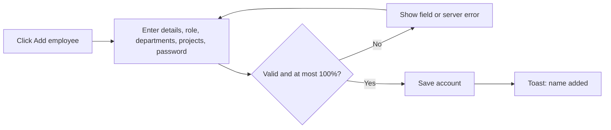
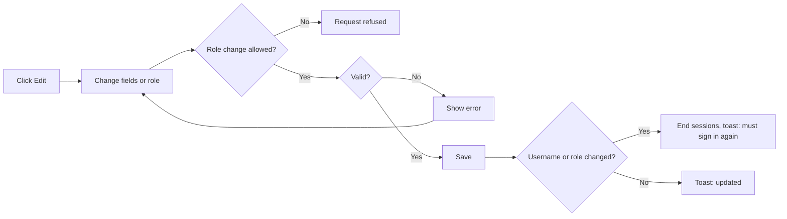
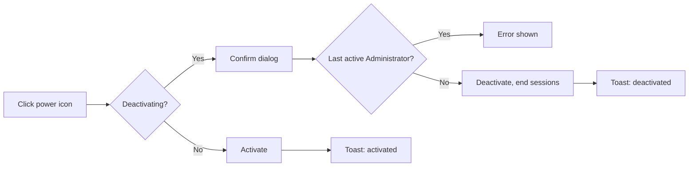
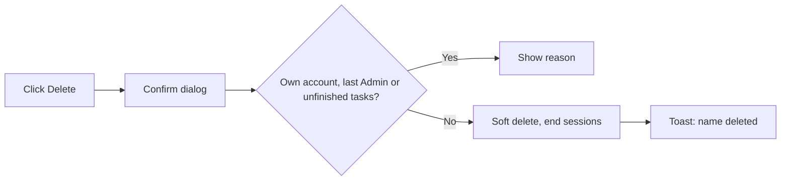
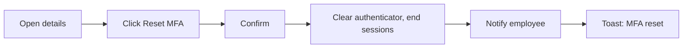

# Business Requirements Document – Employee Management

## TaskFlow – Intelligent Task Allocation & Tracking System

> **Document:** Business Requirements Document (sub-module EMP)  ·  **Version:** 1.0  ·  **Status:** Approved
> **Project type:** Personal Project (Skill Development)  ·  **Date:** 31-Oct-2026
> **Author:** Jojo George (jojogeorge3344@gmail.com)
> **Module:** TaskFlow Management  ·  **Sub-module:** 03.1 Employee Management (code `EMP`)
> © 2026 Jojo George. All rights reserved.

---

## Document Control

### Revision History

| Version | Date | Author | Summary of changes |
|---|---|---|---|
| 1.0 | 31-Oct-2026 | Jojo George | Initial version, written from the original BRD (Screen 5) and TaskFlow as built |
| 1.0 | 31-Oct-2026 | Jojo George | Approved and signed off; baselined as the agreed business requirements. |
| 1.0 | 31-Oct-2026 | Jojo George | Editorial only: Related Documents paths updated to the `TF - Documents` folder layout; no requirement changed, sign-off unchanged. |

### Approvals / Sign-off

| Role | Name | Decision | Date |
|---|---|---|---|
| Product owner | Jojo George | Approved | 31-Oct-2026 |
| Reviewer | Jojo George | Approved | 31-Oct-2026 |

### Related Documents

| Document | Location |
|---|---|
| Overall BRD (roles, global rules, NFRs) | `../../00-Overall/BRD-TaskFlow-Overall.md` |
| Development Plan (screen-wise), Screen 5 | `TF - Documents/Screens Wise Feature Development Plan/05-employee-management-screen.md` |
| Related BRDs | `../03.2-Project-Management/BRD-Project-Management.md`, `../03.3-Department-Management/BRD-Department-Management.md` |
| FRD | `../../../FRD/03-TaskFlow-Management/03.1-Employee-Management/FRD-Employee-Management.md` |
| HLD / LLD | `../../../HLD/03-TaskFlow-Management/03.1-Employee-Management/HLD-Employee-Management.md`, `../../../LLD/03-TaskFlow-Management/03.1-Employee-Management/LLD-Employee-Management.md` |
| TDD | `TF - Documents/TF - TDD/TDD-TaskFlow.md` |

---

## Index

1. Project Overview
2. Stakeholders & User Roles
3. Scope
4. Business Process / Workflows
5. Screen-by-Screen Requirements
6. Business Rules
7. Non-Functional Requirements
8. Data Requirements
9. Integrations & External Dependencies
10. Reporting Requirements
11. Recommended Technology Stack (optional)
12. Assumptions, Constraints & Dependencies
13. Risks
14. Acceptance Criteria
15. Requirements Traceability Matrix
16. Project Deliverables
17. Glossary
18. Project Summary

---

## 1. Project Overview

### 1.1 Introduction
Employee Management (menu **TaskFlow Management → Employee Management**) is where administrators keep the list of
people who use TaskFlow. Each employee is a sign-in account with a role, departments and project allocations. Here an
administrator adds people, edits them, switches accounts on or off, removes people who have left and resets lost
two-step verification (MFA).

### 1.2 Business Problem / Current Situation
- Without one owner of the employee list, sign-in accounts, roles and team membership drift apart and people keep
  access after they leave.
- A "reports to" list kept by hand goes out of date; TaskFlow instead derives a person's managers from departments and
  projects.
- Removing the wrong account (the last Administrator, your own account, or someone still holding open work) can lock
  the organisation out or orphan tasks.
- People who lose their authenticator phone and backup codes cannot sign in without administrator help.

### 1.3 Project Objectives

| ID | Objective | Success measure |
|---|---|---|
| OBJ-EMP-01 | Keep accurate employee accounts in one place | An administrator adds a person with role, departments and projects in one side panel; the list shows every live employee |
| OBJ-EMP-02 | Control who can sign in | A deactivated or deleted person cannot sign in; their existing sessions end at once |
| OBJ-EMP-03 | Protect the system from lock-out and mistakes | There is always at least one active Administrator; nobody can delete their own account |
| OBJ-EMP-04 | Keep history when people leave | Deleting an employee keeps all their tasks, comments and mail |
| OBJ-EMP-05 | Help people who lost their authenticator | An administrator resets MFA and the person can sign in with their password again |

These objectives support the overall TaskFlow objectives in `../../00-Overall/BRD-TaskFlow-Overall.md`.

### 1.4 Expected Benefits
- Organisation: one trusted list of people that tasks, dashboards, workload, reports and the TaskFlow Assistant rely on.
- Administrators: fast account set-up, safe deactivation and deletion, and immediate effect of access changes.
- Managers: correct teams, because managers follow automatically from departments and projects.
- Employees: a working account with the right role, and a recovery path if they lose their authenticator.

---

## 2. Stakeholders & User Roles

### 2.1 Stakeholders

| Stakeholder | Interest / responsibility |
|---|---|
| Project owner (Jojo George) | Defines priorities, approves this BRD |
| Administrators | Maintain employee accounts, roles and status |
| Managers | Rely on correct employee data for assignment and team views |
| Employees | Need a working, correctly-roled account |

### 2.2 User Roles

| Role | Description | Main responsibilities | Access level |
|---|---|---|---|
| Administrator | Full system owner | Add, edit, activate/deactivate, delete employees; assign any role; reset MFA | Organisation |
| Manager | Plans and assigns work | No Employee Management screen; may list people in other screens (for example the task assignee picker) through `employees.view` | Organisation list, read only, through other screens |
| Employee | Works on tasks | No access to this sub-module | None |
| Custom role | Role built in Role Configuration | Whatever employee permissions it is granted; sees the screen only with at least one employee action permission | As granted (Organisation) |

---

## 3. Scope

### 3.1 In Scope
- Employee list with search and filters (project, role, status).
- Employee details side panel (read only), including derived managers and, for Managers, the projects they manage and their team.
- Add employee: personal details, role, departments, project allocations, temporary password and initial status.
- Edit employee: code, name, username, email and role.
- Activate / deactivate accounts.
- Delete (soft delete) employees with safety checks.
- Reset an employee's authenticator MFA.

### 3.2 Out of Scope (this release)
- Changing a person's departments or project allocations after creation – done in Department Management and Project Management.
- Setting or resetting another person's password – people change their own password in My Profile or through account recovery.
- Self-registration – only administrators create accounts.
- Bulk import or export of employees – not requested.
- A Department filter on the employee list – not offered by the screen (see SCREEN 1 change note).

### 3.3 Modules Overview

| # | Module | Purpose | Screens |
|---|---|---|---|
| 1 | TaskFlow Management → Employee Management | Sign-in accounts, roles, status, deletion and MFA reset for every person | Employee Management (list), Employee details (side panel), Add / Edit employee (side panel) |

---

## 4. Business Process / Workflows

### 4.1 Add an Employee

**Trigger:** A new person joins  ·  **Actors:** Administrator, System

| Step | Actor / System | Action | Result |
|---|---|---|---|
| 1 | Administrator | Opens Employee Management and clicks **Add employee** | The Add employee side panel opens |
| 2 | Administrator | Enters full name, username, email (part before `@taskflow.com`) and optional employee code | Fields filled |
| 3 | Administrator | Picks a role (if allowed), ticks departments, adds project rows with position and percentage | Allocation bar shows "X% allocated, Y% remaining" |
| 4 | Administrator | Enters a temporary password and the initial status, then clicks **Add employee** | Data submitted |
| 5 | System | Checks required fields, email format, uniqueness, role rights and the 100% cap | Errors shown, or the account is saved |
| 6 | System | Shows "{Full name} added" and reloads the list | New employee listed |

**Example:** On 31-Oct-2026 the administrator adds *Anu Thomas*, username `anu`, email `anu.thomas@taskflow.com`, role
Employee, department Engineering, project Website as Developer at 60%, temporary password `Temp#123`, status Active. The
bar shows "60% allocated, 40% remaining" and the toast reads "Anu Thomas added".

**Exceptions / alternate flows:**
- Email local part already used (even by a deleted person) → "Email already exists."
- Username already used → "Email or username already exists."
- Allocations add up to 110% → "Allocations total 110%. A person can be allocated at most 100%."
- User without the assign-roles permission → the role stays Employee.

### 4.2 Edit an Employee (including a Role Change)

**Trigger:** Details or role must change  ·  **Actors:** Administrator, System

| Step | Actor / System | Action | Result |
|---|---|---|---|
| 1 | Administrator | Clicks **Edit** on a row or in the details panel | Edit panel opens with saved data; departments and projects are view only |
| 2 | Administrator | Changes code, name, username, email or (if allowed) role | Notice: "Changing the username or role signs this employee out. They must sign in again." |
| 3 | System | Validates, checks role rights and the last-Administrator rule | Errors shown, or changes saved |
| 4 | System | If username or role changed, ends the person's sessions | "{name} updated. They must sign in again." |
| 5 | System | If the person stops being a Manager, removes their project-manager flags and department-manager links | Manager duties cleared |

**Example:** Ravi Menon is promoted from Employee to Manager. The administrator changes the role and saves; the toast
reads "Ravi Menon updated. They must sign in again." and Ravi's next request sends him to the login page.

**Exceptions / alternate flows:**
- An administrator changes their **own** username or role → they are signed out at once and taken to the login page.
- Moving the only active Administrator to another role → "The only active Administrator cannot be moved to another role."

### 4.3 Activate or Deactivate an Employee

**Trigger:** A person goes on leave or returns  ·  **Actors:** Administrator, System

| Step | Actor / System | Action | Result |
|---|---|---|---|
| 1 | Administrator | Clicks the power icon on a row | Deactivation asks for confirmation; activation does not |
| 2 | Administrator | Confirms "Deactivate employee?" | Request sent |
| 3 | System | Refuses if this is the only active Administrator; otherwise switches the account off and ends all sessions | "{name} deactivated" or "{name} activated" |

**Example:** Meera goes on a 3-month leave on 01-Nov-2026. The administrator deactivates her account; she can no longer
sign in until she is activated again.

**Exceptions / alternate flows:**
- Only active Administrator → "The only active Administrator cannot be deactivated."

### 4.4 Delete an Employee

**Trigger:** A person leaves the organisation  ·  **Actors:** Administrator, System

| Step | Actor / System | Action | Result |
|---|---|---|---|
| 1 | Administrator | Clicks the trash icon (never shown on their own row) | Confirmation: "Delete employee?" |
| 2 | System | Refuses for own account, the only active Administrator, or a person with unfinished assigned tasks | Reason shown |
| 3 | System | Otherwise hides the person from every list, ends their sessions and clears their manager duties | "{name} deleted" |

**Example:** Arun leaves with 2 tasks still In Progress. Delete shows "Arun still has 2 unfinished task(s). Reassign
it/them before deleting this employee." After his manager reassigns both tasks, the delete succeeds and his old tasks and
comments remain visible in reports.

**Exceptions / alternate flows:**
- Own account → "You cannot delete your own account."
- Only active Administrator → "The only active Administrator cannot be deleted."

### 4.5 Reset Two-Step Verification (MFA)

**Trigger:** A person lost their authenticator and backup codes  ·  **Actors:** Administrator, System, Employee

| Step | Actor / System | Action | Result |
|---|---|---|---|
| 1 | Administrator | Opens the person's details panel and clicks **Reset MFA** | Confirmation: "Reset two-step verification?" |
| 2 | System | Removes the authenticator and ends all of the person's sessions | MFA off |
| 3 | System | Sends the person a system notification | "An administrator reset your authenticator MFA. Sign in with your password and set it up again from Profile." |
| 4 | System | Shows "MFA reset for {name}" | Done |

**Example:** Sanjay's phone is lost on 30-Oct-2026. The administrator resets his MFA; Sanjay signs in with his password
and sets up a new authenticator from My Profile.

**Exceptions / alternate flows:**
- Person has no MFA set up → the **Reset MFA** button is not shown.

---

## 5. Screen-by-Screen Requirements

### SCREEN 1: Employee Management (list)

| Field | Value |
|---|---|
| **Screen name** | Employee Management |
| **Module** | TaskFlow Management → Employee Management |
| **Access** | Administrator; custom roles holding at least one of `employees.create`, `employees.edit`, `employees.status.change`, `employees.delete`, `employees.role.assign`, `employees.mfa.reset` (list data needs `employees.view`). Manager and Employee: no access |
| **Priority** | Must |

**Purpose**
Keep employee accounts accurate and control who can sign in.

**Screen Elements**
- Header with the employee count (for example "12 employees", plus " match the current filters" when filters are set).
- **Add employee** button.
- Filter bar: **Search** ("Name or email"), **Project**, **Role**, **Status** (All statuses / Active / Inactive), **Reset**.
- Table columns: Employee (name and username), Email, Projects (percentage and position, total when more than one), Departments, Role, Status.
- Row actions: **Edit**, **Activate/Deactivate**, **Delete**.

**Functional Requirements**

| ID | Requirement | Priority |
|---|---|---|
| REQ-EMP-01 | The system shall list every employee who has not been deleted, ordered by full name. | Must |
| REQ-EMP-02 | The system shall show, per employee, the name and username, email, projects (with percentage and position), departments, role and status. | Must |
| REQ-EMP-03 | The system shall show a project total when an employee has more than one project. | Should |
| REQ-EMP-04 | The system shall show the number of employees listed and say when the count reflects active filters. | Should |
| REQ-EMP-05 | The system shall let the user search employees by name, email or username. | Must |
| REQ-EMP-06 | The system shall let the user filter employees by project. | Must |
| REQ-EMP-07 | The system shall let the user filter employees by role, listing custom roles only to users who may assign roles. | Must |
| REQ-EMP-08 | The system shall let the user filter employees by status (All, Active, Inactive). | Must |
| REQ-EMP-09 | The system shall clear all filters when the user clicks **Reset**. | Should |
| REQ-EMP-10 | The system shall show the Employee Management menu item and screen only to users holding at least one employee action permission, and send other users back to their dashboard. | Must |
| REQ-EMP-11 | The system shall show each row action and the **Add employee** button only to users holding the matching permission. | Must |
| REQ-EMP-12 | The system shall never offer **Delete** on the user's own row. | Must |
| REQ-EMP-13 | The system shall ask for confirmation before deactivating an employee and activate without confirmation. | Must |
| REQ-EMP-14 | The system shall end all of a person's sessions when their account is deactivated. | Must |
| REQ-EMP-15 | The system shall refuse to deactivate the only active Administrator. | Must |
| REQ-EMP-16 | The system shall ask for confirmation before deleting an employee and then hide the person from every list while keeping their tasks, comments and mail. | Must |
| REQ-EMP-17 | The system shall refuse to let a user delete their own account. | Must |
| REQ-EMP-18 | The system shall refuse to delete an employee who still has unfinished assigned tasks and state how many. | Must |
| REQ-EMP-19 | The system shall refuse to delete the only active Administrator. | Must |
| REQ-EMP-20 | The system shall end the deleted person's sessions and remove their project-manager and department-manager duties. | Must |
| REQ-EMP-21 | The system shall keep a deleted person's email and username reserved so they cannot be reused. | Must |

**Validations & Messages**

| Situation | Rule / message |
|---|---|
| Deactivate confirmation | "Deactivate employee?" – "{name} will not be able to sign in until they are activated again." |
| Delete confirmation | "Delete employee?" – "{name} will no longer appear in the system or be able to sign in. Their tasks, comments and mail are kept." |
| Status changed | "{name} activated" / "{name} deactivated" |
| Deleted | "{name} deleted" |
| Last Administrator | "The only active Administrator cannot be deactivated." / "The only active Administrator cannot be deleted." |
| Own account | "You cannot delete your own account." |
| Unfinished tasks | "{name} still has {n} unfinished task(s). Reassign it/them before deleting this employee." |
| List failed | "Could not load employees. Check your connection and try again." |
| Empty list | "No employees yet – Add the first employee to get started." / "No employees match these filters – Try a different search or clear the filters." |
| Action refused | "Could not update the employee status." / "Could not delete the employee." |

**Expected Result**
The administrator sees an accurate, searchable list of employees and can safely switch accounts off or remove people
who have left, without losing their history.

**Change from original BRD (Screen 5)**

| Original requirement | Current requirement |
|---|---|
| Department filter on the list | Project, Role and Status filters; departments are shown as a column |
| Display name, email, department, role, status | Also username and projects (percentage and position) |
| Prevent deletion of employees with related task records | Deletion is blocked only while the person has **unfinished** assigned tasks; deletion is a soft delete, so history is kept |
| (not in original) | Delete action, own-account and last-Administrator protection, sessions ended on deactivation and deletion |

### SCREEN 2: Employee Details (side panel)

| Field | Value |
|---|---|
| **Screen name** | Employee details |
| **Module** | TaskFlow Management → Employee Management |
| **Access** | Same as SCREEN 1; **Reset MFA** needs `employees.mfa.reset` |
| **Priority** | Must |

**Purpose**
Show one employee's full picture, read only, and offer the MFA reset.

**Screen Elements**
- Employee code, username, email, role, projects, departments, managers.
- For a Manager: projects they manage and their team.
- Status, created date, two-step status, last login.
- **Reset MFA**, **Close** and **Edit** buttons.

**Functional Requirements**

| ID | Requirement | Priority |
|---|---|---|
| REQ-EMP-22 | The system shall open a read-only details panel when the user clicks an employee's name. | Must |
| REQ-EMP-23 | The system shall show the employee code, username, email, role, projects, departments and managers in the details panel. | Must |
| REQ-EMP-24 | The system shall show, for a Manager, the projects they manage and their team. | Should |
| REQ-EMP-25 | The system shall show the account status, created date, two-step verification status and last login. | Should |
| REQ-EMP-26 | The system shall derive a person's managers from the managers of their departments and the flagged managers of their projects, never from a typed value. | Must |
| REQ-EMP-27 | The system shall show **Reset MFA** only when the person has MFA set up and the user holds the MFA reset permission. | Must |
| REQ-EMP-28 | The system shall, after confirmation, remove the person's authenticator and end all of their sessions. | Must |
| REQ-EMP-29 | The system shall send the person a system notification telling them MFA was reset. | Must |

**Validations & Messages**

| Situation | Rule / message |
|---|---|
| Reset confirmation | "Reset two-step verification?" – "{name} will be signed out everywhere and can sign in with just their password. They can set up an authenticator app again from Profile." |
| Reset done | "MFA reset for {Full name}" |
| Notification text | "An administrator reset your authenticator MFA. Sign in with your password and set it up again from Profile." |
| Reset refused | "Could not reset MFA." |

**Expected Result**
The administrator can check who a person reports to and what they work on, and can help a person who lost their
authenticator back into TaskFlow.

**Change from original BRD (Screen 5):** the original "Employee details view" is kept; derived managers, the Manager's
team and the MFA reset are new.

### SCREEN 3: Add / Edit Employee (side panel)

| Field | Value |
|---|---|
| **Screen name** | Add employee / Edit employee |
| **Module** | TaskFlow Management → Employee Management |
| **Access** | Administrator; custom roles with `employees.create` (add) or `employees.edit` (edit); role choice needs `employees.role.assign`; the Administrator role needs `roles.administrator.assign` (Administrator role only) |
| **Priority** | Must |

**Purpose**
Create a sign-in account or change an existing one.

**Screen Elements**
- Personal details: Full name, Username, Email (part before the fixed `@taskflow.com`), Employee code.
- Role and team: Role, Departments (add only; view only on edit).
- Project allocation: rows of project, position and percentage, **Add project**, allocation bar (add only; view only on edit).
- Sign-in and security (add only): Temporary password with strength meter, Status.
- Notice on edit about signing out; **Add employee** / **Save changes** buttons.

**Functional Requirements**

| ID | Requirement | Priority |
|---|---|---|
| REQ-EMP-30 | The system shall create an employee with a required full name, username and email and an optional employee code. | Must |
| REQ-EMP-31 | The system shall accept only email addresses on the fixed domain `@taskflow.com` and store them in lower case. | Must |
| REQ-EMP-32 | The system shall reject an email whose part before `@` is already used by any employee, including deleted ones. | Must |
| REQ-EMP-33 | The system shall reject a username already used by any employee, ignoring case and including deleted ones. | Must |
| REQ-EMP-34 | The system shall require a temporary password of at least 6 characters when adding an employee and show its strength. | Must |
| REQ-EMP-35 | The system shall let the user choose the initial status (active or inactive) when adding an employee. | Should |
| REQ-EMP-36 | The system shall give a new employee the Employee role unless the user holds the assign-roles permission and picks another role. | Must |
| REQ-EMP-37 | The system shall allow giving or removing the Administrator role only to users holding the Administrator-only permission. | Must |
| REQ-EMP-38 | The system shall let the user tick existing departments for a new employee. | Must |
| REQ-EMP-39 | The system shall let the user add project allocations for a new employee, each with an existing project, a position (picked or newly typed) and a whole percentage from 1 to 100. | Must |
| REQ-EMP-40 | The system shall allow a project only once per employee. | Must |
| REQ-EMP-41 | The system shall reject allocations that total more than 100% and show the allocated and remaining percentage while editing. | Must |
| REQ-EMP-42 | The system shall show departments and project allocations as view only when editing, with the hint "Projects are assigned in Project management." | Must |
| REQ-EMP-43 | The system shall never change a person's password from the edit panel. | Must |
| REQ-EMP-44 | The system shall warn, when editing, that changing the username or role signs the employee out. | Should |
| REQ-EMP-45 | The system shall end all of a person's sessions when their username or role changes. | Must |
| REQ-EMP-46 | The system shall sign out an administrator at once, and take them to the login page, when they change their own username or role. | Must |
| REQ-EMP-47 | The system shall refuse to move the only active Administrator to another role. | Must |
| REQ-EMP-48 | The system shall remove a person's project-manager flags and department-manager links when they stop being a Manager. | Must |
| REQ-EMP-49 | The system shall confirm a successful save with "{Full name} added" or "{Full name} updated". | Should |

**Validations & Messages**

| Situation | Rule / message |
|---|---|
| Required fields empty | "Full name is required." · "Username is required." · "Email is required." · "Password is required." |
| Field limits | Full name at most 200 characters, username at most 100, email at most 256 |
| Bad email | "Use letters, digits, dot, underscore or hyphen before @taskflow.com." |
| Short password | "Use at least 6 characters." |
| Duplicate email | "Email already exists." |
| Duplicate username | "Email or username already exists." |
| Incomplete allocation row | "Give every project row a project, a position and a whole percentage from 1 to 100." |
| Same project twice | "A project can only appear once." |
| Over 100% | "Allocations total {n}%. A person can be allocated at most 100%." |
| Bad percentage | "Allocation percentage must be a whole number from 1 to 100." |
| Unknown reference | "Role does not exist." · "Department does not exist." · "Project does not exist." · "Position does not exist." |
| Last Administrator | "The only active Administrator cannot be moved to another role." |
| Role locked | "Changing a role needs the assign roles permission." |
| Roles list failed | "Custom roles could not be loaded. Only the standard roles are listed." |
| Saved | "{Full name} added" · "{Full name} updated" · "{Full name} updated. They must sign in again." |
| Save refused | "Could not add the employee." / "Could not update the employee." |

**Expected Result**
The administrator creates a ready-to-use account with the right role, departments and projects in one step, and can
correct details later knowing that access changes take effect at once.

**Change from original BRD (Screen 5)**

| Original requirement | Current requirement |
|---|---|
| Assign employees to departments | Departments are set when **adding**; later changes are made in Department Management |
| Assign appropriate roles | Roles other than Employee need the assign-roles permission; the Administrator role is Administrator-only |
| Prevent duplicate registered email addresses | Kept; uniqueness also covers usernames and deleted people, and the email domain is fixed to `@taskflow.com` |
| (not in original) | Project allocations with position and the 100% cap; temporary password; sessions ended on username or role change |

---

## 6. Business Rules

| ID | Rule | Applies to |
|---|---|---|
| BR-EMP-01 | Every employee is a sign-in account; only active, non-deleted accounts can sign in (global rule, overall BRD section 6: deactivated users must not log in). | All screens |
| BR-EMP-02 | Employee email addresses always use the fixed domain `@taskflow.com`; the part before it may hold only letters, digits, dot, underscore or hyphen. | SCREEN 3 |
| BR-EMP-03 | Email (by the part before `@`) and username (ignoring case) are unique for ever; deleted people keep theirs reserved. | SCREEN 1, SCREEN 3 |
| BR-EMP-04 | There must always be at least one active Administrator; the only one cannot be deactivated, deleted or moved to another role. | SCREEN 1, SCREEN 3 |
| BR-EMP-05 | Nobody can delete their own account. | SCREEN 1 |
| BR-EMP-06 | An employee with unfinished assigned tasks cannot be deleted until those tasks are reassigned (global rule, overall BRD section 6: records with dependent data must not be deleted in a way that damages history). | SCREEN 1 |
| BR-EMP-07 | Deleting an employee is a soft delete: the person is hidden, and their tasks, comments and mail are kept. | SCREEN 1 |
| BR-EMP-08 | Changing a username or role, deactivating, deleting, or resetting MFA ends all of the person's sessions at once. | SCREEN 1, SCREEN 2, SCREEN 3 |
| BR-EMP-09 | Choosing any role other than Employee needs the assign-roles permission; giving or removing the Administrator role also needs the Administrator-only permission. | SCREEN 3 |
| BR-EMP-10 | Each project allocation is a whole number from 1 to 100, a project appears once per person, and a person's total across all projects never passes 100% (shared with BR-PROJ). | SCREEN 3 |
| BR-EMP-11 | Departments and project allocations are set only when adding an employee; afterwards they are managed in Department Management and Project Management. | SCREEN 3 |
| BR-EMP-12 | A person's managers are the managers of their departments plus the flagged managers of their projects; they are never typed in. | SCREEN 2 |
| BR-EMP-13 | Administrators never set another person's password when editing; people change their own password in My Profile or through account recovery. | SCREEN 3 |
| BR-EMP-14 | A person who stops being a Manager, or is deleted, stops managing projects and departments automatically. | SCREEN 1, SCREEN 3 |

> Global business rules marked "global rule, overall BRD section 6" are defined in section 6 of the overall BRD
> ([`../../00-Overall/BRD-TaskFlow-Overall.md`](../../00-Overall/BRD-TaskFlow-Overall.md)); they apply to this sub-module in full.

---

## 7. Non-Functional Requirements

The global NFRs in section 7 of the overall BRD (`../../00-Overall/BRD-TaskFlow-Overall.md`) apply. Sub-module-specific requirements:

| ID | Category | Requirement | Measure / target |
|---|---|---|---|
| NFR-EMP-01 | Security | Access changes take effect immediately | After a deactivation, deletion, username or role change, or MFA reset, the person's next request with an old session is rejected |
| NFR-EMP-02 | Security | Permission checks are enforced by the server, not only by hidden buttons | A call without the needed permission is refused even if made outside the screen |
| NFR-EMP-03 | Security | Passwords are never shown or stored in plain text | Temporary passwords are stored hashed |
| NFR-EMP-04 | Usability | Every destructive action asks for confirmation | Deactivate, Delete and Reset MFA show a confirmation dialog |
| NFR-EMP-05 | Usability | Every refusal states the reason in plain words | Messages as listed in section 5 |
| NFR-EMP-06 | Data integrity | Uniqueness holds even when two administrators save at the same time | No two live or deleted accounts share an email local part or username |

---

## 8. Data Requirements

| Entity / data set | Purpose | Key fields | Retention / rules |
|---|---|---|---|
| Employee (user account) | Sign-in account and identity | Employee code, full name, username, email, mobile number (set in My Profile), role, active status, created / updated / last-login dates, two-step verification status | Soft delete; email and username unique for ever |
| Project allocation | What share of a person's time goes to a project | Employee, project, position, percentage, project-manager flag | Total per person at most 100%; set here on create, then in Project Management |
| Department membership | Which departments a person belongs to | Employee, department | Set here on create, then in Department Management |
| Role | What a person may do | Role name, permissions | Managed in Role Configuration |

---

## 9. Integrations & External Dependencies

| System / service | Purpose | Required? | Notes |
|---|---|---|---|
| Authentication (sign-in sessions) | End sessions after access changes | Required | Built in; no external service |
| Notifications (in-app) | Tell a person their MFA was reset | Required | System notification only; no other employee action sends a notification |
| Role Configuration | Supplies the roles offered in the form and filter | Required | If custom roles cannot be loaded, only the standard roles are listed |
| Project Management / Department Management | Supply projects, positions and departments for filters and the add form | Required | The screen needs view rights on projects and departments to fill these lists |
| TaskFlow Assistant | Can prepare a role change that an administrator confirms | Optional | Uses the same employee update after confirmation |
| Email | – | Not used | Employee actions send no email |

---

## 10. Reporting Requirements

_Not applicable for this sub-module._ The employee count in the list header is the only summary; Reports keep showing
deleted people's history (see `../../05-Reports/05.1-Reports/BRD-Reports.md`).

---

## 11. Recommended Technology Stack (optional)

_Not applicable for this sub-module._ See the overall BRD.

---

## 12. Assumptions, Constraints & Dependencies

| Type | Description |
|---|---|
| Assumption | One organisation with one fixed email domain, `@taskflow.com`. |
| Assumption | The administrator gives the temporary password to the new employee outside TaskFlow. |
| Constraint | Departments and project allocations can only be set while adding; later changes happen in the sibling sub-modules. |
| Constraint | The employee list is organisation-wide; there is no team limit for anyone holding the view permission. |
| Dependency | Role Configuration (roles and permissions), Project Management (projects, positions), Department Management (departments), Authentication (sessions, MFA). |
| Dependency | Task Management: the unfinished-task count blocks deletion. |

---

## 13. Risks

| ID | Risk | Impact | Likelihood | Mitigation |
|---|---|---|---|---|
| R-EMP-01 | Organisation locked out if the last Administrator is removed | High | Low | BR-EMP-04 guard on role change, deactivation and deletion |
| R-EMP-02 | Open work orphaned when a person leaves | High | Medium | BR-EMP-06 blocks deletion until tasks are reassigned |
| R-EMP-03 | A changed role keeps old rights in an open session | High | Low | BR-EMP-08 ends sessions at once |
| R-EMP-04 | A custom role with employee rights but without project or department view rights sees empty filter and form lists | Medium | Medium | Grant `projects.view` and `departments.view` together with employee action permissions |
| R-EMP-05 | The Assistant role-change path may not require the Administrator-only permission | High | Low | ⚠️ To be confirmed whether that is intended |
| R-EMP-06 | The details panel always shows **Edit**, even to users who cannot edit | Low | Medium | The server refuses the save; ⚠️ To be confirmed whether the button should be hidden |

---

## 14. Acceptance Criteria

| ID | Criterion | Verified by |
|---|---|---|
| AC-EMP-01 | The list shows every live employee with projects, departments, role and status, and search and filters narrow it correctly. | SCREEN 1, REQ-EMP-01 to REQ-EMP-09 |
| AC-EMP-02 | Users without an employee action permission see no menu item and are sent to their dashboard; buttons appear only with their permission. | SCREEN 1, REQ-EMP-10 to REQ-EMP-12 |
| AC-EMP-03 | A deactivated person cannot sign in and their open sessions stop working. | SCREEN 1, REQ-EMP-13, REQ-EMP-14 |
| AC-EMP-04 | The only active Administrator cannot be deactivated, deleted or moved to another role. | REQ-EMP-15, REQ-EMP-19, REQ-EMP-47 |
| AC-EMP-05 | Deleting yourself or a person with unfinished tasks is refused with the stated reason. | REQ-EMP-17, REQ-EMP-18 |
| AC-EMP-06 | A deleted person disappears from lists, cannot sign in, loses manager duties, and their tasks, comments and mail remain; their email and username cannot be reused. | REQ-EMP-16, REQ-EMP-20, REQ-EMP-21 |
| AC-EMP-07 | The details panel shows derived managers and, for a Manager, their projects and team. | SCREEN 2, REQ-EMP-22 to REQ-EMP-26 |
| AC-EMP-08 | Resetting MFA signs the person out, lets them sign in with their password, and sends them a notification. | SCREEN 2, REQ-EMP-27 to REQ-EMP-29 |
| AC-EMP-09 | A new employee is saved only with a valid `@taskflow.com` email, unique email and username, and a password of at least 6 characters. | SCREEN 3, REQ-EMP-30 to REQ-EMP-35 |
| AC-EMP-10 | Only users with the right permissions can choose a non-Employee role or the Administrator role. | REQ-EMP-36, REQ-EMP-37 |
| AC-EMP-11 | Project allocations on a new employee are rejected when a project repeats or the total passes 100%. | REQ-EMP-38 to REQ-EMP-41 |
| AC-EMP-12 | Editing never changes the password or allocations, and a username or role change signs the person out. | REQ-EMP-42 to REQ-EMP-46, REQ-EMP-49 |
| AC-EMP-13 | A person moved away from the Manager role no longer manages any project or department. | REQ-EMP-48 |

---

## 15. Requirements Traceability Matrix

| Objective | Business rule(s) | Screen(s) | Functional requirement(s) | Acceptance criterion |
|---|---|---|---|---|
| OBJ-EMP-01 | BR-EMP-02, BR-EMP-03, BR-EMP-10, BR-EMP-11, BR-EMP-12 | SCREEN 1, SCREEN 2, SCREEN 3 | REQ-EMP-01 – REQ-EMP-09, REQ-EMP-22 – REQ-EMP-26, REQ-EMP-30 – REQ-EMP-35, REQ-EMP-38 – REQ-EMP-42, REQ-EMP-49 | AC-EMP-01, AC-EMP-07, AC-EMP-09, AC-EMP-11 |
| OBJ-EMP-02 | BR-EMP-01, BR-EMP-08, BR-EMP-09, BR-EMP-13 | SCREEN 1, SCREEN 3 | REQ-EMP-10, REQ-EMP-11, REQ-EMP-13, REQ-EMP-14, REQ-EMP-36, REQ-EMP-37, REQ-EMP-43 – REQ-EMP-46 | AC-EMP-02, AC-EMP-03, AC-EMP-10, AC-EMP-12 |
| OBJ-EMP-03 | BR-EMP-04, BR-EMP-05, BR-EMP-14 | SCREEN 1, SCREEN 3 | REQ-EMP-12, REQ-EMP-15, REQ-EMP-17, REQ-EMP-19, REQ-EMP-47, REQ-EMP-48 | AC-EMP-04, AC-EMP-05, AC-EMP-13 |
| OBJ-EMP-04 | BR-EMP-06, BR-EMP-07, BR-EMP-14 | SCREEN 1 | REQ-EMP-16, REQ-EMP-18, REQ-EMP-20, REQ-EMP-21 | AC-EMP-05, AC-EMP-06 |
| OBJ-EMP-05 | BR-EMP-08 | SCREEN 2 | REQ-EMP-27, REQ-EMP-28, REQ-EMP-29 | AC-EMP-08 |

---

## 16. Project Deliverables

| # | Deliverable | Format |
|---|---|---|
| 1 | Employee Management screens (list, details panel, add/edit panel) | Application source code |
| 2 | Employee, allocation and membership data with seed sign-ins for Administrator, Manager and Employee | Database initialisation |
| 3 | BRD, FRD, HLD, LLD for Employee Management | Markdown |
| 4 | Unit and integration tests for employee rules (last Administrator, deletion, allocations, manager links) | Test project and results |

---

## 17. Glossary

| Term | Meaning |
|---|---|
| Employee | Any person with a TaskFlow sign-in account, whatever their role |
| Allocation | The percentage of a person's time given to one project, with a position |
| Position | A label for what a person does on a project (for example Developer, QA); it grants no access |
| Derived manager | A manager worked out from a person's departments and projects |
| Soft delete | Hiding a record from every list while keeping it and its history |
| MFA / two-step verification | Signing in with a password plus a code from an authenticator app |
| Session | A signed-in state on a device; ending it forces a new sign-in |

---

## 18. Project Summary
Employee Management gives administrators one place to create sign-in accounts, give roles, switch accounts on or off,
remove people who have left and reset lost authenticators. It keeps at least one Administrator active, stops self-deletion
and the deletion of people with open work, ends sessions as soon as access changes, and keeps every person's history.
The accurate employee list it maintains feeds tasks, dashboards, workload, reports and the TaskFlow Assistant.

---
© 2026 Jojo George. All rights reserved. Unauthorized copying or distribution of this document is prohibited.
