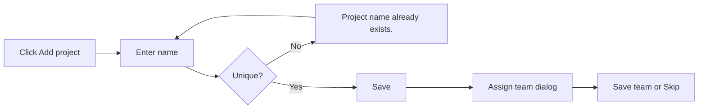
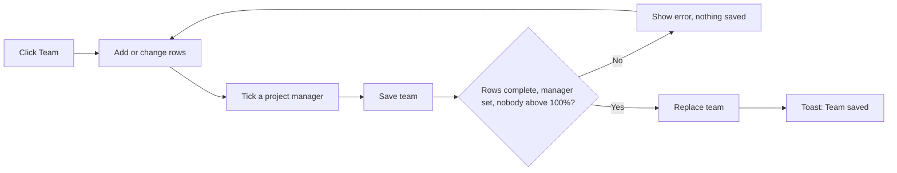
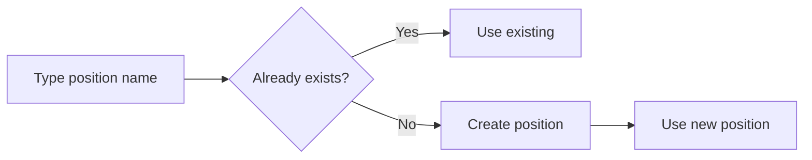
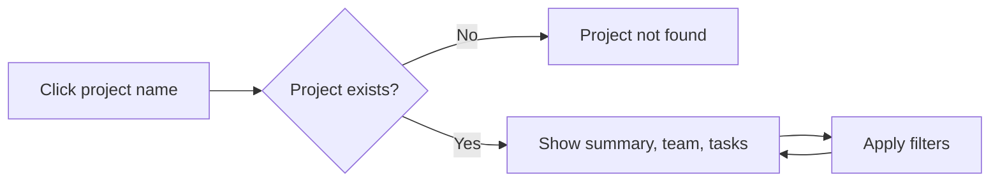
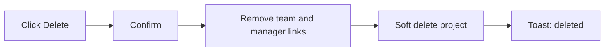

# Business Requirements Document – Project Management

## TaskFlow – Intelligent Task Allocation & Tracking System

> **Document:** Business Requirements Document (sub-module PROJ)  ·  **Version:** 1.0  ·  **Status:** Approved
> **Project type:** Personal Project (Skill Development)  ·  **Date:** 31-Oct-2026
> **Author:** Jojo George (jojogeorge3344@gmail.com)
> **Module:** TaskFlow Management  ·  **Sub-module:** 03.2 Project Management, including Positions (code `PROJ`)
> © 2026 Jojo George. All rights reserved.

---

## Document Control

### Revision History

| Version | Date | Author | Summary of changes |
|---|---|---|---|
| 1.0 | 31-Oct-2026 | Jojo George | Initial version, written from TaskFlow as built (no screen in the original BRD) |
| 1.0 | 31-Oct-2026 | Jojo George | Approved and signed off; baselined as the agreed business requirements. |
| 1.0 | 31-Oct-2026 | Jojo George | Editorial only: Related Documents paths updated to the `TF - Documents` folder layout; no requirement changed, sign-off unchanged. |

### Approvals / Sign-off

| Role | Name | Decision | Date |
|---|---|---|---|
| Product owner | Jojo George | Approved | 31-Oct-2026 |
| Reviewer | Jojo George | Approved | 31-Oct-2026 |

### Related Documents

| Document | Location |
|---|---|
| Overall BRD (roles, global rules, NFRs) | `../../00-Overall/BRD-TaskFlow-Overall.md` |
| Development Plan (screen-wise) | `TF - Documents/Screens Wise Feature Development Plan/` – no Project Management screen (see section 1.2) |
| Related BRDs | `../03.1-Employee-Management/BRD-Employee-Management.md`, `../03.3-Department-Management/BRD-Department-Management.md`, `../../02-TaskFlow-Monitoring/02.1-Task-Management/BRD-Task-Management.md` |
| FRD | `../../../FRD/03-TaskFlow-Management/03.2-Project-Management/FRD-Project-Management.md` |
| HLD / LLD | `../../../HLD/03-TaskFlow-Management/03.2-Project-Management/HLD-Project-Management.md`, `../../../LLD/03-TaskFlow-Management/03.2-Project-Management/LLD-Project-Management.md` |
| TDD | `TF - Documents/TF - TDD/TDD-TaskFlow.md` |

---

## Index

1. Project Overview
2. Stakeholders & User Roles
3. Scope
4. Business Process / Workflows
5. Screen-by-Screen Requirements
6. Business Rules
7. Non-Functional Requirements
8. Data Requirements
9. Integrations & External Dependencies
10. Reporting Requirements
11. Recommended Technology Stack (optional)
12. Assumptions, Constraints & Dependencies
13. Risks
14. Acceptance Criteria
15. Requirements Traceability Matrix
16. Project Deliverables
17. Glossary
18. Project Summary

---

## 1. Project Overview

### 1.1 Introduction
Project Management (menu **TaskFlow Management → Project Management**) is where administrators keep the list of
projects and decide who works on each one, in which position, for what percentage of their time, and who manages the
project. The **Project Details** screen shows one project's team, summary figures and tasks. Positions (such as
Developer or QA) are labels picked or created while building a team.

### 1.2 Business Problem / Current Situation
- Every task must belong to a project, so the organisation needs one controlled list of projects.
- Without a cap, the same person can be promised to several projects at once and becomes over-booked.
- A project without a responsible manager has no one who sees its team on the manager dashboard.
- Managers need a read-only view of each project's team and tasks to plan work.
- The original BRD has **no** Project Management screen; projects, project teams, allocations and positions were added
  during development. This BRD records them as the current requirement.

### 1.3 Project Objectives

| ID | Objective | Success measure |
|---|---|---|
| OBJ-PROJ-01 | Keep one list of projects that tasks belong to | Every live project is listed once, with a unique name |
| OBJ-PROJ-02 | Prevent over-booking of people | No person is ever allocated more than 100% across all projects |
| OBJ-PROJ-03 | Give every project team a responsible manager | Every non-empty team has at least one project manager with the Manager role |
| OBJ-PROJ-04 | Give managers visibility of projects | Managers see every project's team, summary figures and tasks, read only |
| OBJ-PROJ-05 | Describe each person's role on a project consistently | Positions are shared, reusable labels without duplicates |

These objectives support the overall TaskFlow objectives in `../../00-Overall/BRD-TaskFlow-Overall.md`.

### 1.4 Expected Benefits
- Organisation: realistic staffing, because allocations never pass 100% per person.
- Administrators: create a project and its team in one flow.
- Managers: see each project's people, progress (overdue and completed figures) and tasks in one screen.
- Employees: a clear position and share of time on each project they work on.

---

## 2. Stakeholders & User Roles

### 2.1 Stakeholders

| Stakeholder | Interest / responsibility |
|---|---|
| Project owner (Jojo George) | Defines priorities, approves this BRD |
| Administrators | Create projects, build teams, choose project managers |
| Managers | Plan and assign work using project teams; manage flagged projects |
| Employees | Work on projects in a given position and share of time |

### 2.2 User Roles

| Role | Description | Main responsibilities | Access level |
|---|---|---|---|
| Administrator | Full system owner | Add, edit and delete projects; manage teams; create positions | Organisation |
| Manager | Plans and assigns work | View projects, project details and positions (read only); can be flagged as a project manager | Organisation, read only |
| Employee | Works on tasks | No access to this sub-module | None |
| Custom role | Role built in Role Configuration | Whatever project permissions it is granted; needs `projects.view` to see the screen | As granted (Organisation) |

---

## 3. Scope

### 3.1 In Scope
- Project list with search, team size and manager names.
- Add, edit and delete projects.
- Project team: people, position, allocation percentage and project-manager flag.
- Positions: pick an existing one or create a new one while building a team.
- Project Details: summary figures, team and a filtered task list.

### 3.2 Out of Scope (this release)
- Renaming or deleting positions – only "pick or create" is offered.
- Project dates, budgets or status – not requested.
- Creating tasks from the project screens – done in Task Management.
- Changing a person's allocations from Employee Management after creation – done here.

### 3.3 Modules Overview

| # | Module | Purpose | Screens |
|---|---|---|---|
| 1 | TaskFlow Management → Project Management | Projects, teams with position and allocation, project managers, positions | Project Management (list), Add / Edit project (dialog), Project team / Assign team (dialog), Project Details |

---

## 4. Business Process / Workflows

### 4.1 Add a Project and Assign Its Team

**Trigger:** A new project starts  ·  **Actors:** Administrator, System

| Step | Actor / System | Action | Result |
|---|---|---|---|
| 1 | Administrator | Clicks **Add project**, enters the name and optional description | Data submitted |
| 2 | System | Checks the name is unique and saves | "{name} added" |
| 3 | System | Opens **Assign team: {name}** | Team dialog shown with **Skip for now** |
| 4 | Administrator | Adds people with position and percentage and ticks a project manager, or skips | Team saved or left empty |

**Example:** On 31-Oct-2026 the administrator adds project *Website Revamp*. The Assign team dialog opens; she adds Ravi
Menon (Manager role) as Manager at 30%, ticked as project manager, and Anu Thomas as Developer at 60%, then clicks
**Save team** and sees "Team saved".

**Exceptions / alternate flows:**
- Name missing → "Name is required."
- Administrator clicks **Skip for now** → project saved with no team; the team can be added later with **Team**.

### 4.2 Manage a Project Team

**Trigger:** People join or leave a project  ·  **Actors:** Administrator, System

| Step | Actor / System | Action | Result |
|---|---|---|---|
| 1 | Administrator | Clicks **Team** on a project card | Current team and positions loaded |
| 2 | Administrator | Adds a person (picker shows "{n}% remaining" or "Fully allocated"), picks or types a position, enters a percentage | Row added |
| 3 | Administrator | Ticks **Project manager** for at least one person with the Manager role | Manager chosen |
| 4 | System | On **Save team**, checks every rule for the whole team | All rows saved, or nothing saved |
| 5 | System | Shows "Team saved" (or "Team cleared" when no one is left) | Team replaced |

**Example:** Anu Thomas already has 50% on project *Mobile App*. The administrator adds her to *Website Revamp* at 60%.
Save is refused with "Anu Thomas would be allocated 110% in total. They already have 50% on other projects, so 50%
remains." After changing the row to 50%, the team saves.

**Exceptions / alternate flows:**
- No project manager ticked → "Mark at least one person as the project manager."
- A ticked person is not a Manager → "Only a person with the Manager role can manage a project: {names}."
- A person is inactive → "One or more people do not exist or are not active."

### 4.3 Create a Position

**Trigger:** A needed position is not in the list  ·  **Actors:** Administrator, System

| Step | Actor / System | Action | Result |
|---|---|---|---|
| 1 | Administrator | Types a new name in a **Position** field (project team or add-employee form) | Name committed |
| 2 | System | Uses the existing position if the name matches one, ignoring case | Existing position used |
| 3 | System | Otherwise creates the position for everyone to reuse | New position used |

**Example:** The administrator types "qa". TaskFlow uses the existing position "QA". Typing "Business Analyst" creates
a new position that appears in every position list.

**Exceptions / alternate flows:**
- Creation fails or the user lacks the permission → "The position could not be created."

### 4.4 View Project Details

**Trigger:** A user wants to see a project's people and tasks  ·  **Actors:** Administrator, Manager, System

| Step | Actor / System | Action | Result |
|---|---|---|---|
| 1 | User | Clicks a project name on the list | Project Details opens |
| 2 | System | Shows summary figures, the team and all tasks, soonest deadline first | Screen filled |
| 3 | User | Sets filters | Tasks reload with all filters applied together |

**Example:** A manager opens *Website Revamp*: 2 members, 14 tasks, 3 overdue, 43% completed. Filtering by Assigned to
"Anu Thomas" and Status "In Progress" shows her 4 open tasks.

**Exceptions / alternate flows:**
- Project deleted or wrong link → "Project not found – It may have been deleted, or the link is wrong."

### 4.5 Delete a Project

**Trigger:** A project is closed  ·  **Actors:** Administrator, System

| Step | Actor / System | Action | Result |
|---|---|---|---|
| 1 | Administrator | Clicks **Delete** on a card | Confirmation: "Delete project?" |
| 2 | System | Takes every person off the project and removes its managers | Allocations freed |
| 3 | System | Hides the project (soft delete); its tasks are not deleted | "{name} deleted" |

**Example:** Project *Pilot 2025* with 3 employees is deleted. Each of the 3 people gets their percentage back for other
projects; the project's old tasks remain.

**Exceptions / alternate flows:**
- None; deletion is always allowed for users holding the permission.

---

## 5. Screen-by-Screen Requirements

### SCREEN 1: Project Management (list)

| Field | Value |
|---|---|
| **Screen name** | Project Management |
| **Module** | TaskFlow Management → Project Management |
| **Access** | Administrator (full); Manager (read only); custom roles with `projects.view`. Employee: no access |
| **Priority** | Must |

**Purpose**
Keep the list of projects and who works on each.

**Screen Elements**
- Header with the project count and an **Add project** button.
- **Search by name or description** box.
- One card per project: name (link to Project Details), description, "{n} employees", **Manager/Managers** names, **View employees**.
- Card actions: **Team**, **Edit**, **Delete**.

**Functional Requirements**

| ID | Requirement | Priority |
|---|---|---|
| REQ-PROJ-01 | The system shall list every live project as a card with its name, description, number of employees and manager names. | Must |
| REQ-PROJ-02 | The system shall show the number of projects in the header. | Should |
| REQ-PROJ-03 | The system shall let the user search projects by name or description. | Should |
| REQ-PROJ-04 | The system shall show the Project Management menu item and screen only to users holding `projects.view`, and send other users back to their dashboard. | Must |
| REQ-PROJ-05 | The system shall show **Add project**, **Team**, **Edit** and **Delete** only to users holding the matching permission, so Managers see the list read only. | Must |
| REQ-PROJ-06 | The system shall offer **View employees**, opening Employee Management filtered by the project, only to users who can open Employee Management. | Could |
| REQ-PROJ-07 | The system shall ask for confirmation before deleting a project, stating how many employees will be taken off it. | Must |
| REQ-PROJ-08 | The system shall, on delete, take every person off the project, remove its managers and hide the project, without deleting its tasks. | Must |
| REQ-PROJ-09 | The system shall show an empty-state message when there are no projects. | Could |

**Validations & Messages**

| Situation | Rule / message |
|---|---|
| Delete confirmation | "Delete project?" – "\"{name}\" will be permanently deleted and its {n} employees will be taken off it." (first part only when the project has no team) |
| Deleted | "{name} deleted" |
| List failed | "Could not load projects. Check your connection and try again." |
| Empty list | "No projects yet – Add the first project to start organising employees." |
| Delete refused | "Could not delete the project." |

**Expected Result**
Administrators keep an accurate list of projects; Managers can browse every project and its managers.

**Change from original BRD:** the original BRD has no Project Management screen; this screen is a new requirement.

### SCREEN 2: Add / Edit Project (dialog)

| Field | Value |
|---|---|
| **Screen name** | Add project / Edit project |
| **Module** | TaskFlow Management → Project Management |
| **Access** | Administrator; custom roles with `projects.create` (add) or `projects.edit` (edit) |
| **Priority** | Must |

**Purpose**
Enter or change a project's name and description.

**Screen Elements**
- Name (required), Description.
- **Add project** / **Save** buttons.

**Functional Requirements**

| ID | Requirement | Priority |
|---|---|---|
| REQ-PROJ-10 | The system shall create a project with a required name of at most 200 characters and an optional description of at most 500 characters. | Must |
| REQ-PROJ-11 | The system shall reject a project name already used by a live project, ignoring case. | Must |
| REQ-PROJ-12 | The system shall let the user change a project's name and description. | Must |
| REQ-PROJ-13 | The system shall open the **Assign team** dialog, with a **Skip for now** option, straight after a project is created. | Should |
| REQ-PROJ-14 | The system shall confirm a successful save with "{name} added" or "{name} updated". | Should |

**Validations & Messages**

| Situation | Rule / message |
|---|---|
| Name missing | "Name is required." |
| Duplicate name | "Project name already exists." |
| Saved | "{name} added" · "{name} updated" |
| Save refused | "Could not add the project." / "Could not update the project." |

**Expected Result**
Each project has a unique, clear name, and a new project moves straight on to team building.

**Change from original BRD:** new requirement (no project screen in the original BRD).

### SCREEN 3: Project Team / Assign Team (dialog), including Positions

| Field | Value |
|---|---|
| **Screen name** | Project team (titled **Assign team** right after a project is created) |
| **Module** | TaskFlow Management → Project Management |
| **Access** | Administrator; custom roles with `projects.members.manage` (people picker also needs `employees.view`); creating a position needs `positions.create` |
| **Priority** | Must |

**Purpose**
Choose who works on the project, in which position, for what share of time, and who manages it.

**Screen Elements**
- One row per person: Employee, Position (pick or type), Allocation %, **Project manager** tick box, Remove.
- **Add employee** (picker shows "{n}% remaining" or "Fully allocated").
- **Save team**; **Skip for now** when opened after creation.

**Functional Requirements**

| ID | Requirement | Priority |
|---|---|---|
| REQ-PROJ-15 | The system shall show the current team with each person's position, allocation percentage and project-manager flag. | Must |
| REQ-PROJ-16 | The system shall show, when picking a person, how much of their time remains ("{n}% remaining" or "Fully allocated"). | Should |
| REQ-PROJ-17 | The system shall require every team row to have an employee, a position and a whole percentage from 1 to 100. | Must |
| REQ-PROJ-18 | The system shall allow a person only once on a project. | Must |
| REQ-PROJ-19 | The system shall require at least one project manager on a non-empty team. | Must |
| REQ-PROJ-20 | The system shall allow only people with the Manager role to be ticked as project manager. | Must |
| REQ-PROJ-21 | The system shall accept only existing, active people on a team. | Must |
| REQ-PROJ-22 | The system shall reject a team in which any person's total across all projects would pass 100%, stating their total and what remains. | Must |
| REQ-PROJ-23 | The system shall save the whole team or nothing, even when two administrators save teams at the same time. | Must |
| REQ-PROJ-24 | The system shall confirm with "Team saved", or "Team cleared" when no one is left. | Should |
| REQ-PROJ-25 | The system shall start new rows with the position **Member** when it exists. | Could |
| REQ-PROJ-26 | The system shall let the user pick a position or type a new one, reusing an existing position whose name matches ignoring case. | Must |
| REQ-PROJ-27 | The system shall create a typed position that does not exist and make it available to everyone. | Must |
| REQ-PROJ-28 | The system shall require a position name of at most 100 characters and remove extra spaces. | Must |
| REQ-PROJ-29 | The system shall provide the built-in positions Member, Manager, QA, Developer, DevOps and System Admin. | Should |
| REQ-PROJ-30 | The system shall treat positions as labels only, granting no access. | Must |

**Validations & Messages**

| Situation | Rule / message |
|---|---|
| Incomplete rows | "Give every row an employee, a position and a percentage, or remove the row." |
| Bad percentage | "Use a whole percentage from 1 to 100." · "Allocation percentage must be a whole number from 1 to 100." |
| Over capacity (form) | "{name} is fully allocated on other projects." · "{name} has only {n}% remaining." |
| Over capacity (on save) | "{name} would be allocated {total}% in total. They already have {other}% on other projects, so {left}% remains." |
| No manager | "Mark at least one person as the project manager." |
| Not a Manager | Tooltip "Only a person with the Manager role can manage a project" · "Only a person with the Manager role can manage a project: {names}." |
| Duplicate person | "A person can only appear once on a project." |
| Inactive person | "One or more people do not exist or are not active." |
| Position errors | "Position name is required." · "Position name must be 100 characters or fewer." · "The position could not be created." |
| Load / save errors | "Could not load the team. Close this and try again." · "Could not save the team." |
| Saved | "Team saved" · "Team cleared" |

**Expected Result**
Every project team has a manager, nobody is over-booked, and positions stay consistent across projects.

**Change from original BRD:** new requirement (project teams, allocations and positions are not in the original BRD).

### SCREEN 4: Project Details

| Field | Value |
|---|---|
| **Screen name** | Project Details |
| **Module** | TaskFlow Management → Project Management |
| **Access** | Administrator, Manager; custom roles with `projects.view` |
| **Priority** | Should |

**Purpose**
See who is on a project and the project's tasks.

**Screen Elements**
- Project name and summary figures: members, tasks, **Overdue**, **Completed** (percentage).
- **Team** list (person, position, percentage).
- **Tasks** table: Task, Assignee, Priority, Status, Deadline, "Overdue" badge.
- Filters: Status, Priority, Assigned to, Role (position on this project), Deadline from, Deadline to, **Clear filters**.

**Functional Requirements**

| ID | Requirement | Priority |
|---|---|---|
| REQ-PROJ-31 | The system shall open Project Details when the user clicks a project name. | Must |
| REQ-PROJ-32 | The system shall show the project's number of members, number of tasks, number of overdue tasks and completed percentage. | Should |
| REQ-PROJ-33 | The system shall list the team with each person's position and percentage. | Must |
| REQ-PROJ-34 | The system shall list all of the project's tasks with task, assignee, priority, status and deadline, soonest deadline first, marking overdue tasks. | Must |
| REQ-PROJ-35 | The system shall filter the tasks by status, priority, assignee, position on the project and deadline range, applying all filters together. | Should |
| REQ-PROJ-36 | The system shall clear all task filters when the user clicks **Clear filters**. | Could |
| REQ-PROJ-37 | The system shall show "Project not found" when the project does not exist or was deleted. | Must |

**Validations & Messages**

| Situation | Rule / message |
|---|---|
| Not found | "Project not found – It may have been deleted, or the link is wrong." |
| Empty team | "No one is assigned to this project yet." |
| No tasks | "No tasks yet – Tasks created for this project will appear here." |
| Load errors | "Could not load the project." · "Could not load the project tasks." · "Could not load the tasks." |

**Expected Result**
Managers and administrators see a project's people, progress and tasks on one screen and can narrow the task list
quickly.

**Change from original BRD:** new requirement.

---

## 6. Business Rules

| ID | Rule | Applies to |
|---|---|---|
| BR-PROJ-01 | Every task belongs to a project (see Task Management). | All screens |
| BR-PROJ-02 | A project name is required and unique among live projects, ignoring case. | SCREEN 2 |
| BR-PROJ-03 | A person's allocations across all projects never total more than 100% (shared with BR-EMP-10). | SCREEN 3 |
| BR-PROJ-04 | Each allocation is a whole percentage from 1 to 100, and a person appears only once on a project. | SCREEN 3 |
| BR-PROJ-05 | A non-empty team has at least one project manager, and only a person with the Manager role can be one. | SCREEN 3 |
| BR-PROJ-06 | Only existing, active people can be put on a team. | SCREEN 3 |
| BR-PROJ-07 | Saving a team is all-or-nothing: if one rule fails, nothing is saved. | SCREEN 3 |
| BR-PROJ-08 | Positions are shared labels, unique ignoring case, at most 100 characters; they cannot be renamed or deleted and grant no access. | SCREEN 3 |
| BR-PROJ-09 | Deleting a project takes everyone off it and removes its managers; the project is hidden (soft delete) and its tasks are kept (global rule, overall BRD section 6: records with dependent data must not be deleted in a way that damages history). | SCREEN 1 |
| BR-PROJ-10 | A manager's team is everyone in the departments they manage plus everyone on the projects they are flagged as manager of; the manager dashboard and task visibility use this team. | SCREEN 3 |
| BR-PROJ-11 | Project lists, teams and project tasks are organisation-wide for anyone holding `projects.view`; there is no team limit. | SCREEN 1, SCREEN 4 |

> Global business rules marked "global rule, overall BRD section 6" are defined in section 6 of the overall BRD
> ([`../../00-Overall/BRD-TaskFlow-Overall.md`](../../00-Overall/BRD-TaskFlow-Overall.md)); they apply to this sub-module in full.

---

## 7. Non-Functional Requirements

The global NFRs in section 7 of the overall BRD (`../../00-Overall/BRD-TaskFlow-Overall.md`) apply. Sub-module-specific requirements:

| ID | Category | Requirement | Measure / target |
|---|---|---|---|
| NFR-PROJ-01 | Data integrity | The 100% cap holds when several administrators save teams at the same time | No person's stored total ever exceeds 100% |
| NFR-PROJ-02 | Data integrity | A team save never leaves a half-saved team | Either every row changes or none does |
| NFR-PROJ-03 | Security | Permission checks are enforced by the server, not only by hidden buttons | A call without the needed permission is refused |
| NFR-PROJ-04 | Usability | Allocation feedback is shown before saving | The picker shows remaining percentage; the form flags over-capacity rows |
| NFR-PROJ-05 | Usability | Every refusal states the reason in plain words | Messages as listed in section 5 |

---

## 8. Data Requirements

| Entity / data set | Purpose | Key fields | Retention / rules |
|---|---|---|---|
| Project | A body of work that tasks belong to | Name, description | Soft delete; name unique among live projects |
| Project allocation (team row) | Who works on a project and for how much time | Employee, project, position, percentage, project-manager flag | Removed when the project is deleted; total per person at most 100% |
| Project manager link | Which Managers manage which projects | Manager, project | Kept in step with the project-manager flags; removed on project delete or when the person stops being a Manager |
| Position | Label for a person's job on a project | Name | Unique ignoring case; seeded with Member, Manager, QA, Developer, DevOps, System Admin; no rename or delete |

---

## 9. Integrations & External Dependencies

| System / service | Purpose | Required? | Notes |
|---|---|---|---|
| Employee Management | Supplies the people for the team picker; can set first allocations when an employee is added | Required | The picker needs `employees.view` |
| Department Management | Combined with project-manager flags to form a manager's team | Required | – |
| Task Management | Supplies the project's tasks for Project Details | Required | Tasks are not changed when a project is deleted |
| Dashboard / Employee Workload / Reports | Use projects, teams and allocations | Required | Read only from this sub-module's data |
| Email / Notifications | – | Not used | Project actions send no email or notification |

---

## 10. Reporting Requirements

_Not applicable for this sub-module._ Project Details shows per-project summary figures (members, tasks, overdue,
completed %); formal reports filter by project in Reports (`../../05-Reports/05.1-Reports/BRD-Reports.md`).

---

## 11. Recommended Technology Stack (optional)

_Not applicable for this sub-module._ See the overall BRD.

---

## 12. Assumptions, Constraints & Dependencies

| Type | Description |
|---|---|
| Assumption | A "100%" allocation means a person's full working time; part-time work is not modelled separately. |
| Assumption | Only people with the Manager system role manage projects; custom roles cannot be project managers. |
| Constraint | Positions can only be picked or created, not renamed or deleted. |
| Constraint | Project lists and project tasks are organisation-wide for anyone holding `projects.view`. |
| Dependency | Employee Management (people and roles), Department Management (manager teams), Task Management (tasks). |

---

## 13. Risks

| ID | Risk | Impact | Likelihood | Mitigation |
|---|---|---|---|---|
| R-PROJ-01 | People over-booked across projects | High | Medium | BR-PROJ-03 cap checked for the whole team at save time |
| R-PROJ-02 | Project Details shows every task of a project to anyone with `projects.view`, regardless of their task-view scope | Medium | Medium | ⚠️ To be confirmed whether project tasks should follow the task-view scope |
| R-PROJ-03 | Tasks of a deleted project stay without a visible project | Medium | Low | ⚠️ To be confirmed how tasks of a deleted project should be shown |
| R-PROJ-04 | The Assign team dialog opens after creation and the position field always tries to create positions, even for users without those permissions | Low | Low | The server refuses the save; ⚠️ To be confirmed whether the screen should hide these options |
| R-PROJ-05 | The delete confirmation says "permanently deleted" although it is a soft delete | Low | Low | ⚠️ To be confirmed whether the wording should change |
| R-PROJ-06 | Duplicate or misspelt positions clutter the list, since they cannot be renamed or deleted | Low | Medium | Case-insensitive reuse and space trimming (REQ-PROJ-26, REQ-PROJ-28) |

---

## 14. Acceptance Criteria

| ID | Criterion | Verified by |
|---|---|---|
| AC-PROJ-01 | The list shows every live project with team size and managers, and search narrows it. | SCREEN 1, REQ-PROJ-01 to REQ-PROJ-03, REQ-PROJ-09 |
| AC-PROJ-02 | Managers see projects read only; users without `projects.view` cannot open the screen. | REQ-PROJ-04 to REQ-PROJ-06 |
| AC-PROJ-03 | Deleting a project frees every member's allocation, removes its managers and keeps its tasks. | REQ-PROJ-07, REQ-PROJ-08 |
| AC-PROJ-04 | A project cannot be saved without a name or with a name already used by a live project. | SCREEN 2, REQ-PROJ-10 to REQ-PROJ-12, REQ-PROJ-14 |
| AC-PROJ-05 | After a project is added, the Assign team dialog opens and can be skipped. | REQ-PROJ-13 |
| AC-PROJ-06 | A team without a project manager, with a non-Manager ticked, with a repeated or inactive person, or with an incomplete row is refused and nothing is saved. | SCREEN 3, REQ-PROJ-15, REQ-PROJ-17 to REQ-PROJ-21, REQ-PROJ-23, REQ-PROJ-24 |
| AC-PROJ-07 | A team that would put anyone above 100% in total is refused with their total and remaining percentage. | REQ-PROJ-16, REQ-PROJ-22 |
| AC-PROJ-08 | Typing an existing position name in any case reuses it; a new name creates a shared position; positions grant no access. | REQ-PROJ-25 to REQ-PROJ-30 |
| AC-PROJ-09 | Project Details shows correct summary figures, team and tasks, and the filters combine correctly. | SCREEN 4, REQ-PROJ-31 to REQ-PROJ-36 |
| AC-PROJ-10 | Opening a deleted or unknown project shows "Project not found". | REQ-PROJ-37 |

---

## 15. Requirements Traceability Matrix

| Objective | Business rule(s) | Screen(s) | Functional requirement(s) | Acceptance criterion |
|---|---|---|---|---|
| OBJ-PROJ-01 | BR-PROJ-01, BR-PROJ-02, BR-PROJ-09 | SCREEN 1, SCREEN 2 | REQ-PROJ-01 – REQ-PROJ-14 | AC-PROJ-01, AC-PROJ-02, AC-PROJ-03, AC-PROJ-04, AC-PROJ-05 |
| OBJ-PROJ-02 | BR-PROJ-03, BR-PROJ-04, BR-PROJ-06, BR-PROJ-07 | SCREEN 3 | REQ-PROJ-15 – REQ-PROJ-18, REQ-PROJ-21 – REQ-PROJ-24 | AC-PROJ-06, AC-PROJ-07 |
| OBJ-PROJ-03 | BR-PROJ-05, BR-PROJ-10 | SCREEN 3 | REQ-PROJ-19, REQ-PROJ-20 | AC-PROJ-06 |
| OBJ-PROJ-04 | BR-PROJ-11 | SCREEN 4 | REQ-PROJ-31 – REQ-PROJ-37 | AC-PROJ-09, AC-PROJ-10 |
| OBJ-PROJ-05 | BR-PROJ-08 | SCREEN 3 | REQ-PROJ-25 – REQ-PROJ-30 | AC-PROJ-08 |

---

## 16. Project Deliverables

| # | Deliverable | Format |
|---|---|---|
| 1 | Project Management screens (list, add/edit dialog, team dialog, Project Details) | Application source code |
| 2 | Project, allocation, manager-link and position data with the six seeded positions | Database initialisation |
| 3 | BRD, FRD, HLD, LLD for Project Management | Markdown |
| 4 | Tests for team replacement and the 100% cap | Test project and results |

---

## 17. Glossary

| Term | Meaning |
|---|---|
| Project | A body of work that tasks belong to |
| Team | The people allocated to a project |
| Allocation | The whole percentage (1–100) of a person's time given to one project |
| Project manager | A team member with the Manager role, flagged to manage the project |
| Position | A shared label for a person's job on a project (for example Developer); it grants no access |
| Manager's team | People in the departments a Manager manages plus people on the projects they manage |
| Soft delete | Hiding a record from every list while keeping it and its history |

---

## 18. Project Summary
Project Management keeps one list of projects, lets administrators build each project's team with positions and
percentages, and makes sure every team has a Manager in charge and nobody is booked above 100%. Positions stay shared
and consistent, deleting a project frees its people without losing tasks, and Project Details gives managers a clear
view of each project's team, progress and tasks.

---
© 2026 Jojo George. All rights reserved. Unauthorized copying or distribution of this document is prohibited.
