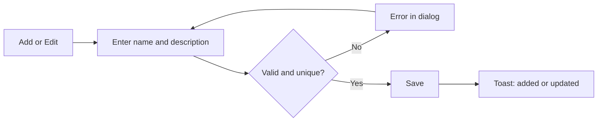
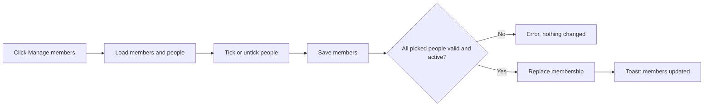
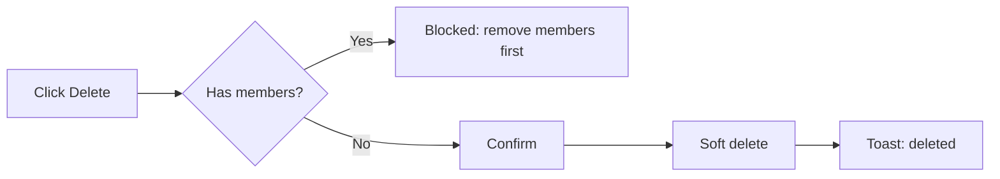

# Business Requirements Document – Department Management

## TaskFlow – Intelligent Task Allocation & Tracking System

> **Document:** Business Requirements Document (sub-module DEPT)  ·  **Version:** 1.0  ·  **Status:** Approved
> **Project type:** Personal Project (Skill Development)  ·  **Date:** 31-Oct-2026
> **Author:** Jojo George (jojogeorge3344@gmail.com)
> **Module:** TaskFlow Management  ·  **Sub-module:** 03.3 Department Management (code `DEPT`)
> © 2026 Jojo George. All rights reserved.

---

## Document Control

### Revision History

| Version | Date | Author | Summary of changes |
|---|---|---|---|
| 1.0 | 31-Oct-2026 | Jojo George | Initial version, written from the original BRD (Screen 6) and TaskFlow as built |
| 1.0 | 31-Oct-2026 | Jojo George | Approved and signed off; baselined as the agreed business requirements. |
| 1.0 | 31-Oct-2026 | Jojo George | Editorial only: Related Documents paths updated to the `TF - Documents` folder layout; no requirement changed, sign-off unchanged. |

### Approvals / Sign-off

| Role | Name | Decision | Date |
|---|---|---|---|
| Product owner | Jojo George | Approved | 31-Oct-2026 |
| Reviewer | Jojo George | Approved | 31-Oct-2026 |

### Related Documents

| Document | Location |
|---|---|
| Overall BRD (roles, global rules, NFRs) | `../../00-Overall/BRD-TaskFlow-Overall.md` |
| Development Plan (screen-wise), Screen 6 | `TF - Documents/Screens Wise Feature Development Plan/06-department-management-screen.md` |
| Related BRDs | `../03.1-Employee-Management/BRD-Employee-Management.md`, `../03.2-Project-Management/BRD-Project-Management.md` |
| FRD | `../../../FRD/03-TaskFlow-Management/03.3-Department-Management/FRD-Department-Management.md` |
| HLD / LLD | `../../../HLD/03-TaskFlow-Management/03.3-Department-Management/HLD-Department-Management.md`, `../../../LLD/03-TaskFlow-Management/03.3-Department-Management/LLD-Department-Management.md` |
| TDD | `TF - Documents/TF - TDD/TDD-TaskFlow.md` |

---

## Index

1. Project Overview
2. Stakeholders & User Roles
3. Scope
4. Business Process / Workflows
5. Screen-by-Screen Requirements
6. Business Rules
7. Non-Functional Requirements
8. Data Requirements
9. Integrations & External Dependencies
10. Reporting Requirements
11. Recommended Technology Stack (optional)
12. Assumptions, Constraints & Dependencies
13. Risks
14. Acceptance Criteria
15. Requirements Traceability Matrix
16. Project Deliverables
17. Glossary
18. Project Summary

---

## 1. Project Overview

### 1.1 Introduction
Department Management (menu **TaskFlow Management → Department Management**) is where administrators create
departments and choose who manages them and who belongs to them. Department managers automatically become the managers
of every employee in that department, and a manager's team includes everyone in the departments they manage.

### 1.2 Business Problem / Current Situation
- People need to be grouped for administration, team views and reporting.
- A separate "reports to" list goes out of date; TaskFlow derives a person's managers from the departments they belong to.
- Deleting a department that still has people in it would leave them without a group and their managers.

### 1.3 Project Objectives

| ID | Objective | Success measure |
|---|---|---|
| OBJ-DEPT-01 | Keep one clean list of departments | Every live department is listed once, with a unique name |
| OBJ-DEPT-02 | Group managers and employees into departments | An administrator sets a department's managers and employees in one dialog and one save |
| OBJ-DEPT-03 | Derive reporting lines automatically | Every employee's managers follow from the departments they belong to, with no typed "reports to" value |
| OBJ-DEPT-04 | Protect the structure | A department with any member cannot be deleted |

These objectives support the overall TaskFlow objectives in `../../00-Overall/BRD-TaskFlow-Overall.md`.

### 1.4 Expected Benefits
- Organisation: a clear structure that drives manager teams, the manager dashboard and task visibility.
- Administrators: quick creation of departments and bulk selection of members.
- Managers: their team is kept up to date automatically from the departments they manage.
- Employees: their managers are always correct.

---

## 2. Stakeholders & User Roles

### 2.1 Stakeholders

| Stakeholder | Interest / responsibility |
|---|---|
| Project owner (Jojo George) | Defines priorities, approves this BRD |
| Administrators | Create departments and choose their managers and employees |
| Managers | Their team includes the members of the departments they manage |
| Employees | Their managers come from their departments |

### 2.2 User Roles

| Role | Description | Main responsibilities | Access level |
|---|---|---|---|
| Administrator | Full system owner | Add, edit and delete departments; manage members | Organisation |
| Manager | Plans and assigns work | No Department Management screen; may list departments in other screens (for example the employee form) through `departments.view`; can be a department manager | Organisation list, read only, through other screens |
| Employee | Works on tasks | No access to this sub-module; can be a department member | None |
| Custom role | Role built in Role Configuration | Whatever department permissions it is granted; sees the screen only with at least one department action permission | As granted (Organisation) |

---

## 3. Scope

### 3.1 In Scope
- Department list with search and member counts.
- Add, edit and delete departments.
- Manage members: choose the managers and employees of a department.
- Derived managers and manager teams based on department membership.

### 3.2 Out of Scope (this release)
- A read-only member list for users who cannot manage members – members are seen through counts and the Manage members dialog.
- A Department filter on the employee list – the employee list filters by project (see the Employee Management BRD).
- Nested (parent / child) departments – not requested.
- Paging of the department list – the list is searched on screen.

### 3.3 Modules Overview

| # | Module | Purpose | Screens |
|---|---|---|---|
| 1 | TaskFlow Management → Department Management | Departments and their managers and employees | Department Management (list), Add / Edit department (dialog), Manage members (dialog) |

---

## 4. Business Process / Workflows

### 4.1 Add or Edit a Department

**Trigger:** A new group is formed or a department is renamed  ·  **Actors:** Administrator, System

| Step | Actor / System | Action | Result |
|---|---|---|---|
| 1 | Administrator | Clicks **Add department**, or **Edit** on a card | Dialog opens |
| 2 | Administrator | Enters the name and optional description, clicks **Add department** or **Save changes** | Data submitted |
| 3 | System | Checks the name is present and unique, ignoring case | Error, or saved |
| 4 | System | Shows "{name} added" or "{name} updated" | List refreshed |

**Example:** On 31-Oct-2026 the administrator adds department *Engineering* with description "Product engineering team".
Adding "engineering" again shows "Department name already exists."

**Exceptions / alternate flows:**
- Name missing → "Name is required."

### 4.2 Manage Department Members

**Trigger:** People join or leave a department  ·  **Actors:** Administrator, System

| Step | Actor / System | Action | Result |
|---|---|---|---|
| 1 | Administrator | Clicks **Manage members** on a card | Current members and all active Managers and Employees load |
| 2 | Administrator | Searches, sorts and ticks or unticks people | "{n} selected" updates |
| 3 | Administrator | Clicks **Save members** | Data submitted |
| 4 | System | Checks every picked manager is an active Manager and every employee is active | Error and nothing changed, or saved |
| 5 | System | Replaces this department's membership in one step | "{department} members updated" |

**Example:** The administrator opens *Engineering*, ticks Ravi Menon (Manager) and Anu Thomas and Arun K (Employees),
and saves. The card shows "1 managers · 2 employees", and Ravi now appears as the manager of Anu and Arun in their
employee details.

**Exceptions / alternate flows:**
- A current member has since been deactivated → shown ticked with an "Inactive" badge; saving with them ticked is refused.
- No active people exist → "There are no active managers or employees to pick from."

### 4.3 Delete a Department

**Trigger:** A department is no longer needed  ·  **Actors:** Administrator, System

| Step | Actor / System | Action | Result |
|---|---|---|---|
| 1 | Administrator | Clicks **Delete** on a card | If it has members, nothing happens and the tooltip explains why |
| 2 | Administrator | Confirms "Delete department?" | Request sent |
| 3 | System | Checks the department has no members, then hides it (soft delete) | "{name} deleted" |

**Example:** *Pilot Team* has 1 employee. Delete is blocked with "Remove its managers and employees before deleting".
After the administrator unticks that employee in Manage members, the delete succeeds and the name *Pilot Team* can be
used again later.

**Exceptions / alternate flows:**
- Members added meanwhile by another administrator → "Department cannot be deleted because it still has members. Remove them first."

---

## 5. Screen-by-Screen Requirements

### SCREEN 1: Department Management (list)

| Field | Value |
|---|---|
| **Screen name** | Department Management |
| **Module** | TaskFlow Management → Department Management |
| **Access** | Administrator; custom roles holding at least one of `departments.create`, `departments.edit`, `departments.delete`, `departments.members.manage` (list data needs `departments.view`). Manager and Employee: no access |
| **Priority** | Must |

**Purpose**
Organise managers and employees into departments.

**Screen Elements**
- Header with the department count and an **Add department** button.
- **Search by name** box.
- One card per department: name, description ("No description" when empty), "{n} managers · {n} employees".
- Card actions: **Manage members**, **Edit**, **Delete**.

**Functional Requirements**

| ID | Requirement | Priority |
|---|---|---|
| REQ-DEPT-01 | The system shall list every live department as a card with its name, description and the number of managers and employees. | Must |
| REQ-DEPT-02 | The system shall show "No description" when a department has no description. | Could |
| REQ-DEPT-03 | The system shall show the number of departments in the header. | Should |
| REQ-DEPT-04 | The system shall let the user search departments by name. | Should |
| REQ-DEPT-05 | The system shall show the Department Management menu item and screen only to users holding at least one department action permission, and send other users back to their dashboard. | Must |
| REQ-DEPT-06 | The system shall show **Add department**, **Manage members**, **Edit** and **Delete** only to users holding the matching permission. | Must |
| REQ-DEPT-07 | The system shall block deleting a department that still has any manager or employee and explain why. | Must |
| REQ-DEPT-08 | The system shall ask for confirmation before deleting an empty department and then hide it. | Must |
| REQ-DEPT-09 | The system shall allow the name of a deleted department to be used again. | Should |
| REQ-DEPT-10 | The system shall show an empty-state message when there are no departments. | Could |

**Validations & Messages**

| Situation | Rule / message |
|---|---|
| Delete with members (tooltip) | "Remove its managers and employees before deleting" |
| Delete with members (on save) | "Department cannot be deleted because it still has members. Remove them first." |
| Delete confirmation | "Delete department?" – "\"{name}\" will be permanently deleted." |
| Deleted | "{name} deleted" |
| List failed | "Could not load departments. Check your connection and try again." |
| Empty list | "No departments yet – Add the first department to start grouping managers and employees." |
| Delete refused | "Could not delete the department." |

**Expected Result**
Administrators see every department with its size and can remove a department only once it is empty.

**Change from original BRD (Screen 6)**

| Original requirement | Current requirement |
|---|---|
| Department employee count | Separate counts of managers and employees |
| Display employees associated with each department | Counts on the card; the people are seen and changed in the Manage members dialog |
| Allow filtering employees by department | Not offered on the employee list (it filters by project). ⚠️ To be confirmed whether a Department filter is still wanted |
| Prevent deletion of departments that still have employees, unless handled safely | Deletion is blocked while the department has any manager or employee; deletion is a soft delete |
| (not in original) | Delete action, department managers, Manage members dialog |

### SCREEN 2: Add / Edit Department (dialog)

| Field | Value |
|---|---|
| **Screen name** | Add department / Edit department |
| **Module** | TaskFlow Management → Department Management |
| **Access** | Administrator; custom roles with `departments.create` (add) or `departments.edit` (edit) |
| **Priority** | Must |

**Purpose**
Enter or change a department's name and description.

**Screen Elements**
- Name (required), Description.
- **Add department** / **Save changes** buttons.

**Functional Requirements**

| ID | Requirement | Priority |
|---|---|---|
| REQ-DEPT-11 | The system shall create a department with a required name of at most 200 characters and an optional description of at most 500 characters. | Must |
| REQ-DEPT-12 | The system shall reject a department name already used by a live department, ignoring case. | Must |
| REQ-DEPT-13 | The system shall let the user change a department's name and description. | Must |
| REQ-DEPT-14 | The system shall confirm a successful save with "{name} added" or "{name} updated". | Should |

**Validations & Messages**

| Situation | Rule / message |
|---|---|
| Name missing | "Name is required." |
| Duplicate name | "Department name already exists." |
| Saved | "{name} added" · "{name} updated" |
| Save refused | "Could not add the department." / "Could not update the department." |

**Expected Result**
Each department has a unique, clear name.

**Change from original BRD (Screen 6):** "Allow administrators to create / edit departments" and "Prevent duplicate
department names" are kept; uniqueness ignores case and applies to live departments only.

### SCREEN 3: Manage Members (dialog)

| Field | Value |
|---|---|
| **Screen name** | Manage members |
| **Module** | TaskFlow Management → Department Management |
| **Access** | Administrator; custom roles with `departments.members.manage` (the people list also needs `employees.view`) |
| **Priority** | Must |

**Purpose**
Choose the department's managers and employees.

**Screen Elements**
- Search box ("Search by name or username").
- Sorting: Name A to Z, Name Z to A, Selected first, Role.
- List of active Managers and Employees with tick boxes; "Inactive" badge on current members who are no longer active.
- "{n} selected", **Select all shown / Clear shown**, **Clear all**, **Save members**.

**Functional Requirements**

| ID | Requirement | Priority |
|---|---|---|
| REQ-DEPT-15 | The system shall list every active person with the Manager or Employee role for selection, with current members ticked. | Must |
| REQ-DEPT-16 | The system shall keep current members who are no longer active in the list, ticked, with an "Inactive" badge. | Should |
| REQ-DEPT-17 | The system shall let the user search the people by name or username. | Should |
| REQ-DEPT-18 | The system shall let the user sort the people by name A to Z, name Z to A, selected first, or role. | Could |
| REQ-DEPT-19 | The system shall show how many people are selected and let the user select or clear all shown people, or clear all. | Could |
| REQ-DEPT-20 | The system shall save each ticked person as a department manager or a department employee according to their role. | Must |
| REQ-DEPT-21 | The system shall accept as department managers only active people with the Manager role. | Must |
| REQ-DEPT-22 | The system shall accept as department employees only active people. | Must |
| REQ-DEPT-23 | The system shall reject the whole save if any picked person is not valid, changing nothing. | Must |
| REQ-DEPT-24 | The system shall replace the department's managers and employees in one step, changing no other department. | Must |
| REQ-DEPT-25 | The system shall allow a person to belong to several departments. | Must |
| REQ-DEPT-26 | The system shall make the department's managers the managers of every employee in that department. | Must |
| REQ-DEPT-27 | The system shall confirm a successful save with "{department} members updated". | Should |

**Validations & Messages**

| Situation | Rule / message |
|---|---|
| Bad manager | "User {id} is not an active manager." |
| Bad employee | "User {id} is not an active user." |
| No one to pick | "There are no active managers or employees to pick from." |
| Load failed | "Could not load the department members." |
| Save failed | "Could not save the department members." |
| Saved | "{department} members updated" |

**Expected Result**
Each department has the right managers and employees, and every employee's managers follow automatically.

**Change from original BRD (Screen 6):** new screen; the original BRD has no department managers or member dialog.

---

## 6. Business Rules

| ID | Rule | Applies to |
|---|---|---|
| BR-DEPT-01 | A department name is required (at most 200 characters) and unique among live departments, ignoring case; a deleted department's name can be reused. | SCREEN 2 |
| BR-DEPT-02 | A department with any manager or employee cannot be deleted; members must be removed first (global rule, overall BRD section 6: records with dependent data must not be deleted in a way that damages history). | SCREEN 1 |
| BR-DEPT-03 | Deleting a department is a soft delete: it is hidden from every list. | SCREEN 1 |
| BR-DEPT-04 | Only active people with the Manager role can be department managers; only active people can be department employees. | SCREEN 3 |
| BR-DEPT-05 | A member save is all-or-nothing and changes only that department's members. | SCREEN 3 |
| BR-DEPT-06 | A person may belong to several departments. | SCREEN 3 |
| BR-DEPT-07 | Department managers are the managers of every employee in that department; reporting lines are never typed in. | SCREEN 3 |
| BR-DEPT-08 | A manager's team is everyone in the departments they manage plus everyone on the projects they manage; the manager dashboard and task visibility use this team (shared with BR-PROJ-10). | SCREEN 3 |
| BR-DEPT-09 | Departments ticked when an employee is first added create the same memberships; afterwards memberships are changed only in Manage members (shared with BR-EMP-11). | SCREEN 3 |
| BR-DEPT-10 | A person who stops being a Manager, or is deleted, is removed as a department manager automatically (shared with BR-EMP-14). | SCREEN 3 |

> Global business rules marked "global rule, overall BRD section 6" are defined in section 6 of the overall BRD
> ([`../../00-Overall/BRD-TaskFlow-Overall.md`](../../00-Overall/BRD-TaskFlow-Overall.md)); they apply to this sub-module in full.

---

## 7. Non-Functional Requirements

The global NFRs in section 7 of the overall BRD (`../../00-Overall/BRD-TaskFlow-Overall.md`) apply. Sub-module-specific requirements:

| ID | Category | Requirement | Measure / target |
|---|---|---|---|
| NFR-DEPT-01 | Data integrity | A member save never leaves a half-changed department | Either every membership change is stored or none is |
| NFR-DEPT-02 | Security | Permission checks are enforced by the server, not only by hidden buttons | A call without the needed permission is refused |
| NFR-DEPT-03 | Usability | A blocked delete explains what to do | Tooltip and message name the fix (remove members first) |
| NFR-DEPT-04 | Usability | Member selection works for larger groups | Search, sorting, select all shown and a selected count are available |

---

## 8. Data Requirements

| Entity / data set | Purpose | Key fields | Retention / rules |
|---|---|---|---|
| Department | A group of people | Name, description | Soft delete; name unique among live departments |
| Department manager link | Which Managers manage the department | Department, manager | Only active Managers; removed when the person stops being a Manager or is deleted |
| Department membership | Which employees belong to the department | Department, employee | Only active people; a person may be in several departments |

---

## 9. Integrations & External Dependencies

| System / service | Purpose | Required? | Notes |
|---|---|---|---|
| Employee Management | Supplies the people for the Manage members dialog; can set first memberships when an employee is added | Required | The dialog needs `employees.view` |
| Project Management | Combined with department managers to form a manager's team | Required | – |
| Dashboard / Task Management | Use the manager's team for the manager dashboard and task visibility; the organisation dashboard counts departments | Required | Read only from this sub-module's data |
| Email / Notifications | – | Not used | Department actions send no email or notification |

---

## 10. Reporting Requirements

_Not applicable for this sub-module._ The card counts (managers and employees) are the only summary shown here.

---

## 11. Recommended Technology Stack (optional)

_Not applicable for this sub-module._ See the overall BRD.

---

## 12. Assumptions, Constraints & Dependencies

| Type | Description |
|---|---|
| Assumption | Departments are a flat list; there is no hierarchy between departments. |
| Assumption | Only the Manager and Employee roles are offered in the member dialog. |
| Constraint | Only people with the Manager system role can be department managers. |
| Constraint | The department list is searched on screen and not paged. |
| Dependency | Employee Management (people and roles), Project Management (manager teams), Role Configuration (permissions). |

---

## 13. Risks

| ID | Risk | Impact | Likelihood | Mitigation |
|---|---|---|---|---|
| R-DEPT-01 | A department deleted while people still belong to it leaves them without managers | High | Low | BR-DEPT-02 blocks the delete, checked again at save time |
| R-DEPT-02 | Administrators and custom-role users can never be picked as department members, because the dialog lists only Managers and Employees | Medium | Medium | ⚠️ To be confirmed whether other roles should be selectable |
| R-DEPT-03 | Users without the member permission cannot see who is in a department | Low | Medium | ⚠️ To be confirmed whether a read-only member view is needed |
| R-DEPT-04 | The empty-state **Add department** button may show to users who cannot create departments | Low | Low | The server refuses the save; ⚠️ To be confirmed whether the button should be hidden |
| R-DEPT-05 | A custom role with member rights but without `employees.view` sees an empty people list | Medium | Low | Grant `employees.view` together with `departments.members.manage` |

---

## 14. Acceptance Criteria

| ID | Criterion | Verified by |
|---|---|---|
| AC-DEPT-01 | The list shows every live department with its manager and employee counts, and search narrows it. | SCREEN 1, REQ-DEPT-01 to REQ-DEPT-04, REQ-DEPT-10 |
| AC-DEPT-02 | Users without a department action permission see no menu item and are sent to their dashboard; buttons appear only with their permission. | REQ-DEPT-05, REQ-DEPT-06 |
| AC-DEPT-03 | A department with any member cannot be deleted; an empty one is deleted after confirmation and its name can be reused. | REQ-DEPT-07 to REQ-DEPT-09 |
| AC-DEPT-04 | A department cannot be saved without a name or with a name already used by a live department, in any case. | SCREEN 2, REQ-DEPT-11 to REQ-DEPT-14 |
| AC-DEPT-05 | The Manage members dialog lists active Managers and Employees, keeps inactive current members visible, and supports search, sort and bulk selection. | SCREEN 3, REQ-DEPT-15 to REQ-DEPT-19 |
| AC-DEPT-06 | Saving members stores Managers as department managers and others as employees, and refuses the whole save if any pick is invalid or inactive. | REQ-DEPT-20 to REQ-DEPT-24, REQ-DEPT-27 |
| AC-DEPT-07 | A person can be in several departments, and each department's managers appear as the managers of its employees. | REQ-DEPT-25, REQ-DEPT-26 |

---

## 15. Requirements Traceability Matrix

| Objective | Business rule(s) | Screen(s) | Functional requirement(s) | Acceptance criterion |
|---|---|---|---|---|
| OBJ-DEPT-01 | BR-DEPT-01, BR-DEPT-03 | SCREEN 1, SCREEN 2 | REQ-DEPT-01 – REQ-DEPT-06, REQ-DEPT-09 – REQ-DEPT-14 | AC-DEPT-01, AC-DEPT-02, AC-DEPT-04 |
| OBJ-DEPT-02 | BR-DEPT-04, BR-DEPT-05, BR-DEPT-06, BR-DEPT-09 | SCREEN 3 | REQ-DEPT-15 – REQ-DEPT-25, REQ-DEPT-27 | AC-DEPT-05, AC-DEPT-06, AC-DEPT-07 |
| OBJ-DEPT-03 | BR-DEPT-07, BR-DEPT-08, BR-DEPT-10 | SCREEN 3 | REQ-DEPT-26 | AC-DEPT-07 |
| OBJ-DEPT-04 | BR-DEPT-02 | SCREEN 1 | REQ-DEPT-07, REQ-DEPT-08 | AC-DEPT-03 |

---

## 16. Project Deliverables

| # | Deliverable | Format |
|---|---|---|
| 1 | Department Management screens (list, add/edit dialog, Manage members dialog) | Application source code |
| 2 | Department, manager-link and membership data | Database initialisation |
| 3 | BRD, FRD, HLD, LLD for Department Management | Markdown |
| 4 | Tests for department rules and members | Test project and results |

---

## 17. Glossary

| Term | Meaning |
|---|---|
| Department | A flat group of managers and employees |
| Department manager | An active person with the Manager role who manages a department |
| Department employee | An active person who belongs to a department |
| Derived manager | A manager worked out from a person's departments (and projects), never typed in |
| Manager's team | People in the departments a Manager manages plus people on the projects they manage |
| Soft delete | Hiding a record from every list while keeping it |

---

## 18. Project Summary
Department Management lets administrators create departments, choose their managers and employees in one dialog, and
remove a department only once it is empty. Department managers become every member's managers automatically, so
reporting lines, manager teams, the manager dashboard and task visibility stay correct without a separate "reports to"
list.

---
© 2026 Jojo George. All rights reserved. Unauthorized copying or distribution of this document is prohibited.
