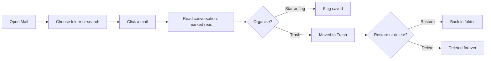
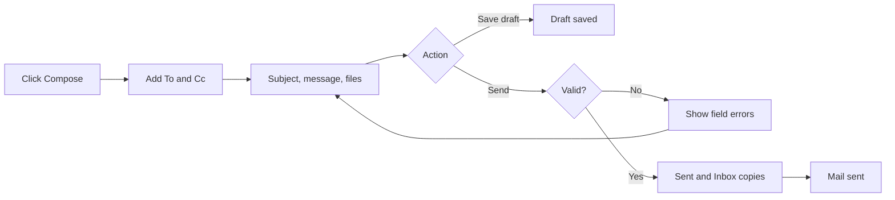
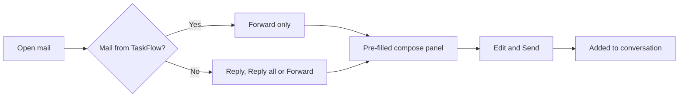
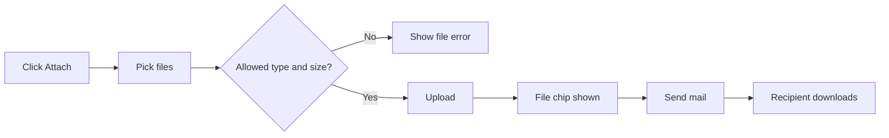
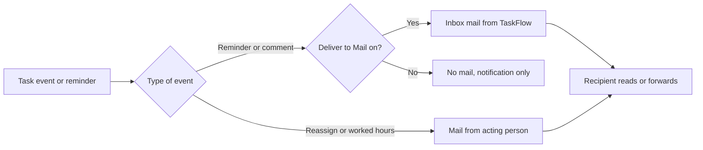

# Business Requirements Document – Mail

## TaskFlow – Intelligent Task Allocation & Tracking System

> **Document:** Business Requirements Document (Sub-module: Communication → Mail, code `MAIL`)  ·  **Version:** 1.0  ·  **Status:** Approved
> **Project type:** Personal Project (Skill Development)  ·  **Date:** 31-Oct-2026
> **Author:** Jojo George (jojogeorge3344@gmail.com)
> © 2026 Jojo George. All rights reserved.

---

## Document Control

### Revision History

| Version | Date | Author | Summary of changes |
|---|---|---|---|
| 1.0 | 31-Oct-2026 | Jojo George | Initial version |
| 1.0 | 31-Oct-2026 | Jojo George | Approved and signed off; baselined as the agreed business requirements. |
| 1.0 | 31-Oct-2026 | Jojo George | Editorial only: Related Documents paths updated to the `TF - Documents` folder layout; no requirement changed, sign-off unchanged. |

### Approvals / Sign-off

| Role | Name | Decision | Date |
|---|---|---|---|
| Product owner | Jojo George | Approved | 31-Oct-2026 |
| Reviewer | Jojo George | Approved | 31-Oct-2026 |

### Related Documents

| Document | Location |
|---|---|
| Overall BRD (roles, global rules `BR-nn`, global NFRs, Auth, Legal) | `../../00-Overall/BRD-TaskFlow-Overall.md` |
| Sibling BRD – Notification (reminder engine that sends reminder mails) | `../04.2-Notification/BRD-Notification.md` |
| BRD – Reminder Settings ("Also deliver reminders to Mail" toggle) | `../../06-Settings/06.1-Reminder-Settings/BRD-Reminder-Settings.md` |
| BRD – Task Management (comments, reassignment, worked hours) | `../../02-TaskFlow-Monitoring/02.1-Task-Management/BRD-Task-Management.md` |
| BRD – Assistant (find user, draft mail) | `../../08-TFA-Assistant/08.1-Assistant/BRD-Assistant.md` |
| Development Plan (screen-wise) – Screen 14, marked SUPERSEDED | `TF - Documents/Screens Wise Feature Development Plan/14-email-notification-settings-screen.md` |
| FRD – Mail | `../../../FRD/04-Communication/04.1-Mail/FRD-Mail.md` |
| HLD / LLD – Mail | `../../../HLD/04-Communication/04.1-Mail/HLD-Mail.md`, `../../../LLD/04-Communication/04.1-Mail/LLD-Mail.md` |

---

## Index

1. Project Overview
2. Stakeholders & User Roles
3. Scope
4. Business Process / Workflows
5. Screen-by-Screen Requirements
6. Business Rules
7. Non-Functional Requirements
8. Data Requirements
9. Integrations & External Dependencies
10. Reporting Requirements
11. Recommended Technology Stack (optional)
12. Assumptions, Constraints & Dependencies
13. Risks
14. Acceptance Criteria
15. Requirements Traceability Matrix
16. Project Deliverables
17. Glossary
18. Project Summary

---

## 1. Project Overview

### 1.1 Introduction
Mail is a private internal mailbox inside TaskFlow. Administrators, Managers and Employees use it to read, search,
write, reply to, forward and organise messages to each other, save drafts, and send and download attachments. It does
not send to outside email addresses. TaskFlow itself also places deadline reminders and task comment alerts into the
Inbox as mails from "TaskFlow", so work-related messages are kept in one place.

### 1.2 Business Problem / Current Situation
Without an internal mailbox, staff discuss task work over outside email or chat tools. Messages are then separated from
the tasks they are about, and nobody can see them from TaskFlow. The original plan was to send reminders by outside
email (SMTP). That needed server credentials, secret handling and delivery monitoring, which are too heavy for a
single-organisation application. It also gave no way for colleagues to write to each other inside TaskFlow.

### 1.3 Project Objectives

| ID | Objective | Success measure |
|---|---|---|
| OBJ-MAIL-01 | Let users exchange work messages inside TaskFlow without outside email | A sent mail appears in every recipient's Inbox when the sender sees "Mail sent"; outside addresses are refused 100% of the time |
| OBJ-MAIL-02 | Keep every mailbox private to its owner | 0 cases where a user can open, flag, delete or download from another person's mailbox; such attempts report "not found" |
| OBJ-MAIL-03 | Make unread mail visible at a glance | The Mail menu badge shows the unread Inbox count, refreshed on every page change and at least every 15 seconds |
| OBJ-MAIL-04 | Support conversations and unfinished work | Reply, Reply all and Forward keep the conversation together; a draft can be saved and continued later |
| OBJ-MAIL-05 | Allow safe file sharing | Limits of 5 files, 10 MB per file and 25 MB per mail are enforced; blocked file types and empty files are refused 100% of the time |
| OBJ-MAIL-06 | Keep task-related system messages next to personal mail | Comment alerts and deadline reminders arrive in the Inbox as mails from "TaskFlow" while "Also deliver reminders to Mail" is on |

### 1.4 Expected Benefits
- **Organisation:** work discussions stay inside TaskFlow, linked to tasks ("Open the task"), with no outside mail server to run.
- **Managers:** can brief team members, reply to questions and pass files on (Forward) without leaving the application.
- **Employees:** one Inbox holds colleagues' mail, task comment alerts and deadline reminders.
- **Every user:** personal folders, stars, important flags and trash; nobody else can read their mail.

---

## 2. Stakeholders & User Roles

### 2.1 Stakeholders

| Stakeholder | Interest / responsibility |
|---|---|
| Project owner (Jojo George) | Defines priorities, approves this BRD |
| Administrator | Grants or removes the `mail.*` permissions for custom roles in Role Configuration; uses Mail like any user |
| Managers and Employees | Daily users of the mailbox |
| Owners of related sub-modules (Task Management, Notification, Reminder Settings, Assistant) | Produce or control the system mails that arrive in the Inbox |

### 2.2 User Roles

Full role definitions are in the overall BRD. Mail treats every role the same: each user works only on their own mailbox.

| Role | Description | Main responsibilities | Access level |
|---|---|---|---|
| Administrator | System administrator | Reads, writes and organises own mail; configures Mail permissions for custom roles | Own mailbox; recipient search over all active users |
| Manager | Leads a team or project | Reads, writes and organises own mail | Own mailbox; recipient search over all active users |
| Employee | Works on assigned tasks | Reads, writes and organises own mail | Own mailbox; recipient search over all active users |
| Custom Role | Role created by an Administrator | As granted: `mail.read`, `mail.compose`, `mail.organize`, `mail.attachments` | Own mailbox, as granted |

---

## 3. Scope

### 3.1 In Scope
- Mail screen with folders Inbox, Starred, Important, Sent, Drafts and Trash, folder counts and search.
- Reading a mail with its whole conversation; marking it read automatically.
- Unread badge on the Mail menu item.
- Compose panel: new mail, Reply, Reply all, Forward, drafts, recipient suggestions.
- Personal flags: Star, Mark important, Mark unread; Move to Trash, Restore, Delete forever.
- Attachments: upload, remove, forward and download, with size and type limits.
- Receiving system mails: deadline reminders and task comment alerts from "TaskFlow"; reassignment and worked-hours notices from the person who made the change.
- Four permissions: `mail.read`, `mail.compose`, `mail.organize`, `mail.attachments`.

### 3.2 Out of Scope (this release)
- Sending to or receiving from outside email addresses (SMTP) – replaced by internal Mail (see 3.3).
- SMTP server settings, credentials and "test email" – removed together with outside email.
- Reading another person's mailbox, for any role including Administrator – by design (privacy).
- Formatted (rich text) message bodies – messages are plain text; only web links are made clickable.
- Physically removing deleted mail and attachment files, and automatic clean-up of abandoned uploads – future phase.
- Generating deadline reminders – owned by the Notification sub-module; Mail only receives them.

### 3.3 Modules Overview

| # | Module | Purpose | Screens |
|---|---|---|---|
| 1 | Communication → Mail | Private internal mailbox between TaskFlow users | SCREEN 1 Mail, SCREEN 2 Compose panel |

**Change from original BRD**

| Original BRD item | Current requirement |
|---|---|
| Screen 14 "Email Configuration" (SMTP server, port, sender, username, password, test email) | Superseded and not built. Replaced by the internal Mail screen described here. |
| Screen 14 FR 1–4 (configure email delivery, secure credentials, never show passwords, test email) | Not applicable: there is no outside mail server and so no credentials. |
| Screen 14 "Enable/disable email notifications" | Kept as the "Also deliver reminders to Mail" toggle on the Reminder Settings screen. |
| Screen 14 FR 5 "Send deadline reminders to the appropriate recipients" | Reminders arrive in each recipient's Inbox as mails from "TaskFlow" (sent by the Notification sub-module). |
| Screen 14 FR 6 "Record email delivery attempts and failures" | Each delivered reminder is recorded in the reminder history (Notification sub-module). Failure tracking is not provided. |
| Screen 14 FR 7 "Continue in-app notifications if email fails" | Every reminder always creates an in-app notification; mail is an extra copy inside TaskFlow. |
| Section 3.4 "Email Notifications" | Replaced by internal Mail delivery. |

> ⚠️ To be confirmed: original Screen 14 FR 6 and FR 7 assumed an outside mail service that can fail. With internal
> Mail, a reminder's notification and its Inbox mail are written together; whether a separate failure record is still
> needed is open.

---

## 4. Business Process / Workflows

### 4.1 Read and Organise Mail

**Trigger:** User opens Communication Management → Mail  ·  **Actors:** Any user with `mail.read`; `mail.organize` for flags and trash

| Step | Actor / System | Action | Result |
|---|---|---|---|
| 1 | User | Opens Mail | Inbox opens; folder counts shown |
| 2 | User | Picks a folder or types in the search box | List shows matching mails, newest first, 25 per page |
| 3 | User | Clicks a mail | Reading pane shows the conversation; the mail is marked read |
| 4 | User | Stars, marks important, marks unread (Inbox) or moves to Trash | Flag saved; "Moved to Trash" for trash |
| 5 | User | In Trash, restores or deletes forever | "Restored" or "Deleted forever" |
| 6 | System | Updates counts | Folder counts and the Mail menu badge change |

**Example:** Priya (Employee) opens Mail on 31-Oct-2026 and sees "Inbox 3". She opens "Q3 report figures" from Rahul;
the count drops to 2. She stars it so it also appears under Starred, then moves an old mail "Lunch on Friday" to Trash.

**Exceptions / alternate flows:**
- Folder empty or no search hits: "Nothing in *folder*." or "No mail matches your search."
- The mail belongs to someone else or was removed: "Could not open this mail."
- Delete forever on a mail that is not in Trash: "Move the mail to Trash before deleting it forever."

### 4.2 Compose and Send a Mail

**Trigger:** User clicks Compose  ·  **Actors:** User with `mail.compose`; System

| Step | Actor / System | Action | Result |
|---|---|---|---|
| 1 | User | Clicks Compose | Compose panel "New mail" opens |
| 2 | User | Types names or emails in To (and Cc) | Up to 10 matching active users suggested; non-users marked "Not a TaskFlow user" |
| 3 | User | Enters subject and/or message; may attach files | Files uploaded and shown as chips |
| 4 | User | Clicks Send | System checks the mail |
| 5 | System | Checks recipients (1–50, all active users), subject or message, lengths, attachments | Errors shown under the field, or the mail is accepted |
| 6 | System | Stores the mail | Copy in the sender's Sent and in each recipient's Inbox; "Mail sent" |
| 7 | User | Alternatively clicks Save draft or Discard | "Draft saved" or "Draft discarded" |

**Example:** Anita (Manager) writes to Rahul (To) and Priya (Cc), subject "Monthly report – 15 Oct", and attaches
"template.xlsx" (220 KB). She clicks Send. Rahul and Priya each see the mail in their Inbox; Anita sees it in Sent.

**Exceptions / alternate flows:**
- An address is not an active TaskFlow user: the whole send is blocked – "Not an active TaskFlow user: *addresses*."
- No subject and no message: "Write a subject or a message before sending."
- More than 50 recipients: "A mail can have at most 50 recipients."

### 4.3 Reply, Reply All or Forward

**Trigger:** User clicks Reply, Reply all or Forward in the reading pane  ·  **Actors:** User with `mail.compose`

| Step | Actor / System | Action | Result |
|---|---|---|---|
| 1 | User | Opens a mail and picks Reply, Reply all or Forward | Compose panel opens pre-filled |
| 2 | System | Pre-fills Reply | Original sender (or original recipients, if you sent it); subject "Re: …"; quoted "On *date*, *name* wrote:" |
| 3 | System | Pre-fills Reply all | Sender plus everyone on To and Cc except you |
| 4 | System | Pre-fills Forward | No recipients; subject "Fwd: …"; forwarded-message header; original attachments |
| 5 | User | Edits and clicks Send | New mail joins the same conversation |

**Example:** Rahul replies to Anita's mail. The panel shows To: Anita, subject "Re: Monthly report – 15 Oct" and the
quoted text. Anita sees the reply under the same conversation as her original mail.

**Exceptions / alternate flows:**
- Reply to a mail from TaskFlow: "Mails from TaskFlow cannot be replied to. Forward it instead."
- Reply and Reply all are not offered for mails in Trash.

### 4.4 Attach and Download Files

**Trigger:** User clicks Attach in the compose panel, or an attachment in the reading pane  ·  **Actors:** User with `mail.attachments`

| Step | Actor / System | Action | Result |
|---|---|---|---|
| 1 | User | Clicks Attach and picks files | Files checked for type, empty content and size |
| 2 | System | Uploads accepted files | "Uploading…", then a file chip; the user can remove a chip |
| 3 | User | Sends the mail | Files go with the mail; forwarded files are copied |
| 4 | Reader | Clicks an attachment | File is downloaded (never opened inside the page) |

**Example:** Priya attaches "photos.zip" (12 MB). TaskFlow refuses it: "photos.zip is larger than 10 MB." She attaches
"summary.pdf" (3 MB) instead and sends the mail.

**Exceptions / alternate flows:**
- Blocked type (for example `.exe`): "Files of type .exe are not allowed."
- More than 20 files (or 100 MB) uploaded but not yet sent: "You have *N* files waiting to be attached. Send or discard a mail before uploading more."

### 4.5 Receive System Mails

**Trigger:** An event in another sub-module  ·  **Actors:** System; recipients

| Step | Actor / System | Action | Result |
|---|---|---|---|
| 1 | System (Notification) | A deadline, due-today or overdue reminder is delivered and "Also deliver reminders to Mail" is on | Inbox mail from "TaskFlow" with an "Open the task" link |
| 2 | System (Task Management) | A comment is added, edited or deleted and the toggle is on | Inbox mail from "TaskFlow", subject "Comment *verb*: *title*" |
| 3 | System (Task Management) | A task is reassigned | Mail from the person who reassigned, subject "Task reassigned: *title*" |
| 4 | System (Task Management) | Worked hours on a task change | Mail from the person who changed them, subject "Worked hours changed: *title*" |
| 5 | Recipient | Opens the mail | Reads it; system mails can only be forwarded |

**Example:** On 13-Oct-2026 Rahul's Inbox receives "Task reminder: Prepare Monthly Report" from TaskFlow. The reading
pane offers "Open the task" and Forward, but not Reply.

**Exceptions / alternate flows:**
- If writing the comment mail fails, the comment itself is still saved; only the mail is dropped.
- Deleted users receive no system mails; reassignment and worked-hours mails go to active users only.

---

## 5. Screen-by-Screen Requirements

### SCREEN 1: Mail

| Field | Value |
|---|---|
| **Screen name** | Mail (menu: Communication Management → Mail, with unread badge) |
| **Module** | Communication → Mail |
| **Access** | Administrator, Manager, Employee by default; any Custom Role granted `mail.read` |
| **Priority** | Must |

**Purpose**
Give each user a private place to read, find and organise internal mail, including system mails from TaskFlow.

**Screen Elements**
- Folder rail: Inbox, Starred, Important, Sent, Drafts, Trash, with counts; Compose button (with `mail.compose`).
- Message list: search box, rows with sender or "To: …", subject or "(no subject)", preview, date, important flag, paperclip, star toggle; Previous / Next.
- Reading pane: subject, "Open the task" link, conversation with sender, recipients, Cc, date, message, attachment download buttons.
- Reader actions: Reply, Reply all, Forward, Star, Mark important, Mark unread, Move to Trash; in Trash: Restore, Delete forever.
- Narrow-screen layout: one pane at a time with a folder button.

**Functional Requirements**

| ID | Requirement | Priority |
|---|---|---|
| REQ-MAIL-01 | The system shall open the Mail screen only for users holding `mail.read`, and return other users to their dashboard. | Must |
| REQ-MAIL-02 | The system shall provide the folders Inbox, Starred, Important, Sent, Drafts and Trash, opening Inbox by default. | Must |
| REQ-MAIL-03 | The system shall show the number of unread mails beside Inbox, Starred and Important, and the total number of drafts beside Drafts. | Should |
| REQ-MAIL-04 | The system shall show a badge on the Mail menu item with the number of unread Inbox mails, refreshed on every page change and every 15 seconds. | Should |
| REQ-MAIL-05 | The system shall list the mails of the chosen folder newest first, 25 per page, with Previous and Next. | Must |
| REQ-MAIL-06 | The system shall show on each row the sender ("To: …" in Sent and Drafts, "TaskFlow" for system mail), the subject or "(no subject)", a preview, the date, an important flag and an attachment indicator. | Must |
| REQ-MAIL-07 | The system shall search the current folder by subject, message text, sender and recipients. | Should |
| REQ-MAIL-08 | The system shall show the whole conversation of an opened mail, oldest first, with sender, recipients, Cc, date, message and attachments. | Must |
| REQ-MAIL-09 | The system shall mark a mail as read for the reader when the reader opens it. | Must |
| REQ-MAIL-10 | The system shall make web links (http and https) in a message clickable. | Could |
| REQ-MAIL-11 | The system shall show an "Open the task" link on a mail that is about a task. | Should |
| REQ-MAIL-12 | The system shall let users holding `mail.organize` star and un-star a mail, from the list and from the reading pane. | Should |
| REQ-MAIL-13 | The system shall let users holding `mail.organize` mark and unmark a mail as important. | Should |
| REQ-MAIL-14 | The system shall let users holding `mail.organize` mark an Inbox mail as unread. | Should |
| REQ-MAIL-15 | The system shall let users holding `mail.organize` move a mail to Trash and restore it from Trash. | Must |
| REQ-MAIL-16 | The system shall let users holding `mail.organize` delete forever only a mail that is in Trash, or a draft. | Must |
| REQ-MAIL-17 | The system shall apply read state, star, important and trash to the acting user's own copy only. | Must |
| REQ-MAIL-18 | The system shall never show or change another user's mail, and shall report such a mail as not found. | Must |
| REQ-MAIL-19 | The system shall show mails from TaskFlow with the sender "TaskFlow" and offer only Forward for them. | Must |
| REQ-MAIL-20 | The system shall not offer Reply or Reply all for mails in Trash. | Should |
| REQ-MAIL-21 | The system shall keep showing the name of a sender or recipient whose account was later deactivated or deleted. | Should |
| REQ-MAIL-22 | The system shall show one pane at a time on narrow screens, with a button to open the folder rail. | Could |
| REQ-MAIL-23 | The system shall deliver a task comment alert (add, edit, delete) as an Inbox mail from "TaskFlow" to the task's assignee, recipients and the acting person while "Also deliver reminders to Mail" is on. | Should |
| REQ-MAIL-24 | The system shall send a reassignment notice as a mail from the person who reassigned the task to the task's active participants. | Should |
| REQ-MAIL-25 | The system shall send a worked-hours notice as a mail from the person who changed the hours to the task's active assignee and recipients. | Could |
| REQ-MAIL-26 | The system shall let users holding `mail.attachments` download an attachment only when they uploaded it or the mail is in their own mailbox. | Must |
| REQ-MAIL-27 | The system shall always download attachments as files and never open them inside the page. | Must |

**Validations & Messages**

| Situation | Rule / message |
|---|---|
| Mail sent / draft saved / draft discarded | "Mail sent" · "Draft saved" · "Draft discarded" |
| Trash actions | "Moved to Trash" · "Restored" · "Deleted forever" |
| Delete forever outside Trash | "Move the mail to Trash before deleting it forever." |
| Reply to a system mail | "Mails from TaskFlow cannot be replied to. Forward it instead." |
| Empty folder / no search hits | "Nothing in *folder*." · "No mail matches your search." |
| Nothing selected | "Select a mail to read it." |
| Load, open, update or download failure | "Could not load your mail." · "Could not open this mail." · "Could not update the mail." · "Could not mark as unread." · "Could not download the file." |
| No permission to open the screen | User is returned to their dashboard; no message |
| No permission for an action | The related "Could not …" message |

**Expected Result**
Each user can find, read and organise their own mail and the system mails about their tasks, and nobody else can see
or change their mailbox.

> **Change from original BRD:** this screen replaces original Screen 14 "Email Configuration" (see 3.3).

### SCREEN 2: Compose Panel (inside Mail)

| Field | Value |
|---|---|
| **Screen name** | Compose panel – titled "New mail", "Reply", "Reply all", "Forward" or "Draft" |
| **Module** | Communication → Mail |
| **Access** | Administrator, Manager, Employee by default; any Custom Role granted `mail.compose` (attachments also need `mail.attachments`) |
| **Priority** | Must |

**Purpose**
Let users write a new mail, reply to or forward a mail, or continue a saved draft, with recipients checked against the
TaskFlow user list.

**Screen Elements**
- To and Cc recipient pickers with name suggestions; invalid entries marked "Not a TaskFlow user".
- Subject and Message fields.
- Attach button and attached-file chips (removable).
- Buttons: Discard, Save draft, Send.

**Functional Requirements**

| ID | Requirement | Priority |
|---|---|---|
| REQ-MAIL-28 | The system shall offer Compose, Reply, Reply all and Forward only to users holding `mail.compose`. | Must |
| REQ-MAIL-29 | The system shall suggest at most 10 active users whose name or email matches what the user types in To or Cc. | Should |
| REQ-MAIL-30 | The system shall mark any recipient who is not an active TaskFlow user as "Not a TaskFlow user". | Must |
| REQ-MAIL-31 | The system shall refuse the whole send when any recipient is not an active TaskFlow user. | Must |
| REQ-MAIL-32 | The system shall require between 1 and 50 recipients in total across To and Cc. | Must |
| REQ-MAIL-33 | The system shall keep a person listed in both To and Cc in To only. | Should |
| REQ-MAIL-34 | The system shall require a subject or a message before sending. | Must |
| REQ-MAIL-35 | The system shall limit the subject to 200 characters and the message to 20,000 characters. | Must |
| REQ-MAIL-36 | The system shall, on send, place the mail in the sender's Sent folder and in each recipient's Inbox, and show "Mail sent". | Must |
| REQ-MAIL-37 | The system shall pre-fill Reply with the original sender (or the original recipients when the user sent the original), the subject "Re: …" and the quoted text "On *date*, *name* wrote:". | Must |
| REQ-MAIL-38 | The system shall pre-fill Reply all with the sender and everyone on To and Cc except the user. | Must |
| REQ-MAIL-39 | The system shall pre-fill Forward with no recipients, the subject "Fwd: …", a forwarded-message header and the original attachments. | Must |
| REQ-MAIL-40 | The system shall add a reply or forward to the same conversation as the original mail. | Should |
| REQ-MAIL-41 | The system shall save a draft even when its recipients are incomplete or invalid, and check recipients only when the draft is sent. | Must |
| REQ-MAIL-42 | The system shall let the user open a draft from Drafts and continue it. | Must |
| REQ-MAIL-43 | The system shall remove the files uploaded in the panel when the user discards it. | Should |
| REQ-MAIL-44 | The system shall let users holding `mail.attachments` attach at most 5 files to one mail. | Must |
| REQ-MAIL-45 | The system shall limit each attachment to 10 MB and all attachments of one mail to 25 MB, counting forwarded files. | Must |
| REQ-MAIL-46 | The system shall refuse empty files and the file types `.exe`, `.dll`, `.bat`, `.cmd`, `.com`, `.msi`, `.ps1`, `.sh`, `.js`, `.vbs` and `.scr`. | Must |
| REQ-MAIL-47 | The system shall allow each user at most 20 files, together at most 100 MB, uploaded but not yet attached to a sent mail or draft. | Should |

**Validations & Messages**

| Situation | Rule / message |
|---|---|
| No recipients | "Add at least one recipient." |
| Recipient not a user (picker) | "Not a TaskFlow user: *addresses*. Mail can only go to people in TaskFlow." |
| Recipient not a user (on send) | "Remove or fix recipients that are not TaskFlow users." / "Not an active TaskFlow user: *addresses*." |
| Recipients still being checked | "Checking recipients…" |
| Too many recipients | "A mail can have at most 50 recipients." / "Add between 1 and 50 recipients." |
| Invalid address | "'*address*' is not an email address." |
| Empty mail | "Write a subject or a message before sending." |
| Too many attachments | "A mail can have at most 5 attachments." |
| Attachments too large | "Attachments on one mail can total at most 25 MB." |
| File too large | "*file* is larger than 10 MB." / "A file can be at most 10 MB." |
| Blocked file type | "Files of type *.ext* are not allowed." |
| Empty file | "*file* is empty." / "The file is empty." |
| No file chosen | "Choose a file to upload." |
| Too many pending uploads | "You have *N* files waiting to be attached. Send or discard a mail before uploading more." |
| Pending uploads at 100 MB | "Your files waiting to be attached already total 100 MB. Send or discard a mail before uploading more." |
| Attachment not available | "One or more attachments are not available." |
| Failures | "Could not send the mail." · "Could not save the draft." · "Could not prepare the reply." · "Could not open the draft." · "Could not discard the draft." · "Could not upload *file*." |

**Expected Result**
Users can write, reply to and forward mail to colleagues, attach files within safe limits, and keep unfinished mail as
drafts, with clear messages when something is not allowed.

> ⚠️ To be confirmed: the Attach button, file chips and download buttons are shown to every user who can compose or
> read, even without `mail.attachments`; such users get an error when they use them. Confirm whether these controls
> should be hidden.
>
> ⚠️ To be confirmed: Discard on a saved draft needs `mail.organize`. A role with `mail.compose` but without
> `mail.organize` cannot discard a saved draft. Confirm whether this is intended.

---

## 6. Business Rules

Global rules that apply here are defined in the overall BRD, section 6
(`../../00-Overall/BRD-TaskFlow-Overall.md`): only authenticated, authorised users can use the system; users must not
access another user's private messages; deactivated users cannot sign in; records with dependent data are not deleted
in a way that damages history.

| ID | Rule | Applies to |
|---|---|---|
| BR-MAIL-01 | Mail can only be sent to active TaskFlow users; outside email addresses are never accepted. | SCREEN 2 |
| BR-MAIL-02 | Every mailbox is private to its owner; no role, including Administrator, can read another person's mail. | SCREEN 1, SCREEN 2 |
| BR-MAIL-03 | Read state, star, important and trash are personal to each copy of a mail. | SCREEN 1 |
| BR-MAIL-04 | A mail can be deleted forever only from Trash, or when it is a draft. | SCREEN 1 |
| BR-MAIL-05 | Mails sent by TaskFlow (reminders, comment alerts) cannot be replied to, only forwarded. | SCREEN 1, SCREEN 2 |
| BR-MAIL-06 | A mail has 1 to 50 recipients across To and Cc; a person in both lists counts once, in To. | SCREEN 2 |
| BR-MAIL-07 | A mail needs a subject or a message; the subject has at most 200 characters and the message at most 20,000. | SCREEN 2 |
| BR-MAIL-08 | A mail carries at most 5 attachments, each at most 10 MB and together at most 25 MB; blocked types and empty files are refused. | SCREEN 2 |
| BR-MAIL-09 | Each user can hold at most 20 files (100 MB) uploaded but not yet attached. | SCREEN 2 |
| BR-MAIL-10 | Drafts may hold incomplete recipients; recipients are checked when the draft is sent. | SCREEN 2 |
| BR-MAIL-11 | An attachment can be downloaded only by its uploader or by a user who has the mail in their mailbox. | SCREEN 1 |
| BR-MAIL-12 | Mail from or to people who were later deactivated or deleted keeps their name. | SCREEN 1 |
| BR-MAIL-13 | Reminder and comment mails from "TaskFlow" are delivered only while "Also deliver reminders to Mail" is on; reassignment and worked-hours mails are sent from the acting person. | SCREEN 1 |

> ⚠️ To be confirmed: reassignment and worked-hours mails are sent even when "Also deliver reminders to Mail" is off.
> Confirm whether they should follow the same toggle.

---

## 7. Non-Functional Requirements

Global NFRs (performance, compatibility, backup, accessibility, maintainability) are in the overall BRD. Sub-module
specific requirements:

| ID | Category | Requirement | Measure / target |
|---|---|---|---|
| NFR-MAIL-01 | Performance | Mail lists are paged so that large mailboxes open quickly | 25 mails per page |
| NFR-MAIL-02 | Security | Every mail action works only on the caller's own mailbox | Foreign mail always reported as not found |
| NFR-MAIL-03 | Security | Uploaded files cannot run inside the application | Files always downloaded; blocked types refused; messages shown as plain text with only web links clickable |
| NFR-MAIL-04 | Usability | Errors are shown next to the field that caused them | To, Cc, Message and file errors shown under the field |
| NFR-MAIL-05 | Usability | Mail works on narrow screens | One pane at a time below the wide layout |
| NFR-MAIL-06 | Reliability | A send is all or nothing | Any invalid recipient or attachment blocks the whole send; no partial delivery |
| NFR-MAIL-07 | Usability | Unread mail is visible from every page | Mail menu badge refreshed on page change and every 15 seconds |
| NFR-MAIL-08 | Backup & Recovery | Attachment files are stored outside the database | Backups must include the attachment folder as well as the database |
| NFR-MAIL-09 | Maintainability | Access is controlled by permissions, not by role names | Four `mail.*` permissions editable in Role Configuration |

---

## 8. Data Requirements

| Entity / data set | Purpose | Key fields | Retention / rules |
|---|---|---|---|
| Mail message | One written mail or draft | Conversation, previous mail (for replies and forwards), sender (empty for TaskFlow), system flag, subject, message, related task, related reminder, draft recipients, created / updated / sent time | Kept; a draft has no sent time |
| Mail recipient | Who a sent mail was addressed to | Mail, user, To or Cc | One entry per user per mail |
| Mailbox copy | Each user's own copy of a mail in a folder | Mail, owner, folder (Inbox, Sent, Drafts), read, starred, important, trashed time, deleted-forever time | Delete forever hides the copy; it is not physically removed |
| Mail attachment | A file sent with a mail | Mail (empty while pending), uploader, file name, file type, size, stored file, upload time | Files are kept even after delete forever |

---

## 9. Integrations & External Dependencies

| System / service | Purpose | Required? | Notes |
|---|---|---|---|
| Notification sub-module (reminder engine) | Places deadline, due-today and overdue reminders in the Inbox | Optional | Only while "Also deliver reminders to Mail" is on |
| Task Management | Comment, reassignment and worked-hours mails; "Open the task" link | Yes | Mail failures do not stop the task action |
| Reminder Settings | "Also deliver reminders to Mail" toggle | Yes | Owned by the Reminder Settings sub-module |
| Application Settings | Application timezone used for dates quoted in replies and forwards | Yes | – |
| Employee Management | List of active users for recipients and suggestions | Yes | Inactive users cannot receive mail |
| Assistant (TFA) | Finds users by name and drafts a mail that the user reviews and confirms before it is sent | Optional | Described in the Assistant BRD |
| Role Configuration | Grants or removes the four `mail.*` permissions | Yes | – |
| Local file storage | Holds attachment files | Yes | Server folder; no outside email service is used |

---

## 10. Reporting Requirements

_Not applicable for this sub-module._

---

## 11. Recommended Technology Stack (optional)

_Not applicable for this sub-module._ The stack is stated once in the overall BRD.

---

## 12. Assumptions, Constraints & Dependencies

| Type | Description |
|---|---|
| Assumption | All correspondents are TaskFlow users of one organisation. |
| Assumption | Plain-text messages are sufficient for work communication. |
| Constraint | No outside email: mail cannot leave or enter TaskFlow. |
| Constraint | Attachment limits: 5 files, 10 MB each, 25 MB per mail; 20 pending files or 100 MB per user. |
| Dependency | Active-user list from Employee Management. |
| Dependency | "Also deliver reminders to Mail" toggle from Reminder Settings. |
| Dependency | Reminder generation from the Notification sub-module. |

---

## 13. Risks

| ID | Risk | Impact | Likelihood | Mitigation |
|---|---|---|---|---|
| R-MAIL-01 | Storage grows because deleted mail and attachment files are never physically removed, and abandoned uploads are not cleaned up | Medium | Medium | Per-user pending-upload limits; plan a clean-up job in a later phase |
| R-MAIL-02 | Recipient suggestions show the names and emails of all active users to anyone who can compose | Low | High | Accept for a single organisation; restrict `mail.compose` for custom roles if needed |
| R-MAIL-03 | Users without `mail.attachments` see attachment buttons that then fail | Low | Medium | Grant the key with `mail.compose`, or hide the buttons (to be confirmed) |
| R-MAIL-04 | A harmful file is shared by mail | High | Low | Blocked file types, size limits, files always downloaded |
| R-MAIL-05 | Users expect mail to reach outside addresses | Medium | Medium | Picker marks non-users "Not a TaskFlow user"; Help explains internal mail |

---

## 14. Acceptance Criteria

| ID | Criterion | Verified by |
|---|---|---|
| AC-MAIL-01 | A user with `mail.read` opens Mail and sees the six folders with counts; a user without it is returned to the dashboard. | SCREEN 1, REQ-MAIL-01, REQ-MAIL-02, REQ-MAIL-03 |
| AC-MAIL-02 | The Mail menu badge shows the unread Inbox count and changes within 15 seconds of a new mail arriving. | SCREEN 1, REQ-MAIL-04 |
| AC-MAIL-03 | A folder lists 25 mails per page, newest first, with the row details, and search finds a mail by subject, text, sender or recipient. | SCREEN 1, REQ-MAIL-05, REQ-MAIL-06, REQ-MAIL-07 |
| AC-MAIL-04 | Opening a mail shows the whole conversation and marks it read; links are clickable and a task mail shows "Open the task". | SCREEN 1, REQ-MAIL-08, REQ-MAIL-09, REQ-MAIL-10, REQ-MAIL-11 |
| AC-MAIL-05 | Star, important, unread, trash, restore and delete forever work only with `mail.organize`, affect only the user's own copy, and delete forever is refused outside Trash. | SCREEN 1, REQ-MAIL-12 – REQ-MAIL-17 |
| AC-MAIL-06 | Trying to open or change another user's mail reports "not found". | SCREEN 1, REQ-MAIL-18 |
| AC-MAIL-07 | A mail from TaskFlow shows sender "TaskFlow" and offers only Forward; trashed mail offers no Reply. | SCREEN 1, REQ-MAIL-19, REQ-MAIL-20 |
| AC-MAIL-08 | Mail from a later-deactivated user still shows that user's name; on a narrow screen one pane is shown at a time. | SCREEN 1, REQ-MAIL-21, REQ-MAIL-22 |
| AC-MAIL-09 | With "Also deliver reminders to Mail" on, a new comment creates an Inbox mail from "TaskFlow" for the participants; a reassignment and a worked-hours change create mails from the acting person. | SCREEN 1, REQ-MAIL-23, REQ-MAIL-24, REQ-MAIL-25 |
| AC-MAIL-10 | An attachment downloads as a file for its uploader or a mailbox holder, and is refused for anyone else. | SCREEN 1, REQ-MAIL-26, REQ-MAIL-27 |
| AC-MAIL-11 | A user with `mail.compose` gets suggestions (at most 10) and sees non-users marked; a send to a non-user is refused as a whole. | SCREEN 2, REQ-MAIL-28 – REQ-MAIL-31 |
| AC-MAIL-12 | Sending with 0 or 51 recipients, or with neither subject nor message, or with a 201-character subject, is refused with the listed message; To wins over Cc. | SCREEN 2, REQ-MAIL-32 – REQ-MAIL-35 |
| AC-MAIL-13 | A valid send places the mail in the sender's Sent and each recipient's Inbox and shows "Mail sent". | SCREEN 2, REQ-MAIL-36 |
| AC-MAIL-14 | Reply, Reply all and Forward are pre-filled as specified and the new mail joins the conversation. | SCREEN 2, REQ-MAIL-37 – REQ-MAIL-40 |
| AC-MAIL-15 | A draft with an invalid recipient saves, reopens from Drafts, and is checked only on Send; discarding removes the panel's uploads. | SCREEN 2, REQ-MAIL-41, REQ-MAIL-42, REQ-MAIL-43 |
| AC-MAIL-16 | A 6th file, an 11 MB file, a 26 MB total, an empty file, a `.exe` file and a 21st pending upload are each refused with the listed message. | SCREEN 2, REQ-MAIL-44 – REQ-MAIL-47 |

---

## 15. Requirements Traceability Matrix

| Objective | Business rule(s) | Screen(s) | Functional requirement(s) | Acceptance criterion |
|---|---|---|---|---|
| OBJ-MAIL-01 | BR-MAIL-01, BR-MAIL-06, BR-MAIL-07 | SCREEN 1, SCREEN 2 | REQ-MAIL-01, REQ-MAIL-02, REQ-MAIL-05, REQ-MAIL-06, REQ-MAIL-07, REQ-MAIL-22, REQ-MAIL-28 – REQ-MAIL-36 | AC-MAIL-01, AC-MAIL-03, AC-MAIL-08, AC-MAIL-11, AC-MAIL-12, AC-MAIL-13 |
| OBJ-MAIL-02 | BR-MAIL-02, BR-MAIL-03, BR-MAIL-04, BR-MAIL-12 | SCREEN 1 | REQ-MAIL-12 – REQ-MAIL-18, REQ-MAIL-21 | AC-MAIL-05, AC-MAIL-06, AC-MAIL-08 |
| OBJ-MAIL-03 | BR-MAIL-03 | SCREEN 1 | REQ-MAIL-03, REQ-MAIL-04, REQ-MAIL-09 | AC-MAIL-01, AC-MAIL-02, AC-MAIL-04 |
| OBJ-MAIL-04 | BR-MAIL-05, BR-MAIL-10 | SCREEN 1, SCREEN 2 | REQ-MAIL-08, REQ-MAIL-10, REQ-MAIL-20, REQ-MAIL-37 – REQ-MAIL-43 | AC-MAIL-04, AC-MAIL-07, AC-MAIL-14, AC-MAIL-15 |
| OBJ-MAIL-05 | BR-MAIL-08, BR-MAIL-09, BR-MAIL-11 | SCREEN 1, SCREEN 2 | REQ-MAIL-26, REQ-MAIL-27, REQ-MAIL-44 – REQ-MAIL-47 | AC-MAIL-10, AC-MAIL-16 |
| OBJ-MAIL-06 | BR-MAIL-05, BR-MAIL-13 | SCREEN 1 | REQ-MAIL-11, REQ-MAIL-19, REQ-MAIL-23, REQ-MAIL-24, REQ-MAIL-25 | AC-MAIL-04, AC-MAIL-07, AC-MAIL-09 |

---

## 16. Project Deliverables

| # | Deliverable | Format |
|---|---|---|
| 1 | Mail screen and compose panel, with the four `mail.*` permissions | Application source code (repository) |
| 2 | Mail data (messages, recipients, mailbox copies, attachments) in the database initialisation scripts | Database migrations |
| 3 | BRD, FRD, HLD and LLD for the Mail sub-module | Markdown |
| 4 | Automated tests for sending, drafts and conversations, mailbox actions and attachments | Unit and integration tests |

---

## 17. Glossary

| Term | Meaning |
|---|---|
| Mailbox | A user's own set of folders and mail copies |
| Conversation | A mail and all its replies and forwards, shown together |
| Draft | A saved, unsent mail in the Drafts folder |
| System mail | A mail sent by TaskFlow itself (sender "TaskFlow"), such as a reminder or comment alert |
| Pending upload | A file uploaded in the compose panel but not yet part of a sent mail or saved draft |
| Delete forever | Removes a mail from the user's view permanently; only possible from Trash or for a draft |
| "Also deliver reminders to Mail" | The Reminder Settings toggle that decides whether reminders and comment alerts are also placed in the Inbox |

---

## 18. Project Summary
Mail gives every TaskFlow user a private internal mailbox that replaces the original outside-email plan. Users read,
search, write, reply to, forward and organise mail, keep drafts and share files within safe limits, while system mails
about deadlines and comments arrive in the same Inbox. Every action works only on the user's own mailbox, and four
permissions let an Administrator decide which roles may read, compose, organise and use attachments.

---
© 2026 Jojo George. All rights reserved. Unauthorized copying or distribution of this document is prohibited.
