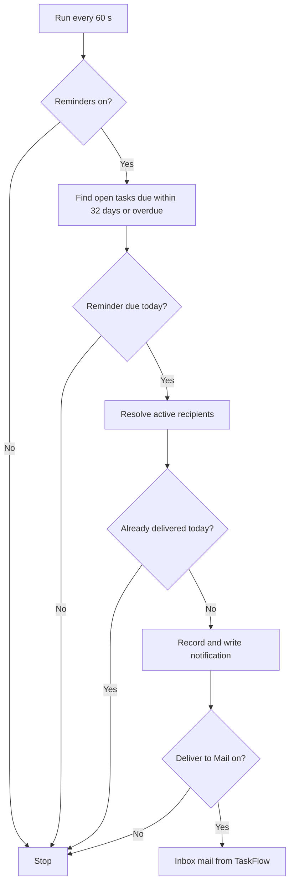
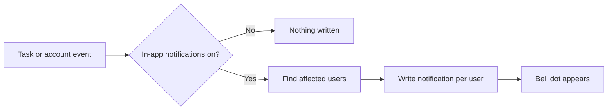
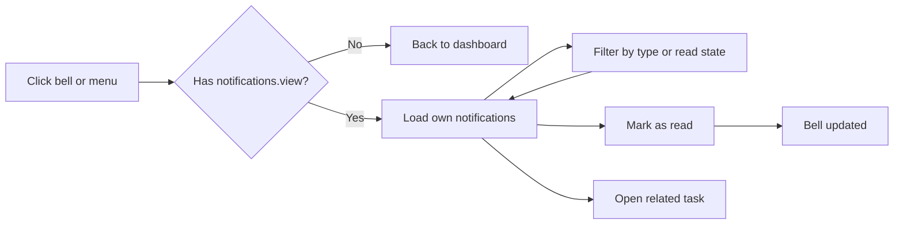

# Business Requirements Document – Notification

## TaskFlow – Intelligent Task Allocation & Tracking System

> **Document:** Business Requirements Document (Sub-module: Communication → Notification, incl. deadline reminder engine, code `NOTIF`)  ·  **Version:** 1.0  ·  **Status:** Approved
> **Project type:** Personal Project (Skill Development)  ·  **Date:** 31-Oct-2026
> **Author:** Jojo George (jojogeorge3344@gmail.com)
> © 2026 Jojo George. All rights reserved.

---

## Document Control

### Revision History

| Version | Date | Author | Summary of changes |
|---|---|---|---|
| 1.0 | 31-Oct-2026 | Jojo George | Initial version |
| 1.0 | 31-Oct-2026 | Jojo George | Approved and signed off; baselined as the agreed business requirements. |
| 1.0 | 31-Oct-2026 | Jojo George | Editorial only: Related Documents paths updated to the `TF - Documents` folder layout; no requirement changed, sign-off unchanged. |

### Approvals / Sign-off

| Role | Name | Decision | Date |
|---|---|---|---|
| Product owner | Jojo George | Approved | 31-Oct-2026 |
| Reviewer | Jojo George | Approved | 31-Oct-2026 |

### Related Documents

| Document | Location |
|---|---|
| Overall BRD (roles, global rules `BR-nn`, global NFRs, Auth, Legal) | `../../00-Overall/BRD-TaskFlow-Overall.md` |
| Sibling BRD – Mail (receives reminder mails) | `../04.1-Mail/BRD-Mail.md` |
| BRD – Reminder Settings (reminder switches and defaults) | `../../06-Settings/06.1-Reminder-Settings/BRD-Reminder-Settings.md` |
| BRD – Application Settings (in-app notifications toggle, timezone) | `../../06-Settings/06.2-Application-Settings/BRD-Application-Settings.md` |
| BRD – Task Management (task reminder fields, recipients, events) | `../../02-TaskFlow-Monitoring/02.1-Task-Management/BRD-Task-Management.md` |
| Development Plan (screen-wise) – Screen 12 | `TF - Documents/Screens Wise Feature Development Plan/12-notification-center-screen.md` |
| FRD – Notification | `../../../FRD/04-Communication/04.2-Notification/FRD-Notification.md` |
| HLD / LLD – Notification | `../../../HLD/04-Communication/04.2-Notification/HLD-Notification.md`, `../../../LLD/04-Communication/04.2-Notification/LLD-Notification.md` |

---

## Index

1. Project Overview
2. Stakeholders & User Roles
3. Scope
4. Business Process / Workflows
5. Screen-by-Screen Requirements
6. Business Rules
7. Non-Functional Requirements
8. Data Requirements
9. Integrations & External Dependencies
10. Reporting Requirements
11. Recommended Technology Stack (optional)
12. Assumptions, Constraints & Dependencies
13. Risks
14. Acceptance Criteria
15. Requirements Traceability Matrix
16. Project Deliverables
17. Glossary
18. Project Summary

---

## 1. Project Overview

### 1.1 Introduction
Notifications are short in-app alerts that tell a user about their own work: a new task, a reassignment, a comment,
a change of worked hours, an account security event, or an approaching or missed deadline. They are collected in the
Notification Center and signalled by the bell in the header. A background reminder engine checks open tasks every
minute and sends first, second, due-today and overdue reminders automatically – the main feature of TaskFlow in the
original BRD ("Automatic Deadline Notification Workflow").

### 1.2 Business Problem / Current Situation
Without automatic alerts, employees learn about new or reassigned tasks only when someone tells them, and deadlines
are missed because nobody reminds the assignee in time. Managers chase people by hand. When reminders are sent by a
simple repeating job, the same reminder can arrive several times, which makes people ignore them.

### 1.3 Project Objectives

| ID | Objective | Success measure |
|---|---|---|
| OBJ-NOTIF-01 | Reduce missed deadlines through automatic reminders | Every open task gets its first, second, due-today and overdue reminders on the correct day in the application timezone, without any user action |
| OBJ-NOTIF-02 | Never send the same reminder twice | Each reminder (task, person, reminder type, day) is delivered at most once, including after restarts |
| OBJ-NOTIF-03 | Tell users immediately about changes to their tasks | An assignment, reassignment, comment or worked-hours change creates a notification for the affected people when the change is saved |
| OBJ-NOTIF-04 | Show users what is unread at a glance | The header bell shows a dot while anything is unread, refreshed on every page change and at least every 15 seconds |
| OBJ-NOTIF-05 | Keep notifications private | 0 cases where a user can see or change another user's notifications |
| OBJ-NOTIF-06 | Let users clear and follow up alerts | A user can mark one or all notifications as read and open the related task in one click |

### 1.4 Expected Benefits
- **Organisation:** fewer overdue tasks; reminder behaviour configurable without code changes.
- **Managers:** creators of a task are reminded together with the assignee, so they can follow up before the deadline.
- **Employees:** one list of everything that needs attention, filterable by type and read state.
- **Every user:** alerts are not repeated and nobody else can read them.

---

## 2. Stakeholders & User Roles

### 2.1 Stakeholders

| Stakeholder | Interest / responsibility |
|---|---|
| Project owner (Jojo George) | Defines priorities, approves this BRD |
| Administrator | Grants or removes `notifications.view` and `notifications.manage` for custom roles; receives own notifications |
| Managers (task creators) | Receive reminders for tasks they created; rely on reminders to keep deadlines |
| Employees (assignees, recipients) | Receive task alerts and deadline reminders |
| Owners of Reminder Settings and Application Settings | Control whether reminders, deadline-day reminders, Mail delivery and in-app notifications are on |

### 2.2 User Roles

Full role definitions are in the overall BRD. Every role sees only its own notifications.

| Role | Description | Main responsibilities | Access level |
|---|---|---|---|
| Administrator | System administrator | Reads and clears own notifications; configures notification permissions for custom roles | Own notifications only |
| Manager | Leads a team or project | Reads and clears own notifications; receives reminders for tasks created | Own notifications only |
| Employee | Works on assigned tasks | Reads and clears own notifications; receives reminders as assignee or recipient | Own notifications only |
| Custom Role | Role created by an Administrator | As granted: `notifications.view` to open the center, `notifications.manage` to mark read | Own notifications, as granted |

---

## 3. Scope

### 3.1 In Scope
- Notification Center screen: list, filters (type, read state), paging, mark as read, mark all as read, open related task.
- Header bell with unread indicator on every page.
- Event notifications: task assigned, task reassigned, comment added / edited / deleted, worked hours changed, MFA reset by an administrator, password reset with the authenticator.
- Automatic deadline reminder engine: first reminder, second reminder, due-today reminder, overdue reminder (daily or weekly).
- Duplicate prevention through a reminder history.
- Optional delivery of each reminder into the Mail Inbox.
- Two permissions: `notifications.view`, `notifications.manage`.

### 3.2 Out of Scope (this release)
- Editing reminder switches and defaults – owned by the Reminder Settings sub-module.
- Setting a task's reminder days, overdue frequency and recipients – owned by Task Management.
- Outside email or SMS delivery – replaced by internal Mail.
- Deleting or archiving notifications – notifications are kept; a later phase may add clean-up.
- Live push of new notifications – the bell refreshes on navigation and every 15 seconds.
- Notifications for task status changes – not provided.
- Catching up reminders for days that passed while the application was stopped – only reminders due today are sent.
- Tracking failed reminder deliveries and retry attempts – not provided.

### 3.3 Modules Overview

| # | Module | Purpose | Screens |
|---|---|---|---|
| 1 | Communication → Notification | In-app alerts, unread indicator and the automatic deadline reminder engine | SCREEN 1 Notification Center (with header bell); the reminder engine has no screen |

**Change from original BRD**

| Original BRD item | Current requirement |
|---|---|
| Screen 12 "Access: All registered users" | Access is by the `notifications.view` permission, granted by default to Administrator, Manager and Employee. |
| Screen 12 "Unread notification count" | The bell shows a dot while anything is unread; the count itself is not printed on the bell. |
| Screen 12 "Notification filters" | Two filters: Type and Read state. |
| Screen 12 FR 5 "Create due-today alerts" | Due-today reminders are delivered as the type "Deadline reminder" with the text "… is due today at *HH:mm*." |
| Section 3.2 fixed schedule (two days before, one day before) | Each task has its own first and second reminder days (0–30), defaulting to 2 and 1 from Reminder Settings; overdue reminders are Daily or Weekly per task. |
| Section 3.2 "Deadline changed → recalculate future reminders" | Every engine run uses the task's current deadline and status, so a changed deadline takes effect on the next run. |
| Section 3.4 "Email Notifications" via SMTP | Reminders are also placed in the internal Mail Inbox when "Also deliver reminders to Mail" is on. |
| Section 3.5 reminder history "processing status, delivery attempt details" | The history records each delivered reminder with status "Sent"; attempt and failure details are not tracked. |
| Not in original BRD | Additional notifications for reassignment, comments, worked-hours changes and account security events. |

---

## 4. Business Process / Workflows

### 4.1 Automatic Deadline Reminders (main workflow)

**Trigger:** Application start, then every 60 seconds  ·  **Actors:** System (reminder engine); task assignee, task recipients, task creator

| Step | Actor / System | Action | Result |
|---|---|---|---|
| 1 | System | Starts a reminder run | – |
| 2 | System | Checks whether reminders are switched on in Reminder Settings | If off, the run stops |
| 3 | System | Finds open tasks (not completed, not cancelled, not deleted) with a deadline within 32 days or already passed | Candidate tasks |
| 4 | System | Decides, in the application timezone, whether a reminder is due today | First, second, due-today or overdue reminder, or none |
| 5 | System | Works out the recipients | Task recipients (always including the assignee) plus the task creator; active users only |
| 6 | System | Checks the reminder history | Already delivered today → skipped |
| 7 | System | Records the reminder and creates the notification | Notification in the person's Notification Center |
| 8 | System | If "Also deliver reminders to Mail" is on, adds an Inbox mail from "TaskFlow" | Mail in the person's Inbox |

**Example:** Task "Prepare Monthly Report" is assigned to Rahul by Anita (Manager), with Priya as an additional
recipient. Deadline 15-Oct-2026 17:00; first reminder 2 days, second reminder 1 day, overdue Daily (the defaults);
deadline-day reminder on.

| Date (application timezone) | What Rahul, Anita and Priya receive |
|---|---|
| 13-Oct-2026 | Reminder: "Prepare Monthly Report" is due in 2 days (15 Oct 2026, 17:00). |
| 14-Oct-2026 | Reminder: "Prepare Monthly Report" is due in 1 day (15 Oct 2026, 17:00). |
| 15-Oct-2026 (before 17:00) | Reminder: "Prepare Monthly Report" is due today at 17:00. |
| 16-Oct-2026 and every day after | Overdue: "Prepare Monthly Report" was due on 15 Oct 2026, 17:00. |
| Rahul completes the task on 17-Oct | No further reminders. |

**Exceptions / alternate flows:**
- Task completed, cancelled or deleted, or deadline changed during the run: nothing is written; the next run uses the new state.
- The application was stopped for a whole day: that day's reminders are not sent later.
- First and second reminder days are equal: only one reminder is sent that day.
- A run fails: the failure is logged and the next run tries again.
- A recipient has been deactivated or deleted: that person gets no reminder.

### 4.2 Event Notifications

**Trigger:** A change in another sub-module  ·  **Actors:** System; affected users

| Step | Actor / System | Action | Result |
|---|---|---|---|
| 1 | Manager | Creates a task | Assignee: "A task was assigned to you: *title*" |
| 2 | Manager | Reassigns a task | New assignee: "A task was reassigned to you: *title*. Reason: *reason*"; other participants get the reassignment details |
| 3 | Any participant | Adds, edits or deletes a comment | Assignee, recipients and the actor: "*Name* *added / edited / deleted* a comment on "*title*": *detail*" |
| 4 | Any participant | Changes worked hours | Assignee and recipients: what changed and the new total |
| 5 | Administrator | Resets a user's authenticator MFA | Account owner: System notice |
| 6 | User | Resets own password with the authenticator | Account owner: System notice |
| 7 | System | Checks the in-app notifications toggle (Application Settings) | If off, no event notification is written |

**Example:** Anita reassigns "Prepare Monthly Report" from Rahul to Priya with the reason "Rahul on leave". Priya gets
"A task was reassigned to you: Prepare Monthly Report. Reason: Rahul on leave". Rahul and Anita get "Anita reassigned
task "Prepare Monthly Report" (TSK-000123) from Rahul to Priya. Reason: Rahul on leave".

**Exceptions / alternate flows:**
- If writing a notification fails, the task change itself is still saved.
- Notifications that already exist are kept when the in-app toggle is switched off.

### 4.3 View, Filter and Mark Notifications as Read

**Trigger:** User clicks the bell or opens Communication Management → Notifications  ·  **Actors:** User with `notifications.view`; `notifications.manage` to mark read

| Step | Actor / System | Action | Result |
|---|---|---|---|
| 1 | User | Opens the Notification Center | Without `notifications.view` the user is returned to the dashboard |
| 2 | System | Loads the newest 20 own notifications | List with range label, for example "1–20 of 45 notifications" |
| 3 | User | Chooses Type and/or Read state | List reloads from page 1 |
| 4 | User | Clicks Mark as read or Mark all as read | Highlight removed; bell dot clears when nothing is unread |
| 5 | User | Clicks the task code on a row | Task details open (task access rules apply) |

**Example:** Rahul has 3 unread notifications. He filters Type = Overdue and Read state = Unread, sees one row for
TSK-000123, clicks Mark as read and the list reloads empty: "No notifications match these filters".

**Exceptions / alternate flows:**
- No notifications: "No notifications yet – Tasks assigned or reassigned to you will appear here."
- Load failure: "Could not load notifications. Check your connection and try again." with Retry.
- The related task was deleted: the row stays but shows no task link.

---

## 5. Screen-by-Screen Requirements

### SCREEN 1: Notification Center (with header bell)

| Field | Value |
|---|---|
| **Screen name** | Notifications (menu: Communication Management → Notifications; also the bell icon in the header) |
| **Module** | Communication → Notification |
| **Access** | Administrator, Manager, Employee by default; any Custom Role granted `notifications.view` (marking read needs `notifications.manage`) |
| **Priority** | Must |

**Purpose**
Show the signed-in user's own task alerts and deadline reminders in one place, signal unread items from every page,
and create these alerts automatically.

**Screen Elements**
- Header bell on every page, with a dot while anything is unread.
- Page header: title "Notifications", range label, Mark all as read button.
- Filters: Type (All types, Task assigned, Task reassigned, Deadline reminder, Overdue, System), Read state (All, Unread, Read), Reset.
- Notification list: type chip, date and time, message, related task code link, Mark as read on unread rows; unread rows highlighted.
- Paging: Previous / Next, "Page X of Y".
- Empty, no-match and error states with Clear filters and Retry.

**Functional Requirements**

*Notification Center and bell*

| ID | Requirement | Priority |
|---|---|---|
| REQ-NOTIF-01 | The system shall open the Notification Center only for users holding `notifications.view`, and return other users to their dashboard. | Must |
| REQ-NOTIF-02 | The system shall show a bell in the header of every page for users holding `notifications.view`, linking to the Notification Center. | Must |
| REQ-NOTIF-03 | The system shall show a dot on the bell while the user has unread notifications, refreshed on every page change, every 15 seconds and when the browser tab becomes visible again. | Must |
| REQ-NOTIF-04 | The system shall list only the signed-in user's own notifications, newest first. | Must |
| REQ-NOTIF-05 | The system shall show 20 notifications per page with Previous, Next, "Page X of Y" and a range label. | Should |
| REQ-NOTIF-06 | The system shall show on each row the type, the date and time, the message and, when the task still exists, the related task code as a link. | Must |
| REQ-NOTIF-07 | The system shall highlight unread rows. | Should |
| REQ-NOTIF-08 | The system shall filter the list by type: All types, Task assigned, Task reassigned, Deadline reminder, Overdue, System. | Should |
| REQ-NOTIF-09 | The system shall filter the list by read state: All, Unread, Read, and reload from page 1 when a filter changes. | Should |
| REQ-NOTIF-10 | The system shall clear both filters when the user clicks Reset or Clear filters. | Should |
| REQ-NOTIF-11 | The system shall let users holding `notifications.manage` mark one of their own notifications as read, with no effect if it is already read. | Must |
| REQ-NOTIF-12 | The system shall show Mark all as read only to users holding `notifications.manage`, disabled when nothing is unread. | Should |
| REQ-NOTIF-13 | The system shall mark all of the user's unread notifications as read when the user clicks Mark all as read. | Must |
| REQ-NOTIF-14 | The system shall update the bell, and reload the list when a read-state filter is active, after notifications are marked read. | Should |
| REQ-NOTIF-15 | The system shall open the related task when the user clicks its task code, subject to the task's own access rules. | Must |
| REQ-NOTIF-16 | The system shall keep a notification without a task link when its task has been deleted. | Should |
| REQ-NOTIF-17 | The system shall keep notifications permanently, allowing them only to be marked as read. | Must |
| REQ-NOTIF-18 | The system shall show the states "No notifications yet", "No notifications match these filters" with Clear filters, and a load error with Retry. | Should |
| REQ-NOTIF-19 | The system shall never show or change another user's notification, and shall report such a notification as not found. | Must |

*Event notifications*

| ID | Requirement | Priority |
|---|---|---|
| REQ-NOTIF-20 | The system shall notify the assignee when a task is created: "A task was assigned to you: *title*". | Must |
| REQ-NOTIF-21 | The system shall notify the new assignee of a reassignment with the title and reason, and the previous assignee, the recipients and the acting person with the reassignment details. | Must |
| REQ-NOTIF-22 | The system shall notify the task's assignee, recipients and the acting person when a comment is added, edited or deleted. | Must |
| REQ-NOTIF-23 | The system shall notify the task's assignee and recipients when the worked hours of a task change, stating the change and the new total. | Should |
| REQ-NOTIF-24 | The system shall send a System notification to the account owner when an administrator resets their authenticator MFA. | Must |
| REQ-NOTIF-25 | The system shall send a System notification to the account owner when their password is reset with the authenticator app. | Must |
| REQ-NOTIF-26 | The system shall not create event notifications while in-app notifications are switched off in Application Settings, and shall keep existing notifications. | Must |
| REQ-NOTIF-27 | The system shall not notify deleted users. | Must |

*Automatic deadline reminders*

| ID | Requirement | Priority |
|---|---|---|
| REQ-NOTIF-28 | The system shall run the reminder engine when the application starts and every 60 seconds after that, without user action. | Must |
| REQ-NOTIF-29 | The system shall send no reminders while reminders are switched off in Reminder Settings. | Must |
| REQ-NOTIF-30 | The system shall consider only open tasks (not completed, not cancelled, not deleted) whose deadline is within 32 days or already passed. | Must |
| REQ-NOTIF-31 | The system shall work out reminder days in the application timezone. | Must |
| REQ-NOTIF-32 | The system shall send the first reminder on the day that is exactly the task's first-reminder days before the deadline. | Must |
| REQ-NOTIF-33 | The system shall send the second reminder on the day that is exactly the task's second-reminder days before the deadline. | Must |
| REQ-NOTIF-34 | The system shall send only one reminder on a day when the first and second reminder days are equal. | Should |
| REQ-NOTIF-35 | The system shall send a due-today reminder on the deadline day, before the deadline time, when the deadline-day reminder is on or the task has a reminder at 0 days. | Must |
| REQ-NOTIF-36 | The system shall send an overdue reminder from the day after the deadline, every day for Daily or every 7 days for Weekly, while the task stays open. | Must |
| REQ-NOTIF-37 | The system shall send each reminder to the task's notification recipients (always including the assignee) and the task creator, counting each person once and only active users. | Must |
| REQ-NOTIF-38 | The system shall deliver each reminder (task, person, reminder type, day) at most once, however often the engine runs or restarts. | Must |
| REQ-NOTIF-39 | The system shall send only reminders due today and never send reminders for days that have already ended. | Must |
| REQ-NOTIF-40 | The system shall write nothing for a task that was completed, cancelled, deleted or given a new deadline during the run. | Must |
| REQ-NOTIF-41 | The system shall use the reminder texts "Reminder: "*title*" is due in *N* days (*date, time*)." ("1 day" when N is 1), "Reminder: "*title*" is due today at *time*." and "Overdue: "*title*" was due on *date, time*.". | Must |
| REQ-NOTIF-42 | The system shall show first, second and due-today reminders with the type "Deadline reminder" and overdue reminders with the type "Overdue". | Should |
| REQ-NOTIF-43 | The system shall also place each reminder in the recipient's Mail Inbox as a mail from "TaskFlow" while "Also deliver reminders to Mail" is on, with the subject "Task reminder:", "Task due today:" or "Overdue task:" followed by the title. | Should |
| REQ-NOTIF-44 | The system shall record every delivered reminder in a reminder history with the task, recipient, reminder type, reminder day, status and processing time. | Must |
| REQ-NOTIF-45 | The system shall log a failed reminder run and try again on the next run. | Should |

**Validations & Messages**

| Situation | Rule / message |
|---|---|
| Task assigned | "A task was assigned to you: *task title*" |
| Task reassigned to you | "A task was reassigned to you: *task title*. Reason: *reason*" |
| Reassignment, other participants | "*Name* reassigned task "*title*" (*code*) from *old* to *new*. Reason: *reason*" |
| Comment activity | "*Name* *added / edited / deleted* a comment on "*title*": *detail*" |
| First / second reminder | "Reminder: "*title*" is due in *N* days (*dd MMM yyyy, HH:mm*)." ("1 day" when N is 1) |
| Due-today reminder | "Reminder: "*title*" is due today at *HH:mm*." |
| Overdue reminder | "Overdue: "*title*" was due on *dd MMM yyyy, HH:mm*." |
| MFA reset by administrator | "An administrator reset your authenticator MFA. Sign in with your password and set it up again from Profile." |
| Password reset with authenticator | "Your password was reset with your authenticator app. If this was not you, contact an administrator now." |
| Empty list | "No notifications yet – Tasks assigned or reassigned to you will appear here." |
| No filter matches | "No notifications match these filters – Try a different type or clear the filters." |
| Load failed | "Could not load notifications. Check your connection and try again." |
| Mark one failed | "Could not mark the notification as read." |
| Mark all failed | "Could not mark all notifications as read." |
| No permission to open the screen | User is returned to their dashboard; no message |
| Page size outside 1–100 | 20 is used; no message |

**Expected Result**
Users receive timely, non-repeated alerts about their tasks and deadlines, see from any page whether something is
unread, and can clear alerts and jump to the related task.

> ⚠️ To be confirmed: comment notifications have their own type, but the Type filter and the type chip do not list it,
> so these rows show an empty chip and cannot be filtered. Confirm whether "Task comment" should be added.
>
> ⚠️ To be confirmed: the per-row Mark as read button is shown to every user who can open the screen, although
> marking read needs `notifications.manage`. Confirm whether it should be hidden like Mark all as read.
>
> ⚠️ To be confirmed: deadline reminders are still written to the Notification Center when in-app notifications are
> switched off in Application Settings (only event notifications follow that toggle). Confirm the intended behaviour.

---

## 6. Business Rules

Global rules that apply here are defined in the overall BRD, section 6
(`../../00-Overall/BRD-TaskFlow-Overall.md`): the assigned employee is always included in task notifications; only
authenticated, authorised users can use the system; a task is overdue when its deadline has passed and it is not
completed or cancelled; completed and cancelled tasks receive no further reminders; reminder settings are
configurable; users cannot access another user's notifications; duplicate reminder events are prevented; Mail
delivery failure does not stop in-app notifications; one timezone is used for deadline comparisons.

| ID | Rule | Applies to |
|---|---|---|
| BR-NOTIF-01 | Users only ever see and change their own notifications; no role, including Administrator, sees another user's. | SCREEN 1 |
| BR-NOTIF-02 | Notifications are never deleted; they can only be marked as read. | SCREEN 1 |
| BR-NOTIF-03 | Reminders are sent only for open tasks: not completed, not cancelled, not deleted. | Reminder engine |
| BR-NOTIF-04 | Reminder recipients are the task's notification recipients (the assignee is always one) plus the task creator, active users only. | Reminder engine |
| BR-NOTIF-05 | Each reminder (task, person, reminder type, day) is delivered at most once. | Reminder engine |
| BR-NOTIF-06 | Only reminders due today are sent; past days are never caught up. | Reminder engine |
| BR-NOTIF-07 | Reminder days are counted in the application timezone. | Reminder engine |
| BR-NOTIF-08 | The due-today reminder is sent only before the deadline time on the deadline day. | Reminder engine |
| BR-NOTIF-09 | Overdue reminders start the day after the deadline and repeat daily or weekly as set on the task. | Reminder engine |
| BR-NOTIF-10 | A changed deadline or status takes effect on the next reminder run. | Reminder engine |
| BR-NOTIF-11 | Event notifications follow the in-app notifications toggle in Application Settings; reminders follow the switches in Reminder Settings. | SCREEN 1, Reminder engine |
| BR-NOTIF-12 | Reminders are also placed in Mail only while "Also deliver reminders to Mail" is on; the in-app notification is always created. | Reminder engine |
| BR-NOTIF-13 | A failure to notify never undoes the task change that caused it. | Event notifications |

---

## 7. Non-Functional Requirements

Global NFRs (performance, compatibility, backup, accessibility, maintainability) are in the overall BRD. Sub-module
specific requirements:

| ID | Category | Requirement | Measure / target |
|---|---|---|---|
| NFR-NOTIF-01 | Performance | Reminders are found quickly after they become due | Engine runs every 60 seconds; a reminder for a day is sent on the first run of that day |
| NFR-NOTIF-02 | Performance | Unread state reaches the user without reloading the page | Bell refreshed on page change and at least every 15 seconds |
| NFR-NOTIF-03 | Performance | Large lists stay fast | 20 notifications per page (at most 100) |
| NFR-NOTIF-04 | Reliability | Reminders are never duplicated, even when runs overlap or the application restarts | At most one delivery per task, person, reminder type and day |
| NFR-NOTIF-05 | Reliability | A failed run does not stop the engine | Failure logged; next run within 60 seconds |
| NFR-NOTIF-06 | Reliability | Reminder days are correct across daylight-saving changes | Day boundaries computed in the application timezone |
| NFR-NOTIF-07 | Security | Notifications are private | Foreign notifications always reported as not found |
| NFR-NOTIF-08 | Maintainability | Reminder behaviour changes without code changes | Switches and defaults edited in Reminder Settings; run interval set in configuration |

---

## 8. Data Requirements

| Entity / data set | Purpose | Key fields | Retention / rules |
|---|---|---|---|
| Notification | One alert for one user | Recipient user, related task (optional), type (Task assigned, Reassigned, Deadline reminder, Overdue, System, Task comment), message, read flag, created time | Kept permanently; removed only together with its user or task |
| Reminder history | Proof that a reminder was delivered; prevents duplicates | Task, recipient, reminder type (First, Second, Due today, Overdue), reminder day, status, processed time, delivery attempts | One entry per task, recipient, reminder type and day (unique) |
| Task reminder fields (read only, from Task Management) | Drive the reminder engine | Deadline, status, first and second reminder days, overdue frequency, creator, notification recipients | Owned by Task Management |

---

## 9. Integrations & External Dependencies

| System / service | Purpose | Required? | Notes |
|---|---|---|---|
| Task Management | Source of tasks, reminder fields, recipients and task events; target of the task code link | Yes | Notification failures do not undo task changes |
| Reminder Settings | Reminders on/off, deadline-day reminder, "Also deliver reminders to Mail" | Yes | Changes apply from the next run |
| Application Settings | In-app notifications toggle; application timezone | Yes | Timezone falls back to UTC when not set |
| Mail | Receives reminder mails from "TaskFlow" | Optional | Only while "Also deliver reminders to Mail" is on |
| Authentication / My Profile | MFA reset and password-reset notices | Yes | System notifications |
| Employee Management | Active-user check for reminder recipients | Yes | Inactive users get no reminders |
| Role Configuration | Grants `notifications.view` and `notifications.manage` | Yes | – |
| Assistant (TFA) | Help article describing notifications | Optional | – |

---

## 10. Reporting Requirements

_Not applicable for this sub-module._

---

## 11. Recommended Technology Stack (optional)

_Not applicable for this sub-module._ The stack is stated once in the overall BRD.

---

## 12. Assumptions, Constraints & Dependencies

| Type | Description |
|---|---|
| Assumption | The application runs continuously; reminders for a day are sent while it is running on that day. |
| Assumption | One application timezone applies to all users. |
| Constraint | Single-server deployment: one reminder engine per installation. |
| Constraint | No live push; the user interface checks for new notifications on navigation and every 15 seconds. |
| Dependency | Task reminder fields and recipients from Task Management. |
| Dependency | Switches from Reminder Settings and Application Settings. |
| Dependency | Mail sub-module for Inbox delivery of reminders. |

---

## 13. Risks

| ID | Risk | Impact | Likelihood | Mitigation |
|---|---|---|---|---|
| R-NOTIF-01 | The application is stopped for a day and that day's reminders are never sent | High | Low | Engine runs on start-up and every 60 seconds; overdue reminders continue daily once running |
| R-NOTIF-02 | The notification list grows without limit because nothing is deleted | Medium | Medium | Paging (20 per page); plan clean-up in a later phase |
| R-NOTIF-03 | Users without `notifications.manage` see a Mark as read button that fails | Low | Medium | Grant both keys together, or hide the button (to be confirmed) |
| R-NOTIF-04 | Reminders still appear when in-app notifications are switched off, confusing administrators | Medium | Medium | Use Reminder Settings to stop reminders; confirm intended behaviour |
| R-NOTIF-05 | Duplicate reminders if runs overlap | High | Low | Unique reminder history per task, person, type and day |

---

## 14. Acceptance Criteria

| ID | Criterion | Verified by |
|---|---|---|
| AC-NOTIF-01 | A user with `notifications.view` opens the Notification Center from the menu or the bell; a user without it is returned to the dashboard and sees no bell. | SCREEN 1, REQ-NOTIF-01, REQ-NOTIF-02 |
| AC-NOTIF-02 | A new notification makes the bell dot appear within 15 seconds or on the next page change, and the dot clears when nothing is unread. | SCREEN 1, REQ-NOTIF-03, REQ-NOTIF-14 |
| AC-NOTIF-03 | The list shows only the user's own notifications, newest first, 20 per page, with type, date, message, task link and unread highlight. | SCREEN 1, REQ-NOTIF-04 – REQ-NOTIF-07 |
| AC-NOTIF-04 | Filtering Type = Overdue and Read state = Unread shows only unread overdue rows from page 1; Reset shows all again. | SCREEN 1, REQ-NOTIF-08, REQ-NOTIF-09, REQ-NOTIF-10 |
| AC-NOTIF-05 | Mark as read and Mark all as read work with `notifications.manage`; Mark all as read is hidden without it and disabled when nothing is unread. | SCREEN 1, REQ-NOTIF-11, REQ-NOTIF-12, REQ-NOTIF-13 |
| AC-NOTIF-06 | Clicking a task code opens the task; a notification for a deleted task stays without a link; notifications cannot be deleted. | SCREEN 1, REQ-NOTIF-15, REQ-NOTIF-16, REQ-NOTIF-17 |
| AC-NOTIF-07 | Empty, no-match and error states show the listed texts; marking another user's notification reports not found. | SCREEN 1, REQ-NOTIF-18, REQ-NOTIF-19 |
| AC-NOTIF-08 | Creating, reassigning, commenting on and changing worked hours of a task create the listed notifications for the listed people. | SCREEN 1, REQ-NOTIF-20 – REQ-NOTIF-23 |
| AC-NOTIF-09 | An administrator MFA reset and a password reset with the authenticator each create a System notification for the account owner. | SCREEN 1, REQ-NOTIF-24, REQ-NOTIF-25 |
| AC-NOTIF-10 | With in-app notifications switched off, creating a task writes no notification and old notifications remain; deleted users are never notified. | SCREEN 1, REQ-NOTIF-26, REQ-NOTIF-27 |
| AC-NOTIF-11 | With reminders on and the default schedule, a task due 15-Oct-2026 17:00 produces reminders on 13-Oct and 14-Oct, a due-today reminder on 15-Oct before 17:00, and overdue reminders from 16-Oct; with reminders off, none. | Workflow 4.1, REQ-NOTIF-28 – REQ-NOTIF-36 |
| AC-NOTIF-12 | The assignee, every recipient and the creator each receive one reminder; an inactive recipient receives none. | Workflow 4.1, REQ-NOTIF-37 |
| AC-NOTIF-13 | Running the engine many times on the same day, or restarting the application, produces no second copy of a reminder, and no reminders for past days. | Workflow 4.1, REQ-NOTIF-38, REQ-NOTIF-39 |
| AC-NOTIF-14 | Completing or cancelling a task stops its reminders; moving its deadline changes the reminder days from the next run. | Workflow 4.1, REQ-NOTIF-30, REQ-NOTIF-40 |
| AC-NOTIF-15 | Reminder texts and types match the listed wording; with "Also deliver reminders to Mail" on, each reminder also appears in the Inbox from "TaskFlow". | Workflow 4.1, REQ-NOTIF-41, REQ-NOTIF-42, REQ-NOTIF-43 |
| AC-NOTIF-16 | Each delivered reminder has one reminder history entry; a failed run is logged and the next run proceeds. | Workflow 4.1, REQ-NOTIF-44, REQ-NOTIF-45 |

---

## 15. Requirements Traceability Matrix

| Objective | Business rule(s) | Screen(s) | Functional requirement(s) | Acceptance criterion |
|---|---|---|---|---|
| OBJ-NOTIF-01 | BR-NOTIF-03, BR-NOTIF-04, BR-NOTIF-07, BR-NOTIF-08, BR-NOTIF-09, BR-NOTIF-10, BR-NOTIF-12 | Reminder engine (workflow 4.1) | REQ-NOTIF-28 – REQ-NOTIF-37, REQ-NOTIF-40 – REQ-NOTIF-43, REQ-NOTIF-45 | AC-NOTIF-11, AC-NOTIF-12, AC-NOTIF-14, AC-NOTIF-15, AC-NOTIF-16 |
| OBJ-NOTIF-02 | BR-NOTIF-05, BR-NOTIF-06 | Reminder engine (workflow 4.1) | REQ-NOTIF-38, REQ-NOTIF-39, REQ-NOTIF-44 | AC-NOTIF-13, AC-NOTIF-16 |
| OBJ-NOTIF-03 | BR-NOTIF-11, BR-NOTIF-13 | SCREEN 1 | REQ-NOTIF-20 – REQ-NOTIF-27 | AC-NOTIF-08, AC-NOTIF-09, AC-NOTIF-10 |
| OBJ-NOTIF-04 | BR-NOTIF-01 | SCREEN 1 | REQ-NOTIF-02, REQ-NOTIF-03, REQ-NOTIF-07, REQ-NOTIF-14 | AC-NOTIF-01, AC-NOTIF-02, AC-NOTIF-03 |
| OBJ-NOTIF-05 | BR-NOTIF-01 | SCREEN 1 | REQ-NOTIF-01, REQ-NOTIF-04, REQ-NOTIF-19 | AC-NOTIF-01, AC-NOTIF-03, AC-NOTIF-07 |
| OBJ-NOTIF-06 | BR-NOTIF-02 | SCREEN 1 | REQ-NOTIF-05, REQ-NOTIF-06, REQ-NOTIF-08 – REQ-NOTIF-13, REQ-NOTIF-15 – REQ-NOTIF-18 | AC-NOTIF-03 – AC-NOTIF-07 |

---

## 16. Project Deliverables

| # | Deliverable | Format |
|---|---|---|
| 1 | Notification Center screen, header bell and the two `notifications.*` permissions | Application source code (repository) |
| 2 | Background reminder engine with duplicate prevention | Application source code (repository) |
| 3 | Notification and reminder history data in the database initialisation scripts | Database migrations |
| 4 | BRD, FRD, HLD and LLD for the Notification sub-module | Markdown |
| 5 | Automated tests for the notification list, reminder calculation, reminder generation, duplicate prevention and the scheduler | Unit and integration tests |

---

## 17. Glossary

| Term | Meaning |
|---|---|
| Notification | A short in-app alert for one user, shown in the Notification Center |
| Event notification | A notification caused by a change, such as an assignment, reassignment, comment or account event |
| Reminder engine | The background process that checks open tasks every 60 seconds and sends deadline reminders |
| First / second reminder | Reminders sent the set number of days (0–30) before the deadline, configured per task |
| Due-today reminder | Reminder sent on the deadline day before the deadline time |
| Overdue reminder | Reminder sent after the deadline day, daily or weekly, while the task is open |
| Recipient | Any user configured to receive reminders for a task; the assignee is always one |
| Reminder history | The record of delivered reminders that prevents duplicates |
| Application timezone | The single timezone, set in Application Settings, used to decide reminder days |

---

## 18. Project Summary
The Notification sub-module tells every TaskFlow user about their own work in one Notification Center, with an unread
dot on the header bell. Task assignments, reassignments, comments, worked-hours changes and account security events
create alerts at once, and the reminder engine sends first, second, due-today and overdue reminders on the right day,
exactly once, to the assignee, recipients and task creator – also into Mail when that is switched on. This delivers
the original BRD's Automatic Deadline Notification Workflow while keeping every user's notifications private.

---
© 2026 Jojo George. All rights reserved. Unauthorized copying or distribution of this document is prohibited.
