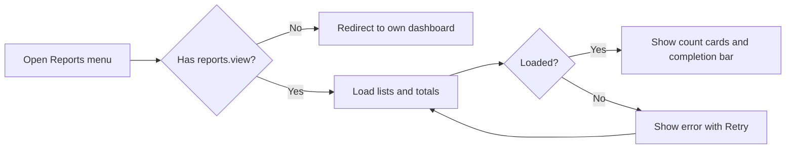
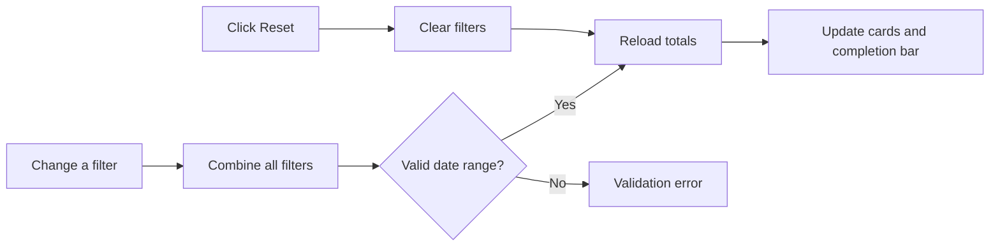
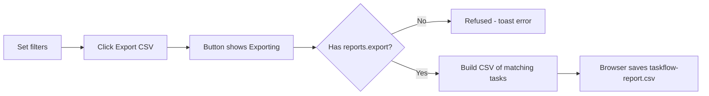

# Business Requirements Document – Reports

## TaskFlow – Intelligent Task Allocation & Tracking System

> **Document:** Business Requirements Document (sub-module 10 – RPT)  ·  **Version:** 1.0  ·  **Status:** Approved
> **Project type:** Personal Project (Skill Development)  ·  **Date:** 31-Oct-2026
> **Author:** Jojo George (jojogeorge3344@gmail.com)
> © 2026 Jojo George. All rights reserved.

---

## Document Control

### Revision History

| Version | Date | Author | Summary of changes |
|---|---|---|---|
| 1.0 | 31-Oct-2026 | Jojo George | Initial version of the Reports sub-module BRD (Task Reports screen and CSV export), written from the original BRD Screen 17 and TaskFlow as built |
| 1.0 | 31-Oct-2026 | Jojo George | Approved and signed off; baselined as the agreed business requirements. |
| 1.0 | 31-Oct-2026 | Jojo George | Editorial only: Related Documents paths updated to the `TF - Documents` folder layout; no requirement changed, sign-off unchanged. |

### Approvals / Sign-off

| Role | Name | Decision | Date |
|---|---|---|---|
| Product owner | Jojo George | Approved | 31-Oct-2026 |
| Reviewer | Jojo George | Approved | 31-Oct-2026 |

### Related Documents

| Document | Location |
|---|---|
| Overall BRD (roles, objectives, global rules in section 6, global NFRs) | `../../00-Overall/BRD-TaskFlow-Overall.md` |
| Original BRD (Screen 17) | `BRD for Task management.docx` (v1.0) |
| Development Plan (screen-wise) | `TF - Documents/Screens Wise Feature Development Plan/17-reports-screen.md` |
| FRD – Reports | `../../../FRD/05-Reports/05.1-Reports/FRD-Reports.md` |
| HLD – Reports | `../../../HLD/05-Reports/05.1-Reports/HLD-Reports.md` |
| LLD – Reports | `../../../LLD/05-Reports/05.1-Reports/LLD-Reports.md` |
| Functional workflow (module docs) | Reports module – child module 06.1 Reports |
| TDD | `TF - Documents/TF - TDD/TDD-TaskFlow.md` (v2.0) |

> Global objectives, rules and NFRs are defined in the overall BRD (`../../00-Overall/BRD-TaskFlow-Overall.md`, rules in
> section 6). Each global rule used here is quoted and linked so this document can be read on its own.

---

## Index

1. Project Overview
2. Stakeholders & User Roles
3. Scope
4. Business Process / Workflows
5. Screen-by-Screen Requirements
6. Business Rules
7. Non-Functional Requirements
8. Data Requirements
9. Integrations & External Dependencies
10. Reporting Requirements
11. Recommended Technology Stack (optional)
12. Assumptions, Constraints & Dependencies
13. Risks
14. Acceptance Criteria
15. Requirements Traceability Matrix
16. Project Deliverables
17. Glossary
18. Project Summary

---

## 1. Project Overview

### 1.1 Introduction
The Reports sub-module gives Managers and Administrators one screen, **Task Reports**, that summarises task allocation and
completion. Users filter tasks by deadline range, employee, project, status and priority and see the total, completed,
pending and overdue counts with a completion summary bar. Users with the export permission can download the filtered tasks
as a CSV file for office use.

### 1.2 Business Problem / Current Situation
Without reports, managers count tasks by hand to prepare status reviews, and the numbers differ from person to person.
There is no easy way to give a spreadsheet of an employee's or project's tasks to someone else, and spreadsheet files
built by hand can carry unsafe content.

### 1.3 Project Objectives

| ID | Objective | Success measure | Supports overall objective |
|---|---|---|---|
| OBJ-RPT-01 | Show task totals for any filter combination | Total, completed, pending and overdue counts appear for any mix of deadline range, employee, project, status and priority, without an "Apply" step | Reports for work planning |
| OBJ-RPT-02 | Show completion progress at a glance | The completion bar and "X of Y completed · Z%" match the counts | Monitor task progress; Reports for work planning |
| OBJ-RPT-03 | Highlight overdue work for planning | The Overdue card counts every open task whose deadline has passed at the moment the report runs | Identify pending and overdue tasks |
| OBJ-RPT-04 | Give a safe file for office use | Users with the export permission download the same filtered tasks (up to 50,000 rows) as a CSV that a spreadsheet opens without running formulas | Reports for work planning |
| OBJ-RPT-05 | Keep reports to authorised users | Users without `reports.view` cannot open the screen or receive report data; users without `reports.export` cannot download | Reports for work planning |

### 1.4 Expected Benefits
- **Organisation:** one consistent source of task totals for reviews and audits.
- **Managers and Administrators:** filtered figures in seconds and a CSV to share or archive.
- **Employees:** no change to their screens; their task data is reported correctly, including after reassignment or removal.

---

## 2. Stakeholders & User Roles

### 2.1 Stakeholders

| Stakeholder | Interest / responsibility |
|---|---|
| Project owner (Jojo George) | Defines priorities and approves this BRD |
| Administrators | Use reports; grant or remove report permissions in Role Configuration |
| Managers | Use reports for planning and reviews |
| Employees | Their tasks are counted; no report access by default |

### 2.2 User Roles

| Role | Description | Main responsibilities in Reports | Access level |
|---|---|---|---|
| Administrator | Runs the system and its settings | Views and exports reports | Organisation |
| Manager | Leads one or more departments or projects | Views and exports reports | Organisation (not limited to the team) |
| Employee | Works on assigned tasks | None by default | No access unless an Administrator grants `reports.view` |
| Custom Role | Role created by an Administrator | Views / exports if granted | Organisation, if `reports.view` is granted |

**Report permissions (default grants)**

| Permission | Meaning | Administrator | Manager | Employee | Custom Role |
|---|---|:-:|:-:|:-:|:-:|
| `reports.view` | View reports – open Task Reports and filter them | Granted | Granted | Not granted | Configurable |
| `reports.export` | Export reports – download a report as a file (requires `reports.view`) | Granted | Granted | Not granted | Configurable |
| `projects.view` (Project Management key) | Needed only to fill the **Project** filter list | Granted | Granted | Not granted | Configurable |

The Administrator is re-granted every permission on each application start. Manager and Employee values are seed defaults
that an Administrator can change in Role Configuration. A custom role starts with no permissions.

---

## 3. Scope

### 3.1 In Scope
- Task Reports screen with a Reports menu item.
- Filters: deadline from / to, employee, project, status, priority; **Reset**.
- Count cards: Total Tasks, Completed, Pending, Overdue; completion summary bar.
- CSV export of the filtered tasks (`taskflow-report.csv`).

### 3.2 Out of Scope (this release)
- Department filter – not built; future phase.
- Per-status / per-priority / per-employee breakdown and a chart – not built; future phase.
- Per-user data scope (reports limited to the records each user may access) – not built; see 3.4 and section 13.
- Export formats other than CSV (PDF, Excel) – not built.
- Scheduled or emailed reports – not built.
- Workload reports – provided by the Employee Workload sub-module.

### 3.3 Modules Overview

| # | Module | Purpose | Screens |
|---|---|---|---|
| 1 | Reports | Filtered task totals, completion summary and CSV export | Task Reports |

### 3.4 Change from Original BRD

| Original BRD (Screen 17) | Current requirement |
|---|---|
| Date-range filter | Deadline range filter (Deadline from / Deadline to), both days included |
| Department filter | Replaced by a **Project** filter (assignee's project allocations) |
| Completion summary chart | Completion summary **progress bar** with "X of Y completed · Z%" |
| FR2 "Display task counts by status" | Four totals (Total, Completed, Pending, Overdue) plus a Status filter |
| FR6 "Reports contain only records the user is permitted to access" | Any holder of `reports.view` sees the whole organisation (chosen to match the dashboards) – > ⚠️ To be confirmed: acceptance of organisation-wide scope for Managers |
| FR5 "Export authorized report data to CSV" | CSV export needs `reports.export`; data is the same organisation-wide filtered set |
| New (not in original) | Spreadsheet formula protection; 50,000-row export limit; separate view and export permissions |

---

## 4. Business Process / Workflows

### 4.1 View the Report

**Trigger:** User clicks **Reports** in the side menu  ·  **Actors:** Administrator, Manager, Custom Role, System

| Step | Actor / System | Action | Result |
|---|---|---|---|
| 1 | User | Opens **Reports** | Request to open Task Reports |
| 2 | System | Checks `reports.view`; without it sends the user to their own dashboard (menu item hidden) | No unauthorised access |
| 3 | System | Loads the Employee and Project lists and the totals with no filter; subtitle "Loading report…" | Report loading |
| 4 | System | Shows the four count cards and the completion bar | Report shown |
| 5 | System | On a failure shows "Something went wrong" with **Retry** | User can reload |

**Example:** On 31-Oct-2026 the Manager opens Reports. There are 40 tasks: 12 Completed, 2 Cancelled, 26 pending of which
5 have a passed deadline. The cards show Total 40, Completed 12, Pending 26, Overdue 5 and the bar shows
"12 of 40 completed · 30%".

**Exceptions / alternate flows:**
- Load failure → *"Could not load the report. Check your connection and try again."* with **Retry**.

### 4.2 Filter the Report

**Trigger:** User changes a filter  ·  **Actors:** Administrator, Manager, Custom Role, System

| Step | Actor / System | Action | Result |
|---|---|---|---|
| 1 | User | Picks Deadline from, Deadline to, Employee, Project, Status or Priority | Filter changed |
| 2 | System | Combines all selected filters and reloads the totals at once (no "Apply" button) | Updated cards and bar |
| 3 | System | Stops "Deadline to" being earlier than "Deadline from"; refuses such a request if it still arrives | Valid range only |
| 4 | User | Clicks **Reset** | All filters cleared; full report reloads |

**Example:** The Manager sets Deadline from 01-Oct-2026, Deadline to 31-Oct-2026, Employee "Arun Kumar" and Priority
"High". The cards reload to Total 6, Completed 2, Pending 4, Overdue 1 – "2 of 6 completed · 33%".

**Exceptions / alternate flows:**
- "To" before "From" reaches the server → *"The report 'to' deadline must be on or after the 'from' deadline."*

### 4.3 Export CSV

**Trigger:** User clicks **Export CSV**  ·  **Actors:** Administrator, Manager, Custom Role with `reports.export`, System

| Step | Actor / System | Action | Result |
|---|---|---|---|
| 1 | User | Sets filters and clicks **Export CSV** (shown only with `reports.export`) | Export requested |
| 2 | System | Shows "Exporting…" and disables the button | No double export |
| 3 | System | Checks `reports.export`; collects the matching tasks, earliest deadline first, at most 50,000 rows | Export rows ready |
| 4 | System | Delivers `taskflow-report.csv` to the browser | File saved |
| 5 | System | On failure shows the toast *"Could not export the report. Please try again."* | User can retry |

**Example:** With the October filter above, the Manager exports 6 rows, earliest deadline first. A task assigned to Arun Kumar, who is allocated to "Portal" and "Website", shows `Portal, Website` in the Project column; its CompletedAt cell is empty because the task is not finished. A title typed as `=SUM(A1)` appears in the file as `'=SUM(A1)`.

**Exceptions / alternate flows:**
- More than 50,000 matching tasks → only the first 50,000 by deadline are exported.
- No notification, email or activity entry is created by an export.

---

## 5. Screen-by-Screen Requirements

### SCREEN 1: Task Reports

| Field | Value |
|---|---|
| **Screen name** | Task Reports (original BRD Screen 17) |
| **Module** | Reports |
| **Access** | Administrator, Manager, Custom Role holding `reports.view`; Employee only if an Administrator grants `reports.view` (export needs `reports.export`) |
| **Priority** | Must |

**Purpose**
Show task allocation and completion for the selected filters, and export the matching tasks to CSV.

**Screen Elements**
- Header "Task Reports" with subtitle "Task allocation and completion for the selected filters." ("Loading report…" on first load).
- **Export CSV** button (top right), shown only with `reports.export`; label "Exporting…" while running.
- Filter toolbar: Deadline from, Deadline to, Employee ("All employees"), Project ("All projects"), Status ("All statuses",
  ToDo, InProgress, InQA, Blocked, Completed, Cancelled), Priority ("All priorities", Low, Medium, High, Critical), **Reset**.
- Count cards: Total Tasks, Completed, Pending, Overdue (Overdue highlighted).
- Completion summary: progress bar and "X of Y completed · Z%".
- Error panel "Something went wrong" with **Retry**.

**Functional Requirements**

| ID | Requirement | Priority |
|---|---|---|
| REQ-RPT-01 | The system shall show the **Reports** menu item only to users holding `reports.view`. | Must |
| REQ-RPT-02 | The system shall send a user without `reports.view` who opens the Reports address to their own dashboard without a message. | Must |
| REQ-RPT-03 | The system shall refuse report data to a user without `reports.view`. | Must |
| REQ-RPT-04 | The system shall load the report with no filter applied when the screen opens. | Must |
| REQ-RPT-05 | The system shall show the subtitle "Loading report…" during the first load. | Could |
| REQ-RPT-06 | The system shall show four count cards: Total Tasks, Completed, Pending and Overdue, with Overdue highlighted. | Must |
| REQ-RPT-07 | The system shall count in **Total** every non-deleted task that matches the filters, including Cancelled tasks. | Must |
| REQ-RPT-08 | The system shall count in **Completed** the matching tasks with status Completed. | Must |
| REQ-RPT-09 | The system shall count in **Pending** the matching tasks that are neither Completed nor Cancelled. | Must |
| REQ-RPT-10 | The system shall count in **Overdue** the pending tasks whose deadline has passed at the moment the report runs. | Must |
| REQ-RPT-11 | The system shall show a completion bar and the text "X of Y completed · Z%", with Z = Completed ÷ Total rounded to a whole number and 0 % when there are no tasks. | Must |
| REQ-RPT-12 | The system shall filter by deadline range, including both the "from" day and the "to" day in full. | Must |
| REQ-RPT-13 | The system shall stop "Deadline to" from being set earlier than "Deadline from". | Must |
| REQ-RPT-14 | The system shall refuse a request whose "to" deadline is before its "from" deadline. | Must |
| REQ-RPT-15 | The system shall filter by one employee, keeping tasks assigned to that employee. | Must |
| REQ-RPT-16 | The system shall list in the Employee filter the assignees the user can see in the Task List. | Should |
| REQ-RPT-17 | The system shall filter by one project, keeping tasks whose assignee is allocated to that project. | Should |
| REQ-RPT-18 | The system shall fill the Project filter list only for users holding `projects.view`. | Should |
| REQ-RPT-19 | The system shall filter by one status (ToDo, InProgress, InQA, Blocked, Completed, Cancelled). | Must |
| REQ-RPT-20 | The system shall filter by one priority (Low, Medium, High, Critical). | Must |
| REQ-RPT-21 | The system shall treat every filter as optional and combine all selected filters. | Must |
| REQ-RPT-22 | The system shall reload the totals immediately when any filter changes, without an "Apply" button. | Should |
| REQ-RPT-23 | The system shall clear every filter and reload the full report when **Reset** is clicked. | Should |
| REQ-RPT-24 | The system shall leave deleted tasks out of reports and exports. | Must |
| REQ-RPT-25 | The system shall keep the tasks of removed employees in reports and exports, with that person's name. | Must |
| REQ-RPT-26 | The system shall report over the whole organisation for every holder of `reports.view`. | Must |
| REQ-RPT-27 | The system shall show an error panel with **Retry** when the report cannot be loaded. | Must |
| REQ-RPT-28 | The system shall show the **Export CSV** button only to users holding `reports.export`. | Must |
| REQ-RPT-29 | The system shall refuse an export to a user without `reports.export`. | Must |
| REQ-RPT-30 | The system shall export the tasks that match the current filters, ordered by deadline, earliest first. | Must |
| REQ-RPT-31 | The system shall export at most 50,000 rows per file. | Must |
| REQ-RPT-32 | The system shall name the file `taskflow-report.csv`. | Should |
| REQ-RPT-33 | The system shall export the columns TaskCode, Title, Assignee, Project, Priority, Status, StartDate, Deadline, EstimatedHours and CompletedAt. | Must |
| REQ-RPT-34 | The system shall list in the Project column every project the assignee is allocated to, comma-separated and sorted by name. | Should |
| REQ-RPT-35 | The system shall write dates in the CSV as `yyyy-MM-dd` and leave CompletedAt empty for unfinished tasks. | Should |
| REQ-RPT-36 | The system shall prefix with `'` any cell that starts with `=`, `+`, `-` or `@`. | Must |
| REQ-RPT-37 | The system shall show "Exporting…" and disable the button while an export runs. | Should |
| REQ-RPT-38 | The system shall show a toast message when an export fails. | Must |
| REQ-RPT-39 | The system shall create no notification, email or activity entry when a report is viewed or exported. | Must |

**Validations & Messages**

| Situation | Rule / message |
|---|---|
| Page loading for the first time | "Loading report…" |
| Page loaded | "Task allocation and completion for the selected filters." |
| Report could not be loaded | "Something went wrong" – "Could not load the report. Check your connection and try again." (with **Retry**) |
| Invalid date range (server check) | "The report 'to' deadline must be on or after the 'from' deadline." |
| Invalid status or priority value | Refused; only the listed values are accepted |
| Export in progress | "Exporting…" (button) |
| Export failed | "Could not export the report. Please try again." |
| Completion summary | "X of Y completed · Z%" |
| No permission to open the screen | No message – user sent to their own dashboard; **Reports** menu item hidden |
| No permission to export | No message – **Export CSV** button hidden |

**Expected Result**
Managers and Administrators review task performance for any filter combination and export the same tasks as a safe CSV
file for office use.

---

## 6. Business Rules

| ID | Rule | Applies to |
|---|---|---|
| BR-RPT-01 | Only holders of `reports.view` can open Task Reports or receive report data; export also needs `reports.export`, which requires `reports.view`. Applies the global rule "only authorised users access records" ([overall BRD §6](../../00-Overall/BRD-TaskFlow-Overall.md)). | SCREEN 1 |
| BR-RPT-02 | Counts: Total = all matching tasks; Completed = status Completed; Pending = neither Completed nor Cancelled; Overdue = Pending with a passed deadline; Cancelled tasks count only in Total. Applies the global rule "overdue = deadline passed and not completed or cancelled" ([overall BRD §6](../../00-Overall/BRD-TaskFlow-Overall.md)). | Count cards, completion bar |
| BR-RPT-03 | Completion % = Completed ÷ Total, rounded to a whole number; 0 % when Total is 0. | Completion bar |
| BR-RPT-04 | The date range filters the task deadline and includes both days in full. | Filters, export |
| BR-RPT-05 | The Project filter and the CSV Project column use the assignee's project allocations, not the task's own project. | Filters, export |
| BR-RPT-06 | Deleted tasks are excluded; tasks of removed employees are kept with the person's name, so finished work still counts. Applies the global rule "historical data is not damaged by deletion" ([overall BRD §6](../../00-Overall/BRD-TaskFlow-Overall.md)). | Report, export |
| BR-RPT-07 | Report data is organisation-wide for every holder of `reports.view`. | Report, export |
| BR-RPT-08 | One export contains at most 50,000 rows, earliest deadline first. | Export |
| BR-RPT-09 | Cells that start with `=`, `+`, `-` or `@` are written with a leading `'` so spreadsheets do not run them as formulas. | Export |
| BR-RPT-10 | The overdue rule is the same one the dashboards use. Applies the global rule "dashboards and reports use consistent calculation rules" ([overall BRD §6](../../00-Overall/BRD-TaskFlow-Overall.md)) – > ⚠️ To be confirmed: the dashboards leave Cancelled tasks out of their totals and split open tasks into Pending (To Do, Blocked) and In progress, while Reports counts Cancelled in Total and all open tasks as Pending. | Count cards |

---

## 7. Non-Functional Requirements

Global NFRs (performance, security, usability, compatibility, accessibility) in the overall BRD apply. Sub-module specifics:

| ID | Category | Requirement | Measure / target |
|---|---|---|---|
| NFR-RPT-01 | Security | View and export permissions are enforced by the server, not only by hiding the menu item and button | A request without the permission is refused; refused requests are logged |
| NFR-RPT-02 | Security | Exported files are safe to open in spreadsheet tools | No cell in the file starts with `=`, `+`, `-` or `@` without a leading `'` |
| NFR-RPT-03 | Compatibility | The CSV opens in common spreadsheet tools | Standard comma-separated format with a header row; dates `yyyy-MM-dd` |
| NFR-RPT-04 | Capacity | Exports stay bounded | At most 50,000 rows per file |
| NFR-RPT-05 | Usability | Filters apply at once and every failure shows a plain-language message | No "Apply" step; messages in section 5 |
| NFR-RPT-06 | Performance | Totals reload after each filter change | > ⚠️ To be confirmed: a measured response-time target has not been set |

---

## 8. Data Requirements

Reports store no data of their own; they read the following business data.

| Entity / data set | Purpose | Key fields | Retention / rules |
|---|---|---|---|
| Tasks | Counts and export rows | Code, title, assignee, priority, status, start date, deadline, estimated hours, completed date | Deleted tasks excluded |
| Users | Employee filter and Assignee column | Name | Removed employees' names are kept on their tasks |
| Project allocations | Project filter and Project column | Employee, project | Assignee's allocations decide the project |
| Projects | Project names | Name | Sorted by name in the Project column |

---

## 9. Integrations & External Dependencies

| System / service | Purpose | Required? | Notes |
|---|---|---|---|
| Task Management (Task List) | Source of the Employee filter list | Required | List follows the user's own task access |
| Project Management | Source of the Project filter list | Optional | Needs `projects.view`; without it the list stays empty |
| Role Configuration (Settings) | Grants `reports.view` and `reports.export` | Required | Administrator changes take effect for the role's users |

No external (third-party) service is used.

---

## 10. Reporting Requirements

| Report | Audience | Filters | Output formats |
|---|---|---|---|
| Task Reports summary | Administrator, Manager, Custom Role with `reports.view` | Deadline range, employee, project, status, priority | Screen (count cards, completion bar) |
| Task Reports export | Administrator, Manager, Custom Role with `reports.export` | Same as the summary | CSV (`taskflow-report.csv`) |

Charts and team / organisation analytics are provided by the Dashboard sub-module (`../../01-Dashboard/01.1-Dashboard/BRD-Dashboard.md`).

---

## 11. Recommended Technology Stack (optional)

_Not applicable for this sub-module._ The recommended stack is in the overall BRD.

---

## 12. Assumptions, Constraints & Dependencies

| Type | Description |
|---|---|
| Assumption | Managers are allowed to see organisation-wide report figures (matches the dashboards' design choice). |
| Assumption | A task's project for reporting is the set of projects its assignee is allocated to. |
| Constraint | The export row limit (50,000) is fixed, not configurable. |
| Constraint | Only CSV export is offered. |
| Dependency | Task Management, Employee / Project Management, Role Configuration. |

---

## 13. Risks

| ID | Risk | Impact | Likelihood | Mitigation |
|---|---|---|---|---|
| R-RPT-01 | Managers see tasks outside their team, unlike original BRD FR6 | High | High | Grant `reports.view` only to trusted roles; > ⚠️ To be confirmed: whether a per-user scope is required |
| R-RPT-02 | Exports above 50,000 rows are cut off without a warning | Medium | Low | Narrow the filters; > ⚠️ To be confirmed: whether to warn the user |
| R-RPT-03 | The deadline-day conversion uses the browser's time zone, not the application timezone (global consistent-timezone rule, [overall BRD §6](../../00-Overall/BRD-TaskFlow-Overall.md)) | Medium | Medium | > ⚠️ To be confirmed: use the application timezone |
| R-RPT-04 | Without `projects.view` (or when the list fails to load) the Project / Employee list stays empty with no message | Low | Medium | Grant `projects.view` with `reports.view`; > ⚠️ To be confirmed: show a message |
| R-RPT-05 | A custom role with limited task access sees a partial Employee list but organisation-wide totals | Medium | Low | Review custom role grants; > ⚠️ To be confirmed: align the list with the report scope |
| R-RPT-06 | A task whose assignee is allocated to two projects appears under both project filters; a task whose assignee has no allocation never matches a project filter | Low | Medium | Documented in BR-RPT-05; > ⚠️ To be confirmed: whether the task's own project should be used |

---

## 14. Acceptance Criteria

| ID | Criterion | Verified by |
|---|---|---|
| AC-RPT-01 | A user without `reports.view` does not see the menu item, is redirected from the address, and is refused report data. | SCREEN 1, REQ-RPT-01, REQ-RPT-02, REQ-RPT-03 |
| AC-RPT-02 | On opening, the unfiltered report shows the four cards for a known data set (e.g. 40 / 12 / 26 / 5). | SCREEN 1, REQ-RPT-04 – REQ-RPT-10 |
| AC-RPT-03 | The completion bar shows "12 of 40 completed · 30%" for that data set and "0%" with no tasks. | SCREEN 1, REQ-RPT-11 |
| AC-RPT-04 | A deadline range includes tasks due on both end days; a reversed range cannot be entered and is refused by the server. | SCREEN 1, REQ-RPT-12, REQ-RPT-13, REQ-RPT-14 |
| AC-RPT-05 | Employee, Project, Status and Priority filters each narrow the totals, combine with each other, and reload at once. | SCREEN 1, REQ-RPT-15 – REQ-RPT-22 |
| AC-RPT-06 | **Reset** clears every filter and reloads the full report. | SCREEN 1, REQ-RPT-23 |
| AC-RPT-07 | Deleted tasks are not counted; a removed employee's tasks are counted and exported with their name. | SCREEN 1, REQ-RPT-24, REQ-RPT-25 |
| AC-RPT-08 | A Manager sees the same organisation-wide totals as the Administrator for the same filters. | SCREEN 1, REQ-RPT-26 |
| AC-RPT-09 | A load failure shows the error panel; **Retry** reloads. | SCREEN 1, REQ-RPT-27 |
| AC-RPT-10 | Only `reports.export` holders see **Export CSV**; others are refused. | SCREEN 1, REQ-RPT-28, REQ-RPT-29 |
| AC-RPT-11 | The exported `taskflow-report.csv` contains the filtered tasks, ordered by deadline, at most 50,000 rows, with the ten columns, project list and date format stated. | SCREEN 1, REQ-RPT-30 – REQ-RPT-35 |
| AC-RPT-12 | A title starting with `=` is written with a leading `'` in the file. | SCREEN 1, REQ-RPT-36 |
| AC-RPT-13 | The button shows "Exporting…" while running; a failure shows the toast; no notification, email or activity entry is created. | SCREEN 1, REQ-RPT-37, REQ-RPT-38, REQ-RPT-39 |

---

## 15. Requirements Traceability Matrix

| Objective | Business rule(s) | Screen(s) | Functional requirement(s) | Acceptance criterion |
|---|---|---|---|---|
| OBJ-RPT-01 | BR-RPT-02, BR-RPT-04, BR-RPT-05, BR-RPT-06, BR-RPT-07 | SCREEN 1 | REQ-RPT-04, REQ-RPT-05, REQ-RPT-06, REQ-RPT-07, REQ-RPT-08, REQ-RPT-09, REQ-RPT-12, REQ-RPT-13, REQ-RPT-14, REQ-RPT-15, REQ-RPT-16, REQ-RPT-17, REQ-RPT-18, REQ-RPT-19, REQ-RPT-20, REQ-RPT-21, REQ-RPT-22, REQ-RPT-23, REQ-RPT-24, REQ-RPT-25, REQ-RPT-26, REQ-RPT-27 | AC-RPT-02, AC-RPT-04, AC-RPT-05, AC-RPT-06, AC-RPT-07, AC-RPT-08, AC-RPT-09 |
| OBJ-RPT-02 | BR-RPT-03 | SCREEN 1 | REQ-RPT-11 | AC-RPT-03 |
| OBJ-RPT-03 | BR-RPT-02, BR-RPT-10 | SCREEN 1 | REQ-RPT-06, REQ-RPT-10 | AC-RPT-02 |
| OBJ-RPT-04 | BR-RPT-05, BR-RPT-08, BR-RPT-09 | SCREEN 1 | REQ-RPT-30, REQ-RPT-31, REQ-RPT-32, REQ-RPT-33, REQ-RPT-34, REQ-RPT-35, REQ-RPT-36, REQ-RPT-37, REQ-RPT-38, REQ-RPT-39 | AC-RPT-11, AC-RPT-12, AC-RPT-13 |
| OBJ-RPT-05 | BR-RPT-01 | SCREEN 1 | REQ-RPT-01, REQ-RPT-02, REQ-RPT-03, REQ-RPT-28, REQ-RPT-29 | AC-RPT-01, AC-RPT-10 |

---

## 16. Project Deliverables

| # | Deliverable | Format |
|---|---|---|
| 1 | Task Reports screen and CSV export (source code) | Repository |
| 2 | Reports BRD, FRD, HLD, LLD | Markdown |
| 3 | Unit tests (report logic, CSV format and formula protection) and integration tests (endpoints and permissions) | Repository (test projects) |
| 4 | Sample data covering every status, priority and an overdue task | Seed data |

---

## 17. Glossary

| Term | Meaning |
|---|---|
| Pending (Reports) | A task that is neither Completed nor Cancelled (ToDo, InProgress, InQA, Blocked) |
| Overdue | A pending task whose deadline has passed at the moment the report runs |
| Allocation | The link between an employee and a project they work on |
| CSV | Comma-separated values file that spreadsheet tools open |
| Formula protection | Writing a leading `'` before a cell starting with `=`, `+`, `-` or `@` |

---

## 18. Project Summary
The Reports sub-module gives Managers and Administrators a single Task Reports screen that turns any mix of deadline range,
employee, project, status and priority into total, completed, pending and overdue counts with a completion bar, and lets
authorised users export the same tasks as a safe CSV file. It is protected by separate view and export permissions and
uses the shared overdue rule, while the organisation-wide scope and the missing department filter are recorded as changes
from the original BRD.

---
© 2026 Jojo George. All rights reserved. Unauthorized copying or distribution of this document is prohibited.
