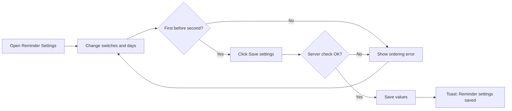
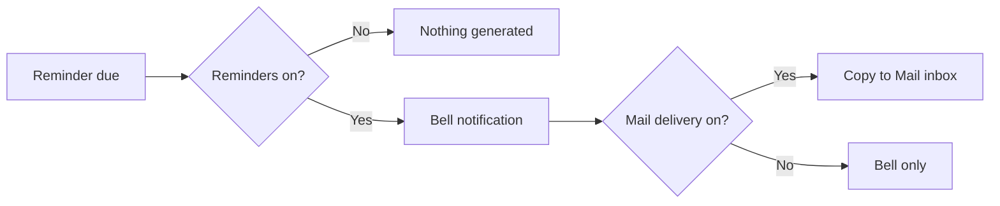

# Business Requirements Document – Reminder Settings

## TaskFlow – Intelligent Task Allocation & Tracking System

> **Document:** Business Requirements Document  ·  **Version:** 1.0  ·  **Status:** Approved
> **Project type:** Personal Project (Skill Development)  ·  **Date:** 31-Oct-2026
> **Author:** Jojo George (jojogeorge3344@gmail.com)
> **Module:** Settings  ·  **Sub-module:** 06.1 Reminder Settings  ·  **Code:** REM
> © 2026 Jojo George. All rights reserved.

---

## Document Control

### Revision History

| Version | Date | Author | Summary of changes |
|---|---|---|---|
| 1.0 | 31-Oct-2026 | Jojo George | Initial version |
| 1.0 | 31-Oct-2026 | Jojo George | Approved and signed off; baselined as the agreed business requirements. |
| 1.0 | 31-Oct-2026 | Jojo George | Editorial only: Related Documents paths updated to the `TF - Documents` folder layout; no requirement changed, sign-off unchanged. |

### Approvals / Sign-off

| Role | Name | Decision | Date |
|---|---|---|---|
| Product owner | Jojo George | Approved | 31-Oct-2026 |
| Reviewer | Jojo George | Approved | 31-Oct-2026 |

### Related Documents

| Document | Location |
|---|---|
| Overall BRD (roles, global rules, global NFRs) | `../../00-Overall/BRD-TaskFlow-Overall.md` |
| Development Plan (screen-wise) | `TF - Documents/Screens Wise Feature Development Plan/13-deadline-reminder-settings-screen.md` |
| Original BRD (Screen 13, section 3 workflow) | `BRD for Task management.docx` (v1.0) |
| Notification BRD (reminder engine) | `../../04-Communication/04.2-Notification/BRD-Notification.md` |
| Application Settings BRD (timezone, in-app switch) | `../06.2-Application-Settings/BRD-Application-Settings.md` |
| FRD | `../../../FRD/06-Settings/06.1-Reminder-Settings/FRD-Reminder-Settings.md` |
| HLD / LLD | `../../../HLD/06-Settings/06.1-Reminder-Settings/HLD-Reminder-Settings.md`, `../../../LLD/06-Settings/06.1-Reminder-Settings/LLD-Reminder-Settings.md` |

---

## Index

1. Project Overview
2. Stakeholders & User Roles
3. Scope
4. Business Process / Workflows
5. Screen-by-Screen Requirements
6. Business Rules
7. Non-Functional Requirements
8. Data Requirements
9. Integrations & External Dependencies
10. Reporting Requirements
11. Recommended Technology Stack (optional)
12. Assumptions, Constraints & Dependencies
13. Risks
14. Acceptance Criteria
15. Requirements Traceability Matrix
16. Project Deliverables
17. Glossary
18. Project Summary

---

## 1. Project Overview

### 1.1 Introduction
Reminder Settings is the screen that controls the automatic deadline reminders TaskFlow sends to assignees, task creators
and selected recipients. Authorized users switch reminders and the deadline-day reminder on or off, choose the default
reminder days for new tasks and the overdue frequency, and decide whether each reminder is also delivered to TaskFlow
Mail. It is Screen 13 "Deadline Reminder Settings" of the original BRD.

### 1.2 Business Problem / Current Situation
Without a settings screen, reminder intervals are fixed in the program. A change ("remind three days before, not two")
needs a developer and a new release. Teams cannot stop reminders during a holiday period, cannot make overdue reminders
less frequent, and reminders can be lost among other bell notifications.

### 1.3 Project Objectives

| ID | Objective | Success measure |
|---|---|---|
| OBJ-REM-01 | Let authorized users change reminder behaviour without editing source code | Every reminder setting on the screen can be changed and saved from the screen, with no restart |
| OBJ-REM-02 | Give the organization control over how persistent and how visible reminders are | Overdue frequency (daily / weekly) and Mail delivery can be chosen; reminders can be stopped with one switch |
| OBJ-REM-03 | Keep reminder configuration safe and consistent | Only holders of `settings.reminders.manage` can open or change it; invalid combinations are refused |

### 1.4 Expected Benefits
- The organization adapts reminders to its own working rhythm in seconds.
- Managers and Administrators no longer depend on a developer to tune reminders.
- Employees receive reminders at sensible times, and optionally in their Mail inbox, so deadlines are not missed.

---

## 2. Stakeholders & User Roles

### 2.1 Stakeholders

| Stakeholder | Interest / responsibility |
|---|---|
| Project owner (Jojo George) | Defines priorities, approves this BRD |
| Administrators and Managers | Maintain the reminder configuration |
| Employees, task creators, additional recipients | Receive the reminders this configuration controls |

### 2.2 User Roles

| Role | Description | Main responsibilities | Access level |
|---|---|---|---|
| Administrator | Manages the whole system | View and change reminder settings | Organization (full screen) |
| Manager | Assigns and monitors tasks | View and change reminder settings (granted by default) | Organization (full screen) |
| Employee | Works on assigned tasks | Receives reminders only | None (no access to the screen by default) |
| Custom role | Role defined on Role Configuration | As granted | Full screen when `settings.reminders.manage` is granted, otherwise none |

> Roles and the access model are described in the overall BRD. Every reminder setting applies to the whole organization;
> there is no personal or team version.

---

## 3. Scope

### 3.1 In Scope
- Viewing the current reminder configuration.
- Turning automatic deadline reminders on or off for the whole organization.
- Turning the deadline-day ("due today") reminder on or off.
- Default first reminder, second reminder and overdue frequency for new tasks.
- Turning delivery of reminder copies to TaskFlow Mail on or off.
- Showing the application timezone (read-only).

### 3.2 Out of Scope (this release)
- Generating, scheduling and de-duplicating reminders (the reminder engine) – described in the Notification BRD.
- Changing the application timezone or the in-app notifications switch – Application Settings.
- Per-task reminder days – chosen on Create / Edit Task (Task Management BRD).
- Outbound SMTP email – superseded by internal Mail (original Screen 14).
- Resetting all reminder settings to factory defaults with one button – not requested.

### 3.3 Modules Overview

| # | Module | Purpose | Screens |
|---|---|---|---|
| 1 | Settings → Reminder Settings | Organization-wide configuration of automatic deadline reminders | Reminder Settings |

### Change from original BRD

| Original BRD item | Current requirement |
|---|---|
| Screen 13 "Email notification setting" | **Also deliver reminders to Mail** – each reminder is copied to the recipient's internal TaskFlow Mail inbox. SMTP email (Screen 14) was superseded by internal Mail. |
| Screen 13 FR-5, FR-6, FR-8 (no reminders for completed/cancelled tasks, no past times, reminder history) | Kept as requirements of the reminder engine, in the Notification BRD; this screen only supplies the configuration. |
| Screen 13 FR-7 (consistent timezone) | The application timezone is shown read-only here and is changed on Application Settings. |
| Screen 20 "Default task reminder intervals" | Kept on this screen; Application Settings only links here. |
| Not in original BRD | Overdue frequency may be **Every week** as well as **Every day**; the deadline-day reminder has its own switch. |

---

## 4. Business Process / Workflows

### 4.1 Save Reminder Settings

**Trigger:** An authorized user wants to change how reminders behave  ·  **Actors:** Administrator, Manager, Custom role, System

| Step | Actor / System | Action | Result |
|---|---|---|---|
| 1 | User | Opens **Settings → Reminder Settings** | Current configuration and the application timezone are shown |
| 2 | User | Changes the switches, the first and second reminder and the overdue frequency | Form shows the new values |
| 3 | System | Checks that the first reminder comes earlier than the second | Error under **Second reminder** if not |
| 4 | User | Clicks **Save settings** | Values are sent for saving |
| 5 | System | Checks all values again (presence, allowed ranges, ordering) | Invalid values are refused with a message |
| 6 | System | Saves the values and records who changed them and when | Toast "Reminder settings saved" and a **Saved** tick |
| 7 | System | Uses the new switches from the next reminder run; new tasks start with the new default days | Existing tasks keep their own days |

**Example:** On 1 October, Manager Anita changes the first reminder from 2 to 3 days, keeps the second reminder at 1 day,
sets **After the deadline** to **Every week** and saves. On 2 October she creates "Prepare Monthly Report" for Rahul, due
15 October 5:00 PM (application timezone Asia/Kolkata). The task starts with 3 days / 1 day / weekly, so Rahul, Anita and
the additional recipient Priya receive reminders on 12 and 14 October, a "due today" reminder on 15 October, and then one
overdue reminder a week while the task stays open. A task created on 30 September keeps 2 days / 1 day / daily.

**Exceptions / alternate flows:**
- The first reminder is not earlier than the second: the save is refused with "The first reminder must come earlier than
  the second reminder."
- The settings cannot be loaded: an error card with **Retry** is shown.
- **Send deadline reminders** is switched off: no reminders are generated for any task until it is switched on again.

### 4.2 Reminder Delivery Choice

**Trigger:** A reminder is due for a task  ·  **Actors:** System

| Step | Actor / System | Action | Result |
|---|---|---|---|
| 1 | System | Checks **Send deadline reminders** | When off, nothing is generated |
| 2 | System | Checks **Remind on the deadline day** for a "due today" reminder | When off, the deadline-day reminder is skipped |
| 3 | System | Creates the bell notification for each recipient | Shown in the Notification Center (unless in-app notifications are switched off on Application Settings) |
| 4 | System | Checks **Also deliver reminders to Mail** | When on, a copy from "TaskFlow" arrives in each recipient's Mail inbox |

**Example:** With Mail delivery on, Priya sees the 14 October reminder for "Prepare Monthly Report" both under the bell
and in her Mail inbox, sent by "TaskFlow".

**Exceptions / alternate flows:**
- The deadline-day switch is off: on 15 October no "due today" reminder is created; the other reminders are unaffected.

---

## 5. Screen-by-Screen Requirements

### SCREEN 1: Reminder Settings

| Field | Value |
|---|---|
| **Screen name** | Reminder Settings (original BRD Screen 13 "Deadline Reminder Settings") |
| **Module** | Settings |
| **Access** | Administrator, Manager; Custom role with `settings.reminders.manage`. Employee: no access by default |
| **Priority** | Must |

**Purpose**
Let authorized users configure the automatic deadline reminders for the whole organization.

**Screen Elements**
- Page title **Reminder settings** and the line "Control the automatic deadline reminders sent to assignees, task
  creators and selected recipients."
- **Automatic reminders** group: **Send deadline reminders** switch; **Remind on the deadline day** switch, each with a hint.
- **Defaults for new tasks** group: **First reminder** (3, 2 or 1 days before), **Second reminder** (1 day before or on
  the deadline day), **After the deadline** (Every day or Every week).
- **Delivery** group: **Also deliver reminders to Mail** switch; **Application timezone** (read-only).
- **Save settings** button and **Saved** tick; loading placeholder; error card with **Retry**.

**Functional Requirements**

| ID | Requirement | Priority |
|---|---|---|
| REQ-REM-01 | The system shall display the current reminder configuration when the screen opens. | Must |
| REQ-REM-02 | The system shall let the user switch automatic deadline reminders on or off for the whole organization. | Must |
| REQ-REM-03 | The system shall generate no deadline reminders for any task while automatic reminders are switched off. | Must |
| REQ-REM-04 | The system shall let the user switch the deadline-day ("due today") reminder on or off. | Must |
| REQ-REM-05 | The system shall let the user choose the default first reminder as 3, 2 or 1 days before the deadline. | Must |
| REQ-REM-06 | The system shall let the user choose the default second reminder as 1 day before the deadline or on the deadline day. | Must |
| REQ-REM-07 | The system shall let the user choose the default overdue reminder frequency as Every day or Every week. | Must |
| REQ-REM-08 | The system shall let the user switch delivery of reminder copies to the recipients' TaskFlow Mail inbox on or off. | Should |
| REQ-REM-09 | The system shall always create the bell notification for a reminder, whatever the Mail delivery choice. | Must |
| REQ-REM-10 | The system shall show the application timezone read-only, with a hint that it is changed on Application Settings. | Should |
| REQ-REM-11 | The system shall refuse to save when the first reminder is not earlier than the second reminder. | Must |
| REQ-REM-12 | The system shall check every value again when saving, independently of the screen. | Must |
| REQ-REM-13 | The system shall refuse a save in which any of the six reminder values is missing. | Must |
| REQ-REM-14 | The system shall use the defaults reminders on, deadline-day reminder on, first 2 days, second 1 day, overdue every day, Mail delivery on while no value has been saved. | Must |
| REQ-REM-15 | The system shall pre-fill new tasks with the saved default first reminder, second reminder and overdue frequency. | Must |
| REQ-REM-16 | The system shall keep the reminder days of existing tasks unchanged when the defaults change. | Must |
| REQ-REM-17 | The system shall apply the saved switches from the next reminder run, without a restart. | Must |
| REQ-REM-18 | The system shall record which user last changed the reminder settings and when. | Should |
| REQ-REM-19 | The system shall confirm a successful save with the message "Reminder settings saved" and a **Saved** tick. | Should |
| REQ-REM-20 | The system shall hide the menu item from, and redirect to their dashboard, users without `settings.reminders.manage`. | Must |
| REQ-REM-21 | The system shall refuse any read or change of reminder settings by a user without `settings.reminders.manage`. | Must |
| REQ-REM-22 | The system shall still display a saved value that is not one of the screen's fixed choices. | Could |

**Validations & Messages**

| Situation | Rule / message |
|---|---|
| First reminder not earlier than second | "The first reminder must come earlier than the second reminder." (under **Second reminder**) |
| First reminder out of range | Must be 1–30 days before the deadline |
| Second reminder out of range | Must be 0–30 days before the deadline (0 = on the deadline day) |
| Overdue frequency invalid | Must be Every day or Every week |
| A value missing | Save refused; every value must be sent |
| Success | "Reminder settings saved" |
| Load failed | "Could not load the reminder settings." with **Retry** |
| Save failed | "Could not save the reminder settings." |
| No permission | Menu item hidden; opening the address returns the user to their dashboard; a direct request is refused |

**Expected Result**
Managers and Administrators can tune deadline reminders without code changes: switch them on or off, choose the
defaults for new tasks and the overdue frequency, and decide whether reminders also arrive in TaskFlow Mail.

---

## 6. Business Rules

| ID | Rule | Applies to |
|---|---|---|
| BR-REM-01 | Reminder settings are organization-wide; there is no personal or team version. | SCREEN 1 |
| BR-REM-02 | The first reminder must come earlier (more days before the deadline) than the second reminder. | SCREEN 1 |
| BR-REM-03 | The first reminder is 1–30 days before the deadline; the second is 0–30 days (0 = deadline day). The screen offers 3/2/1 and 1/0. | SCREEN 1 |
| BR-REM-04 | Default values are reminders on, deadline-day on, 2 days, 1 day, every day, Mail on – the original BRD default schedule. | SCREEN 1, reminder engine |
| BR-REM-05 | Changed defaults apply to new tasks only; existing tasks keep the days they were created with. | SCREEN 1, Create Task |
| BR-REM-06 | Bell reminders are always created when reminders run; Mail delivery only adds a copy. | SCREEN 1, reminder engine |
| BR-REM-07 | The timezone is never changed on this screen. | SCREEN 1 |

Global rules that apply (see [overall BRD section 6](../../00-Overall/BRD-TaskFlow-Overall.md)): reminder settings must be configurable; completed and cancelled tasks receive no
further reminders; duplicate reminders are prevented; one application timezone is used for deadline comparisons.

---

## 7. Non-Functional Requirements

| ID | Category | Requirement | Measure / target |
|---|---|---|---|
| NFR-REM-01 | Performance | The screen loads and saves under normal office use without noticeable delay | As the global performance NFR in the overall BRD |
| NFR-REM-02 | Security | Access is checked on every request, not only by hiding the menu | Requests without `settings.reminders.manage` are refused |
| NFR-REM-03 | Usability | Each switch and list has a plain hint; errors appear next to the field | Every control on the screen has a hint text |
| NFR-REM-04 | Reliability | Saved settings take effect without restart and survive restarts | New values used from the next reminder run (every 60 seconds by default) |
| NFR-REM-05 | Reliability | Missing settings never stop reminders | Defaults are used when a value is missing; missing values are filled at start without overwriting saved ones |
| NFR-REM-06 | Maintainability | Reminder configuration is kept apart from the reminder engine | Engine reads the configuration; the screen never generates reminders |
| NFR-REM-07 | Compatibility | Works in current desktop browsers with a responsive layout | As the global compatibility NFR |
| NFR-REM-08 | Accessibility | Switches and lists are usable by keyboard and labelled | All controls have visible labels |

---

## 8. Data Requirements

| Entity / data set | Purpose | Key fields | Retention / rules |
|---|---|---|---|
| Reminder settings (organization-wide) | Configure automatic reminders | Reminders on/off, deadline-day reminder on/off, default first reminder days, default second reminder days, default overdue frequency, Mail delivery on/off | One value per setting; last changed by and at are kept; values missing at start are filled with defaults, saved values are never overwritten |
| Application timezone (read only here) | Show which calendar day a reminder belongs to | Timezone name | Owned by Application Settings |
| Task reminder days (per task) | The days actually used for a task | First, second, overdue frequency | Copied from the defaults when the task is created; owned by Task Management |

---

## 9. Integrations & External Dependencies

| System / service | Purpose | Required? | Notes |
|---|---|---|---|
| Reminder engine (Notification sub-module) | Reads the switches and Mail choice on each run | Required | When reminders are off, the whole run generates nothing |
| TaskFlow Mail (internal) | Receives reminder copies when Mail delivery is on | Optional | Internal mailbox; no external email service |
| Task Management | Uses the defaults for new tasks | Required | Existing tasks unaffected |
| Application Settings | Supplies the timezone and the in-app notifications switch | Required | In-app switch off stops all new bell notifications |

No external system is involved.

---

## 10. Reporting Requirements

_Not applicable for this sub-module._

---

## 11. Recommended Technology Stack (optional)

_Not applicable for this sub-module._ The technology stack is given in the overall BRD.

---

## 12. Assumptions, Constraints & Dependencies

| Type | Description |
|---|---|
| Assumption | One organization per installation, so one set of reminder settings. |
| Assumption | Managers keep `settings.reminders.manage` as granted by default; an organization may change this on Role Configuration. |
| Constraint | The screen offers fixed choices (3/2/1 days, 1/0 days, daily/weekly). |
| Dependency | The reminder engine (Notification) and Create Task (Task Management) read these settings. |
| Dependency | The application timezone is maintained on Application Settings. |

---

## 13. Risks

| ID | Risk | Impact | Likelihood | Mitigation |
|---|---|---|---|---|
| R-REM-01 | Reminders are switched off by mistake and nobody is reminded | High | Low | Hint "When off, no reminders are generated for any task."; access limited to `settings.reminders.manage` |
| R-REM-02 | Mail delivery off here and in-app notifications off on Application Settings, so reminders reach nobody | High | Low | Hints on both screens explain the effect |
| R-REM-03 | Users expect existing tasks to follow new defaults | Medium | Medium | Hint "Existing tasks keep the intervals they were created with." |
| R-REM-04 | No history of earlier values, so a wrong change is hard to trace | Low | Medium | Last editor and time are recorded |

---

## 14. Acceptance Criteria

| ID | Criterion | Verified by |
|---|---|---|
| AC-REM-01 | An Administrator or Manager opens Reminder Settings and sees the current configuration and the timezone. | SCREEN 1, REQ-REM-01, REQ-REM-10 |
| AC-REM-02 | With **Send deadline reminders** off, no reminder is generated for any task. | REQ-REM-02, REQ-REM-03 |
| AC-REM-03 | With the deadline-day switch off, no "due today" reminder is generated; other reminders still are. | REQ-REM-04 |
| AC-REM-04 | After saving 3 days / 1 day / every week, a new task starts with these values and an older task keeps its own. | REQ-REM-05, REQ-REM-06, REQ-REM-07, REQ-REM-15, REQ-REM-16 |
| AC-REM-05 | With Mail delivery on, a reminder appears under the bell and in the recipient's Mail inbox; with it off, only under the bell. | REQ-REM-08, REQ-REM-09 |
| AC-REM-06 | Saving first = 1 day and second = 1 day is refused with "The first reminder must come earlier than the second reminder." | REQ-REM-11, REQ-REM-12 |
| AC-REM-07 | A save with a value missing is refused. | REQ-REM-13 |
| AC-REM-08 | On a new installation the screen shows on / on / 2 days / 1 day / every day / Mail on. | REQ-REM-14 |
| AC-REM-09 | A saved change is used by the next reminder run without restarting the application. | REQ-REM-17 |
| AC-REM-10 | A successful save shows "Reminder settings saved" and records the editor and time. | REQ-REM-18, REQ-REM-19 |
| AC-REM-11 | An Employee does not see the menu item, is returned to the dashboard from the address, and a direct request is refused. | REQ-REM-20, REQ-REM-21 |
| AC-REM-12 | A value saved outside the fixed choices (for example 5 days) is still displayed. | REQ-REM-22 |

---

## 15. Requirements Traceability Matrix

| Objective | Business rule(s) | Screen(s) | Functional requirement(s) | Acceptance criterion |
|---|---|---|---|---|
| OBJ-REM-01 | BR-REM-01, BR-REM-05, global rules | SCREEN 1 | REQ-REM-01, REQ-REM-05, REQ-REM-06, REQ-REM-07, REQ-REM-10, REQ-REM-15, REQ-REM-16, REQ-REM-17, REQ-REM-22 | AC-REM-01, AC-REM-04, AC-REM-09, AC-REM-12 |
| OBJ-REM-02 | BR-REM-04, BR-REM-06, global rules | SCREEN 1 | REQ-REM-02, REQ-REM-03, REQ-REM-04, REQ-REM-08, REQ-REM-09, REQ-REM-14 | AC-REM-02, AC-REM-03, AC-REM-05, AC-REM-08 |
| OBJ-REM-03 | BR-REM-02, BR-REM-03, BR-REM-07, global rules | SCREEN 1 | REQ-REM-11, REQ-REM-12, REQ-REM-13, REQ-REM-18, REQ-REM-19, REQ-REM-20, REQ-REM-21 | AC-REM-06, AC-REM-07, AC-REM-10, AC-REM-11 |

---

## 16. Project Deliverables

| # | Deliverable | Format |
|---|---|---|
| 1 | Reminder Settings screen and its saving logic | Source code in the repository |
| 2 | Default reminder settings created on first start | Initialization at application start |
| 3 | BRD, FRD, HLD and LLD for Reminder Settings | Markdown |
| 4 | Unit and integration tests for reminder settings | Automated tests |

---

## 17. Glossary

| Term | Meaning |
|---|---|
| First reminder | Reminder sent a number of days before the deadline (default 2) |
| Second reminder | Later reminder, 1 day before or on the deadline day (default 1 day before) |
| Deadline-day reminder | "Due today" reminder on the deadline day while the task is open |
| Overdue frequency | How often reminders repeat after the deadline: every day or every week |
| Bell notification | In-app notification shown in the Notification Center |
| TaskFlow Mail | The internal mailbox inside TaskFlow; reminder copies arrive from "TaskFlow" |
| Application timezone | The one timezone that decides which calendar day a deadline falls on |
| Recipient | The assignee, the task creator or an additional recipient of a task |

---

## 18. Project Summary
Reminder Settings gives Administrators and Managers one organization-wide place to control TaskFlow's automatic deadline
reminders: switch them on or off, keep or skip the deadline-day reminder, choose the default days for new tasks and the
overdue frequency, and add a copy to TaskFlow Mail. Values are checked on the screen and again when saved, take effect
on the next reminder run, and never change existing tasks.

---
© 2026 Jojo George. All rights reserved. Unauthorized copying or distribution of this document is prohibited.
