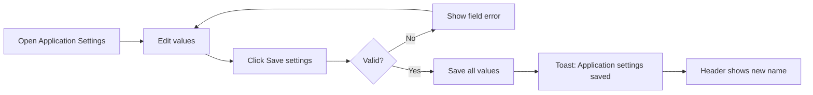
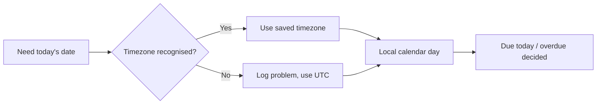

# Business Requirements Document – Application Settings

## TaskFlow – Intelligent Task Allocation & Tracking System

> **Document:** Business Requirements Document  ·  **Version:** 1.0  ·  **Status:** Approved
> **Project type:** Personal Project (Skill Development)  ·  **Date:** 31-Oct-2026
> **Author:** Jojo George (jojogeorge3344@gmail.com)
> **Module:** Settings  ·  **Sub-module:** 06.2 Application Settings  ·  **Code:** APP
> © 2026 Jojo George. All rights reserved.

---

## Document Control

### Revision History

| Version | Date | Author | Summary of changes |
|---|---|---|---|
| 1.0 | 31-Oct-2026 | Jojo George | Initial version |
| 1.0 | 31-Oct-2026 | Jojo George | Approved and signed off; baselined as the agreed business requirements. |
| 1.0 | 31-Oct-2026 | Jojo George | Editorial only: Related Documents paths updated to the `TF - Documents` folder layout; no requirement changed, sign-off unchanged. |

### Approvals / Sign-off

| Role | Name | Decision | Date |
|---|---|---|---|
| Product owner | Jojo George | Approved | 31-Oct-2026 |
| Reviewer | Jojo George | Approved | 31-Oct-2026 |

### Related Documents

| Document | Location |
|---|---|
| Overall BRD (roles, global rules, global NFRs) | `../../00-Overall/BRD-TaskFlow-Overall.md` |
| Development Plan (screen-wise) | `TF - Documents/Screens Wise Feature Development Plan/20-application-settings-screen.md` |
| Original BRD (Screen 20) | `BRD for Task management.docx` (v1.0) |
| Reminder Settings BRD | `../06.1-Reminder-Settings/BRD-Reminder-Settings.md` |
| FRD | `../../../FRD/06-Settings/06.2-Application-Settings/FRD-Application-Settings.md` |
| HLD / LLD | `../../../HLD/06-Settings/06.2-Application-Settings/HLD-Application-Settings.md`, `../../../LLD/06-Settings/06.2-Application-Settings/LLD-Application-Settings.md` |

---

## Index

1. Project Overview
2. Stakeholders & User Roles
3. Scope
4. Business Process / Workflows
5. Screen-by-Screen Requirements
6. Business Rules
7. Non-Functional Requirements
8. Data Requirements
9. Integrations & External Dependencies
10. Reporting Requirements
11. Recommended Technology Stack (optional)
12. Assumptions, Constraints & Dependencies
13. Risks
14. Acceptance Criteria
15. Requirements Traceability Matrix
16. Project Deliverables
17. Glossary
18. Project Summary

---

## 1. Project Overview

### 1.1 Introduction
Application Settings is the screen where an authorized user maintains TaskFlow's basic organization-wide configuration:
the application name shown in the sidebar and header, the single application timezone, the default task priority, and
whether in-app (bell) notifications are created at all. It is Screen 20 "System Settings" of the original BRD.

### 1.2 Business Problem / Current Situation
If these values are fixed in the program, the organization cannot rename the product, cannot move to another timezone
and cannot choose which priority new tasks start with, without a developer. When users in different places compute
"due today" with their own clocks, dashboards, reports and reminders disagree about which tasks are due or overdue.

### 1.3 Project Objectives

| ID | Objective | Success measure |
|---|---|---|
| OBJ-APP-01 | Let an Administrator maintain basic application settings from the screen | Name, timezone, default priority and the in-app switch are changed and saved without code changes or restart |
| OBJ-APP-02 | Use one timezone for every deadline calculation | Reminders, dashboards, workload, reports and tasks use the saved timezone straight after saving |
| OBJ-APP-03 | Keep configuration valid and free of secrets | Invalid values are refused; the settings every user can read contain nothing secret |

### 1.4 Expected Benefits
- The organization brands TaskFlow with its own name.
- "Due today" and "overdue" mean the same thing on every screen and for every user.
- New tasks start with the priority the organization uses most.
- Bell notifications can be paused for the whole organization with one switch.

---

## 2. Stakeholders & User Roles

### 2.1 Stakeholders

| Stakeholder | Interest / responsibility |
|---|---|
| Project owner (Jojo George) | Defines priorities, approves this BRD |
| Administrator | Maintains the application settings |
| All signed-in users | See the brand name; get the default priority on Create Task; receive bell notifications |

### 2.2 User Roles

| Role | Description | Main responsibilities | Access level |
|---|---|---|---|
| Administrator | Manages the whole system | View and change application settings | Organization (full screen) |
| Manager | Assigns and monitors tasks | Uses the brand name and default priority | None on the screen; reads the values behind the scenes |
| Employee | Works on assigned tasks | Uses the brand name | None on the screen; reads the values behind the scenes |
| Custom role | Role defined on Role Configuration | As granted | Full screen when `settings.application.manage` is granted, otherwise none |

---

## 3. Scope

### 3.1 In Scope
- Application name (brand name) shown in the sidebar and header.
- Application (default) timezone used for all deadline-day calculations.
- Default task priority pre-selected on Create Task.
- Switching in-app (bell) notifications on or off for the whole organization.
- A link to Reminder Settings for reminder defaults.
- Reading of the non-secret settings by every signed-in user.

### 3.2 Out of Scope (this release)
- Reminder intervals and Mail delivery – Reminder Settings.
- AI provider configuration – TFA Settings.
- A full history (audit trail) of earlier setting values – only the last editor and time are kept.
- Reset to factory defaults – not requested.
- Outbound SMTP email settings – superseded by internal Mail (original Screen 14).

### 3.3 Modules Overview

| # | Module | Purpose | Screens |
|---|---|---|---|
| 1 | Settings → Application Settings | Organization-wide basic configuration | Application Settings |

### Change from original BRD

| Original BRD item | Current requirement |
|---|---|
| Screen 20 "Default task reminder intervals" / FR-3 | Maintained on Reminder Settings; this screen shows a link to it. |
| Screen 20 "Notification preferences" | One organization-wide switch: **Enable in-app notifications**. Mail delivery of reminders is on Reminder Settings. |
| Screen 20 FR-6 "Record significant configuration changes" | The system records who last changed the settings and when; no history of earlier values. |
| Screen 20 access "Administrator" | Access is by the permission `settings.application.manage` (Administrator by default, grantable to a custom role). |

> ⚠️ To be confirmed: whether a full change history of settings (original Screen 20 FR-6) is still required.

---

## 4. Business Process / Workflows

### 4.1 Save Application Settings

**Trigger:** The Administrator wants to change a basic setting  ·  **Actors:** Administrator, Custom role, System

| Step | Actor / System | Action | Result |
|---|---|---|---|
| 1 | Administrator | Opens **Settings → Application Settings** | Current values shown |
| 2 | Administrator | Changes name, timezone, default priority or the in-app switch | Form shows the new values |
| 3 | Administrator | Clicks **Save settings** | Button shows "Saving…" |
| 4 | System | Checks the fields on the screen, then again when saving | Field errors shown if invalid |
| 5 | System | Saves all four values and records who changed them and when | Toast "Application settings saved" and **Saved** tick |
| 6 | System | Shows the new name in sidebar and header; applies the new timezone | No page reload, no restart |

**Example:** The Administrator renames the application from "TaskFlow" to "Acme TaskFlow", sets the timezone to
`Asia/Dubai` and the default priority to High, and saves. Every user sees "Acme TaskFlow" in the header at once, and
Rahul's next new task on Create Task starts with priority High.

**Exceptions / alternate flows:**
- Name blank or longer than 100 characters: "Application name is required and must be 100 characters or fewer."
- Timezone not recognised: "Unknown timezone."
- Settings cannot be loaded: "Could not load the application settings." with **Retry**.

### 4.2 Use of the Application Timezone

**Trigger:** Any calculation that needs "today"  ·  **Actors:** System

| Step | Actor / System | Action | Result |
|---|---|---|---|
| 1 | System | Reads the saved application timezone | Timezone known |
| 2 | System | If the saved timezone is not recognised, records the problem and uses UTC | Reminders and dashboards keep working |
| 3 | System | Converts the current time into that timezone | Local calendar day |
| 4 | System | Decides "due today" and "overdue" by this day | Same answer on every screen |

**Example:** The timezone is `Asia/Kolkata`. At 23:30 UTC on 14 October it is already 05:00 on 15 October in Kolkata, so
"Prepare Monthly Report", due 15 October 5:00 PM, appears as due today on the dashboards and receives the deadline-day
reminder.

**Exceptions / alternate flows:**
- The saved timezone becomes unknown on the server: UTC is used until the Administrator saves a valid timezone.

---

## 5. Screen-by-Screen Requirements

### SCREEN 1: Application Settings

| Field | Value |
|---|---|
| **Screen name** | Application Settings (original BRD Screen 20 "System Settings") |
| **Module** | Settings |
| **Access** | Administrator; Custom role with `settings.application.manage`. Manager and Employee: no access to the screen (they only read the brand name and default priority) |
| **Priority** | Must |

**Purpose**
Maintain the organization-wide basic configuration of TaskFlow.

**Screen Elements**
- Page title **Application settings** and the line "Application-wide configuration: the brand name, timezone, default
  task priority and in-app notifications."
- **General** group: **Application name** (required); **Default timezone** (required, text box with suggestions such as
  UTC, Asia/Kolkata, Asia/Dubai, Europe/London, America/New_York, Australia/Sydney); **Default task priority** (Low,
  Medium, High, Critical). Each with a hint.
- **Notifications** group: **Enable in-app notifications** switch.
- **Reminder defaults** group: link to **Reminder Settings**.
- **Save settings** button ("Saving…" while saving), **Saved** tick, loading placeholder, error card with **Retry**.

**Functional Requirements**

| ID | Requirement | Priority |
|---|---|---|
| REQ-APP-01 | The system shall display the current application settings when the screen opens. | Must |
| REQ-APP-02 | The system shall let the user change the application name. | Must |
| REQ-APP-03 | The system shall require an application name of at most 100 characters and remove spaces before and after it. | Must |
| REQ-APP-04 | The system shall show the saved application name in the sidebar and header for every user, straight after saving and without a page reload. | Must |
| REQ-APP-05 | The system shall let the user choose the default timezone from suggestions or type any valid timezone name. | Must |
| REQ-APP-06 | The system shall refuse a blank or unrecognised timezone. | Must |
| REQ-APP-07 | The system shall use the saved timezone for reminders, dashboards, workload, reports and task deadline checks straight after saving, without a restart. | Must |
| REQ-APP-08 | The system shall use UTC, and record the problem, when the saved timezone cannot be recognised at run time. | Must |
| REQ-APP-09 | The system shall let the user choose the default task priority as Low, Medium, High or Critical. | Must |
| REQ-APP-10 | The system shall pre-select the default task priority on the Create Task form. | Must |
| REQ-APP-11 | The system shall let the user switch in-app (bell) notifications on or off for the whole organization. | Must |
| REQ-APP-12 | The system shall create no new bell notifications for any event while in-app notifications are off, and shall keep existing notifications. | Must |
| REQ-APP-13 | The system shall show a link to Reminder Settings for the reminder defaults. | Should |
| REQ-APP-14 | The system shall check every value again when saving, independently of the screen. | Must |
| REQ-APP-15 | The system shall refuse a save in which any of the four values is missing. | Must |
| REQ-APP-16 | The system shall use the defaults name "TaskFlow", priority Medium, in-app notifications on and the server's configured timezone (or UTC) when a value is missing or unreadable. | Must |
| REQ-APP-17 | The system shall let every signed-in user read the application name and default priority. | Must |
| REQ-APP-18 | The system shall include no secret or sensitive configuration in the settings every user can read. | Must |
| REQ-APP-19 | The system shall record which user last changed the application settings and when. | Should |
| REQ-APP-20 | The system shall confirm a successful save with "Application settings saved" and a **Saved** tick. | Should |
| REQ-APP-21 | The system shall hide the menu item from, and redirect to their dashboard, users without `settings.application.manage`. | Must |
| REQ-APP-22 | The system shall refuse any change of application settings by a user without `settings.application.manage`. | Must |

**Validations & Messages**

| Situation | Rule / message |
|---|---|
| Name blank or too long (screen) | "Application name is required and must be 100 characters or fewer." |
| Name blank (when saving) | "Application name cannot be blank." |
| Timezone blank (screen) | "Timezone is required." |
| Timezone blank (when saving) | "Timezone cannot be blank." |
| Timezone not recognised | "Unknown timezone." |
| Priority invalid / value missing | Save refused |
| Success | "Application settings saved" |
| Load failed | "Could not load the application settings." with **Retry** |
| Save failed | "Could not save the application settings." |
| No permission | Menu item hidden; opening the address returns the user to their dashboard; a direct save is refused |

**Expected Result**
The Administrator maintains the application name, timezone, default priority and in-app notifications from the
interface. Every user sees the new brand name at once, and every deadline calculation uses the one application timezone.

---

## 6. Business Rules

| ID | Rule | Applies to |
|---|---|---|
| BR-APP-01 | Application settings are organization-wide. | SCREEN 1 |
| BR-APP-02 | Exactly one application timezone is used for every "today", "due today" and "overdue" decision. | All modules |
| BR-APP-03 | All four values are saved together; a partial save is refused rather than filled with defaults. | SCREEN 1 |
| BR-APP-04 | Reading the settings needs only a signed-in user; changing them needs `settings.application.manage`. | SCREEN 1, header, Create Task |
| BR-APP-05 | Switching in-app notifications off never deletes existing notifications. | Notification Center |
| BR-APP-06 | Reminder intervals and Mail delivery are not changed here. | SCREEN 1 |

Global rules that apply (see [overall BRD section 6](../../00-Overall/BRD-TaskFlow-Overall.md)): one consistent timezone for deadline comparisons; consistent calculation rules for
dashboards and reports; in-app notifications keep working independently of other delivery channels.

---

## 7. Non-Functional Requirements

| ID | Category | Requirement | Measure / target |
|---|---|---|---|
| NFR-APP-01 | Performance | The screen loads and saves without noticeable delay | As the global performance NFR in the overall BRD |
| NFR-APP-02 | Security | Readable settings never contain secrets | The readable values are only name, timezone, default priority and the in-app switch |
| NFR-APP-03 | Security | Changes are checked on every request | Requests without `settings.application.manage` are refused |
| NFR-APP-04 | Reliability | A bad or missing value never stops the application | Defaults and the UTC fallback are used |
| NFR-APP-05 | Usability | Changes are visible immediately | New name shown without reload; new timezone used without restart |
| NFR-APP-06 | Compatibility | Works in current desktop browsers, responsive layout | As the global compatibility NFR |
| NFR-APP-07 | Accessibility | Every field has a label and hint; errors appear next to the field | All controls labelled |

---

## 8. Data Requirements

| Entity / data set | Purpose | Key fields | Retention / rules |
|---|---|---|---|
| Application settings (organization-wide) | Basic configuration | Application name, timezone, default task priority, in-app notifications on/off | One value per setting; last changed by and at are kept; missing values are created at start with defaults, saved values never overwritten |
| Server configuration (timezone) | First value and fallback for the timezone | Configured timezone | Set by whoever installs the application |

---

## 9. Integrations & External Dependencies

| System / service | Purpose | Required? | Notes |
|---|---|---|---|
| Notification (bell) | Checks the in-app switch before creating any notification | Required | Missing or unreadable value counts as on |
| Reminders, Dashboard, Workload, Reports, Tasks, Assistant | Use the application timezone for "today" | Required | UTC fallback when the timezone is unknown |
| Task Management (Create Task) | Pre-selects the default priority | Required | – |
| Application shell and TFA | Show the application name | Required | – |

No external system is involved.

---

## 10. Reporting Requirements

_Not applicable for this sub-module._ Reports use the application timezone (see the Reports BRD).

---

## 11. Recommended Technology Stack (optional)

_Not applicable for this sub-module._ The technology stack is given in the overall BRD.

---

## 12. Assumptions, Constraints & Dependencies

| Type | Description |
|---|---|
| Assumption | One organization per installation, so one set of application settings. |
| Assumption | The server knows standard timezone names such as `Asia/Kolkata` and `UTC`. |
| Constraint | Only the four listed settings are editable on this screen. |
| Dependency | Reminder Settings shows this timezone read-only. |
| Dependency | Role Configuration grants `settings.application.manage`. |

---

## 13. Risks

| ID | Risk | Impact | Likelihood | Mitigation |
|---|---|---|---|---|
| R-APP-01 | Wrong timezone saved, so tasks appear due a day early or late | High | Low | Only recognised timezones accepted; hint explains the effect |
| R-APP-02 | In-app notifications switched off by mistake, users miss notifications | High | Low | Hint "When off, no new bell notifications are created for any event."; restricted permission |
| R-APP-03 | No history of earlier values | Low | Medium | Last editor and time recorded; see To be confirmed in section 3 |

---

## 14. Acceptance Criteria

| ID | Criterion | Verified by |
|---|---|---|
| AC-APP-01 | The Administrator opens Application Settings and sees the current four values. | SCREEN 1, REQ-APP-01 |
| AC-APP-02 | After renaming to "Acme TaskFlow" and saving, every user sees the new name in the header without reload. | REQ-APP-02, REQ-APP-04 |
| AC-APP-03 | A blank name or one of 101 characters is refused with the name message. | REQ-APP-03, REQ-APP-14 |
| AC-APP-04 | A timezone such as "Mars/Base" is refused with "Unknown timezone."; `Asia/Dubai` is accepted. | REQ-APP-05, REQ-APP-06 |
| AC-APP-05 | After the timezone is saved, the next reminder run and the dashboards use it without restart. | REQ-APP-07 |
| AC-APP-06 | When the stored timezone is unknown, reminders still run, using UTC. | REQ-APP-08 |
| AC-APP-07 | With default priority High, Create Task opens with High selected. | REQ-APP-09, REQ-APP-10 |
| AC-APP-08 | With in-app notifications off, no new bell notification is created and existing ones stay. | REQ-APP-11, REQ-APP-12 |
| AC-APP-09 | The screen shows a working link to Reminder Settings. | REQ-APP-13 |
| AC-APP-10 | A save with a value missing is refused. | REQ-APP-15 |
| AC-APP-11 | On a new installation the screen shows "TaskFlow", Medium, notifications on and the configured timezone. | REQ-APP-16 |
| AC-APP-12 | An Employee's screens show the brand name, and the values readable by everyone contain no secret. | REQ-APP-17, REQ-APP-18 |
| AC-APP-13 | A successful save shows "Application settings saved" and records editor and time. | REQ-APP-19, REQ-APP-20 |
| AC-APP-14 | A Manager does not see the menu item, is redirected from the address, and a direct save is refused. | REQ-APP-21, REQ-APP-22 |

---

## 15. Requirements Traceability Matrix

| Objective | Business rule(s) | Screen(s) | Functional requirement(s) | Acceptance criterion |
|---|---|---|---|---|
| OBJ-APP-01 | BR-APP-01, BR-APP-05, BR-APP-06 | SCREEN 1 | REQ-APP-01, REQ-APP-02, REQ-APP-04, REQ-APP-09, REQ-APP-10, REQ-APP-11, REQ-APP-12, REQ-APP-13, REQ-APP-19, REQ-APP-20 | AC-APP-01, AC-APP-02, AC-APP-07, AC-APP-08, AC-APP-09, AC-APP-13 |
| OBJ-APP-02 | BR-APP-02, global rules | SCREEN 1 | REQ-APP-05, REQ-APP-07, REQ-APP-08 | AC-APP-04, AC-APP-05, AC-APP-06 |
| OBJ-APP-03 | BR-APP-03, BR-APP-04 | SCREEN 1 | REQ-APP-03, REQ-APP-06, REQ-APP-14, REQ-APP-15, REQ-APP-16, REQ-APP-17, REQ-APP-18, REQ-APP-21, REQ-APP-22 | AC-APP-03, AC-APP-04, AC-APP-10, AC-APP-11, AC-APP-12, AC-APP-14 |

---

## 16. Project Deliverables

| # | Deliverable | Format |
|---|---|---|
| 1 | Application Settings screen and its saving logic | Source code in the repository |
| 2 | Default application settings created on first start | Initialization at application start |
| 3 | BRD, FRD, HLD and LLD for Application Settings | Markdown |
| 4 | Unit and integration tests for application settings and the timezone fallback | Automated tests |

---

## 17. Glossary

| Term | Meaning |
|---|---|
| Application name | The brand name shown in the sidebar, header and TFA |
| Application timezone | The one timezone that decides which calendar day a deadline belongs to |
| Default task priority | The priority pre-selected on Create Task |
| In-app notification | A bell notification shown in the Notification Center |
| UTC | Coordinated Universal Time; the fallback timezone |

---

## 18. Project Summary
Application Settings lets the Administrator keep TaskFlow's name, timezone, default task priority and in-app
notifications in one organization-wide place. Values are checked twice, apply at once without restart, and contain
nothing secret, so every user can read them while only authorized users can change them. The single application timezone
makes "due today" and "overdue" consistent across reminders, dashboards, workload and reports.

---
© 2026 Jojo George. All rights reserved. Unauthorized copying or distribution of this document is prohibited.
