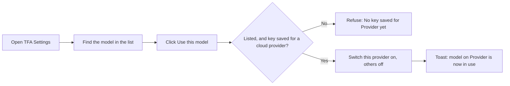
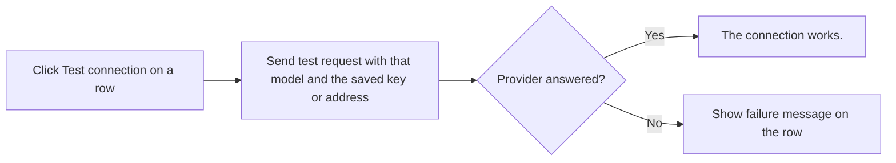
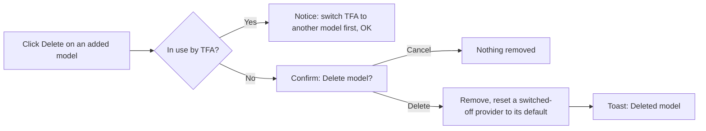
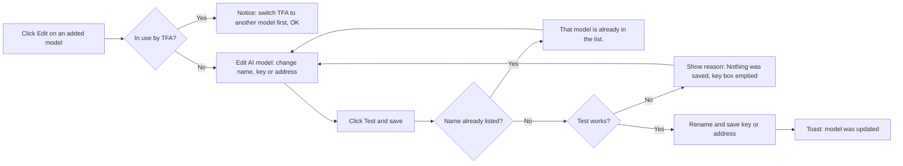

# Business Requirements Document – TFA Settings

## TaskFlow – Intelligent Task Allocation & Tracking System

> **Document:** Business Requirements Document  ·  **Version:** 1.3  ·  **Status:** Approved (v1.0 baseline); v1.1 – v1.3 changes recorded
> **Project type:** Personal Project (Skill Development)  ·  **Date:** 01-Nov-2026
> **Author:** Jojo George (jojogeorge3344@gmail.com)
> **Module:** Settings  ·  **Sub-module:** 06.3 TFA Settings  ·  **Code:** TFAS
> © 2026 Jojo George. All rights reserved.

---

## Document Control

### Revision History

| Version | Date | Author | Summary of changes |
|---|---|---|---|
| 1.0 | 31-Oct-2026 | Jojo George | Initial version |
| 1.0 | 31-Oct-2026 | Jojo George | Approved and signed off; baselined as the agreed business requirements. |
| 1.1 | 31-Oct-2026 | Jojo George | TFA answers TaskFlow questions from the documents folder (OpenSpec change `tfa-document-rag`). Added the **Document search** card to SCREEN 1 (index status and **Re-index now**): OBJ-TFAS-04, workflow 4.4, REQ-TFAS-26 – REQ-TFAS-32, BR-TFAS-08 – BR-TFAS-10, NFR-TFAS-09 – NFR-TFAS-10, R-TFAS-06, AC-TFAS-17 – AC-TFAS-21; REQ-TFAS-21 / AC-TFAS-13 wording now includes matching document text; scope, data, integrations, assumptions, deliverables and glossary updated. |
| 1.2 | 01-Nov-2026 | Jojo George | OpenSpec change `tfa-document-rag` (revised, design D13 and D14). **Document search** card, **Re-index now** and the status/re-index endpoints removed: nothing on the card could be changed from the screen, the automatic re-check every 5 minutes already re-processes changed documents, and indexing problems are now written to the server log as warnings naming the folder or file. Withdrawn: OBJ-TFAS-04, workflow 4.4, REQ-TFAS-26 – REQ-TFAS-32, BR-TFAS-08 – BR-TFAS-09, NFR-TFAS-10, AC-TFAS-17 – AC-TFAS-21; reworded: BR-TFAS-10, NFR-TFAS-09, R-TFAS-06, data, deliverables and glossary. Model names must be model IDs without spaces, with an example per provider and a Google AI Studio hint for Gemini (REQ-TFAS-33, BR-TFAS-11, AC-TFAS-22); a Gemini model-name refusal is reported as model not available (REQ-TFAS-34, AC-TFAS-23); Test connection adds the provider's own status and reason for an unexpected error or a missing model, at most 200 characters with keys shown as `[key]` (REQ-TFAS-35, NFR-TFAS-11, AC-TFAS-24); new risk R-TFAS-07. Built-in Gemini models are now `gemini-3.8-flash` (default), `gemini-3.5-flash` and `gemini-3.5-flash-lite`, replacing the retired `gemini-2.0-flash`, `gemini-2.5-flash` and `gemini-2.5-pro` (REQ-TFAS-03, workflow 4.1 example). |
| 1.3 | 01-Nov-2026 | Jojo George | OpenSpec change `tfa-model-list-and-edit`. TFA Settings becomes a read-only list of every model grouped by provider (heading **AI models**): the Model and Server dropdowns, the provider card with the API key / server address inputs, **Remove the key**, **Remove this model from the list** and **Save TFA settings** are removed. Each row offers **Use this model**, **Test connection** and, on added models only, **Edit** and **Delete**; the Add AI model screen gains an edit mode (**Edit AI model**) with **Remove the key**; the model TFA uses cannot be edited or deleted; built-in models are read-only; the key stays one per provider. Workflows 4.1 – 4.3 rewritten, new workflow 4.5; SCREEN 1 purpose and elements, validations and the to-be-confirmed notes rewritten; reworded: REQ-TFAS-02, -05, -06, -11 – -14, -16, -18, -19, -23, -25, BR-TFAS-02, -04, -05, AC-TFAS-02, -07, -08, -11, -15, -16; withdrawn: REQ-TFAS-04, REQ-TFAS-17, AC-TFAS-10; added REQ-TFAS-36 – REQ-TFAS-44, BR-TFAS-12 – BR-TFAS-14, NFR-TFAS-12, R-TFAS-08, AC-TFAS-25 – AC-TFAS-33; scope, data, traceability, deliverables, glossary and summary updated. No data change. |

### Approvals / Sign-off

| Role | Name | Decision | Date |
|---|---|---|---|
| Product owner | Jojo George | Approved | 31-Oct-2026 |
| Reviewer | Jojo George | Approved | 31-Oct-2026 |

### Related Documents

| Document | Location |
|---|---|
| Overall BRD (roles, global rules, global NFRs) | `../../00-Overall/BRD-TaskFlow-Overall.md` |
| TFA Assistant BRD (uses this configuration; answers from the TaskFlow documents) | `../../08-TFA-Assistant/08.1-Assistant/BRD-Assistant.md` |
| OpenSpec change (document search) | `openspec/changes/tfa-document-rag/` |
| OpenSpec change (model list and edit, v1.3) | `openspec/changes/tfa-model-list-and-edit/` |
| Development Plan (screen-wise) | _Not applicable – not in the original 20-screen plan._ |
| FRD | `../../../FRD/06-Settings/06.3-TFA-Settings/FRD-TFA-Settings.md` |
| HLD / LLD | `../../../HLD/06-Settings/06.3-TFA-Settings/HLD-TFA-Settings.md`, `../../../LLD/06-Settings/06.3-TFA-Settings/LLD-TFA-Settings.md` |

---

## Index

1. Project Overview
2. Stakeholders & User Roles
3. Scope
4. Business Process / Workflows
5. Screen-by-Screen Requirements
6. Business Rules
7. Non-Functional Requirements
8. Data Requirements
9. Integrations & External Dependencies
10. Reporting Requirements
11. Recommended Technology Stack (optional)
12. Assumptions, Constraints & Dependencies
13. Risks
14. Acceptance Criteria
15. Requirements Traceability Matrix
16. Project Deliverables
17. Glossary
18. Project Summary

---

## 1. Project Overview

### 1.1 Introduction
TFA Settings is the screen where an authorized user chooses the AI model behind TFA, the TaskFlow Assistant.
It supports a free local server (Ollama) and two cloud services (Google Gemini and OpenAI GPT). Since v1.3 the screen is a
read-only list of every model grouped by provider: one click (**Use this model**) switches TFA to a model, **Test
connection** checks any listed model, and the models an administrator added can be edited or deleted. All typing (model
name, API key, Ollama address) happens on the Add AI model screen and its edit mode. API keys are stored protected, one
per provider, and a connection test runs before a model is added or changed. Since v1.1 TFA
also answers TaskFlow questions from TaskFlow's own documents; that document index is built and kept current by the
server and, since v1.2, has no card or settings on this screen (indexing problems are written to the server log).

### 1.2 Business Problem / Current Situation
An AI assistant is only useful when it is connected to a working model. Without a settings screen the provider, model and
API key would have to be written into configuration files by a developer, keys could leak to the browser or the logs,
and nobody could check whether the connection works until a user's question failed.

### 1.3 Project Objectives

| ID | Objective | Success measure |
|---|---|---|
| OBJ-TFAS-01 | Let the organization choose which AI provider and model TFA uses | A listed model is made the one TFA uses with one click (**Use this model**, v1.3); TFA offers only that configuration |
| OBJ-TFAS-02 | Keep API keys safe | Keys are stored protected and never shown again; only "key set" and the last four characters are visible |
| OBJ-TFAS-03 | Confirm the connection works before users depend on it | One click runs a test and shows a plain-language result |
| OBJ-TFAS-04 | _Withdrawn in v1.2 – the Document search card was removed; indexing problems go to the server log._ (v1.1: let administrators see whether TFA's document answers are ready and current) | – |

### 1.4 Expected Benefits
- The organization can run TFA free on its own server, or use a cloud service when it prefers.
- API keys cannot be read back by anyone, including Administrators.
- Problems (wrong key, server not running, rate limit) are found and explained before users meet them.
- Everyone uses the one model the Administrator chose.
- When a test fails for a reason TaskFlow does not recognise, or the model is not available, the administrator sees
  the provider's own status and reason (for example the model Google says to use instead) (v1.2).
- One list shows every model, which one TFA uses, and whether its provider has a key, so the administrator no longer
  has to work out which fields belong to which model; a model the administrator added can be corrected later (v1.3).

---

## 2. Stakeholders & User Roles

### 2.1 Stakeholders

| Stakeholder | Interest / responsibility |
|---|---|
| Project owner (Jojo George) | Defines priorities, approves this BRD |
| Administrator | Chooses and maintains the AI configuration and keys |
| TFA users (all roles allowed to chat) | Depend on a working, configured model |
| AI provider (Ollama, Google, OpenAI) | Answers TFA's requests |

### 2.2 User Roles

| Role | Description | Main responsibilities | Access level |
|---|---|---|---|
| Administrator | Manages the whole system | View, use, test, add, edit and delete models | Organization (full screen) |
| Manager | Assigns and monitors tasks | None on this screen | None by default |
| Employee | Works on assigned tasks | None on this screen | None by default |
| Custom role | Role defined on Role Configuration | As granted | `settings.ai.view` opens the screen; `settings.ai.edit`, `settings.ai.test` and `settings.ai.model.remove` allow the actions |

---

## 3. Scope

### 3.1 In Scope
- Viewing every model of the three providers as a read-only list, with the provider, Local or Cloud, whether a key is
  saved (or the Ollama address), whether the model is built in or added, and which model TFA uses (v1.3).
- Choosing the model TFA uses with **Use this model** on its row (v1.3; replaces the linked Model and Server lists).
- Adding a new model on the Add AI model screen; editing and deleting a model an administrator added (v1.3).
- Setting the Ollama server address, on the Add AI model screen or its edit mode (v1.3).
- Entering, keeping or removing a Gemini or OpenAI API key, on the Add AI model screen or its edit mode (v1.3).
- Testing the connection of any listed model, with the provider's own reason when the failure is not recognised (v1.2).

### 3.2 Out of Scope (this release)
- The TFA chat window itself – TFA Assistant BRD.
- AI providers other than Ollama, Google Gemini and OpenAI GPT.
- Usage or cost tracking of cloud providers.
- Installing models on the Ollama server (done outside TaskFlow), including the embedding model `nomic-embed-text` (the
  AI setup scripts pull it).
- Choosing the documents folder, the embedding model or the search settings on the screen – they are server
  configuration (`DocumentKnowledge`) (v1.1).
- Uploading documents through TaskFlow, PDF or Excel documents, and per-role document filtering (v1.1).
- A screen or endpoint for the document index status or for starting a re-index (removed in v1.2). The server builds the
  index at start-up, re-checks the folder every 5 minutes (`RescanMinutes`) and writes indexing problems to the server
  log as warnings naming the folder or file.
- A separate API key for each model (the key stays one per provider, shared by all its models), custom providers, and
  hiding or deleting built-in models (v1.3).

### 3.3 Modules Overview

| # | Module | Purpose | Screens |
|---|---|---|---|
| 1 | Settings → TFA Settings | Configuration of the AI model and server behind TFA | TFA Settings, Add AI model (add and edit mode, v1.3) |

### Change from original BRD

| Original BRD item | Current requirement |
|---|---|
| Not in original BRD | TFA Settings is a new screen, added with the TFA Assistant. |
| Original NFR 5.2 "Secure handling of email credentials" | The same principle applies to AI API keys: stored protected, never shown, never sent back to the browser. |

---

## 4. Business Process / Workflows

### 4.1 Choose the Model TFA Uses (v1.3)

**Trigger:** The Administrator sets up or changes TFA's model  ·  **Actors:** Administrator, Custom role, System

| Step | Actor / System | Action | Result |
|---|---|---|---|
| 1 | Administrator | Opens **Settings → TFA Settings** | Every model is listed, grouped by provider; the line "TFA uses `model` on `Provider`." and the **In use** badge show the model in use |
| 2 | Administrator | Finds the wanted model; when it is not listed, clicks **Add AI model** to add it on its own screen (provider, model name, API key or Ollama address, Test connection; saved and made the one in use only when the test works) | Row found, or new model added and in use |
| 3 | Administrator | Clicks **Use this model** on the row | Request sent |
| 4 | System | Checks that the model is listed and that a cloud provider has a readable key | Allowed or refused |
| 5 | System | Switches that provider on with this model and the other providers off, keeping their keys and models | Toast "`model` on `Provider` is now in use"; list refreshed |
| 6 | System | Offers only this configuration in the TFA window | Users chat with the chosen model |

**Example:** TFA uses `llama3.2:3b` on Ollama. Google Gemini has a key ending in 1234, so every Gemini row shows "Key
saved, ends …1234". The Administrator clicks **Use this model** on `gemini-3.5-flash`. The line above the list now says
"TFA uses **gemini-3.5-flash** on **Google Gemini**.", that row shows **In use**, and Ollama is switched off but keeps its
address and models.

**Exceptions / alternate flows:**
- Cloud provider without a readable key: **Use this model** is disabled with the hint "No key saved for `Provider` yet. Add
  it on the Add AI model screen."; a request that skipped the screen is refused with the same text and nothing changes.
- The row in use has no **Use this model** button.
- Model name with a space (for example `Gemini API Key` typed on **Add AI model**): "A model name is the provider's model
  ID, without spaces, for example gemini-3.8-flash." No test is sent and nothing is saved (v1.2).
- _The v1.0 – v1.2 flow (pick a model or server in linked dropdowns, type the address or key on the provider card, click
  **Save TFA settings**, toast "TFA settings saved") was withdrawn in v1.3._

### 4.2 Test the Connection (v1.3)

**Trigger:** The Administrator wants to check that a model works  ·  **Actors:** Administrator, Custom role, System, AI provider

| Step | Actor / System | Action | Result |
|---|---|---|---|
| 1 | Administrator | Clicks **Test connection** on a model's row | Test starts; the button shows "Testing…" |
| 2 | System | Sends one short request ("Reply with OK.") to that row's provider with that row's model and the saved key or address, also when the provider is switched off | Provider answers or fails |
| 3 | System | Shows "The connection works." or a plain message explaining the problem on that row; nothing is saved | Administrator knows what to fix |

**Example:** Ollama is not started on the server. Testing `llama3.2:3b` shows on its row "Ollama is not running or cannot
be reached. Ask an administrator to start it, or choose another model." Which model TFA uses does not change.

**Exceptions / alternate flows:**
- Key refused, rate limit reached, timeout or model missing: each has its own message (see SCREEN 1).
- Cloud provider without a readable key: "No key saved for `Provider` yet. Add it on the Add AI model screen." (v1.3).
- Unexpected error or model not available: the message adds the provider's own status and reason, for example "Google
  Gemini said: HTTP 404 - NOT_FOUND: This model models/gemini-2.0-flash is no longer available … use
  models/gemini-3.8-flash" (at most 200 characters, any API key replaced by `[key]`). Only Test connection shows it;
  TFA chat replies keep the plain message (v1.2).
- _v1.0 – v1.2: the test ran from the provider card and saved unsaved changes first; withdrawn in v1.3 – there is
  nothing to save on the screen._

### 4.3 Delete an Added Model (v1.3)

**Trigger:** A model added earlier is no longer wanted  ·  **Actors:** Administrator, Custom role, System

| Step | Actor / System | Action | Result |
|---|---|---|---|
| 1 | Administrator | Clicks **Delete** on the row of a model an administrator added (built-in rows have no Delete) | Model in use: notice; otherwise confirmation "Delete `model`?" |
| 2 | Administrator | Confirms | Request sent |
| 3 | System | Refuses a built-in model and the model TFA uses; otherwise removes the model; a switched-off provider that still had it saved goes back to its default model | Toast "Deleted `model`"; list refreshed |

**Example:** The Administrator added `phi3:mini` for Ollama last week, then switched TFA to `llama3.2:3b`. Deleting
`phi3:mini` succeeds after confirmation. `llama3.2:3b` has no Delete button because it is built in. When TFA uses
`gemini-2.5-pro` (added), clicking Delete on it shows "gemini-2.5-pro is in use by TFA. Switch TFA to another model
first, then delete it." with only an **OK** button.

**Exceptions / alternate flows:**
- Gemini switched off with `gemini-2.5-pro` saved as its model, and that model deleted: Gemini's saved model becomes
  `gemini-3.8-flash` and Gemini stays switched off.
- _v1.0 – v1.2: the model was chosen in the Model dropdown and removed with **Remove this model from the list**, and the
  model saved for its server could not be removed even when that server was switched off; withdrawn in v1.3._

### 4.4 Check Document Search and Re-index (v1.1) – Withdrawn in v1.2

_Withdrawn in v1.2 – the Document search card and **Re-index now** were removed; indexing problems go to the server
log._ Nothing on the card could be changed from the screen (the documents folder, embedding model and search settings
are server configuration, `DocumentKnowledge`), and the automatic re-check already did what **Re-index now** did. The
server builds the document index at start-up and re-checks the documents folder every 5 minutes (`RescanMinutes`),
re-processing only changed documents. A missing documents folder, an embedding model that cannot be reached (indexing
stops) and a document that could not be indexed are each written to the server log as a warning naming the folder or
file. TFA itself tells users when the documents cannot be searched right now or are still being prepared (TFA Assistant
BRD).

### 4.5 Edit an Added Model (v1.3)

**Trigger:** A model an administrator added has the wrong name, or its provider needs a new key or address  ·
**Actors:** Administrator, Custom role, System, AI provider

| Step | Actor / System | Action | Result |
|---|---|---|---|
| 1 | Administrator | Clicks **Edit** on the row of a model an administrator added (not the one in use) | **Edit AI model** screen opens: provider fixed, model name filled in, key box empty |
| 2 | Administrator | Changes the model name and/or types a new API key (Gemini, OpenAI) or server address (Ollama); an empty key box keeps the saved key | Form ready |
| 3 | Administrator | Clicks **Test and save** | Values checked, then tested |
| 4 | System | Sends one short request with the typed values; nothing is saved before the test works | Provider answers or fails |
| 5 | System | On success renames the model (a switched-off provider that had it saved follows the new name) and saves a typed key or address; which model TFA uses does not change | Toast "`model` was updated"; back to TFA Settings |

**Example:** The Administrator added `gemini-2.5-pro`. On its edit screen the key box says "A key is saved (ends …1234).
Leave the box empty to keep it. A new key replaces it for every Google Gemini model." The Administrator changes the name
to `gemini-2.5-flash` and clicks **Test and save**. The test works, the list shows `gemini-2.5-flash` instead of
`gemini-2.5-pro`, and TFA still uses the model it used before.

**Exceptions / alternate flows:**
- Remove the key: on the edit screen of a cloud provider with a saved key, **Remove the key** asks "Remove the `Provider`
  key?" / "The key is removed for every `Provider` model." (plus " TFA uses `Provider`, so TFA is unavailable until a key
  is added again." when TFA uses that provider). After confirming, the key is removed without a test, every row of that
  provider shows "No key saved", the toast "The `Provider` key was removed" is shown and the screen returns to TFA
  Settings.
- Model in use: Edit shows "`model` is in use by TFA. Switch TFA to another model first, then edit it." with only an
  **OK** button, and the edit screen does not open.
- Opening the edit address of an unknown, built-in or in-use model returns to TFA Settings with the reason as an error
  toast.
- A new key replaces the provider's key for every model of that provider: the key stays one per provider.

---

## 5. Screen-by-Screen Requirements

### SCREEN 1: TFA Settings

| Field | Value |
|---|---|
| **Screen name** | TFA Settings |
| **Module** | Settings |
| **Access** | Administrator; Custom role with `settings.ai.view` (actions need `settings.ai.edit` for **Use this model**, `settings.ai.test` for **Test connection**, `settings.ai.edit` + `settings.ai.test` for **Add AI model** and **Edit**, `settings.ai.model.remove` for **Delete**). Manager and Employee: no access by default |
| **Priority** | Must |

**Purpose**
Show every model TFA can use, switch TFA to one of them, test any of them, and add, edit or delete the models an
administrator added; keys and addresses are typed only on the Add AI model screen and its edit mode (v1.3). (The v1.1
Document search card was removed in v1.2.)

**Screen Elements**
- Page title **TFA settings** and an **AI models** section (v1.3; was **Model and server**) explaining the choices:
  **Use this model** switches TFA to a model, and a model is added or changed on the Add AI model screen; Ollama runs on
  your own server and is free; Google Gemini has a free tier with limits; OpenAI GPT has no free tier; with the cloud
  services a user's question, related task details and matching TaskFlow document text are sent to the provider (v1.1
  wording).
- **Add AI model** button next to the heading, opening the separate **Add AI model** screen (AI provider, Model name, API
  key or Ollama address, Test connection, Back). The **Model name** box shows an example for the chosen provider –
  `gemini-3.8-flash` (Google Gemini), `gpt-4o-mini` (OpenAI GPT), `llama3.2:3b` (Ollama) – and for Google Gemini the key
  field says to create a key in Google AI Studio (aistudio.google.com/apikey); the key is not judged by its prefix (v1.2).
- A line above the list: "TFA uses **`model`** on **`Provider`**." (or, when no model is in use, "TFA has no model in use
  yet. Choose **Use this model** on a model below.") (v1.3).
- Model list (v1.3), read-only, one group per provider (Ollama, Google Gemini, OpenAI GPT) with its **Local** / **Cloud**
  tag. Each row shows:
  - the model ID;
  - "`Provider` · Local" or "`Provider` · Cloud";
  - the provider's key status – "Key saved, ends …1234", "No key saved" or "The saved key can no longer be read" – or,
    for Ollama, its server address; the key is shared by all models of the provider, so every row of that provider
    shows the same status;
  - **Built-in** or **Added by you**;
  - an **In use** badge on exactly the model TFA uses;
  - the actions **Use this model** (not on the row in use; disabled, with the hint "No key saved for `Provider` yet. Add
    it on the Add AI model screen.", when a cloud provider has no readable key), **Test connection** (result shown on
    the row), and, on added models only, **Edit** and **Delete**.
  At phone width each row is shown as a stacked card with the same details and actions, without horizontal scrolling.
- Notice dialog with only an **OK** button when Edit or Delete is clicked on the model in use; confirmation dialog
  "Delete `model`?" (danger) before a delete (v1.3).
- **Edit AI model** screen (v1.3): the Add AI model screen in edit mode, opened by **Edit**. Title **Edit AI model**; the
  provider is shown and cannot be changed; the model name is filled in; the key box is empty with "A key is saved (ends
  …1234). Leave the box empty to keep it. A new key replaces it for every `Provider` model." (or the Ollama **Server
  address**); **Remove the key** (cloud provider with a saved key); **Test and save**; **Back to TFA settings**.
- _Withdrawn in v1.3 – the screen became a read-only model list:_ the **Model** and **Server** dropdowns (and choosing a
  model selecting its server), the provider card with the **Server address** / **API key** inputs and **Remove the key**
  / **Keep the key**, **Remove this model from the list**, the card-level **Test connection** and **Save TFA settings**.
- _The v1.1 **Document search** card (documents folder, embedding model, files, chunks, last indexed, state, last error,
  **Re-index now**) was withdrawn in v1.2; indexing problems go to the server log._

**Functional Requirements**

| ID | Requirement | Priority |
|---|---|---|
| REQ-TFAS-01 | The system shall support three AI providers: Ollama (local, no key), Google Gemini and OpenAI GPT (cloud, key needed). | Must |
| REQ-TFAS-02 | The system shall show each provider's models under the provider with a Local or Cloud tag, its key status (or Ollama address) and an **In use** mark on the model TFA uses (v1.3; v1.0 – v1.2: a provider card with the status In use, Ready to use, Needs an API key or Not configured). | Must |
| REQ-TFAS-03 | The system shall offer the built-in models Ollama `llama3.2:3b`, `llama3.2:1b`, `llama3.1:8b`, `qwen2.5:7b`, `mistral:7b`; Gemini `gemini-3.8-flash`, `gemini-3.5-flash`, `gemini-3.5-flash-lite` (v1.2; they replace the retired `gemini-2.0-flash`, `gemini-2.5-flash`, `gemini-2.5-pro`); OpenAI `gpt-4o-mini`, `gpt-4o`, `gpt-4.1-mini`, the first of each being the provider's default. | Must |
| REQ-TFAS-04 | _Withdrawn in v1.3 – the Model and Server dropdowns were removed; TFA Settings is a read-only model list._ (v1.0: The system shall select the matching server when a model is chosen, and the matching model when a server is chosen.) | – |
| REQ-TFAS-05 | The system shall let the user add a new model name of 1–100 characters on the Add AI model screen, and list it afterwards as **Added by you** (v1.3 wording). | Should |
| REQ-TFAS-06 | The system shall let the user set the Ollama server address on the Add AI model screen or its edit mode (v1.3; no longer on TFA Settings). | Must |
| REQ-TFAS-07 | The system shall accept only a valid http or https server address of at most 300 characters, and refuse link-local and cloud metadata addresses, while allowing local and private addresses. | Must |
| REQ-TFAS-08 | The system shall let the user enter an API key for Gemini or OpenAI of at most 500 characters without spaces. | Must |
| REQ-TFAS-09 | The system shall refuse an API key for Ollama. | Must |
| REQ-TFAS-10 | The system shall store API keys protected and never display or return a saved key. | Must |
| REQ-TFAS-11 | The system shall show only that a key is saved and its last four characters, on every row of that provider ("Key saved, ends …1234", v1.3). | Must |
| REQ-TFAS-12 | The system shall keep the saved key when the key box on the Add AI model or Edit AI model screen is left empty (v1.3 wording). | Must |
| REQ-TFAS-13 | The system shall let the user remove a saved key with **Remove the key** on the Edit AI model screen (v1.3), and refuse a new key and removal in the same request. | Must |
| REQ-TFAS-14 | The system shall switch the chosen provider on and the other providers off when **Use this model** is clicked or a model is added (v1.3; was: when saving), keeping their keys and models. | Must |
| REQ-TFAS-15 | The system shall offer in the TFA window only providers that are configured (switched on, with a model and an address or a readable key). | Must |
| REQ-TFAS-16 | The system shall let the user test a listed model's connection with one short request and show "The connection works." or a plain failure message on its row (v1.3: per model, see REQ-TFAS-38). | Must |
| REQ-TFAS-17 | _Withdrawn in v1.3 – TFA Settings has nothing to save; Test connection uses the saved key or address._ (v1.0: The system shall save unsaved changes before running a connection test.) | – |
| REQ-TFAS-18 | The system shall let the user delete a model that an administrator added, after confirmation (v1.3, see REQ-TFAS-44). | Should |
| REQ-TFAS-19 | The system shall refuse to change or delete a built-in model, and to edit or delete the model TFA uses (v1.3; was: the model saved for its server). | Must |
| REQ-TFAS-20 | The system shall tell the user "The saved key can no longer be read. Enter it again." when a saved key cannot be read. | Should |
| REQ-TFAS-21 | The system shall explain on the screen that cloud providers receive the user's question, related task details and (v1.1) matching TaskFlow document text. | Should |
| REQ-TFAS-22 | The system shall switch Ollama on at `http://localhost:11434` with the cloud providers off on a brand-new installation, and leave TFA off on an upgraded installation until an administrator turns it on. | Should |
| REQ-TFAS-23 | The system shall control viewing, editing, testing and model removal by four separate permissions and hide the buttons for actions the user may not do (v1.3: **Use this model** needs edit, **Edit** and **Add AI model** need edit and test, **Delete** needs model removal, **Test connection** needs test). | Must |
| REQ-TFAS-24 | The system shall hide the menu item from, and redirect to their dashboard, users without `settings.ai.view`. | Must |
| REQ-TFAS-25 | The system shall confirm actions with the toasts "`model` on `Provider` is now in use", "`model` was updated", "The `Provider` key was removed" and "Deleted `model`" (v1.3; v1.0 – v1.2: "TFA settings saved" and "Removed `model` from the list"). | Should |
| REQ-TFAS-26 | _Withdrawn in v1.2 – the Document search card was removed; indexing problems go to the server log._ (v1.1: The system shall show users with `settings.ai.view` a Document search card with the documents folder, the embedding model, the number of indexed files and chunks, when indexing last finished, and whether indexing is running.) | – |
| REQ-TFAS-27 | _Withdrawn in v1.2 – the Document search card was removed; indexing problems go to the server log._ (v1.1: The system shall mark the documents folder **Not found** when it does not exist.) | – |
| REQ-TFAS-28 | _Withdrawn in v1.2 – the Document search card was removed; indexing problems go to the server log._ (v1.1: The system shall show the last indexing error and the document it concerns.) | – |
| REQ-TFAS-29 | _Withdrawn in v1.2 – the Document search card was removed; indexing problems go to the server log._ (v1.1: The system shall let users with `settings.ai.edit` start a re-index with **Re-index now**, and hide the button from other users.) | – |
| REQ-TFAS-30 | _Withdrawn in v1.2 – the Document search card was removed; indexing problems go to the server log._ (v1.1: The system shall accept a re-index request while indexing is already running without starting a second run.) | – |
| REQ-TFAS-31 | _Withdrawn in v1.2 – the Document search card was removed; indexing problems go to the server log._ (v1.1: The system shall refresh the card every 3 seconds while indexing is running.) | – |
| REQ-TFAS-32 | _Withdrawn in v1.2 – the Document search card was removed; indexing problems go to the server log._ (v1.1: The system shall show **Switched off** and no **Re-index now** button when document search is switched off in the server configuration, and refuse a re-index request then.) | – |
| REQ-TFAS-33 | The system shall refuse a model name that contains whitespace, on the Add AI model screen and its edit mode (v1.3) and on the server, before any test is sent, with "A model name is the provider's model ID, without spaces, for example gemini-3.8-flash."; the Add AI model screen shall show an example model ID for the chosen provider and, for Google Gemini, say that the key is created in Google AI Studio (aistudio.google.com/apikey), without judging a key by its prefix (v1.2). | Must |
| REQ-TFAS-34 | The system shall report a Google Gemini refusal about the model name (HTTP 400 `INVALID_ARGUMENT` whose message mentions the model name) as "model not available", not as an unexpected error, while a refusal about the API key is still reported as a key problem (v1.2). | Should |
| REQ-TFAS-35 | The system shall add the provider's own HTTP status and reason ("`Provider` said: HTTP `status` - `reason`", at most 200 characters, any API key replaced by `[key]`) to a connection-test failure that is an unexpected error or model not available; TFA chat replies to users shall keep the plain message, and the server log warning shall include the same reason (v1.2). | Should |
| REQ-TFAS-36 | The system shall show on TFA Settings every model of every provider as a read-only list grouped by provider, each row with the model ID, "`Provider` · Local" or "`Provider` · Cloud", the provider's key status ("Key saved, ends …1234", "No key saved", "The saved key can no longer be read") or Ollama address, **Built-in** or **Added by you**, and an **In use** badge on exactly the model TFA uses, with the line "TFA uses `model` on `Provider`." above it; there shall be no Model or Server dropdown, no key or address input and no Save button; at phone width rows shall stack as cards (v1.3). | Must |
| REQ-TFAS-37 | The system shall offer **Use this model** on every row not in use to users with `settings.ai.edit`; one click shall make that provider and model the ones TFA uses, switch the other providers off without deleting their keys or models, refresh the list and show "`model` on `Provider` is now in use"; it shall be disabled with the hint "No key saved for `Provider` yet. Add it on the Add AI model screen." when a cloud provider has no readable key, and the server shall refuse it then too (v1.3). | Must |
| REQ-TFAS-38 | The system shall offer **Test connection** on every row to users with `settings.ai.test`, sending one short request with that row's model and the saved key or address (also for a switched-off provider), saving nothing, and showing the result on that row (v1.3). | Must |
| REQ-TFAS-39 | The system shall show no **Edit** or **Delete** on built-in models and refuse a request to change or delete one with "A built-in model cannot be changed or removed." (v1.3). | Must |
| REQ-TFAS-40 | The system shall offer **Edit** on models an administrator added to users with `settings.ai.edit` and `settings.ai.test`, opening the Add AI model screen in edit mode (**Edit AI model**) at its own address with the provider fixed, the model name filled in, and an optional new API key or Ollama address; the key field shall say that a new key replaces it for every model of that provider (v1.3). | Should |
| REQ-TFAS-41 | The system shall, on the Edit AI model screen, save only after the connection test with the typed values works: rename the model if the name changed, save a typed key or address, keep the model TFA uses unchanged, show "`model` was updated" and return to TFA Settings; a failed test shall save nothing, show the reason with "Nothing was saved." and empty the key box; a name already listed shall be refused with "That model is already in the list." (v1.3). | Should |
| REQ-TFAS-42 | The system shall offer **Remove the key** on the Edit AI model screen of a cloud provider with a saved key; after confirmation ("Remove the `Provider` key?", warning when TFA uses that provider that TFA is unavailable until a key is added again) it shall remove the key for every model of that provider without sending a test (v1.3). | Should |
| REQ-TFAS-43 | The system shall not edit or delete the model TFA uses: the screen shall show "`model` is in use by TFA. Switch TFA to another model first, then edit it." (or "… then delete it.") with only an **OK** button, and the server shall refuse such a request with the same message (v1.3). | Must |
| REQ-TFAS-44 | The system shall ask "Delete `model`?" before deleting an added model that TFA does not use, show "Deleted `model`" afterwards, and reset a switched-off provider that still had that model saved to its default model (v1.3). | Should |

**Validations & Messages**

| Situation | Rule / message |
|---|---|
| Model name blank | "Model name cannot be blank." / on screen "Type the model name (100 characters at most)." |
| Model name with whitespace (v1.2) | "A model name is the provider's model ID, without spaces, for example gemini-3.8-flash." (Add AI model and its edit mode; no test is sent) |
| Bad server address | "The server address must be a valid http or https URL, and not a link-local or cloud metadata address." / on screen "Enter a valid http or https address." |
| Key with spaces | "The API key cannot contain spaces." |
| New key and clear together | "Provide a new key or clear the key, not both." |
| Key on Ollama | "Ollama does not use an API key." |
| Edit or delete a built-in model (v1.3) | "A built-in model cannot be changed or removed." (v1.0 – v1.2: "A built-in model cannot be removed.") |
| Edit or delete the model in use (v1.3) | "`model` is in use by TFA. Switch TFA to another model first, then edit it." / "… then delete it." (notice with only **OK**; the server refuses with the same text). (v1.0 – v1.2, withdrawn: "That model is the one saved for its server. Choose another model and save before removing it.") |
| Use this model / test, cloud provider without a readable key (v1.3) | "No key saved for `Provider` yet. Add it on the Add AI model screen." |
| Delete confirmation (v1.3) | "Delete `model`?" – "`model` is removed from the `Provider` models. The `Provider` key stays saved." |
| Rename to a listed name (v1.3) | "That model is already in the list." |
| Edit – test failed (v1.3) | The test message followed by "Nothing was saved."; the key box is emptied |
| Remove the key confirmation (v1.3) | "Remove the `Provider` key?" – "The key is removed for every `Provider` model." plus " TFA uses `Provider`, so TFA is unavailable until a key is added again." when TFA uses that provider |
| Remove the key with other changes (v1.3) | "Remove the key on its own, without other changes." |
| Toasts (v1.3) | "`model` on `Provider` is now in use" / "`model` was updated" / "The `Provider` key was removed" / "Deleted `model`" |
| Model not found | "That model is not in the list." |
| Test OK | "The connection works." |
| Test – not configured | "`Provider` is not configured. Choose another model, or ask an administrator to set it up." |
| Test – key refused | "`Provider` did not accept the API key. Ask an administrator to check the key in TFA Settings, or choose another model." |
| Test – rate limit | "`Provider`'s free limit or rate limit has been reached. Try again in about a minute, or choose another model." |
| Test – timeout | "`Provider` took too long to answer. You can retry, or choose another model." |
| Test – Ollama not reachable | "Ollama is not running or cannot be reached. Ask an administrator to start it, or choose another model." |
| Test – model missing on Ollama | "The configured model is not available on Ollama. Ask an administrator to install it, or choose another model." |
| Test – model not available on Google Gemini or OpenAI GPT | "The configured model is not available on `Provider`. Ask an administrator to check the model name, or choose another model." For Gemini this includes an HTTP 400 `INVALID_ARGUMENT` about the model name (v1.2). |
| Test – unexpected error | "`Provider` returned an unexpected error. Please try again, or choose another model." |
| Test – provider's reason (v1.2) | For an unexpected error or model not available, Test connection adds "`Provider` said: HTTP `status` - `reason`" (at most 200 characters, API keys shown as `[key]`); TFA chat replies keep the plain message |
| Load / action failed | "Could not load the TFA settings." / "Could not switch TFA to that model." / "Could not delete the model." / "Could not remove the key." / "The test could not be run." (v1.3) |
| No permission | Menu item hidden; address returns to dashboard; buttons for forbidden actions hidden |
| Document search card messages (v1.1) | _Withdrawn in v1.2 – the Document search card was removed; indexing problems go to the server log._ A missing documents folder, an embedding model that cannot be reached and a document that could not be indexed are logged as warnings naming the folder or file. |

> Resolved in v1.3: TFA Settings is read-only for every user (it has no inputs), and a user with `settings.ai.test` but
> without `settings.ai.edit` tests the saved key or address of any listed model.
> ⚠️ To be confirmed: **Use this model** and adding a model switch the other providers off, but the older save request
> (kept for compatibility, no longer used by the screen) still accepts more than one active provider; whether it should
> refuse that.

**Expected Result**
The Administrator sees every model in one list, switches TFA to one with a single click, tests any of them, and adds,
edits or deletes the models an administrator added, storing API keys safely without exposing them to anyone. TFA users
are offered only the configured model.

---

## 6. Business Rules

| ID | Rule | Applies to |
|---|---|---|
| BR-TFAS-01 | API keys are write-only: once saved they are never shown or returned, only "key set" and the last four characters. | SCREEN 1 |
| BR-TFAS-02 | Only one server is active after **Use this model** or adding a model (v1.3; was: after a save from the screen); switched-off servers keep their keys and models. | SCREEN 1, TFA |
| BR-TFAS-03 | A provider is configured only when it is switched on, has a model, and has an address (Ollama) or a readable key (cloud). | SCREEN 1, TFA |
| BR-TFAS-04 | Built-in models cannot be changed or removed; the model TFA uses cannot be edited or deleted until TFA is switched to another model (v1.3; was: the saved model cannot be removed until another is saved). | SCREEN 1 |
| BR-TFAS-05 | Each provider appears only once in a save request (v1.3: applies to the save request kept for compatibility; the screen no longer saves). | SCREEN 1 |
| BR-TFAS-06 | Server addresses pointing at link-local or cloud metadata addresses are refused. | SCREEN 1 |
| BR-TFAS-07 | `settings.ai.edit`, `settings.ai.test` and `settings.ai.model.remove` each need `settings.ai.view`. | SCREEN 1, Role Configuration |
| BR-TFAS-08 | _Withdrawn in v1.2 – the Document search card was removed; indexing problems go to the server log._ (v1.1: viewing the document search status needed `settings.ai.view`; starting a re-index needed `settings.ai.edit`.) | – |
| BR-TFAS-09 | _Withdrawn in v1.2 – there is no re-index request any more; the server re-checks the documents folder on its own every 5 minutes._ (v1.1: only one indexing run at a time; a re-index request while one runs started nothing new.) | – |
| BR-TFAS-10 | Document embeddings are always made on Ollama, whichever chat provider is selected, at the address configured for document search or else the saved Ollama server address (v1.1; v1.2: applies to TFA only, the screen no longer shows the index). | TFA |
| BR-TFAS-11 | A model name is the provider's model ID and contains no whitespace (v1.2). | SCREEN 1 |
| BR-TFAS-12 | "In use" means the model saved on the enabled provider; a model saved only on a switched-off provider is not in use and may be edited (its saved name follows the rename) or deleted (its saved model resets to the provider's default) (v1.3). | SCREEN 1, TFA |
| BR-TFAS-13 | The API key is one per provider and shared by all its models; a new key typed for one model replaces it for every model of that provider (v1.3). | SCREEN 1 |
| BR-TFAS-14 | TFA Settings is read-only; model names, keys and addresses are typed only on the Add AI model screen and its edit mode, and are saved only after a connection test works (removing a key needs no test) (v1.3). | SCREEN 1 |

Global rules and requirements that apply (see [overall BRD section 6](../../00-Overall/BRD-TaskFlow-Overall.md) and section 7): the global security NFRs – role-based access control, server-side input
validation and secure handling of credentials (original BRD NFR 5.2). No original BRD business rule is specific to this
screen.

---

## 7. Non-Functional Requirements

| ID | Category | Requirement | Measure / target |
|---|---|---|---|
| NFR-TFAS-01 | Security | API keys are protected when stored and never leave the server towards the browser | No response or screen contains a saved key |
| NFR-TFAS-02 | Security | Server addresses cannot be used to reach link-local or cloud metadata addresses | Such addresses refused when saving |
| NFR-TFAS-03 | Security | Every action is checked by permission on the server | Requests without the matching `settings.ai.*` permission are refused |
| NFR-TFAS-04 | Reliability | A test never breaks the screen; failures are reported as messages | The test always returns a result message |
| NFR-TFAS-05 | Reliability | A key that can no longer be read is detected and reported | Provider shown as needing a key; message asks to enter it again |
| NFR-TFAS-06 | Usability | Failure messages are plain language and say what to do next | Every failure kind has its own message |
| NFR-TFAS-07 | Privacy | Users are told which providers are cloud services | Cloud tag and explanation on the screen |
| NFR-TFAS-08 | Compatibility | Works in current desktop browsers, responsive layout | As the global compatibility NFR |
| NFR-TFAS-09 | Performance | The automatic re-check of the documents folder processes only documents that changed | Unchanged documents are skipped; the first full indexing of 89 documents took about 28 minutes on a laptop CPU, later runs seconds (v1.1; reworded v1.2) |
| NFR-TFAS-10 | Usability | _Withdrawn in v1.2 – the Document search card was removed; indexing problems go to the server log._ (v1.1: the status card refreshed every 3 seconds while indexing ran.) | – |
| NFR-TFAS-11 | Security | The provider's reason shown on a failed test never contains an API key | At most 200 characters; any key replaced by `[key]`; shown only on Test connection (`settings.ai.test`), not in TFA chat (v1.2) |
| NFR-TFAS-12 | Usability | The model list works at phone width | Each row is shown as a stacked card with the same details and actions, without horizontal scrolling (v1.3) |

---

## 8. Data Requirements

| Entity / data set | Purpose | Key fields | Retention / rules |
|---|---|---|---|
| AI provider configuration | One record per provider | Provider, switched on, model, server address (Ollama only), protected key, last four characters, last changed by and at | One record per provider; a key is replaced or removed, never shown |
| AI model list | Models listed per provider | Provider, model name, built-in flag | Provider + name unique; built-in models cannot be changed or removed; an added model can be renamed or deleted when not in use (v1.3, no data change) |
| Document index status (v1.1; reworded v1.2) | Lets TFA tell users the documents cannot be searched right now or are still being prepared | Switched on, folder found, files, chunks, last indexed, running, last error | Kept in memory by the server and not shown on any screen since v1.2; the index itself is described in the TFA Assistant BRD |

---

## 9. Integrations & External Dependencies

| System / service | Purpose | Required? | Notes |
|---|---|---|---|
| Ollama (local server) | Free local AI model | Optional | Not reachable: test reports "Ollama is not running or cannot be reached …" |
| Google Gemini | Cloud AI model, free tier with limits | Optional | Needs an API key, created in Google AI Studio (aistudio.google.com/apikey); question and task details are sent to Google |
| OpenAI GPT | Cloud AI model, no free tier | Optional | Needs an API key; question and task details are sent to OpenAI |
| TFA Assistant | Uses the saved configuration | Required | Offers only configured providers |
| Ollama embedding model `nomic-embed-text` (v1.1) | Makes the document index searchable | Required for document search | Uses the saved Ollama server address unless the server configuration sets another one |
| TaskFlow documents folder (v1.1) | Documents TFA answers from | Required for document search | Set in the server configuration (`DocumentKnowledge:SourcePath`) |
| Server key protection | Protects stored API keys | Required | When it is lost, saved keys must be entered again |

---

## 10. Reporting Requirements

_Not applicable for this sub-module._

---

## 11. Recommended Technology Stack (optional)

_Not applicable for this sub-module._ The technology stack is given in the overall BRD.

---

## 12. Assumptions, Constraints & Dependencies

| Type | Description |
|---|---|
| Assumption | The organization obtains its own Gemini or OpenAI key, or runs Ollama on its own server. |
| Assumption | Models used with Ollama are installed on the Ollama server outside TaskFlow. |
| Constraint | Only Ollama, Google Gemini and OpenAI GPT are supported. |
| Dependency | TFA Assistant reads this configuration. |
| Dependency | Role Configuration grants the four `settings.ai.*` permissions. |
| Assumption | Ollama runs with `nomic-embed-text` installed when document search is used (v1.1). |

---

## 13. Risks

| ID | Risk | Impact | Likelihood | Mitigation |
|---|---|---|---|---|
| R-TFAS-01 | API key leaked | High | Low | Keys stored protected, write-only, never returned |
| R-TFAS-02 | Task data sent to a cloud provider without awareness | Medium | Medium | Cloud tag and explanation on the screen; Ollama is the default |
| R-TFAS-03 | Cloud free limit reached, TFA unavailable | Medium | Medium | Rate-limit message; switch to another model |
| R-TFAS-04 | Server key protection lost, keys unreadable | Medium | Low | Detected and reported; enter key again |
| R-TFAS-05 | Server address abused to reach internal metadata services | High | Low | Link-local and metadata addresses refused |
| R-TFAS-06 | TFA cannot answer from the documents and nobody notices (v1.1) | Medium | Medium | Indexing problems (documents folder not found, embedding model unavailable, a document that could not be indexed) are written to the server log as warnings naming the folder or file, and TFA tells users the documents cannot be searched right now (v1.2; the Document search card was removed) |
| R-TFAS-07 | A model name or retired model makes Gemini fail with an error nobody can explain (v1.2) | Medium | Medium | Model names without spaces with an example per provider; Gemini model-name errors reported as model not available; Test connection shows the provider's own reason, which names the replacement model |
| R-TFAS-08 | An administrator looks for the removed Save button to change a key (v1.3) | Low | Medium | Key changes move to **Edit** on an added model, or to **Add AI model** for a provider that has only built-in models; the screen text and the disabled **Use this model** hint say so |

---

## 14. Acceptance Criteria

| ID | Criterion | Verified by |
|---|---|---|
| AC-TFAS-01 | The Administrator sees Ollama, Google Gemini and OpenAI GPT, each with its Local or Cloud tag and its models, and the model in use marked **In use** (v1.3 wording). | SCREEN 1, REQ-TFAS-01, REQ-TFAS-02 |
| AC-TFAS-02 | The model list contains the built-in models, each under its provider and marked **Built-in** (v1.3; the v1.0 check "choosing `gpt-4o` selects the OpenAI server" was withdrawn with REQ-TFAS-04). | REQ-TFAS-03, REQ-TFAS-04 (withdrawn) |
| AC-TFAS-03 | A new model `phi3:mini` is added on the Add AI model screen and listed afterwards as **Added by you**. | REQ-TFAS-05 |
| AC-TFAS-04 | An Ollama address `http://169.254.169.254` is refused; `http://192.168.1.20:11434` is accepted. | REQ-TFAS-06, REQ-TFAS-07 |
| AC-TFAS-05 | A key with a space, or a key for Ollama, is refused. | REQ-TFAS-08, REQ-TFAS-09 |
| AC-TFAS-06 | After saving a key, only "ends …1234" is shown; the key never appears in any screen or response. | REQ-TFAS-10, REQ-TFAS-11 |
| AC-TFAS-07 | On the Edit AI model screen an empty key box keeps the key; **Remove the key** clears it after confirmation; a new key and removal together are refused (v1.3 wording). | REQ-TFAS-12, REQ-TFAS-13 |
| AC-TFAS-08 | After **Use this model** on a Gemini model, Ollama is off but keeps its address; TFA offers only Gemini (v1.3 wording). | REQ-TFAS-14, REQ-TFAS-15 |
| AC-TFAS-09 | Test connection on a row of a working provider shows "The connection works." on that row; with Ollama stopped an Ollama row shows the Ollama message. | REQ-TFAS-16 |
| AC-TFAS-10 | _Withdrawn in v1.3 – there is nothing to save on TFA Settings._ (v1.0: Test with unsaved changes saves them first.) | REQ-TFAS-17 (withdrawn) |
| AC-TFAS-11 | An added model that is not in use is deleted after confirmation; a built-in model has no Delete, and a request to delete one or the model in use is refused with its message (v1.3 wording). | REQ-TFAS-18, REQ-TFAS-19, REQ-TFAS-25 |
| AC-TFAS-12 | When a saved key can no longer be read, the screen asks to enter it again. | REQ-TFAS-20 |
| AC-TFAS-13 | The screen explains that cloud providers receive the question, task details and matching TaskFlow document text. | REQ-TFAS-21 |
| AC-TFAS-14 | A brand-new installation has Ollama on at `http://localhost:11434` and both cloud providers off. | REQ-TFAS-22 |
| AC-TFAS-15 | A custom role with only `settings.ai.view` sees the list without **Use this model**, **Test connection**, **Add AI model**, **Edit** or **Delete** (v1.3 wording); a Manager has no menu item and is redirected. | REQ-TFAS-23, REQ-TFAS-24 |
| AC-TFAS-16 | **Use this model** shows "`model` on `Provider` is now in use"; an edit shows "`model` was updated"; a delete shows "Deleted `model`" (v1.3; v1.0: "TFA settings saved"). | REQ-TFAS-25 |
| AC-TFAS-17 | _Withdrawn in v1.2 – the Document search card was removed; indexing problems go to the server log._ (v1.1: An Administrator sees the Document search card with folder, model, file and chunk counts and the last indexed time; a missing folder shows **Not found**.) | REQ-TFAS-26, REQ-TFAS-27 (withdrawn) |
| AC-TFAS-18 | _Withdrawn in v1.2 – the Document search card was removed; indexing problems go to the server log._ (v1.1: With Ollama stopped, the card shows the Ollama error and the file it concerns.) | REQ-TFAS-28 (withdrawn) |
| AC-TFAS-19 | _Withdrawn in v1.2 – the Document search card was removed; indexing problems go to the server log._ (v1.1: **Re-index now** shows **Indexing…** until the run ends and the card refreshes itself; clicking while a run is going starts no second run.) | REQ-TFAS-29, REQ-TFAS-30, REQ-TFAS-31 (withdrawn) |
| AC-TFAS-20 | _Withdrawn in v1.2 – the Document search card was removed; indexing problems go to the server log._ (v1.1: A custom role with only `settings.ai.view` sees the card without **Re-index now**; a Manager without `settings.ai.view` is refused the status (403), and without `settings.ai.edit` the re-index (403).) Since v1.2 TFA Settings shows no Document search card and both old endpoints answer 404. | REQ-TFAS-26, REQ-TFAS-29 (withdrawn) |
| AC-TFAS-21 | _Withdrawn in v1.2 – the Document search card was removed; indexing problems go to the server log._ (v1.1: With document search switched off, the card shows **Switched off** and no button, and a re-index request is refused.) | REQ-TFAS-32 (withdrawn) |
| AC-TFAS-22 | On **Add AI model**, typing `Gemini API Key` as the model name and clicking **Test connection** shows "A model name is the provider's model ID, without spaces, for example gemini-3.8-flash."; no test is sent and nothing is saved. Choosing Google Gemini shows `gemini-3.8-flash` as the example and says where to create a Gemini key. | REQ-TFAS-33 |
| AC-TFAS-23 | Gemini answering HTTP 400 `INVALID_ARGUMENT` "unexpected model name format" gives "The configured model is not available on Google Gemini …"; "API key not valid" still gives the key message. | REQ-TFAS-34 |
| AC-TFAS-24 | Testing a retired Gemini model shows the model-not-available message followed by "Google Gemini said: HTTP 404 - …" naming the model to use; a key in the reason appears as `[key]`; a TFA chat reply for the same failure shows only the plain message. | REQ-TFAS-35 |
| AC-TFAS-25 | TFA Settings lists every model in a row with provider, Local or Cloud, key status or address, **Built-in** / **Added by you**, and shows no dropdown, key field, address field or **Save TFA settings** button; with a Gemini key ending 1234 every Gemini row shows "Key saved, ends …1234"; only the model TFA uses is marked **In use**; at phone width rows stack as cards. | REQ-TFAS-36, NFR-TFAS-12 |
| AC-TFAS-26 | While TFA uses `llama3.2:3b`, **Use this model** on `gemini-3.5-flash` makes it **In use** on Google Gemini and switches Ollama off with its address kept. | REQ-TFAS-37, REQ-TFAS-14 |
| AC-TFAS-27 | With no OpenAI key, **Use this model** on OpenAI rows is disabled with "No key saved for OpenAI GPT yet. Add it on the Add AI model screen." and a direct request is refused with nothing changed; a user without `settings.ai.edit` sees no **Use this model**. | REQ-TFAS-37 |
| AC-TFAS-28 | Testing `gemini-3.5-flash` while TFA uses another model sends model `gemini-3.5-flash` with the saved Gemini key, shows the result on that row, and leaves the model in use unchanged. | REQ-TFAS-38 |
| AC-TFAS-29 | The built-in `gemini-3.8-flash` row shows **Use this model** (unless in use) and **Test connection**, but no **Edit** or **Delete**; a request to edit or delete it is refused with "A built-in model cannot be changed or removed." | REQ-TFAS-39 |
| AC-TFAS-30 | **Edit** on the added `gemini-2.5-pro` opens **Edit AI model** with Google Gemini fixed, the name filled in and the shared-key hint; renaming it to `gemini-2.5-flash` with a passing test lists the new name and keeps the model in use unchanged; a failed test shows "Nothing was saved."; a name already listed shows "That model is already in the list." | REQ-TFAS-40, REQ-TFAS-41 |
| AC-TFAS-31 | **Remove the key** on the edit screen, after confirmation, removes the key without a test and every row of that provider shows "No key saved"; when TFA uses that provider the confirmation says TFA will be unavailable until a key is added. | REQ-TFAS-42 |
| AC-TFAS-32 | **Edit** or **Delete** on the row marked **In use** shows the in-use notice with only **OK**, and nothing changes; the same request sent directly is refused with the same message. | REQ-TFAS-43 |
| AC-TFAS-33 | Deleting `gemini-2.5-pro` (not in use) after confirming removes only that model; cancelling removes nothing; when Gemini is switched off with that model saved, Gemini's saved model becomes `gemini-3.8-flash` and Gemini stays off. | REQ-TFAS-44, BR-TFAS-12 |

---

## 15. Requirements Traceability Matrix

| Objective | Business rule(s) | Screen(s) | Functional requirement(s) | Acceptance criterion |
|---|---|---|---|---|
| OBJ-TFAS-01 | BR-TFAS-02, BR-TFAS-03, BR-TFAS-04, BR-TFAS-05, BR-TFAS-10, BR-TFAS-11, BR-TFAS-12, BR-TFAS-14 | SCREEN 1 | REQ-TFAS-01, REQ-TFAS-02, REQ-TFAS-03, REQ-TFAS-04 (withdrawn), REQ-TFAS-05, REQ-TFAS-06, REQ-TFAS-14, REQ-TFAS-15, REQ-TFAS-18, REQ-TFAS-19, REQ-TFAS-22, REQ-TFAS-25, REQ-TFAS-33, REQ-TFAS-36, REQ-TFAS-37, REQ-TFAS-39, REQ-TFAS-40, REQ-TFAS-41, REQ-TFAS-43, REQ-TFAS-44 | AC-TFAS-01, AC-TFAS-02, AC-TFAS-03, AC-TFAS-08, AC-TFAS-11, AC-TFAS-14, AC-TFAS-16, AC-TFAS-22, AC-TFAS-25, AC-TFAS-26, AC-TFAS-27, AC-TFAS-29, AC-TFAS-30, AC-TFAS-32, AC-TFAS-33 |
| OBJ-TFAS-02 | BR-TFAS-01, BR-TFAS-06, BR-TFAS-07, BR-TFAS-13 | SCREEN 1 | REQ-TFAS-07, REQ-TFAS-08, REQ-TFAS-09, REQ-TFAS-10, REQ-TFAS-11, REQ-TFAS-12, REQ-TFAS-13, REQ-TFAS-20, REQ-TFAS-21, REQ-TFAS-23, REQ-TFAS-24, REQ-TFAS-42 | AC-TFAS-04, AC-TFAS-05, AC-TFAS-06, AC-TFAS-07, AC-TFAS-12, AC-TFAS-13, AC-TFAS-15, AC-TFAS-31 |
| OBJ-TFAS-03 | BR-TFAS-03, BR-TFAS-14 | SCREEN 1 | REQ-TFAS-16, REQ-TFAS-17 (withdrawn), REQ-TFAS-34, REQ-TFAS-35, REQ-TFAS-38, REQ-TFAS-41 | AC-TFAS-09, AC-TFAS-10 (withdrawn), AC-TFAS-23, AC-TFAS-24, AC-TFAS-28, AC-TFAS-30 |
| OBJ-TFAS-04 (withdrawn in v1.2) | BR-TFAS-08, BR-TFAS-09 (withdrawn); BR-TFAS-10 now traced to OBJ-TFAS-01 | – | REQ-TFAS-26 – REQ-TFAS-32 (withdrawn) | AC-TFAS-17 – AC-TFAS-21 (withdrawn) |

---

## 16. Project Deliverables

| # | Deliverable | Format |
|---|---|---|
| 1 | TFA Settings model list (Use this model, Test connection, Edit, Delete), Add AI model screen with its edit mode, and the connection test (v1.3) | Source code in the repository |
| 2 | Initial provider records and built-in model list | Initialization at application start |
| 3 | BRD, FRD, HLD and LLD for TFA Settings | Markdown |
| 4 | Tests for provider configuration, key protection, connection test, (v1.2) model-name format and the provider's reason on a failed test, and (v1.3) using, testing, editing and deleting a listed model | Automated tests |
| 5 | _Withdrawn in v1.2 – the Document search card was removed; indexing problems go to the server log._ (v1.1: Document search card on TFA Settings) | – |

---

## 17. Glossary

| Term | Meaning |
|---|---|
| TFA | TaskFlow Assistant, the AI chat assistant inside TaskFlow |
| Provider / server | The service that runs the AI model: Ollama, Google Gemini or OpenAI GPT |
| Model | The AI model name used on a provider, for example `llama3.2:3b` |
| Built-in model | A model that ships with TaskFlow; read-only, it cannot be changed or removed (v1.3 wording) |
| Added model | A model an administrator added on the Add AI model screen, shown as **Added by you**; it can be edited or deleted when not in use (v1.3) |
| Model in use | The model saved on the enabled provider – the one TFA answers with, marked **In use** (v1.3) |
| Edit mode | The Add AI model screen opened by **Edit** (**Edit AI model**), with the provider fixed (v1.3) |
| API key | Secret credential for a cloud provider |
| Ollama | Free AI model server that runs on the organization's own machine |
| Configured provider | A provider that is switched on, has a model and an address or a readable key |
| Connection test | One short request that checks whether the provider answers |
| Document search | TFA's index of the TaskFlow documents, used to answer questions about TaskFlow (v1.1); built and kept current by the server, with no card on this screen since v1.2 |
| Embedding model | The Ollama model (`nomic-embed-text`) that turns document text into searchable vectors |
| Chunk | One section of a document as stored in the index |
| Automatic re-check | The server checks the documents folder every 5 minutes (`RescanMinutes`) and re-processes only changed documents (v1.2; the manual **Re-index now** of v1.1 was withdrawn) |
| Model ID | The exact model name a provider expects, without spaces, for example `gemini-3.8-flash` (v1.2) |

---

## 18. Project Summary
TFA Settings lets the Administrator choose the AI provider and model behind the TaskFlow Assistant – a free local Ollama
server or a cloud service – from a read-only list of every model (since v1.3: **Use this model**, **Test connection**, and
**Edit** / **Delete** on added models), add models, store API keys that can never be read back, and test the connection
with one click. Only the configured model is offered to TFA users, and every action is controlled by its own permission.
Since v1.2 model names are checked as provider model IDs and a failed test shows the provider's own reason. TFA's
answers from the TaskFlow documents (v1.1) need no action on this screen: the server keeps the document index current
and writes indexing problems to the server log.

---
© 2026 Jojo George. All rights reserved. Unauthorized copying or distribution of this document is prohibited.
