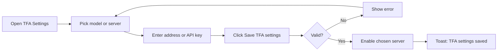
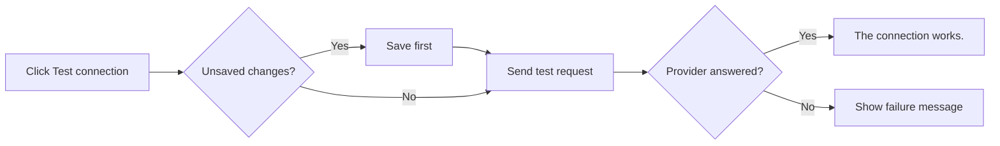
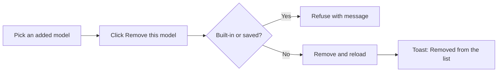

# Business Requirements Document – TFA Settings

## TaskFlow – Intelligent Task Allocation & Tracking System

> **Document:** Business Requirements Document  ·  **Version:** 1.0  ·  **Status:** Approved
> **Project type:** Personal Project (Skill Development)  ·  **Date:** 31-Oct-2026
> **Author:** Jojo George (jojogeorge3344@gmail.com)
> **Module:** Settings  ·  **Sub-module:** 06.3 TFA Settings  ·  **Code:** TFAS
> © 2026 Jojo George. All rights reserved.

---

## Document Control

### Revision History

| Version | Date | Author | Summary of changes |
|---|---|---|---|
| 1.0 | 31-Oct-2026 | Jojo George | Initial version |
| 1.0 | 31-Oct-2026 | Jojo George | Approved and signed off; baselined as the agreed business requirements. |

### Approvals / Sign-off

| Role | Name | Decision | Date |
|---|---|---|---|
| Product owner | Jojo George | Approved | 31-Oct-2026 |
| Reviewer | Jojo George | Approved | 31-Oct-2026 |

### Related Documents

| Document | Location |
|---|---|
| Overall BRD (roles, global rules, global NFRs) | `../../00-Overall/BRD-TaskFlow-Overall.md` |
| TFA Assistant BRD (uses this configuration) | `../../08-TFA-Assistant/08.1-Assistant/BRD-Assistant.md` |
| Development Plan (screen-wise) | _Not applicable – not in the original 20-screen plan._ |
| FRD | `../../../FRD/06-Settings/06.3-TFA-Settings/FRD-TFA-Settings.md` |
| HLD / LLD | `../../../HLD/06-Settings/06.3-TFA-Settings/HLD-TFA-Settings.md`, `../../../LLD/06-Settings/06.3-TFA-Settings/LLD-TFA-Settings.md` |

---

## Index

1. Project Overview
2. Stakeholders & User Roles
3. Scope
4. Business Process / Workflows
5. Screen-by-Screen Requirements
6. Business Rules
7. Non-Functional Requirements
8. Data Requirements
9. Integrations & External Dependencies
10. Reporting Requirements
11. Recommended Technology Stack (optional)
12. Assumptions, Constraints & Dependencies
13. Risks
14. Acceptance Criteria
15. Requirements Traceability Matrix
16. Project Deliverables
17. Glossary
18. Project Summary

---

## 1. Project Overview

### 1.1 Introduction
TFA Settings is the screen where an authorized user chooses the AI model and server behind TFA, the TaskFlow Assistant.
It supports a free local server (Ollama) and two cloud services (Google Gemini and OpenAI GPT), lets the user add and
remove models, stores API keys protected, and runs a connection test before users rely on the assistant.

### 1.2 Business Problem / Current Situation
An AI assistant is only useful when it is connected to a working model. Without a settings screen the provider, model and
API key would have to be written into configuration files by a developer, keys could leak to the browser or the logs,
and nobody could check whether the connection works until a user's question failed.

### 1.3 Project Objectives

| ID | Objective | Success measure |
|---|---|---|
| OBJ-TFAS-01 | Let the organization choose which AI provider and model TFA uses | Provider and model are chosen and saved from the screen; TFA offers only that configuration |
| OBJ-TFAS-02 | Keep API keys safe | Keys are stored protected and never shown again; only "key set" and the last four characters are visible |
| OBJ-TFAS-03 | Confirm the connection works before users depend on it | One click runs a test and shows a plain-language result |

### 1.4 Expected Benefits
- The organization can run TFA free on its own server, or use a cloud service when it prefers.
- API keys cannot be read back by anyone, including Administrators.
- Problems (wrong key, server not running, rate limit) are found and explained before users meet them.
- Everyone uses the one model the Administrator chose.

---

## 2. Stakeholders & User Roles

### 2.1 Stakeholders

| Stakeholder | Interest / responsibility |
|---|---|
| Project owner (Jojo George) | Defines priorities, approves this BRD |
| Administrator | Chooses and maintains the AI configuration and keys |
| TFA users (all roles allowed to chat) | Depend on a working, configured model |
| AI provider (Ollama, Google, OpenAI) | Answers TFA's requests |

### 2.2 User Roles

| Role | Description | Main responsibilities | Access level |
|---|---|---|---|
| Administrator | Manages the whole system | View, edit, test and remove models | Organization (full screen) |
| Manager | Assigns and monitors tasks | None on this screen | None by default |
| Employee | Works on assigned tasks | None on this screen | None by default |
| Custom role | Role defined on Role Configuration | As granted | `settings.ai.view` opens the screen; `settings.ai.edit`, `settings.ai.test` and `settings.ai.model.remove` allow the actions |

---

## 3. Scope

### 3.1 In Scope
- Viewing the three providers, their status and whether a key is saved.
- Choosing the model and server TFA uses, with linked Model and Server lists.
- Adding a new model name and removing an added model.
- Setting the Ollama server address.
- Entering, keeping or removing a Gemini or OpenAI API key.
- Testing the connection to a provider.

### 3.2 Out of Scope (this release)
- The TFA chat window itself – TFA Assistant BRD.
- AI providers other than Ollama, Google Gemini and OpenAI GPT.
- Usage or cost tracking of cloud providers.
- Installing models on the Ollama server (done outside TaskFlow).

### 3.3 Modules Overview

| # | Module | Purpose | Screens |
|---|---|---|---|
| 1 | Settings → TFA Settings | Configuration of the AI model and server behind TFA | TFA Settings |

### Change from original BRD

| Original BRD item | Current requirement |
|---|---|
| Not in original BRD | TFA Settings is a new screen, added with the TFA Assistant. |
| Original NFR 5.2 "Secure handling of email credentials" | The same principle applies to AI API keys: stored protected, never shown, never sent back to the browser. |

---

## 4. Business Process / Workflows

### 4.1 Choose the Model and Save

**Trigger:** The Administrator sets up or changes TFA's model  ·  **Actors:** Administrator, Custom role, System

| Step | Actor / System | Action | Result |
|---|---|---|---|
| 1 | Administrator | Opens **Settings → TFA Settings** | Providers shown; the one in use is marked |
| 2 | Administrator | Picks a model (the server follows) or a server (the model follows); or **Add new model…** and types a name | Selection shown with "After you save, TFA will use …" |
| 3 | Administrator | Checks the Ollama server address, or pastes the cloud API key (empty keeps the saved key) | Form ready |
| 4 | Administrator | Clicks **Save TFA settings** | Values checked |
| 5 | System | Saves; switches the chosen server on and the others off, keeping their keys and models | Toast "TFA settings saved" |
| 6 | System | Offers only this configuration in the TFA window | Users chat with the chosen model |

**Example:** The Administrator chooses `gemini-2.0-flash` (the Server list switches to "Google Gemini ·
generativelanguage.googleapis.com"), pastes a key ending in 1234 and saves. The card then shows "A key is saved (ends
…1234). Leave the box empty to keep it." and Ollama is switched off, but its address and models stay stored.

**Exceptions / alternate flows:**
- Address invalid: "The server address must be a valid http or https URL, and not a link-local or cloud metadata address."
- Key with spaces: "The API key cannot contain spaces."
- New key and **Remove the key** together: "Provide a new key or clear the key, not both."

### 4.2 Test the Connection

**Trigger:** The Administrator wants to check that a provider works  ·  **Actors:** Administrator, Custom role, System, AI provider

| Step | Actor / System | Action | Result |
|---|---|---|---|
| 1 | Administrator | Clicks **Test connection** on the provider card | Test starts |
| 2 | System | Saves unsaved changes first, if any | Configuration up to date |
| 3 | System | Sends one short request ("Reply with OK.") to the provider | Provider answers or fails |
| 4 | System | Shows "The connection works." or a plain message explaining the problem | Administrator knows what to fix |

**Example:** Ollama is selected but not started on the server. The test shows "Ollama is not running or cannot be
reached. Ask an administrator to start it, or choose another model."

**Exceptions / alternate flows:**
- Key refused, rate limit reached, timeout or model missing: each has its own message (see SCREEN 1).

### 4.3 Remove an Added Model

**Trigger:** A model added earlier is no longer wanted  ·  **Actors:** Administrator, Custom role, System

| Step | Actor / System | Action | Result |
|---|---|---|---|
| 1 | Administrator | Selects an added model that is not the saved one | **Remove this model from the list** button shown |
| 2 | Administrator | Clicks the button | Request sent |
| 3 | System | Refuses built-in and saved models; otherwise removes the model and reloads the screen | Toast "Removed `model` from the list" |

**Example:** The Administrator added `phi3:mini` for Ollama last week, then saved `llama3.2:3b`. Removing `phi3:mini`
succeeds; removing `llama3.2:3b` is refused because it is built-in.

**Exceptions / alternate flows:**
- Unsaved edits on the screen are dropped when the screen reloads after removal.

---

## 5. Screen-by-Screen Requirements

### SCREEN 1: TFA Settings

| Field | Value |
|---|---|
| **Screen name** | TFA Settings |
| **Module** | Settings |
| **Access** | Administrator; Custom role with `settings.ai.view` (actions need `settings.ai.edit`, `settings.ai.test`, `settings.ai.model.remove`). Manager and Employee: no access by default |
| **Priority** | Must |

**Purpose**
Choose the AI model and server behind TFA, manage models and API keys, and test the connection.

**Screen Elements**
- Page title **TFA settings** and a **Model and server** section explaining the choices: Ollama runs on your own server
  and is free; Google Gemini has a free tier with limits; OpenAI GPT has no free tier; with the cloud services a user's
  question and related task details are sent to the provider.
- **Model** list grouped by provider, with **Add new model…** in each group; **New model name** box.
- **Server** list: "Ollama · http://localhost:11434", "Google Gemini · generativelanguage.googleapis.com", "OpenAI GPT ·
  api.openai.com".
- **Remove this model from the list** button.
- A line such as "TFA uses **llama3.2:3b** on **Ollama**."
- Provider card: name, **Local** / **Cloud** tag, status (**In use**, **Ready to use**, **Needs an API key**, **Not
  configured**); **Server address** (Ollama) or **API key** with key status and **Remove the key** / **Keep the key**.
- **Test connection** button and result; **Save TFA settings** button.

**Functional Requirements**

| ID | Requirement | Priority |
|---|---|---|
| REQ-TFAS-01 | The system shall support three AI providers: Ollama (local, no key), Google Gemini and OpenAI GPT (cloud, key needed). | Must |
| REQ-TFAS-02 | The system shall show each provider with a Local or Cloud tag and its status: In use, Ready to use, Needs an API key or Not configured. | Must |
| REQ-TFAS-03 | The system shall offer the built-in models Ollama `llama3.2:3b`, `llama3.2:1b`, `llama3.1:8b`, `qwen2.5:7b`, `mistral:7b`; Gemini `gemini-2.0-flash`, `gemini-2.5-flash`, `gemini-2.5-pro`; OpenAI `gpt-4o-mini`, `gpt-4o`, `gpt-4.1-mini`, the first of each being the provider's default. | Must |
| REQ-TFAS-04 | The system shall select the matching server when a model is chosen, and the matching model when a server is chosen. | Should |
| REQ-TFAS-05 | The system shall let the user add a new model name of 1–100 characters, and keep offering it afterwards. | Should |
| REQ-TFAS-06 | The system shall let the user set the Ollama server address. | Must |
| REQ-TFAS-07 | The system shall accept only a valid http or https server address of at most 300 characters, and refuse link-local and cloud metadata addresses, while allowing local and private addresses. | Must |
| REQ-TFAS-08 | The system shall let the user enter an API key for Gemini or OpenAI of at most 500 characters without spaces. | Must |
| REQ-TFAS-09 | The system shall refuse an API key for Ollama. | Must |
| REQ-TFAS-10 | The system shall store API keys protected and never display or return a saved key. | Must |
| REQ-TFAS-11 | The system shall show only that a key is saved and its last four characters. | Must |
| REQ-TFAS-12 | The system shall keep the saved key when the key box is left empty. | Must |
| REQ-TFAS-13 | The system shall let the user remove a saved key, and refuse a new key and removal in the same save. | Must |
| REQ-TFAS-14 | The system shall switch the chosen server on and the other servers off when saving, keeping their keys and models. | Must |
| REQ-TFAS-15 | The system shall offer in the TFA window only providers that are configured (switched on, with a model and an address or a readable key). | Must |
| REQ-TFAS-16 | The system shall let the user test a provider's connection with one short request and show "The connection works." or a plain failure message. | Must |
| REQ-TFAS-17 | The system shall save unsaved changes before running a connection test. | Should |
| REQ-TFAS-18 | The system shall let the user remove a model that an administrator added. | Should |
| REQ-TFAS-19 | The system shall refuse to remove a built-in model or the model saved for its server. | Must |
| REQ-TFAS-20 | The system shall tell the user "The saved key can no longer be read. Enter it again." when a saved key cannot be read. | Should |
| REQ-TFAS-21 | The system shall explain on the screen that cloud providers receive the user's question and related task details. | Should |
| REQ-TFAS-22 | The system shall switch Ollama on at `http://localhost:11434` with the cloud providers off on a brand-new installation, and leave TFA off on an upgraded installation until an administrator turns it on. | Should |
| REQ-TFAS-23 | The system shall control viewing, editing, testing and model removal by four separate permissions and hide the buttons for actions the user may not do. | Must |
| REQ-TFAS-24 | The system shall hide the menu item from, and redirect to their dashboard, users without `settings.ai.view`. | Must |
| REQ-TFAS-25 | The system shall confirm actions with "TFA settings saved" and "Removed `model` from the list". | Should |

**Validations & Messages**

| Situation | Rule / message |
|---|---|
| Model name blank | "Model name cannot be blank." / on screen "Type the model name (100 characters at most)." |
| Bad server address | "The server address must be a valid http or https URL, and not a link-local or cloud metadata address." / on screen "Enter a valid http or https address." |
| Key with spaces | "The API key cannot contain spaces." |
| New key and clear together | "Provide a new key or clear the key, not both." |
| Key on Ollama | "Ollama does not use an API key." |
| Remove built-in model | "A built-in model cannot be removed." |
| Remove saved model | "That model is the one saved for its server. Choose another model and save before removing it." |
| Model not found | "That model is not in the list." |
| Test OK | "The connection works." |
| Test – not configured | "`Provider` is not configured. Choose another model, or ask an administrator to set it up." |
| Test – key refused | "`Provider` did not accept the API key. Ask an administrator to check the key in TFA Settings, or choose another model." |
| Test – rate limit | "`Provider`'s free limit or rate limit has been reached. Try again in about a minute, or choose another model." |
| Test – timeout | "`Provider` took too long to answer. You can retry, or choose another model." |
| Test – Ollama not reachable | "Ollama is not running or cannot be reached. Ask an administrator to start it, or choose another model." |
| Test – model missing on Ollama | "The configured model is not available on Ollama. Ask an administrator to install it, or choose another model." |
| Load / save / remove failed | "Could not load the TFA settings." / "Could not save the TFA settings." / "Could not remove the model." |
| No permission | Menu item hidden; address returns to dashboard; buttons for forbidden actions hidden |

> ⚠️ To be confirmed: without `settings.ai.edit` the inputs on the screen stay editable and only **Save** is hidden;
> whether the screen should be fully read-only for view-only users.
> ⚠️ To be confirmed: a user with `settings.ai.test` but without `settings.ai.edit` cannot test while there are unsaved
> changes (the automatic save is refused); whether such users should test the saved configuration instead.
> ⚠️ To be confirmed: only the screen ensures that one server is active; whether more than one active provider should
> also be refused when saving.

**Expected Result**
The Administrator chooses and tests the AI model behind TFA and stores API keys safely, without exposing them to anyone.
TFA users are offered only the configured model.

---

## 6. Business Rules

| ID | Rule | Applies to |
|---|---|---|
| BR-TFAS-01 | API keys are write-only: once saved they are never shown or returned, only "key set" and the last four characters. | SCREEN 1 |
| BR-TFAS-02 | Only one server is active after a save from the screen; switched-off servers keep their keys and models. | SCREEN 1, TFA |
| BR-TFAS-03 | A provider is configured only when it is switched on, has a model, and has an address (Ollama) or a readable key (cloud). | SCREEN 1, TFA |
| BR-TFAS-04 | Built-in models cannot be removed; the saved model cannot be removed until another is saved. | SCREEN 1 |
| BR-TFAS-05 | Each provider appears only once in a save. | SCREEN 1 |
| BR-TFAS-06 | Server addresses pointing at link-local or cloud metadata addresses are refused. | SCREEN 1 |
| BR-TFAS-07 | `settings.ai.edit`, `settings.ai.test` and `settings.ai.model.remove` each need `settings.ai.view`. | SCREEN 1, Role Configuration |

Global rules and requirements that apply (see [overall BRD section 6](../../00-Overall/BRD-TaskFlow-Overall.md) and section 7): the global security NFRs – role-based access control, server-side input
validation and secure handling of credentials (original BRD NFR 5.2). No original BRD business rule is specific to this
screen.

---

## 7. Non-Functional Requirements

| ID | Category | Requirement | Measure / target |
|---|---|---|---|
| NFR-TFAS-01 | Security | API keys are protected when stored and never leave the server towards the browser | No response or screen contains a saved key |
| NFR-TFAS-02 | Security | Server addresses cannot be used to reach link-local or cloud metadata addresses | Such addresses refused when saving |
| NFR-TFAS-03 | Security | Every action is checked by permission on the server | Requests without the matching `settings.ai.*` permission are refused |
| NFR-TFAS-04 | Reliability | A test never breaks the screen; failures are reported as messages | The test always returns a result message |
| NFR-TFAS-05 | Reliability | A key that can no longer be read is detected and reported | Provider shown as needing a key; message asks to enter it again |
| NFR-TFAS-06 | Usability | Failure messages are plain language and say what to do next | Every failure kind has its own message |
| NFR-TFAS-07 | Privacy | Users are told which providers are cloud services | Cloud tag and explanation on the screen |
| NFR-TFAS-08 | Compatibility | Works in current desktop browsers, responsive layout | As the global compatibility NFR |

---

## 8. Data Requirements

| Entity / data set | Purpose | Key fields | Retention / rules |
|---|---|---|---|
| AI provider configuration | One record per provider | Provider, switched on, model, server address (Ollama only), protected key, last four characters, last changed by and at | One record per provider; a key is replaced or removed, never shown |
| AI model list | Models offered per provider | Provider, model name, built-in flag | Provider + name unique; built-in models cannot be removed |

---

## 9. Integrations & External Dependencies

| System / service | Purpose | Required? | Notes |
|---|---|---|---|
| Ollama (local server) | Free local AI model | Optional | Not reachable: test reports "Ollama is not running or cannot be reached …" |
| Google Gemini | Cloud AI model, free tier with limits | Optional | Needs an API key; question and task details are sent to Google |
| OpenAI GPT | Cloud AI model, no free tier | Optional | Needs an API key; question and task details are sent to OpenAI |
| TFA Assistant | Uses the saved configuration | Required | Offers only configured providers |
| Server key protection | Protects stored API keys | Required | When it is lost, saved keys must be entered again |

---

## 10. Reporting Requirements

_Not applicable for this sub-module._

---

## 11. Recommended Technology Stack (optional)

_Not applicable for this sub-module._ The technology stack is given in the overall BRD.

---

## 12. Assumptions, Constraints & Dependencies

| Type | Description |
|---|---|
| Assumption | The organization obtains its own Gemini or OpenAI key, or runs Ollama on its own server. |
| Assumption | Models used with Ollama are installed on the Ollama server outside TaskFlow. |
| Constraint | Only Ollama, Google Gemini and OpenAI GPT are supported. |
| Dependency | TFA Assistant reads this configuration. |
| Dependency | Role Configuration grants the four `settings.ai.*` permissions. |

---

## 13. Risks

| ID | Risk | Impact | Likelihood | Mitigation |
|---|---|---|---|---|
| R-TFAS-01 | API key leaked | High | Low | Keys stored protected, write-only, never returned |
| R-TFAS-02 | Task data sent to a cloud provider without awareness | Medium | Medium | Cloud tag and explanation on the screen; Ollama is the default |
| R-TFAS-03 | Cloud free limit reached, TFA unavailable | Medium | Medium | Rate-limit message; switch to another model |
| R-TFAS-04 | Server key protection lost, keys unreadable | Medium | Low | Detected and reported; enter key again |
| R-TFAS-05 | Server address abused to reach internal metadata services | High | Low | Link-local and metadata addresses refused |

---

## 14. Acceptance Criteria

| ID | Criterion | Verified by |
|---|---|---|
| AC-TFAS-01 | The Administrator sees Ollama, Google Gemini and OpenAI GPT with tag and status. | SCREEN 1, REQ-TFAS-01, REQ-TFAS-02 |
| AC-TFAS-02 | The Model list contains the built-in models; choosing `gpt-4o` selects the OpenAI server. | REQ-TFAS-03, REQ-TFAS-04 |
| AC-TFAS-03 | A new model `phi3:mini` is saved and offered afterwards. | REQ-TFAS-05 |
| AC-TFAS-04 | An Ollama address `http://169.254.169.254` is refused; `http://192.168.1.20:11434` is accepted. | REQ-TFAS-06, REQ-TFAS-07 |
| AC-TFAS-05 | A key with a space, or a key for Ollama, is refused. | REQ-TFAS-08, REQ-TFAS-09 |
| AC-TFAS-06 | After saving a key, only "ends …1234" is shown; the key never appears in any screen or response. | REQ-TFAS-10, REQ-TFAS-11 |
| AC-TFAS-07 | Saving with an empty key box keeps the key; **Remove the key** clears it; both together are refused. | REQ-TFAS-12, REQ-TFAS-13 |
| AC-TFAS-08 | After saving Gemini, Ollama is off but keeps its address; TFA offers only Gemini. | REQ-TFAS-14, REQ-TFAS-15 |
| AC-TFAS-09 | Test with a working provider shows "The connection works."; with Ollama stopped shows the Ollama message. | REQ-TFAS-16 |
| AC-TFAS-10 | Test with unsaved changes saves them first. | REQ-TFAS-17 |
| AC-TFAS-11 | An added model is removed; a built-in or saved model is refused with its message. | REQ-TFAS-18, REQ-TFAS-19, REQ-TFAS-25 |
| AC-TFAS-12 | When a saved key can no longer be read, the screen asks to enter it again. | REQ-TFAS-20 |
| AC-TFAS-13 | The screen explains that cloud providers receive the question and task details. | REQ-TFAS-21 |
| AC-TFAS-14 | A brand-new installation has Ollama on at `http://localhost:11434` and both cloud providers off. | REQ-TFAS-22 |
| AC-TFAS-15 | A custom role with only `settings.ai.view` sees the screen without Save, Test or Remove; a Manager has no menu item and is redirected. | REQ-TFAS-23, REQ-TFAS-24 |
| AC-TFAS-16 | A successful save shows "TFA settings saved". | REQ-TFAS-25 |

---

## 15. Requirements Traceability Matrix

| Objective | Business rule(s) | Screen(s) | Functional requirement(s) | Acceptance criterion |
|---|---|---|---|---|
| OBJ-TFAS-01 | BR-TFAS-02, BR-TFAS-03, BR-TFAS-04, BR-TFAS-05 | SCREEN 1 | REQ-TFAS-01, REQ-TFAS-02, REQ-TFAS-03, REQ-TFAS-04, REQ-TFAS-05, REQ-TFAS-06, REQ-TFAS-14, REQ-TFAS-15, REQ-TFAS-18, REQ-TFAS-19, REQ-TFAS-22, REQ-TFAS-25 | AC-TFAS-01, AC-TFAS-02, AC-TFAS-03, AC-TFAS-08, AC-TFAS-11, AC-TFAS-14, AC-TFAS-16 |
| OBJ-TFAS-02 | BR-TFAS-01, BR-TFAS-06, BR-TFAS-07 | SCREEN 1 | REQ-TFAS-07, REQ-TFAS-08, REQ-TFAS-09, REQ-TFAS-10, REQ-TFAS-11, REQ-TFAS-12, REQ-TFAS-13, REQ-TFAS-20, REQ-TFAS-21, REQ-TFAS-23, REQ-TFAS-24 | AC-TFAS-04, AC-TFAS-05, AC-TFAS-06, AC-TFAS-07, AC-TFAS-12, AC-TFAS-13, AC-TFAS-15 |
| OBJ-TFAS-03 | BR-TFAS-03 | SCREEN 1 | REQ-TFAS-16, REQ-TFAS-17 | AC-TFAS-09, AC-TFAS-10 |

---

## 16. Project Deliverables

| # | Deliverable | Format |
|---|---|---|
| 1 | TFA Settings screen, saving, model removal and connection test | Source code in the repository |
| 2 | Initial provider records and built-in model list | Initialization at application start |
| 3 | BRD, FRD, HLD and LLD for TFA Settings | Markdown |
| 4 | Tests for provider configuration, key protection and connection test | Automated tests |

---

## 17. Glossary

| Term | Meaning |
|---|---|
| TFA | TaskFlow Assistant, the AI chat assistant inside TaskFlow |
| Provider / server | The service that runs the AI model: Ollama, Google Gemini or OpenAI GPT |
| Model | The AI model name used on a provider, for example `llama3.2:3b` |
| Built-in model | A model that ships with TaskFlow and cannot be removed |
| API key | Secret credential for a cloud provider |
| Ollama | Free AI model server that runs on the organization's own machine |
| Configured provider | A provider that is switched on, has a model and an address or a readable key |
| Connection test | One short request that checks whether the provider answers |

---

## 18. Project Summary
TFA Settings lets the Administrator choose the AI provider and model behind the TaskFlow Assistant – a free local Ollama
server or a cloud service – add and remove models, store API keys that can never be read back, and test the connection
with one click. Only the configured model is offered to TFA users, and every action is controlled by its own permission.

---
© 2026 Jojo George. All rights reserved. Unauthorized copying or distribution of this document is prohibited.
