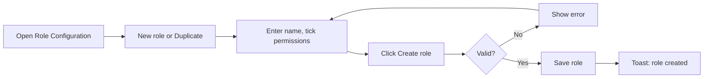
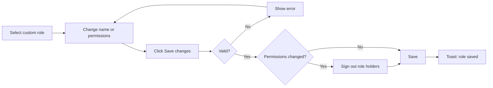
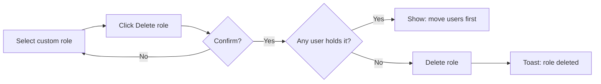

# Business Requirements Document – Role Configuration

## TaskFlow – Intelligent Task Allocation & Tracking System

> **Document:** Business Requirements Document  ·  **Version:** 1.0  ·  **Status:** Approved
> **Project type:** Personal Project (Skill Development)  ·  **Date:** 31-Oct-2026
> **Author:** Jojo George (jojogeorge3344@gmail.com)
> **Module:** Settings  ·  **Sub-module:** 06.4 Role Configuration  ·  **Code:** ROLE
> © 2026 Jojo George. All rights reserved.

---

## Document Control

### Revision History

| Version | Date | Author | Summary of changes |
|---|---|---|---|
| 1.0 | 31-Oct-2026 | Jojo George | Initial version |
| 1.0 | 31-Oct-2026 | Jojo George | Approved and signed off; baselined as the agreed business requirements. |
| 1.0 | 31-Oct-2026 | Jojo George | Editorial only: Related Documents paths updated to the `TF - Documents` folder layout; no requirement changed, sign-off unchanged. |

### Approvals / Sign-off

| Role | Name | Decision | Date |
|---|---|---|---|
| Product owner | Jojo George | Approved | 31-Oct-2026 |
| Reviewer | Jojo George | Approved | 31-Oct-2026 |

### Related Documents

| Document | Location |
|---|---|
| Overall BRD (roles, access model, global rules) | `../../00-Overall/BRD-TaskFlow-Overall.md` |
| Employee Management BRD (assigning roles to users) | `../../03-TaskFlow-Management/03.1-Employee-Management/BRD-Employee-Management.md` |
| Development Plan (screen-wise) | _Not applicable – not in the original 20-screen plan._ |
| Original BRD (section 1.4 User Roles) | `BRD for Task management.docx` (v1.0) |
| FRD | `../../../FRD/06-Settings/06.4-Role-Configuration/FRD-Role-Configuration.md` |
| HLD / LLD | `../../../HLD/06-Settings/06.4-Role-Configuration/HLD-Role-Configuration.md`, `../../../LLD/06-Settings/06.4-Role-Configuration/LLD-Role-Configuration.md` |

---

## Index

1. Project Overview
2. Stakeholders & User Roles
3. Scope
4. Business Process / Workflows
5. Screen-by-Screen Requirements
6. Business Rules
7. Non-Functional Requirements
8. Data Requirements
9. Integrations & External Dependencies
10. Reporting Requirements
11. Recommended Technology Stack (optional)
12. Assumptions, Constraints & Dependencies
13. Risks
14. Acceptance Criteria
15. Requirements Traceability Matrix
16. Project Deliverables
17. Glossary
18. Project Summary

---

## 1. Project Overview

### 1.1 Introduction
Role Configuration is the screen where an authorized user decides exactly what each role can see and do in TaskFlow.
The three system roles (Administrator, Manager, Employee) are shown read-only. The organization creates, edits,
duplicates and deletes its own **custom roles** by ticking permissions from a fixed permission catalogue.

### 1.2 Business Problem / Current Situation
With only three fixed roles, an organization must give people either too much access (Manager) or too little
(Employee). A team lead who should see workload but not manage employees, or an assistant who should only send Mail,
cannot be served. Changing what a role may do would need a developer.

### 1.3 Project Objectives

| ID | Objective | Success measure |
|---|---|---|
| OBJ-ROLE-01 | Let the organization define custom roles that grant exactly the screens and actions a group needs | A custom role is created, edited and deleted from the screen without code changes |
| OBJ-ROLE-02 | Protect the built-in access model | System roles and the permission catalogue cannot be changed by anyone; Administrator-only permissions cannot be given away |
| OBJ-ROLE-03 | Make permission changes effective at once | Every holder of a changed role is signed out and signs in again with the new access |

### 1.4 Expected Benefits
- Least-privilege access: each group gets what it needs and nothing more.
- No risk of breaking the system roles by mistake.
- Changes are immediate and visible: a compare view shows every role against every permission.

---

## 2. Stakeholders & User Roles

### 2.1 Stakeholders

| Stakeholder | Interest / responsibility |
|---|---|
| Project owner (Jojo George) | Defines priorities, approves this BRD |
| Administrator | Maintains roles and permissions |
| All users | Their access is decided by the role they hold |

### 2.2 User Roles

| Role | Description | Main responsibilities | Access level |
|---|---|---|---|
| Administrator | Manages the whole system | View all roles; create, edit, duplicate and delete custom roles | Organization (full screen); always holds every permission |
| Manager | Assigns and monitors tasks | None on this screen | None by default (system role, read-only) |
| Employee | Works on assigned tasks | None on this screen | None by default (system role, read-only) |
| Custom role | Role defined on this screen | As granted | `roles.manage` opens the screen; `roles.view.all` shows all roles (otherwise only one's own); `roles.modify.access` allows changes (otherwise read-only) |

---

## 3. Scope

### 3.1 In Scope
- Listing roles with the number of users holding each, and searching them.
- Viewing a role's permissions as a tree or in a compare-roles matrix.
- Creating, duplicating, editing and deleting custom roles.
- Copying permissions from another role.
- Scope levels (for example Dashboard Own / Team / Organization) and permission prerequisites.
- Signing out holders of a role whose permissions change.

### 3.2 Out of Scope (this release)
- Giving a role to a user – Employee Management.
- Adding, changing or removing permissions in the catalogue – the catalogue is fixed by design.
- Changing the system roles Administrator, Manager and Employee.
- A history of role changes – not recorded.
- Permissions per individual user (outside a role) – not supported.

### 3.3 Modules Overview

| # | Module | Purpose | Screens |
|---|---|---|---|
| 1 | Settings → Role Configuration | Roles and their permissions | Role Configuration |

### Change from original BRD

| Original BRD item | Current requirement |
|---|---|
| Section 1.4: three fixed roles (Administrator, Manager, Employee) | The three roles remain as protected system roles; the organization can add custom roles with chosen permissions. |
| Screen 5 FR-5 "Assign appropriate roles" | Roles, including custom roles, are assigned in Employee Management; making someone an Administrator needs `roles.administrator.assign`. |
| Not in original BRD | Role Configuration is a new screen; access everywhere is decided by permissions, not by role names. |

---

## 4. Business Process / Workflows

### 4.1 Create a Custom Role

**Trigger:** A group needs access different from the system roles  ·  **Actors:** Administrator, Custom role, System

| Step | Actor / System | Action | Result |
|---|---|---|---|
| 1 | Administrator | Opens **Settings → Role Configuration** | Roles and the permission tree shown |
| 2 | Administrator | Clicks **New role**, or selects a role and clicks **Duplicate as custom role** | Empty draft, or a draft named "… copy" with that role's permissions |
| 3 | Administrator | Types the role name and ticks permissions; optionally **Copy permissions from…** | Prerequisites are ticked automatically; save bar counts the changes |
| 4 | Administrator | Clicks **Create role** | Name and permissions checked |
| 5 | System | Saves the role | Toast "`Role name` created" |

**Example:** The Administrator duplicates Manager, renames the draft "Team Lead", unticks Employee Management and keeps
View all tasks, Create task and Workload. Creating it shows "Team Lead created". In Employee Management, Rahul is then
given the role Team Lead.

**Exceptions / alternate flows:**
- Name blank: "Enter a name for the role."
- Name already used, in any letter case: "A role named "Team Lead" already exists."
- Permission without its prerequisite: "`permission` also needs `needed permission`."

### 4.2 Edit a Custom Role

**Trigger:** A custom role needs more or less access  ·  **Actors:** Administrator, Custom role, System, role holders

| Step | Actor / System | Action | Result |
|---|---|---|---|
| 1 | Administrator | Selects the custom role | Its permissions shown |
| 2 | Administrator | Renames it or ticks / unticks permissions | Save bar shows "N unsaved changes" |
| 3 | Administrator | Clicks **Save changes** | Checked as on create |
| 4 | System | If permissions changed, signs out every holder of the role | Holders sign in again with the new access |
| 5 | System | Saves the role | Toast "`Role name` saved" |

**Example:** The Administrator adds Reports to "Team Lead" and saves. Rahul, who holds Team Lead, is signed out; after
signing in again he sees the Reports menu.

**Exceptions / alternate flows:**
- Selecting another role with unsaved changes asks "Discard unsaved changes?" first.
- A name-only change does not sign anyone out.
- A system role cannot be saved: "`Role name` is a system role and is read-only: it cannot be changed or deleted."

### 4.3 Delete a Custom Role

**Trigger:** A custom role is no longer needed  ·  **Actors:** Administrator, Custom role, System

| Step | Actor / System | Action | Result |
|---|---|---|---|
| 1 | Administrator | Selects the custom role and clicks **Delete role** | Confirmation "Delete `Role name`?" |
| 2 | Administrator | Confirms | Request sent |
| 3 | System | Refuses when any user still holds the role | "2 users still hold this role. Move them to another role first." |
| 4 | System | Otherwise deletes the role and its permissions | Toast "`Role name` deleted" |

**Example:** "Team Lead" is held by Rahul and Priya. Deleting it is refused with "2 users still hold this role. Move them
to another role first." After both are moved to Manager in Employee Management, the delete succeeds.

**Exceptions / alternate flows:**
- The user cancels the confirmation: nothing changes.

---

## 5. Screen-by-Screen Requirements

### SCREEN 1: Role Configuration

| Field | Value |
|---|---|
| **Screen name** | Role Configuration |
| **Module** | Settings |
| **Access** | Administrator; Custom role with `roles.manage` (+ `roles.view.all` to see all roles, + `roles.modify.access` to change). Manager and Employee: no access by default |
| **Priority** | Must |

**Purpose**
Choose exactly what each role can see and do, and manage custom roles.

**Screen Elements**
- Page title **Role Configuration**: "Choose exactly what each role can see and do. Administrator, Manager and Employee
  are protected; create your own roles for anyone else."
- **Roles** panel: **New role** button, **Find a role** search, list of roles (system roles first) with user counts.
- Role detail: role name box (custom) or name with **System role** badge and **Duplicate as custom role**; **Copy
  permissions from…**; **Delete role**; progress "N of M permissions", "x% enabled".
- **Search permissions** box; **All / Enabled / Disabled** filter; **Tree** / **Compare roles** view switch.
- Tree: module list, **Expand all / Collapse all**, **Select all / Deselect all**, tick boxes for module, screen and
  permission, scope selectors; tags **Always on** and **Administrator only**.
- Save bar: "N unsaved changes", **Discard**, **Create role** / **Save changes**.

**Functional Requirements**

| ID | Requirement | Priority |
|---|---|---|
| REQ-ROLE-01 | The system shall list all roles, system roles first, with the number of users holding each, and let the user search the list. | Must |
| REQ-ROLE-02 | The system shall show only the user's own role when the user does not hold `roles.view.all`. | Must |
| REQ-ROLE-03 | The system shall show a role's permissions as a tree grouped by module and screen. | Must |
| REQ-ROLE-04 | The system shall show a compare view of every permission against every role. | Should |
| REQ-ROLE-05 | The system shall let the user search permissions and filter them by All, Enabled or Disabled. | Should |
| REQ-ROLE-06 | The system shall show system roles read-only and refuse any change or deletion of them. | Must |
| REQ-ROLE-07 | The system shall let the user create a custom role with a name and chosen permissions. | Must |
| REQ-ROLE-08 | The system shall let the user duplicate any role as a new custom role named "… copy" with the same permissions. | Should |
| REQ-ROLE-09 | The system shall let the user copy the permissions of another role into the role being edited. | Should |
| REQ-ROLE-10 | The system shall require a role name of at most 100 characters that is unique regardless of letter case. | Must |
| REQ-ROLE-11 | The system shall tick a permission's prerequisite automatically and refuse to save a permission without its prerequisite. | Must |
| REQ-ROLE-12 | The system shall refuse to give `roles.administrator.assign` to any role other than Administrator. | Must |
| REQ-ROLE-13 | The system shall keep always-on features (own profile, own dashboard, own tasks) on for every role, not switchable. | Must |
| REQ-ROLE-14 | The system shall treat scope levels as inclusive, a higher level including the lower ones. | Must |
| REQ-ROLE-15 | The system shall let the user rename a custom role and change its permissions. | Must |
| REQ-ROLE-16 | The system shall count unsaved changes, let the user discard them, and ask "Discard unsaved changes?" before leaving a role with unsaved changes. | Should |
| REQ-ROLE-17 | The system shall sign out every holder of a custom role when its permissions change, and not when only its name changes. | Must |
| REQ-ROLE-18 | The system shall delete a custom role only after confirmation. | Must |
| REQ-ROLE-19 | The system shall refuse to delete a role that any user still holds, stating how many users hold it. | Must |
| REQ-ROLE-20 | The system shall keep the permission catalogue fixed and refuse any attempt to add, change or remove a permission. | Must |
| REQ-ROLE-21 | The system shall give the Administrator role every permission again each time the application starts. | Must |
| REQ-ROLE-22 | The system shall show everything read-only and hide **New role** when the user does not hold `roles.modify.access`. | Must |
| REQ-ROLE-23 | The system shall show how many permissions of the catalogue a role has, as a count and a percentage. | Could |
| REQ-ROLE-24 | The system shall hide the menu item from, and redirect to their dashboard, users without `roles.manage`. | Must |
| REQ-ROLE-25 | The system shall confirm actions with "`Role name` created", "`Role name` saved" and "`Role name` deleted". | Should |

**Validations & Messages**

| Situation | Rule / message |
|---|---|
| Name blank | "Enter a name for the role." |
| Name too long | "The role name can be at most 100 characters." |
| Duplicate name | "A role named "`name`" already exists." |
| Unknown permission | "Unknown permission: `keys`." |
| Missing prerequisite | ""`permission`" also needs "`needed permission`"." |
| Administrator-only permission | "`permission` can only be held by the Administrator role and cannot be given to another role." |
| System role change | "`Role name` is a system role and is read-only: it cannot be changed or deleted." |
| Role in use | "1 user still holds this role. Move them to another role first." / "`n` users still hold this role. Move them to another role first." |
| Role not found | "That role does not exist." |
| Catalogue change attempt | "The permission list is fixed and cannot be changed." |
| Leaving with unsaved changes | "Discard unsaved changes?" – "The changes you made to this role have not been saved and will be lost." |
| Load failed | "Could not load roles and permissions." |
| Save / delete failed | "Could not save the role." / "Could not delete the role." |
| No permission | Menu item hidden; opening the address returns the user to their dashboard |

> ⚠️ To be confirmed: `roles.manage` can be given to a custom role; a custom role holding `roles.manage` and
> `roles.modify.access` can create a role that may assign roles to users. Whether `roles.manage` should be
> Administrator-only.
> ⚠️ To be confirmed: a user with `roles.manage` but without `roles.view.all` sees only their own role in the list but can
> still open another role directly; whether that should be refused.
> ⚠️ To be confirmed: **Duplicate as custom role** is shown to users without `roles.modify.access`, but the draft cannot
> be saved; whether the button should be hidden.
> ⚠️ To be confirmed: a refusal for missing `roles.modify.access` shows only the general message "Could not save the role.";
> whether a specific message is wanted.

**Expected Result**
The organization defines custom roles that grant exactly the screens and actions each group needs, while the system
roles and the permission catalogue stay protected and changes reach the role's holders at once.

---

## 6. Business Rules

| ID | Rule | Applies to |
|---|---|---|
| BR-ROLE-01 | Administrator, Manager and Employee are system roles: they cannot be renamed, changed or deleted. | SCREEN 1 |
| BR-ROLE-02 | The permission catalogue is fixed; nobody, including an Administrator, can change it. | SCREEN 1 |
| BR-ROLE-03 | Role names are unique, ignoring letter case ("team lead" equals "Team Lead"), and at most 100 characters. | SCREEN 1 |
| BR-ROLE-04 | A permission that needs another can only be held together with it. | SCREEN 1 |
| BR-ROLE-05 | "Give the Administrator role" can only be held by the Administrator role. | SCREEN 1, Employee Management |
| BR-ROLE-06 | Always-on features are granted to every user and are not stored as grants. | All modules |
| BR-ROLE-07 | Scope levels include the lower ones: Organization includes Team and Own; View all tasks includes View my tasks. | All modules |
| BR-ROLE-08 | A role that any user holds cannot be deleted. | SCREEN 1 |
| BR-ROLE-09 | A permission change on a custom role signs out all its holders. | SCREEN 1, Authentication |
| BR-ROLE-10 | The Administrator role always holds every permission, including new ones. | All modules |

Global rules that apply (see [overall BRD section 6](../../00-Overall/BRD-TaskFlow-Overall.md)): only authorized users may create, change or manage records – authorization is
decided by the permissions defined here; records with dependent data are not deleted in a way that damages history – a
role in use cannot be deleted.

---

## 7. Non-Functional Requirements

| ID | Category | Requirement | Measure / target |
|---|---|---|---|
| NFR-ROLE-01 | Security | Access is checked on the server for every request, not only by hiding the menu | Requests without `roles.manage` / `roles.modify.access` are refused |
| NFR-ROLE-02 | Security | New permissions apply without waiting for users to sign out | Holders of a changed role are signed out at once; grants are re-read on each request |
| NFR-ROLE-03 | Integrity | System roles are protected at every level | Changes to system roles are refused, also by the stored data |
| NFR-ROLE-04 | Usability | Large permission lists stay manageable | Search, filter, expand/collapse, select all and compare view available |
| NFR-ROLE-05 | Usability | No accidental loss of edits | Unsaved-change counter and discard confirmation |
| NFR-ROLE-06 | Performance | The screen loads and saves without noticeable delay | As the global performance NFR in the overall BRD |
| NFR-ROLE-07 | Compatibility | Works in current desktop browsers, responsive layout | As the global compatibility NFR |

---

## 8. Data Requirements

| Entity / data set | Purpose | Key fields | Retention / rules |
|---|---|---|---|
| Role | System and custom roles | Name, system flag, created at, number of holders | Name unique ignoring case; system roles never changed; a role in use cannot be deleted |
| Permission catalogue | The fixed list of permissions | Key, name, description, module, screen, section, action, prerequisite, scope level, assignable, always on | Fixed; maintained only with the application itself |
| Role permission grant | Which permissions a role holds | Role, permission | Removed together with the role |
| User sessions | Signed-in users of a role | User, session validity | Ended when the user's role permissions change |

---

## 9. Integrations & External Dependencies

| System / service | Purpose | Required? | Notes |
|---|---|---|---|
| Employee Management | Gives roles to users; users must be moved before a role is deleted | Required | Giving the Administrator role needs `roles.administrator.assign` |
| Authentication | Signs out holders of a changed role | Required | They sign in again with the new access |
| All modules | Every screen and action is controlled by the permissions defined here | Required | – |

No external system is involved.

---

## 10. Reporting Requirements

_Not applicable for this sub-module._ The compare-roles view gives an on-screen overview of permissions per role.

---

## 11. Recommended Technology Stack (optional)

_Not applicable for this sub-module._ The technology stack is given in the overall BRD.

---

## 12. Assumptions, Constraints & Dependencies

| Type | Description |
|---|---|
| Assumption | Each user holds exactly one role. |
| Assumption | Only Administrators normally hold `roles.manage`. |
| Constraint | The permission catalogue is fixed; new permissions come only with a new application version. |
| Dependency | Employee Management assigns roles; Authentication ends sessions. |

---

## 13. Risks

| ID | Risk | Impact | Likelihood | Mitigation |
|---|---|---|---|---|
| R-ROLE-01 | A custom role gets too much access | High | Medium | Compare view; prerequisites; Administrator-only permissions cannot be given away |
| R-ROLE-02 | A custom role with role-management permissions widens its own or others' access | High | Low | Grant `roles.manage` only to trusted roles; see To be confirmed in SCREEN 1 |
| R-ROLE-03 | Holders lose unsaved work when signed out after a permission change | Medium | Low | Change roles outside busy hours; sign-out happens only when permissions change |
| R-ROLE-04 | No history of role changes | Low | Medium | Compare view shows the current state |

---

## 14. Acceptance Criteria

| ID | Criterion | Verified by |
|---|---|---|
| AC-ROLE-01 | The Administrator sees all roles, system roles first, with user counts, and can search them. | SCREEN 1, REQ-ROLE-01 |
| AC-ROLE-02 | A custom role with `roles.manage` but without `roles.view.all` sees only its own role. | REQ-ROLE-02 |
| AC-ROLE-03 | The tree and the compare view show a role's permissions; search and the Enabled filter narrow the list. | REQ-ROLE-03, REQ-ROLE-04, REQ-ROLE-05, REQ-ROLE-23 |
| AC-ROLE-04 | Manager cannot be renamed, changed or deleted; the read-only message is shown. | REQ-ROLE-06 |
| AC-ROLE-05 | "Team Lead" is created from scratch and by duplicating Manager; copying permissions from Employee fills the tree. | REQ-ROLE-07, REQ-ROLE-08, REQ-ROLE-09, REQ-ROLE-25 |
| AC-ROLE-06 | A blank name, a 101-character name and "team lead" when "Team Lead" exists are refused. | REQ-ROLE-10 |
| AC-ROLE-07 | Ticking "Edit employees" also ticks "View employees"; saving without the prerequisite is refused. | REQ-ROLE-11 |
| AC-ROLE-08 | Giving "Give the Administrator role" to a custom role is refused. | REQ-ROLE-12 |
| AC-ROLE-09 | Always-on features are shown as **Always on** and cannot be unticked; choosing Organization scope includes Team and Own. | REQ-ROLE-13, REQ-ROLE-14 |
| AC-ROLE-10 | Renaming and changing a custom role is saved; leaving with unsaved changes asks for confirmation. | REQ-ROLE-15, REQ-ROLE-16 |
| AC-ROLE-11 | After a permission change, holders are signed out; after a name-only change, they are not. | REQ-ROLE-17 |
| AC-ROLE-12 | Deleting a role held by 2 users is refused with the count; deleting an unused role after confirmation succeeds. | REQ-ROLE-18, REQ-ROLE-19 |
| AC-ROLE-13 | Any attempt to change the permission catalogue is refused with "The permission list is fixed and cannot be changed." | REQ-ROLE-20 |
| AC-ROLE-14 | After a restart, the Administrator role holds every permission in the catalogue. | REQ-ROLE-21 |
| AC-ROLE-15 | Without `roles.modify.access` the screen is read-only and **New role** is hidden; without `roles.manage` the menu item is hidden and the address redirects. | REQ-ROLE-22, REQ-ROLE-24 |

---

## 15. Requirements Traceability Matrix

| Objective | Business rule(s) | Screen(s) | Functional requirement(s) | Acceptance criterion |
|---|---|---|---|---|
| OBJ-ROLE-01 | BR-ROLE-03, BR-ROLE-04, BR-ROLE-06, BR-ROLE-07, BR-ROLE-08, global rules | SCREEN 1 | REQ-ROLE-01, REQ-ROLE-03, REQ-ROLE-04, REQ-ROLE-05, REQ-ROLE-07, REQ-ROLE-08, REQ-ROLE-09, REQ-ROLE-10, REQ-ROLE-11, REQ-ROLE-13, REQ-ROLE-14, REQ-ROLE-15, REQ-ROLE-16, REQ-ROLE-18, REQ-ROLE-19, REQ-ROLE-23, REQ-ROLE-25 | AC-ROLE-01, AC-ROLE-03, AC-ROLE-05, AC-ROLE-06, AC-ROLE-07, AC-ROLE-09, AC-ROLE-10, AC-ROLE-12 |
| OBJ-ROLE-02 | BR-ROLE-01, BR-ROLE-02, BR-ROLE-05, BR-ROLE-10, global rules | SCREEN 1 | REQ-ROLE-02, REQ-ROLE-06, REQ-ROLE-12, REQ-ROLE-20, REQ-ROLE-21, REQ-ROLE-22, REQ-ROLE-24 | AC-ROLE-02, AC-ROLE-04, AC-ROLE-08, AC-ROLE-13, AC-ROLE-14, AC-ROLE-15 |
| OBJ-ROLE-03 | BR-ROLE-09 | SCREEN 1 | REQ-ROLE-17 | AC-ROLE-11 |

---

## 16. Project Deliverables

| # | Deliverable | Format |
|---|---|---|
| 1 | Role Configuration screen with tree and compare views | Source code in the repository |
| 2 | System roles and the permission catalogue created at start | Initialization at application start |
| 3 | BRD, FRD, HLD and LLD for Role Configuration | Markdown |
| 4 | Tests for roles, permissions and the sign-out on change | Automated tests |

---

## 17. Glossary

| Term | Meaning |
|---|---|
| System role | Administrator, Manager or Employee; built in and read-only |
| Custom role | A role created by the organization on this screen |
| Permission | One screen or action a role may use, for example `settings.reminders.manage` |
| Permission catalogue | The fixed list of all permissions |
| Prerequisite | A permission another permission needs (normally the screen's View) |
| Scope level | How far a permission reaches: Own, Team or Organization (or own / all tasks) |
| Always on | A feature every user has, such as their own profile |
| Holder | A user who has been given a role |

---

## 18. Project Summary
Role Configuration turns TaskFlow's access control into something the organization can shape itself: the system roles
stay protected, while custom roles are built by ticking permissions from a fixed catalogue, with prerequisites, scope
levels and Administrator-only permissions enforced. Roles in use cannot be deleted, and permission changes sign out the
holders so the new access applies at once.

---
© 2026 Jojo George. All rights reserved. Unauthorized copying or distribution of this document is prohibited.
