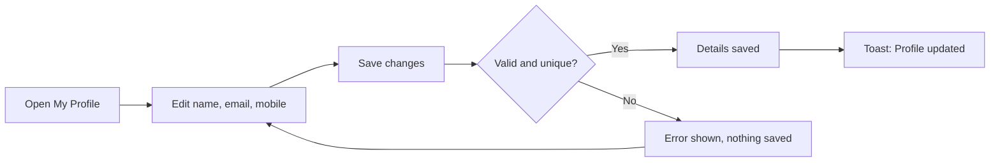
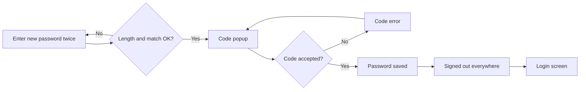
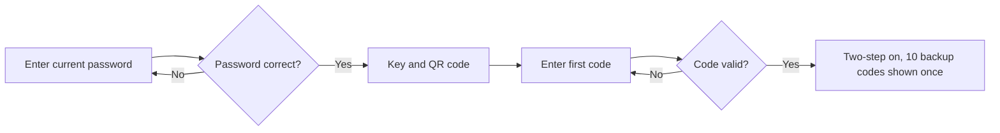

# Business Requirements Document – My Profile

## TaskFlow – Intelligent Task Allocation & Tracking System

> **Document:** Business Requirements Document (sub-module 07.1 My Profile, code `PROF`)  ·  **Version:** 1.0  ·  **Status:** Approved
> **Project type:** Personal Project (Skill Development)  ·  **Date:** 31-Oct-2026
> **Author:** Jojo George (jojogeorge3344@gmail.com)
> © 2026 Jojo George. All rights reserved.

---

## Document Control

### Revision History

| Version | Date | Author | Summary of changes |
|---|---|---|---|
| 1.0 | 31-Oct-2026 | Jojo George | Initial version of the My Profile sub-module BRD (profile details, change password, self-service two-step verification) |
| 1.0 | 31-Oct-2026 | Jojo George | Approved and signed off; baselined as the agreed business requirements. |
| 1.0 | 31-Oct-2026 | Jojo George | Editorial only: Related Documents paths updated to the `TF - Documents` folder layout; no requirement changed, sign-off unchanged. |

### Approvals / Sign-off

| Role | Name | Decision | Date |
|---|---|---|---|
| Product owner | Jojo George | Approved | 31-Oct-2026 |
| Reviewer | Jojo George | Approved | 31-Oct-2026 |

### Related Documents

| Document | Location |
|---|---|
| Overall BRD (roles, global rules, NFRs, Authentication) | `../../00-Overall/BRD-TaskFlow-Overall.md` |
| Original BRD – Screen 19 User Profile | `TF - Documents/Screens Wise Feature Development Plan/19-user-profile-screen.md` |
| FRD – My Profile | `../../../FRD/07-My-Profile/07.1-My-Profile/FRD-My-Profile.md` |
| HLD / LLD – My Profile | `../../../HLD/07-My-Profile/07.1-My-Profile/HLD-My-Profile.md`, `../../../LLD/07-My-Profile/07.1-My-Profile/LLD-My-Profile.md` |
| TDD | `TF - Documents/TF - TDD/TDD-TaskFlow.md` |

---

## Index

1. Project Overview
2. Stakeholders & User Roles
3. Scope
4. Business Process / Workflows
5. Screen-by-Screen Requirements
6. Business Rules
7. Non-Functional Requirements
8. Data Requirements
9. Integrations & External Dependencies
10. Reporting Requirements
11. Recommended Technology Stack (optional)
12. Assumptions, Constraints & Dependencies
13. Risks
14. Acceptance Criteria
15. Requirements Traceability Matrix
16. Project Deliverables
17. Glossary
18. Project Summary

---

## 1. Project Overview

### 1.1 Introduction
My Profile is the self-service area of TaskFlow where every signed-in user looks after their own account. A user can see their account details, correct their full name, email address and mobile number, change their password, and protect their sign-in with an authenticator app. The sub-module only ever works on the signed-in user's own account.

### 1.2 Business Problem / Current Situation
Without self-service, every typo in a name, every new mobile number and every password change becomes a request to an administrator. That wastes administrator time and leaves contact details out of date. A password change protected only by the current password can be abused by anyone who has hijacked a session. Users must also not be able to give themselves a different role, project or account status.

### 1.3 Sub-module Objectives

| ID | Objective | Success measure |
|---|---|---|
| OBJ-PROF-01 | Let every user keep their own contact details up to date without an administrator | A user changes name, email or mobile number and sees "Profile updated" in under 1 minute |
| OBJ-PROF-02 | Let every user change their password safely | A password change needs a valid authenticator or backup code and ends every session of that user |
| OBJ-PROF-03 | Protect every account with a second factor that the user sets up alone | A new user connects an authenticator app and receives 10 backup codes without administrator help |
| OBJ-PROF-04 | Prevent self-promotion | Role, projects, username, employee code and account status cannot be changed from My Profile by any role |

### 1.4 Expected Benefits
- Fewer routine requests to administrators.
- Accurate names and email addresses across tasks, mail and notifications.
- Stronger account security: a stolen session alone cannot change the password.
- Every user sees the same, accurate account information (role, projects, departments, managers).

---

## 2. Stakeholders & User Roles

### 2.1 Stakeholders

| Stakeholder | Interest / responsibility |
|---|---|
| Project owner (Jojo George) | Defines priorities, approves this BRD |
| All TaskFlow users | Maintain their own contact details, password and authenticator |
| Administrators | Manage the read-only account fields (role, projects, departments, status) in Employee Management; reset a user's two-step verification when needed |

### 2.2 User Roles

| Role | Description | Main responsibilities | Access level |
|---|---|---|---|
| Administrator | Full system user | Maintains own profile, password and authenticator | Own account only (other accounts are managed in Employee Management) |
| Manager | Leads teams and projects | Same as Employee; also sees own Managed projects and Team on My Profile | Own account only |
| Employee | Works on assigned tasks | Maintains own profile, password and authenticator | Own account only |
| Custom role | Role created in Role Configuration | Same as Employee | Own account only |

All four profile permissions (`profile.view`, `profile.edit`, `profile.password.change`, `profile.mfa.manage`) are **Always On** for every role, including custom roles, and cannot be removed in Role Configuration.

---

## 3. Scope

### 3.1 In Scope
- My Profile screen: view own account details; edit full name, email address and mobile number.
- Change Password screen: new password confirmed with an authenticator or backup code; sign-out everywhere afterwards.
- Self-service two-step verification actions: start authenticator setup, turn two-step verification on, receive backup codes.
- Profile change prepared by the TaskFlow Assistant (TFA) and confirmed by the user (rules owned here; the Action Card is in the TFA BRD).

### 3.2 Out of Scope (this release)
- Viewing or editing another user's profile – done in Employee Management (`../../03-TaskFlow-Management/03.1-Employee-Management/BRD-Employee-Management.md`).
- Changing own role, projects, departments, username, employee code or account status – administrator-only.
- Profile photo upload – not requested; the header shows initials.
- Forgotten-password recovery and the sign-in flow – Authentication, see the overall BRD.
- Layout and step sequence of the Security Setup screen – Authentication, see the overall BRD. This BRD covers only the account rules that screen uses.
- Turning two-step verification off by the user – not offered; an administrator reset is the route (Employee Management).

### 3.3 Modules Overview

| # | Module | Purpose | Screens |
|---|---|---|---|
| 07.1 | My Profile | Self-service account maintenance | SCREEN 1 My Profile, SCREEN 2 Change Password, SCREEN 3 Two-Step Verification (self-service, used by Security Setup) |

---

## 4. Business Process / Workflows

### 4.1 Edit Personal Information

**Trigger:** User opens My Profile and changes a field  ·  **Actors:** Any signed-in user, System

| Step | Actor / System | Action | Result |
|---|---|---|---|
| 1 | User | Opens **My Profile** from the side menu or the name/avatar in the top bar | Own account details are shown |
| 2 | User | Changes full name, email (part before `@taskflow.com`) or mobile number | Fields are checked while typing |
| 3 | User | Clicks **Save changes** | Data is sent for saving |
| 4 | System | Checks format, length and uniqueness again | Valid → saved; invalid → error shown, nothing saved |
| 5 | System | Shows "Profile updated" and "Saved"; updates the name in the top bar | User sees the new details at once |

**Example:** Asha Menon (Employee) sees her email as `asha.m@taskflow.com`. She types `asha.menon`, adds mobile `+91 98765 43210` and clicks **Save changes**. The system stores `asha.menon@taskflow.com` and `+919876543210`, shows "Profile updated", and the top bar still reads "Asha Menon".

**Exceptions / alternate flows:**
- Email already used by another (or a deleted) account → "Email already exists."; nothing saved.
- Another user already has the same email and mobile number → "A user with this email and mobile number already exists."
- Someone else changed the record at the same moment → "Someone else changed this record while you were saving. Reload it and try again."

### 4.2 Change Password

**Trigger:** User clicks **Change password** on the Password card  ·  **Actors:** Any signed-in user with two-step verification on, System

| Step | Actor / System | Action | Result |
|---|---|---|---|
| 1 | User | Enters the new password twice | Strength hint shown; length and match checked |
| 2 | User | Clicks **Change password** | "Confirm it is you" popup opens; nothing sent yet |
| 3 | User | Enters a 6-digit authenticator code or an unused backup code, clicks **Confirm** | Code is checked |
| 4 | System | Checks two-step verification is on and the code is valid | Valid → new password saved; wrong → error in popup |
| 5 | System | Signs the user out on every device, including this browser | Login screen shows "Your username or password was changed. Sign in again with your new details." |

**Example:** Ravi Kumar (Manager) is signed in on his laptop and phone. On the laptop he sets the new password `Blue#Lake2026`, enters code `482915` from his authenticator app and confirms. Both sessions end; he signs in again on the laptop with the new password.

**Exceptions / alternate flows:**
- Two-step verification not on → "Set up two-step verification before changing your password."
- Five wrong codes in a row → code checks are locked for 5 minutes ("Too many wrong codes. Try again in a few minutes."). Sign-in shares this counter.
- A code already accepted once is refused if used again.

### 4.3 Turn On Two-Step Verification (self-service)

**Trigger:** First sign-in of a user without two-step verification (Security Setup screen)  ·  **Actors:** User, System

| Step | Actor / System | Action | Result |
|---|---|---|---|
| 1 | System | Blocks every screen except My Profile and Security Setup | "Set up two-step verification to continue." on blocked screens |
| 2 | User | Enters the current password to start setup | Password checked (5 tries in 5 minutes) |
| 3 | System | Shows a new key and QR code | Two-step verification is still off |
| 4 | User | Scans the QR code and enters the first 6-digit code | Code checked |
| 5 | System | Turns two-step verification on and shows 10 backup codes once | My Profile shows "Two-step on" |

**Example:** New employee Neha Joseph signs in for the first time on 03-Nov-2026. She confirms her details, enters her password, scans the QR code with her phone, enters `730214`, downloads `taskflow-backup-codes.txt` with 10 codes and continues to her dashboard.

**Exceptions / alternate flows:**
- Two-step verification already on → "Authenticator MFA is already on. Turn it off first to set it up again."
- First code entered before setup was started → "Start the setup first to get a key."

---

## 5. Screen-by-Screen Requirements

### SCREEN 1: My Profile (original BRD Screen 19)

| Field | Value |
|---|---|
| **Screen name** | My Profile |
| **Module** | My Profile (07.1) |
| **Access** | Administrator, Manager, Employee, Custom role (all signed-in users; own account only) |
| **Priority** | Must |

**Purpose**
Show the signed-in user's own account and let them update their personal information.

**Screen Elements**
- Header: avatar with initials, full name, `@username`, email.
- Summary chips: role, Active/Inactive, one chip per project allocation, "Two-step on"/"Two-step off", "Last sign-in …".
- Account details card (read-only): Username, Employee code, Role, Projects with total "% allocated", Departments, Managers, Account status; Managed projects and Team for Managers; note "Your role, project and status are managed by an administrator."
- Personal information card: Full name (required), Email address (part before the fixed `@taskflow.com` suffix), Mobile number (optional), **Save changes** button with "Saving…" and "Saved".
- Password card with a **Change password** button.
- Loading placeholders; error state with **Retry**.

**Functional Requirements**

| ID | Requirement | Priority |
|---|---|---|
| REQ-PROF-01 | The system shall show the signed-in user's own account only, taken from the sign-in session and never from a value chosen on the screen. | Must |
| REQ-PROF-02 | The system shall show username, employee code, role, project allocations with total percentage, departments, managers, account status and two-step status as read-only information. | Must |
| REQ-PROF-03 | The system shall additionally show Managed projects and Team when the user's role is Manager. | Should |
| REQ-PROF-04 | The system shall let the user edit only full name, email address and mobile number. | Must |
| REQ-PROF-05 | The system shall check each editable field while the user types and again when saving. | Must |
| REQ-PROF-06 | The system shall store the email in lower case on the fixed domain `@taskflow.com`. | Must |
| REQ-PROF-07 | The system shall refuse an email already used by another account, including deleted accounts. | Must |
| REQ-PROF-08 | The system shall refuse a save when another user has both the same email and the same mobile number. | Must |
| REQ-PROF-09 | The system shall remove a saved mobile number when the field is left empty. | Should |
| REQ-PROF-10 | The system shall show "Profile updated" and "Saved" after a successful save and update the name in the top bar immediately. | Must |
| REQ-PROF-11 | The system shall show "Could not load your profile." with a **Retry** button when the account cannot be loaded. | Should |
| REQ-PROF-12 | The system shall keep My Profile viewable and saveable while the user still has to set up two-step verification. | Must |
| REQ-PROF-13 | The system shall apply the same rules when the TaskFlow Assistant changes the user's name or email after the user confirms it, and leave the mobile number unchanged. | Should |

**Validations & Messages**

| Situation | Rule / message |
|---|---|
| Full name empty | "Full name is required." (max 200 characters, spaces trimmed) |
| Email empty | "Email is required." |
| Email local part invalid (screen) | "Use letters, digits, dot, underscore or hyphen before @taskflow.com." (max 64 characters; no leading, trailing or double dots) |
| Email invalid (server) | "Email must be a name using letters, digits, dot, underscore or hyphen followed by @taskflow.com." |
| Field too long | "This field is too long." |
| Mobile invalid (screen) | "Use international format, for example +919876543210." |
| Mobile invalid (server) | "Mobile number must be in international format, for example +919876543210." (plus sign, 8–15 digits, no leading zero; spaces, dashes, dots and brackets removed first) |
| Email taken | "Email already exists." |
| Email and mobile pair taken | "A user with this email and mobile number already exists." |
| Save failed, no reason | "Could not update your profile." |
| Concurrent change | "Someone else changed this record while you were saving. Reload it and try again." |
| Unexpected error | "Something went wrong. Please try again." |

**Expected Result**
Every user sees accurate details about their own account and can fix their name, email and mobile number without an administrator, but cannot change their role, projects or status.

### SCREEN 2: Change Password

| Field | Value |
|---|---|
| **Screen name** | Change Password |
| **Module** | My Profile (07.1) |
| **Access** | Administrator, Manager, Employee, Custom role (own account; two-step verification must be on) |
| **Priority** | Must |

**Purpose**
Let the user set a new password, confirmed with a second factor instead of the current password.

**Screen Elements**
- **Back to profile** link.
- New password field with show/hide and a strength meter (Weak, Fair, Good, Strong).
- Confirm new password field with show/hide.
- Hint: "At least 6 and at most 128 characters. Mix upper and lower case, numbers and symbols for a stronger one."
- **Change password** button.
- "Confirm it is you" popup: Authenticator code field, **Cancel**, **Confirm** ("Changing…").

**Functional Requirements**

| ID | Requirement | Priority |
|---|---|---|
| REQ-PROF-14 | The system shall accept a new password of 6 to 128 characters, the same range as sign-in. | Must |
| REQ-PROF-15 | The system shall require the new password to be entered twice and both entries to match before asking for a code. | Must |
| REQ-PROF-16 | The system shall show a password strength hint while the user types, as guidance only. | Could |
| REQ-PROF-17 | The system shall confirm the change with a 6-digit authenticator code or an unused backup code instead of the current password. | Must |
| REQ-PROF-18 | The system shall refuse a password change while two-step verification is not on. | Must |
| REQ-PROF-19 | The system shall refuse a code that has already been accepted once. | Must |
| REQ-PROF-20 | The system shall lock code checks for 5 minutes after 5 wrong codes in a row, sharing the counter with sign-in. | Must |
| REQ-PROF-21 | The system shall end every session of the user on every device after a successful change and open the Login screen with "Your username or password was changed. Sign in again with your new details." | Must |
| REQ-PROF-22 | The system shall keep the popup open with the error when the code is wrong, and show a password error on the form when the password itself is rejected. | Should |

**Validations & Messages**

| Situation | Rule / message |
|---|---|
| Field empty | "Required." |
| Too short | "Password must be at least 6 characters." |
| Too long | "Password must be at most 128 characters." |
| Entries differ | "Passwords do not match." |
| Code missing | "Enter the code from your authenticator app." |
| Code wrong or expired | "The code is incorrect or has expired." |
| Too many wrong codes | "Too many wrong codes. Try again in a few minutes." |
| Two-step not on | "Set up two-step verification before changing your password." |
| Code rejected, no reason | "That code did not work. Try the new code from your app." |
| Password rejected, no reason | "Could not change your password." |

**Expected Result**
Every user can change their own password safely; any session an attacker may hold is ended.

### SCREEN 3: Two-Step Verification (self-service, used by the Security Setup screen)

| Field | Value |
|---|---|
| **Screen name** | Security Setup (hosted by Authentication; account rules owned by My Profile) |
| **Module** | My Profile (07.1) – account actions; Authentication – screen |
| **Access** | Administrator, Manager, Employee, Custom role (own account) |
| **Priority** | Must |

**Purpose**
Let each user connect an authenticator app to their own account and receive backup codes. The screen layout and sign-in sequence are described in the overall BRD (Authentication); this block covers the account rules only.

**Screen Elements**
- Current password field (to start setup).
- Setup key and QR code.
- First-code field.
- Backup codes list shown once, with download `taskflow-backup-codes.txt`.
- On My Profile: "Two-step on"/"Two-step off" chip.

**Functional Requirements**

| ID | Requirement | Priority |
|---|---|---|
| REQ-PROF-23 | The system shall start authenticator setup only after checking the user's current password, allowing 5 password attempts in 5 minutes per account. | Must |
| REQ-PROF-24 | The system shall refuse to start setup again while two-step verification is already on. | Must |
| REQ-PROF-25 | The system shall turn two-step verification on only after the first valid code from the new authenticator. | Must |
| REQ-PROF-26 | The system shall issue 10 backup codes when two-step verification is turned on and show them only once. | Must |
| REQ-PROF-27 | The system shall keep the authenticator key only in protected (encrypted) form and backup codes only in hashed form. | Must |
| REQ-PROF-28 | The system shall block every screen except My Profile and the two-step actions until setup is finished, showing "Set up two-step verification to continue." | Must |
| REQ-PROF-29 | The system shall let a user with two-step verification on replace all backup codes with 10 new ones after the current password and a valid code, making all old codes stop working. | Could |

> ⚠️ To be confirmed: REQ-PROF-29 (regenerate backup codes) and the "check a code" action exist on the server, but no screen offers them yet.

**Validations & Messages**

| Situation | Rule / message |
|---|---|
| Wrong current password | "Current password is incorrect." |
| Too many password attempts | "Too many attempts. Try again in a few minutes." |
| Already on | "Authenticator MFA is already on. Turn it off first to set it up again." |
| Setup not started | "Start the setup first to get a key." |
| Two-step not on (backup codes) | "Authenticator MFA is not on." |
| Wrong code | "The code is incorrect or has expired." |
| Locked | "Too many wrong codes. Try again in a few minutes." |

**Expected Result**
Every user protects their account with an authenticator app without administrator help, and keeps backup codes for a lost phone.

---

## 6. Business Rules

Global rules (authentication required, permission-based access, Own scope, mandatory two-step verification) are defined in section 6 of the overall BRD (`../../00-Overall/BRD-TaskFlow-Overall.md`) and apply here.

> ⚠️ To be confirmed: the exact global `BR-nn` numbers to cite here, once the overall BRD numbering is final.

| ID | Rule | Applies to |
|---|---|---|
| BR-PROF-01 | A user can read and change only their own account; the account is always taken from the sign-in session. | SCREEN 1–3 |
| BR-PROF-02 | Only full name, email address and mobile number are editable; role, projects, departments, username, employee code and status are administrator-managed. | SCREEN 1 |
| BR-PROF-03 | Email addresses use the fixed domain `@taskflow.com`, are stored in lower case and are unique by the part before `@`; addresses of deleted users stay reserved. | SCREEN 1, TFA profile action |
| BR-PROF-04 | A mobile number may be shared by colleagues; only the same email together with the same mobile number is refused. | SCREEN 1 |
| BR-PROF-05 | The four profile permissions are Always On for every role and cannot be removed. | SCREEN 1–3 |
| BR-PROF-06 | A password change is proven with an authenticator or backup code; the current password is not asked for. | SCREEN 2 |
| BR-PROF-07 | A password change requires two-step verification to be on. | SCREEN 2 |
| BR-PROF-08 | A successful password change ends every session of the user. | SCREEN 2 |
| BR-PROF-09 | Five wrong codes in a row lock code checks for 5 minutes; sign-in and password change share the counter. | SCREEN 2, 3 |
| BR-PROF-10 | Each authenticator or backup code can be accepted only once. | SCREEN 2, 3 |
| BR-PROF-11 | Authenticator keys and backup codes are shown once and never again. | SCREEN 3 |
| BR-PROF-12 | Profile saves create no notification, mail or activity-log entry. | SCREEN 1, 2 |
| BR-PROF-13 | The TaskFlow Assistant may change only the user's own name and email, only after the user confirms, and never the password. | SCREEN 1 |

**Change from original BRD (Screen 19)**

| Original requirement | Current requirement | Reason |
|---|---|---|
| "Require the current password when appropriate" for a password change | The change is confirmed with an authenticator or backup code; the current password is asked only to start authenticator setup | Two-step verification became mandatory; a code is stronger proof than a password that may already be known to an attacker |
| Screen elements list "Department" as a field | Departments, projects and managers shown read-only; editing is in Employee Management | Prevents self-assignment |
| Change password form on the profile screen | Separate Change Password screen opened from the Password card | Keeps the code popup and sign-out flow apart from contact edits |
| Not in original BRD | Mobile number field; two-step verification self-service; profile change through TFA | Added with mandatory two-step verification and the TFA assistant |

---

## 7. Non-Functional Requirements

Global NFRs (performance, browser support, accessibility, backup) are in section 7 of the overall BRD. Sub-module specifics:

| ID | Category | Requirement | Measure / target |
|---|---|---|---|
| NFR-PROF-01 | Security | Passwords are stored only as salted hashes | No readable password stored or logged |
| NFR-PROF-02 | Security | Authenticator keys are stored encrypted; backup codes hashed | No readable key or backup code after setup |
| NFR-PROF-03 | Security | Brute-force protection on codes and passwords | 5 wrong codes → 5-minute lock; 5 password tries per 5 minutes |
| NFR-PROF-04 | Usability | Field errors appear while typing, next to the field | Every message in section 5 shown beside its field or in the popup |
| NFR-PROF-05 | Reliability | Concurrent edits do not silently overwrite each other | Second save receives the "Someone else changed this record…" message |
| NFR-PROF-06 | Performance | My Profile opens quickly | Under 2 seconds for 95% of loads on a normal office network |

---

## 8. Data Requirements

| Entity / data set | Purpose | Key fields | Retention / rules |
|---|---|---|---|
| User account | Identity and contact details | Full name, username, email, mobile number, role, status, last sign-in | Soft delete; email unique (deleted addresses reserved) |
| Password | Sign-in secret | Hashed password | Replaced on change; never shown |
| Session marker | Ends all sessions after a password change | Per-user security marker, refresh tokens | Renewed on password change |
| Authenticator | Second factor | Encrypted key, enabled date, failed-attempt counter, lock-until time | Key shown once at setup |
| Backup codes | Recovery second factor | 10 hashed codes, used date | All replaced on regeneration |

---

## 9. Integrations & External Dependencies

| System / service | Purpose | Required? | Notes |
|---|---|---|---|
| Authenticator app (any standard time-based one-time code app) | Generates 6-digit codes | Required for password change and sign-in | Backup codes are the fallback when the phone is lost |
| TaskFlow Assistant (TFA) | Prepares an own name/email change | Optional | Same profile rules; see `../../08-TFA-Assistant/08.1-Assistant/BRD-Assistant.md` |

---

## 10. Reporting Requirements

_Not applicable for this sub-module._

---

## 11. Recommended Technology Stack (optional)

_Not applicable for this sub-module._ The stack is recorded once in the overall BRD and the TDD.

---

## 12. Assumptions, Constraints & Dependencies

| Type | Description |
|---|---|
| Assumption | Every user has a smartphone with an authenticator app |
| Assumption | All staff email addresses belong to the single domain `@taskflow.com` |
| Constraint | Two-step verification is mandatory; a user cannot turn it off themselves |
| Dependency | Employee Management maintains role, projects, departments, status and the administrator two-step reset |
| Dependency | Authentication hosts the Login and Security Setup screens and the Account Recovery route for forgotten passwords |

---

## 13. Risks

| ID | Risk | Impact | Likelihood | Mitigation |
|---|---|---|---|---|
| R-PROF-01 | User loses phone and backup codes | High | Low | Administrator two-step reset in Employee Management; Account Recovery |
| R-PROF-02 | Brute-force guessing of codes | High | Low | 5-wrong-code lock for 5 minutes; single-use codes |
| R-PROF-03 | Hijacked session used to change the password | High | Low | Code required; all sessions ended after the change |
| R-PROF-04 | User enters a colleague's email | Medium | Low | Uniqueness check; deleted addresses reserved |
| R-PROF-05 | TFA help text still says the current password is required, unlike the built screen | Low | High | ⚠️ To be confirmed: align the TFA password guidance and help topic with BR-PROF-06 |

---

## 14. Acceptance Criteria

| ID | Criterion | Verified by |
|---|---|---|
| AC-PROF-01 | Any role opens My Profile and sees only their own account with read-only role, projects, departments, managers and status. | SCREEN 1, REQ-PROF-01, REQ-PROF-02 |
| AC-PROF-02 | A Manager also sees Managed projects and Team; an Employee does not. | SCREEN 1, REQ-PROF-03 |
| AC-PROF-03 | Changing name, email and mobile number shows "Profile updated" and the top bar shows the new name. | SCREEN 1, REQ-PROF-04, REQ-PROF-05, REQ-PROF-06, REQ-PROF-09, REQ-PROF-10 |
| AC-PROF-04 | An email already used (also by a deleted user) is refused with "Email already exists."; an existing email + mobile pair is refused. | SCREEN 1, REQ-PROF-07, REQ-PROF-08 |
| AC-PROF-05 | A failed load shows "Could not load your profile." and Retry reloads it. | SCREEN 1, REQ-PROF-11 |
| AC-PROF-06 | A user with setup pending can still save My Profile while other screens are blocked. | SCREEN 1, 3, REQ-PROF-12, REQ-PROF-28 |
| AC-PROF-07 | A name/email change confirmed on a TFA Action Card follows the same rules and leaves the mobile number unchanged. | SCREEN 1, REQ-PROF-13 |
| AC-PROF-08 | A 5-character password or mismatched entries are refused before the code popup opens; the strength hint updates while typing. | SCREEN 2, REQ-PROF-14, REQ-PROF-15, REQ-PROF-16 |
| AC-PROF-09 | A valid authenticator or backup code changes the password and signs the user out on all devices. | SCREEN 2, REQ-PROF-17, REQ-PROF-21 |
| AC-PROF-10 | Without two-step verification the change is refused; a reused code is refused; wrong codes keep the popup open. | SCREEN 2, REQ-PROF-18, REQ-PROF-19, REQ-PROF-22 |
| AC-PROF-11 | The sixth attempt after 5 wrong codes is locked for 5 minutes, also at sign-in. | SCREEN 2, REQ-PROF-20 |
| AC-PROF-12 | Setup starts only with the correct current password and cannot restart while two-step is on. | SCREEN 3, REQ-PROF-23, REQ-PROF-24 |
| AC-PROF-13 | After the first valid code two-step is on, 10 backup codes are shown once and cannot be shown again. | SCREEN 3, REQ-PROF-25, REQ-PROF-26, REQ-PROF-27 |
| AC-PROF-14 | Regenerating backup codes makes every old code stop working. | SCREEN 3, REQ-PROF-29 |

---

## 15. Requirements Traceability Matrix

| Objective | Business rule(s) | Screen(s) | Functional requirement(s) | Acceptance criterion |
|---|---|---|---|---|
| OBJ-PROF-01 | BR-PROF-01, BR-PROF-03, BR-PROF-04, BR-PROF-05, BR-PROF-12 | SCREEN 1 | REQ-PROF-01, REQ-PROF-04, REQ-PROF-05, REQ-PROF-06, REQ-PROF-09, REQ-PROF-10, REQ-PROF-11 | AC-PROF-01, AC-PROF-03, AC-PROF-05 |
| OBJ-PROF-01 | BR-PROF-03, BR-PROF-04 | SCREEN 1 | REQ-PROF-07, REQ-PROF-08 | AC-PROF-04 |
| OBJ-PROF-01 | BR-PROF-13 | SCREEN 1 | REQ-PROF-13 | AC-PROF-07 |
| OBJ-PROF-02 | BR-PROF-06, BR-PROF-07, BR-PROF-08 | SCREEN 2 | REQ-PROF-14, REQ-PROF-15, REQ-PROF-16, REQ-PROF-17, REQ-PROF-21 | AC-PROF-08, AC-PROF-09 |
| OBJ-PROF-02 | BR-PROF-07, BR-PROF-09, BR-PROF-10 | SCREEN 2 | REQ-PROF-18, REQ-PROF-19, REQ-PROF-20, REQ-PROF-22 | AC-PROF-10, AC-PROF-11 |
| OBJ-PROF-03 | BR-PROF-09, BR-PROF-10, BR-PROF-11 | SCREEN 3 | REQ-PROF-23, REQ-PROF-24, REQ-PROF-25, REQ-PROF-26, REQ-PROF-27, REQ-PROF-29 | AC-PROF-12, AC-PROF-13, AC-PROF-14 |
| OBJ-PROF-03 | BR-PROF-05 | SCREEN 1, 3 | REQ-PROF-12, REQ-PROF-28 | AC-PROF-06 |
| OBJ-PROF-04 | BR-PROF-01, BR-PROF-02 | SCREEN 1 | REQ-PROF-02, REQ-PROF-03 | AC-PROF-01, AC-PROF-02 |

---

## 16. Project Deliverables

| # | Deliverable | Format |
|---|---|---|
| 1 | My Profile, Change Password and two-step self-service source code | Repository |
| 2 | Account, authenticator and backup-code data structures | Database migrations |
| 3 | BRD, FRD, HLD, LLD for My Profile | Markdown |
| 4 | Automated tests for profile update, password change and two-step actions | Test projects and results |
| 5 | Demo users with two-step verification | Seed data |

---

## 17. Glossary

| Term | Meaning |
|---|---|
| Two-step verification (MFA) | Sign-in and sensitive changes need a code from an authenticator app in addition to the password |
| Authenticator app | A phone app that shows a new 6-digit code every 30 seconds for the account |
| Backup code | One of 10 single-use codes given at setup, used when the phone is not available |
| Security Setup | Authentication screen shown after the first sign-in until two-step verification is on |
| Own scope | The user can act only on their own record |

---

## 18. Project Summary
My Profile gives every TaskFlow user, whatever their role, a safe self-service place for their own account. Users correct their name, email and mobile number without an administrator, change their password with an authenticator code that also signs them out everywhere, and set up two-step verification with backup codes on their own. Role, projects and status stay under administrator control, so no user can raise their own access.

---
© 2026 Jojo George. All rights reserved. Unauthorized copying or distribution of this document is prohibited.
