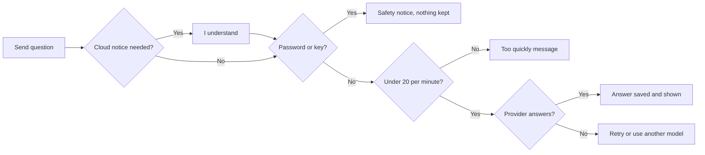
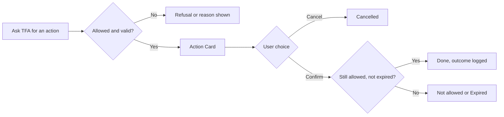
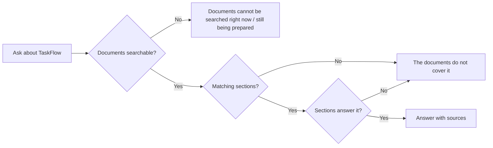

# Business Requirements Document – TaskFlow Assistant (TFA)

## TaskFlow – Intelligent Task Allocation & Tracking System

> **Document:** Business Requirements Document (sub-module 08.1 Assistant, code `TFA`)  ·  **Version:** 1.1  ·  **Status:** Approved (v1.0 baseline); v1.1 change recorded
> **Project type:** Personal Project (Skill Development)  ·  **Date:** 31-Oct-2026
> **Author:** Jojo George (jojogeorge3344@gmail.com)
> © 2026 Jojo George. All rights reserved.

---

## Document Control

### Revision History

| Version | Date | Author | Summary of changes |
|---|---|---|---|
| 1.0 | 31-Oct-2026 | Jojo George | Initial version of the TFA sub-module BRD (chat, actions, how-to help, safeguards, voice input) |
| 1.0 | 31-Oct-2026 | Jojo George | Approved and signed off; baselined as the agreed business requirements. |
| 1.0 | 31-Oct-2026 | Jojo George | Editorial only: Related Documents paths updated to the `TF - Documents` folder layout; no requirement changed, sign-off unchanged. |
| 1.1 | 31-Oct-2026 | Jojo George | TFA answers TaskFlow questions from the documents folder (OpenSpec change `tfa-document-rag`). How-to help from the 19 built-in help topics is withdrawn: SCREEN 2 becomes "Answers from TaskFlow documents"; REQ-TFA-18 – REQ-TFA-21 and AC-TFA-08 are superseded by REQ-TFA-46 – REQ-TFA-55 and AC-TFA-18 – AC-TFA-22; BR-TFA-07 reworded; BR-TFA-15 – BR-TFA-16, NFR-TFA-09 – NFR-TFA-12 and R-TFA-07 – R-TFA-08 added; cloud notice text, objectives, scope, workflows, data, integrations, deliverables and glossary updated. Every role may get answers from every document (owner decision). |

### Approvals / Sign-off

| Role | Name | Decision | Date |
|---|---|---|---|
| Product owner | Jojo George | Approved | 31-Oct-2026 |
| Reviewer | Jojo George | Approved | 31-Oct-2026 |

### Related Documents

| Document | Location |
|---|---|
| Overall BRD (roles, global rules, NFRs, Legal) | `../../00-Overall/BRD-TaskFlow-Overall.md` |
| BRD – TFA Settings (AI provider setup) | `../../06-Settings/06.3-TFA-Settings/BRD-TFA-Settings.md` |
| BRD – My Profile (profile rules used by TFA) | `../../07-My-Profile/07.1-My-Profile/BRD-My-Profile.md` |
| BRD – Mail (mail rules used by TFA) | `../../04-Communication/04.1-Mail/BRD-Mail.md` |
| FRD / HLD / LLD – Assistant | `../../../FRD/08-TFA-Assistant/08.1-Assistant/FRD-Assistant.md` and the matching HLD/LLD folders |
| TDD | `TF - Documents/TF - TDD/TDD-TaskFlow.md` (section 16; document knowledge in 16.8) |
| OpenSpec change | `openspec/changes/tfa-document-rag/` (proposal, design, spec `tfa-document-knowledge`) |

---

## Index

1. Project Overview
2. Stakeholders & User Roles
3. Scope
4. Business Process / Workflows
5. Screen-by-Screen Requirements
6. Business Rules
7. Non-Functional Requirements
8. Data Requirements
9. Integrations & External Dependencies
10. Reporting Requirements
11. Recommended Technology Stack (optional)
12. Assumptions, Constraints & Dependencies
13. Risks
14. Acceptance Criteria
15. Requirements Traceability Matrix
16. Project Deliverables
17. Glossary
18. Project Summary

---

## 1. Project Overview

### 1.1 Introduction
TFA (TaskFlow Assistant) is the AI assistant built into TaskFlow. It opens as a panel on the right of every signed-in screen. Users ask how TaskFlow works and get answers taken only from TaskFlow's own documents (requirements, design and screen specifications), with the sources shown, see their upcoming, due-today and overdue tasks, get a ranked "what to do first" list, and let TFA prepare a mail, a change to their own profile or (for administrators) a change to another user's role. TFA never acts on its own: every prepared action is shown on a card and happens only when the user clicks Confirm.

### 1.2 Business Problem / Current Situation
Users who do not know a screen must search training material or ask a colleague. Deciding what to work on first means scanning the task list by hand, and routine mails such as "update my manager on task TSK-12" take time to address and write. A general-purpose AI chat outside TaskFlow would not know the user's tasks, could leak company data, and could invent features or act without permission.

### 1.3 Sub-module Objectives

| ID | Objective | Success measure |
|---|---|---|
| OBJ-TFA-01 | Give every permitted user one place on every screen to ask about TaskFlow and their own work | TFA opens from any signed-in screen and answers in the same conversation |
| OBJ-TFA-02 | Give a clear, repeatable work order | The same open tasks always produce the same ranked list, whichever AI model is used |
| OBJ-TFA-03 | Save time on routine actions without losing control | A mail or own-profile change is prepared and carried out with one confirmation |
| OBJ-TFA-04 | Keep the organisation safe | TFA never does more than the user may do, never accepts passwords or keys, and records every action outcome |
| OBJ-TFA-05 | Give trustworthy answers about TaskFlow | Answers about TaskFlow's features, screens, rules and design come only from the TaskFlow documents, name their sources, and say so when the documents do not cover a question (v1.1; replaces "only from the 19 built-in help topics") |
| OBJ-TFA-06 | Allow hands-free use | In Chrome or Edge, "Hey TF assistant" opens TFA and answers are read aloud |

### 1.4 Expected Benefits
- Less training effort; answers for every role taken from the same documents the project is built from, with sources to check them.
- No cost for document answers: the documents are searched on the local AI server (Ollama), with no paid service.
- Faster daily planning through the ranked work order.
- Faster routine communication with mail drafts addressed to "my manager".
- The organisation chooses where AI runs: a local model (nothing leaves the machine) or a cloud model.

---

## 2. Stakeholders & User Roles

### 2.1 Stakeholders

| Stakeholder | Interest / responsibility |
|---|---|
| Project owner (Jojo George) | Defines priorities, approves this BRD |
| All TaskFlow users | Ask questions, plan work, confirm prepared actions |
| Administrators | Configure AI providers in TFA Settings; see the document index and start a re-index in TFA Settings; grant TFA permissions in Role Configuration; change roles through TFA |
| Document authors (project owner) | Keep the documents in the TaskFlow documents folder current; TFA picks up their changes automatically |

### 2.2 User Roles

| Role | Description | Main responsibilities | Access level |
|---|---|---|---|
| Administrator | Full system user | Chat, mail drafts, own profile change, change another user's role | Own conversation and actions; role change across the organisation |
| Manager | Leads teams and projects | Chat, mail drafts, own profile change | Own conversation and actions; task answers follow own task access |
| Employee | Works on assigned tasks | Chat, mail drafts, own profile change | Own conversation and actions; task answers follow own task access |
| Custom role | Role created in Role Configuration | As granted | As granted (`assistant.chat`, `assistant.actions.confirm`, `roles.manage`) |

| Permission | Administrator | Manager | Employee | Custom role |
|---|:-:|:-:|:-:|:-:|
| `assistant.chat` – chat with the assistant | Granted | Granted | Granted | Configurable |
| `assistant.actions.confirm` – confirm, edit or cancel prepared actions | Granted | Granted | Granted | Configurable |
| `roles.manage` (Role Configuration key, checked for role changes) | Granted | Denied | Denied | Configurable |

---

## 3. Scope

### 3.1 In Scope
- TFA Panel: conversation, model selector, cloud notice, new chat, provider failure handling.
- Task answers: upcoming, due today, overdue, all open tasks; ranked "what to do first" list.
- Action Cards: mail draft (editable), own profile update, role change; confirm and cancel.
- Lookup and guidance: find a user, password guidance, "needs an administrator" guidance.
- Answers about TaskFlow from the Markdown documents in the TaskFlow documents folder (BRD, FRD, HLD, LLD, TDD, screen specifications), with sources (v1.1; replaces the 19 built-in help topics).
- Safeguards: password/API-key screen, 20-messages-per-minute limit, action audit log.
- Voice input: wake phrase, dictation, answers read aloud (Chrome, Edge).

### 3.2 Out of Scope (this release)
- AI provider, model and API key setup – TFA Settings (`../../06-Settings/06.3-TFA-Settings/BRD-TFA-Settings.md`).
- Document index status and **Re-index now** – TFA Settings (`../../06-Settings/06.3-TFA-Settings/BRD-TFA-Settings.md`).
- PDF and Excel documents, uploading documents through TaskFlow, and limiting which documents a role may ask about – not provided (v1.1).
- Creating, editing or reassigning tasks through TFA – not offered; TFA links to the task screens.
- Password changes through TFA – never; TFA points to My Profile.
- A screen to view the TFA audit log – not provided.
- Deleting one's own conversation history – not provided (see R-TFA-04).

### 3.3 Modules Overview

| # | Module | Purpose | Screens |
|---|---|---|---|
| 08.1 | TFA Assistant | AI help, planning and confirm-before-act actions | SCREEN 1 TFA Panel (chat), SCREEN 2 Answers from TaskFlow documents (in panel), SCREEN 3 Action Card, SCREEN 4 Voice controls, SCREEN 5 Background safeguards (no screen) |

---

## 4. Business Process / Workflows

### 4.1 Ask TFA a Question

**Trigger:** User clicks the TFA button or says "Hey TF assistant"  ·  **Actors:** User, System, AI provider

| Step | Actor / System | Action | Result |
|---|---|---|---|
| 1 | User | Opens the panel and sends a question | Message held for checks |
| 2 | System | Shows the cloud notice for the first message to a cloud provider | User clicks **I understand** or **Cancel** |
| 3 | System | Checks length (1–2000) and screens for passwords or API keys | Unsafe message is neither sent nor stored |
| 4 | System | Checks the 20-messages-per-minute limit | Over the limit → "too quickly" message |
| 5 | System, AI provider | The system finds the TaskFlow document sections that match the question; the AI provider answers, using that text and up to 4 rounds of lookups (tasks, users) | Answer with sources, task links or a ranked list |
| 6 | System | Saves the question and answer | Conversation can be reloaded later |

**Example:** At 09:10 on 03-Nov-2026 Asha (Employee) asks "What should I prioritise?". TFA lists 1. TSK-41 (Overdue), 2. TSK-52 (Today), 3. TSK-47 (Tomorrow, High), 4. TSK-49 (Tomorrow, Medium), 5. TSK-38 (Blocked, 4 days), each linking to its task page.

**Exceptions / alternate flows:**
- No provider configured → "TFA is not available yet. An administrator needs to choose an AI model in TFA Settings."
- Provider fails (limit, bad key, timeout, unreachable, model missing) → plain message with **Retry** and **Use** another provider; nothing saved.

### 4.2 Confirm a Prepared Action

**Trigger:** User asks TFA to send a mail, change their name/email, or (administrator) change a role  ·  **Actors:** User, System

| Step | Actor / System | Action | Result |
|---|---|---|---|
| 1 | User | Asks, e.g. "Send a mail to my manager about TSK-12" | TFA resolves the recipient or asks who is meant |
| 2 | System | Checks permission and the module rules, shows an Action Card | "Nothing happens until you confirm." · expires in 10 minutes |
| 3 | User | Optionally edits (mail only), then clicks Confirm | Permission checked again |
| 4 | System | Runs the action once and records the outcome | "Done…" message, card shows **Done** |

**Example:** Ravi (Employee) asks "Send a mail to my manager about TSK-12". The task was created by Priya (Manager), so TFA shows a Mail draft to Priya with subject "Update on TSK-12". Ravi edits the message and clicks **Send mail**. TFA replies "Done. Your mail "Update on TSK-12" was sent to Priya Nair."

**Exceptions / alternate flows:**
- The card is older than 10 minutes → "This request has expired. Please ask TFA again."
- Confirm clicked twice → the action runs once; second click → "This action has already been done."
- Administrator asks to change their own role → "For safety I do not change your own role. Please ask another administrator to do it."

### 4.3 Ask About TaskFlow (answers from the documents)

> v1.1: replaces "Get How-To Help" (answers from the 19 built-in help topics).

**Trigger:** User asks how TaskFlow works, e.g. "How do I…?", "Who receives…?", "What validations apply…?"  ·  **Actors:** User, System, AI provider

| Step | Actor / System | Action | Result |
|---|---|---|---|
| 1 | User | Asks, e.g. "What validations apply when creating a task?" | – |
| 2 | System | Finds the best-matching sections of the TaskFlow documents (a short follow-up such as "and for managers?" is searched together with the previous question) | Up to 5 sections passed to the AI as reference text |
| 3 | AI provider | Answers only from those sections | No general knowledge, no invented features |
| 4 | System | Shows the answer with its sources (document name and section) | Sources kept with the answer |

**Example:** An Employee asks "Who receives the overdue reminder?". TFA answers with the recipients the reminder documents name, adds none they do not mention, and lists the document sections it was given under **Sources** (document title and section heading).

**Exceptions / alternate flows:**
- No section matches, or the sections do not answer the question → TFA says the TaskFlow documents do not cover it.
- The question is not about TaskFlow or the user's work (e.g. "What is the capital of France?") → TFA says it can only answer from the TaskFlow documents and the user's own work, and does not answer.
- The question is about the user's own tasks, priorities, mail or profile → answered from live data as in 4.1, never from the documents.
- The local AI server cannot be reached → TFA says the documents cannot be searched right now; task, mail and profile questions still work.
- The first indexing has not stored anything yet → TFA says the documents are still being prepared.

---

## 5. Screen-by-Screen Requirements

### SCREEN 1: TFA Panel (chat)

| Field | Value |
|---|---|
| **Screen name** | TFA Panel |
| **Module** | TFA Assistant (08.1) |
| **Access** | Administrator, Manager, Employee (default); Custom role if granted `assistant.chat` |
| **Priority** | Must |

**Purpose**
Let the user ask TFA questions and read its answers in a running conversation, from any signed-in screen.

**Screen Elements**
- Floating **TFA** button (bottom right) with voice hint.
- Header: "TFA – TaskFlow Assistant", **New chat** (+), **Close** (×).
- Model selector with **Local**/**Cloud** tag (menu opens only with 2 or more configured providers).
- Cloud notice with **I understand** and **Cancel**.
- Conversation feed: messages, "Permission required" bubble, notices, numbered ranked task list with tags (Overdue, Today, Tomorrow, `n` days, Blocked), screen link buttons, **Sources** under answers that used the TaskFlow documents (v1.1), provider name under each answer.
- Welcome bubble and four starter suggestions on an empty chat.
- Message box "Ask TFA anything about TaskFlow…", microphone, **Send** (Enter sends, Shift+Enter new line).
- Footer: "TFA can make mistakes. Actions always need your confirmation."
- Provider failure card with **Retry** and **Use** another provider.

**Functional Requirements**

| ID | Requirement | Priority |
|---|---|---|
| REQ-TFA-01 | The system shall show the TFA button and panel on every signed-in screen only to users holding `assistant.chat`. | Must |
| REQ-TFA-02 | The system shall reload the user's own latest conversation, up to the last 100 messages, when the panel opens. | Must |
| REQ-TFA-03 | The system shall show another user's conversation or action to no one, reporting it as "not found". | Must |
| REQ-TFA-04 | The system shall accept messages of 1 to 2000 characters. | Must |
| REQ-TFA-05 | The system shall neither send nor store a message that looks like it contains a password or API key, and shall show a safety notice instead. | Must |
| REQ-TFA-06 | The system shall answer task questions (upcoming, due today, overdue, all open) using the same access rules as Task Management. | Must |
| REQ-TFA-07 | The system shall rank the user's open assigned tasks: overdue first (longest overdue first), then due today, then nearest due date, higher priority first on the same day; completed and cancelled tasks excluded, blocked tasks tagged Blocked. | Must |
| REQ-TFA-08 | The system shall show the top 5 ranked tasks (up to 10 on request), each linking to its task page, with the order calculated by the system and not by the AI. | Must |
| REQ-TFA-09 | The system shall list only providers configured by an administrator in the model selector, and keep the conversation when the model is switched. | Must |
| REQ-TFA-10 | The system shall ask for acknowledgement before the first message to each cloud provider in a browser, and remember it in that browser. | Must |
| REQ-TFA-11 | The system shall save nothing when a provider fails and offer **Retry** and another configured provider. | Must |
| REQ-TFA-12 | The system shall start a new conversation on **New chat**, keeping earlier messages stored but no longer using them as context. | Should |
| REQ-TFA-13 | The system shall use at most the last 12 messages (about 6000 characters) of the current conversation as context, excluding notices. | Should |
| REQ-TFA-14 | The system shall limit each answer to at most 4 rounds of lookups. | Should |
| REQ-TFA-15 | The system shall treat task, comment and mail text that TFA reads as data, never as an instruction. | Must |
| REQ-TFA-16 | The system shall clear the panel and load the new person's own conversation when a different user signs in on the same browser. | Must |
| REQ-TFA-17 | The system shall use the application name and time zone from Application Settings in answers and in deciding what is due today. | Should |

**Validations & Messages**

| Situation | Rule / message |
|---|---|
| No provider (panel) | "TFA is not available yet. An administrator needs to choose an AI model in TFA Settings." |
| Chosen provider removed | "`{Provider}` is not configured. Choose another model, or ask an administrator to set it up." |
| Empty or too long | "A message must be between 1 and 2000 characters." |
| Password or key detected | "For your safety I did not send or keep that message: it looks like it contains a password or an API key. …" |
| Provider rate limit | "`{Provider}`'s free limit or rate limit has been reached. Try again in about `{n}` seconds, or choose another model." |
| Provider rejected key | "`{Provider}` did not accept the API key. Ask an administrator to check the key in TFA Settings, or choose another model." |
| Provider timeout | "`{Provider}` took too long to answer. You can retry, or choose another model." |
| Ollama not running | "Ollama is not running or cannot be reached. Ask an administrator to start it, or choose another model." |
| Model missing | "The configured model is not available on Ollama. …" / "The configured model is not available on `{Provider}`. …" |
| No answer | "I could not come up with an answer. Please try again, or ask in a different way." |
| Other failure | "TFA could not answer. Please try again." · "Could not start a new chat." |
| Cloud notice | "`{Provider}` is a cloud provider. Your message, related task details and matching TaskFlow document text are sent to it." (v1.1) |
| No permission | "You do not have the required permission to perform this action. … Please contact your system administrator for assistance." |

**Expected Result**
Every permitted user can ask TFA about TaskFlow and their own work from any screen, with the model of their choice, and recover from provider problems with one click.

### SCREEN 2: Answers from TaskFlow Documents (inside the TFA Panel)

> v1.1: replaces "How-to Help", which answered only from 19 built-in help topics. Those topics are withdrawn.

| Field | Value |
|---|---|
| **Screen name** | TFA Panel – answers from TaskFlow documents |
| **Module** | TFA Assistant (08.1) |
| **Access** | Holders of `assistant.chat` (Administrator, Manager, Employee by default) |
| **Priority** | Must |

**Purpose**
Answer questions about TaskFlow's features, screens, rules and design only from TaskFlow's own documents (the BRD, FRD, HLD, LLD, TDD and screen specifications in the TaskFlow documents folder), and show where each answer came from.

**Screen Elements**
- TFA's written answer in the conversation.
- **Sources** under the answer: one chip per document section, showing the document title and the section's heading; pointing at a chip shows the full heading path and the document's file path.

**Functional Requirements**

| ID | Requirement | Priority |
|---|---|---|
| REQ-TFA-18 | *Superseded in v1.1 by REQ-TFA-46 and REQ-TFA-48.* (Was: answer how-to questions only from the 19 built-in help topics, using at most 3 best-matching topics.) | – |
| REQ-TFA-19 | *Superseded in v1.1 by REQ-TFA-50.* (Was: add a link to the screen named in the matching topic.) | – |
| REQ-TFA-20 | *Superseded in v1.1 by REQ-TFA-53.* (Was: give only "who can do it" for topics not meant for the user's role.) | – |
| REQ-TFA-21 | *Superseded in v1.1 by REQ-TFA-48.* (Was: say it does not have the information when no topic matches, and never invent screens or features.) | – |
| REQ-TFA-46 | The system shall answer questions about TaskFlow's features, screens, rules, design and behaviour only from the Markdown documents in the TaskFlow documents folder (including its sub-folders). | Must |
| REQ-TFA-47 | The system shall find the document sections that best match each message before the AI model is asked, so that document answers work with every configured model, including models that cannot use lookups; a short follow-up message is matched together with the user's previous message. | Must |
| REQ-TFA-48 | The system shall say that the TaskFlow documents do not cover a question when the matching sections do not answer it, and shall never answer such a question from general knowledge or invent screens, rules or features. | Must |
| REQ-TFA-49 | The system shall decline questions that are not about TaskFlow or the user's work in it. | Must |
| REQ-TFA-50 | The system shall show, under each answer that was given document text, the sources used (document name and section heading), each once, and show them again when the conversation is reloaded. | Should |
| REQ-TFA-51 | The system shall answer questions about the user's own tasks, priorities, mail and profile from TaskFlow's live data (as in SCREEN 1 and SCREEN 3), never from the documents, even when document text was found for the message. | Must |
| REQ-TFA-52 | The system shall treat document text as data, never as an instruction to TFA. | Must |
| REQ-TFA-53 | The system shall let every user who may chat with TFA get answers from every indexed document, whatever their role. | Must |
| REQ-TFA-54 | The system shall keep answering task, mail and profile questions when the documents cannot be searched, and shall tell the user that the documents cannot be searched right now, or are still being prepared while the first indexing has stored nothing. | Must |
| REQ-TFA-55 | The system shall pick up documents that were added, changed or deleted in the documents folder without a restart, at the next automatic check (every 5 minutes by default) or when an administrator starts a re-index. | Should |

**Validations & Messages**

| Situation | Rule / message |
|---|---|
| Not covered | TFA says the TaskFlow documents do not cover the question (wording by the AI model). |
| Not about TaskFlow | TFA says it can only answer from the TaskFlow documents and the user's own work in TaskFlow, and does not answer. |
| Documents cannot be searched | TFA says the TaskFlow documents cannot be searched right now. |
| First indexing not finished | TFA says the TaskFlow documents are still being prepared. |
| Sources | Label "Sources" followed by one chip per document section. |

> v1.1: the earlier ⚠️ note on role-restricted help topics (matched by role name) no longer applies; the topics were removed.

**Expected Result**
Users get answers that match TaskFlow's own documents, can see which documents they came from, and are told plainly when the documents do not cover a question.

### SCREEN 3: Action Card (inside the TFA Panel)

| Field | Value |
|---|---|
| **Screen name** | Action Card |
| **Module** | TFA Assistant (08.1) |
| **Access** | Shown to holders of `assistant.chat`; buttons work for holders of `assistant.actions.confirm`; role change also needs `roles.manage` (Administrator by default) |
| **Priority** | Must |

**Purpose**
Show exactly what TFA prepared and let the user confirm, edit (mail only) or cancel it.

**Screen Elements**
- Title: **Mail draft**, **Update your profile** or **Change role**; "Expires in 10 minutes".
- Fields: To, Subject, message (mail); Name/Email old → new (profile); User and Role old → new (role).
- Buttons: **Send mail** / **Save changes** / **Change role**, **Edit** (mail only), **Cancel**; text "Nothing happens until you confirm."
- Mail edit form: To (email addresses), Subject, Message, **Save changes**, **Back**.
- Final status: Done, Cancelled, "Expired. Ask TFA again.", Not allowed, Not done.

**Functional Requirements**

| ID | Requirement | Priority |
|---|---|---|
| REQ-TFA-22 | The system shall let TFA only prepare an action; only the user's own Confirm click shall run it. | Must |
| REQ-TFA-23 | The system shall check the user's permission when the action is prepared and again, with the current sign-in, when it is confirmed. | Must |
| REQ-TFA-24 | The system shall expire a prepared action 10 minutes after it is created. | Must |
| REQ-TFA-25 | The system shall run an action at most once, even when Confirm is clicked several times at the same moment. | Must |
| REQ-TFA-26 | The system shall prepare internal mail drafts that follow the Mail rules and are sent from the user's own mailbox. | Must |
| REQ-TFA-27 | The system shall resolve "my manager" as the task's creator when that is someone else, otherwise the single active Manager of the user's departments, and ask the user when none or several match. | Should |
| REQ-TFA-28 | The system shall allow editing of mail drafts only, with recipients limited to active TaskFlow users and unknown addresses named. | Must |
| REQ-TFA-29 | The system shall prepare a change to the user's own name and/or email only, following the My Profile rules. | Should |
| REQ-TFA-30 | The system shall prepare a role change only for holders of `roles.manage`, to an existing role named exactly, and never for the requester's own role. | Should |
| REQ-TFA-31 | The system shall tell a user whose role was changed that they were signed out and will use the new role at next sign-in. | Should |
| REQ-TFA-32 | The system shall find active users by name or email to address a mail. | Should |
| REQ-TFA-33 | The system shall answer password questions with fixed guidance pointing to My Profile and never ask for or accept a password. | Must |
| REQ-TFA-34 | The system shall tell the user when a request needs an administrator. | Could |
| REQ-TFA-35 | The system shall mark a failed action **Not done** and explain why, with nothing sent or changed. | Must |

**Validations & Messages**

| Situation | Rule / message |
|---|---|
| Prepared | "I have prepared this for you. Please review it. Nothing happens until you confirm." |
| Mail sent | "Done. Your mail "`{subject}`" was sent to `{names}`." |
| Profile updated | "Done. Your profile was updated." |
| Role changed | "Done. `{name}` is now a `{role}`. They were signed out and will use the new role the next time they sign in." |
| Failed | "I could not do that: `{reason}`. Nothing was sent." / "Nothing was changed." |
| Expired | "This request has expired. Please ask TFA again." |
| Already done | "This action has already been done." |
| No longer pending | "This action can no longer be confirmed (`{status}`). Please ask TFA again." / "This action can no longer be changed. Please ask TFA again." |
| Edit non-mail | "Only a mail can be edited." |
| Unknown recipient | "These are not active TaskFlow users: `{addresses}`." |
| Mail rules | "Write a subject or a message before sending." / "Add between 1 and 50 recipients." / "'`{value}`' is not an email address." (subject max 200, message max 20,000 characters) |
| Own role | "For safety I do not change your own role. Please ask another administrator to do it." |
| Needs administrator | "This needs an administrator. Please contact your system administrator for assistance." |
| No permission (role) | "You do not have the required permission to perform this action. Changing a user's role can only be performed by an authorized administrator. …" |
| Network failure | "Could not confirm that action." / "Could not cancel that action." / "Could not save your changes." |

> ⚠️ To be confirmed: the fixed password guidance still describes entering the **current password** and says only *other* sessions end (the "Change your password" help topic that said the same was removed in v1.1). The built Change Password screen uses an authenticator code and signs the user out everywhere (My Profile BR-PROF-06, BR-PROF-08). The text should be aligned.

**Expected Result**
Routine mails and own-profile changes are carried out with one confirmation, administrators change roles from the chat, and nothing happens without confirmation or beyond the user's permissions.

### SCREEN 4: Voice Controls (inside the TFA Panel)

| Field | Value |
|---|---|
| **Screen name** | TFA Panel – voice controls |
| **Module** | TFA Assistant (08.1) |
| **Access** | Holders of `assistant.chat` (Administrator, Manager, Employee by default), in Chrome or Edge |
| **Priority** | Could |

**Purpose**
Let users talk to TFA instead of typing and hear the answer.

**Screen Elements**
- Microphone button ("Speak a command (Chrome or Edge)").
- Listening bar: Waiting for "Hey TF assistant", Listening… say your command, Hands-free is off, Voice is paused; **Turn on "Hey TF assistant"** / **Turn on hands-free** / **Turn off**.
- "Heard: …" text and voice hint under the TFA button.

**Functional Requirements**

| ID | Requirement | Priority |
|---|---|---|
| REQ-TFA-36 | The system shall open the panel and greet the user by first name ("Hi `{first name}`, how can I help you?") when the wake phrase "Hey TF assistant" is heard. | Could |
| REQ-TFA-37 | The system shall send a spoken question like a typed message after about 2 seconds of silence, applying all chat rules. | Could |
| REQ-TFA-38 | The system shall let the microphone button dictate a single command into the message box. | Could |
| REQ-TFA-39 | The system shall read aloud answers to spoken questions only, up to 500 characters, pausing the microphone while speaking. | Could |
| REQ-TFA-40 | The system shall remember a deliberate "Turn off" in the browser, and never turn voice off permanently because of an error. | Could |
| REQ-TFA-41 | The system shall use the browser's own speech service and keep no recording. | Must |

**Validations & Messages**

| Situation | Rule / message |
|---|---|
| Browser without voice | "Voice input is not supported in this browser. Try Chrome or Edge, or type your question." |
| Microphone blocked | "Microphone access was denied. Allow it in your browser to use voice, or type your question." |
| No microphone | "No microphone was found. You can type your question instead." |
| No internet for voice | "Voice needs an internet connection in this browser. You can type your question instead." |
| Auto start blocked | "Click anywhere on the page to turn "Hey TF assistant" back on." |

**Expected Result**
Users in Chrome or Edge can use TFA hands-free; typing always works as a fallback.

### SCREEN 5: Background Safeguards (no screen)

| Field | Value |
|---|---|
| **Screen name** | None – background safeguards |
| **Module** | TFA Assistant (08.1) |
| **Access** | Applies automatically to every TFA user (Administrator, Manager, Employee, Custom role); no screen |
| **Priority** | Must |

**Purpose**
Record what happened to every TFA action and stop any one user from using up the AI provider's quota.

**Screen Elements**
- None. Users only see the "too quickly" message.

**Functional Requirements**

| ID | Requirement | Priority |
|---|---|---|
| REQ-TFA-42 | The system shall allow at most 20 messages per user in any one-minute window, counting only messages that pass the length and safety checks. | Must |
| REQ-TFA-43 | The system shall record each action outcome (prepared, confirmed, cancelled, expired, refused, failed) with user, action kind and time. | Must |
| REQ-TFA-44 | The system shall never store message bodies, passwords or API keys in the audit record. | Must |
| REQ-TFA-45 | The system shall record a refusal both when TFA refuses to prepare an action and when a confirm is refused. | Should |

**Validations & Messages**

| Situation | Rule / message |
|---|---|
| Over the limit | "You are sending messages too quickly. Please wait about `{n}` seconds and try again." |

**Expected Result**
Every action outcome is traceable without sensitive content, and no single user can flood TFA.

---

## 6. Business Rules

Global rules (authentication, permission-based access, Own/Team/Organization scope, confirm-before-act) are in section 6 of the overall BRD (`../../00-Overall/BRD-TaskFlow-Overall.md`) and apply here.

> ⚠️ To be confirmed: the exact global `BR-nn` numbers to cite here, once the overall BRD numbering is final.

| ID | Rule | Applies to |
|---|---|---|
| BR-TFA-01 | TFA can do only what the signed-in user could already do in TaskFlow; every tool uses the same permission rules as the screens. | SCREEN 1–3 |
| BR-TFA-02 | Every action needs the user's explicit confirmation; the AI model can never run an action. | SCREEN 3 |
| BR-TFA-03 | Passwords and API keys never pass through the chat: they are not sent to a provider and not stored. | SCREEN 1, 3 |
| BR-TFA-04 | A user works only with their own conversation and their own prepared actions. | SCREEN 1, 3 |
| BR-TFA-05 | Task answers never show a task the user could not open on the Task Management screens. | SCREEN 1 |
| BR-TFA-06 | The work order is calculated by the system, not by the AI, so it is the same for every model. | SCREEN 1 |
| BR-TFA-07 | Answers about TaskFlow come only from the TaskFlow documents; when they do not cover a question TFA says so and never invents screens, rules or features (v1.1; was "only from the built-in help topics"). | SCREEN 2 |
| BR-TFA-08 | Prepared actions expire after 10 minutes and run at most once. | SCREEN 3 |
| BR-TFA-09 | Mail drafts follow the Mail rules; profile changes follow the My Profile rules; role changes follow Employee Management rules. | SCREEN 3 |
| BR-TFA-10 | TFA never changes the requester's own role and never changes a password. | SCREEN 3 |
| BR-TFA-11 | Only providers configured by an administrator can be used; cloud providers need the user's acknowledgement first. | SCREEN 1 |
| BR-TFA-12 | Each user may send at most 20 messages per minute. | SCREEN 5 |
| BR-TFA-13 | Every action outcome is audited without message bodies, passwords or keys. | SCREEN 5 |
| BR-TFA-14 | TaskFlow keeps no voice recording. | SCREEN 4 |
| BR-TFA-15 | Every user who may chat with TFA may get answers from every TaskFlow document, including the technical design documents (project owner decision, v1.1). | SCREEN 2 |
| BR-TFA-16 | Questions about the user's own work are answered from live data under the user's own permissions; document text is reference data only and never an instruction (v1.1). | SCREEN 1, 2 |

**Change from original BRD**

| Original requirement | Current requirement | Reason |
|---|---|---|
| Not in original BRD (no assistant screen) | TFA Assistant added as a new sub-module with chat, actions, help, safeguards and voice | Added to reduce training effort and speed up routine work; AI provider setup added as TFA Settings |
| v1.0 of this BRD: how-to help only from 19 built-in help topics | v1.1: answers about TaskFlow only from the TaskFlow documents folder, with sources | The topics could not answer detailed questions that the documents already state exactly (OpenSpec change `tfa-document-rag`) |

---

## 7. Non-Functional Requirements

Global NFRs are in section 7 of the overall BRD. Sub-module specifics:

| ID | Category | Requirement | Measure / target |
|---|---|---|---|
| NFR-TFA-01 | Security | Secret screen on every message before any provider call | 0 messages containing a detected password or key sent or stored |
| NFR-TFA-02 | Security | Permission re-checked at confirm time | A permission removed after preparing makes the confirm fail |
| NFR-TFA-03 | Privacy | A local provider option where nothing leaves the machine | Ollama selectable when configured |
| NFR-TFA-04 | Reliability | Provider failures lose nothing | Retry resends the same text; no partial messages stored |
| NFR-TFA-05 | Reliability | Concurrent confirms are safe | Duplicate confirm never runs an action twice |
| NFR-TFA-06 | Fair use | Per-user message limit | 20 messages per user per minute |
| NFR-TFA-07 | Compatibility | Voice in browsers with speech recognition | Chrome and Edge; typing works in every supported browser |
| NFR-TFA-08 | Usability | Every provider problem has a plain message and a next step | Each failure in SCREEN 1 offers Retry or another model |
| NFR-TFA-09 | Privacy / cost | The documents are searched on the local AI server, at no cost, whichever chat model is chosen | Only the matching document sections reach a cloud chat provider, after the cloud notice |
| NFR-TFA-10 | Freshness | Document changes reach TFA without a restart | Picked up at the next check (default every 5 minutes) or on Re-index now |
| NFR-TFA-11 | Performance | Unchanged documents are not processed again | Measured on a laptop CPU: first full indexing of 89 documents about 28 minutes; later checks with no changes finish in seconds |
| NFR-TFA-12 | Reliability | TFA keeps working when the documents cannot be searched | Task, mail and profile questions are still answered; the user is told the documents cannot be searched |

---

## 8. Data Requirements

| Entity / data set | Purpose | Key fields | Retention / rules |
|---|---|---|---|
| Conversation | A user's chat thread | Owner, created, updated | Own only; kept indefinitely |
| Message | One question, answer, tool result or notice | Conversation, role, text, provider used, sources (v1.1), time | Last 100 shown; secrets never stored |
| Pending action | A prepared action waiting for confirmation | Owner, kind (Send mail, Update own profile, Change user role), details, status, created, expires | Expires after 10 minutes; resolved once |
| Audit record | Action outcome | User, kind, outcome, time | No bodies, passwords or keys |
| Help topics (19) | *Withdrawn in v1.1* (replaced by the document index) | – | – |
| Document index (v1.1) | The searchable form of the TaskFlow documents | Document file path, title, section headings, section text, search vectors, when indexed | Rebuilt automatically from the documents folder; holds no user data |
| Browser settings | Chosen model, cloud acknowledgement, hands-free off | Per browser | Not stored on the server |

---

## 9. Integrations & External Dependencies

| System / service | Purpose | Required? | Notes |
|---|---|---|---|
| Ollama (local AI) | Answers questions on the local machine; also searches the TaskFlow documents (free embedding model `nomic-embed-text`) whichever chat provider is chosen | One provider required; Ollama with `nomic-embed-text` required for document answers | "Ollama is not running…" when unreachable; documents "cannot be searched right now" without it |
| TaskFlow documents folder (v1.1) | Source of the answers about TaskFlow | Required for document answers | Markdown files only; see TFA Settings for its status |
| Google Gemini (cloud AI) | Answers questions | Optional | Cloud notice; rate limit and key messages |
| OpenAI GPT (cloud AI) | Answers questions | Optional | Cloud notice; rate limit and key messages |
| Browser speech service | Speech to text and text to speech | Optional | Chrome, Edge; needs internet in some browsers |
| TaskFlow Mail, My Profile, Employee Management, Task Management | Carry out actions and lookups | Required | Same rules as their own screens |
| TFA Settings | Provider, model and API key configuration | Required | See `../../06-Settings/06.3-TFA-Settings/BRD-TFA-Settings.md` |

---

## 10. Reporting Requirements

_Not applicable for this sub-module._ The audit log has no report or screen in this release.

---

## 11. Recommended Technology Stack (optional)

_Not applicable for this sub-module._ The stack is recorded once in the overall BRD and the TDD.

---

## 12. Assumptions, Constraints & Dependencies

| Type | Description |
|---|---|
| Assumption | An administrator configures at least one AI provider before users rely on TFA |
| Assumption | Users understand that AI answers can be wrong ("TFA can make mistakes") |
| Constraint | The message limit is held in memory; a server restart resets it |
| Constraint | Voice depends on the browser's speech service (Chrome, Edge) |
| Dependency | Mail, My Profile, Employee Management and Task Management rules |
| Dependency | Application Settings for application name and time zone |
| Assumption | The documents in the TaskFlow documents folder are kept current; TFA answers only as well as they are written (v1.1) |
| Constraint | Only Markdown documents are used; PDF and Excel files are not read (v1.1) |
| Dependency | Ollama running with the `nomic-embed-text` model pulled, for document answers (v1.1) |

---

## 13. Risks

| ID | Risk | Impact | Likelihood | Mitigation |
|---|---|---|---|---|
| R-TFA-01 | AI gives a wrong or invented answer | Medium | Medium | Answers about TaskFlow only from the documents, with sources; system-calculated ranking; footer warning |
| R-TFA-02 | Prompt injection through task, comment or mail text | High | Low | Text treated as data; every action needs confirmation and a permission check |
| R-TFA-03 | Company data (including matching document text, v1.1) sent to a cloud provider | High | Medium | Cloud notice names document text; documents searched locally; local Ollama option; secret screen |
| R-TFA-04 | Conversations kept indefinitely with no self-service delete | Medium | Medium | ⚠️ To be confirmed: retention period or "delete my history" |
| R-TFA-05 | Provider quota exhausted by one user | Medium | Low | 20 messages per user per minute |
| R-TFA-06 | Help text out of step with built screens (password guidance) | Low | High | ⚠️ To be confirmed: align texts with My Profile (the help topics were removed in v1.1; the fixed password guidance remains) |
| R-TFA-07 | Technical design documents (TDD, LLD) answered to every role | Medium | Medium | Accepted by the project owner (BR-TFA-15); limiting documents by role is a future enhancement |
| R-TFA-08 | A small local model paraphrases loosely or misses a detail in long reference text | Medium | Medium | Small, labelled sections; reference text capped per message; sources shown so users can check; a larger model answers better |

---

## 14. Acceptance Criteria

| ID | Criterion | Verified by |
|---|---|---|
| AC-TFA-01 | A user without `assistant.chat` sees no TFA button; a user with it opens the panel and sees only their own last conversation. | SCREEN 1, REQ-TFA-01, REQ-TFA-02, REQ-TFA-03, REQ-TFA-16 |
| AC-TFA-02 | A 2001-character message is refused; "my password is Hunter2!" is neither sent nor stored. | SCREEN 1, REQ-TFA-04, REQ-TFA-05 |
| AC-TFA-03 | "What are my upcoming tasks?" lists only tasks the user can open, using the application time zone for "today". | SCREEN 1, REQ-TFA-06, REQ-TFA-15, REQ-TFA-17 |
| AC-TFA-04 | "What should I prioritise?" returns the same ranked top 5 with any model, with task links and tags. | SCREEN 1, REQ-TFA-07, REQ-TFA-08 |
| AC-TFA-05 | Only configured providers appear; the first cloud message shows the notice (which mentions matching TaskFlow document text, v1.1); switching model keeps the conversation. | SCREEN 1, REQ-TFA-09, REQ-TFA-10 |
| AC-TFA-06 | A provider timeout shows Retry and another provider, and nothing is stored. | SCREEN 1, REQ-TFA-11 |
| AC-TFA-07 | New chat empties the panel; earlier messages are not used as context; context and lookup limits are respected. | SCREEN 1, REQ-TFA-12, REQ-TFA-13, REQ-TFA-14 |
| AC-TFA-08 | *Superseded in v1.1 by AC-TFA-18 – AC-TFA-22.* (Was: an Employee asking how to create a task gets "who can do it" only; an Administrator gets steps and a link; an unknown topic gets "no information".) | – |
| AC-TFA-09 | A mail to "my manager" is prepared to the task creator, can be edited, and is sent only after Send mail. | SCREEN 3, REQ-TFA-22, REQ-TFA-26, REQ-TFA-27, REQ-TFA-28, REQ-TFA-32 |
| AC-TFA-10 | A card confirmed after 10 minutes shows Expired; a double click runs once; a removed permission makes confirm fail. | SCREEN 3, REQ-TFA-23, REQ-TFA-24, REQ-TFA-25 |
| AC-TFA-11 | An own name/email change applies the My Profile rules after Save changes. | SCREEN 3, REQ-TFA-29 |
| AC-TFA-12 | An Administrator changes Ravi to Manager and is told Ravi was signed out; a Manager is refused; own role is refused. | SCREEN 3, REQ-TFA-30, REQ-TFA-31 |
| AC-TFA-13 | A password question returns fixed guidance with a My Profile link; an admin-only request gets the "needs an administrator" text; a failed action shows Not done. | SCREEN 3, REQ-TFA-33, REQ-TFA-34, REQ-TFA-35 |
| AC-TFA-14 | In Chrome, "Hey TF assistant" opens the panel with a greeting; a spoken question is sent after silence and the answer is read aloud. | SCREEN 4, REQ-TFA-36, REQ-TFA-37, REQ-TFA-38, REQ-TFA-39 |
| AC-TFA-15 | "Turn off" is remembered after reload; no audio recording is stored by TaskFlow. | SCREEN 4, REQ-TFA-40, REQ-TFA-41 |
| AC-TFA-16 | The 21st message within a minute gets the "too quickly" message. | SCREEN 5, REQ-TFA-42 |
| AC-TFA-17 | Each prepared, confirmed, cancelled, expired, refused or failed action leaves one audit record without message text. | SCREEN 5, REQ-TFA-43, REQ-TFA-44, REQ-TFA-45 |
| AC-TFA-18 | "What validations apply when creating a task?" is answered from the Create Task sections of the documents, with those sections listed under Sources, also when the chosen Ollama model cannot use lookups. | SCREEN 2, REQ-TFA-46, REQ-TFA-47, REQ-TFA-50 |
| AC-TFA-19 | A question the documents do not cover gets "the documents do not cover it"; "What is the capital of France?" is declined. | SCREEN 2, REQ-TFA-48, REQ-TFA-49 |
| AC-TFA-20 | "Which of my tasks are overdue?" is answered from the user's own tasks even when document sections matched; an instruction written inside a document is not followed. | SCREEN 2, REQ-TFA-51, REQ-TFA-52 |
| AC-TFA-21 | An Employee asking how the reminder scheduler works gets the answer from the technical documents; after reloading, earlier answers still show their sources. | SCREEN 2, REQ-TFA-50, REQ-TFA-53 |
| AC-TFA-22 | With Ollama stopped, a documentation question gets "the documents cannot be searched right now" while task questions still work; an edited document is reflected after the next check without a restart. | SCREEN 2, REQ-TFA-54, REQ-TFA-55 |

---

## 15. Requirements Traceability Matrix

| Objective | Business rule(s) | Screen(s) | Functional requirement(s) | Acceptance criterion |
|---|---|---|---|---|
| OBJ-TFA-01 | BR-TFA-04, BR-TFA-11 | SCREEN 1 | REQ-TFA-01, REQ-TFA-02, REQ-TFA-03, REQ-TFA-16 | AC-TFA-01 |
| OBJ-TFA-01 | BR-TFA-11 | SCREEN 1 | REQ-TFA-09, REQ-TFA-10, REQ-TFA-11, REQ-TFA-12, REQ-TFA-13, REQ-TFA-14 | AC-TFA-05, AC-TFA-06, AC-TFA-07 |
| OBJ-TFA-02 | BR-TFA-05, BR-TFA-06 | SCREEN 1 | REQ-TFA-06, REQ-TFA-07, REQ-TFA-08, REQ-TFA-17 | AC-TFA-03, AC-TFA-04 |
| OBJ-TFA-03 | BR-TFA-02, BR-TFA-08, BR-TFA-09 | SCREEN 3 | REQ-TFA-22, REQ-TFA-24, REQ-TFA-25, REQ-TFA-26, REQ-TFA-27, REQ-TFA-28, REQ-TFA-29, REQ-TFA-32 | AC-TFA-09, AC-TFA-10, AC-TFA-11 |
| OBJ-TFA-04 | BR-TFA-01, BR-TFA-10 | SCREEN 3 | REQ-TFA-23, REQ-TFA-30, REQ-TFA-31, REQ-TFA-33, REQ-TFA-34, REQ-TFA-35 | AC-TFA-10, AC-TFA-12, AC-TFA-13 |
| OBJ-TFA-04 | BR-TFA-03 | SCREEN 1 | REQ-TFA-04, REQ-TFA-05, REQ-TFA-15 | AC-TFA-02, AC-TFA-03 |
| OBJ-TFA-04 | BR-TFA-12, BR-TFA-13 | SCREEN 5 | REQ-TFA-42, REQ-TFA-43, REQ-TFA-44, REQ-TFA-45 | AC-TFA-16, AC-TFA-17 |
| OBJ-TFA-05 | BR-TFA-07, BR-TFA-15, BR-TFA-16 | SCREEN 2 | REQ-TFA-46, REQ-TFA-47, REQ-TFA-48, REQ-TFA-49, REQ-TFA-50, REQ-TFA-51, REQ-TFA-52, REQ-TFA-53, REQ-TFA-54, REQ-TFA-55 (v1.1; REQ-TFA-18 – REQ-TFA-21 superseded) | AC-TFA-18, AC-TFA-19, AC-TFA-20, AC-TFA-21, AC-TFA-22 |
| OBJ-TFA-06 | BR-TFA-14 | SCREEN 4 | REQ-TFA-36, REQ-TFA-37, REQ-TFA-38, REQ-TFA-39, REQ-TFA-40, REQ-TFA-41 | AC-TFA-14, AC-TFA-15 |

---

## 16. Project Deliverables

| # | Deliverable | Format |
|---|---|---|
| 1 | TFA panel, actions, help, safeguards and voice source code | Repository |
| 2 | Conversation, message, pending-action and audit data structures | Database migrations |
| 3 | Document search over the TaskFlow documents folder (v1.1; replaces the 19 built-in help topics) | Source code, database migration and AI setup scripts that also install `nomic-embed-text` |
| 4 | BRD, FRD, HLD, LLD for TFA | Markdown |
| 5 | Automated tests for chat, task ranking, actions, document answers and sources, document indexing, provider failures and the secret screen | Test projects and results |

---

## 17. Glossary

| Term | Meaning |
|---|---|
| TFA | TaskFlow Assistant, the built-in AI assistant |
| AI provider | The service that writes TFA's answers: Ollama (local), Google Gemini or OpenAI GPT (cloud) |
| Action Card | A card in the chat showing a prepared action that runs only on Confirm |
| Pending action | A prepared action waiting for confirmation; expires after 10 minutes |
| Work order | The system-ranked list of the user's open tasks |
| Wake phrase | "Hey TF assistant", which opens TFA hands-free |
| Secret screen | The check that blocks messages that look like passwords or API keys |
| TaskFlow documents | The Markdown documents (BRD, FRD, HLD, LLD, TDD, screen specifications) in the documents folder that TFA answers from |
| Document index | The searchable form of the TaskFlow documents, kept in step with the folder automatically |
| Source | A document name and section heading shown under an answer that used document text |

---

## 18. Project Summary
TFA brings an AI assistant into every TaskFlow screen without giving up control. Users ask how TaskFlow works and get answers only from TaskFlow's own documents, with their sources, see a system-calculated "what to do first" list, and have mails and own-profile changes prepared for one-click confirmation; administrators can also change roles from the chat. Every action is permission-checked twice, confirmed by the user, run once and audited, while passwords and keys never pass through the chat and the organisation chooses between local and cloud AI.

---
© 2026 Jojo George. All rights reserved. Unauthorized copying or distribution of this document is prohibited.
