# Functional Requirements Document (FRD)

## TaskFlow – Intelligent Task Allocation & Tracking System

> **Document:** Functional Requirements Document – Overall (all modules)  ·  **Version:** 1.0  ·  **Status:** Draft
> **Project type:** Personal Project (Skill Development)  ·  **Date:** 31-Oct-2026
> **Author:** Jojo George (jojogeorge3344@gmail.com)
> **Based on:** BRD-TaskFlow-Overall.md v1.0 (and the 16 sub-module BRDs v1.0)
> © 2026 Jojo George. All rights reserved.

---

## Document Control

### Revision History

| Version | Date | Author | Summary of changes |
|---|---|---|---|
| 1.0 | 31-Oct-2026 | Jojo George | Initial version of the overall FRD: system overview, module map, roles and the full permission matrix, cross-module workflows, system-level notification and message catalogue, global NFRs, full functional detail for Authentication and Legal, index of the 16 sub-module FRDs. |

### Related Documents

| Document | Purpose | Location |
|---|---|---|
| BRD – Overall | Business needs, global rules `BR-nn`, global acceptance criteria `AC-nn`, `REQ-AUTH-nn`, `REQ-LEGAL-nn` | [BRD-TaskFlow-Overall](../../BRD/00-Overall/BRD-TaskFlow-Overall.md) |
| BRDs – sub-modules (16) | `REQ-<CODE>-nn` baseline of every other screen | `../../BRD/<Folder>/BRD-<File stem>.md` (see section 2.3) |
| FRDs – sub-modules (16) | Detailed functional behaviour of every other screen | Section 2.3 (links relative to this file) |
| Development Plan | Screen-wise build plan (20 screens) | `TF - Documents/Screens Wise Feature Development Plan/` |
| Module workflow docs | Verified functional and technical behaviour, written from the code | `TaskFlow Proj/TFWorkflow/App WF in MD/`, `TaskFlow Proj/TFTechnicalWorkflow/Tech WF in MD/` (Authentication: `01-Auth`, Legal: `10-Legal`) |
| HLD / LLD / TDD | Technical design | `../../HLD/00-Overall/HLD-TaskFlow-Overall.md`, `../../LLD/00-Overall/LLD-TaskFlow-Overall.md`, `TF - Documents/TF - TDD/TDD-TaskFlow.md` |

### How this document is organised

This overall FRD holds what is shared by the whole system: modules, roles and permissions, cross-module workflows, the
system-level notification and message catalogue, global non-functional requirements and the complete functional detail
of **Authentication** (`FR-AUTH-nn`, `UC-AUTH-nn`) and **Legal** (`FR-LEGAL-nn`, `UC-LEGAL-nn`), which have no
sub-module FRD. Every other screen is specified in its sub-module FRD (`FR-<CODE>-nn`, `UC-<CODE>-nn`), indexed in
section 2.3; that detail is not repeated here.

---

## 1. Introduction

### 1.1 Purpose
This FRD specifies the testable functional behaviour of TaskFlow at system level: which modules exist, who may use what,
how modules work together, which notifications and messages the system produces, and – in full – how sign-in, two-step
verification, account recovery, security setup, sessions and the legal pages behave. It turns the overall BRD into
"The system shall …" statements that developers implement and testers verify.

### 1.2 Scope

| In scope of this document | Covered in sub-module FRDs |
|---|---|
| System overview, module map, sub-module FRD index | Dashboard (DASH) |
| Roles and the 64-entry permission matrix | Task Management incl. comments and activity (TASK), Employee Workload (WORK), Board (BOARD) |
| Cross-module workflows (task lifecycle, reminders, sign-in, recovery, MFA reset, role change, TFA actions, deactivation) | Employee (EMP), Project incl. positions (PROJ), Department (DEPT) Management |
| System-level notification, mail and message catalogue | Mail (MAIL), Notification incl. reminder engine (NOTIF) |
| Global NFRs (functional impact) | Reports (RPT) |
| Authentication: Login, Two-step verification step, Account Recovery, Security Setup, Sessions and Sign out, access control | Reminder (REM), Application (APP), TFA (TFAS) Settings, Role Configuration (ROLE) |
| Legal: five legal document pages, legal footer and ownership notice | My Profile incl. change password and two-step verification (PROF); TFA Assistant (TFA) |

Out of scope (BRD section 3.2): external e-mail or SMS (SMTP of original Screen 14), multiple organisations, more than one
application server, automatic scheduled backups, editing legal documents in the application, password reset by e-mail
link or by an administrator choosing a password.

### 1.3 Audience
Developer (implementation), tester (test design from FR, UC and messages), reviewer, product owner (Jojo George).

### 1.4 Conventions
- Requirement IDs: `FR-<CODE>-nn` (this document: `FR-AUTH-nn`, `FR-LEGAL-nn`). Use cases: `UC-<CODE>-nn`.
  Global business rules `BR-nn`, global NFRs `NFR-nn` and acceptance criteria `AC-nn` come from the overall BRD; BRD
  requirements are `REQ-<CODE>-nn`.
- Priority: **Must / Should / Could** (MoSCoW), taken from the traced BRD requirement.
- "The system shall …" = mandatory behaviour; "should" = recommended.
- Permission matrix values: **Always On** (every role, cannot be removed), **Granted** (default on), **Denied** (default
  off), **Configurable** (custom roles: as granted by an administrator), **Not assignable** (Administrator only).
- "Public" = no sign-in and no permission key needed.
- Real UI labels are in **bold**; real messages in "quotes".

### 1.5 Definitions & Abbreviations

| Term | Meaning |
|---|---|
| Scope | Data visibility: Own (own records), Team (a Manager's team), Organisation (everything). |
| Team | For a Manager: active people in a department the manager manages or on a project where the manager is project manager. |
| MFA / two-step verification | Sign-in with password plus a 6-digit time-based code from an authenticator app. |
| Backup code | One of 10 single-use codes in the form `XXXXX-XXXXX`. |
| Sign-in step (challenge) | Short-lived (5 minutes) proof that the password was correct, needed for the code step. |
| Access pass | Short session credential (30 minutes) sent with every request. |
| Renewal cookie | 7-day, HttpOnly, Secure, SameSite Strict cookie used to renew the access pass; replaced at every renewal. |
| Security stamp | Account value that changes after a password change, password reset or MFA reset; old sessions stop working. |
| Reset permission | Single-use permission, valid 10 minutes, to set a new password after account recovery. |
| Setup pending | The user must still set up two-step verification (required by default). |
| Owner record | The single set of ownership values (owner name, year, contact email, rights statement, application name) used by the legal pages and the footer. |
| TFA | TaskFlow Assistant. |
| In QA | Task status for finished work that is being checked. |

---

## 2. System Overview

### 2.1 Module Map

| Code | Module | Child modules / screens | Primary roles | Specified in |
|---|---|---|---|---|
| AUTH | Authentication | Login, Two-step verification step, Account Recovery, Security Setup, Sessions and Sign out | Everyone (public), all signed-in users | This document, 4.1 |
| DASH | Dashboard | Administrator, Manager and Employee Dashboard, analytics, filters, drill-down | All signed-in users | FRD-Dashboard |
| TASK | TaskFlow Monitoring › Task Management | Task List, Create Task, Task Details, Reassign Task, Task Discussion, Activity History | All signed-in users (scope by permission) | FRD-Task-Management |
| WORK | TaskFlow Monitoring › Employee Workload | Employee Workload | Administrator, Manager | FRD-Employee-Workload |
| BOARD | TaskFlow Monitoring › Board | Kanban Board | All signed-in users | FRD-Board |
| EMP | TaskFlow Management › Employee Management | Employee list, details panel (incl. **Reset MFA**), add/edit | Administrator (Manager view only) | FRD-Employee-Management |
| PROJ | TaskFlow Management › Project Management | Project Management, Project Details, team and positions | Administrator (Manager view only) | FRD-Project-Management |
| DEPT | TaskFlow Management › Department Management | Department list, add/edit, members | Administrator (Manager view only) | FRD-Department-Management |
| MAIL | Communication › Mail | Mail folders, reading pane, Compose panel | All signed-in users | FRD-Mail |
| NOTIF | Communication › Notification | Notification Center, header bell, reminder engine | All signed-in users; System | FRD-Notification |
| RPT | Reports | Task Reports, CSV export | Administrator, Manager | FRD-Reports |
| REM | Settings › Reminder Settings | Reminder Settings | Administrator, Manager | FRD-Reminder-Settings |
| APP | Settings › Application Settings | Application Settings | Administrator | FRD-Application-Settings |
| TFAS | Settings › TFA Settings | TFA Settings (AI providers, models, keys, connection test) | Administrator | FRD-TFA-Settings |
| ROLE | Settings › Role Configuration | Role Configuration | Administrator | FRD-Role-Configuration |
| PROF | My Profile | My Profile, Change Password, Two-step verification (self-service) | All signed-in users | FRD-My-Profile |
| TFA | TFA Assistant | TFA Panel, How-to Help, Action Card, Voice controls | All signed-in users | FRD-Assistant |
| LEGAL | Legal | Copyright, Terms of Use, Privacy Policy, Disclaimer, Licences pages; legal footer | Everyone (public) | This document, 4.2 |

### 2.2 Context Diagram

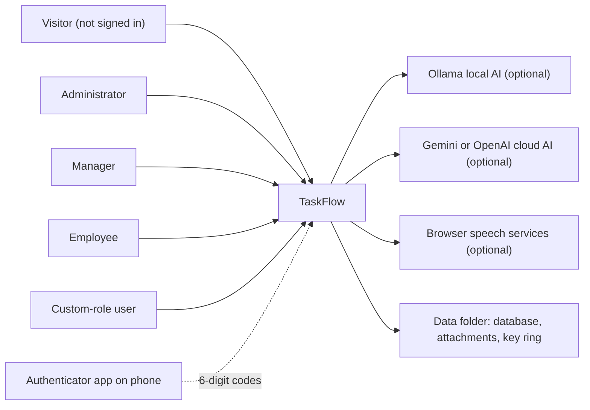

TaskFlow sends nothing by external e-mail or SMS (BR-23). The authenticator app works offline on the user's phone; the
only outbound connections are to a cloud AI provider when an administrator chooses one.

### 2.3 Sub-module FRD Index

| # | Code | Module | Sub-module | Sub-module FRD | BRD baseline |
|---|---|---|---|---|---|
| 0 | ALL | (all) | Overall, incl. Authentication and Legal | This document | [BRD-TaskFlow-Overall](../../BRD/00-Overall/BRD-TaskFlow-Overall.md) – REQ-AUTH-01 – 41, REQ-LEGAL-01 – 15 |
| 1 | DASH | Dashboard | Dashboard | [FRD-Dashboard](../01-Dashboard/01.1-Dashboard/FRD-Dashboard.md) | REQ-DASH-01 – 58 |
| 2 | TASK | TaskFlow Monitoring | Task Management (incl. comments and activity history) | [FRD-Task-Management](../02-TaskFlow-Monitoring/02.1-Task-Management/FRD-Task-Management.md) | REQ-TASK-01 – 58 |
| 3 | WORK | TaskFlow Monitoring | Employee Workload | [FRD-Employee-Workload](../02-TaskFlow-Monitoring/02.2-Employee-Workload/FRD-Employee-Workload.md) | REQ-WORK-01 – 17 |
| 4 | BOARD | TaskFlow Monitoring | Board | [FRD-Board](../02-TaskFlow-Monitoring/02.3-Board/FRD-Board.md) | REQ-BOARD-01 – 18 |
| 5 | EMP | TaskFlow Management | Employee Management | [FRD-Employee-Management](../03-TaskFlow-Management/03.1-Employee-Management/FRD-Employee-Management.md) | REQ-EMP-01 – 49 |
| 6 | PROJ | TaskFlow Management | Project Management (incl. positions) | [FRD-Project-Management](../03-TaskFlow-Management/03.2-Project-Management/FRD-Project-Management.md) | REQ-PROJ-01 – 37 |
| 7 | DEPT | TaskFlow Management | Department Management | [FRD-Department-Management](../03-TaskFlow-Management/03.3-Department-Management/FRD-Department-Management.md) | REQ-DEPT-01 – 27 |
| 8 | MAIL | Communication | Mail | [FRD-Mail](../04-Communication/04.1-Mail/FRD-Mail.md) | REQ-MAIL-01 – 47 |
| 9 | NOTIF | Communication | Notification (incl. reminder engine) | [FRD-Notification](../04-Communication/04.2-Notification/FRD-Notification.md) | REQ-NOTIF-01 – 45 |
| 10 | RPT | Reports | Reports | [FRD-Reports](../05-Reports/05.1-Reports/FRD-Reports.md) | REQ-RPT-01 – 39 |
| 11 | REM | Settings | Reminder Settings | [FRD-Reminder-Settings](../06-Settings/06.1-Reminder-Settings/FRD-Reminder-Settings.md) | REQ-REM-01 – 22 |
| 12 | APP | Settings | Application Settings | [FRD-Application-Settings](../06-Settings/06.2-Application-Settings/FRD-Application-Settings.md) | REQ-APP-01 – 22 |
| 13 | TFAS | Settings | TFA Settings | [FRD-TFA-Settings](../06-Settings/06.3-TFA-Settings/FRD-TFA-Settings.md) | REQ-TFAS-01 – 25 |
| 14 | ROLE | Settings | Role Configuration | [FRD-Role-Configuration](../06-Settings/06.4-Role-Configuration/FRD-Role-Configuration.md) | REQ-ROLE-01 – 25 |
| 15 | PROF | My Profile | My Profile (profile, change password, two-step verification) | [FRD-My-Profile](../07-My-Profile/07.1-My-Profile/FRD-My-Profile.md) | REQ-PROF-01 – 29 |
| 16 | TFA | TFA Assistant | Assistant | [FRD-Assistant](../08-TFA-Assistant/08.1-Assistant/FRD-Assistant.md) | REQ-TFA-01 – 45 |

Each sub-module FRD numbers its requirements `FR-<CODE>-nn`, traces each one to its BRD `REQ-<CODE>-nn`, and applies the
global rules `BR-nn` of the overall BRD.

### 2.4 Screen and Route Map

| Screen | Route / location | Module | Access |
|---|---|---|---|
| Login (with Two-step verification step) | `/login` (also the target of `/` and of any unknown address) | AUTH | Public |
| Forgot your password? | `/account-recovery` | AUTH | Public |
| Let's secure your account | `/security-setup` | AUTH | Signed in, setup pending |
| Sign out | Header → account area → **Sign out** icon | AUTH | Signed in |
| Administrator / Manager / Employee Dashboard | `/admin`, `/manager`, `/me` | DASH | `dashboard.view.organization`, `dashboard.view.team`, `dashboard.view.own` |
| Task List, Create Task, Task Details | `/tasks`, `/tasks/new`, `/tasks/:id` | TASK | `tasks.view.own` / `tasks.view.all`, `tasks.create` |
| Task Discussion, Activity History, Reassign Task | `/tasks/:id/discussion`, `/tasks/:id/activity`, `/tasks/:id/reassign` | TASK | Task access; `tasks.activity.view`; `tasks.reassign` |
| Board | `/board` | BOARD | `board.view` |
| Employee Workload | `/workload` | WORK | `workload.view` |
| Employee, Project, Department Management | `/employees`, `/projects`, `/projects/:id`, `/departments` | EMP, PROJ, DEPT | Matching view and action permissions |
| Mail, Notification Center | `/mail`, `/notifications` | MAIL, NOTIF | `mail.read`, `notifications.view` |
| Task Reports | `/reports` | RPT | `reports.view` |
| Reminder, Application, TFA Settings, Role Configuration | `/settings/reminders`, `/settings/application`, `/settings/tfa`, `/settings/permissions` | REM, APP, TFAS, ROLE | Matching settings permissions |
| My Profile, Change Password | `/profile`, `/profile/change-password` | PROF | Always On |
| TFA Panel | TFA button on every signed-in screen | TFA | `assistant.chat` |
| Legal document pages | `/legal/copyright`, `/legal/terms`, `/legal/privacy`, `/legal/disclaimer`, `/legal/licenses` | LEGAL | Public |
| Legal footer | Bottom of Login, Account Recovery and every signed-in screen | LEGAL | Public |

### 2.5 Change from Original BRD (system level)

| Original BRD | Current functional requirement | Where |
|---|---|---|
| Screen 1 – password-only login | Password plus mandatory two-step verification; generic failure message; renewable sessions re-checked on every request | 4.1.1 – 4.1.5 |
| No account recovery | Self-service recovery with an authenticator code; nothing sent by e-mail or SMS | 4.1.3 |
| No security setup | Mandatory Security Setup before any other screen | 4.1.4 |
| Fixed roles | Permission-based access from a fixed catalogue of 64 permissions; read-only system roles and custom roles | 3.2, FRD-Role-Configuration |
| Screen 14 – SMTP e-mail settings | **Superseded** by internal Mail; reminders optionally copied into the Mail inbox | 7, FRD-Mail, FRD-Reminder-Settings |
| Five task statuses | **In QA** added (six statuses, five Board columns) | 5.1, FRD-Task-Management, FRD-Board |
| No legal pages | Five public legal documents and an ownership footer | 4.2 |

---

## 3. User Roles & Permissions

### 3.1 Roles

| Role | Description | Data scope |
|---|---|---|
| Visitor | Anyone not signed in: Login, Account Recovery, legal pages and footer only. | Public pages only |
| Administrator | System role, holds every permission; the role is re-granted every permission at each application start. | Organisation |
| Manager | System role for people who lead work: tasks (no delete), workload, reports, reminder settings, read-only master data. | Team for tasks and the team dashboard; Organisation for reports and workload |
| Employee | System role for people who carry out work: own tasks, status, hours, comments, board, Mail, notifications, profile, TFA. | Own |
| Custom Role | Created by an administrator from the fixed catalogue; Always On permissions included; "Give the Administrator role" never assignable. | As granted: Own, Team or Organisation |

System roles cannot be changed (BR-05). Every user holds exactly one role. Role and permission changes apply on the user's
next request and are picked up by the session check within 15 seconds (FR-AUTH-44, FR-AUTH-45).

### 3.2 Permission Matrix (functional view)

Source: permission catalogue, 64 entries. "Requires" = prerequisite permission that is ticked automatically and must be
held as well.

| Module › Sub-module › Function | Permission key | Requires | Administrator | Manager | Employee | Custom role |
|---|---|---|:---:|:---:|:---:|:---:|
| Authentication › Sign in, code step, recovery, renewal, sign out | (none – public) | – | Always On | Always On | Always On | Always On |
| Legal › Legal pages and footer | (none – public) | – | Always On | Always On | Always On | Always On |
| Dashboard › View my dashboard | `dashboard.view.own` | – | Always On | Always On | Always On | Always On |
| Dashboard › View team dashboard | `dashboard.view.team` | – | Granted | Granted | Denied | Configurable |
| Dashboard › View organization dashboard | `dashboard.view.organization` | – | Granted | Denied | Denied | Configurable |
| Dashboard › View charts and reports | `dashboard.analytics.view` | – | Granted | Granted | Granted | Configurable |
| Dashboard › Use dashboard filters | `dashboard.filters.use` | – | Granted | Granted | Granted | Configurable |
| Task Management › View my tasks | `tasks.view.own` | – | Always On | Always On | Always On | Always On |
| Task Management › View all tasks | `tasks.view.all` | – | Granted | Granted | Denied | Configurable |
| Task Management › Create tasks | `tasks.create` | – | Granted | Granted | Denied | Configurable |
| Task Management › Delete tasks | `tasks.delete` | – | Granted | Denied | Denied | Configurable |
| Task Management › Edit tasks | `tasks.update` | – | Granted | Granted | Denied | Configurable |
| Task Management › Reassign tasks | `tasks.reassign` | – | Granted | Granted | Denied | Configurable |
| Task Management › Manage task recipients | `tasks.recipients.manage` | – | Granted | Granted | Denied | Configurable |
| Task Management › Post task comments | `tasks.comment.create` | – | Granted | Granted | Granted | Configurable |
| Task Management › Edit own task comments | `tasks.comment.edit` | – | Granted | Granted | Granted | Configurable |
| Task Management › Delete own task comments | `tasks.comment.delete` | – | Granted | Granted | Granted | Configurable |
| Task Management › View task history | `tasks.activity.view` | – | Granted | Granted | Granted | Configurable |
| Employee Workload › View workload | `workload.view` | – | Granted | Granted | Denied | Configurable |
| Employee Workload › Use workload filters | `workload.filters.use` | `workload.view` | Granted | Granted | Denied | Configurable |
| Employee Workload › Open an employee's tasks | `workload.tasks.open` | `workload.view` | Granted | Granted | Denied | Configurable |
| Board › View board | `board.view` | – | Granted | Granted | Granted | Configurable |
| Board › Use board filters | `board.filters.use` | `board.view` | Granted | Granted | Granted | Configurable |
| Board / Task Details › Update task status | `tasks.status.change` | – | Granted | Granted | Granted | Configurable |
| Employee Management › View employees | `employees.view` | – | Granted | Granted | Denied | Configurable |
| Employee Management › Create employees | `employees.create` | `employees.view` | Granted | Denied | Denied | Configurable |
| Employee Management › Edit employees | `employees.edit` | `employees.view` | Granted | Denied | Denied | Configurable |
| Employee Management › Activate or deactivate employees | `employees.status.change` | `employees.view` | Granted | Denied | Denied | Configurable |
| Employee Management › Assign roles | `employees.role.assign` | `employees.view` | Granted | Denied | Denied | Configurable |
| Employee Management › Reset two-step verification | `employees.mfa.reset` | `employees.view` | Granted | Denied | Denied | Configurable |
| Employee Management › Delete employees | `employees.delete` | `employees.view` | Granted | Denied | Denied | Configurable |
| Project Management › View projects | `projects.view` | – | Granted | Granted | Denied | Configurable |
| Project Management › Create projects | `projects.create` | `projects.view` | Granted | Denied | Denied | Configurable |
| Project Management › Edit projects | `projects.edit` | `projects.view` | Granted | Denied | Denied | Configurable |
| Project Management › Delete projects | `projects.delete` | `projects.view` | Granted | Denied | Denied | Configurable |
| Project Management › Manage project members | `projects.members.manage` | `projects.view` | Granted | Denied | Denied | Configurable |
| Project Management › Create positions | `positions.create` | `projects.view` | Granted | Denied | Denied | Configurable |
| Department Management › View departments | `departments.view` | – | Granted | Granted | Denied | Configurable |
| Department Management › Create departments | `departments.create` | `departments.view` | Granted | Denied | Denied | Configurable |
| Department Management › Edit departments | `departments.edit` | `departments.view` | Granted | Denied | Denied | Configurable |
| Department Management › Delete departments | `departments.delete` | `departments.view` | Granted | Denied | Denied | Configurable |
| Department Management › Manage department members | `departments.members.manage` | `departments.view` | Granted | Denied | Denied | Configurable |
| Mail › Read mail | `mail.read` | – | Granted | Granted | Granted | Configurable |
| Mail › Write and send mail | `mail.compose` | – | Granted | Granted | Granted | Configurable |
| Mail › Organize mail | `mail.organize` | – | Granted | Granted | Granted | Configurable |
| Mail › Use mail attachments | `mail.attachments` | – | Granted | Granted | Granted | Configurable |
| Notification › View notifications | `notifications.view` | – | Granted | Granted | Granted | Configurable |
| Notification › Mark notifications read | `notifications.manage` | – | Granted | Granted | Granted | Configurable |
| Reports › View reports | `reports.view` | – | Granted | Granted | Denied | Configurable |
| Reports › Export reports | `reports.export` | `reports.view` | Granted | Granted | Denied | Configurable |
| Settings › Reminder settings | `settings.reminders.manage` | – | Granted | Granted | Denied | Configurable |
| Settings › Application settings | `settings.application.manage` | – | Granted | Denied | Denied | Configurable |
| Settings › View AI provider settings | `settings.ai.view` | – | Granted | Denied | Denied | Configurable |
| Settings › Edit AI provider settings | `settings.ai.edit` | `settings.ai.view` | Granted | Denied | Denied | Configurable |
| Settings › Test AI providers | `settings.ai.test` | `settings.ai.view` | Granted | Denied | Denied | Configurable |
| Settings › Remove AI models | `settings.ai.model.remove` | `settings.ai.view` | Granted | Denied | Denied | Configurable |
| Role Configuration › Manage roles and permissions | `roles.manage` | – | Granted | Denied | Denied | Configurable |
| Role Configuration › View all roles | `roles.view.all` | – | Granted | Denied | Denied | Configurable |
| Role Configuration › Modify access | `roles.modify.access` | – | Granted | Denied | Denied | Configurable |
| Role Configuration › Give the Administrator role | `roles.administrator.assign` | – | Granted | Denied | Denied | Not assignable |
| My Profile › View my profile | `profile.view` | – | Always On | Always On | Always On | Always On |
| My Profile › Edit my personal information | `profile.edit` | – | Always On | Always On | Always On | Always On |
| My Profile › Change my password | `profile.password.change` | – | Always On | Always On | Always On | Always On |
| My Profile › Manage my authenticator (Security Setup, My Profile) | `profile.mfa.manage` | – | Always On | Always On | Always On | Always On |
| TFA Assistant › Chat with the assistant | `assistant.chat` | – | Granted | Granted | Granted | Configurable |
| TFA Assistant › Confirm assistant actions | `assistant.actions.confirm` | – | Granted | Granted | Granted | Configurable |

**Legacy keys.** Older combined keys are accepted and expand to their fine-grained keys: `dashboard.admin` →
`dashboard.view.organization`; `dashboard.manager` → `dashboard.view.team`; `projects.manage` → `projects.create`,
`projects.edit`, `projects.delete`, `projects.members.manage`, `positions.create`; `departments.manage` →
`departments.create`, `departments.edit`, `departments.delete`, `departments.members.manage`; `employees.manage` →
`employees.create`, `employees.edit`, `employees.status.change`, `employees.mfa.reset`; `settings.ai.manage` →
`settings.ai.view`, `settings.ai.edit`, `settings.ai.test`, `settings.ai.model.remove`. They are not shown as separate
rows in Role Configuration.

### 3.3 Global Access-Control Behaviour

| Layer | Behaviour |
|---|---|
| Menu | Shows only the entries the user's permissions allow (BR-04, NFR-12). |
| Screen address | Opening a screen without its permission sends the user to their own dashboard; no message is shown. |
| Server | Checks the permission on every request (BR-04); refused requests get "403 Forbidden" and the screen shows its fallback error. Another user's notification, mail or assistant conversation is reported as not found (BR-20). |
| Setup pending | Only `/security-setup` opens; the server refuses every function except sign-in, the own profile and the MFA setup functions (BR-03). |

The detailed functional requirements for these layers are FR-AUTH-29, FR-AUTH-45, FR-AUTH-49 – FR-AUTH-51.

---

## 4. Functional Requirements by Module

Full detail is given for **Authentication (4.1)** and **Legal (4.2)** only. Section 4.3 summarises the other modules and
points to their FRDs.

### 4.1 Module: Authentication (AUTH)

**Purpose:** Let registered, active users sign in securely with password and authenticator code, recover a forgotten
password without an administrator, secure their account before first use, and keep the session safe until sign-out.
·  **BRD reference:** Overall BRD SCREEN 1 – 3, section 4.3 – 4.4, REQ-AUTH-01 – REQ-AUTH-41, BR-01 – BR-04, BR-23 – BR-25, BR-28

#### 4.1.1 Screen: Login (Sign in)

| Field | Value |
|---|---|
| Route / location | `/login`; also opened for `/` and for any unknown address |
| Access | Public (Visitor). Completed by Administrator, Manager, Employee and Custom Role users with an active, not deleted account |
| Entry points | Opening TaskFlow; redirect from any protected screen when not signed in (with a return address); end of a session; **← Back to sign in** on Account Recovery; **Back to sign in** on a legal page |

**Screen elements**

| Element | Type | Description | Mandatory | Visible to |
|---|---|---|:---:|---|
| "TF" logo, **TaskFlow**, "Sign in to continue" | Header text | Brand and subtitle | – | Everyone |
| Notice area | Info box | Reason the user was sent back to sign in (session ended, credentials changed, password reset) | – | Everyone, when a reason exists |
| **Email** | Text input | Email address or username; pre-filled with the identifier last used on this device | Yes | Everyone |
| **Password** | Password input | Password, with eye button **Show password / Hide password** | Yes | Everyone |
| Error area | Message | Field and sign-in errors | – | Everyone |
| **Sign in** | Button | Submits; shows "Signing in…" while working | – | Everyone |
| **Forgot password?** | Link | Opens Account Recovery | – | Everyone |
| Legal footer | Footer | Ownership line and five links (4.2.2) | – | Everyone |

**Functional requirements**

| ID | Requirement | Priority | Permission | BRD trace |
|---|---|---|---|---|
| FR-AUTH-01 | The system shall accept either the username or the email address of the account, together with the password, to sign in. | Must | Public | REQ-AUTH-01 |
| FR-AUTH-02 | The system shall require **Email** and **Password**, check the email format on the screen, and accept at most 256 characters for the identifier and 128 for the password on the server. | Must | Public | REQ-AUTH-01 |
| FR-AUTH-03 | The system shall answer an unknown account, an inactive or deleted account and a wrong password with the same message "Invalid email or password." and open no session. | Must | Public | REQ-AUTH-02 |
| FR-AUTH-04 | The system shall compare the password only against its stored salted hash and replace an old-format hash with the current format after the next successful sign-in. | Must | Public | REQ-AUTH-03 |
| FR-AUTH-05 | The system shall let the user show and hide the typed password with the eye button. | Should | Public | REQ-AUTH-11 |
| FR-AUTH-06 | The system shall pre-fill **Email** with the identifier last used for sign-in on the same device. | Could | Public | REQ-AUTH-12 |
| FR-AUTH-07 | The system shall record the date and time of each successful sign-in as the account's last login. | Should | Public | REQ-AUTH-10 |
| FR-AUTH-08 | The system shall, after a correct password, open the session directly when two-step verification is off, and otherwise show the Two-step verification step (4.1.2) without opening a session. | Must | Public | REQ-AUTH-04 |
| FR-AUTH-09 | The system shall, after sign-in, open the return address if it is a page inside TaskFlow; otherwise it shall open Administrator → `/admin`, Manager → `/manager`, custom roles → the widest dashboard their `dashboard.view.*` permissions allow, everyone else → `/me`. | Must | `dashboard.view.*` decides the target | REQ-AUTH-08 |
| FR-AUTH-10 | The system shall open Security Setup (`/security-setup`) instead of the dashboard when two-step verification is required but not yet set up. | Must | Public | REQ-AUTH-09 |
| FR-AUTH-11 | The system shall show in the notice area why the user was returned to sign in: session ended, credentials changed, or password reset. | Should | Public | REQ-AUTH-18, REQ-AUTH-29 |

**Use case: UC-AUTH-01 – Sign in with password and authenticator code**

| Item | Detail |
|---|---|
| Actor | Any registered user (Administrator, Manager, Employee, Custom Role) |
| Preconditions | Account exists, is active and not deleted; two-step verification is on |
| Trigger | User enters email (or username) and password and clicks **Sign in** |
| Main flow | 1. System checks the fields. 2. System finds the account and checks the password. 3. System creates a sign-in step valid for 5 minutes and shows **Two-step verification**. 4. User types the current 6-digit code and clicks **Verify**. 5. System checks the code (unused, within one 30-second step). 6. System opens the session, records the last login and opens the return address or the role dashboard. |
| Alternate flows | A1: two-step verification off and not required → session opens after step 2. A2: setup pending → session opens and Security Setup is shown (UC-AUTH-03). A3: **← Back to sign in** → password step, password cleared. |
| Exceptions | E1: empty or invalid fields → field messages. E2: unknown, inactive, deleted account or wrong password → "Invalid email or password.". E3: wrong, reused or expired code → "The code is incorrect, or the sign-in has expired. Try again or sign in again.", code box cleared. E4: 5 wrong codes in a row → "Too many wrong codes. Try again in a few minutes." for 5 minutes. |
| Postconditions | Session open (access pass and renewal cookie); last login recorded; user on the right screen. |

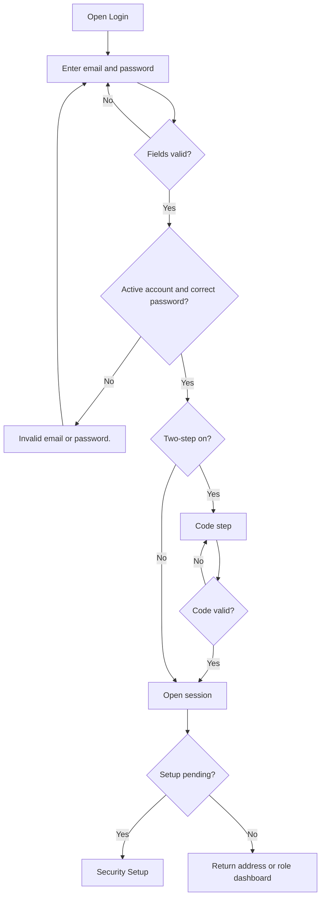

**Field validations**

| Field | Rule | Error message |
|---|---|---|
| Email | Required | "Email is required." |
| Email | Valid email format (screen) | "Enter a valid email address." |
| Email | At most 256 characters (server) | Request refused as invalid |
| Password | Required | "Password is required." |
| Password | At most 128 characters (server) | Request refused as invalid |

**Business rules applied:** BR-01, BR-02, BR-03, BR-28

**Notifications / side effects**

| Event | Who is notified | Channel |
|---|---|---|
| Successful sign-in | Nobody; last login time recorded | – |

**Messages**

| Situation | Message |
|---|---|
| Wrong credentials, inactive or deleted account | "Invalid email or password." |
| Sent back after session ended or renewal failed | "Your session has ended, for example because your username or password was changed. Please sign in again." |
| Sent back after credentials changed | "Your username or password was changed. Sign in again with your new details." |
| Sent back after password reset | "Your password has been reset. Sign in with your new password." |
| No permission | Not applicable – public screen |

#### 4.1.2 Screen: Two-step verification (second step of Login)

| Field | Value |
|---|---|
| Route / location | `/login`, shown after a correct password when two-step verification is on |
| Access | Public; needs the sign-in step created by FR-AUTH-08 |
| Entry points | **Sign in** with a correct password |

**Screen elements**

| Element | Type | Description | Mandatory | Visible to |
|---|---|---|:---:|---|
| **Two-step verification** | Title | With "Enter the 6-digit code from your authenticator app." | – | Users with two-step verification on |
| **Authentication code** | Text input | Current code from the authenticator app | Yes | Same |
| **Verify** | Button | Submits the code | – | Same |
| **← Back to sign in** | Link | Returns to the password step | – | Same |

**Functional requirements**

| ID | Requirement | Priority | Permission | BRD trace |
|---|---|---|---|---|
| FR-AUTH-12 | The system shall accept the code step only within 5 minutes of the correct password, and refuse it earlier when the account's security stamp changed in the meantime (password change, password reset or MFA reset). | Must | Public | REQ-AUTH-05 |
| FR-AUTH-13 | The system shall accept a time-based 6-digit code from the current 30-second step or one step before or after it, and accept each code only once per account. | Must | Public | REQ-AUTH-06 |
| FR-AUTH-14 | The system shall lock code checking for the account for 5 minutes after 5 wrong codes in a row; the counter is shared with the code checks of My Profile. | Must | Public | REQ-AUTH-07 |
| FR-AUTH-15 | The system shall clear the code box after a refused code, and clear the password when the user returns with **← Back to sign in**. | Should | Public | REQ-AUTH-04, REQ-AUTH-06 |

Use case: covered by UC-AUTH-01 (steps 3 – 6, exceptions E3 – E4).

**Field validations**

| Field | Rule | Error message |
|---|---|---|
| Authentication code | Required | "Enter the code to continue." |
| Authentication code | Correct, unused, sign-in step not expired | "The code is incorrect, or the sign-in has expired. Try again or sign in again." |
| Authentication code | Not locked | "Too many wrong codes. Try again in a few minutes." |

**Business rules applied:** BR-03, BR-28

**Notifications / side effects**

| Event | Who is notified | Channel |
|---|---|---|
| Wrong code | Nobody; failure counted toward the 5-minute lockout | – |

**Messages**

| Situation | Message |
|---|---|
| Code refused without a server message | "That code did not work. Check the code and try again." |
| No permission | Not applicable – public step |

> ⚠️ To be confirmed: the server also accepts an unused backup code at this step, but the code box takes only 6
> characters while backup codes have the form `XXXXX-XXXXX`.

#### 4.1.3 Screen: Forgot your password? (Account Recovery)

| Field | Value |
|---|---|
| Route / location | `/account-recovery` |
| Access | Public; usable only for active accounts with two-step verification on |
| Entry points | **Forgot password?** on Login |

**Screen elements**

| Element | Type | Description | Mandatory | Visible to |
|---|---|---|:---:|---|
| **Forgot your password?** | Title | With a short explanation | – | Everyone |
| **Email or username** | Text input | Step 1 identifier | Yes | Everyone |
| **Code from your authenticator app** | Text input | Step 1 code, 6 digits | Yes | Everyone |
| **Continue** | Button | Verifies step 1 | – | Everyone |
| Note | Text | "This works if you turned on two-step verification from your Profile. If you did not, ask an administrator to set a new password for you." | – | Everyone |
| "Code verified. Choose a new password for your account." | Subtitle | Step 2 | – | Users who passed step 1 |
| **New password**, **Confirm new password** | Password inputs | Step 2 | Yes | Same |
| **Reset password** | Button | Saves the new password | – | Same |
| **Start over** | Button | Back to step 1 | – | Only when the reset is refused |
| **← Back to sign in** | Link | Returns to Login | – | Everyone |
| Legal footer | Footer | 4.2.2 | – | Everyone |

**Functional requirements**

| ID | Requirement | Priority | Permission | BRD trace |
|---|---|---|---|---|
| FR-AUTH-16 | The system shall verify the identity with the email or username and the current 6-digit authenticator code. | Must | Public | REQ-AUTH-19 |
| FR-AUTH-17 | The system shall offer recovery only for active, not deleted accounts that have two-step verification on. | Must | Public | REQ-AUTH-20 |
| FR-AUTH-18 | The system shall refuse a backup code as the recovery factor. | Must | Public | REQ-AUTH-21 |
| FR-AUTH-19 | The system shall show the same message for an unknown account, an inactive account, an account without two-step verification and a wrong code. | Must | Public | REQ-AUTH-22 |
| FR-AUTH-20 | The system shall allow at most 5 verification attempts per account and 20 per network address in any sliding 5 minutes and refuse further attempts. | Must | Public | REQ-AUTH-23 |
| FR-AUTH-21 | The system shall not count wrong recovery codes toward the sign-in code lockout, and shall still refuse an account that is currently locked for codes. | Must | Public | REQ-AUTH-24 |
| FR-AUTH-22 | The system shall grant a reset permission valid for 10 minutes and usable once; when it is used, all other open reset permissions of the user are cancelled; when only the new password is rejected, the same permission stays usable until it expires. | Must | Public | REQ-AUTH-25 |
| FR-AUTH-23 | The system shall require a new password of 6 to 128 characters entered identically in **New password** and **Confirm new password**. | Must | Public | REQ-AUTH-26 |
| FR-AUTH-24 | The system shall end every session of the user on all devices when the password is reset. | Must | Public | REQ-AUTH-27 |
| FR-AUTH-25 | The system shall send the account owner the System notification "Your password was reset with your authenticator app. If this was not you, contact an administrator now." after a successful reset; a failure to write it does not undo the reset. | Must | Public | REQ-AUTH-28 |
| FR-AUTH-26 | The system shall open Login with the notice "Your password has been reset. Sign in with your new password." after the reset. | Should | Public | REQ-AUTH-29 |
| FR-AUTH-27 | The system shall show **Start over** when the reset permission has expired or was already used, returning to step 1. | Should | Public | REQ-AUTH-30 |

**Use case: UC-AUTH-02 – Reset a forgotten password with the authenticator app**

| Item | Detail |
|---|---|
| Actor | User whose two-step verification is on |
| Preconditions | Not signed in; authenticator app at hand |
| Trigger | Clicks **Forgot password?** on Login |
| Main flow | 1. User enters email or username and the current code, clicks **Continue**. 2. System checks attempt limits, account, two-step status and code. 3. System grants a 10-minute single-use reset permission and shows step 2. 4. User enters and confirms a new password, clicks **Reset password**. 5. System saves the password, ends all sessions, cancels other reset permissions, sends the System notification. 6. System opens Login with the success notice. |
| Alternate flows | A1: **← Back to sign in** at any time. A2: new password rejected by validation → user corrects it and retries with the same permission. |
| Exceptions | E1: limits exceeded → "Too many attempts. Try again in a few minutes.". E2: any verification failure → "The details are incorrect, or the code has expired. Check them and try again.". E3: permission expired or used → "This reset link is no longer valid. Start again from the login page." and **Start over**. |
| Postconditions | New password active; every old session ended; owner notified. |

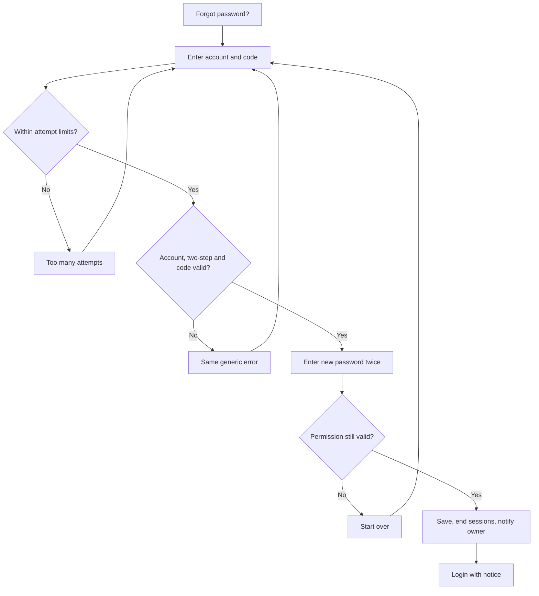

**Field validations**

| Field | Rule | Error message |
|---|---|---|
| Email or username | Required; at most 256 characters | "Email or username is required." |
| Code from your authenticator app | Required; exactly 6 digits on the screen (server accepts up to 32 characters) | "Enter the 6-digit code from the app." |
| New password | 6 – 128 characters | "Use at least 6 and at most 128 characters." |
| Confirm new password | Same as New password | "Passwords do not match." |

**Business rules applied:** BR-02, BR-03, BR-23, BR-25, BR-28

**Notifications / side effects**

| Event | Who is notified | Channel |
|---|---|---|
| Password reset with authenticator | Account owner | In-app (System) – catalogue N-12 |
| Password reset | All sessions of the user end | – |

**Messages**

| Situation | Message |
|---|---|
| Verification failed | "The details are incorrect, or the code has expired. Check them and try again." |
| Too many attempts | "Too many attempts. Try again in a few minutes." |
| Verification failed without a server message | "Could not verify the code. Please try again." |
| Reset permission used or expired | "This reset link is no longer valid. Start again from the login page." |
| Reset failed without a server message | "Could not reset your password. Please try again." |
| Success (on Login) | "Your password has been reset. Sign in with your new password." |
| No permission | Not applicable – public screen |

#### 4.1.4 Screen: Let's secure your account (Security Setup)

| Field | Value |
|---|---|
| Route / location | `/security-setup` |
| Access | Signed-in users with setup pending; `profile.view`, `profile.edit`, `profile.mfa.manage` (Always On). Users without setup pending are sent to their dashboard; visitors to Login |
| Entry points | Automatic after sign-in (FR-AUTH-10); any other screen while setup is pending |

**Screen elements**

| Element | Type | Description | Mandatory | Visible to |
|---|---|---|:---:|---|
| Progress list **Your details**, **Authenticator app**, **Backup codes** | Stepper | "Step N of 3" on small screens | – | Users with setup pending |
| "Welcome, (first name)" and Employee code, Username, Role, Projects, Managers | Read-only facts | Step 1 | – | Same |
| **Full name** | Text input | Step 1, at most 200 characters | Yes | Same |
| **Email** | Text input with fixed `@taskflow.com` | Step 1, name part only | Yes | Same |
| **Mobile number** | Text input | Step 1, international format | Yes | Same |
| **Sign out**, **Save and continue** | Buttons | Step 1 | – | Same |
| **Current password** | Password input with **Show/Hide** | Step 2 | Yes | Same |
| **Back**, **Show my QR code** | Buttons | Step 2 | – | Same |
| QR code, typed key, **Copy key** | Display, button | Step 2 after the password check | – | Same |
| **6-digit code** | Text input | Step 2 | Yes | Same |
| **Start over**, **Verify and turn on** | Buttons | Step 2 | – | Same |
| "Two-step verification is on", 10 backup codes, **Copy all**, **Download** | Display, buttons | Step 3 | – | Same |
| "I have saved my backup codes somewhere safe." | Check box | Step 3 | Yes | Same |
| **Open TaskFlow** | Button | Enabled only after the check box | – | Same |
| "We could not load your details." with **Try again** | Error box | Load failure | – | Same |

**Functional requirements**

| ID | Requirement | Priority | Permission | BRD trace |
|---|---|---|---|---|
| FR-AUTH-28 | The system shall require two-step verification for every user by default; it can be switched off only in server configuration as a break-glass measure. | Must | – | REQ-AUTH-31 |
| FR-AUTH-29 | The system shall, while setup is pending, open only `/security-setup` and refuse every server function except sign-in, the user's own profile and the MFA setup functions with "Set up two-step verification to continue.". | Must | – | REQ-AUTH-32 |
| FR-AUTH-30 | The system shall send a signed-in user without setup pending who opens `/security-setup` to their dashboard, and a visitor to Login. | Must | – | REQ-AUTH-32 |
| FR-AUTH-31 | The system shall show the user's read-only facts and let the user confirm and save **Full name**, **Email** and **Mobile number** before continuing. | Must | `profile.view`, `profile.edit` | REQ-AUTH-33 |
| FR-AUTH-32 | The system shall show a new setup key and QR code only after the current password is checked, allowing 5 password attempts per account in 5 minutes; two-step verification stays off at this point. | Must | `profile.mfa.manage` | REQ-AUTH-34 |
| FR-AUTH-33 | The system shall let the user copy the setup key when the QR code cannot be scanned. | Should | `profile.mfa.manage` | REQ-AUTH-35 |
| FR-AUTH-34 | The system shall turn on two-step verification only after a correct 6-digit code from the app for the key just issued; a backup code is not accepted; wrong codes count toward the shared 5-minute lockout. | Must | `profile.mfa.manage` | REQ-AUTH-36 |
| FR-AUTH-35 | The system shall refuse to start setup again while two-step verification is on. | Must | `profile.mfa.manage` | REQ-AUTH-37 |
| FR-AUTH-36 | The system shall create exactly 10 single-use backup codes in the form `XXXXX-XXXXX` when two-step verification is turned on and show them only once, with **Copy all** and **Download**. | Must | `profile.mfa.manage` | REQ-AUTH-38 |
| FR-AUTH-37 | The system shall keep **Open TaskFlow** disabled until the check box is ticked, then open the user's dashboard. | Must | – | REQ-AUTH-39 |
| FR-AUTH-38 | The system shall store the setup key only encrypted and the backup codes only as hashes, and never show them again. | Must | – | REQ-AUTH-40 |
| FR-AUTH-39 | The system shall let the user leave with **Sign out** without finishing setup. | Should | – | REQ-AUTH-41 |
| FR-AUTH-40 | The system shall show "We could not load your details." with **Try again** when the details cannot be loaded. | Should | `profile.view` | REQ-AUTH-33 |

**Use case: UC-AUTH-03 – Complete first-time Security Setup**

| Item | Detail |
|---|---|
| Actor | Signed-in user with setup pending |
| Preconditions | Signed in (UC-AUTH-01 A2); authenticator app installed on the phone |
| Trigger | System opens **Let's secure your account** |
| Main flow | 1. User checks Full name, Email and Mobile number, clicks **Save and continue**. 2. User enters **Current password**, clicks **Show my QR code**. 3. System checks the password and shows QR code and key. 4. User scans the QR code (or copies the key), enters the 6-digit code, clicks **Verify and turn on**. 5. System checks the code, turns two-step verification on and shows 10 backup codes. 6. User copies or downloads the codes, ticks the check box, clicks **Open TaskFlow**. 7. System opens the user's dashboard. |
| Alternate flows | A1: **Sign out** at step 1. A2: **Start over** at step 2 gets a new key. A3: **Back** at step 2 returns to step 1. |
| Exceptions | E1: invalid details → field messages. E2: wrong password → "Current password is incorrect."; 6th attempt in 5 minutes → "Too many attempts. Try again in a few minutes.". E3: wrong code → "The code is incorrect or has expired."; 5 wrong codes → lockout. E4: already on → "Authenticator MFA is already on. Turn it off first to set it up again.". |
| Postconditions | Two-step verification on; 10 backup codes issued; every later sign-in asks for a code. |

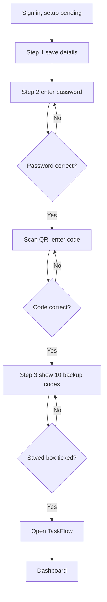

**Field validations**

| Field | Rule | Error message |
|---|---|---|
| Full name | Required; at most 200 characters | "Enter your full name." |
| Email | Name part with letters, digits, dot, underscore or hyphen, then `@taskflow.com` | "Use letters, digits, dot, underscore or hyphen before @taskflow.com." (server: "Email must be a name using letters, digits, dot, underscore or hyphen followed by @taskflow.com.") |
| Email | Unique | "Email already exists." |
| Email + Mobile number | Not the same pair as another user | "A user with this email and mobile number already exists." |
| Mobile number | Required | "Enter your mobile number." |
| Mobile number | International format | "Use international format, for example +919876543210." |
| Current password | Required / correct | "Enter your password." / "Current password is incorrect." |
| 6-digit code | Exactly 6 digits | "Enter the 6-digit code from the app." |
| 6-digit code | Correct and setup started | "The code is incorrect or has expired." / "Start the setup first to get a key." |

**Business rules applied:** BR-03, BR-24, BR-28

**Notifications / side effects**

| Event | Who is notified | Channel |
|---|---|---|
| Two-step verification turned on | Nobody; 10 backup codes created | – |

**Messages**

| Situation | Message |
|---|---|
| Details not saved without a server message | "Could not save your details. Please try again." |
| Setup failed without a server message | "Could not start setup. Please try again." |
| Code failed without a server message | "That code did not work. Check the app and try the new code." |
| Too many password attempts / wrong codes | "Too many attempts. Try again in a few minutes." / "Too many wrong codes. Try again in a few minutes." |
| Copy done / failed | "Key copied" / "Backup codes copied" / "Could not copy. Select the text and copy it by hand." |
| Any other page while setup pending | "Set up two-step verification to continue." |

> ⚠️ To be confirmed: regenerating backup codes exists as a server function (REQ-PROF-29) but no screen offers it.

#### 4.1.5 Screen: Sessions and Sign out (all signed-in screens)

| Field | Value |
|---|---|
| Route / location | **Sign out** icon in the header account area of every signed-in screen (and on Security Setup step 1); background session handling |
| Access | All signed-in users; no permission key |
| Entry points | Successful sign-in (FR-AUTH-08) |

**Screen elements**

| Element | Type | Description | Mandatory | Visible to |
|---|---|---|:---:|---|
| **Sign out** | Icon button | Ends the session on this device | – | All signed-in users |
| Login notice | Info box | Shown after the session ends (4.1.1) | – | Users returned to Login |

**Functional requirements**

| ID | Requirement | Priority | Permission | BRD trace |
|---|---|---|---|---|
| FR-AUTH-41 | The system shall issue at sign-in a 30-minute access pass and a 7-day renewal cookie (HttpOnly, Secure, SameSite Strict, sent only to the sign-in functions) and restore the session from the cookie after a page reload. | Must | – | REQ-AUTH-13 |
| FR-AUTH-42 | The system shall, when a request is refused because the access pass expired, renew the pass silently with the cookie and repeat the request. | Must | – | REQ-AUTH-13 |
| FR-AUTH-43 | The system shall replace the renewal cookie at every renewal and refuse a used, expired or revoked cookie. | Must | – | REQ-AUTH-14 |
| FR-AUTH-44 | The system shall check the session every 15 seconds and when the browser tab becomes visible again, and apply the user's current role and permissions to menus and screens without a new sign-in. | Must | – | REQ-AUTH-15 |
| FR-AUTH-45 | The system shall, on every request, refuse a session whose user no longer exists, is inactive or deleted, or whose security stamp has changed, and read the role and permissions afresh. | Must | – | REQ-AUTH-16 |
| FR-AUTH-46 | The system shall, on **Sign out**, revoke and remove the renewal cookie and open Login; signing out without a cookie or with an already revoked one still succeeds quietly. | Must | – | REQ-AUTH-17 |
| FR-AUTH-47 | The system shall, when renewal fails, clear the session and open Login with "Your session has ended, for example because your username or password was changed. Please sign in again.". | Should | – | REQ-AUTH-18 |
| FR-AUTH-48 | The system shall change the security stamp and revoke all renewal cookies of the user after a password change, a password reset and an administrator MFA reset, so every session on every device ends. | Must | – | REQ-AUTH-16, REQ-AUTH-27 |
| FR-AUTH-49 | The system shall check the permission key of every protected function on the server, independently of the screen, and refuse a missing permission with "403 Forbidden". | Must | Per function (3.2) | REQ-AUTH-16 |
| FR-AUTH-50 | The system shall show in the menu only the entries the user's permissions allow and send a user who opens a screen without its permission to their own dashboard. | Must | Per screen (2.4) | REQ-AUTH-15 |
| FR-AUTH-51 | The system shall keep only Login, Account Recovery and the legal pages public, send a visitor who opens a protected screen to Login with the address as return address, and send any unknown address to Login. | Must | Public | REQ-AUTH-08 |

**Use case: UC-AUTH-04 – Keep the session alive and apply changes**

| Item | Detail |
|---|---|
| Actor | Signed-in user; System |
| Preconditions | Session open |
| Trigger | Access pass expires, 15-second check, tab becomes visible, or a security change happens |
| Main flow | 1. A request is refused because the pass expired. 2. System renews with the cookie, issuing a new pass and a new cookie. 3. System repeats the request. 4. Every 15 seconds the system re-reads the user, role and permissions and updates menus. |
| Alternate flows | A1: an administrator changed the user's role or a custom role's permissions → the next check applies them (custom-role permission change signs holders out, REQ-ROLE-17). |
| Exceptions | E1: cookie expired, revoked or reused, user inactive or deleted, security stamp changed → session cleared, Login with notice. E2: setup pending detected → Security Setup. |
| Postconditions | Session continues with current rights, or ends safely. |

**Use case: UC-AUTH-05 – Sign out**

| Item | Detail |
|---|---|
| Actor | Signed-in user |
| Preconditions | Session open (or setup pending on Security Setup step 1) |
| Trigger | Clicks **Sign out** |
| Main flow | 1. System revokes and removes the renewal cookie. 2. System clears the session on the device. 3. System opens Login. |
| Alternate flows | A1: no cookie or already revoked → still signed out quietly. |
| Exceptions | None |
| Postconditions | No usable session on this device. |

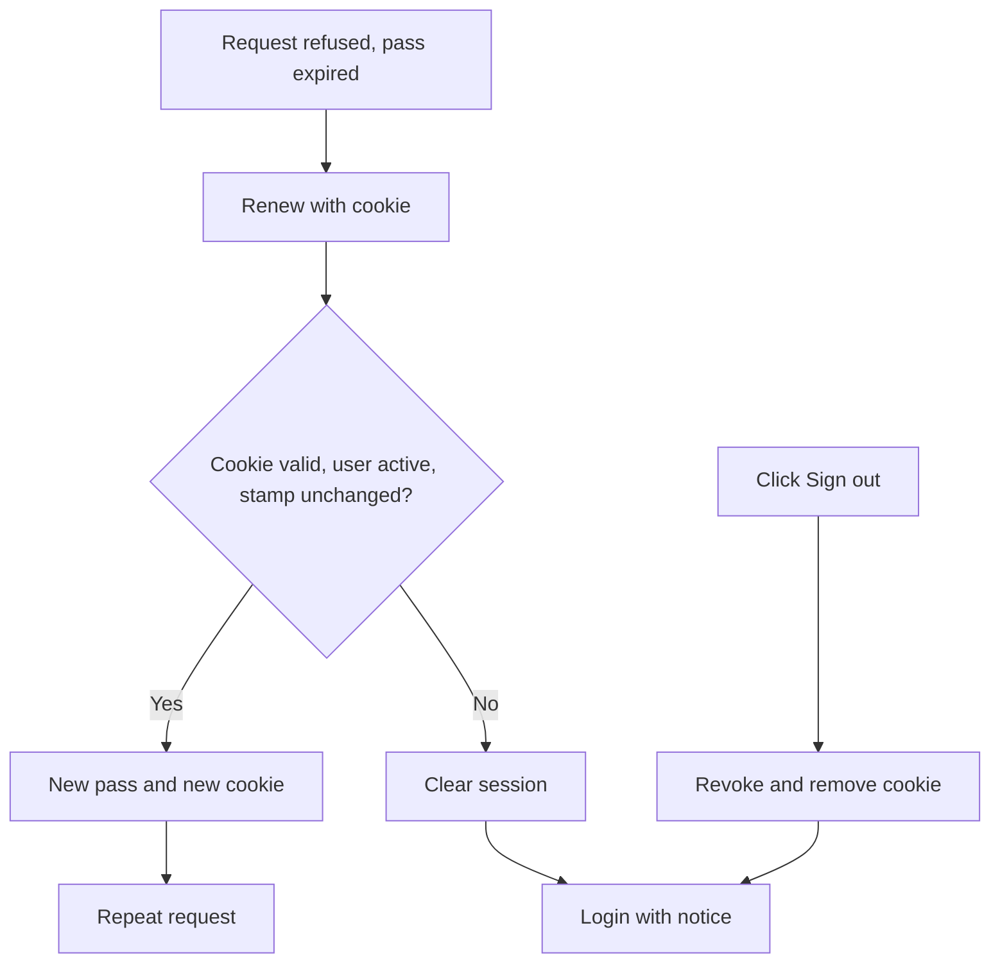

**Field validations**

| Field | Rule | Error message |
|---|---|---|
| – | No input fields | _Not applicable for this screen._ |

**Business rules applied:** BR-01, BR-02, BR-04, BR-05, BR-06, BR-25

**Notifications / side effects**

| Event | Who is notified | Channel |
|---|---|---|
| Password change, password reset, MFA reset | All sessions of the user end | – |
| Account deactivated or deleted (FRD-Employee-Management) | Session refused on next request | – |

**Messages**

| Situation | Message |
|---|---|
| Session ended or renewal failed | "Your session has ended, for example because your username or password was changed. Please sign in again." |
| Credentials changed | "Your username or password was changed. Sign in again with your new details." |
| Setup pending (stale session) | "Set up two-step verification to continue." |
| Concurrent change | "Someone else changed this record while you were saving. Reload it and try again." |
| Unexpected error | "Something went wrong. Please try again." |
| No permission (screen) | User returned to their dashboard; no message |
| No permission (function) | "403 Forbidden"; the screen shows its fallback error |

### 4.2 Module: Legal (LEGAL)

**Purpose:** Publish TaskFlow's five legal documents to everyone and show the same ownership statement on every main
screen.  ·  **BRD reference:** Overall BRD SCREEN 4 – 5, REQ-LEGAL-01 – REQ-LEGAL-15, BR-01, BR-29

#### 4.2.1 Screen: Legal Document Page (Copyright / Terms of Use / Privacy Policy / Disclaimer / Licences)

| Field | Value |
|---|---|
| Route / location | `/legal/copyright`, `/legal/terms`, `/legal/privacy`, `/legal/disclaimer`, `/legal/licenses` |
| Access | Public – Visitor, Administrator, Manager, Employee, Custom Role; no permission key |
| Entry points | Legal footer links (4.2.2); typing the address. No side-menu entry |

**Screen elements**

| Element | Type | Description | Mandatory | Visible to |
|---|---|---|:---:|---|
| Top bar | Header | "TF" mark and "TaskFlow — Intelligent Task Allocation & Tracking System" | – | Everyone |
| **Back to the application** / **Back to sign in** | Link | Depends on whether the user is signed in | – | Everyone |
| Heading | Text | Title, one-line summary, "Last updated: 21 October 2026 · © 2026 Jojo George. All Rights Reserved." | – | Everyone |
| **Contents** | Link list | Numbered sections (Copyright 8, Terms 14, Privacy 11, Disclaimer 7, Licences 3) | – | Everyone |
| Document body | Text, lists, notes, tables | "What we collect" table (Privacy), "Third-party components" table (Licences) | – | Everyone |
| Ownership line | Text | At the foot of the page | – | Everyone |

**Functional requirements**

| ID | Requirement | Priority | Permission | BRD trace |
|---|---|---|---|---|
| FR-LEGAL-01 | The system shall publish exactly five legal documents, each on its own page: Copyright Notice (`/legal/copyright`), Terms of Use (`/legal/terms`), Privacy Policy (`/legal/privacy`), Disclaimer (`/legal/disclaimer`) and Third-Party Licence Notices (`/legal/licenses`). | Must | Public | REQ-LEGAL-01 |
| FR-LEGAL-02 | The system shall open the legal pages without sign-in, without any permission and also while two-step setup is pending. | Must | Public | REQ-LEGAL-02 |
| FR-LEGAL-03 | The system shall show on each page the title, summary, "Last updated" date and the ownership line in the heading and at the foot. | Must | Public | REQ-LEGAL-03 |
| FR-LEGAL-04 | The system shall show a **Contents** list of the document's sections and scroll to a section when its entry is clicked. | Must | Public | REQ-LEGAL-03 |
| FR-LEGAL-05 | The system shall insert owner name (Jojo George), year (2026), contact email (jojogeorge3344@gmail.com), rights statement ("All Rights Reserved") and application name from the single owner record into every document. | Must | Public | REQ-LEGAL-04 |
| FR-LEGAL-06 | The system shall label the back link **Back to the application** for a signed-in user and send Administrator → `/admin`, Manager → `/manager`, any other role → `/me`; for a visitor it shall label it **Back to sign in** and open `/login`. | Should | Public | REQ-LEGAL-05 |
| FR-LEGAL-07 | The system shall show "Legal document not found" with "The document you requested is not available." when no document matches the page. | Should | Public | REQ-LEGAL-06 |
| FR-LEGAL-08 | The system shall keep the documents read-only: no edit function exists and opening a page creates no record, notification, mail or activity entry. | Must | Public | REQ-LEGAL-07 |
| FR-LEGAL-09 | The Privacy Policy shall state what data TaskFlow keeps and why, where it is stored (data folder on the server, default `C:\TaskFlow` on Windows), who can see it, how it is protected (salted password hash, encrypted AI keys) and how long it is kept. | Must | Public | REQ-LEGAL-08 |
| FR-LEGAL-10 | The Terms of Use and the Privacy Policy shall state that, when a cloud AI model is chosen, the question and the task details behind it are sent to that provider, and that a notice is shown the first time a cloud model is used. | Must | Public | REQ-LEGAL-09 |
| FR-LEGAL-11 | The Disclaimer shall state that assistant output and allocation suggestions are advisory only and must be checked before acting on them. | Must | Public | REQ-LEGAL-10 |

**Use case: UC-LEGAL-01 – Read a legal document**

| Item | Detail |
|---|---|
| Actor | Anyone (Visitor or any signed-in role) |
| Preconditions | None |
| Trigger | Clicks a footer link or opens a `/legal/...` address |
| Main flow | 1. System opens the page without checking sign-in. 2. System fills the owner values into the text. 3. System shows heading, **Contents** and all sections. 4. User clicks a **Contents** entry; the page scrolls to that section. 5. User clicks the back link and returns to the dashboard (signed in) or Login (visitor). |
| Alternate flows | A1: user leaves through a link in the text or the browser back button. |
| Exceptions | E1: no matching document → "Legal document not found". |
| Postconditions | Nothing stored. |

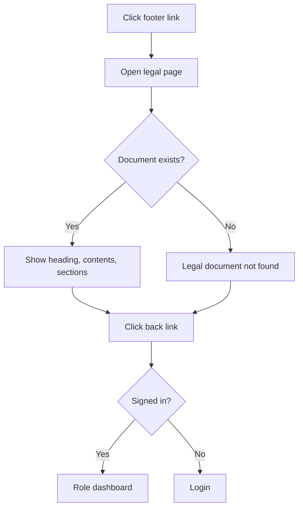

**Field validations**

| Field | Rule | Error message |
|---|---|---|
| – | Read-only page, no input | _Not applicable for this screen._ |

**Business rules applied:** BR-01, BR-29

**Notifications / side effects**

| Event | Who is notified | Channel |
|---|---|---|
| Page opened | Nobody; nothing recorded | – |

**Messages**

| Situation | Message |
|---|---|
| Document not found | "Legal document not found" / "The document you requested is not available." / "Choose one of the documents from the footer, or back to sign in." ("back to the application" when signed in) |
| Back link | "Back to the application" (signed in) / "Back to sign in" (not signed in) |
| No permission | Not applicable – public page |

> ⚠️ To be confirmed: an address under `/legal/` that is not one of the five documents is currently sent to Login by the
> catch-all route, so the "not found" message may not be reached.

#### 4.2.2 Screen: Legal Footer and Ownership Notice (part of other screens)

| Field | Value |
|---|---|
| Route / location | Bottom of `/login`, `/account-recovery` (dark style) and every signed-in screen (light style) |
| Access | Public – everyone |
| Entry points | Always visible on those screens |

**Screen elements**

| Element | Type | Description | Mandatory | Visible to |
|---|---|---|:---:|---|
| Ownership line | Text | "© 2026 Jojo George. All Rights Reserved. · TaskFlow — Intelligent Task Allocation & Tracking System." | – | Everyone |
| **Copyright**, **Terms of Use**, **Privacy Policy**, **Disclaimer**, **Licences** | Links | Open the matching document in the same tab | – | Everyone |
| Browser page details | Page title and details | Title "TaskFlow — Intelligent Task Allocation & Tracking System", author, copyright, description | – | Everyone (browser tab) |

**Functional requirements**

| ID | Requirement | Priority | Permission | BRD trace |
|---|---|---|---|---|
| FR-LEGAL-12 | The system shall show the legal footer with the ownership line at the bottom of Login, Account Recovery and every signed-in screen. | Must | Public | REQ-LEGAL-11 |
| FR-LEGAL-13 | The system shall show the five document links in the fixed order Copyright, Terms of Use, Privacy Policy, Disclaimer, Licences, each opening its page in the same tab. | Must | Public | REQ-LEGAL-12 |
| FR-LEGAL-14 | The system shall take the footer's ownership values from the same owner record as the documents, so the statement is identical everywhere. | Must | Public | REQ-LEGAL-13 |
| FR-LEGAL-15 | The system shall not show the footer on the legal pages, which carry their own ownership line. | Could | Public | REQ-LEGAL-14 |
| FR-LEGAL-16 | The system shall set, when the application starts, the browser page title "TaskFlow — Intelligent Task Allocation & Tracking System" and the author "Jojo George", the copyright "© 2026 Jojo George. All Rights Reserved." and a one-line description. | Should | Public | REQ-LEGAL-15 |

**Use case: UC-LEGAL-02 – Open a legal document from the footer**

| Item | Detail |
|---|---|
| Actor | Anyone |
| Preconditions | User is on Login, Account Recovery or any signed-in screen |
| Trigger | Clicks a footer link, for example **Licences** |
| Main flow | 1. System opens the matching page (`/legal/licenses`) in the same tab. 2. UC-LEGAL-01 continues. |
| Alternate flows | None |
| Exceptions | None |
| Postconditions | Legal page shown; nothing stored. |

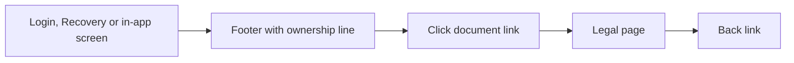

**Field validations**

| Field | Rule | Error message |
|---|---|---|
| – | No input | _Not applicable for this screen._ |

**Business rules applied:** BR-29

**Notifications / side effects**

| Event | Who is notified | Channel |
|---|---|---|
| – | Nobody | – |

**Messages**

| Situation | Message |
|---|---|
| Ownership line | "© 2026 Jojo George. All Rights Reserved. · TaskFlow — Intelligent Task Allocation & Tracking System." |
| Validation / no permission | Not applicable – read-only, public |

### 4.3 Other Modules (summary – detail in the sub-module FRDs)

| Code | Main functional areas | Key global rules | FRD |
|---|---|---|---|
| DASH | Role dashboards, analytics, filters (default Last 30 days by Created date), drill-down to exactly the counted tasks | BR-06, BR-12, BR-17, BR-22 | [FRD-Dashboard](../01-Dashboard/01.1-Dashboard/FRD-Dashboard.md) |
| TASK | Task List, Create/Copy, Details, edit, status, worked hours, recipients, reassign with reason, soft delete, comments, activity history | BR-07 – BR-12, BR-18, BR-19, BR-21 | [FRD-Task-Management](../02-TaskFlow-Monitoring/02.1-Task-Management/FRD-Task-Management.md) |
| WORK | Active, high-priority, overdue, completed counts and allocation per employee; "High load" at twice the average | BR-06, BR-12 | [FRD-Employee-Workload](../02-TaskFlow-Monitoring/02.2-Employee-Workload/FRD-Employee-Workload.md) |
| BOARD | Five status columns, drag and drop under the same status rules, filters | BR-10, BR-11 | [FRD-Board](../02-TaskFlow-Monitoring/02.3-Board/FRD-Board.md) |
| EMP | Employee list, add/edit, activate/deactivate, delete protections, role assignment, **Reset MFA** | BR-02, BR-21, BR-24 – BR-26 | [FRD-Employee-Management](../03-TaskFlow-Management/03.1-Employee-Management/FRD-Employee-Management.md) |
| PROJ | Projects, team members, positions, allocation percentages (at most 100% per person), project manager | BR-21 | [FRD-Project-Management](../03-TaskFlow-Management/03.2-Project-Management/FRD-Project-Management.md) |
| DEPT | Departments, managers and members; no delete while members exist | BR-21 | [FRD-Department-Management](../03-TaskFlow-Management/03.3-Department-Management/FRD-Department-Management.md) |
| MAIL | Private mailbox, folders, compose/reply/forward, drafts, attachments, system mail from "TaskFlow" | BR-20, BR-23 | [FRD-Mail](../04-Communication/04.1-Mail/FRD-Mail.md) |
| NOTIF | Notification Center and bell; event notifications; reminder engine every 60 seconds | BR-13 – BR-17, BR-20, BR-23 | [FRD-Notification](../04-Communication/04.2-Notification/FRD-Notification.md) |
| RPT | Task totals and completion summary with filters; CSV export up to 50,000 rows | BR-06, BR-22 | [FRD-Reports](../05-Reports/05.1-Reports/FRD-Reports.md) |
| REM | Reminders on/off, deadline-day reminder, default first/second reminder, overdue frequency, Mail delivery | BR-14 | [FRD-Reminder-Settings](../06-Settings/06.1-Reminder-Settings/FRD-Reminder-Settings.md) |
| APP | Application name, timezone, default priority, in-app notifications | BR-17 | [FRD-Application-Settings](../06-Settings/06.2-Application-Settings/FRD-Application-Settings.md) |
| TFAS | AI provider, model, server address, encrypted keys, connection test | BR-28 | [FRD-TFA-Settings](../06-Settings/06.3-TFA-Settings/FRD-TFA-Settings.md) |
| ROLE | Roles list, permission tree, compare view, custom roles, prerequisites | BR-04, BR-05 | [FRD-Role-Configuration](../06-Settings/06.4-Role-Configuration/FRD-Role-Configuration.md) |
| PROF | Own details, change password with code, self-service two-step verification | BR-03, BR-24, BR-25 | [FRD-My-Profile](../07-My-Profile/07.1-My-Profile/FRD-My-Profile.md) |
| TFA | Chat panel, help topics, Action Card with confirm, audit log, rate limit, voice input | BR-20, BR-27, BR-28 | [FRD-Assistant](../08-TFA-Assistant/08.1-Assistant/FRD-Assistant.md) |

---

## 5. Cross-Module Workflows

In the FR reference column, sub-module requirements are named by their FRD and the traced BRD requirement
(`FR-<CODE>` ← `REQ-<CODE>-nn`); the exact `FR-<CODE>-nn` number is in that FRD's traceability matrix.

### 5.1 Task Lifecycle (create → work → review → complete)

| Step | Module | Actor / System | Action | FR reference |
|---|---|---|---|---|
| 1 | AUTH | Manager | Signs in and opens Create Task | FR-AUTH-01, FR-AUTH-09 |
| 2 | TASK | Manager | Creates the task (To Do, code `TSK-` + 6 digits, assignee as recipient, reminder days prefilled from Reminder Settings, priority from Application Settings) | FR-TASK ← REQ-TASK-12, REQ-TASK-19 – REQ-TASK-23; FR-REM ← REQ-REM-15; FR-APP ← REQ-APP-10 |
| 3 | NOTIF | System | Notifies the assignee "A task was assigned to you: …" (N-01) | FR-NOTIF ← REQ-NOTIF-20; FR-TASK ← REQ-TASK-24 |
| 4 | BOARD, TASK | Employee | Moves the task to In Progress and logs worked hours | FR-BOARD ← REQ-BOARD-07, REQ-BOARD-08; FR-TASK ← REQ-TASK-32 |
| 5 | NOTIF, MAIL | System | Notifies assignee and recipients of the hours change (N-05, M-04) | FR-TASK ← REQ-TASK-34; FR-NOTIF ← REQ-NOTIF-23; FR-MAIL ← REQ-MAIL-25 |
| 6 | TASK, NOTIF, MAIL | Employee / Manager | Discuss in comments; members notified (N-04, M-02) | FR-TASK ← REQ-TASK-51; FR-NOTIF ← REQ-NOTIF-22; FR-MAIL ← REQ-MAIL-23 |
| 7 | TASK | Manager | Reassigns with a reason if needed (N-02, N-03, M-03) | FR-TASK ← REQ-TASK-41 – REQ-TASK-44 |
| 8 | TASK, BOARD | Employee / Manager | Moves to In QA, then Completed; history records each move; reminders stop | FR-BOARD ← REQ-BOARD-11; FR-TASK ← REQ-TASK-52; FR-NOTIF ← REQ-NOTIF-30 |
| 9 | DASH, RPT | System | Dashboards and reports count the task with the same rules | FR-DASH ← REQ-DASH-27; FR-RPT ← REQ-RPT-* |

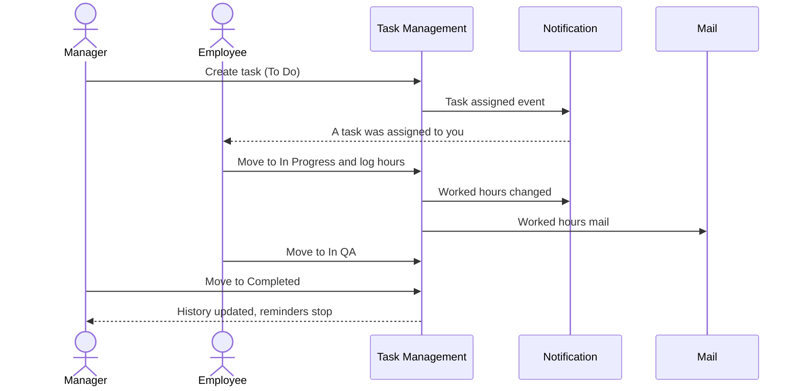

### 5.2 Automatic Deadline Reminders

| Step | Module | Actor / System | Action | FR reference |
|---|---|---|---|---|
| 1 | NOTIF | System | Reminder engine runs at start-up and every 60 seconds | FR-NOTIF ← REQ-NOTIF-28 |
| 2 | REM | System | Reads "Send deadline reminders", deadline-day reminder, Mail delivery | FR-NOTIF ← REQ-NOTIF-29; FR-REM ← REQ-REM-03, REQ-REM-17 |
| 3 | TASK | System | Takes open tasks due within 32 days or overdue | FR-NOTIF ← REQ-NOTIF-30 |
| 4 | APP | System | Decides today's reminder type in the application timezone (UTC if unrecognised) | FR-NOTIF ← REQ-NOTIF-31 – REQ-NOTIF-36; FR-APP ← REQ-APP-07, REQ-APP-08 |
| 5 | NOTIF | System | Resolves recipients plus creator, active only; skips already delivered | FR-NOTIF ← REQ-NOTIF-37 – REQ-NOTIF-39 |
| 6 | NOTIF | System | Writes the in-app reminder (N-06 – N-09) and the reminder history | FR-NOTIF ← REQ-NOTIF-41, REQ-NOTIF-42, REQ-NOTIF-44; FR-REM ← REQ-REM-09 |
| 7 | MAIL | System | When Mail delivery is on, places a mail from "TaskFlow" in each Inbox (M-01) | FR-NOTIF ← REQ-NOTIF-43; FR-REM ← REQ-REM-08 |
| 8 | NOTIF | System | Writes nothing for a task completed, cancelled, deleted or rescheduled during the run; a failed run is logged | FR-NOTIF ← REQ-NOTIF-40, REQ-NOTIF-45 |

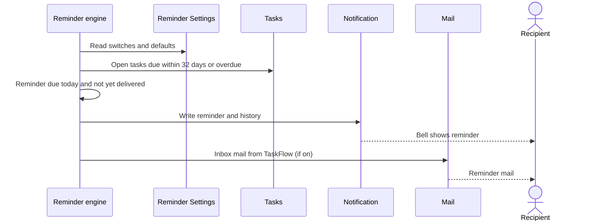

### 5.3 Sign-in with Two-Step Verification and First-Time Setup

| Step | Module | Actor / System | Action | FR reference |
|---|---|---|---|---|
| 1 | EMP | Administrator | Creates the account (Employee role by default) | FR-EMP ← REQ-EMP-30, REQ-EMP-36 |
| 2 | AUTH | User | Signs in with email and password | FR-AUTH-01 – FR-AUTH-04 |
| 3 | AUTH | System | Setup pending → opens Security Setup; every other screen and function closed | FR-AUTH-10, FR-AUTH-29 |
| 4 | AUTH, PROF | User | Saves details (own profile functions), checks password, scans QR, verifies code, saves backup codes | FR-AUTH-31 – FR-AUTH-38; FR-PROF ← REQ-PROF-12 |
| 5 | DASH | System | Opens the role dashboard | FR-AUTH-37, FR-AUTH-09; FR-DASH ← REQ-DASH-02 |
| 6 | AUTH | User | Later sign-ins: password, then 6-digit code | FR-AUTH-08, FR-AUTH-12 – FR-AUTH-14 |

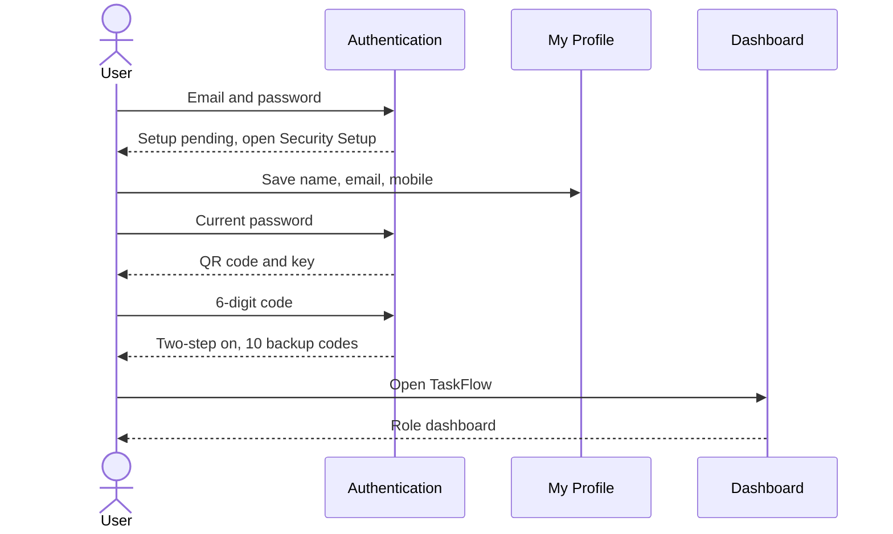

### 5.4 Self-Service Account Recovery

| Step | Module | Actor / System | Action | FR reference |
|---|---|---|---|---|
| 1 | AUTH | User | Enters account and authenticator code | FR-AUTH-16 – FR-AUTH-21 |
| 2 | AUTH | System | Grants a 10-minute single-use reset permission | FR-AUTH-22 |
| 3 | AUTH | User | Sets a new password | FR-AUTH-23 |
| 4 | AUTH | System | Ends every session of the user | FR-AUTH-24, FR-AUTH-48 |
| 5 | NOTIF | System | Sends the System notification (N-12) | FR-AUTH-25; FR-NOTIF ← REQ-NOTIF-25 |
| 6 | AUTH | User | Signs in with the new password | FR-AUTH-26, FR-AUTH-01 |

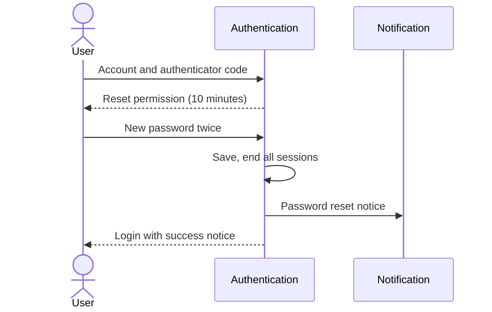

### 5.5 Lost Authenticator – Administrator MFA Reset

| Step | Module | Actor / System | Action | FR reference |
|---|---|---|---|---|
| 1 | EMP | Administrator | Opens the employee details panel; **Reset MFA** is shown only with `employees.mfa.reset` and when MFA is on | FR-EMP ← REQ-EMP-27 |
| 2 | EMP | Administrator | Confirms "Reset two-step verification?" | FR-EMP ← REQ-EMP-28 |
| 3 | AUTH | System | Removes key and backup codes, changes the security stamp, ends all sessions | FR-AUTH-48 |
| 4 | NOTIF | System | Sends the System notification (N-11) | FR-EMP ← REQ-EMP-29; FR-NOTIF ← REQ-NOTIF-24 |
| 5 | AUTH | Employee | Next sign-in → Security Setup | FR-AUTH-10, FR-AUTH-29 |

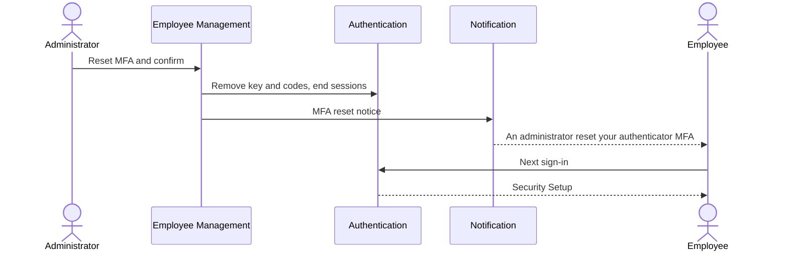

### 5.6 Role or Permission Change Reaches Signed-in Users

| Step | Module | Actor / System | Action | FR reference |
|---|---|---|---|---|
| 1 | ROLE | Administrator | Changes a custom role's permissions (system roles are read-only) | FR-ROLE ← REQ-ROLE-06, REQ-ROLE-15 |
| 2 | ROLE | System | Signs out every holder of that role when permissions changed (not for a rename) | FR-ROLE ← REQ-ROLE-17 |
| 3 | EMP | Administrator | Or gives an employee another role (Administrator role only with `roles.administrator.assign`) | FR-EMP ← REQ-EMP-37, REQ-EMP-44 |
| 4 | AUTH | System | Next request and the 15-second check use the current role and permissions; menus update | FR-AUTH-44, FR-AUTH-45, FR-AUTH-50 |

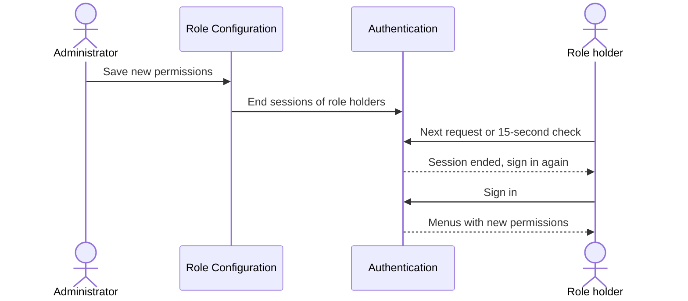

### 5.7 TFA Prepared Action (confirm before acting)

| Step | Module | Actor / System | Action | FR reference |
|---|---|---|---|---|
| 1 | TFA | User | Asks TFA, for example to send a mail to the manager | FR-TFA ← REQ-TFA-01, REQ-TFA-27 |
| 2 | TFA | System | Checks the user's permission and prepares an Action Card (expires in 10 minutes) | FR-TFA ← REQ-TFA-22 – REQ-TFA-24 |
| 3 | TFA | User | Clicks **Confirm** | FR-TFA ← REQ-TFA-22 |
| 4 | TFA, MAIL / PROF / EMP | System | Re-checks the permission with the current sign-in and runs the action once (send mail, update own profile, change a user's role) | FR-TFA ← REQ-TFA-23, REQ-TFA-25; FR-PROF ← REQ-PROF-13 |
| 5 | TFA | System | Records the outcome in the audit log, without message bodies or secrets | FR-TFA ← REQ-TFA-43 – REQ-TFA-45 |

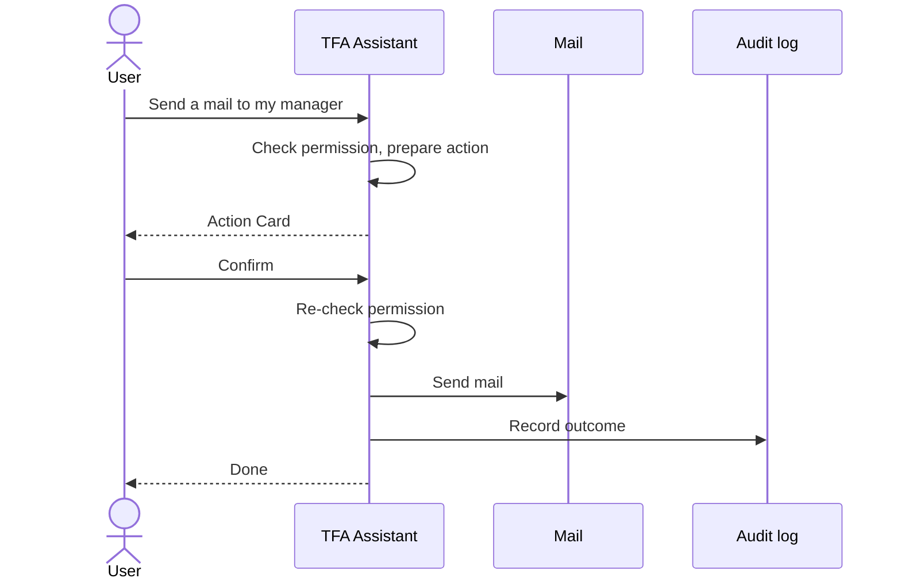

### 5.8 Employee Deactivation or Deletion

| Step | Module | Actor / System | Action | FR reference |
|---|---|---|---|---|
| 1 | EMP | Administrator | Deactivates (with confirmation) or deletes an employee; last active Administrator protected | FR-EMP ← REQ-EMP-13, REQ-EMP-15, REQ-EMP-16, REQ-EMP-18 |
| 2 | AUTH | System | Ends the person's sessions; sign-in refused with the generic message | FR-EMP ← REQ-EMP-14, REQ-EMP-20; FR-AUTH-03, FR-AUTH-45 |
| 3 | NOTIF | System | No reminders or notifications to inactive or deleted users | FR-NOTIF ← REQ-NOTIF-27, REQ-NOTIF-37 |
| 4 | TASK, MAIL | System | Tasks, comments and mail are kept; names still shown | FR-EMP ← REQ-EMP-16; FR-MAIL ← REQ-MAIL-21 |

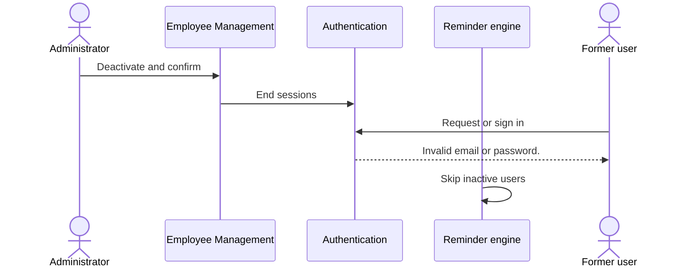

---

## 6. Reports & Exports

System-level overview; filters, columns and messages are specified in the sub-module FRDs.

| Report | Module | Filters | Columns / content | Export | Access |
|---|---|---|---|---|---|
| Task Reports – totals and completion summary | RPT | Deadline range, employee, project, status, priority | Total, completed, pending, overdue, completion summary; filtered task rows | CSV `taskflow-report.csv`, at most 50,000 rows, opened without running formulas | `reports.view`; export `reports.export` |
| Dashboard analytics | DASH | Period chips, date basis (Created / Deadline / Completed), dashboard filters | By status, priority, deadline, time, department, employee, manager, project; drill-down to the counted tasks | – | `dashboard.analytics.view`, `dashboard.filters.use`, scope by `dashboard.view.*` |
| Employee Workload | WORK | Project, employee | Employee ("High load" badge), projects and %, allocated %, active, high priority, overdue, completed | – | `workload.view`, `workload.filters.use`, `workload.tasks.open` |
| Activity History | TASK | Activity filters | Event, user, old and new value, time | – | `tasks.activity.view` and task access |

Authentication and Legal produce no reports.

---

## 7. Notifications & Messages Catalogue

### 7.1 In-app notifications (header bell, Notification Center)

Event notifications (N-01 – N-05, N-10 – N-12) are not created while in-app notifications are switched off in
Application Settings (REQ-APP-12, REQ-NOTIF-26); reminder notifications (N-06 – N-09) are always created when reminders
run (REQ-REM-09). Deleted users are never notified.

| Code | Trigger | Recipients | Type shown | Text |
|---|---|---|---|---|
| N-01 | Task created | Assignee | Task assigned | "A task was assigned to you: *title*" |
| N-02 | Task reassigned | New assignee | Task reassigned | "A task was reassigned to you: *title*. Reason: *reason*" |
| N-03 | Task reassigned | Previous assignee, recipients, acting person | Task reassigned | "*Name* reassigned task "*title*" (*code*) from *old* to *new*. Reason: *reason*" |
| N-04 | Comment added, edited or deleted | Assignee, recipients, acting person (active, not deleted) | Comment | "*Name* *added / edited / deleted* a comment on "*title*": *detail*" |
| N-05 | Worked hours added, updated or cleared | Assignee and recipients (incl. the acting person when a recipient) | System | "*Name* *action* on task *title*. Total worked now: *n*h of *m*h estimated (*r*h remaining / over by *r*h)." |
| N-06 | First reminder day | Recipients (assignee always) and creator, active only | Deadline reminder | "Reminder: "*title*" is due in *N* days (*dd MMM yyyy, HH:mm*)." ("1 day" when N is 1) |
| N-07 | Second reminder day | Same as N-06 | Deadline reminder | Same text as N-06 |
| N-08 | Deadline day, before the deadline time | Same as N-06 | Deadline reminder | "Reminder: "*title*" is due today at *HH:mm*." |
| N-09 | Each day (Daily) or every 7 days (Weekly) after the deadline while open | Same as N-06 | Overdue | "Overdue: "*title*" was due on *dd MMM yyyy, HH:mm*." |
| N-10 | Task status changed | – | – | No notification; recorded in the activity history only |
| N-11 | Administrator MFA reset | Account owner | System | "An administrator reset your authenticator MFA. Sign in with your password and set it up again from Profile." |
| N-12 | Password reset with authenticator | Account owner | System | "Your password was reset with your authenticator app. If this was not you, contact an administrator now." |

### 7.2 Internal Mail generated by TaskFlow

| Code | Trigger | Recipients | Sender | Subject | Condition |
|---|---|---|---|---|---|
| M-01 | Reminder N-06 – N-09 | Same as the reminder | "TaskFlow" (system) | "Task reminder: *title*" / "Task due today: *title*" / "Overdue task: *title*"; body ends "This is an automatic reminder from TaskFlow." | "Also deliver reminders to Mail" on |
| M-02 | Comment added, edited or deleted | Same as N-04 | "TaskFlow" (system) | "Comment *added / edited / deleted*: *title*"; body ends "This is an automatic message from TaskFlow." | Same Mail delivery setting |
| M-03 | Task reassigned | Active participants of N-02 / N-03 | The person who reassigned | "Task reassigned: *title*" | Always (best effort) |
| M-04 | Worked hours changed | Active assignee and recipients | The person who changed the hours | "Worked hours changed: *title*" | Always (best effort) |

System mails from "TaskFlow" can only be forwarded, not replied to. A failed notification or mail never undoes the saved
task change (it is logged).

### 7.3 System-level messages

| Code | Situation | Text | Where |
|---|---|---|---|
| G-01 | Session ended or renewal failed | "Your session has ended, for example because your username or password was changed. Please sign in again." | Login notice |
| G-02 | Credentials changed (own password change, username change) | "Your username or password was changed. Sign in again with your new details." | Login notice |
| G-03 | Password reset | "Your password has been reset. Sign in with your new password." | Login notice |
| G-04 | Setup pending | "Set up two-step verification to continue." | Server answer to any function except sign-in, own profile, MFA setup |
| G-05 | Concurrent change of the same record | "Someone else changed this record while you were saving. Reload it and try again." | Any save |
| G-06 | Unexpected server fault | "Something went wrong. Please try again." | Any function |
| G-07 | Missing permission | "403 Forbidden"; screen shows its fallback error; screen address → own dashboard | Any protected function or screen |
| G-08 | Record of another user (notification, mail, conversation) | Reported as not found | NOTIF, MAIL, TFA |
| G-09 | Too many attempts (recovery, password re-entry) | "Too many attempts. Try again in a few minutes." | Account Recovery, Security Setup, My Profile |
| G-10 | Code lockout | "Too many wrong codes. Try again in a few minutes." | Login, Security Setup, My Profile |

---

## 8. Data Requirements (functional view)

| Data item | Description | Created by | Rules |
|---|---|---|---|
| User account | Employee code, full name, username, email, mobile number, role, active flag, last login | Administrator (EMP); user updates own details (PROF, Security Setup) | Username unique; email unique on `@taskflow.com`, stored in lower case; soft delete |
| Password | Secret for sign-in | User; Administrator at creation | Stored only as salted hash; 6 – 128 characters; old hashes upgraded at sign-in |
| Authenticator key | Shared secret for 6-digit codes | System at Security Setup | Stored encrypted; never shown after setup; removed by MFA reset |
| Backup codes | 10 single-use codes `XXXXX-XXXXX` | System when two-step verification turns on | Stored only as hashes; each usable once; shown once |
| Code lockout state | Wrong-code counter and lock time, last used code step | System | 5 wrong codes → 5-minute lock; each code step accepted once |
| Sign-in step | Proof of correct password for the code step | System | Valid 5 minutes; void after a security stamp change |
| Renewal token | Session renewal | System at sign-in and renewal | Stored only as hash; 7 days; replaced at each renewal; revoked at sign-out and security changes |
| Reset permission | Password reset after recovery | System after a valid recovery code | Stored only as hash; 10 minutes; single use; others cancelled when one is used |
| Security stamp | Session validity marker | System | Changes on password change, password reset, MFA reset |
| Attempt counters | Recovery and password re-entry throttles | System | Kept in memory; reset at application restart |
| Owner record | Owner name, year, contact email, rights statement, application name | Fixed in the application | Same values for footer, legal pages and browser page details |
| Legal documents | Five documents with sections | Fixed in the application | Read-only; "Last updated" 21 October 2026 |
| Other data sets | Tasks, recipients, comments, history, notifications, reminder history, mail, settings, roles, AI settings, assistant data | Sub-modules | See overall BRD section 8 and the sub-module FRDs |

---

## 9. Non-Functional Requirements (functional impact)

| ID | Requirement | Affects |
|---|---|---|
| NFR-01 | Long lists are paged: tasks and notifications 20 rows by default (at most 100), Mail 25 per page. | Task List, Notification Center, Mail |
| NFR-02 | Dashboard and report totals are calculated by the server. ⚠️ To be confirmed: response-time target. | Dashboards, Reports |
| NFR-03 | A CSV export contains at most 50,000 rows. | Reports |
| NFR-04 | Passwords only as salted hashes; new passwords 6 – 128 characters; never shown or logged. | Login, Account Recovery, Security Setup, My Profile, Employee Management (FR-AUTH-04, FR-AUTH-23) |
| NFR-05 | Two-step verification (6-digit time-based codes, 10 backup codes) is required and enforced by the server. | All signed-in functions (FR-AUTH-28, FR-AUTH-29) |
| NFR-06 | Access pass 30 minutes; renewal cookie 7 days, HttpOnly, Secure, SameSite Strict, replaced at each renewal. | Sessions (FR-AUTH-41 – FR-AUTH-43) |
| NFR-07 | Throttling: 5 wrong codes lock 5 minutes; recovery 5 per account and 20 per address in 5 minutes; password re-entry 5 per 5 minutes; TFA 20 messages per minute per user. | Login, Account Recovery, Security Setup, My Profile, TFA (FR-AUTH-14, FR-AUTH-20, FR-AUTH-32) |
| NFR-08 | Every write is validated by the server and returns field messages; queries are safe against injection. | All forms |
| NFR-09 | Another user's task, mail, notification or conversation is refused or reported as not found. | TASK, MAIL, NOTIF, TFA |
| NFR-10 | AI provider keys and authenticator keys are encrypted with a key ring outside the database; only the last 4 characters of an AI key are shown. | TFA Settings, Security Setup (FR-AUTH-38) |
| NFR-11 | Data stays on the server unless a cloud AI model is chosen; notice on first cloud use; local model is the default. | TFA, TFA Settings, Privacy Policy (FR-LEGAL-10) |
| NFR-12 | Every refused action shows a message; destructive actions and every TFA action ask for confirmation; menus show only permitted entries. | All screens (FR-AUTH-50) |
| NFR-13 | Tasks, history, notifications and reminder history survive a restart. | TASK, NOTIF |
| NFR-14 | Reminder engine: first run at start-up, then every 60 seconds; failed run logged; no duplicates. | Reminder engine |
| NFR-15 | Modular, layered application; structure rules run with the automated tests. | All modules |
| NFR-16 | Modern desktop browsers with responsive layout; voice input needs Chrome or Edge; server on Windows, Linux, macOS. | All screens, TFA voice |
| NFR-17 | All data in one data folder with a documented backup and restore; key ring backed up separately. | Operations, Privacy Policy |
| NFR-18 | Keyboard use and readability. ⚠️ To be confirmed: accessibility target. | All screens |
| NFR-19 | Every request logged without its content (method, path, status, time, user, trace id); refused authorisations and TFA outcomes recorded. | All modules |
| NFR-20 | Works without the internet except for cloud AI providers. | Authentication (offline authenticator), NOTIF, MAIL, TFA |

---

## 10. Assumptions & Open Issues

| Type | Description | Owner |
|---|---|---|
| Assumption | TaskFlow serves one organisation on a single application server; attempt counters and the TFA rate limit are in memory and reset on restart. | Jojo George |
| Assumption | Every user has a phone with an authenticator app (Google Authenticator, Microsoft Authenticator, Authy or similar). | Jojo George |
| Assumption | All deadline days are decided in one application timezone (default Asia/Kolkata). | Jojo George |
| Assumption | Sub-module FRDs number their requirements independently; this document refers to them through their BRD trace. | Jojo George |
| Open issue | ⚠️ To be confirmed: the Login form requires a valid email format although the server also accepts a username (FR-AUTH-01, FR-AUTH-02). | Jojo George |
| Open issue | ⚠️ To be confirmed: the server accepts an unused backup code at the sign-in code step, but the code box takes only 6 characters (4.1.2). | Jojo George |
| Open issue | ⚠️ To be confirmed: password sign-in itself has no attempt limit (only the code step is limited); whether a limit is required (R-06). | Jojo George |
| Open issue | ⚠️ To be confirmed: regenerating backup codes exists as a server function but no screen offers it (REQ-PROF-29). | Jojo George |
| Open issue | ⚠️ To be confirmed: the Reset MFA confirmation says the employee "can sign in with just their password" and points to Profile, while with two-step verification required the employee is sent to Security Setup on the next sign-in. | Jojo George |
| Open issue | ⚠️ To be confirmed: while setup is pending the own-profile functions stay open on the server, but the `/profile` screen itself redirects to Security Setup (BR-03 wording "own profile"). | Jojo George |
| Open issue | ⚠️ To be confirmed: an unknown `/legal/...` address goes to Login, so "Legal document not found" may not be reached (FR-LEGAL-07). | Jojo George |
| Open issue | ⚠️ To be confirmed: response-time target (NFR-02) and accessibility target (NFR-18). | Jojo George |
| Open issue | ⚠️ To be confirmed: whether Managers' reports and workload should be limited to their team (R-09). | Jojo George |

---

## 11. Requirements Traceability Matrix

### 11.1 Authentication and Legal requirements

| BRD item | FRD requirement(s) | Screen | Use case | Test case |
|---|---|---|---|---|
| REQ-AUTH-01 | FR-AUTH-01, FR-AUTH-02 | Login | UC-AUTH-01 | AuthServiceLoginTests, AuthEndpointsTests |
| REQ-AUTH-02 | FR-AUTH-03 | Login | UC-AUTH-01 (E2) | AuthServiceLoginTests, AuthEndpointsTests |
| REQ-AUTH-03 | FR-AUTH-04 | Login | UC-AUTH-01 | AuthServiceLoginTests |
| REQ-AUTH-04 | FR-AUTH-08, FR-AUTH-15 | Login, Two-step step | UC-AUTH-01 | AuthServiceMfaTests, MfaSignInEndpointsTests |
| REQ-AUTH-05 | FR-AUTH-12 | Two-step step | UC-AUTH-01 (E3) | AuthServiceMfaTests, MfaSignInEndpointsTests |
| REQ-AUTH-06 | FR-AUTH-13, FR-AUTH-15 | Two-step step | UC-AUTH-01 | TotpTests, MfaServiceTests |
| REQ-AUTH-07 | FR-AUTH-14 | Two-step step | UC-AUTH-01 (E4) | MfaServiceTests, MfaSignInEndpointsTests |
| REQ-AUTH-08 | FR-AUTH-09, FR-AUTH-51 | Login | UC-AUTH-01 | AuthEndpointsTests |
| REQ-AUTH-09 | FR-AUTH-10 | Login | UC-AUTH-01 (A2) | MfaSetupGateEndpointsTests |
| REQ-AUTH-10 | FR-AUTH-07 | Login | UC-AUTH-01 | AuthServiceLoginTests |
| REQ-AUTH-11 | FR-AUTH-05 | Login | UC-AUTH-01 | ⚠️ No automated frontend test found |
| REQ-AUTH-12 | FR-AUTH-06 | Login | UC-AUTH-01 | ⚠️ No automated frontend test found |
| REQ-AUTH-13 | FR-AUTH-41, FR-AUTH-42 | Sessions | UC-AUTH-04 | AuthServiceRefreshAndLogoutTests |
| REQ-AUTH-14 | FR-AUTH-43 | Sessions | UC-AUTH-04 | AuthServiceRefreshAndLogoutTests |
| REQ-AUTH-15 | FR-AUTH-44, FR-AUTH-50 | Sessions | UC-AUTH-04 | AuthenticationWiringTests |
| REQ-AUTH-16 | FR-AUTH-45, FR-AUTH-48, FR-AUTH-49 | Sessions | UC-AUTH-04 | AuthenticationWiringTests, PermissionAuthorizationTests |
| REQ-AUTH-17 | FR-AUTH-46 | Sessions | UC-AUTH-05 | AuthServiceRefreshAndLogoutTests |
| REQ-AUTH-18 | FR-AUTH-11, FR-AUTH-47 | Login, Sessions | UC-AUTH-04 (E1) | ⚠️ No automated frontend test found |
| REQ-AUTH-19 | FR-AUTH-16 | Account Recovery | UC-AUTH-02 | PasswordRecoveryServiceTests, PasswordRecoveryEndpointsTests |
| REQ-AUTH-20 | FR-AUTH-17 | Account Recovery | UC-AUTH-02 | PasswordRecoveryServiceTests |
| REQ-AUTH-21 | FR-AUTH-18 | Account Recovery | UC-AUTH-02 | PasswordRecoveryServiceTests |
| REQ-AUTH-22 | FR-AUTH-19 | Account Recovery | UC-AUTH-02 (E2) | PasswordRecoveryEndpointsTests |
| REQ-AUTH-23 | FR-AUTH-20 | Account Recovery | UC-AUTH-02 (E1) | AttemptLimiterTests, PasswordRecoveryEndpointsTests |
| REQ-AUTH-24 | FR-AUTH-21 | Account Recovery | UC-AUTH-02 | PasswordRecoveryServiceTests |
| REQ-AUTH-25 | FR-AUTH-22 | Account Recovery | UC-AUTH-02 (E3) | PasswordRecoveryServiceTests |
| REQ-AUTH-26 | FR-AUTH-23 | Account Recovery | UC-AUTH-02 | PasswordRecoveryEndpointsTests |
| REQ-AUTH-27 | FR-AUTH-24, FR-AUTH-48 | Account Recovery, Sessions | UC-AUTH-02 | PasswordRecoveryServiceTests |
| REQ-AUTH-28 | FR-AUTH-25 | Account Recovery | UC-AUTH-02 | PasswordRecoveryServiceTests |
| REQ-AUTH-29 | FR-AUTH-11, FR-AUTH-26 | Account Recovery, Login | UC-AUTH-02 | ⚠️ No automated frontend test found |
| REQ-AUTH-30 | FR-AUTH-27 | Account Recovery | UC-AUTH-02 (E3) | ⚠️ No automated frontend test found |
| REQ-AUTH-31 | FR-AUTH-28 | Security Setup | UC-AUTH-03 | MfaSetupGateEndpointsTests |
| REQ-AUTH-32 | FR-AUTH-29, FR-AUTH-30 | Security Setup | UC-AUTH-03 | MfaSetupGateEndpointsTests |
| REQ-AUTH-33 | FR-AUTH-31, FR-AUTH-40 | Security Setup | UC-AUTH-03 | MfaSetupGateEndpointsTests |
| REQ-AUTH-34 | FR-AUTH-32 | Security Setup | UC-AUTH-03 (E2) | MfaEnrolmentEndpointsTests, MfaStepUpEndpointsTests |
| REQ-AUTH-35 | FR-AUTH-33 | Security Setup | UC-AUTH-03 | ⚠️ No automated frontend test found |
| REQ-AUTH-36 | FR-AUTH-34 | Security Setup | UC-AUTH-03 (E3) | MfaServiceTests, MfaEnrolmentEndpointsTests |
| REQ-AUTH-37 | FR-AUTH-35 | Security Setup | UC-AUTH-03 (E4) | MfaEnrolmentEndpointsTests |
| REQ-AUTH-38 | FR-AUTH-36 | Security Setup | UC-AUTH-03 | MfaServiceTests, MfaRecoveryEndpointsTests |
| REQ-AUTH-39 | FR-AUTH-37 | Security Setup | UC-AUTH-03 | ⚠️ No automated frontend test found |
| REQ-AUTH-40 | FR-AUTH-38 | Security Setup | UC-AUTH-03 | MfaServiceTests |
| REQ-AUTH-41 | FR-AUTH-39 | Security Setup | UC-AUTH-03 (A1) | ⚠️ No automated frontend test found |
| REQ-LEGAL-01 | FR-LEGAL-01 | Legal Document Page | UC-LEGAL-01 | ⚠️ No automated test found |
| REQ-LEGAL-02 | FR-LEGAL-02 | Legal Document Page | UC-LEGAL-01 | ⚠️ No automated test found |
| REQ-LEGAL-03 | FR-LEGAL-03, FR-LEGAL-04 | Legal Document Page | UC-LEGAL-01 | ⚠️ No automated test found |
| REQ-LEGAL-04 | FR-LEGAL-05 | Legal Document Page | UC-LEGAL-01 | ⚠️ No automated test found |
| REQ-LEGAL-05 | FR-LEGAL-06 | Legal Document Page | UC-LEGAL-01 | ⚠️ No automated test found |
| REQ-LEGAL-06 | FR-LEGAL-07 | Legal Document Page | UC-LEGAL-01 (E1) | ⚠️ No automated test found |
| REQ-LEGAL-07 | FR-LEGAL-08 | Legal Document Page | UC-LEGAL-01 | ⚠️ No automated test found |
| REQ-LEGAL-08 | FR-LEGAL-09 | Legal Document Page (Privacy) | UC-LEGAL-01 | Content review |
| REQ-LEGAL-09 | FR-LEGAL-10 | Legal Document Page (Terms, Privacy) | UC-LEGAL-01 | Content review |
| REQ-LEGAL-10 | FR-LEGAL-11 | Legal Document Page (Disclaimer) | UC-LEGAL-01 | Content review |
| REQ-LEGAL-11 | FR-LEGAL-12 | Legal Footer | UC-LEGAL-02 | ⚠️ No automated test found |
| REQ-LEGAL-12 | FR-LEGAL-13 | Legal Footer | UC-LEGAL-02 | ⚠️ No automated test found |
| REQ-LEGAL-13 | FR-LEGAL-14 | Legal Footer | UC-LEGAL-02 | ⚠️ No automated test found |
| REQ-LEGAL-14 | FR-LEGAL-15 | Legal Footer | UC-LEGAL-02 | ⚠️ No automated test found |
| REQ-LEGAL-15 | FR-LEGAL-16 | Legal Footer (browser page details) | UC-LEGAL-02 | ⚠️ No automated test found |

### 11.2 Global business rules

| BRD item | FRD requirement(s) in this document | Sub-module FRD requirements (by BRD trace) | Workflow |
|---|---|---|---|
| BR-01 | FR-AUTH-29, FR-AUTH-51, FR-LEGAL-02 | – | 5.3 |
| BR-02 | FR-AUTH-03, FR-AUTH-45 | FR-EMP ← REQ-EMP-13, REQ-EMP-14, REQ-EMP-20 | 5.8 |
| BR-03 | FR-AUTH-08, FR-AUTH-10, FR-AUTH-12 – FR-AUTH-14, FR-AUTH-28 – FR-AUTH-38 | FR-PROF ← REQ-PROF-12, REQ-PROF-28 | 5.3 |
| BR-04 | FR-AUTH-44, FR-AUTH-45, FR-AUTH-49, FR-AUTH-50 | FR-ROLE ← REQ-ROLE-11, REQ-ROLE-17 | 5.6 |
| BR-05 | FR-AUTH-45 (Always On read with the role) | FR-ROLE ← REQ-ROLE-06, REQ-ROLE-13, REQ-ROLE-21 | 5.6 |
| BR-06 | FR-AUTH-09 (dashboard by scope) | FR-TASK ← REQ-TASK-01; FR-DASH ← REQ-DASH-27, REQ-DASH-47; FR-WORK ← REQ-WORK-01 | 5.1 |
| BR-07 | – | FR-TASK ← REQ-TASK-23 (code generated at creation) | 5.1 |
| BR-08 | – | FR-TASK ← REQ-TASK-12, REQ-TASK-21 | 5.1 |
| BR-09 | – | FR-TASK ← REQ-TASK-19 | 5.1 |
| BR-10 | FR-AUTH-49 | FR-TASK ← REQ-TASK-09; FR-BOARD ← REQ-BOARD-07 | 5.1 |
| BR-11 | – | FR-BOARD ← REQ-BOARD-08; FR-TASK ← REQ-TASK-52 | 5.1 |
| BR-12 | – | FR-NOTIF ← REQ-NOTIF-36; FR-DASH ← REQ-DASH-27 | 5.2 |
| BR-13 | – | FR-NOTIF ← REQ-NOTIF-30, REQ-NOTIF-40 | 5.2 |
| BR-14 | – | FR-REM ← REQ-REM-05 – REQ-REM-07, REQ-REM-14, REQ-REM-17 | 5.2 |
| BR-15 | – | FR-NOTIF ← REQ-NOTIF-38 | 5.2 |
| BR-16 | – | FR-NOTIF ← REQ-NOTIF-37 | 5.2 |
| BR-17 | – | FR-NOTIF ← REQ-NOTIF-31; FR-APP ← REQ-APP-07, REQ-APP-08 | 5.2 |
| BR-18 | – | FR-TASK ← REQ-TASK-41 – REQ-TASK-43 | 5.1 |
| BR-19 | – | FR-TASK ← REQ-TASK-52 | 5.1 |
| BR-20 | FR-AUTH-49 (refusal), 7.3 G-08 | FR-NOTIF ← REQ-NOTIF-19; FR-MAIL ← REQ-MAIL-18; FR-TFA ← REQ-TFA-16 | 5.7 |
| BR-21 | – | FR-TASK ← REQ-TASK-37; FR-EMP ← REQ-EMP-16 | 5.8 |
| BR-22 | – | FR-DASH ← REQ-DASH-27; FR-RPT ← REQ-RPT-* | 5.1 |
| BR-23 | FR-AUTH-16 – FR-AUTH-25 (no e-mail or SMS factor) | FR-MAIL ← REQ-MAIL-23 – REQ-MAIL-25; FR-NOTIF ← REQ-NOTIF-43 | 5.2, 5.4 |
| BR-24 | FR-AUTH-31 | FR-EMP ← REQ-EMP-30; FR-PROF ← REQ-PROF-06, REQ-PROF-07 | 5.3 |
| BR-25 | FR-AUTH-24, FR-AUTH-48 | FR-PROF ← REQ-PROF-21; FR-EMP ← REQ-EMP-28 | 5.4, 5.5 |
| BR-26 | – | FR-EMP ← REQ-EMP-15 | 5.8 |
| BR-27 | – | FR-TFA ← REQ-TFA-22 – REQ-TFA-25, REQ-TFA-43 | 5.7 |
| BR-28 | FR-AUTH-04, FR-AUTH-38 | FR-TFA ← REQ-TFA-44; FR-TFAS ← REQ-TFAS-* | 5.3 |
| BR-29 | FR-LEGAL-01 – FR-LEGAL-16 | – | – |

### 11.3 Global acceptance criteria

| BRD item | FRD requirement(s) in this document | Sub-module acceptance (verified in the sub-module FRDs) | Use case |
|---|---|---|---|
| AC-01 | FR-AUTH-01, FR-AUTH-05 – FR-AUTH-07, FR-AUTH-09 | AC-DASH-01 | UC-AUTH-01 |
| AC-02 | FR-AUTH-03, FR-AUTH-04 | AC-EMP-03 | UC-AUTH-01 |
| AC-03 | FR-AUTH-08, FR-AUTH-12 – FR-AUTH-15 | – | UC-AUTH-01 |
| AC-04 | FR-AUTH-11, FR-AUTH-41 – FR-AUTH-48 | AC-ROLE-11 | UC-AUTH-04, UC-AUTH-05 |
| AC-05 | FR-AUTH-16 – FR-AUTH-27 | AC-NOTIF-09 | UC-AUTH-02 |
| AC-06 | FR-AUTH-28 – FR-AUTH-40 | AC-PROF-12, AC-PROF-13 | UC-AUTH-03 |
| AC-07 | FR-AUTH-48 (MFA reset ends sessions) | AC-EMP-01 – AC-EMP-13 | – |
| AC-08 | – | AC-TASK-06, AC-TASK-09 | – |
| AC-09 | – | AC-TASK-01, AC-TASK-12, AC-TASK-13, AC-TASK-16, AC-BOARD-03 | – |
| AC-10 | – | AC-TASK-03, AC-DASH-05, AC-DASH-12, AC-RPT-02 | – |
| AC-11 | – | AC-NOTIF-11, AC-REM-08 | – |
| AC-12 | – | AC-NOTIF-12 | – |
| AC-13 | – | AC-NOTIF-15, AC-REM-05 | – |
| AC-14 | – | AC-NOTIF-14, AC-TASK-12 | – |
| AC-15 | – | AC-NOTIF-13 | – |
| AC-16 | – | AC-TASK-15 | – |
| AC-17 | – | AC-WORK-01 – AC-WORK-04 | – |
| AC-18 | – | AC-RPT-05, AC-RPT-11 | – |
| AC-19 | FR-AUTH-49 – FR-AUTH-51 | AC-EMP-02, AC-RPT-01, AC-REM-11, AC-NOTIF-07, AC-MAIL-06 | UC-AUTH-04 |
| AC-20 | – | AC-NOTIF-13, AC-NOTIF-16 | – |
| AC-21 | FR-AUTH-44 (role changes without restart) | AC-REM-09, AC-APP-05, AC-ROLE-05 | – |
| AC-22 | – | AC-MAIL-06, AC-MAIL-13 | – |
| AC-23 | – | AC-TFA-09, AC-TFA-10, AC-TFA-17 | – |
| AC-24 | FR-LEGAL-01 – FR-LEGAL-08 | – | UC-LEGAL-01, UC-LEGAL-02 |
| AC-25 | FR-LEGAL-09 – FR-LEGAL-11 | – | UC-LEGAL-01 |
| AC-26 | FR-LEGAL-12 – FR-LEGAL-16 | – | UC-LEGAL-02 |

Untraced BRD items in scope of this document: **0** (41 REQ-AUTH, 15 REQ-LEGAL, 29 BR, 26 AC).

---

## 12. Approvals

| Role | Name | Decision | Date |
|---|---|---|---|
| Product owner | Jojo George | Pending | – |
| Reviewer | To be assigned | Pending | – |

---
© 2026 Jojo George. All rights reserved. Unauthorized copying or distribution of this document is prohibited.
