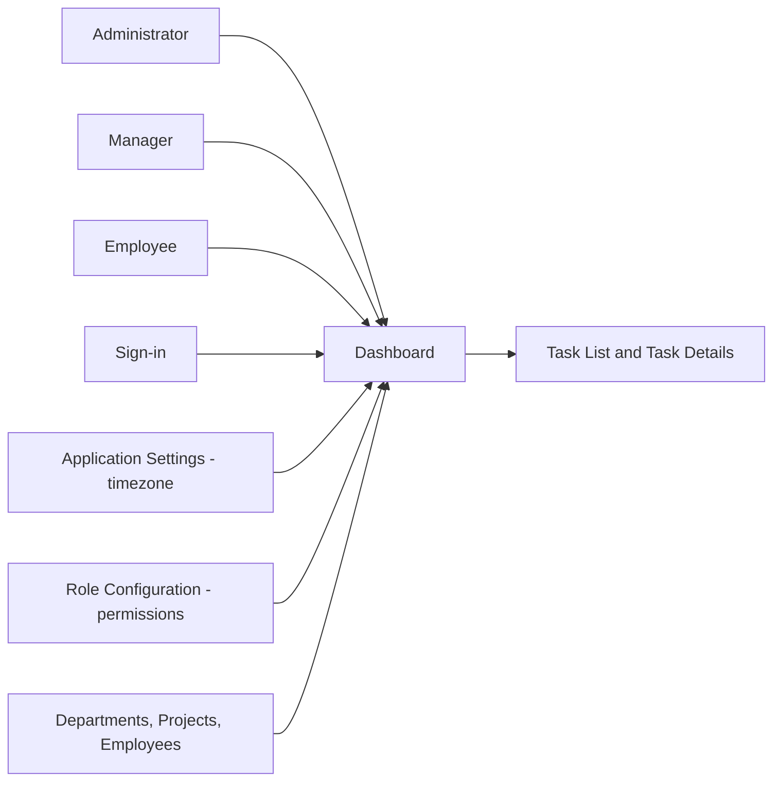
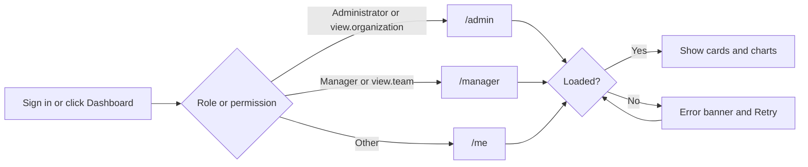
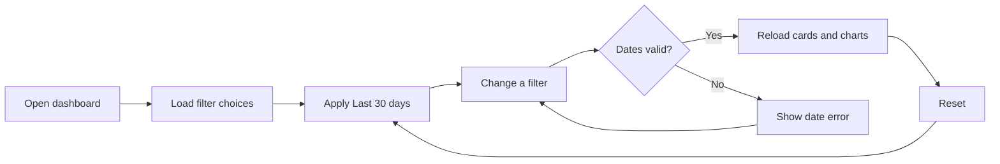
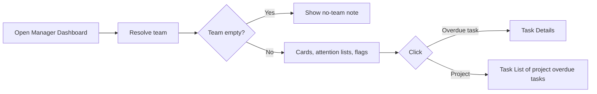
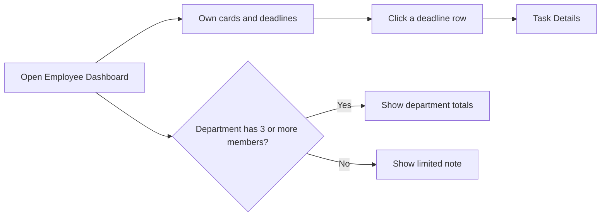
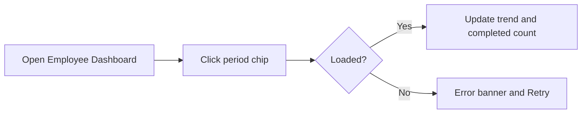
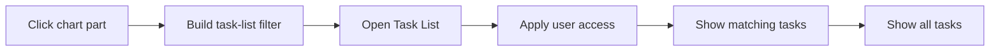
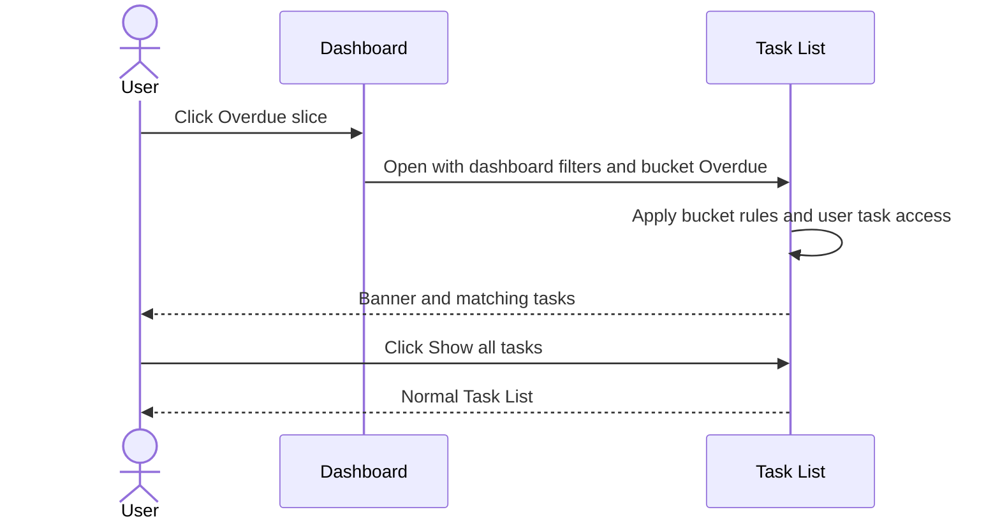

# Functional Requirements Document – Dashboard

## TaskFlow – Intelligent Task Allocation & Tracking System

> **Document:** Functional Requirements Document (sub-module 1 – DASH)  ·  **Version:** 1.0  ·  **Status:** Draft
> **Project type:** Personal Project (Skill Development)  ·  **Date:** 31-Oct-2026
> **Author:** Jojo George (jojogeorge3344@gmail.com)
> **Based on:** BRD – Dashboard (`BRD-Dashboard.md` v1.0)
> © 2026 Jojo George. All rights reserved.

---

## Document Control

### Revision History

| Version | Date | Author | Summary of changes |
|---|---|---|---|
| 1.0 | 31-Oct-2026 | Jojo George | Initial version of the Dashboard FRD (Administrator, Manager and Employee dashboards, analytics, filters and drill-down), detailed from BRD – Dashboard v1.0 and TaskFlow as built |

### Related Documents

| Document | Purpose | Location |
|---|---|---|
| BRD – Dashboard | Business needs this FRD details (REQ-DASH-01 – REQ-DASH-58, BR-DASH-01 – BR-DASH-12) | `../../../BRD/01-Dashboard/01.1-Dashboard/BRD-Dashboard.md` |
| BRD – Overall | Roles, global rules `BR-nn`, global NFRs | `../../../BRD/00-Overall/BRD-TaskFlow-Overall.md` |
| FRD – Overall | Shared roles, permission model, Authentication, cross-cutting behaviour | `../../00-Overall/FRD-TaskFlow-Overall.md` |
| FRD – Task Management | Drill-down target (Task List) and Task Details | `../../02-TaskFlow-Monitoring/02.1-Task-Management/FRD-Task-Management.md` |
| Development Plan | Screen-wise build plan (Screens 2, 3, 4) | `TF - Documents/Screens Wise Feature Development Plan/02-admin-dashboard.md`, `03-manager-dashboard.md`, `04-employee-dashboard.md` |
| HLD / LLD – Dashboard | Technical design | `../../../HLD/01-Dashboard/01.1-Dashboard/HLD-Dashboard.md`, `../../../LLD/01-Dashboard/01.1-Dashboard/LLD-Dashboard.md` |
| TDD | System-wide technical design | `TF - Documents/TF - TDD/TDD-TaskFlow.md` (v2.0) |

---

## 1. Introduction

### 1.1 Purpose
This FRD specifies the detailed, testable behaviour of the Dashboard sub-module of TaskFlow: which dashboard each user
opens, what every summary card, chart, list and filter shows, how figures are calculated, which permission controls each
function, which messages appear, and how a chart part opens the matching tasks in the Task List.

### 1.2 Scope
In scope: the **Dashboard** menu entry and routing, the Administrator Dashboard (`/admin`), the Manager Dashboard
(`/manager`), the Employee Dashboard (`/me`), their analytics sections, the filter bar, the period chips and the drill-down
to the Task List. Out of scope (BRD §3.2): activity feeds, recent notifications, quick task creation, per-card permissions
and any data change from the dashboard. File export of task figures belongs to the Reports sub-module
(`../../05-Reports/05.1-Reports/FRD-Reports.md`).

### 1.3 Audience
Developer and tester (Jojo George), reviewers, and the product owner.

### 1.4 Conventions
- Requirement IDs: `FR-DASH-nn`. Use cases: `UC-DASH-nn`. Messages: `MSG-DASH-nn`. BRD items: `REQ-DASH-nn`,
  sub-module rules `BR-DASH-nn`, global rules `BR-nn` (overall BRD §6).
- Priority: **Must / Should / Could** (MoSCoW), taken from the traced BRD requirement.
- "The system shall …" = mandatory behaviour.
- *Italic* words in labels (*name*, *n*, *range*) are filled in at run time.

### 1.5 Definitions & Abbreviations

| Term | Meaning |
|---|---|
| Scope | Data visibility: Own (the user's tasks), Team (the manager's team), Organisation (all tasks) |
| Counted task | A task that is not deleted and not cancelled (BR-DASH-01) |
| Bucket | One of Completed, Overdue, In progress, Pending; each counted task is in exactly one (BR-DASH-02) |
| Open task | A counted task that is not Completed |
| Owner of a task | Its assignee or one of its recipients (BR-DASH-04) |
| Team | Active members of the departments a manager runs plus members of projects where the manager is flagged project manager, excluding the manager |
| Date basis | The task date that must fall in the filter range: Created date, Deadline or Completed date |
| Drill-down | Opening the Task List with the filter of the clicked chart part |
| Application timezone | The timezone set in Application Settings (default Asia/Kolkata) that decides "today" |

---

## 2. System Overview

### 2.1 Module Map

| Code | Module | Child modules | Primary roles |
|---|---|---|---|
| DASH | Dashboard | Overview (routing, summary cards, team performance summary, deadlines, department overview); Analytics (charts, filter bar, period chips, drill-down) | All signed-in users |
| TASK | Task Management (related) | Task List, Task Details – drill-down targets | All signed-in users |
| APP | Application Settings (related) | Application timezone | Administrator |
| ROLE | Role Configuration (related) | Grants the five dashboard permissions | Administrator |
| AUTH | Authentication (related, overall FRD) | Sign-in, Security Setup – lead to the dashboard | All users |

### 2.2 Context Diagram

---

## 3. User Roles & Permissions

### 3.1 Roles

| Role | Description | Data scope on the Dashboard |
|---|---|---|
| Administrator | Runs the system and its settings | Organisation (Administrator Dashboard); may also open the Manager Dashboard by direct address |
| Manager | Leads one or more departments or projects | Team (Manager Dashboard) |
| Employee | Works on assigned tasks | Own (Employee Dashboard) |
| Custom Role | Role created by an Administrator | Organisation if it holds `dashboard.view.organization`; Team if it holds `dashboard.view.team`; otherwise Own |

Every signed-in user also has the Employee Dashboard (`/me`), because `dashboard.view.own` is Always On.

### 3.2 Permission Matrix (functional view)

| Module › Function | Permission key | Administrator | Manager | Employee | Custom role |
|---|---|:---:|:---:|:---:|:---:|
| Dashboard › Open my (Employee) dashboard | `dashboard.view.own` | Always On | Always On | Always On | Always On |
| Dashboard › Open Manager Dashboard (team scope) | `dashboard.view.team` | Granted | Granted | Denied | Configurable |
| Dashboard › Open Administrator Dashboard (organisation scope) | `dashboard.view.organization` | Granted | Denied | Denied | Configurable |
| Dashboard › View charts and figures | `dashboard.analytics.view` | Granted | Granted | Granted | Configurable |
| Dashboard › Use the filter bar | `dashboard.filters.use` | Granted | Granted | Granted | Configurable |
| Task Management › Open drill-down tasks (Task List rules) | `tasks.view.own` / `tasks.view.all` | Always On / Granted | Always On / Granted | Always On / Denied | Always On / Configurable |

The three view keys are levels: Organisation includes Team, Team includes Own (BR-DASH-07). The Employee holds
`dashboard.filters.use`, but the Employee Dashboard has no filter bar; its period chips need no filter permission
(BR-DASH-08). Permissions are checked by the server on every request (BR-04).

---

## 4. Functional Requirements by Module

### 4.1 Module: Dashboard (DASH)

**Purpose:** Show every signed-in user a summary of task work at the level they may see and let them open the exact tasks
behind any figure.  ·  **BRD reference:** BRD – Dashboard §5 SCREEN 1–3, BR-DASH-01 – BR-DASH-12; global BR-04, BR-06,
BR-12, BR-17, BR-22.

#### 4.1.1 Common: Dashboard entry, loading and calculation rules

| Field | Value |
|---|---|
| Route / location | Side menu → **Dashboard** → `/admin`, `/manager` or `/me` |
| Access | Every signed-in user (`dashboard.view.own`, Always On); `/admin` needs `dashboard.view.organization`; `/manager` needs `dashboard.view.team` |
| Entry points | Sign-in (after any Security Setup), side menu **Dashboard**, direct address |

**Screen elements**

| Element | Type | Description | Mandatory | Visible to |
|---|---|---|:---:|---|
| Dashboard | Side-menu item | Single menu item that opens the user's dashboard | – | All signed-in users |
| Card placeholders | Loading state | Shown on the cards while data loads | – | All signed-in users |
| Error banner | Banner with **Retry** button | Shown when the dashboard cannot be loaded | – | All signed-in users |

**Functional requirements**

| ID | Requirement | Priority | Permission | BRD trace |
|---|---|---|---|---|
| FR-DASH-01 | The system shall provide one **Dashboard** side-menu item that opens: Administrator → `/admin`; Manager → `/manager`; any other role → `/admin` if it holds `dashboard.view.organization`, else `/manager` if it holds `dashboard.view.team`, else `/me`. | Must | `dashboard.view.own` | REQ-DASH-01, BR-DASH-07 |
| FR-DASH-02 | The system shall open the user's dashboard (rule of FR-DASH-01) automatically after a successful sign-in and after any required Security Setup. | Must | `dashboard.view.own` | REQ-DASH-02 |
| FR-DASH-03 | The system shall open `/admin` only for users holding `dashboard.view.organization`; any other user who enters the address shall be taken to their own dashboard without a message. | Must | `dashboard.view.organization` | REQ-DASH-03 |
| FR-DASH-04 | The system shall open `/manager` only for users holding `dashboard.view.team`; any other user who enters the address shall be taken to their own dashboard without a message. | Must | `dashboard.view.team` | REQ-DASH-03 |
| FR-DASH-05 | The system shall open `/me` for every signed-in user. | Must | `dashboard.view.own` | REQ-DASH-03 |
| FR-DASH-06 | The system shall refuse organisation dashboard data to users without `dashboard.view.organization` and team dashboard data to users without `dashboard.view.team`, independently of the screen. | Must | `dashboard.view.organization`, `dashboard.view.team` | REQ-DASH-03, NFR-DASH-01 |
| FR-DASH-07 | The system shall refuse chart and figure data on all three dashboards to users without `dashboard.analytics.view`; the screen then shows the load-error banner (FR-DASH-09). | Must | `dashboard.analytics.view` | REQ-DASH-05, BR-DASH-08 |
| FR-DASH-08 | The system shall show placeholders on the summary cards while the dashboard data loads. | Should | `dashboard.view.own` | REQ-DASH-04 |
| FR-DASH-09 | The system shall show an error banner with a **Retry** button when the dashboard cannot be loaded: MSG-DASH-01 on the Administrator and Manager dashboards, MSG-DASH-02 on the Employee Dashboard; **Retry** shall load the dashboard again with the same filter or period. | Must | `dashboard.view.own` | REQ-DASH-05 |
| FR-DASH-10 | The system shall count on every card and chart only tasks that are not deleted and not cancelled. | Must | `dashboard.analytics.view` | BR-DASH-01, REQ-DASH-06, REQ-DASH-29, REQ-DASH-46 |
| FR-DASH-11 | The system shall place each counted task in exactly one bucket: **Completed** if its status is Completed; else **Overdue** if its deadline has passed; else **In progress** if its status is In Progress or In QA; else **Pending** (To Do, Blocked). | Must | `dashboard.analytics.view` | BR-DASH-02, BR-12, BR-22 |
| FR-DASH-12 | The system shall calculate Completion (%) as completed ÷ counted tasks, rounded to the nearest whole number, and show 0 % when there are no counted tasks. | Must | `dashboard.analytics.view` | BR-DASH-03 |
| FR-DASH-13 | The system shall treat a task as belonging to a person when the person is its assignee or one of its recipients (Manager and Employee dashboards). | Must | `dashboard.analytics.view` | BR-DASH-04 |
| FR-DASH-14 | The system shall decide "today", "due today", "next 7 days" and date presets in the application timezone. | Must | `dashboard.analytics.view` | BR-DASH-05, BR-17 |
| FR-DASH-15 | The system shall not create, change or delete any data, notification, mail or activity entry when a dashboard is opened, filtered or drilled into. | Must | `dashboard.view.own` | BR-DASH-11 |

**Use case: UC-DASH-01 – Open my dashboard**

| Item | Detail |
|---|---|
| Actor | Any signed-in user (Administrator, Manager, Employee, Custom Role) |
| Preconditions | Signed in; Security Setup completed (BR-03) |
| Trigger | Sign-in completes, or the user clicks **Dashboard**, or enters `/admin`, `/manager` or `/me` |
| Main flow | 1. The system picks the dashboard by FR-DASH-01. 2. The system shows card placeholders. 3. The system loads the cards and charts for the user's scope. 4. The dashboard is shown. |
| Alternate flows | A1: the user enters `/admin` without `dashboard.view.organization` or `/manager` without `dashboard.view.team` → taken to their own dashboard, no message. A2: an Administrator enters `/manager` → Manager Dashboard opens (FR-DASH-58). |
| Exceptions | E1: load fails, or the role lacks `dashboard.analytics.view` → error banner MSG-DASH-01 / MSG-DASH-02 with **Retry**. |
| Postconditions | The correct dashboard is shown; no data is changed. |

**Field validations:** _Not applicable – no input on this part._

**Business rules applied:** BR-DASH-01, BR-DASH-02, BR-DASH-03, BR-DASH-04, BR-DASH-05, BR-DASH-07, BR-DASH-08, BR-DASH-11; BR-03, BR-04, BR-12, BR-17, BR-22.

**Notifications / side effects:** none (BR-DASH-11).

**Messages**

| Situation | Message |
|---|---|
| Administrator / Manager dashboard failed to load (MSG-DASH-01) | "Could not load analytics. Check your connection and try again." |
| Employee dashboard failed to load (MSG-DASH-02) | "Could not load your dashboard. Check your connection and try again." |
| No permission for a dashboard address | No message – the user is taken to their own dashboard |

#### 4.1.2 Screen: Administrator Dashboard

| Field | Value |
|---|---|
| Route / location | `/admin` (side menu → **Dashboard**) |
| Access | Administrator; Custom Role holding `dashboard.view.organization`; charts need `dashboard.analytics.view`; filter bar needs `dashboard.filters.use` |
| Entry points | Sign-in, **Dashboard** menu item, direct address |

**Screen elements**

| Element | Type | Description | Mandatory | Visible to |
|---|---|---|:---:|---|
| Header | Text | "Administrator Dashboard", "Welcome back, *name*", subtitle "Organisation-wide analytics · *range* by *date basis*" | – | Users with `dashboard.view.organization` |
| Preset chips | Chip group | Today, Last 7 days, Last 30 days, This month, Previous month, Custom range | – | Users with `dashboard.filters.use` |
| From / To | Date inputs | Start and end of the range | Yes (both) | Users with `dashboard.filters.use` |
| Date basis | Drop-down | Created date, Deadline, Completed date | Yes | Users with `dashboard.filters.use` |
| Department, Project, Manager, Employee | Drop-downs | Optional narrowing filters | No | Users with `dashboard.filters.use` |
| Reset | Button | Returns to the default filter | – | Users with `dashboard.filters.use` |
| Summary cards | 10 cards | Employees, Managers, Departments, Projects, Total tasks, Completed, In progress, Pending, Overdue, Completion (%) | – | Users with `dashboard.analytics.view` |
| Task status & priority | 2 donut charts | Share of tasks per status bucket and per priority; slices clickable | – | Users with `dashboard.analytics.view` |
| Completion trend | Line chart | Tasks created vs completed per day or per week; points clickable | – | Users with `dashboard.analytics.view` |
| Deadlines | Bar chart | Open tasks: Overdue, Due today, Next 7 days, Later; bars clickable | – | Users with `dashboard.analytics.view` |
| Department-wise tasks | Stacked bars | Tasks per department by status, "No department" row when needed | – | Users with `dashboard.analytics.view` |
| Employee-wise workload | Bars + toggle | Top 10 by open tasks; **View all *n* employees with tasks** / **Show top 10** | – | Users with `dashboard.analytics.view` |
| Manager-wise teams | Table | Manager, Depts, Staff, Projects and task counts; counts clickable | – | Users with `dashboard.analytics.view` |
| Project-wise progress | Progress list | Progress per project with "Projected end"; project clickable | – | Users with `dashboard.analytics.view` |
| Empty-state note | Text | Shown when no task matches the filters | – | Users with `dashboard.analytics.view` |

**Functional requirements**

| ID | Requirement | Priority | Permission | BRD trace |
|---|---|---|---|---|
| FR-DASH-16 | The system shall show ten summary cards: Employees, Managers, Departments, Projects, Total tasks, Completed, In progress, Pending, Overdue and Completion (%), with the task cards following FR-DASH-10 – FR-DASH-12. | Must | `dashboard.view.organization` + `dashboard.analytics.view` | REQ-DASH-06 |
| FR-DASH-17 | The system shall count on the **Employees** card the active users whose role cannot view all tasks. | Must | `dashboard.view.organization` + `dashboard.analytics.view` | REQ-DASH-07 |
| FR-DASH-18 | The system shall count on the **Managers** card the users holding the Manager system role. | Must | `dashboard.view.organization` + `dashboard.analytics.view` | REQ-DASH-08 |
| FR-DASH-19 | The system shall show task status (by bucket) and task priority as two donut charts. | Must | `dashboard.analytics.view` | REQ-DASH-09 |
| FR-DASH-20 | The system shall show a completion trend of tasks created versus tasks completed per day when the range is 31 days or shorter. | Should | `dashboard.analytics.view` | REQ-DASH-10 |
| FR-DASH-21 | The system shall show the completion trend per week, with weeks starting on Monday, when the range is longer than 31 days. | Should | `dashboard.analytics.view` | REQ-DASH-11 |
| FR-DASH-22 | The system shall build the completion trend from created and completed dates in the selected range, whatever the date basis. | Should | `dashboard.analytics.view` | BR-DASH-06, REQ-DASH-10 |
| FR-DASH-23 | The system shall show open tasks by deadline window: Overdue (deadline passed), Due today (rest of today), Next 7 days (tomorrow up to 7 days ahead), Later. | Must | `dashboard.analytics.view` | REQ-DASH-12 |
| FR-DASH-24 | The system shall show department-wise tasks as bars stacked by status bucket, with a "No department" row when counted tasks belong to no department. | Should | `dashboard.analytics.view` | REQ-DASH-13 |
| FR-DASH-25 | The system shall show employee-wise workload for the top 10 people by open tasks. | Should | `dashboard.analytics.view` | REQ-DASH-14 |
| FR-DASH-26 | The system shall switch the employee-wise workload between all employees with tasks (**View all *n* employees with tasks**) and the top 10 (**Show top 10**). | Could | `dashboard.analytics.view` | REQ-DASH-15 |
| FR-DASH-27 | The system shall show manager-wise teams with the columns Manager, Depts, Staff, Projects and task counts. | Should | `dashboard.analytics.view` | REQ-DASH-16 |
| FR-DASH-28 | The system shall show project-wise progress with a "Projected end" equal to the latest task deadline in the project. | Should | `dashboard.analytics.view` | REQ-DASH-17 |
| FR-DASH-29 | The system shall show the empty-state messages MSG-DASH-03 (no task matches), MSG-DASH-04 (empty chart), MSG-DASH-05 (empty trend), MSG-DASH-06 (no projects) and MSG-DASH-07 (no managers). | Should | `dashboard.analytics.view` | REQ-DASH-28 |
| FR-DASH-30 | The system shall show the filter bar only to users holding `dashboard.filters.use`. | Must | `dashboard.filters.use` | REQ-DASH-18 |
| FR-DASH-31 | The system shall load the filter choices (departments, projects, employees, managers) only for users holding `dashboard.filters.use` and the dashboard's view key. | Should | `dashboard.filters.use` + `dashboard.view.organization` | REQ-DASH-18, REQ-DASH-22 |
| FR-DASH-32 | The system shall apply the default filter Last 30 days (ending today) by Created date when the dashboard opens. | Must | `dashboard.analytics.view` | REQ-DASH-19 |
| FR-DASH-33 | The system shall let the user choose a preset (Today, Last 7 days, Last 30 days, This month, Previous month) or **Custom range** with From and To dates. | Must | `dashboard.filters.use` | REQ-DASH-20 |
| FR-DASH-34 | The system shall let the user choose the date basis Created date, Deadline or Completed date, and count only tasks whose chosen date falls in the range. | Must | `dashboard.filters.use` | REQ-DASH-21, BR-DASH-06 |
| FR-DASH-35 | The system shall let the Administrator narrow the figures by one Department, Project, Manager and Employee, in any combination. | Should | `dashboard.filters.use` | REQ-DASH-22 |
| FR-DASH-36 | The system shall check the dates on the screen before reloading: both dates required (MSG-DASH-08) and end not before start (MSG-DASH-09); an invalid filter shall not be sent. | Must | `dashboard.filters.use` | REQ-DASH-20, REQ-DASH-24 |
| FR-DASH-37 | The system shall refuse a filter whose range is 3660 days or longer, whose date basis is not valid, or that names a department, project, employee or manager that does not exist; the screen shows MSG-DASH-01. | Should | `dashboard.filters.use` | REQ-DASH-23 |
| FR-DASH-38 | The system shall reload every card and chart when a valid filter is applied and update the subtitle to the new range and basis (for example "Last 7 days by deadline"). | Must | `dashboard.filters.use` | REQ-DASH-24 |
| FR-DASH-39 | The system shall return to Last 30 days by Created date with no other filter when **Reset** is clicked, and reload. | Should | `dashboard.filters.use` | REQ-DASH-25 |

**Use case: UC-DASH-02 – Filter dashboard analytics**

| Item | Detail |
|---|---|
| Actor | Administrator (also Manager on `/manager`, see 4.1.3) |
| Preconditions | On the Administrator Dashboard; holds `dashboard.filters.use` and `dashboard.analytics.view` |
| Trigger | Changes a preset, From / To, Date basis, Department, Project, Manager or Employee |
| Main flow | 1. The system has loaded the filter choices and the default Last 30 days by Created date. 2. The user picks, e.g., **Previous month**, Date basis **Deadline**, Department **Engineering**. 3. The system checks the dates. 4. The system reloads all ten cards and every chart and changes the subtitle. |
| Alternate flows | A1: **Custom range** – the user enters From and To. A2: **Reset** – back to the default (FR-DASH-39). |
| Exceptions | E1: a date missing → MSG-DASH-08, no reload. E2: end before start → MSG-DASH-09, no reload. E3: range 3660 days or longer, or a filter refused by the server → MSG-DASH-01 with **Retry**. |
| Postconditions | Figures match the filter; no data is changed. |

**Field validations**

| Field | Rule | Error message |
|---|---|---|
| From / To | Both required | "Choose both a start and an end date." |
| To | Not before From | "The end date cannot be before the start date." |
| Range | Shorter than 3660 days (server check) | Screen shows "Could not load analytics. Check your connection and try again." |
| Date basis | Created date, Deadline or Completed date (server check) | Screen shows "Could not load analytics. Check your connection and try again." |
| Department / Project / Manager / Employee | Must exist (server check) | Screen shows "Could not load analytics. Check your connection and try again." |

**Business rules applied:** BR-DASH-01 – BR-DASH-03, BR-DASH-05, BR-DASH-06, BR-DASH-08, BR-DASH-12; BR-06, BR-22.

**Notifications / side effects:** none (BR-DASH-11).

**Messages**

| Situation | Message |
|---|---|
| No task matches (MSG-DASH-03) | "No tasks match these filters. Try a wider date range or reset the filters." |
| Empty chart (MSG-DASH-04) | "No tasks match these filters." |
| Empty trend (MSG-DASH-05) | "No tasks were created or completed in this period." |
| No projects (MSG-DASH-06) | "No projects match these filters." |
| No managers (MSG-DASH-07) | "No managers match these filters." |
| Date missing (MSG-DASH-08) | "Choose both a start and an end date." |
| End before start (MSG-DASH-09) | "The end date cannot be before the start date." |
| Load failed / filter refused (MSG-DASH-01) | "Could not load analytics. Check your connection and try again." |

#### 4.1.3 Screen: Manager Dashboard

| Field | Value |
|---|---|
| Route / location | `/manager` (side menu → **Dashboard**) |
| Access | Manager; Custom Role holding `dashboard.view.team`; Administrator by direct address; charts need `dashboard.analytics.view`; filter bar needs `dashboard.filters.use` |
| Entry points | Sign-in, **Dashboard** menu item, direct address |

**Screen elements**

| Element | Type | Description | Mandatory | Visible to |
|---|---|---|:---:|---|
| Header | Text | "Manager Dashboard", "Welcome back, *name*", subtitle "Team analytics · *range* by *date basis*" | – | Users with `dashboard.view.team` |
| Filter bar | Chips, dates, drop-downs | As on the Administrator Dashboard without Department and Manager; Project and Employee limited to the team | – | Users with `dashboard.filters.use` |
| Summary cards | 6 cards | Team tasks, Completed, In progress, Pending, Overdue, Completion (%) | – | Users with `dashboard.analytics.view` |
| Most overdue tasks | List (up to 5) | Task with "*n* days overdue"; opens Task Details | – | Users with `dashboard.analytics.view` |
| Projects needing attention | List (up to 5) | Projects with overdue team tasks; opens the Task List | – | Users with `dashboard.analytics.view` |
| Task status & priority | 2 donut charts | Team tasks by bucket and priority; slices clickable | – | Users with `dashboard.analytics.view` |
| Project-wise progress | Progress list | Team progress per project with "Projected end" | – | Users with `dashboard.analytics.view` |
| Employee-wise workload | Table | Member, Open, Done, Overdue, Completion, Flag, Tasks-by-status bar | – | Users with `dashboard.analytics.view` |
| No-team note | Text | Shown when the team is empty | – | Users with `dashboard.view.team` |

**Functional requirements**

| ID | Requirement | Priority | Permission | BRD trace |
|---|---|---|---|---|
| FR-DASH-40 | The system shall show six summary cards: Team tasks, Completed, In progress, Pending, Overdue and Completion (%), following FR-DASH-10 – FR-DASH-12. | Must | `dashboard.view.team` + `dashboard.analytics.view` | REQ-DASH-29 |
| FR-DASH-41 | The system shall work out the team as the active members of the departments the manager runs plus the members of projects where the manager is flagged project manager, excluding the manager. | Must | `dashboard.view.team` | REQ-DASH-30 |
| FR-DASH-42 | The system shall limit every figure on the Manager Dashboard to tasks that belong to a team member (FR-DASH-13). | Must | `dashboard.view.team` | REQ-DASH-30, BR-DASH-09 |
| FR-DASH-43 | The system shall show MSG-DASH-10 instead of team figures when a Manager has nobody on the team. | Must | `dashboard.view.team` | REQ-DASH-31 |
| FR-DASH-44 | The system shall show MSG-DASH-11 instead of MSG-DASH-10 when an Administrator without a team opens the Manager Dashboard. | Could | `dashboard.view.team` | REQ-DASH-32 |
| FR-DASH-45 | The system shall list under "Most overdue tasks" up to 5 overdue team tasks, most overdue first, each with "*n* days overdue", and MSG-DASH-12 when none is overdue. | Must | `dashboard.analytics.view` | REQ-DASH-33 |
| FR-DASH-46 | The system shall open Task Details (`/tasks/:id`) when a task in "Most overdue tasks" is clicked. | Must | `dashboard.analytics.view` (Task Details applies its own access) | REQ-DASH-34 |
| FR-DASH-47 | The system shall list under "Projects needing attention" up to 5 projects with the most overdue team tasks. | Should | `dashboard.analytics.view` | REQ-DASH-35 |
| FR-DASH-48 | The system shall open the Task List with that project's overdue team tasks when a project in "Projects needing attention" is clicked. | Should | `dashboard.analytics.view` | REQ-DASH-36 |
| FR-DASH-49 | The system shall show the team's task status and priority donuts and project-wise progress with "Projected end". | Must | `dashboard.analytics.view` | REQ-DASH-37 |
| FR-DASH-50 | The system shall show an employee-wise workload table with Open, Done, Overdue, Completion, Flag and a tasks-by-status bar for each team member, and MSG-DASH-14 when there are no members to show. | Must | `dashboard.analytics.view` | REQ-DASH-38 |
| FR-DASH-51 | The system shall flag a member **High workload** when the member's open tasks are at least 5 and at least 1.5 × the team's average open tasks. | Must | `dashboard.analytics.view` | REQ-DASH-39 |
| FR-DASH-52 | The system shall flag a member **Overdue** when the member has at least one overdue task. | Must | `dashboard.analytics.view` | REQ-DASH-40 |
| FR-DASH-53 | The system shall compare a single employee chosen in the filter with the whole team's average. | Should | `dashboard.filters.use` | REQ-DASH-41 |
| FR-DASH-54 | The system shall show the Manager's filter bar without the Department and Manager fields and ignore those values if sent. | Must | `dashboard.filters.use` | REQ-DASH-42 |
| FR-DASH-55 | The system shall offer in the Manager's Employee list only team members and in the Project list only projects in the manager's scope (projects the manager is assigned to or that the team's tasks belong to). | Must | `dashboard.filters.use` + `dashboard.view.team` | REQ-DASH-43 |
| FR-DASH-56 | The system shall refuse a Manager filter naming an employee outside the team or a project outside the manager's scope; the screen shows MSG-DASH-01. | Must | `dashboard.view.team` | REQ-DASH-44, NFR-DASH-01 |
| FR-DASH-57 | The system shall show MSG-DASH-13 when no team task matches the filters. | Should | `dashboard.analytics.view` | REQ-DASH-37 |
| FR-DASH-58 | The system shall let an Administrator open the Manager Dashboard by its direct address `/manager`. | Could | `dashboard.view.team` | REQ-DASH-45 |

**Use case: UC-DASH-03 – Review team performance**

| Item | Detail |
|---|---|
| Actor | Manager |
| Preconditions | Signed in; holds `dashboard.view.team` and `dashboard.analytics.view` |
| Trigger | Opens the Manager Dashboard |
| Main flow | 1. The system works out the team (FR-DASH-41). 2. The system shows the six team cards. 3. The system lists the most overdue tasks and the projects needing attention. 4. The system shows the workload table with flags. 5. The Manager clicks an overdue task → Task Details opens. |
| Alternate flows | A1: the Manager clicks a project in "Projects needing attention" → Task List with that project's overdue tasks. A2: the Manager filters by one employee → figures for that employee, flags compared with the whole team (FR-DASH-53). |
| Exceptions | E1: empty team → MSG-DASH-10 (Administrator: MSG-DASH-11). E2: employee or project outside scope → refused, MSG-DASH-01. |
| Postconditions | Delayed work and overloaded members are visible; no data is changed. |

Example (BRD §4.4): team of 6 with 27 open tasks (average 4.5); Arun has 9 open tasks (9 ≥ 5 and 9 ≥ 6.75) → **High workload**;
one task 3 days overdue → **Overdue** flag and "3 days overdue" in "Most overdue tasks".

**Field validations**

| Field | Rule | Error message |
|---|---|---|
| From / To, Date basis, range | As on the Administrator Dashboard (4.1.2) | As in 4.1.2 |
| Employee | Must be a team member (server check) | Screen shows "Could not load analytics. Check your connection and try again." |
| Project | Must be in the manager's scope (server check) | Screen shows "Could not load analytics. Check your connection and try again." |

**Business rules applied:** BR-DASH-01 – BR-DASH-05, BR-DASH-09, BR-DASH-12; BR-06, BR-12.

**Notifications / side effects:** none (BR-DASH-11).

**Messages**

| Situation | Message |
|---|---|
| Manager has no team (MSG-DASH-10) | "You have no team yet. Ask an administrator to assign departments or direct reports to you." |
| Administrator opens the Manager Dashboard without a team (MSG-DASH-11) | "This dashboard shows one manager's team. Organisation-wide figures are on the Administrator Dashboard." |
| Nothing overdue (MSG-DASH-12) | "Nothing is overdue for the team." |
| No team tasks match (MSG-DASH-13) | "No team tasks match these filters. Try a wider date range or reset the filters." |
| No team members to show (MSG-DASH-14) | "No team members to show. Ask an administrator to assign departments or direct reports to you." |
| Filter refused or load failed (MSG-DASH-01) | "Could not load analytics. Check your connection and try again." |

#### 4.1.4 Screen: Employee Dashboard

| Field | Value |
|---|---|
| Route / location | `/me` (side menu → **Dashboard**) |
| Access | Every signed-in user (`dashboard.view.own`, Always On); figures need `dashboard.analytics.view` |
| Entry points | Sign-in (Employee and roles without a team or organisation key), **Dashboard** menu item, direct address |

**Screen elements**

| Element | Type | Description | Mandatory | Visible to |
|---|---|---|:---:|---|
| Header | Text | "Employee Dashboard", "Welcome back, *name*", subtitle "Your tasks, projects and progress · *period*" | – | All signed-in users |
| Period chips | Chip group | Last 7 days, Last 30 days (default), This month; note "Only your own data is shown." | – | Users with `dashboard.analytics.view` |
| Summary cards | 6 cards | My tasks, Completed, In progress, Pending, Overdue, Completion (%) | – | Users with `dashboard.analytics.view` |
| Overall task summary | Progress bar + 2 donuts | "*n* completed · *n* outstanding · *n*%", status and priority donuts | – | Users with `dashboard.analytics.view` |
| Upcoming deadlines & overdue | List (up to 10) | Task code, title, priority, deadline, badge; row opens Task Details | – | Users with `dashboard.analytics.view` |
| Personal performance | Line chart | Created vs completed per day for the period, "*n* completed in this period" | – | Users with `dashboard.analytics.view` |
| My projects | Progress list | Progress of the user's own tasks per project | – | Users with `dashboard.analytics.view` |
| Department overview | Aggregate panel | Task totals of the user's first department by name | – | Users with `dashboard.analytics.view` |

**Functional requirements**

| ID | Requirement | Priority | Permission | BRD trace |
|---|---|---|---|---|
| FR-DASH-59 | The system shall show six summary cards: My tasks, Completed, In progress, Pending, Overdue and Completion (%), following FR-DASH-10 – FR-DASH-12, and MSG-DASH-15 when the user has no tasks. | Must | `dashboard.view.own` + `dashboard.analytics.view` | REQ-DASH-46 |
| FR-DASH-60 | The system shall show on the Employee Dashboard only tasks that belong to the signed-in user and shall not accept a request for another user's data. | Must | `dashboard.view.own` | REQ-DASH-47, BR-DASH-09, NFR-DASH-01 |
| FR-DASH-61 | The system shall show an overall task summary with a progress bar, "*n* completed · *n* outstanding · *n*%" and status and priority donuts covering all of the user's counted tasks. | Should | `dashboard.analytics.view` | REQ-DASH-48 |
| FR-DASH-62 | The system shall list up to 10 open tasks that are overdue or due within the next 7 days, soonest deadline first, and MSG-DASH-16 when there are none. | Must | `dashboard.analytics.view` | REQ-DASH-49 |
| FR-DASH-63 | The system shall show on each deadline row the task code, title, priority, deadline and a badge: "Due today", "Due tomorrow", "In *n* days", "Overdue" or "*n* days overdue". | Must | `dashboard.analytics.view` | REQ-DASH-50 |
| FR-DASH-64 | The system shall open Task Details (`/tasks/:id`) when a deadline row is clicked. | Must | `dashboard.analytics.view` (Task Details applies its own access) | REQ-DASH-51 |
| FR-DASH-65 | The system shall offer the period chips Last 7 days, Last 30 days (default) and This month without requiring `dashboard.filters.use`, and refuse any other period value. | Should | `dashboard.analytics.view` | REQ-DASH-52, BR-DASH-08 |
| FR-DASH-66 | The system shall show a personal performance trend of the user's tasks created versus completed per day for the chosen period, with "*n* completed in this period", and MSG-DASH-17 when the trend is empty. | Should | `dashboard.analytics.view` | REQ-DASH-53 |
| FR-DASH-67 | The system shall apply the chosen period only to the personal performance trend and its completed count; cards, summary, deadlines, projects and department overview always cover all of the user's tasks. | Should | `dashboard.analytics.view` | REQ-DASH-54 |
| FR-DASH-68 | The system shall list under "My projects" the projects where the user has tasks or is allocated, with progress of the user's own tasks only, and MSG-DASH-18 when there are none. | Should | `dashboard.analytics.view` | REQ-DASH-55 |
| FR-DASH-69 | The system shall show a Department overview with aggregate task figures for the user's first department by name, and "No department assigned" when the user is in no department. | Should | `dashboard.analytics.view` | REQ-DASH-56 |
| FR-DASH-70 | The system shall never show a colleague's name or task in the Department overview. | Must | `dashboard.analytics.view` | REQ-DASH-57, BR-DASH-10 |
| FR-DASH-71 | The system shall show only MSG-DASH-19, and no figures, when the user's department has fewer than 3 active members. | Must | `dashboard.analytics.view` | REQ-DASH-58, BR-DASH-10, NFR-DASH-02 |

**Use case: UC-DASH-04 – Check my deadlines and department**

| Item | Detail |
|---|---|
| Actor | Employee (any signed-in user) |
| Preconditions | Signed in; holds `dashboard.analytics.view` |
| Trigger | Opens the Employee Dashboard |
| Main flow | 1. The system shows the own cards and overall summary. 2. The system lists up to 10 overdue or soon-due open tasks with badges. 3. The user clicks a row → Task Details opens. 4. The system shows the Department overview totals. |
| Alternate flows | A1: department has fewer than 3 active members → only MSG-DASH-19. A2: no department → "No department assigned". |
| Exceptions | E1: load fails → MSG-DASH-02 with **Retry**. E2: no tasks → MSG-DASH-15; nothing due → MSG-DASH-16. |
| Postconditions | The user knows which deadlines need attention; no colleague data is shown. |

Example (BRD §4.5): on 31-Oct-2026 (Asia/Kolkata) Ravi sees TF-104 "Due today", TF-117 "Due tomorrow", TF-120 "In 3 days"
and TF-098 "2 days overdue"; his department "Design" has 2 active members, so only MSG-DASH-19 is shown.

**Use case: UC-DASH-05 – Change my period**

| Item | Detail |
|---|---|
| Actor | Employee (any signed-in user) |
| Preconditions | On the Employee Dashboard; holds `dashboard.analytics.view` |
| Trigger | Clicks **Last 7 days**, **Last 30 days** or **This month** |
| Main flow | 1. The system reloads the personal performance trend for the period. 2. The system updates "*n* completed in this period" and the subtitle. |
| Alternate flows | A1: no task created or completed in the period → MSG-DASH-17. |
| Exceptions | E1: load fails → MSG-DASH-02 with **Retry**. |
| Postconditions | Only the trend and its count change (FR-DASH-67). |

**Field validations**

| Field | Rule | Error message |
|---|---|---|
| Period | Last 7 days, Last 30 days or This month (server check) | Screen shows "Could not load your dashboard. Check your connection and try again." |

**Business rules applied:** BR-DASH-01 – BR-DASH-05, BR-DASH-08 – BR-DASH-10; BR-06, BR-17.

**Notifications / side effects:** none (BR-DASH-11).

**Messages**

| Situation | Message |
|---|---|
| No tasks (MSG-DASH-15) | "You have no tasks yet. New assignments will appear here." |
| No upcoming deadlines (MSG-DASH-16) | "Nothing is due in the next 7 days." |
| Empty personal trend (MSG-DASH-17) | "You created or completed no tasks in this period." |
| No projects (MSG-DASH-18) | "You have no projects yet." |
| Small department (MSG-DASH-19) | "Departments with fewer than 3 members do not show task figures." |
| Not in any department | "No department assigned" |
| Load failed (MSG-DASH-02) | "Could not load your dashboard. Check your connection and try again." |

#### 4.1.5 Function: Drill-down from a chart (all dashboards)

| Field | Value |
|---|---|
| Route / location | From any dashboard to the Task List `/tasks` with the drill-down filter |
| Access | Users with `dashboard.analytics.view`; the Task List applies `tasks.view.own` / `tasks.view.all` and its own access rules |
| Entry points | Donut slice, bar segment, deadline bar, trend point, project row, manager count |

**Screen elements (Task List side)**

| Element | Type | Description | Mandatory | Visible to |
|---|---|---|:---:|---|
| Drill-down banner | Status banner | "Opened from the dashboard: *summary*" | – | Users who arrive from a chart |
| Show all tasks | Button | Removes the drill-down filter | – | Users who arrive from a chart |

**Functional requirements**

| ID | Requirement | Priority | Permission | BRD trace |
|---|---|---|---|---|
| FR-DASH-72 | The system shall make every chart part (donut slice, bar segment, deadline bar, trend point, project, manager count) clickable and open the Task List with the dashboard's current filters plus the clicked part (for example bucket "Overdue", priority "High", a department). | Must | `dashboard.analytics.view` | REQ-DASH-26 |
| FR-DASH-73 | The system shall show on the Task List the banner "Opened from the dashboard: *summary*" with a **Show all tasks** button that removes the drill-down filter. | Must | `tasks.view.own` | REQ-DASH-26 |
| FR-DASH-74 | The system shall apply in the drill-down the same bucket, ownership, scope and timezone rules as the chart, so that the Task List shows exactly the tasks the chart part counted. | Must | `dashboard.analytics.view` | REQ-DASH-27, BR-DASH-12, BR-22, NFR-DASH-03 |
| FR-DASH-75 | The system shall limit the drill-down result again to the tasks the user may open in the Task List. | Must | `tasks.view.own` / `tasks.view.all` | REQ-DASH-27 |

**Use case: UC-DASH-06 – Drill down from a chart**

| Item | Detail |
|---|---|
| Actor | Any signed-in user |
| Preconditions | A dashboard is shown with figures; holds `dashboard.analytics.view` |
| Trigger | Clicks a chart part |
| Main flow | 1. The system builds a Task List filter from the dashboard filters and the clicked part. 2. The Task List opens with the drill-down banner. 3. The Task List shows the matching tasks within the user's task access. |
| Alternate flows | A1: the user clicks **Show all tasks** → the normal Task List is shown. |
| Exceptions | E1: the user's task access is narrower than the dashboard scope → only the tasks the user may open are shown. |
| Postconditions | The listed tasks equal the chart count for the same user (NFR-DASH-03). |

Example (BRD §4.3): the "Overdue" slice of the Manager's status donut shows 4; clicking it lists the same 4 team tasks.

**Field validations:** _Not applicable – no input._

**Business rules applied:** BR-DASH-02, BR-DASH-12; BR-22.

**Notifications / side effects:** none (BR-DASH-11).

**Messages**

| Situation | Message |
|---|---|
| Drill-down applied | "Opened from the dashboard: *summary*" |

---

## 5. Cross-Module Workflows

### 5.1 Sign-in to dashboard

| Step | Module | Actor / System | Action | FR reference |
|---|---|---|---|---|
| 1 | AUTH | User | Signs in (and completes Security Setup if required) | Overall FRD (FR-AUTH) |
| 2 | DASH | System | Picks the dashboard by role and permission | FR-DASH-01, FR-DASH-02 |
| 3 | DASH | System | Loads cards and charts in the user's scope, using the application timezone | FR-DASH-08, FR-DASH-14 |
| 4 | APP | System | Supplies the application timezone that decides "today" | FR-DASH-14 |

### 5.2 Dashboard drill-down to the Task List

| Step | Module | Actor / System | Action | FR reference |
|---|---|---|---|---|
| 1 | DASH | User | Clicks a chart part | FR-DASH-72 |
| 2 | TASK | System | Opens the Task List with the drill-down filter and banner | FR-DASH-73 |
| 3 | TASK | System | Applies the same bucket rules and the user's task access | FR-DASH-74, FR-DASH-75 |
| 4 | TASK | User | Opens a task (Task Details) | FR-DASH-46, FR-DASH-64 |

---

## 6. Reports & Exports

| Report | Module | Filters | Columns | Export | Access |
|---|---|---|---|---|---|
| Administrator Dashboard analytics | DASH | Date preset / From–To, date basis, department, project, manager, employee | 10 cards; status, priority, trend, deadlines, department, employee, manager, project sections | None (screen) | `dashboard.view.organization` + `dashboard.analytics.view` (filters: `dashboard.filters.use`) |
| Manager Dashboard analytics | DASH | Date preset / From–To, date basis, project, employee (team only) | 6 cards; attention lists; donuts; project progress; workload table | None (screen) | `dashboard.view.team` + `dashboard.analytics.view` (filters: `dashboard.filters.use`) |
| Employee Dashboard analytics | DASH | Period (Last 7 days, Last 30 days, This month) | 6 cards; summary; deadlines; trend; my projects; department overview | None (screen) | `dashboard.view.own` + `dashboard.analytics.view` |

File export is provided by the Reports sub-module (`../../05-Reports/05.1-Reports/FRD-Reports.md`).

---

## 7. Notifications & Messages Catalogue

The Dashboard sends no notification or mail (BR-DASH-11). On-screen messages:

| Code | Trigger | Recipients | Channel | Text |
|---|---|---|---|---|
| MSG-DASH-01 | Administrator / Manager dashboard load failed or filter refused | Current user | On screen (banner + **Retry**) | "Could not load analytics. Check your connection and try again." |
| MSG-DASH-02 | Employee dashboard load failed | Current user | On screen (banner + **Retry**) | "Could not load your dashboard. Check your connection and try again." |
| MSG-DASH-03 | No task matches (Administrator) | Current user | On screen | "No tasks match these filters. Try a wider date range or reset the filters." |
| MSG-DASH-04 | Empty chart | Current user | On screen | "No tasks match these filters." |
| MSG-DASH-05 | Empty completion trend | Current user | On screen | "No tasks were created or completed in this period." |
| MSG-DASH-06 | No projects (Administrator / Manager) | Current user | On screen | "No projects match these filters." |
| MSG-DASH-07 | No managers | Current user | On screen | "No managers match these filters." |
| MSG-DASH-08 | A filter date missing | Current user | On screen | "Choose both a start and an end date." |
| MSG-DASH-09 | End date before start date | Current user | On screen | "The end date cannot be before the start date." |
| MSG-DASH-10 | Manager has no team | Current user | On screen | "You have no team yet. Ask an administrator to assign departments or direct reports to you." |
| MSG-DASH-11 | Administrator opens the Manager Dashboard without a team | Current user | On screen | "This dashboard shows one manager's team. Organisation-wide figures are on the Administrator Dashboard." |
| MSG-DASH-12 | Nothing overdue for the team | Current user | On screen | "Nothing is overdue for the team." |
| MSG-DASH-13 | No team tasks match | Current user | On screen | "No team tasks match these filters. Try a wider date range or reset the filters." |
| MSG-DASH-14 | No team members to show | Current user | On screen | "No team members to show. Ask an administrator to assign departments or direct reports to you." |
| MSG-DASH-15 | Employee has no tasks | Current user | On screen | "You have no tasks yet. New assignments will appear here." |
| MSG-DASH-16 | Nothing due in the next 7 days | Current user | On screen | "Nothing is due in the next 7 days." |
| MSG-DASH-17 | Empty personal trend | Current user | On screen | "You created or completed no tasks in this period." |
| MSG-DASH-18 | Employee has no projects | Current user | On screen | "You have no projects yet." |
| MSG-DASH-19 | Department with fewer than 3 active members | Current user | On screen | "Departments with fewer than 3 members do not show task figures." |

---

## 8. Data Requirements (functional view)

The Dashboard stores no data of its own; it reads:

| Data item | Description | Created by | Rules |
|---|---|---|---|
| Task status, priority, deadline, created / completed dates | Basis of every bucket and chart | Task Management | Deleted and cancelled tasks are not counted (FR-DASH-10) |
| Task assignee and recipients | Ownership for Manager and Employee figures | Task Management | Assignee or recipient = owner (FR-DASH-13) |
| Users (name, role, active status) | Employees / Managers cards, team members | Employee Management | Only active users count on the Employees card and in teams |
| Departments, department manager, members | Department-wise figures, team, department overview | Department Management | Department overview needs 3 or more active members |
| Projects, allocations, project-manager flag | Project figures, manager scope, My projects | Project Management | Projected end = latest task deadline |
| Application timezone | "Today" and day windows | Application Settings | Default Asia/Kolkata |

---

## 9. Non-Functional Requirements (functional impact)

| ID | Requirement | Affects |
|---|---|---|
| NFR-DASH-01 | Dashboard scope is enforced by the server, not only by hiding screens (FR-DASH-06, FR-DASH-56, FR-DASH-60) | All dashboards |
| NFR-DASH-02 | No department figures below 3 active members (FR-DASH-71) | Employee Dashboard |
| NFR-DASH-03 | Drill-down count equals chart count for the same user (FR-DASH-74) | All dashboards, Task List |
| NFR-DASH-04 | Every empty or failed section shows a plain-language message and a recovery action (§7, **Retry**) | All dashboards |
| NFR-DASH-05 | The dashboard returns aggregated figures, not lists of all tasks. > ⚠️ To be confirmed: a measured load-time target. | All dashboards |
| NFR-DASH-06 | Filter ranges stay bounded: shorter than 3660 days; top 10 employees by default (FR-DASH-25, FR-DASH-37) | Administrator, Manager dashboards |

Global NFRs of the overall BRD / FRD apply.

---

## 10. Assumptions & Open Issues

| Type | Description | Owner |
|---|---|---|
| Assumption | A user may be in zero or more departments; the Department overview uses the first by name (FR-DASH-69). | Jojo George |
| Assumption | A manager's team comes from departments the manager runs and projects where the manager is flagged project manager; no separate "direct reports" relation exists. | Jojo George |
| Assumption | Thresholds are fixed, not configurable: default 30 days, maximum range 3660 days, daily trend up to 31 days, top 10, lists of 5 and 10, 7-day window, High workload 5 and 1.5 ×, department minimum 3. | Jojo George |
| Assumption | The test suites in §11 are named from the project's test file list; individual test cases are not listed. | Jojo George |
| Open issue | > ⚠️ To be confirmed: a role without `dashboard.analytics.view` sees only the generic load-error banner instead of a "no permission" message (R-DASH-01). | Jojo George |
| Open issue | > ⚠️ To be confirmed: the server's specific filter messages ("The date range is too long.", "The employee is outside your team.", "The project is outside your scope.") are not shown; the screen shows MSG-DASH-01 (R-DASH-02). | Jojo George |
| Open issue | > ⚠️ To be confirmed: the single team definition shared by the Manager Dashboard, the Administrator's Manager filter and "Manager-wise teams" (R-DASH-03). | Jojo George |
| Open issue | > ⚠️ To be confirmed: one completion rule for the Administrator trend (counts tasks completed in the range even if later reopened) and the Employee trend (counts only tasks still completed) (R-DASH-04). | Jojo George |
| Open issue | > ⚠️ To be confirmed: simple counter endpoints for the three dashboards exist but no screen uses them. | Jojo George |
| Open issue | > ⚠️ To be confirmed: a measured performance target (NFR-DASH-05). | Jojo George |

---

## 11. Requirements Traceability Matrix

| BRD item | FRD requirement(s) | Screen | Use case | Test case |
|---|---|---|---|---|
| REQ-DASH-01 | FR-DASH-01 | Common (entry) | UC-DASH-01 | AC-DASH-01 (manual UI check) |
| REQ-DASH-02 | FR-DASH-02 | Common (entry) | UC-DASH-01 | AC-DASH-01 (manual UI check) |
| REQ-DASH-03 | FR-DASH-03, FR-DASH-04, FR-DASH-05, FR-DASH-06 | Common (entry) | UC-DASH-01 | AC-DASH-02 · `AdminAnalyticsEndpointsTests`, `ManagerAnalyticsEndpointsTests`, `DashboardEndpointsTests` |
| REQ-DASH-04 | FR-DASH-08 | Common (entry) | UC-DASH-01 | AC-DASH-03 (manual UI check) |
| REQ-DASH-05 | FR-DASH-07, FR-DASH-09 | Common (entry) | UC-DASH-01 | AC-DASH-03 (manual UI check) |
| REQ-DASH-06 | FR-DASH-10, FR-DASH-16 | Administrator Dashboard | UC-DASH-01 | AC-DASH-04 · `AdminAnalyticsServiceTests` |
| REQ-DASH-07 | FR-DASH-17 | Administrator Dashboard | UC-DASH-01 | AC-DASH-04 · `AdminAnalyticsServiceTests` |
| REQ-DASH-08 | FR-DASH-18 | Administrator Dashboard | UC-DASH-01 | AC-DASH-04 · `AdminAnalyticsServiceTests` |
| REQ-DASH-09 | FR-DASH-19 | Administrator Dashboard | UC-DASH-01 | AC-DASH-05 · `AdminAnalyticsServiceTests` |
| REQ-DASH-10 | FR-DASH-20, FR-DASH-22 | Administrator Dashboard | UC-DASH-02 | AC-DASH-05 · `AdminAnalyticsServiceTests` |
| REQ-DASH-11 | FR-DASH-21 | Administrator Dashboard | UC-DASH-02 | AC-DASH-05 · `AdminAnalyticsServiceTests` |
| REQ-DASH-12 | FR-DASH-23 | Administrator Dashboard | UC-DASH-01 | AC-DASH-05 · `AdminAnalyticsServiceTests` |
| REQ-DASH-13 | FR-DASH-24 | Administrator Dashboard | UC-DASH-01 | AC-DASH-05 · `AdminAnalyticsServiceTests` |
| REQ-DASH-14 | FR-DASH-25 | Administrator Dashboard | UC-DASH-01 | AC-DASH-05 · `AdminAnalyticsServiceTests` |
| REQ-DASH-15 | FR-DASH-26 | Administrator Dashboard | UC-DASH-01 | AC-DASH-05 (manual UI check) |
| REQ-DASH-16 | FR-DASH-27 | Administrator Dashboard | UC-DASH-01 | AC-DASH-05 · `AdminAnalyticsServiceTests` |
| REQ-DASH-17 | FR-DASH-28 | Administrator Dashboard | UC-DASH-01 | AC-DASH-05 · `AdminAnalyticsServiceTests` |
| REQ-DASH-18 | FR-DASH-30, FR-DASH-31 | Administrator Dashboard | UC-DASH-02 | AC-DASH-06 · `AdminAnalyticsEndpointsTests` |
| REQ-DASH-19 | FR-DASH-32 | Administrator Dashboard | UC-DASH-02 | AC-DASH-06 (manual UI check) |
| REQ-DASH-20 | FR-DASH-33, FR-DASH-36 | Administrator Dashboard | UC-DASH-02 | AC-DASH-06 (manual UI check) |
| REQ-DASH-21 | FR-DASH-34 | Administrator Dashboard | UC-DASH-02 | AC-DASH-06 · `AdminAnalyticsServiceTests` |
| REQ-DASH-22 | FR-DASH-31, FR-DASH-35 | Administrator Dashboard | UC-DASH-02 | AC-DASH-06 · `AdminAnalyticsServiceTests` |
| REQ-DASH-23 | FR-DASH-37 | Administrator Dashboard | UC-DASH-02 | AC-DASH-06 · `AdminAnalyticsEndpointsTests` |
| REQ-DASH-24 | FR-DASH-36, FR-DASH-38 | Administrator Dashboard | UC-DASH-02 | AC-DASH-06 (manual UI check) |
| REQ-DASH-25 | FR-DASH-39 | Administrator Dashboard | UC-DASH-02 | AC-DASH-06 (manual UI check) |
| REQ-DASH-26 | FR-DASH-72, FR-DASH-73 | Drill-down | UC-DASH-06 | AC-DASH-07 · `AnalyticsDrillDownTests` |
| REQ-DASH-27 | FR-DASH-74, FR-DASH-75 | Drill-down | UC-DASH-06 | AC-DASH-07 · `AnalyticsDrillDownTests`, `ManagerDrillDownScopeTests` |
| REQ-DASH-28 | FR-DASH-29 | Administrator Dashboard | UC-DASH-02 | AC-DASH-06 (manual UI check) |
| REQ-DASH-29 | FR-DASH-10, FR-DASH-40 | Manager Dashboard | UC-DASH-03 | AC-DASH-08 · `ManagerAnalyticsServiceTests` |
| REQ-DASH-30 | FR-DASH-41, FR-DASH-42 | Manager Dashboard | UC-DASH-03 | AC-DASH-08 · `ManagerScopeTests`, `ManagerAnalyticsIsolationTests` |
| REQ-DASH-31 | FR-DASH-43 | Manager Dashboard | UC-DASH-03 | AC-DASH-08 · `ManagerAnalyticsServiceTests` |
| REQ-DASH-32 | FR-DASH-44 | Manager Dashboard | UC-DASH-03 | AC-DASH-08 (manual UI check) |
| REQ-DASH-33 | FR-DASH-45 | Manager Dashboard | UC-DASH-03 | AC-DASH-09 · `ManagerAnalyticsServiceTests` |
| REQ-DASH-34 | FR-DASH-46 | Manager Dashboard | UC-DASH-03 | AC-DASH-09 (manual UI check) |
| REQ-DASH-35 | FR-DASH-47 | Manager Dashboard | UC-DASH-03 | AC-DASH-09 · `ManagerAnalyticsServiceTests` |
| REQ-DASH-36 | FR-DASH-48 | Manager Dashboard | UC-DASH-03 | AC-DASH-09 · `ManagerDrillDownScopeTests` |
| REQ-DASH-37 | FR-DASH-49, FR-DASH-57 | Manager Dashboard | UC-DASH-03 | AC-DASH-08 · `ManagerAnalyticsServiceTests` |
| REQ-DASH-38 | FR-DASH-50 | Manager Dashboard | UC-DASH-03 | AC-DASH-10 · `ManagerAnalyticsServiceTests` |
| REQ-DASH-39 | FR-DASH-51 | Manager Dashboard | UC-DASH-03 | AC-DASH-10 · `ManagerAnalyticsServiceTests` |
| REQ-DASH-40 | FR-DASH-52 | Manager Dashboard | UC-DASH-03 | AC-DASH-10 · `ManagerAnalyticsServiceTests` |
| REQ-DASH-41 | FR-DASH-53 | Manager Dashboard | UC-DASH-03 | AC-DASH-10 · `ManagerAnalyticsServiceTests` |
| REQ-DASH-42 | FR-DASH-54 | Manager Dashboard | UC-DASH-02 | AC-DASH-11 · `ManagerScopeTests` |
| REQ-DASH-43 | FR-DASH-55 | Manager Dashboard | UC-DASH-02 | AC-DASH-11 · `ManagerAnalyticsEndpointsTests` |
| REQ-DASH-44 | FR-DASH-56 | Manager Dashboard | UC-DASH-03 | AC-DASH-11 · `ManagerScopeTests`, `ManagerAnalyticsIsolationTests` |
| REQ-DASH-45 | FR-DASH-58 | Manager Dashboard | UC-DASH-01 | AC-DASH-11 · `ManagerAnalyticsEndpointsTests` |
| REQ-DASH-46 | FR-DASH-10, FR-DASH-59 | Employee Dashboard | UC-DASH-04 | AC-DASH-12 · `EmployeeAnalyticsServiceTests` |
| REQ-DASH-47 | FR-DASH-05, FR-DASH-60 | Employee Dashboard | UC-DASH-04 | AC-DASH-12 · `EmployeeAnalyticsIsolationTests` |
| REQ-DASH-48 | FR-DASH-61 | Employee Dashboard | UC-DASH-04 | AC-DASH-12 · `EmployeeAnalyticsServiceTests` |
| REQ-DASH-49 | FR-DASH-62 | Employee Dashboard | UC-DASH-04 | AC-DASH-12 · `EmployeeAnalyticsServiceTests` |
| REQ-DASH-50 | FR-DASH-63 | Employee Dashboard | UC-DASH-04 | AC-DASH-12 (manual UI check) |
| REQ-DASH-51 | FR-DASH-64 | Employee Dashboard | UC-DASH-04 | AC-DASH-12 (manual UI check) |
| REQ-DASH-52 | FR-DASH-65 | Employee Dashboard | UC-DASH-05 | AC-DASH-13 · `EmployeeAnalyticsEndpointsTests` |
| REQ-DASH-53 | FR-DASH-66 | Employee Dashboard | UC-DASH-05 | AC-DASH-13 · `EmployeeAnalyticsServiceTests` |
| REQ-DASH-54 | FR-DASH-67 | Employee Dashboard | UC-DASH-05 | AC-DASH-13 · `EmployeeAnalyticsServiceTests` |
| REQ-DASH-55 | FR-DASH-68 | Employee Dashboard | UC-DASH-04 | AC-DASH-13 · `EmployeeAnalyticsServiceTests` |
| REQ-DASH-56 | FR-DASH-69 | Employee Dashboard | UC-DASH-04 | AC-DASH-14 · `EmployeeAnalyticsServiceTests` |
| REQ-DASH-57 | FR-DASH-70 | Employee Dashboard | UC-DASH-04 | AC-DASH-14 · `EmployeeAnalyticsIsolationTests` |
| REQ-DASH-58 | FR-DASH-71 | Employee Dashboard | UC-DASH-04 | AC-DASH-14 · `EmployeeAnalyticsServiceTests` |
| BR-DASH-01 | FR-DASH-10 | All dashboards | UC-DASH-01 | AC-DASH-04 · `AdminAnalyticsServiceTests` |
| BR-DASH-02 | FR-DASH-11, FR-DASH-74 | All dashboards, Drill-down | UC-DASH-01, UC-DASH-06 | AC-DASH-04, AC-DASH-07 · `AnalyticsDrillDownTests` |
| BR-DASH-03 | FR-DASH-12 | All dashboards | UC-DASH-01 | AC-DASH-04 · `AdminAnalyticsServiceTests` |
| BR-DASH-04 | FR-DASH-13 | Manager, Employee dashboards | UC-DASH-03, UC-DASH-04 | AC-DASH-08, AC-DASH-12 · `ManagerAnalyticsServiceTests`, `EmployeeAnalyticsServiceTests` |
| BR-DASH-05 | FR-DASH-14 | All dashboards | UC-DASH-04 | AC-DASH-12 · `EmployeeAnalyticsServiceTests` |
| BR-DASH-06 | FR-DASH-22, FR-DASH-34 | Administrator, Manager dashboards | UC-DASH-02 | AC-DASH-06 · `AdminAnalyticsServiceTests` |
| BR-DASH-07 | FR-DASH-01, FR-DASH-03, FR-DASH-04 | Common (entry) | UC-DASH-01 | AC-DASH-01, AC-DASH-02 · `AnalyticsScopeTests` |
| BR-DASH-08 | FR-DASH-07, FR-DASH-30, FR-DASH-65 | All dashboards | UC-DASH-01, UC-DASH-02, UC-DASH-05 | AC-DASH-06 · `AdminAnalyticsEndpointsTests` |
| BR-DASH-09 | FR-DASH-42, FR-DASH-60 | Manager, Employee dashboards | UC-DASH-03, UC-DASH-04 | AC-DASH-11, AC-DASH-12 · `ManagerAnalyticsIsolationTests`, `EmployeeAnalyticsIsolationTests` |
| BR-DASH-10 | FR-DASH-70, FR-DASH-71 | Employee Dashboard | UC-DASH-04 | AC-DASH-14 · `EmployeeAnalyticsIsolationTests` |
| BR-DASH-11 | FR-DASH-15 | All dashboards | UC-DASH-01 | (manual check – no data change) |
| BR-DASH-12 | FR-DASH-74 | Drill-down | UC-DASH-06 | AC-DASH-07 · `AnalyticsDrillDownTests` |

Untraced BRD items: 0 (REQ-DASH-01 – REQ-DASH-58 and BR-DASH-01 – BR-DASH-12 all map to at least one FR).

---

## 12. Approvals

| Role | Name | Decision | Date |
|---|---|---|---|
| Product owner | Jojo George | Pending | – |
| Reviewer | Jojo George | Pending | – |

---
© 2026 Jojo George. All rights reserved. Unauthorized copying or distribution of this document is prohibited.
