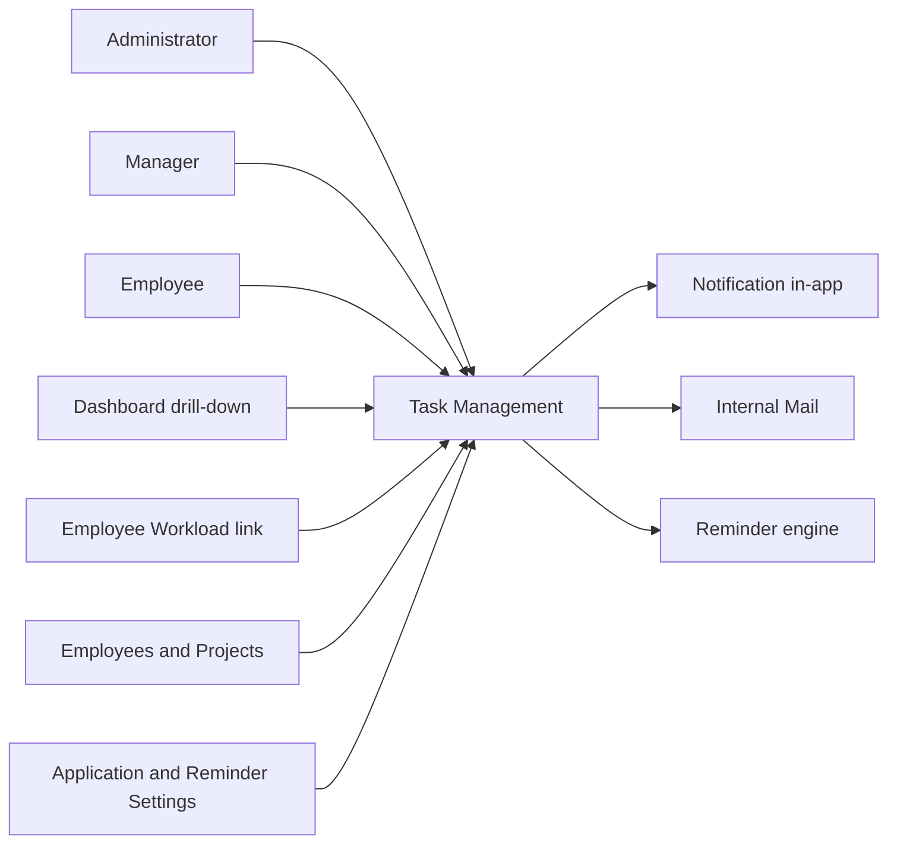
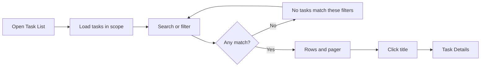
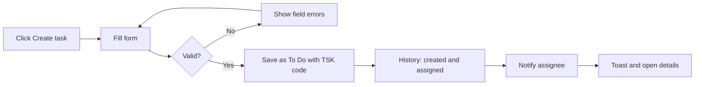
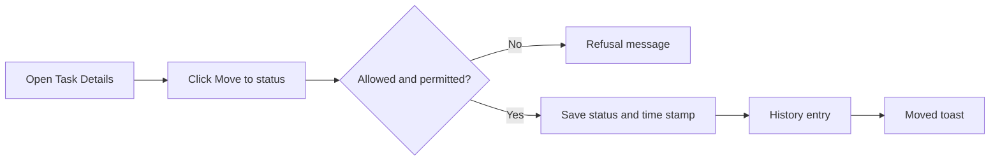
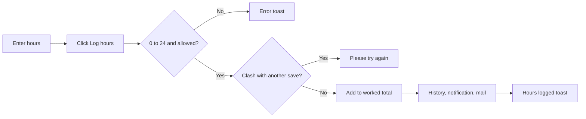
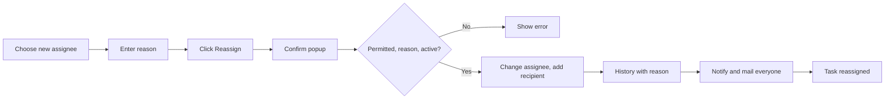
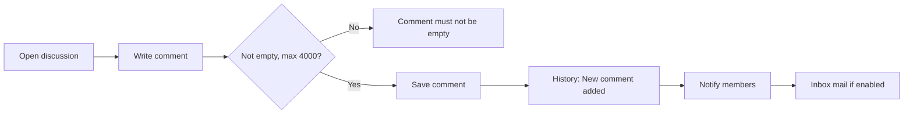
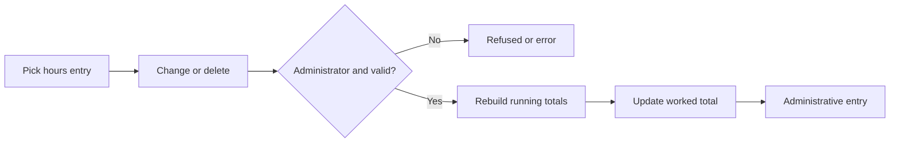
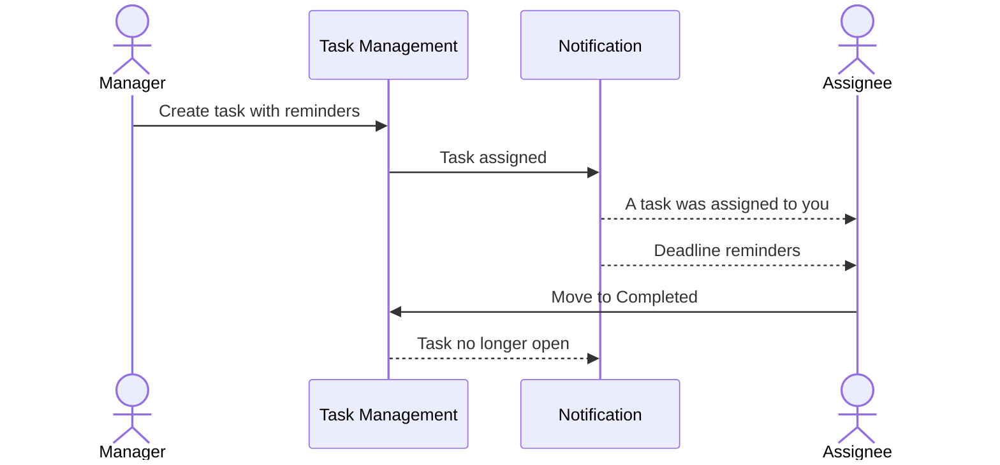
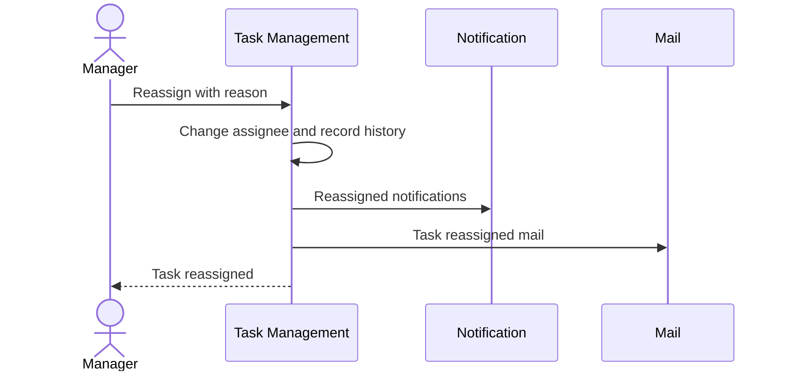

# Functional Requirements Document – Task Management

## TaskFlow – Intelligent Task Allocation & Tracking System

> **Document:** Functional Requirements Document (sub-module 02.1 Task Management, code `TASK`)  ·  **Version:** 1.0  ·  **Status:** Draft
> **Project type:** Personal Project (Skill Development)  ·  **Date:** 31-Oct-2026
> **Author:** Jojo George (jojogeorge3344@gmail.com)
> **Based on:** BRD-Task-Management.md v1.0
> © 2026 Jojo George. All rights reserved.

---

## Document Control

### Revision History

| Version | Date | Author | Summary of changes |
|---|---|---|---|
| 1.0 | 31-Oct-2026 | Jojo George | Initial version, derived from BRD-Task-Management v1.0 and the verified Task Management and Comments & Activity History workflow docs |

### Related Documents

| Document | Purpose | Location |
|---|---|---|
| BRD – Task Management | Business needs this FRD details (`REQ-TASK-nn`, `BR-TASK-nn`) | `../../../BRD/02-TaskFlow-Monitoring/02.1-Task-Management/BRD-Task-Management.md` |
| Overall BRD / FRD | Roles, global rules `BR-nn`, global NFRs, Authentication and Legal | `../../../BRD/00-Overall/BRD-TaskFlow-Overall.md`, `../../00-Overall/FRD-TaskFlow-Overall.md` |
| Sibling FRDs – Employee Workload, Board | Screens that open or share task data | `../02.2-Employee-Workload/FRD-Employee-Workload.md`, `../02.3-Board/FRD-Board.md` |
| Development Plan | Screen-wise build plan (original Screens 7, 8, 9, 11, 15, 18) | `TF - Documents/Screens Wise Feature Development Plan/` |
| HLD / LLD / TDD | Technical design | `../../../HLD/02-TaskFlow-Monitoring/02.1-Task-Management/HLD-Task-Management.md`, `../../../LLD/02-TaskFlow-Monitoring/02.1-Task-Management/LLD-Task-Management.md`, `TDD-TaskFlow.md` (v2.0) |

---

## 1. Introduction

### 1.1 Purpose
This FRD specifies the detailed, testable behaviour of the Task Management sub-module of TaskFlow Monitoring: the Task
List, Create Task (including Copy), Task Details, Reassign Task, Task Discussion and Activity History screens. For each
screen it states the inputs, outputs, rules, validations, messages and permissions, and traces every requirement back
to the Task Management BRD.

### 1.2 Scope
In scope: the six screens above and the behaviour behind them (task scope, status rules, worked hours, soft delete,
comments, activity history and the notifications and internal mail these actions send).

Out of scope (see BRD §3.2): choosing an initial status on Create; editing reminder intervals after creation; a screen
for changing additional recipients after creation; the Board (`../02.3-Board/FRD-Board.md`); Employee Workload
(`../02.2-Employee-Workload/FRD-Employee-Workload.md`); sending deadline reminders (Notification,
`../../04-Communication/04.2-Notification/FRD-Notification.md`); task reports (`../../05-Reports/05.1-Reports/FRD-Reports.md`).

### 1.3 Audience
Developer, tester and reviewer of TaskFlow (Jojo George), and the product owner approving the behaviour.

### 1.4 Conventions
- Requirement IDs: `FR-TASK-nn`. Use cases: `UC-TASK-nn`. BRD requirements: `REQ-TASK-nn`; sub-module rules `BR-TASK-nn`; global rules `BR-nn` (overall BRD).
- Notification codes in §7: `N-TASK-nn`.
- Priority: **Must / Should / Could** (MoSCoW).
- "The system shall …" = mandatory behaviour; "should" = recommended.
- Text in quotes is the exact UI label or message; `{name}` marks a value filled in at run time.

### 1.5 Definitions & Abbreviations

| Term | Meaning |
|---|---|
| Task scope | The tasks a user may see: **Own** (assigned, created or notified), **Team** (Manager) or **Organization** (Administrator) |
| Team (Manager) | Active people in a department the Manager manages or on a project where the Manager is flagged as project manager |
| Recipient | A user notified about a task; the assignee is always one |
| Stage | Upcoming, Due today, Overdue or Completed – worked out from the deadline and status each time a task is shown |
| Task code | `TSK-` followed by the 6-digit task number, e.g. `TSK-000042` |
| Worked hours / Remaining | Hours logged against the task / estimated hours minus worked hours |
| Soft delete | The record is hidden from every list but kept, with its comments and history |
| Drill-down | Opening the Task List from a dashboard chart segment, showing exactly the tasks it counted |
| Internal mail | A message in the TaskFlow Mail module (no external e-mail, global BR-23) |

---

## 2. System Overview

### 2.1 Module Map

| Code | Module | Child modules / screens | Primary roles |
|---|---|---|---|
| TASK | Task Management (TaskFlow Monitoring) | Task List, Create Task (and Copy), Task Details, Reassign Task | Administrator, Manager, Employee, Custom role |
| TASK | Comments & Activity History (part of Task Management) | Task Discussion, Activity History | All roles with task access |
| BOARD | Board (related) | Board (Kanban) – shares task scope, status rules and history | All roles with `board.view` |
| WORK | Employee Workload (related) | **Tasks →** link opens the Task List for one employee | Administrator, Manager |
| NOTIF / MAIL | Notification, Mail (related) | Receive task notifications and internal mail; reminder engine | All users |
| DASH | Dashboard (related) | Chart segments open the Task List as a drill-down | All users |

### 2.2 Context Diagram

---

## 3. User Roles & Permissions

### 3.1 Roles

| Role | Description | Data scope |
|---|---|---|
| Administrator | System owner; every task action including delete and worked-hours corrections | Organization (all tasks) |
| Manager | Leads a team; creates, copies, edits and reassigns tasks; changes status; comments | Team, plus tasks the Manager created, is assigned or is notified about |
| Employee | Works on tasks; views own tasks, changes status, logs hours on own tasks, comments | Own (assigned, created or notified) |
| Custom role | Role defined in Role Configuration | Own by default; Team or Organization when `tasks.view.all` is granted |

### 3.2 Permission Matrix (functional view)

| Module › Function | Permission key | Administrator | Manager | Employee | Custom role |
|---|---|:---:|:---:|:---:|:---:|
| Task List › View my tasks (list, board, details) | `tasks.view.own` | Always On | Always On | Always On | Always On |
| Task List › View all tasks (Managers limited to their team) | `tasks.view.all` | Granted | Granted | Denied | Configurable |
| Task List › Create and copy tasks | `tasks.create` | Granted | Granted | Denied | Configurable |
| Task List › Delete tasks | `tasks.delete` | Granted | Denied | Denied | Configurable |
| Details › Edit tasks (and log hours on any accessible task) | `tasks.update` | Granted | Granted | Denied | Configurable |
| Details › Reassign tasks | `tasks.reassign` | Granted | Granted | Denied | Configurable |
| Details › Manage task recipients (no screen in this release) | `tasks.recipients.manage` | Granted | Granted | Denied | Configurable |
| Details › Update task status (shared with Board) | `tasks.status.change` | Granted | Granted | Granted | Configurable |
| Discussion › Post task comments | `tasks.comment.create` | Granted | Granted | Granted | Configurable |
| Discussion › Edit own task comments | `tasks.comment.edit` | Granted | Granted | Granted | Configurable |
| Discussion › Delete own task comments | `tasks.comment.delete` | Granted | Granted | Granted | Configurable |
| Activity › View task history | `tasks.activity.view` | Granted | Granted | Granted | Configurable |
| Activity › Correct or delete a worked-hours entry | none – Administrator role only | Granted | Denied | Denied | Denied |

Supporting keys used by these screens (owned by other sub-modules): `employees.view` and `projects.view` (assignee,
recipient and project lists on Create and Reassign) and `settings.reminders.manage` (reminder defaults on Create) –
Administrator and Manager Granted, Employee Denied, Custom role Configurable.

---

## 4. Functional Requirements by Module

### 4.1 Module: Task Management (TASK)

**Purpose:** Keep one reliable record per task – owner, deadline, status, effort, discussion and history – and let
authorised users act on it.  ·  **BRD reference:** BRD-Task-Management §5 SCREENS 1–6, BR-TASK-01…12; global BR-06…BR-13, BR-17…BR-19, BR-21…BR-23.

#### 4.1.1 Screen: Task List

| Field | Value |
|---|---|
| Route / location | `/tasks` – menu **TaskFlow Monitoring → Task Management** (with `tasks.view.all`) or **Task Management → My Tasks** (everyone else) |
| Access | All signed-in users (`tasks.view.own`, Always On); content follows the user's task scope |
| Entry points | Menu; dashboard chart segment (drill-down); **Tasks →** on Employee Workload; Back from Task Details |

**Screen elements**

| Element | Type | Description | Mandatory | Visible to |
|---|---|---|:---:|---|
| Count text | Text | "1–20 of 57 tasks", plus " match the current filters" when filters are active | – | All |
| Board view | Button | Opens the Board | – | All (see §10, open issue) |
| Create task | Button | Opens Create Task | – | `tasks.create` |
| Search | Text input | Placeholder "Task code or title" | No | All |
| Employee | Drop-down | Filter by assignee | No | `tasks.view.all` |
| Project | Drop-down | Filter by project (shown when the project list loads) | No | All |
| Status, Priority | Drop-downs | Filter by status / priority | No | All |
| Deadline from, Deadline to | Date inputs | Deadline range | No | All |
| Reset | Button | Clears all filters | – | All |
| Drill-down banner | Banner | "Opened from the dashboard: …" with **Show all tasks** | – | When opened from a dashboard segment |
| Task table | Table | Code, Title (link), Project, Assignee, Creator, Priority, Start, Deadline (stage chip), Est. hours, Status | – | All |
| Copy task | Row action | Opens Create Task prefilled from the row | – | `tasks.create` |
| Delete | Row action | Deletes the task after confirmation | – | `tasks.delete` |
| Pager | Buttons / text | Previous, Next, "Page X of Y" | – | All |

**Functional requirements**

| ID | Requirement | Priority | Permission | BRD trace |
|---|---|---|---|---|
| FR-TASK-01 | The system shall list only the tasks in the user's task scope: Own (assigned, created or notified) for users without `tasks.view.all`, Team plus own for a Manager, Organization for an Administrator. | Must | `tasks.view.own`, `tasks.view.all` | REQ-TASK-01, BR-TASK-01, BR-06 |
| FR-TASK-02 | The system shall define a Manager's team as the active people in a department the Manager manages or on a project where the Manager is flagged as project manager. | Must | `tasks.view.all` | BR-TASK-01 |
| FR-TASK-03 | The system shall order the list by deadline, soonest first, and show 20 tasks per page (at most 100 per page) with Previous, Next and "Page X of Y". | Must | `tasks.view.own` | REQ-TASK-02, NFR-TASK-01, NFR-01 |
| FR-TASK-04 | The system shall search task code and title and refresh the list 300 ms after the user stops typing. | Must | `tasks.view.own` | REQ-TASK-03 |
| FR-TASK-05 | The system shall filter by Status, Priority, Project and a Deadline from/to range, combine all chosen filters (AND) and restart at page 1 whenever a filter changes. | Must | `tasks.view.own` | REQ-TASK-04 |
| FR-TASK-06 | The system shall offer the Employee filter only to users with `tasks.view.all`. | Should | `tasks.view.all` | REQ-TASK-05 |
| FR-TASK-07 | The system shall show a stage chip "Overdue", "Due today" or "Upcoming" on each deadline and highlight overdue rows. | Must | `tasks.view.own` | REQ-TASK-06, BR-12 |
| FR-TASK-08 | The system shall, when opened from a dashboard chart segment, list exactly the tasks the segment counted, show the banner "Opened from the dashboard: …" and offer **Show all tasks** to return to the unfiltered list. | Should | `tasks.view.own` | REQ-TASK-07, BR-22 |
| FR-TASK-09 | The system shall limit a Manager's drill-down list to the team's tasks. | Must | `tasks.view.all` | BR-TASK-02 |
| FR-TASK-10 | The system shall open Task Details when the user clicks a task title. | Must | `tasks.view.own` | REQ-TASK-08 |
| FR-TASK-11 | The system shall show **Create task** and **Copy task** only to users with `tasks.create`, and **Delete** only to users with `tasks.delete`. | Must | `tasks.create`, `tasks.delete` | REQ-TASK-09 |
| FR-TASK-12 | The system shall title the page "Task Management" for users with `tasks.view.all` and "My Tasks" for everyone else. | Could | `tasks.view.all` | REQ-TASK-10 |
| FR-TASK-13 | The system shall show "No tasks match these filters" with **Clear filters** when filters return nothing, "No tasks yet" / "Tasks assigned to you will appear here." when the user has no tasks, and "Could not load tasks. Check your connection and try again." when loading fails. | Should | `tasks.view.own` | REQ-TASK-02, REQ-TASK-04 |

**Use case: UC-TASK-01 – Find and open a task**

| Item | Detail |
|---|---|
| Actor | Employee, Manager or Administrator |
| Preconditions | Signed in (two-step verification done) |
| Trigger | Opens **My Tasks** or **TaskFlow Monitoring → Task Management** |
| Main flow | 1. System loads the first 20 tasks in the user's scope, soonest deadline first. 2. User types a code or title in **Search**; the list refreshes 300 ms after typing stops. 3. User picks Status, Priority, Project, a deadline range (and Employee if allowed); the list restarts at page 1. 4. User pages with Previous / Next. 5. User clicks a title; Task Details opens. |
| Alternate flows | A1: Opened from a dashboard segment – the list shows the segment's tasks with the drill-down banner; **Show all tasks** clears it. A2: Opened from Employee Workload **Tasks →** – the list is filtered to that employee within the user's scope. |
| Exceptions | E1: No match → "No tasks match these filters" and **Clear filters**. E2: Load failure → "Could not load tasks. Check your connection and try again." |
| Postconditions | The user sees the tasks they are allowed to see; nothing is changed |

**Use case: UC-TASK-02 – Open a dashboard drill-down**

| Item | Detail |
|---|---|
| Actor | Any user with a dashboard |
| Preconditions | Signed in; on a dashboard chart |
| Trigger | Clicks a chart segment |
| Main flow | 1. System opens `/tasks` with the segment's criteria. 2. System lists exactly the counted tasks (team tasks only for a Manager) and shows "Opened from the dashboard: …". 3. User clicks **Show all tasks** to clear the drill-down. |
| Alternate flows | – |
| Exceptions | E1: Segment dates reversed → "The end date cannot be before the start date." |
| Postconditions | The list matches the chart count |

**Field validations**

| Field | Rule | Error message |
|---|---|---|
| Deadline from / to (drill-down) | End not before start | "The end date cannot be before the start date." |
| Search | Free text, code or title | – |

**Business rules applied:** BR-TASK-01, BR-TASK-02, BR-TASK-04; global BR-06, BR-12, BR-17, BR-22.

**Notifications / side effects**

| Event | Who is notified | Channel |
|---|---|---|
| – | Viewing and filtering send nothing | – |

**Messages**

| Situation | Message |
|---|---|
| Load failed | "Could not load tasks. Check your connection and try again." |
| No result for filters | "No tasks match these filters" (button **Clear filters**) |
| No tasks at all | "No tasks yet" / "Tasks assigned to you will appear here." |
| No permission for an action | The button is hidden; a direct request is refused |

#### 4.1.2 Screen: Create Task (and Copy Task)

| Field | Value |
|---|---|
| Route / location | `/tasks/new`; Copy opens `/tasks/new?copyFrom={id}` |
| Access | `tasks.create` (Administrator, Manager; Custom role as granted). Also needs `employees.view`, `projects.view` and `settings.reminders.manage` to fill the drop-downs and defaults |
| Entry points | Task List **Create task**; **Copy task** on a list row; **Copy** on Task Details |

**Screen elements**

| Element | Type | Description | Mandatory | Visible to |
|---|---|---|:---:|---|
| Project | Drop-down | Active projects | Yes | `tasks.create` |
| Title | Text input | Up to 200 characters | Yes | `tasks.create` |
| Description | Text area | Up to 4000 characters | No | `tasks.create` |
| Assigned employee | Drop-down | Active users with the Employee role | Yes | `tasks.create` |
| Priority | Selector | Low, Medium, High, Critical; default from Application Settings | Yes | `tasks.create` |
| Start date, Deadline | Date-time inputs | Default now and now + 3 days | Yes | `tasks.create` |
| Estimated hours | Number input | Greater than 0 | Yes | `tasks.create` |
| Additional recipients | Checklist | Active users except the assignee; hint "The assigned employee is always notified." | No | `tasks.create` |
| First reminder, Second reminder | Number inputs | Days before the deadline (0–30), prefilled from Reminder Settings | No | `tasks.create` |
| After the deadline | Selector | Daily / Weekly, prefilled from Reminder Settings | No | `tasks.create` |
| Copy notice | Notice | "Copied from TSK-…. Check the dates before creating." | – | When opened with Copy |
| Cancel, Create task | Buttons | Leave without saving / save the task | – | `tasks.create` |

**Functional requirements**

| ID | Requirement | Priority | Permission | BRD trace |
|---|---|---|---|---|
| FR-TASK-14 | The system shall give every new task a unique, never-reused code `TSK-` followed by the 6-digit task number (e.g. `TSK-000042`). | Must | `tasks.create` | REQ-TASK-11, BR-07 |
| FR-TASK-15 | The system shall require Project, Title, Assigned employee, Priority, Start date, Deadline and Estimated hours. | Must | `tasks.create` | REQ-TASK-12, BR-08 |
| FR-TASK-16 | The system shall reject a Title longer than 200 characters and a Description longer than 4000 characters. | Must | `tasks.create` | REQ-TASK-13 |
| FR-TASK-17 | The system shall offer the priorities Low, Medium, High and Critical and preselect the default priority from Application Settings. | Must | `tasks.create` | REQ-TASK-14 |
| FR-TASK-18 | The system shall preset Start date to the current date and time and Deadline to three days later. | Should | `tasks.create` | REQ-TASK-15 |
| FR-TASK-19 | The system shall reject a Deadline that is not later than the Start date. | Must | `tasks.create` | REQ-TASK-16, BR-08 |
| FR-TASK-20 | The system shall reject Estimated hours that are not greater than 0. | Must | `tasks.create` | REQ-TASK-17, BR-08 |
| FR-TASK-21 | The system shall save every new task with status To Do; the form has no status field. | Must | `tasks.create` | REQ-TASK-18, BR-11 |
| FR-TASK-22 | The system shall always add the assignee as a recipient, accept up to 50 additional recipients chosen from active users, and reject the task if any recipient does not exist. | Must | `tasks.create` | REQ-TASK-19, BR-TASK-05, BR-09 |
| FR-TASK-23 | The system shall accept First and Second reminder values of 0 to 30 days before the deadline (0 = deadline day) and an overdue frequency of Daily or Weekly, reject a second reminder that comes before the first, and use the Reminder Settings defaults for empty fields. | Must | `tasks.create` | REQ-TASK-20, BR-TASK-06, BR-14 |
| FR-TASK-24 | The system shall accept only an assignee who exists and is active and a project that exists and is active. | Must | `tasks.create` | REQ-TASK-21, BR-08 |
| FR-TASK-25 | The system shall list only active users with the Employee role in the Assigned employee drop-down. | Must | `tasks.create`, `employees.view` | REQ-TASK-22 |
| FR-TASK-26 | The system shall record the creator and creation time and add the history entries "Task created" and "Assigned to {name}". | Must | `tasks.create` | REQ-TASK-23, BR-19 |
| FR-TASK-27 | The system shall notify the assignee in-app with "A task was assigned to you: {title}" as part of saving the task. | Must | `tasks.create` | REQ-TASK-24, BR-09 |
| FR-TASK-28 | The system shall, after saving, show "{code} created and assigned to {name}" and open the new task's details. | Should | `tasks.create` | REQ-TASK-11, REQ-TASK-24 |
| FR-TASK-29 | The system shall, when **Copy** is used, prefill the form from the source task (keeping the new-task date defaults), show "Copied from TSK-…. Check the dates before creating.", and save nothing until the user clicks **Create task**. | Should | `tasks.create` | REQ-TASK-25 |
| FR-TASK-30 | The system shall show "Copied from TSK-…, but {name} can no longer be assigned. Choose another employee." when the source assignee cannot be chosen, and "That task could not be copied, so the form is empty." when the source task cannot be loaded. | Should | `tasks.create` | REQ-TASK-25 |

**Use case: UC-TASK-03 – Create and assign a task**

| Item | Detail |
|---|---|
| Actor | Manager or Administrator |
| Preconditions | Signed in; holds `tasks.create` (and the supporting view keys) |
| Trigger | Clicks **Create task** on the Task List |
| Main flow | 1. System opens the form with the default priority, start now, deadline now + 3 days and the reminder defaults. 2. User picks Project, enters Title, picks Assigned employee, Priority, dates and Estimated hours, and optionally recipients and reminders. 3. User clicks **Create task**. 4. System validates the form and the server rules. 5. System saves the task as To Do with a `TSK-` code and adds the assignee as a recipient. 6. System records "Task created" and "Assigned to {name}" and notifies the assignee. 7. System shows "{code} created and assigned to {name}" and opens Task Details. |
| Alternate flows | A1: **Cancel** – nothing is saved. |
| Exceptions | E1: Missing or invalid field → field message (see validations); nothing saved. E2: Assignee or project inactive → "The assigned employee does not exist or is not active." / "The selected project does not exist." E3: No permission → "Your role is not allowed to create tasks."; without `tasks.create` the route sends the user back to the dashboard. |
| Postconditions | Task saved as To Do; assignee notified; history started; task visible to authorised users |

**Use case: UC-TASK-04 – Copy a task**

| Item | Detail |
|---|---|
| Actor | Manager or Administrator |
| Preconditions | Holds `tasks.create`; can access the source task |
| Trigger | Clicks **Copy task** on a list row or **Copy** on Task Details |
| Main flow | 1. System opens Create Task filled from the source task, with new-task dates. 2. System shows "Copied from TSK-…. Check the dates before creating." 3. User adjusts the values and continues as UC-TASK-03 from step 3. |
| Alternate flows | A1: Source assignee can no longer be assigned → warning naming the person; user chooses another employee. |
| Exceptions | E1: Source cannot be loaded → "That task could not be copied, so the form is empty." |
| Postconditions | A new, independent task (the source is unchanged) |

**Field validations**

| Field | Rule | Error message |
|---|---|---|
| Project | Required; must exist and be active | "Project is required." · "The selected project does not exist." |
| Title | Required; at most 200 characters | "Title is required." · "Title must be 200 characters or fewer." |
| Description | At most 4000 characters | "Description must be 4000 characters or fewer." |
| Assigned employee | Required; must exist and be active | "Select the employee to assign." · "The assigned employee does not exist or is not active." |
| Start date | Required | "Start date is required." |
| Deadline | Required; later than Start date | "Deadline is required." · "Deadline must be after the start date." |
| Estimated hours | Required; greater than 0 | "Estimated hours are required." · "Estimated hours must be a positive number." |
| Additional recipients | At most 50; every user must exist | "A task can have at most 50 additional recipients." · "One or more recipients do not exist." |
| First / Second reminder | 0–30 days; second not before first | "The second reminder cannot come before the first reminder." |

**Business rules applied:** BR-TASK-05, BR-TASK-06, BR-TASK-12; global BR-07, BR-08, BR-09, BR-10, BR-11, BR-14, BR-19.

**Notifications / side effects**

| Event | Who is notified | Channel |
|---|---|---|
| Task created and assigned (N-TASK-01) | Assignee | In-app |
| Reminder intervals stored | Used later by the reminder engine for the recipients and creator | In-app and Mail (Notification sub-module) |

**Messages**

| Situation | Message |
|---|---|
| Success | "TSK-000123 created and assigned to {name}" |
| No permission | "Your role is not allowed to create tasks." |
| Copy notice | "Copied from TSK-…. Check the dates before creating." |

#### 4.1.3 Screen: Task Details

| Field | Value |
|---|---|
| Route / location | `/tasks/{id}` |
| Access | Assignee, creator and recipients of the task; `tasks.view.all` holders (a Manager only for team tasks); Administrator. Each action has its own key |
| Entry points | Task title on the Task List; card on the Board (Back returns to the Board); links in notifications and mail |

**Screen elements**

| Element | Type | Description | Mandatory | Visible to |
|---|---|---|:---:|---|
| Header | Text / chip | Task code, project, stage chip | – | Task access |
| Copy, Delete, Edit task | Buttons | Copy the task / delete it / open the edit form | – | `tasks.create` / `tasks.delete` / `tasks.update` |
| Details card | Read-only fields | Description, project, assignee, created by, priority, start date, deadline, estimated hours, worked hours, status, last updated, "Also notified" | – | Task access |
| Edit form | Inputs | Title, Description, Priority, Start date, Deadline, Estimated hours, Worked hours; **Cancel** / **Save changes** | Title, dates, estimate | `tasks.update` |
| Discussion tab | Tab | Comment count, latest 3 comments, "Showing the latest 3 of N.", **Open full discussion →** | – | Task access |
| Activity history tab | Tab | Latest 4 entries, **Open full history →** | – | `tasks.activity.view` |
| Reassign task tab | Tab | **Choose new assignee** | – | `tasks.reassign` |
| Time tracking | Panel | Estimated, Worked, Remaining; **Log hours** box; "View hours in activity history" | – | Assignee or `tasks.update` |
| Move to | Buttons | One button per allowed next status | – | Task access (action needs `tasks.status.change`) |

**Functional requirements**

| ID | Requirement | Priority | Permission | BRD trace |
|---|---|---|---|---|
| FR-TASK-31 | The system shall show the task code, title, description, project, assignee, creator, priority, start date, deadline, estimated hours, worked hours, status, last updated time and the "Also notified" recipients. | Must | `tasks.view.own` | REQ-TASK-26 |
| FR-TASK-32 | The system shall open a task only for users in its scope and refuse anyone else with "You do not have access to this task.". | Must | `tasks.view.own`, `tasks.view.all` | REQ-TASK-26, BR-TASK-01, NFR-TASK-02 |
| FR-TASK-33 | The system shall show the stage Upcoming, Due today, Overdue or Completed, worked out in the application time zone each time the task is shown and never stored. | Must | `tasks.view.own` | REQ-TASK-27, BR-TASK-04, BR-12, BR-17 |
| FR-TASK-34 | The system shall let users with `tasks.update` change title, description, priority, start date, deadline, estimated hours and worked hours, and show "Task updated" after saving. | Must | `tasks.update` | REQ-TASK-28 |
| FR-TASK-35 | The system shall validate the edit form: Title required and at most 200 characters, Start date and Deadline required with the deadline after the start, Estimated hours at least 0.5. | Must | `tasks.update` | REQ-TASK-28, REQ-TASK-16 |
| FR-TASK-36 | The system shall record "Deadline updated", "Priority updated" and "Worked hours logged: {X}h (total)" history entries when those values change on edit. | Must | `tasks.update` | REQ-TASK-29, BR-19 |
| FR-TASK-37 | The system shall offer under **Move to** only the statuses allowed from the current status by the transition table in BR-TASK-03. | Must | `tasks.status.change` | REQ-TASK-30, BR-TASK-03, BR-11 |
| FR-TASK-38 | The system shall refuse a status change without `tasks.status.change` or outside the transition table, with "Cannot move a task from {from} to {to}." for a disallowed move. | Must | `tasks.status.change` | REQ-TASK-30, BR-TASK-03 |
| FR-TASK-39 | The system shall, on an accepted status change, record "Status changed from {X} to {Y}" (plus "Task completed" when completed) and show "{code} moved to {status}". | Must | `tasks.status.change` | REQ-TASK-30, REQ-TASK-52 |
| FR-TASK-40 | The system shall store the completion time when a task becomes Completed and the cancel time when it becomes Cancelled. | Should | `tasks.status.change` | REQ-TASK-31 |
| FR-TASK-41 | The system shall let the assignee, or a user with `tasks.update`, log more than 0 and at most 24 hours per entry, add them to the worked total, record "Worked hours logged: {X}h (total)" and show "{X}h logged". | Must | none for the assignee, otherwise `tasks.update` | REQ-TASK-32, BR-TASK-07 |
| FR-TASK-42 | The system shall show Estimated, Worked and Remaining hours in Time tracking and update them after hours are logged. | Should | `tasks.view.own` | REQ-TASK-33 |
| FR-TASK-43 | The system shall notify the assignee and the recipients in-app and by internal mail whenever the worked hours change (Log hours or edit). | Should | – | REQ-TASK-34 |
| FR-TASK-44 | The system shall refuse a worked-hours save that clashes with another save, keep the other save's hours and show "The task's worked hours changed while you were saving. Please try again.". | Should | – | REQ-TASK-35, NFR-TASK-05 |
| FR-TASK-45 | The system shall show the latest 3 comments in the Discussion tab and, to users with `tasks.activity.view`, the latest 4 history entries in the Activity history tab. | Should | `tasks.activity.view` | REQ-TASK-36 |
| FR-TASK-46 | The system shall let users with `tasks.delete` delete a task after the confirmation "Delete task?" ("… will be removed for everyone. Its comments and history are kept."), hide it from every list, keep its comments and history, record "Task deleted" and show "{code} deleted". | Must | `tasks.delete` | REQ-TASK-37, BR-TASK-08, BR-21 |
| FR-TASK-47 | The system shall stop deadline reminders for a task once it is Completed or Cancelled. | Must | – | REQ-TASK-38, BR-13 |

**Use case: UC-TASK-05 – Edit a task**

| Item | Detail |
|---|---|
| Actor | Manager or Administrator |
| Preconditions | Holds `tasks.update`; the task is in the user's scope |
| Trigger | Clicks **Edit task** |
| Main flow | 1. System shows the edit form with the current values. 2. User changes fields and clicks **Save changes**. 3. System validates and saves. 4. System records deadline, priority and worked-hours changes in the history. 5. If worked hours changed, the assignee and recipients are notified and mailed. 6. System shows "Task updated". |
| Alternate flows | A1: **Cancel** – nothing is saved. |
| Exceptions | E1: Invalid value → field message. E2: No permission → "Your role is not allowed to edit tasks." E3: Out of scope → "You do not have access to this task." |
| Postconditions | Task updated; changes recorded |

**Use case: UC-TASK-06 – Change a task's status**

| Item | Detail |
|---|---|
| Actor | Assignee, Manager or Administrator |
| Preconditions | Holds `tasks.status.change`; the task is in the user's scope |
| Trigger | Clicks a status under **Move to** |
| Main flow | 1. System shows only the allowed next statuses. 2. User clicks one. 3. System checks the permission and the transition table. 4. System saves the status (and completion or cancel time), records the history entry and shows "{code} moved to {status}". |
| Alternate flows | A1: Same as the Board drag (see `../02.3-Board/FRD-Board.md`). |
| Exceptions | E1: Disallowed move → "Cannot move a task from Completed to InProgress." (statuses vary). E2: No `tasks.status.change` → refused. |
| Postconditions | New status saved and recorded; reminders stop for Completed or Cancelled |

**Use case: UC-TASK-07 – Log worked hours**

| Item | Detail |
|---|---|
| Actor | Assignee (or a `tasks.update` holder) |
| Preconditions | Can access the task |
| Trigger | Enters hours in **Log hours** and confirms |
| Main flow | 1. System checks 0 < hours ≤ 24 and that the user is the assignee or holds `tasks.update`. 2. System adds the hours to the worked total and records "Worked hours logged: {X}h (total)". 3. System notifies the assignee and recipients in-app and by mail ("… added 3h of worked time (was 2h) …"). 4. System shows "3h logged" and updates Worked and Remaining. |
| Alternate flows | – |
| Exceptions | E1: Hours empty or 0 → "Enter the hours worked (greater than 0)." E2: Outside 0–24 → "Hours must be greater than 0 and at most 24 per entry." E3: Not allowed → "Only the assignee can log hours on this task." E4: Clashing save → "The task's worked hours changed while you were saving. Please try again." |
| Postconditions | Worked total increased; history and notifications written |

**Use case: UC-TASK-08 – Delete a task**

| Item | Detail |
|---|---|
| Actor | Administrator |
| Preconditions | Holds `tasks.delete` |
| Trigger | Clicks **Delete** on a list row or on Task Details |
| Main flow | 1. System asks "Delete task?" and explains the task will be removed for everyone while comments and history are kept. 2. User confirms. 3. System soft-deletes the task, records "Task deleted" and shows "{code} deleted". |
| Alternate flows | A1: User cancels the popup – nothing changes. |
| Exceptions | E1: No permission – the button is hidden and a direct request is refused. |
| Postconditions | Task hidden from every list, board, workload count and reminder; comments and history kept |

**Field validations**

| Field | Rule | Error message |
|---|---|---|
| Title (edit) | Required; at most 200 characters | "Title is required." · "Title must be 200 characters or fewer." |
| Deadline (edit) | Later than Start date | "Deadline must be after the start date." |
| Estimated hours (edit) | At least 0.5 | "Enter at least 0.5 hours." |
| Log hours | Greater than 0, at most 24 | "Enter the hours worked (greater than 0)." · "Hours must be greater than 0 and at most 24 per entry." |

**Business rules applied:** BR-TASK-01, BR-TASK-03, BR-TASK-04, BR-TASK-07, BR-TASK-08, BR-TASK-12; global BR-10, BR-11, BR-12, BR-13, BR-17, BR-19, BR-21.

**Notifications / side effects**

| Event | Who is notified | Channel |
|---|---|---|
| Worked hours changed (N-TASK-05, N-TASK-06) | Assignee and recipients | In-app, internal Mail |
| Status changed, task edited (other fields), task deleted | Nobody – recorded in the history only | – |
| Completed or Cancelled | Reminder engine stops further reminders | – |

**Messages**

| Situation | Message |
|---|---|
| Edit saved | "Task updated" |
| Status changed | "TSK-000123 moved to InProgress" |
| Hours logged | "3h logged" |
| Deleted | "TSK-000123 deleted" |
| Delete confirmation | "Delete task?" – "… will be removed for everyone. Its comments and history are kept." |
| Disallowed status move | "Cannot move a task from Completed to InProgress." |
| Not allowed to log hours | "Only the assignee can log hours on this task." |
| Concurrent hours save | "The task's worked hours changed while you were saving. Please try again." |
| No access / permission | "You do not have access to this task." · "Your role is not allowed to edit tasks." · screen fallback "Could not load the task." |

#### 4.1.4 Screen: Reassign Task

| Field | Value |
|---|---|
| Route / location | `/tasks/{id}/reassign` |
| Access | `tasks.reassign` (Administrator, Manager; Custom role as granted) and access to the task; the people list needs `employees.view` |
| Entry points | Task Details → **Reassign task** tab → **Choose new assignee** |

**Screen elements**

| Element | Type | Description | Mandatory | Visible to |
|---|---|---|:---:|---|
| "1 · Who takes over?" | Step | Current and New cards, "Search people…", list of active users except the current assignee | Yes | `tasks.reassign` |
| "2 · Why is it moving?" – Reason | Text area | Up to 500 characters; hint: "recorded in the activity history and shown to everyone notified" | Yes | `tasks.reassign` |
| "What happens next" | List | Everyone who will be told: new assignee, previous assignee, also notified | – | `tasks.reassign` |
| Cancel, Reassign | Buttons | Return to the task / start the reassignment | – | `tasks.reassign` |
| Confirmation popup | Dialog | "Reassign task?" – "… will move from A to B. The new assignee will be notified." | – | `tasks.reassign` |

**Functional requirements**

| ID | Requirement | Priority | Permission | BRD trace |
|---|---|---|---|---|
| FR-TASK-48 | The system shall let the user search the people list and pick any active user except the current assignee as the new assignee. | Must | `tasks.reassign`, `employees.view` | REQ-TASK-39 |
| FR-TASK-49 | The system shall refuse a reassignment by a user without `tasks.reassign` ("Your role is not allowed to reassign tasks.") or outside the task's scope ("You do not have access to this task."). | Must | `tasks.reassign` | REQ-TASK-39, BR-TASK-01, BR-10 |
| FR-TASK-50 | The system shall require a reason of at most 500 characters and refuse an empty one with "A reassignment reason is required.". | Must | `tasks.reassign` | REQ-TASK-40, BR-TASK-09, BR-18 |
| FR-TASK-51 | The system shall refuse a new assignee who does not exist or is not active with "The target employee does not exist or is not active.". | Must | `tasks.reassign` | REQ-TASK-39, BR-TASK-09 |
| FR-TASK-52 | The system shall ask "Reassign task?" and save only after the user confirms. | Must | `tasks.reassign` | REQ-TASK-41 |
| FR-TASK-53 | The system shall record "Reassigned from {A} to {B}. Reason: {reason}" with the acting user and the time. | Must | `tasks.reassign` | REQ-TASK-42, BR-19 |
| FR-TASK-54 | The system shall add the new assignee as a recipient and keep all existing comments, recipients and history. | Must | `tasks.reassign` | REQ-TASK-43, BR-TASK-05, BR-18 |
| FR-TASK-55 | The system shall notify the new assignee, the previous assignee, the recipients and the acting user in-app and by internal mail, then show "Task reassigned" and return to the task. | Must | `tasks.reassign` | REQ-TASK-44 |
| FR-TASK-56 | The system shall list under "What happens next", before saving, everyone who will be told about the reassignment. | Could | `tasks.reassign` | REQ-TASK-45 |

**Use case: UC-TASK-09 – Reassign a task**

| Item | Detail |
|---|---|
| Actor | Manager or Administrator |
| Preconditions | Holds `tasks.reassign`; the task is in the user's scope |
| Trigger | Task Details → **Reassign task** → **Choose new assignee** |
| Main flow | 1. System shows the current assignee and the people list. 2. User searches and picks the new person. 3. User enters a reason; "What happens next" lists everyone who will be told. 4. User clicks **Reassign**; system asks "Reassign task?". 5. User confirms. 6. System checks permission, reason and the person's status, changes the assignee, adds them as a recipient and records the reason. 7. System notifies and mails everyone listed, shows "Task reassigned" and returns to Task Details. |
| Alternate flows | A1: **Cancel** or cancelling the popup – nothing changes. |
| Exceptions | E1: Reason empty → "A reassignment reason is required." E2: Target inactive → "The target employee does not exist or is not active." E3: No permission → "Your role is not allowed to reassign tasks."; without the key the route sends the user back to the dashboard. |
| Postconditions | New assignee set; history and comments kept; everyone informed |

**Field validations**

| Field | Rule | Error message |
|---|---|---|
| New assignee | Required; active user; not the current assignee | "The target employee does not exist or is not active." |
| Reason | Required; at most 500 characters | "A reassignment reason is required." |

**Business rules applied:** BR-TASK-01, BR-TASK-05, BR-TASK-09, BR-TASK-12; global BR-10, BR-18, BR-19, BR-23.

**Notifications / side effects**

| Event | Who is notified | Channel |
|---|---|---|
| Task reassigned (N-TASK-02, N-TASK-03, N-TASK-04) | New assignee, previous assignee, recipients, acting user | In-app, internal Mail |

**Messages**

| Situation | Message |
|---|---|
| Confirmation | "Reassign task?" – "… will move from A to B. The new assignee will be notified." |
| Success | "Task reassigned" |
| No permission | "Your role is not allowed to reassign tasks." |

#### 4.1.5 Screen: Task Discussion

| Field | Value |
|---|---|
| Route / location | `/tasks/{id}/discussion` (summary in the Task Details **Discussion** tab) |
| Access | Users who can access the task; writing needs `tasks.comment.create`, `tasks.comment.edit`, `tasks.comment.delete` |
| Entry points | Task Details → **Discussion** → **Open full discussion →** |

The full page (`TaskDiscussionComponent`, `discussion/pages/task-discussion.component.*`) has **Back to task #N**, chips
with the task code, title and comment count, the thread, an **Add a comment** box and a side rail.

**Screen elements**

| Element | Type | Description | Mandatory | Visible to |
|---|---|---|:---:|---|
| Header chips | Chips | Task code, title and "N comments" | – | Task access |
| Comment history | List | Grouped by day; author initials and name, "You" on the user's own comments, time, "(edited)" mark; oldest first. Empty state "No comments yet" | – | Task access |
| Comment box | Text area | **Add a comment**, at most 1000 characters on the page (the server accepts 4000); counter "N / 1000 · Everyone on the task is notified"; **Post comment** | Yes (to post) | `tasks.comment.create` |
| Edit / Delete | Actions | On the user's own comments: **Edit** opens the text in place with **Cancel** / **Save**; **Delete** asks "Delete comment?" first | – | author with `tasks.comment.edit` / author with `tasks.comment.delete` |
| Who is notified | Panel | The assignee and each recipient | – | Task access |
| Task | Panel | Status, priority and deadline | – | Task access |

**Functional requirements**

| ID | Requirement | Priority | Permission | BRD trace |
|---|---|---|---|---|
| FR-TASK-57 | The system shall list a task's comments oldest first, each with author, time and an "(edited)" mark when edited, and show "No comments yet" when there are none. | Must | task access | REQ-TASK-46 |
| FR-TASK-58 | The system shall let users with `tasks.comment.create` post a comment that is not empty and at most 4000 characters. | Must | `tasks.comment.create` | REQ-TASK-47 |
| FR-TASK-59 | The system shall let only the author edit (with `tasks.comment.edit`) or delete (with `tasks.comment.delete`) a comment, whatever other permissions the user holds. | Should | `tasks.comment.edit`, `tasks.comment.delete` | REQ-TASK-48, BR-TASK-10 |
| FR-TASK-60 | The system shall hide a deleted comment and keep an excerpt of up to 200 characters in the history. | Should | `tasks.comment.delete` | REQ-TASK-49, BR-21 |
| FR-TASK-61 | The system shall record "New comment added", "Comment edited" or "Comment deleted" in the task's history. | Must | – | REQ-TASK-50, BR-19 |
| FR-TASK-62 | The system shall notify the assignee, every recipient and the author in-app of each comment change, and place a system mail "Comment {added/edited/deleted}: {task}" in their Inbox when mail is enabled. | Should | – | REQ-TASK-51, BR-TASK-12 |

**Use case: UC-TASK-10 – Post a comment**

| Item | Detail |
|---|---|
| Actor | Any user with task access and `tasks.comment.create` |
| Preconditions | Can access the task |
| Trigger | Writes in the comment box and posts |
| Main flow | 1. System checks the comment is not empty and at most 4000 characters. 2. System saves it and records "New comment added". 3. System notifies the assignee, recipients and author ("{name} added a comment on "{task}": "{excerpt}"") and, when mail is enabled, places "Comment added: {task}" in their Inbox. 4. The comment appears at the end of the list. |
| Alternate flows | – |
| Exceptions | E1: Empty → "Comment must not be empty." E2: Task missing → "Task not found." |
| Postconditions | Comment saved; history entry; members informed |

**Use case: UC-TASK-11 – Edit or delete an own comment**

| Item | Detail |
|---|---|
| Actor | Comment author |
| Preconditions | Holds `tasks.comment.edit` (edit) or `tasks.comment.delete` (delete) |
| Trigger | Chooses edit or delete on one of their comments |
| Main flow | 1. System checks the user is the author. 2. Edit: saves the new text, marks it "(edited)", records "Comment edited". Delete: hides the comment, records "Comment deleted" with an excerpt. 3. System notifies members as in UC-TASK-10 ("edited" / "deleted"). |
| Alternate flows | – |
| Exceptions | E1: Not the author → "Only the author can edit this comment." / "Only the author can delete this comment." E2: Empty edit → "Comment must not be empty." |
| Postconditions | Comment changed or hidden; history and notifications written |

**Field validations**

| Field | Rule | Error message |
|---|---|---|
| Comment | Required; at most 4000 characters | "Comment must not be empty." |

**Business rules applied:** BR-TASK-10, BR-TASK-12; global BR-19, BR-21, BR-23.

**Notifications / side effects**

| Event | Who is notified | Channel |
|---|---|---|
| Comment added, edited or deleted (N-TASK-07, N-TASK-08) | Assignee, recipients, author | In-app; system mail in the Inbox when mail is enabled |

**Messages**

| Situation | Message |
|---|---|
| Not the author | "Only the author can edit this comment." · "Only the author can delete this comment." |
| Task missing | "Task not found." |
| No comments | "No comments yet" |

#### 4.1.6 Screen: Activity History

| Field | Value |
|---|---|
| Route / location | `/tasks/{id}/activity` (summary in the Task Details **Activity history** tab) |
| Access | `tasks.activity.view` and access to the task; worked-hours correction: Administrator role only |
| Entry points | Task Details → **Activity history** → **Open full history →**; Time tracking → "View hours in activity history" |

The full page (`ActivityComponent`, `activity/pages/activity.component.*`) has **Back to task #N**, the title
"Activity history", an event count, the filters and the entries, newest first and grouped by day.

**Screen elements**

| Element | Type | Description | Mandatory | Visible to |
|---|---|---|:---:|---|
| Entries | List | Newest first, grouped by day; each entry has an event-type chip, time, message, old → new value and the acting user. Empty state "No activity found" | – | `tasks.activity.view` |
| Filters | Inputs | Event-type pills (**All**, Status changed, Comment added, Hours logged, Reassigned, Deadline changed) and an **Other events** select; **Search activity…**; **From** / **To** dates; **Clear** / **Apply**. The page has no person filter; the API accepts one (`actorUserId`) | No | `tasks.activity.view` |
| Edit hours / Delete | Actions | On "Worked hours logged" entries: **Edit hours** (min 0.25, step 0.25) or **Delete** (after confirmation). The page checks the role name Administrator, not a permission key | – | Administrator role |

**Functional requirements**

| ID | Requirement | Priority | Permission | BRD trace |
|---|---|---|---|---|
| FR-TASK-63 | The system shall record history entries automatically for task created, assigned, reassigned, status changed, deadline changed, priority changed, completed, comment added, edited and deleted, worked hours logged, recipients updated ("Task recipients updated"), task deleted and administrator corrections. | Must | – | REQ-TASK-52, BR-19 |
| FR-TASK-64 | The system shall show the entries in chronological order with the acting user, old value, new value and time, and show "No activity yet" when there are none. | Must | `tasks.activity.view` | REQ-TASK-53 |
| FR-TASK-65 | The system shall filter entries by event type, person, from/to date (a date without time covers the whole day) and message text. | Should | `tasks.activity.view` | REQ-TASK-54 |
| FR-TASK-66 | The system shall show the history (tab and page) only to users with `tasks.activity.view` who can access the task, hide the tab otherwise and refuse a direct request. | Must | `tasks.activity.view` | REQ-TASK-55 |
| FR-TASK-67 | The system shall offer no way to change or delete history entries, except the Administrator correction in FR-TASK-68. | Must | – | REQ-TASK-56, BR-TASK-11, BR-19 |
| FR-TASK-68 | The system shall let the Administrator role change the hours of a "Worked hours logged" entry (more than 0, at most 24) or delete it, recalculate every later entry and the task's worked total, and record an "Administrative" entry such as "Administrator changed a worked-hours entry from 3h to 2h; worked total is now 5h". | Could | Administrator role | REQ-TASK-57, BR-TASK-11 |
| FR-TASK-69 | The system shall open the history filtered to worked-hours entries from the Time tracking link "View hours in activity history". | Could | `tasks.activity.view` | REQ-TASK-58 |

**Use case: UC-TASK-12 – Review and filter the history**

| Item | Detail |
|---|---|
| Actor | Any user with `tasks.activity.view` |
| Preconditions | Can access the task |
| Trigger | Opens **Activity history** or **Open full history →** |
| Main flow | 1. System lists the entries in time order. 2. User filters by event type, person, date range or text. 3. System shows the matching entries with old and new values. |
| Alternate flows | A1: Opened from "View hours in activity history" – pre-filtered to worked-hours entries. |
| Exceptions | E1: No `tasks.activity.view` → tab hidden, direct request refused. |
| Postconditions | Nothing changed |

**Use case: UC-TASK-13 – Correct a worked-hours entry**

| Item | Detail |
|---|---|
| Actor | Administrator |
| Preconditions | Administrator role; the task has a "Worked hours logged" entry |
| Trigger | Chooses to change or remove that entry |
| Main flow | 1. Administrator enters the corrected hours or chooses delete. 2. System checks the role and the hours. 3. System recalculates the running totals and the task's worked total. 4. System records the "Administrative" entry. |
| Alternate flows | A1: Delete instead of change – the entry's hours are removed from the total. |
| Exceptions | E1: Hours outside range → "Hours must be greater than 0 and at most 24 per entry." E2: Entry added no hours → "This entry did not add hours, so it can only be deleted." E3: Not Administrator → refused. |
| Postconditions | Worked total corrected; the correction itself is on record |

**Field validations**

| Field | Rule | Error message |
|---|---|---|
| Corrected hours | Greater than 0, at most 24 | "Hours must be greater than 0 and at most 24 per entry." |
| Entry type | Only an entry that added hours can be changed | "This entry did not add hours, so it can only be deleted." |
| From / to date (filter) | A date without time covers the whole day | – |

**Business rules applied:** BR-TASK-11; global BR-19.

**Notifications / side effects**

| Event | Who is notified | Channel |
|---|---|---|
| Administrator correction | Nobody – recorded as an "Administrative" entry | – |

**Messages**

| Situation | Message |
|---|---|
| No entries | "No activity yet" |
| Bad correction | "Hours must be greater than 0 and at most 24 per entry." · "This entry did not add hours, so it can only be deleted." |
| No permission | Tab hidden; a direct request is refused |

#### 4.1.7 Common behaviour (all Task Management screens)

| Field | Value |
|---|---|
| Route / location | All routes in 4.1.1–4.1.6 |
| Access | As per screen |
| Entry points | – |

**Functional requirements**

| ID | Requirement | Priority | Permission | BRD trace |
|---|---|---|---|---|
| FR-TASK-70 | The system shall never notify deleted users, skip in-app notifications when they are switched off in Application Settings, and skip comment mail when mail is switched off. | Must | – | BR-TASK-12 |
| FR-TASK-71 | The system shall keep a task change when a notification or mail for it fails, and log the failure. | Must | – | REQ-TASK-34, REQ-TASK-44, REQ-TASK-51, NFR-TASK-04 |
| FR-TASK-72 | The system shall check the task scope and the action permission on the server for every action, so hiding a button is never the only protection. | Must | all task keys | REQ-TASK-09, NFR-TASK-02, BR-04 |
| FR-TASK-73 | The system shall send a user without the route's permission (Create Task, Reassign Task, Activity History) back to their dashboard. | Must | `tasks.create`, `tasks.reassign`, `tasks.activity.view` | REQ-TASK-09, REQ-TASK-55 |

---

## 5. Cross-Module Workflows

### 5.1 Create a task → notify → remind

| Step | Module | Actor / System | Action | FR reference |
|---|---|---|---|---|
| 1 | TASK | Manager | Creates and assigns a task with reminder intervals | FR-TASK-14…FR-TASK-26 |
| 2 | NOTIF | System | Assignee receives "A task was assigned to you: …" | FR-TASK-27 |
| 3 | NOTIF | Reminder engine | Sends first, second, due-today and overdue reminders from the task's intervals | Notification FRD |
| 4 | TASK | Assignee | Moves the task to Completed | FR-TASK-37…FR-TASK-40 |
| 5 | NOTIF | Reminder engine | Sends no further reminders | FR-TASK-47 |

### 5.2 Reassign a task → notifications and internal mail

| Step | Module | Actor / System | Action | FR reference |
|---|---|---|---|---|
| 1 | WORK | Manager | Spots a busy employee and opens their tasks (**Tasks →**) | FR-WORK-15 (Workload FRD) |
| 2 | TASK | Manager | Reassigns a task with a reason | FR-TASK-48…FR-TASK-54 |
| 3 | NOTIF | System | In-app notifications to new and previous assignee, recipients and actor | FR-TASK-55 |
| 4 | MAIL | System | Internal mail "Task reassigned: {title}" to the same people | FR-TASK-55 |

### 5.3 Comment → notification and Inbox mail

| Step | Module | Actor / System | Action | FR reference |
|---|---|---|---|---|
| 1 | TASK | User | Posts, edits or deletes a comment | FR-TASK-57…FR-TASK-61 |
| 2 | NOTIF | System | In-app notification to assignee, recipients and author | FR-TASK-62 |
| 3 | MAIL | System | System mail "Comment added: {task}" in each Inbox when mail is enabled | FR-TASK-62, FR-TASK-70 |

---

## 6. Reports & Exports

_Not applicable for this sub-module._ Task reports and CSV exports are specified in `../../05-Reports/05.1-Reports/FRD-Reports.md`.

---

## 7. Notifications & Messages Catalogue

| Code | Trigger | Recipients | Channel | Text |
|---|---|---|---|---|
| N-TASK-01 | Task created | Assignee | In-app (Task assigned) | "A task was assigned to you: {title}" |
| N-TASK-02 | Task reassigned | New assignee | In-app (Reassigned) | "A task was reassigned to you: {title}. Reason: {reason}" |
| N-TASK-03 | Task reassigned | Previous assignee, recipients, acting user | In-app (Reassigned) | "{actor} reassigned task "{title}" ({code}) from {A} to {B}. Reason: {reason}" |
| N-TASK-04 | Task reassigned | New and previous assignee, recipients, acting user | Internal Mail | Subject "Task reassigned: {title}" |
| N-TASK-05 | Worked hours changed (Log hours or edit) | Assignee, recipients | In-app (System) | "{actor} added {X}h of worked time (was {Y}h) on task {title}. Total worked now: …h of …h estimated (…h remaining \| over by …h)." – wording becomes "cleared the worked hours" or "updated the worked hours" for those cases |
| N-TASK-06 | Worked hours changed | Assignee, recipients | Internal Mail | Subject "Worked hours changed: {title}" |
| N-TASK-07 | Comment added, edited or deleted | Assignee, recipients, author | In-app (Task comment) | "{name} added a comment on "{task}": "{excerpt}"" (also "edited", "deleted") |
| N-TASK-08 | Comment added, edited or deleted | Assignee, recipients, author | System mail in the Inbox (when mail is enabled) | Subject "Comment added: {task}" / "Comment edited: {task}" / "Comment deleted: {task}" |

Status changes, edits of other fields and deletes send no notification. Deadline reminders are catalogued in the
Notification FRD.

---

## 8. Data Requirements (functional view)

| Data item | Description | Created by | Rules |
|---|---|---|---|
| Task code | Readable unique identifier | System | `TSK-` + 6-digit number; never reused |
| Task | Project, title, description, assignee, creator, priority, start date, deadline, estimated hours, worked hours, status, completed / cancelled time, reminder intervals, created / updated time | Manager / Administrator | Starts as To Do; soft delete only; reminder intervals fixed after creation |
| Task recipient | A user notified about a task | System (assignee) / creator (additional) | Assignee always included; at most 50 additional; must exist |
| Task comment | Discussion text with author, time and edited mark | Any user with `tasks.comment.create` | Not empty; at most 4000 characters; soft delete |
| Activity history entry | Event type, message, old value, new value, acting user, time | System | Never changed by users except Administrator worked-hours corrections, which are themselves recorded |
| Stage | Upcoming, Due today, Overdue, Completed | System (on display) | Worked out in the application time zone; never stored |
| Remaining hours | Estimated minus worked | System (on display) | Shows "over by" when worked exceeds estimated |

---

## 9. Non-Functional Requirements (functional impact)

| ID | Requirement | Affects |
|---|---|---|
| NFR-TASK-01 | 20 tasks per page by default, at most 100; search refreshes 300 ms after typing stops | Task List |
| NFR-TASK-02 | Task scope and every action permission checked on the server | All screens (FR-TASK-72) |
| NFR-TASK-03 | Delete and Reassign always ask for confirmation; validation messages appear next to the field | Task Details, Reassign Task, Create Task |
| NFR-TASK-04 | A failed notification or mail never undoes the task change | Create, Reassign, Log hours, Discussion (FR-TASK-71) |
| NFR-TASK-05 | Simultaneous worked-hours saves never lose hours | Task Details (FR-TASK-44) |
| NFR-TASK-06 | One status transition table shared by Task Details and the Board | Task Details, Board |
| NFR-TASK-07 / NFR-TASK-08 | Compatibility and accessibility as the global NFRs (NFR-16, NFR-18) | All screens |

---

## 10. Assumptions & Open Issues

| Type | Description | Owner |
|---|---|---|
| Assumption | Managers' teams are maintained in Management (department managers, project-manager flags) | Jojo George |
| Assumption | Creators of tasks also hold `employees.view`, `projects.view` and `settings.reminders.manage` (true for Administrator and Manager by default) | Jojo George |
| Open issue | Delete is not checked against task scope: any `tasks.delete` holder can delete any task (R-TASK-01) | Jojo George |
| Open issue | A Manager can read and write comments and history of another team's task by direct request; the team limit applies on screen only (R-TASK-02) | Jojo George |
| Open issue | The **Move to** buttons are shown without `tasks.status.change`; the server then refuses (R-TASK-03) | Jojo George |
| Open issue | Only Employee-role users can be chosen as assignee on Create; custom-role users and Managers only through Reassign (R-TASK-04) | Jojo George |
| Open issue | Reminder intervals and additional recipients cannot be changed after creation; `tasks.recipients.manage` has no screen (R-TASK-05) | Jojo George |
| Open issue | Clearing Worked hours in the edit form records a change to 0 (R-TASK-06) | Jojo George |
| Open issue | For a Manager, picking a Project in the normal list filter also drops the Manager's own non-team tasks, because the project filter is handled like a drill-down | Jojo George |
| Open issue | The Task List **Board view** button is shown without `board.view`; the Board then sends the user back | Jojo George |

---

## 11. Requirements Traceability Matrix

Test cases name the automated test files (`TaskFlow.UnitTests` / `TaskFlow.IntegrationTests` and the frontend
`*.spec.ts` files under `frontend/src/app/`) that test the behaviour; the mapping was checked against the test sources.

| BRD item | FRD requirement(s) | Screen | Use case | Test case |
|---|---|---|---|---|
| REQ-TASK-01 | FR-TASK-01 | Task List | UC-TASK-01 | `TasksEndpointsTests.cs`, `TaskServiceTests.cs`, `TaskManagementServiceTests.cs` |
| REQ-TASK-02 | FR-TASK-03, FR-TASK-13 | Task List | UC-TASK-01 | `TasksEndpointsTests.cs`, `task-list.component.spec.ts` |
| REQ-TASK-03 | FR-TASK-04 | Task List | UC-TASK-01 | `TaskManagementServiceTests.cs`, `TasksEndpointsTests.cs`, `task-list.component.spec.ts` |
| REQ-TASK-04 | FR-TASK-05, FR-TASK-13 | Task List | UC-TASK-01 | `TaskManagementServiceTests.cs`, `TasksEndpointsTests.cs`, `ProjectTaskTests.cs`, `task-list.component.spec.ts` |
| REQ-TASK-05 | FR-TASK-06 | Task List | UC-TASK-01 | `task-list.component.spec.ts` |
| REQ-TASK-06 | FR-TASK-07 | Task List | UC-TASK-01 | `TaskTrackingDomainTests.cs`, `TaskManagementServiceTests.cs`, `task-list.component.spec.ts` |
| REQ-TASK-07 | FR-TASK-08 | Task List | UC-TASK-02 | `AnalyticsDrillDownTests.cs`, `TaskBucketRulesTests.cs`, `task-list.component.spec.ts` |
| REQ-TASK-08 | FR-TASK-10 | Task List | UC-TASK-01 | `task-list.component.spec.ts` |
| REQ-TASK-09 | FR-TASK-11, FR-TASK-72, FR-TASK-73 | Task List | UC-TASK-03, UC-TASK-08 | `CustomRolePermissionTests.cs`, `task-list.component.spec.ts`, `app.routes.spec.ts` |
| REQ-TASK-10 | FR-TASK-12 | Task List | UC-TASK-01 | `task-list.component.spec.ts` |
| REQ-TASK-11 | FR-TASK-14, FR-TASK-28 | Create Task | UC-TASK-03 | `TaskManagementServiceTests.cs`, `TasksEndpointsTests.cs`, `task-create.component.spec.ts` |
| REQ-TASK-12 | FR-TASK-15 | Create Task | UC-TASK-03 | `CreateTaskRequestValidatorTests.cs`, `ProjectTaskTests.cs`, `task-create.component.spec.ts` |
| REQ-TASK-13 | FR-TASK-16 | Create Task | UC-TASK-03 | `task-create.component.spec.ts` (title length only; no test for the 4000-character description) |
| REQ-TASK-14 | FR-TASK-17 | Create Task | UC-TASK-03 | `CreateTaskRequestValidatorTests.cs`, `task-create.component.spec.ts` |
| REQ-TASK-15 | FR-TASK-18 | Create Task | UC-TASK-03 | `task-create.component.spec.ts` |
| REQ-TASK-16 | FR-TASK-19, FR-TASK-35 | Create Task, Task Details | UC-TASK-03, UC-TASK-05 | `CreateTaskRequestValidatorTests.cs`, `TaskValidatorsTests.cs`, `task-create.component.spec.ts`, `task-details.component.spec.ts` |
| REQ-TASK-17 | FR-TASK-20 | Create Task | UC-TASK-03 | `CreateTaskRequestValidatorTests.cs`, `task-create.component.spec.ts` |
| REQ-TASK-18 | FR-TASK-21 | Create Task | UC-TASK-03 | `TaskManagementServiceTests.cs` |
| REQ-TASK-19 | FR-TASK-22 | Create Task | UC-TASK-03 | `CreateTaskRequestValidatorTests.cs`, `TaskManagementServiceTests.cs`, `task-create.component.spec.ts` |
| REQ-TASK-20 | FR-TASK-23 | Create Task | UC-TASK-03 | `CreateTaskRequestValidatorTests.cs`, `TaskManagementServiceTests.cs`, `TasksEndpointsTests.cs`, `task-create.component.spec.ts` |
| REQ-TASK-21 | FR-TASK-24 | Create Task | UC-TASK-03 | `ProjectTaskTests.cs`, `TaskManagementServiceTests.cs` |
| REQ-TASK-22 | FR-TASK-25 | Create Task | UC-TASK-03 | `task-create.component.spec.ts` |
| REQ-TASK-23 | FR-TASK-26 | Create Task | UC-TASK-03 | `TaskManagementServiceTests.cs` |
| REQ-TASK-24 | FR-TASK-27, FR-TASK-28 | Create Task | UC-TASK-03 | `TaskManagementServiceTests.cs`, `task-create.component.spec.ts` |
| REQ-TASK-25 | FR-TASK-29, FR-TASK-30 | Create Task | UC-TASK-04 | `task-create.component.spec.ts` |
| REQ-TASK-26 | FR-TASK-31, FR-TASK-32 | Task Details | UC-TASK-05 | `TasksEndpointsTests.cs`, `TaskServiceTests.cs`, `task-details.component.spec.ts` |
| REQ-TASK-27 | FR-TASK-33 | Task Details | UC-TASK-06 | `TaskTrackingDomainTests.cs` |
| REQ-TASK-28 | FR-TASK-34, FR-TASK-35 | Task Details | UC-TASK-05 | `TaskValidatorsTests.cs`, `TaskServiceTests.cs`, `TasksEndpointsTests.cs`, `task-details.component.spec.ts` |
| REQ-TASK-29 | FR-TASK-36 | Task Details | UC-TASK-05 | `TaskServiceTests.cs`, `TasksEndpointsTests.cs` |
| REQ-TASK-30 | FR-TASK-37, FR-TASK-38, FR-TASK-39 | Task Details | UC-TASK-06 | `TaskTrackingDomainTests.cs`, `TaskServiceTests.cs`, `TasksEndpointsTests.cs`, `task-details.component.spec.ts` |
| REQ-TASK-31 | FR-TASK-40 | Task Details | UC-TASK-06 | `TaskServiceTests.cs` (completion time only; no test for the cancel time) |
| REQ-TASK-32 | FR-TASK-41 | Task Details | UC-TASK-07 | `TaskLogHoursTests.cs`, `task-details.component.spec.ts` |
| REQ-TASK-33 | FR-TASK-42 | Task Details | UC-TASK-07 | `task-details.component.spec.ts` |
| REQ-TASK-34 | FR-TASK-43, FR-TASK-71 | Task Details | UC-TASK-07 | `TaskWorkedHoursNotificationTests.cs`, `TaskLogHoursTests.cs` |
| REQ-TASK-35 | FR-TASK-44 | Task Details | UC-TASK-07 | `TaskLogHoursTests.cs` |
| REQ-TASK-36 | FR-TASK-45 | Task Details | UC-TASK-12 | `task-details.component.spec.ts` |
| REQ-TASK-37 | FR-TASK-46 | Task Details, Task List | UC-TASK-08 | `TaskDeletionTests.cs`, `task-details.component.spec.ts`, `task-list.component.spec.ts` |
| REQ-TASK-38 | FR-TASK-47 | Task Details | UC-TASK-06 | `ReminderServiceTests.cs` |
| REQ-TASK-39 | FR-TASK-48, FR-TASK-49, FR-TASK-51 | Reassign Task | UC-TASK-09 | `TaskServiceTests.cs`, `TasksEndpointsTests.cs`, `reassign.component.spec.ts` |
| REQ-TASK-40 | FR-TASK-50 | Reassign Task | UC-TASK-09 | `TaskValidatorsTests.cs`, `reassign.component.spec.ts` |
| REQ-TASK-41 | FR-TASK-52 | Reassign Task | UC-TASK-09 | `reassign.component.spec.ts` |
| REQ-TASK-42 | FR-TASK-53 | Reassign Task | UC-TASK-09 | `TaskServiceTests.cs` |
| REQ-TASK-43 | FR-TASK-54 | Reassign Task | UC-TASK-09 | `TaskServiceTests.cs` |
| REQ-TASK-44 | FR-TASK-55, FR-TASK-71 | Reassign Task | UC-TASK-09 | `TaskServiceTests.cs`, `TasksEndpointsTests.cs`, `reassign.component.spec.ts` |
| REQ-TASK-45 | FR-TASK-56 | Reassign Task | UC-TASK-09 | `reassign.component.spec.ts` |
| REQ-TASK-46 | FR-TASK-57 | Task Discussion | UC-TASK-10 | `TaskCommentActivityNotificationTests.cs`, `TasksEndpointsTests.cs`, `task-discussion.component.spec.ts` |
| REQ-TASK-47 | FR-TASK-58 | Task Discussion | UC-TASK-10 | `TaskCommentActivityNotificationTests.cs`, `TasksEndpointsTests.cs`, `task-discussion.component.spec.ts` |
| REQ-TASK-48 | FR-TASK-59 | Task Discussion | UC-TASK-11 | `TaskCommentActivityNotificationTests.cs`, `task-discussion.component.spec.ts` |
| REQ-TASK-49 | FR-TASK-60 | Task Discussion | UC-TASK-11 | `TaskCommentActivityNotificationTests.cs`, `task-discussion.component.spec.ts` |
| REQ-TASK-50 | FR-TASK-61 | Task Discussion | UC-TASK-10, UC-TASK-11 | `TaskCommentActivityNotificationTests.cs`, `TasksEndpointsTests.cs` |
| REQ-TASK-51 | FR-TASK-62, FR-TASK-71 | Task Discussion | UC-TASK-10 | `TaskCommentActivityNotificationTests.cs` |
| REQ-TASK-52 | FR-TASK-39, FR-TASK-63 | Activity History | UC-TASK-12 | `TaskManagementServiceTests.cs`, `TaskServiceTests.cs`, `TaskCommentActivityNotificationTests.cs` |
| REQ-TASK-53 | FR-TASK-64 | Activity History | UC-TASK-12 | `TasksEndpointsTests.cs`, `TaskCommentActivityNotificationTests.cs`, `activity.component.spec.ts` |
| REQ-TASK-54 | FR-TASK-65 | Activity History | UC-TASK-12 | `TasksEndpointsTests.cs`, `TaskCommentActivityNotificationTests.cs`, `activity.component.spec.ts` |
| REQ-TASK-55 | FR-TASK-66, FR-TASK-73 | Activity History | UC-TASK-12 | `app.routes.spec.ts` |
| REQ-TASK-56 | FR-TASK-67 | Activity History | UC-TASK-12 | No automated test (no endpoint changes history apart from FR-TASK-68) |
| REQ-TASK-57 | FR-TASK-68 | Activity History | UC-TASK-13 | `TaskCommentActivityNotificationTests.cs`, `activity.component.spec.ts` |
| REQ-TASK-58 | FR-TASK-69 | Activity History | UC-TASK-12 | `activity.component.spec.ts` |
| BR-TASK-01 | FR-TASK-01, FR-TASK-02, FR-TASK-32, FR-TASK-49 | Task List, Task Details, Reassign Task | UC-TASK-01, UC-TASK-09 | `TaskServiceTests.cs`, `TasksEndpointsTests.cs` |
| BR-TASK-02 | FR-TASK-09 | Task List | UC-TASK-02 | `ManagerDrillDownScopeTests.cs` |
| BR-TASK-03 | FR-TASK-37, FR-TASK-38 | Task Details | UC-TASK-06 | `TaskTrackingDomainTests.cs` |
| BR-TASK-04 | FR-TASK-33 | Task List, Task Details | UC-TASK-01 | `TaskTrackingDomainTests.cs` |
| BR-TASK-05 | FR-TASK-22, FR-TASK-54 | Create Task, Reassign Task | UC-TASK-03, UC-TASK-09 | `CreateTaskRequestValidatorTests.cs`, `TaskServiceTests.cs` |
| BR-TASK-06 | FR-TASK-23 | Create Task | UC-TASK-03 | `CreateTaskRequestValidatorTests.cs` |
| BR-TASK-07 | FR-TASK-41 | Task Details | UC-TASK-07 | `TaskLogHoursTests.cs` |
| BR-TASK-08 | FR-TASK-46 | Task List, Task Details | UC-TASK-08 | `TaskDeletionTests.cs` |
| BR-TASK-09 | FR-TASK-50, FR-TASK-51 | Reassign Task | UC-TASK-09 | `TaskValidatorsTests.cs`, `TaskServiceTests.cs` |
| BR-TASK-10 | FR-TASK-59 | Task Discussion | UC-TASK-11 | `TaskCommentActivityNotificationTests.cs`, `task-discussion.component.spec.ts` |
| BR-TASK-11 | FR-TASK-67, FR-TASK-68 | Activity History | UC-TASK-13 | `TaskCommentActivityNotificationTests.cs`, `activity.component.spec.ts` |
| BR-TASK-12 | FR-TASK-27, FR-TASK-62, FR-TASK-70 | Create Task, Task Discussion | UC-TASK-03, UC-TASK-10 | `TaskManagementServiceTests.cs`, `TaskCommentActivityNotificationTests.cs` |

---

## 12. Approvals

| Role | Name | Decision | Date |
|---|---|---|---|
| Product owner | Jojo George | Pending | – |
| Reviewer | Jojo George | Pending | – |

---
© 2026 Jojo George. All rights reserved. Unauthorized copying or distribution of this document is prohibited.
