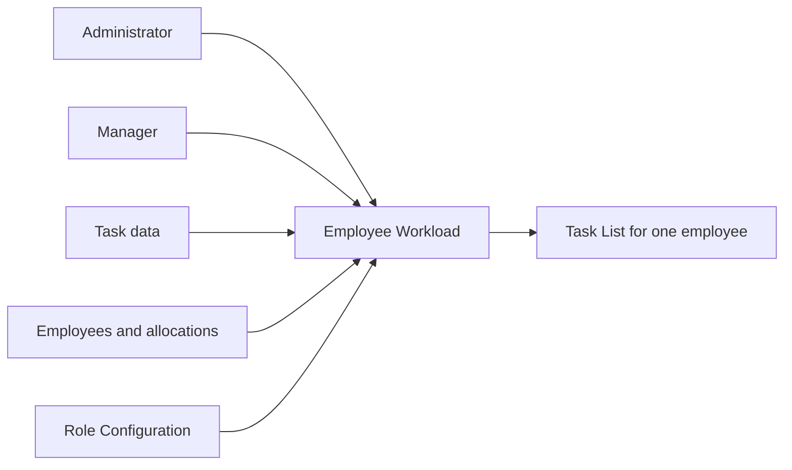
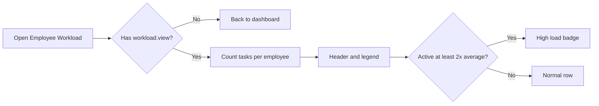
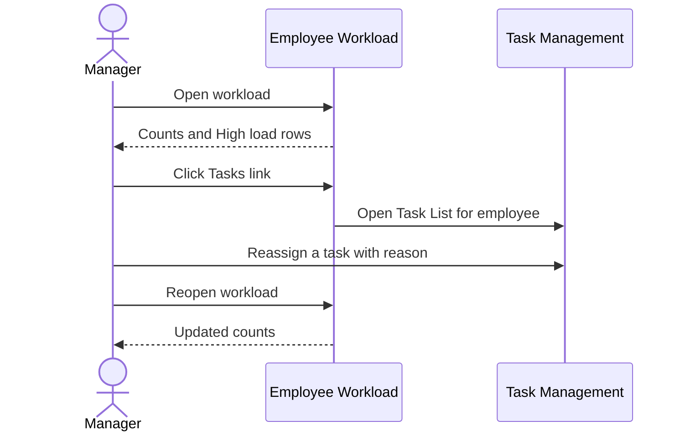

# Functional Requirements Document – Employee Workload

## TaskFlow – Intelligent Task Allocation & Tracking System

> **Document:** Functional Requirements Document (sub-module 02.2 Employee Workload, code `WORK`)  ·  **Version:** 1.0  ·  **Status:** Draft
> **Project type:** Personal Project (Skill Development)  ·  **Date:** 31-Oct-2026
> **Author:** Jojo George (jojogeorge3344@gmail.com)
> **Based on:** BRD-Employee-Workload.md v1.0
> © 2026 Jojo George. All rights reserved.

---

## Document Control

### Revision History

| Version | Date | Author | Summary of changes |
|---|---|---|---|
| 1.0 | 31-Oct-2026 | Jojo George | Initial version, derived from BRD-Employee-Workload v1.0 and the verified Employee Workload workflow doc |

### Related Documents

| Document | Purpose | Location |
|---|---|---|
| BRD – Employee Workload | Business needs this FRD details (`REQ-WORK-nn`, `BR-WORK-nn`) | `../../../BRD/02-TaskFlow-Monitoring/02.2-Employee-Workload/BRD-Employee-Workload.md` |
| Overall BRD / FRD | Roles, global rules `BR-nn`, global NFRs | `../../../BRD/00-Overall/BRD-TaskFlow-Overall.md`, `../../00-Overall/FRD-TaskFlow-Overall.md` |
| Sibling FRDs – Task Management, Board | Target of the **Tasks →** link; task data and definitions | `../02.1-Task-Management/FRD-Task-Management.md`, `../02.3-Board/FRD-Board.md` |
| Development Plan | Screen-wise build plan (original Screen 16) | `TF - Documents/Screens Wise Feature Development Plan/16-employee-workload-screen.md` |
| HLD / LLD / TDD | Technical design | `../../../HLD/02-TaskFlow-Monitoring/02.2-Employee-Workload/HLD-Employee-Workload.md`, `../../../LLD/02-TaskFlow-Monitoring/02.2-Employee-Workload/LLD-Employee-Workload.md`, `TDD-TaskFlow.md` (v2.0) |

---

## 1. Introduction

### 1.1 Purpose
This FRD specifies the detailed, testable behaviour of the Employee Workload screen: which people are listed, how
each count is worked out, how overloaded people are flagged, how the filters behave, the link to a person's tasks,
and who may use each part.

### 1.2 Scope
In scope: the Employee Workload screen (`/workload`) – per-employee task counts, project allocations, the average and
"High load" highlighting, the Project and Employee filters and the **Tasks →** link.

Out of scope (see BRD §3.2): a Department column or filter; a separate workload chart (workload charts are on the
Dashboard); changing or reassigning tasks on this screen (Task Management, `../02.1-Task-Management/FRD-Task-Management.md`);
narrowing the list to a Manager's own team.

### 1.3 Audience
Developer, tester and reviewer of TaskFlow (Jojo George), and the product owner approving the behaviour.

### 1.4 Conventions
- Requirement IDs: `FR-WORK-nn`. Use cases: `UC-WORK-nn`. BRD requirements: `REQ-WORK-nn`; sub-module rules `BR-WORK-nn`; global rules `BR-nn` (overall BRD).
- Priority: **Must / Should / Could** (MoSCoW).
- "The system shall …" = mandatory behaviour; "should" = recommended.
- Text in quotes is the exact UI label or message; `{name}` marks a value filled in at run time.

### 1.5 Definitions & Abbreviations

| Term | Meaning |
|---|---|
| Listed employee | An active user whose role does not hold `tasks.view.all` (the Employee role by default) |
| Active task | A task that is not Completed, Cancelled or deleted |
| High priority task | An active task with High or Critical priority |
| Overdue task | An active task whose deadline has passed |
| Allocation | A person's percentage share of a project, with a position |
| Allocated % | The sum of a person's project allocation percentages |
| Average | Total active tasks of the rows shown divided by the number of rows shown |
| High load | Active count at least twice the average of the rows shown |
| Task scope | The tasks a user may see: Own, Team or Organization |

---

## 2. System Overview

### 2.1 Module Map

| Code | Module | Child modules / screens | Primary roles |
|---|---|---|---|
| WORK | Employee Workload (TaskFlow Monitoring) | Employee Workload | Administrator, Manager |
| TASK | Task Management (related) | Task List – target of **Tasks →**; source of the task data | All users |
| EMP / PROJ | Employee and Project Management (related) | Employees and project allocations | Administrator, Manager |
| ROLE | Role Configuration (related) | Grants the workload keys; which roles hold `tasks.view.all` decides who is listed | Administrator |

### 2.2 Context Diagram

---

## 3. User Roles & Permissions

### 3.1 Roles

| Role | Description | Data scope |
|---|---|---|
| Administrator | Reviews load across the organization, filters, opens an employee's tasks | Organization |
| Manager | Reviews load, filters, opens an employee's tasks to rebalance work | Organization on this screen (not narrowed to the team); the Task List opened from it keeps the Manager's normal task scope |
| Employee | Is listed on the screen; cannot open it by default | No access |
| Custom role | As granted by `workload.view`, `workload.filters.use`, `workload.tasks.open` | Organization when granted |

### 3.2 Permission Matrix (functional view)

| Module › Function | Permission key | Administrator | Manager | Employee | Custom role |
|---|---|:---:|:---:|:---:|:---:|
| Employee Workload › View workload | `workload.view` | Granted | Granted | Denied | Configurable |
| Employee Workload › Use workload filters (requires `workload.view`) | `workload.filters.use` | Granted | Granted | Denied | Configurable |
| Employee Workload › Open an employee's tasks (requires `workload.view`) | `workload.tasks.open` | Granted | Granted | Denied | Configurable |
| Task Management › View all tasks (decides who is listed; not used to open the screen) | `tasks.view.all` | Granted | Granted | Denied | Configurable |
| Project Management › View projects (fills the Project filter) | `projects.view` | Granted | Granted | Denied | Configurable |

---

## 4. Functional Requirements by Module

### 4.1 Module: Employee Workload (WORK)

**Purpose:** Show how open work is spread across employees so Administrators and Managers can spot overload and
overdue work and rebalance it.  ·  **BRD reference:** BRD-Employee-Workload §5 SCREEN 1, BR-WORK-01…06; global BR-04, BR-06, BR-12, BR-22.

#### 4.1.1 Screen: Employee Workload

| Field | Value |
|---|---|
| Route / location | `/workload` – menu **TaskFlow Monitoring → Employee Workload** |
| Access | `workload.view` (Administrator, Manager; Custom role as granted). Employee: no access by default |
| Entry points | Menu item (shown only with `workload.view`) |

**Screen elements**

| Element | Type | Description | Mandatory | Visible to |
|---|---|---|:---:|---|
| Header summary | Text | "N employees · average X active tasks" (average with one decimal; "1 employee" in the singular) | – | `workload.view` |
| Project | Drop-down | Narrows to people allocated to the project; reloads the list | No | `workload.filters.use` |
| Employee | Drop-down | Shows one person; applies on screen without reloading | No | `workload.filters.use` |
| Reset | Button | Clears both filters and reloads | – | `workload.filters.use` |
| Employee | Column | Name with a "High load" badge when applicable | – | `workload.view` |
| Projects | Column | Each project name and allocation % | – | `workload.view` |
| Allocated % | Column | Sum of the allocations | – | `workload.view` |
| Active, High priority, Overdue, Completed | Columns | Task counts; Overdue highlighted when greater than 0 | – | `workload.view` |
| Workload bar | Bar | Active count scaled to the busiest row shown | – | `workload.view` |
| Tasks → | Link | Opens the Task List filtered to the employee | – | `workload.tasks.open` |
| Legend | Text | "Highlighted rows carry at least twice the average active load (X active tasks)." | – | `workload.view` |

**Functional requirements**

| ID | Requirement | Priority | Permission | BRD trace |
|---|---|---|---|---|
| FR-WORK-01 | The system shall list every active user whose role does not hold `tasks.view.all` (the Employee role by default), ordered by name. | Must | `workload.view` | REQ-WORK-01, BR-WORK-02 |
| FR-WORK-02 | The system shall never list inactive users. | Must | `workload.view` | BR-WORK-02 |
| FR-WORK-03 | The system shall show each employee's Active count: assigned tasks that are not Completed, Cancelled or deleted. | Must | `workload.view` | REQ-WORK-02, BR-WORK-01 |
| FR-WORK-04 | The system shall show each employee's High priority count: active tasks with priority High or Critical. | Must | `workload.view` | REQ-WORK-03, BR-WORK-01 |
| FR-WORK-05 | The system shall show each employee's Overdue count (active tasks whose deadline has passed) and highlight it when greater than 0. | Must | `workload.view` | REQ-WORK-04, BR-WORK-01, BR-12 |
| FR-WORK-06 | The system shall show each employee's Completed count (tasks with status Completed that are not deleted). | Must | `workload.view` | REQ-WORK-05, BR-WORK-01 |
| FR-WORK-07 | The system shall list employees who have no tasks with zero in every count. | Should | `workload.view` | REQ-WORK-06 |
| FR-WORK-08 | The system shall show each employee's project allocations (project name and percentage) and an Allocated % equal to their sum. | Should | `workload.view` | REQ-WORK-07, BR-WORK-04 |
| FR-WORK-09 | The system shall show in the header the number of rows shown and their average active tasks, "N employees · average X active tasks". | Should | `workload.view` | REQ-WORK-08 |
| FR-WORK-10 | The system shall mark with "High load" every row whose active count is at least twice the average of the rows currently shown, and mark no row when that average is 0. | Must | `workload.view` | REQ-WORK-09, BR-WORK-03 |
| FR-WORK-11 | The system shall explain the highlight in the legend "Highlighted rows carry at least twice the average active load (X active tasks)." | Must | `workload.view` | REQ-WORK-09 |
| FR-WORK-12 | The system shall show a workload bar per row, scaled so the busiest row shown is full length. | Could | `workload.view` | REQ-WORK-10 |
| FR-WORK-13 | The system shall, when a Project is picked, reload the list with only the people allocated to that project and clear the Employee filter. | Should | `workload.filters.use` | REQ-WORK-11 |
| FR-WORK-14 | The system shall, when an Employee is picked, show only that person without reloading, recalculate the header, average, highlight and bars for the rows shown, and offer **Reset** to clear both filters. | Should | `workload.filters.use` | REQ-WORK-12, NFR-WORK-01 |
| FR-WORK-15 | The system shall open the Task List filtered to the row's employee when **Tasks →** is clicked, applying the user's own task scope. | Must | `workload.tasks.open` | REQ-WORK-14, BR-WORK-05 |
| FR-WORK-16 | The system shall show the Project and Employee filters and **Reset** only to users with `workload.filters.use`. | Should | `workload.filters.use` | REQ-WORK-13, BR-WORK-06 |
| FR-WORK-17 | The system shall show the **Tasks →** link only to users with `workload.tasks.open`. | Must | `workload.tasks.open` | REQ-WORK-14, BR-WORK-06 |
| FR-WORK-18 | The system shall show the menu item and open the screen only for users with `workload.view`, send everyone else back to their dashboard and refuse the workload data to a direct request without the key. | Must | `workload.view` | REQ-WORK-15, BR-WORK-06, NFR-WORK-02 |
| FR-WORK-19 | The system shall cover the whole organization for every user who may open the screen, not only a Manager's team. | Must | `workload.view` | REQ-WORK-16 |
| FR-WORK-20 | The system shall not create, change or delete any data from this screen; viewing and filtering are read-only. | Should | `workload.view` | REQ-WORK-17, NFR-WORK-04 |
| FR-WORK-21 | The system shall show "No employees to show – There are no active employees in this project." when no rows match, and "Could not load the workload. Check your connection and try again." when loading fails. | Should | `workload.view` | REQ-WORK-01, REQ-WORK-11 |
| FR-WORK-22 | The system shall use the same active, overdue and priority definitions as the Dashboard, Task List and Reports. | Should | `workload.view` | BR-WORK-01, NFR-WORK-05, BR-22 |

**Use case: UC-WORK-01 – Review workload**

| Item | Detail |
|---|---|
| Actor | Manager or Administrator |
| Preconditions | Signed in; holds `workload.view` |
| Trigger | Opens **TaskFlow Monitoring → Employee Workload** |
| Main flow | 1. System loads every listed employee with their allocations and four counts. 2. System shows the header "N employees · average X active tasks" and the legend. 3. System marks rows at or above twice the average with "High load" and highlights Overdue counts above 0. 4. User reviews the table and bars. |
| Alternate flows | A1: No listed employees → "No employees to show – There are no active employees in this project." |
| Exceptions | E1: Load failure → "Could not load the workload. Check your connection and try again." E2: No `workload.view` → menu hidden; the screen sends the user to the dashboard; data refused. |
| Postconditions | Nothing changed |

**Use case: UC-WORK-02 – Filter by project or employee**

| Item | Detail |
|---|---|
| Actor | Manager or Administrator |
| Preconditions | Holds `workload.view` and `workload.filters.use` |
| Trigger | Picks a Project or an Employee |
| Main flow | 1. Project picked: system reloads with only the people allocated to it and clears the Employee filter. 2. Employee picked: system shows only that person without reloading. 3. System recalculates header, average, "High load" and bars for the rows shown. 4. **Reset** clears both filters and reloads. |
| Alternate flows | – |
| Exceptions | E1: Nobody allocated to the project → "No employees to show – There are no active employees in this project." |
| Postconditions | Nothing changed |

**Use case: UC-WORK-03 – Open an employee's tasks**

| Item | Detail |
|---|---|
| Actor | Manager or Administrator |
| Preconditions | Holds `workload.view` and `workload.tasks.open` |
| Trigger | Clicks **Tasks →** on a row |
| Main flow | 1. System opens the Task List filtered to that employee. 2. The Task List applies the user's own task scope (a Manager sees only team tasks plus own). 3. User opens a task and reassigns it (Task Management, UC-TASK-09). |
| Alternate flows | – |
| Exceptions | E1: The employee has no tasks within the user's scope → the Task List shows its empty state. |
| Postconditions | Work can be rebalanced in Task Management |

**Field validations**

| Field | Rule | Error message |
|---|---|---|
| Project | Optional; one of the projects the user may view | – |
| Employee | Optional; one of the rows loaded | – |

**Business rules applied:** BR-WORK-01, BR-WORK-02, BR-WORK-03, BR-WORK-04, BR-WORK-05, BR-WORK-06; global BR-04, BR-06, BR-12, BR-22.

**Notifications / side effects**

| Event | Who is notified | Channel |
|---|---|---|
| – | Read-only screen; nothing is sent | – |

**Messages**

| Situation | Message |
|---|---|
| Load failed | "Could not load the workload. Check your connection and try again." |
| No rows | "No employees to show – There are no active employees in this project." |
| Legend | "Highlighted rows carry at least twice the average active load (X active tasks)." |
| No permission | Menu item hidden; the screen sends the user to their dashboard; the data is refused |

---

## 5. Cross-Module Workflows

### 5.1 Spot overload and rebalance work

| Step | Module | Actor / System | Action | FR reference |
|---|---|---|---|---|
| 1 | WORK | Manager | Opens Employee Workload and sees a "High load" row | FR-WORK-01…FR-WORK-11 |
| 2 | WORK | Manager | Clicks **Tasks →** on that row | FR-WORK-15, FR-WORK-17 |
| 3 | TASK | System | Task List filtered to the employee within the Manager's scope | FR-TASK-01, FR-TASK-05 (Task Management FRD) |
| 4 | TASK | Manager | Reassigns a task with a reason | FR-TASK-48…FR-TASK-55 (Task Management FRD) |
| 5 | WORK | Manager | Reopens Employee Workload; the counts reflect the move | FR-WORK-03 |

---

## 6. Reports & Exports

_Not applicable for this sub-module._ Workload is an on-screen view with no export; exportable reports are in
`../../05-Reports/05.1-Reports/FRD-Reports.md`.

---

## 7. Notifications & Messages Catalogue

_Not applicable for this sub-module._ The screen is read-only and sends no notifications or mail. On-screen messages are
listed in §4.1.1.

---

## 8. Data Requirements (functional view)

This sub-module stores no data of its own; it reads the items below.

| Data item | Description | Created by | Rules |
|---|---|---|---|
| Listed employee | Name, active flag, role | Employee Management | Only active users whose role lacks `tasks.view.all` |
| Project allocation | Project, position, allocation % | Employee / Project Management | Projects listed by project name; Allocated % = sum |
| Task counts | Active, High priority, Overdue, Completed per assignee | System (on request) | Deleted tasks never counted; Overdue uses the current time |
| Average / High load | Average active of the rows shown; badge at ≥ 2 × average | System (on screen) | Recalculated whenever the rows shown change; no badge when the average is 0 |

---

## 9. Non-Functional Requirements (functional impact)

| ID | Requirement | Affects |
|---|---|---|
| NFR-WORK-01 | One load per screen open or Project change; the Employee filter works without reloading | Employee Workload (FR-WORK-13, FR-WORK-14) |
| NFR-WORK-02 | Workload data refused without `workload.view` | Employee Workload (FR-WORK-18) |
| NFR-WORK-03 | Overload and overdue work stand out: "High load" badge, highlighted Overdue, legend | Employee Workload (FR-WORK-05, FR-WORK-10, FR-WORK-11) |
| NFR-WORK-04 | Read-only screen | Employee Workload (FR-WORK-20) |
| NFR-WORK-05 | Same count definitions as Dashboard and Reports | Employee Workload (FR-WORK-22) |
| NFR-WORK-06 / NFR-WORK-07 | Compatibility and accessibility as the global NFRs (NFR-16, NFR-18) | Employee Workload |

---

## 10. Assumptions & Open Issues

| Type | Description | Owner |
|---|---|---|
| Assumption | Project allocations are kept up to date in Employee and Project Management | Jojo George |
| Assumption | Users who open the screen also hold `projects.view`, so the Project filter can be filled (true for Administrator and Manager by default) | Jojo George |
| Open issue | `workload.filters.use` and `workload.tasks.open` are enforced only on the screen; the Project filter works by direct request without `workload.filters.use` (R-WORK-01) | Jojo George |
| Open issue | A Manager sees counts of employees outside the team (accepted for this release, FR-WORK-19; R-WORK-02) | Jojo George |
| Open issue | A role that holds `tasks.view.all` only through an older permission name could still be listed (R-WORK-03) | Jojo George |
| Open issue | No Department column or filter, unlike the original BRD Screen 16 (R-WORK-04) | Jojo George |
| Open issue | "High load" is relative to the rows shown, so picking a single Employee never shows the badge | Jojo George |

---

## 11. Requirements Traceability Matrix

Test cases name the automated test files (`TaskFlow.UnitTests` / `TaskFlow.IntegrationTests` and the frontend
`*.spec.ts` files under `frontend/src/app/`) that test the behaviour; the mapping was checked against the test sources.
"Manual UI" = checked by hand on the screen.

| BRD item | FRD requirement(s) | Screen | Use case | Test case |
|---|---|---|---|---|
| REQ-WORK-01 | FR-WORK-01, FR-WORK-21 | Employee Workload | UC-WORK-01 | `WorkloadServiceTests.cs`, `CustomRoleWorkloadTests.cs`, `workload.component.spec.ts` (error state; the empty state is not tested) |
| REQ-WORK-02 | FR-WORK-03 | Employee Workload | UC-WORK-01 | `WorkloadServiceTests.cs` |
| REQ-WORK-03 | FR-WORK-04 | Employee Workload | UC-WORK-01 | `WorkloadServiceTests.cs` |
| REQ-WORK-04 | FR-WORK-05 | Employee Workload | UC-WORK-01 | `WorkloadServiceTests.cs` |
| REQ-WORK-05 | FR-WORK-06 | Employee Workload | UC-WORK-01 | `WorkloadServiceTests.cs` |
| REQ-WORK-06 | FR-WORK-07 | Employee Workload | UC-WORK-01 | `WorkloadServiceTests.cs` |
| REQ-WORK-07 | FR-WORK-08 | Employee Workload | UC-WORK-01 | `WorkloadServiceTests.cs`, `workload.component.spec.ts` |
| REQ-WORK-08 | FR-WORK-09 | Employee Workload | UC-WORK-01 | `workload.component.spec.ts` (row count; the average is not asserted) |
| REQ-WORK-09 | FR-WORK-10, FR-WORK-11 | Employee Workload | UC-WORK-01 | `workload.component.spec.ts` (highlight; the legend text is not asserted) |
| REQ-WORK-10 | FR-WORK-12 | Employee Workload | UC-WORK-01 | `workload.component.spec.ts` (bar shown; the scaling is not asserted) |
| REQ-WORK-11 | FR-WORK-13, FR-WORK-21 | Employee Workload | UC-WORK-02 | `WorkloadEndpointsTests.cs`, `WorkloadServiceTests.cs`, `workload.component.spec.ts` |
| REQ-WORK-12 | FR-WORK-14 | Employee Workload | UC-WORK-02 | `workload.component.spec.ts` |
| REQ-WORK-13 | FR-WORK-16 | Employee Workload | UC-WORK-02 | `workload.component.spec.ts` |
| REQ-WORK-14 | FR-WORK-15, FR-WORK-17 | Employee Workload | UC-WORK-03 | `workload.component.spec.ts`, `task-list.component.spec.ts` |
| REQ-WORK-15 | FR-WORK-18 | Employee Workload | UC-WORK-01 | `WorkloadEndpointsTests.cs`, `app.routes.spec.ts` |
| REQ-WORK-16 | FR-WORK-19 | Employee Workload | UC-WORK-01 | `WorkloadServiceTests.cs` |
| REQ-WORK-17 | FR-WORK-20 | Employee Workload | UC-WORK-01, UC-WORK-02 | Manual UI |
| BR-WORK-01 | FR-WORK-03, FR-WORK-04, FR-WORK-05, FR-WORK-06, FR-WORK-22 | Employee Workload | UC-WORK-01 | `WorkloadServiceTests.cs` |
| BR-WORK-02 | FR-WORK-01, FR-WORK-02 | Employee Workload | UC-WORK-01 | `CustomRoleWorkloadTests.cs` |
| BR-WORK-03 | FR-WORK-10 | Employee Workload | UC-WORK-01, UC-WORK-02 | `workload.component.spec.ts` |
| BR-WORK-04 | FR-WORK-08 | Employee Workload | UC-WORK-01 | `WorkloadServiceTests.cs`, `workload.component.spec.ts` |
| BR-WORK-05 | FR-WORK-15 | Employee Workload | UC-WORK-03 | `TasksEndpointsTests.cs`, `task-list.component.spec.ts`, `workload.component.spec.ts` |
| BR-WORK-06 | FR-WORK-16, FR-WORK-17, FR-WORK-18 | Employee Workload | UC-WORK-01, UC-WORK-02, UC-WORK-03 | `WorkloadEndpointsTests.cs`, `workload.component.spec.ts`, `app.routes.spec.ts` |

---

## 12. Approvals

| Role | Name | Decision | Date |
|---|---|---|---|
| Product owner | Jojo George | Pending | – |
| Reviewer | Jojo George | Pending | – |

---
© 2026 Jojo George. All rights reserved. Unauthorized copying or distribution of this document is prohibited.
