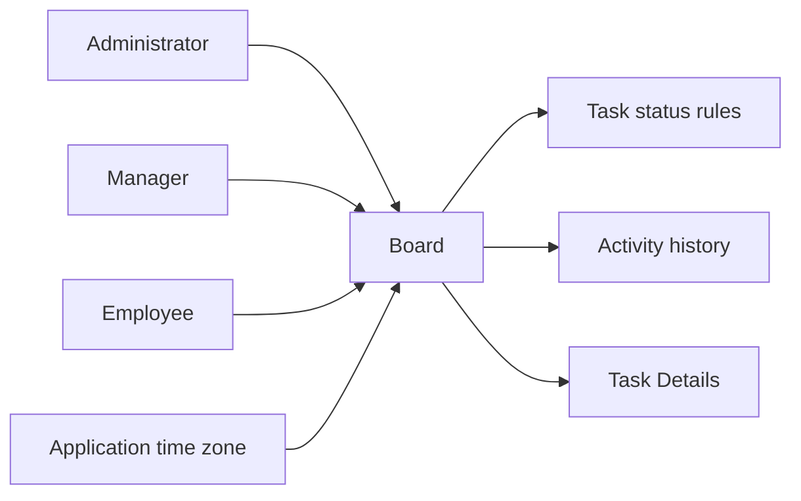
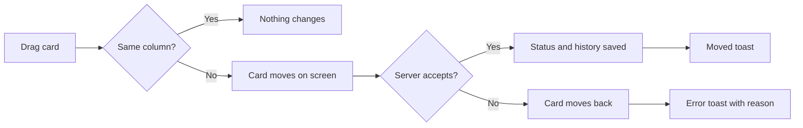
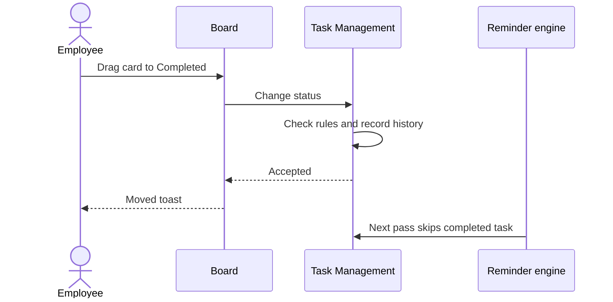

# Functional Requirements Document – Board

## TaskFlow – Intelligent Task Allocation & Tracking System

> **Document:** Functional Requirements Document (sub-module 02.3 Board, code `BOARD`)  ·  **Version:** 1.0  ·  **Status:** Draft
> **Project type:** Personal Project (Skill Development)  ·  **Date:** 31-Oct-2026
> **Author:** Jojo George (jojogeorge3344@gmail.com)
> **Based on:** BRD-Board.md v1.0
> © 2026 Jojo George. All rights reserved.

---

## Document Control

### Revision History

| Version | Date | Author | Summary of changes |
|---|---|---|---|
| 1.0 | 31-Oct-2026 | Jojo George | Initial version, derived from BRD-Board v1.0 and the verified Kanban Board workflow doc |

### Related Documents

| Document | Purpose | Location |
|---|---|---|
| BRD – Board | Business needs this FRD details (`REQ-BOARD-nn`, `BR-BOARD-nn`) | `../../../BRD/02-TaskFlow-Monitoring/02.3-Board/BRD-Board.md` |
| Overall BRD / FRD | Roles, global rules `BR-nn`, global NFRs | `../../../BRD/00-Overall/BRD-TaskFlow-Overall.md`, `../../00-Overall/FRD-TaskFlow-Overall.md` |
| Sibling FRDs – Task Management, Employee Workload | Task scope, status rules, history, Task Details | `../02.1-Task-Management/FRD-Task-Management.md`, `../02.2-Employee-Workload/FRD-Employee-Workload.md` |
| Development Plan | Screen-wise build plan (original Screen 10) | `TF - Documents/Screens Wise Feature Development Plan/10-kanban-board-screen.md` |
| HLD / LLD / TDD | Technical design | `../../../HLD/02-TaskFlow-Monitoring/02.3-Board/HLD-Board.md`, `../../../LLD/02-TaskFlow-Monitoring/02.3-Board/LLD-Board.md`, `TDD-TaskFlow.md` (v2.0) |

---

## 1. Introduction

### 1.1 Purpose
This FRD specifies the detailed, testable behaviour of the Board (Kanban): which tasks appear in which column, what a
card shows, how a drag changes a task's status under the shared status rules, how the filters behave, and who may use
each part.

### 1.2 Scope
In scope: the Board screen (`/board`) – five status columns, task cards, drag-and-drop status change, Project /
Assignee / Status / Deadline filters, Refresh and opening a task from a card.

Out of scope (see BRD §3.2): a Cancelled column; re-ordering cards within a column; paging; notifications for a status
change; editing task details on the board (Task Details, `../02.1-Task-Management/FRD-Task-Management.md`).

### 1.3 Audience
Developer, tester and reviewer of TaskFlow (Jojo George), and the product owner approving the behaviour.

### 1.4 Conventions
- Requirement IDs: `FR-BOARD-nn`. Use cases: `UC-BOARD-nn`. BRD requirements: `REQ-BOARD-nn`; sub-module rules `BR-BOARD-nn`; Task Management rules `BR-TASK-nn`; global rules `BR-nn` (overall BRD).
- Priority: **Must / Should / Could** (MoSCoW).
- "The system shall …" = mandatory behaviour; "should" = recommended.
- Text in quotes is the exact UI label or message; `{name}` marks a value filled in at run time.

### 1.5 Definitions & Abbreviations

| Term | Meaning |
|---|---|
| Board / Kanban | A view of tasks as columns, one per status |
| Card | One task on the board |
| Column | A status: To Do, In Progress, In QA, Blocked or Completed |
| In QA | The task is being checked before it is completed |
| Overdue card | A card whose deadline has passed and whose task is neither Completed nor Cancelled |
| Task scope | The tasks a user may see: Own, Team or Organization (as on the Task List) |
| Optimistic move | The card moves on screen at once and moves back if the server refuses |

---

## 2. System Overview

### 2.1 Module Map

| Code | Module | Child modules / screens | Primary roles |
|---|---|---|---|
| BOARD | Board (TaskFlow Monitoring) | Board (Kanban) | Administrator, Manager, Employee, Custom role with `board.view` |
| TASK | Task Management (related) | Task scope, status transition table, activity history, Task Details | All users |
| ROLE | Role Configuration (related) | Grants `board.view`, `board.filters.use`, `tasks.status.change` | Administrator |

### 2.2 Context Diagram

---

## 3. User Roles & Permissions

### 3.1 Roles

| Role | Description | Data scope |
|---|---|---|
| Administrator | Views, filters and moves any task | Organization (all tasks) |
| Manager | Views, filters and moves team tasks | Team, plus tasks the Manager created, is assigned or is notified about |
| Employee | Views, filters and moves own tasks | Own (assigned, created or notified) |
| Custom role | As granted by `board.view`, `board.filters.use`, `tasks.status.change` | Follows the user's task scope |

### 3.2 Permission Matrix (functional view)

| Module › Function | Permission key | Administrator | Manager | Employee | Custom role |
|---|---|:---:|:---:|:---:|:---:|
| Board › View board | `board.view` | Granted | Granted | Granted | Configurable |
| Board › Use board filters (requires `board.view`) | `board.filters.use` | Granted | Granted | Granted | Configurable |
| Board › Update task status by drag (shared with Task Details) | `tasks.status.change` | Granted | Granted | Granted | Configurable |
| Task Management › View my tasks (cards in Own scope) | `tasks.view.own` | Always On | Always On | Always On | Always On |
| Task Management › View all tasks (Team / Organization cards, Assignee filter, menu location) | `tasks.view.all` | Granted | Granted | Denied | Configurable |

---

## 4. Functional Requirements by Module

### 4.1 Module: Board (BOARD)

**Purpose:** Give every user a visual overview of their accessible tasks by status and the fastest way to move a task
to its next allowed status.  ·  **BRD reference:** BRD-Board §5 SCREEN 1, BR-BOARD-01…06, BR-TASK-03; global BR-06, BR-10, BR-11, BR-12, BR-17, BR-19.

#### 4.1.1 Screen: Board (Kanban)

| Field | Value |
|---|---|
| Route / location | `/board` – menu **TaskFlow Monitoring → Board** (with `tasks.view.all`) or **Task Management → Board** (everyone else) |
| Access | `board.view` (Administrator, Manager, Employee; Custom role as granted); content follows the user's task scope |
| Entry points | Menu item (shown only with `board.view`); **Board view** button on the Task List; Back from Task Details opened from a card |

**Screen elements**

| Element | Type | Description | Mandatory | Visible to |
|---|---|---|:---:|---|
| Header | Text | "N tasks across 5 stages" ("Loading board…" while loading) | – | `board.view` |
| Refresh | Button | Reloads the board | – | `board.view` |
| Project | Drop-down | Filter by project | No | `board.filters.use` |
| Assignee | Drop-down | Filter by assignee | No | `board.filters.use` and `tasks.view.all` |
| Status | Drop-down | Filter by status | No | `board.filters.use` |
| Deadline from, Deadline to | Date inputs | Inclusive deadline range; "to" cannot be set before "from" | No | `board.filters.use` |
| Clear | Button | Clears all filters; disabled while no filter is set | – | `board.filters.use` |
| Columns | Lists | To Do, In Progress, In QA, Blocked, Completed, each with a count | – | `board.view` |
| Card | Draggable item | Task code, priority, title, project, assignee, deadline; overdue cards and deadlines highlighted | – | `board.view` (drag needs `tasks.status.change`) |
| Empty column | Text | "Drop tasks here" | – | `board.view` |
| Filtered-empty state | Text / button | "No tasks match the current filters." with **Clear filters** | – | `board.filters.use` |

**Functional requirements**

| ID | Requirement | Priority | Permission | BRD trace |
|---|---|---|---|---|
| FR-BOARD-01 | The system shall show exactly the tasks of the user's task-list scope (Own, Team or Organization) in the columns To Do, In Progress, In QA, Blocked and Completed, with a count of cards in each column. | Must | `board.view`, `tasks.view.own`, `tasks.view.all` | REQ-BOARD-01, BR-BOARD-01, BR-06 |
| FR-BOARD-02 | The system shall not show cancelled or deleted tasks on the board. | Must | `board.view` | REQ-BOARD-02 |
| FR-BOARD-03 | The system shall show on each card the task code, priority, title, project, assignee and deadline; the column gives the status. | Must | `board.view` | REQ-BOARD-03 |
| FR-BOARD-04 | The system shall highlight a card and its deadline when the deadline has passed and the task is neither Completed nor Cancelled. | Must | `board.view` | REQ-BOARD-04, BR-BOARD-03, BR-12 |
| FR-BOARD-05 | The system shall order the cards in each column by deadline, soonest first, and ignore any attempt to re-order cards within a column. | Should | `board.view` | REQ-BOARD-05 |
| FR-BOARD-06 | The system shall show the total in the header as "N tasks across 5 stages", counting the cards shown. | Could | `board.view` | REQ-BOARD-06 |
| FR-BOARD-07 | The system shall let users with `tasks.status.change` drag a card to another column to change the task's status, and disable dragging for users without it. | Must | `tasks.status.change` | REQ-BOARD-07 |
| FR-BOARD-08 | The system shall check every move on the server against the permission, the user's access to the task and the transition table in BR-TASK-03, and refuse a disallowed move with "Cannot move a task from {from} to {to}.". | Must | `tasks.status.change` | REQ-BOARD-08, BR-BOARD-02, NFR-BOARD-02 |
| FR-BOARD-09 | The system shall change nothing when a card is dropped back into its own column. | Should | `tasks.status.change` | BR-BOARD-06 |
| FR-BOARD-10 | The system shall move the card on screen as soon as it is dropped and, if the move is refused or fails, return it to its original column and show the server's reason or "Could not move {code}.". | Should | `tasks.status.change` | REQ-BOARD-09, NFR-BOARD-03, NFR-BOARD-04 |
| FR-BOARD-11 | The system shall confirm an accepted move with "{code} moved to {status}" (e.g. "TSK-000123 moved to In Progress"). | Should | `tasks.status.change` | REQ-BOARD-10 |
| FR-BOARD-12 | The system shall record "Status changed from {X} to {Y}" in the task's history for every accepted move, plus "Task completed" when moved to Completed, and store the completion time. | Must | `tasks.status.change` | REQ-BOARD-11, BR-19 |
| FR-BOARD-13 | The system shall filter the loaded cards by Project, Status and an inclusive Deadline from/to range on screen without reloading, combining all chosen filters (AND). | Should | `board.filters.use` | REQ-BOARD-12, BR-BOARD-04, NFR-BOARD-01 |
| FR-BOARD-14 | The system shall offer the Assignee filter only to users with `tasks.view.all`. | Should | `tasks.view.all` | REQ-BOARD-13, BR-BOARD-05 |
| FR-BOARD-15 | The system shall show the filter row only to users with `board.filters.use`. | Should | `board.filters.use` | REQ-BOARD-14, BR-BOARD-05 |
| FR-BOARD-16 | The system shall clear every filter when **Clear** (filter row) or **Clear filters** (empty state) is clicked, and disable **Clear** while no filter is set. | Could | `board.filters.use` | REQ-BOARD-12, REQ-BOARD-15 |
| FR-BOARD-17 | The system shall show "Drop tasks here" in an empty column and "No tasks match the current filters." when the filters hide every loaded task. | Could | `board.view` | REQ-BOARD-15 |
| FR-BOARD-18 | The system shall reload the tasks and their latest statuses when the user clicks **Refresh**. | Must | `board.view` | REQ-BOARD-16 |
| FR-BOARD-19 | The system shall show "Could not load the board. Try again." when the board cannot be loaded. | Should | `board.view` | REQ-BOARD-01, REQ-BOARD-16 |
| FR-BOARD-20 | The system shall open Task Details when a card is clicked, with Back returning to the board. | Must | `tasks.view.own` | REQ-BOARD-17 |
| FR-BOARD-21 | The system shall show the Board menu item and open the screen only for users with `board.view`, and send everyone else back to their dashboard. | Must | `board.view` | REQ-BOARD-18 |
| FR-BOARD-22 | The system shall place the menu item under **TaskFlow Monitoring** for users with `tasks.view.all` and under **Task Management** for everyone else. | Could | `tasks.view.all` | REQ-BOARD-18 |

**Use case: UC-BOARD-01 – View the board**

| Item | Detail |
|---|---|
| Actor | Employee, Manager or Administrator |
| Preconditions | Signed in; holds `board.view` |
| Trigger | Opens **Board** from the menu or **Board view** on the Task List |
| Main flow | 1. System loads every task in the user's scope except cancelled and deleted tasks. 2. System places each card in its status column, ordered by deadline, with a count per column. 3. System highlights overdue cards. 4. System shows "N tasks across 5 stages". |
| Alternate flows | A1: **Refresh** – the board reloads with the latest statuses. |
| Exceptions | E1: Load failure → "Could not load the board. Try again." E2: No `board.view` → menu hidden; the screen sends the user back to the dashboard. |
| Postconditions | Nothing changed |

**Use case: UC-BOARD-02 – Move a card to a new status**

| Item | Detail |
|---|---|
| Actor | Employee, Manager or Administrator |
| Preconditions | Holds `board.view` and `tasks.status.change`; the task is in the user's scope |
| Trigger | Drags a card to another column |
| Main flow | 1. Card moves on screen at once. 2. System checks the permission, task access and transition table. 3. System saves the status (and completion time when Completed) and records "Status changed from {X} to {Y}" (plus "Task completed"). 4. System shows "{code} moved to {status}". |
| Alternate flows | A1: Card dropped in its own column – nothing happens. |
| Exceptions | E1: Disallowed move (e.g. Completed → In Progress) → card returns; "Cannot move a task from Completed to InProgress." E2: Other failure → card returns; "Could not move {code}." E3: No `tasks.status.change` → cards cannot be dragged. |
| Postconditions | Accepted: new status saved and recorded, reminders stop for Completed. Refused: task unchanged on server and screen |

**Use case: UC-BOARD-03 – Filter the board**

| Item | Detail |
|---|---|
| Actor | User with `board.filters.use` |
| Preconditions | Board loaded |
| Trigger | Picks a Project, Assignee (view-all users), Status or Deadline range |
| Main flow | 1. System narrows the loaded cards on screen, combining all filters (AND), with both deadline dates included. 2. Column counts and the header follow the cards shown. 3. **Clear** removes all filters. |
| Alternate flows | – |
| Exceptions | E1: No card matches → "No tasks match the current filters." with **Clear filters**. |
| Postconditions | Nothing changed on the server |

**Use case: UC-BOARD-04 – Open a task from a card**

| Item | Detail |
|---|---|
| Actor | Any board user |
| Preconditions | Board loaded |
| Trigger | Clicks a card |
| Main flow | 1. System opens Task Details for the task. 2. User clicks Back. 3. System returns to the board. |
| Alternate flows | – |
| Exceptions | E1: Task no longer accessible → Task Details shows its fallback text. |
| Postconditions | Nothing changed |

**Field validations**

| Field | Rule | Error message |
|---|---|---|
| Deadline to | Cannot be set before Deadline from | – (the date picker blocks earlier dates) |
| Target column | Allowed by BR-TASK-03 from the card's current status | "Cannot move a task from {from} to {to}." |

**Business rules applied:** BR-BOARD-01, BR-BOARD-02, BR-BOARD-03, BR-BOARD-04, BR-BOARD-05, BR-BOARD-06, BR-TASK-03; global BR-06, BR-10, BR-11, BR-12, BR-17, BR-19.

**Notifications / side effects**

| Event | Who is notified | Channel |
|---|---|---|
| Card moved | Nobody – recorded in the task's activity history only | – |
| Card moved to Completed | Reminder engine sends no further reminders for the task | – |

**Messages**

| Situation | Message |
|---|---|
| Move accepted | "TSK-000123 moved to In Progress" |
| Move not allowed | "Cannot move a task from Completed to InProgress." (statuses vary) |
| Move failed (other) | "Could not move TSK-000123." |
| Load failed | "Could not load the board. Try again." |
| Filters hide all cards | "No tasks match the current filters." |
| Empty column | "Drop tasks here" |
| No permission | Menu item hidden; the screen sends the user back to their dashboard |

---

## 5. Cross-Module Workflows

### 5.1 Move a task on the board → history → reminders

| Step | Module | Actor / System | Action | FR reference |
|---|---|---|---|---|
| 1 | BOARD | Employee | Drags a card from In QA to Completed | FR-BOARD-07, FR-BOARD-10 |
| 2 | TASK | System | Checks the transition table and the user's access, saves the status and completion time | FR-BOARD-08, FR-TASK-38, FR-TASK-40 (Task Management FRD) |
| 3 | TASK | System | Records "Status changed from InQA to Completed" and "Task completed" | FR-BOARD-12, FR-TASK-63 |
| 4 | NOTIF | Reminder engine | Stops reminders for the task | FR-TASK-47 |
| 5 | BOARD | System | Shows "TSK-… moved to Completed" | FR-BOARD-11 |

---

## 6. Reports & Exports

_Not applicable for this sub-module._ Status reports are in `../../05-Reports/05.1-Reports/FRD-Reports.md`.

---

## 7. Notifications & Messages Catalogue

_Not applicable for this sub-module._ A status change on the board sends no notification or mail; it is recorded in the
task's activity history. On-screen messages are listed in §4.1.1.

---

## 8. Data Requirements (functional view)

This sub-module stores no data of its own.

| Data item | Description | Created by | Rules |
|---|---|---|---|
| Task (card) | Code, title, project, assignee, priority, deadline, status | Task Management | Cancelled and deleted tasks not shown; status updated by an accepted move |
| Overdue flag | Deadline passed and not Completed or Cancelled | System (on load) | Never stored |
| Activity history entry | "Status changed from X to Y", "Task completed" | System | Owned by Task Management; never changed by users |

---

## 9. Non-Functional Requirements (functional impact)

| ID | Requirement | Affects |
|---|---|---|
| NFR-BOARD-01 | Filters apply on screen to the loaded tasks; one load per open or Refresh | Board (FR-BOARD-13, FR-BOARD-18) |
| NFR-BOARD-02 | Status permission, task access and status rules checked on the server for every move | Board (FR-BOARD-08) |
| NFR-BOARD-03 | Moves feel immediate and failures are visible | Board (FR-BOARD-10) |
| NFR-BOARD-04 | The board never shows a status the server did not accept | Board (FR-BOARD-10) |
| NFR-BOARD-05 | One transition table for the board and Task Details (BR-TASK-03) | Board, Task Details |
| NFR-BOARD-06 | Drag-and-drop works in the supported browsers (global NFR-16) | Board |
| NFR-BOARD-07 | Accessibility as the global NFRs (NFR-18) | Board |

---

## 10. Assumptions & Open Issues

| Type | Description | Owner |
|---|---|---|
| Assumption | The number of accessible tasks stays small enough to load the whole board at once (no paging) | Jojo George |
| Open issue | Large task volumes could slow the board because it is not paged (R-BOARD-01) | Jojo George |
| Open issue | `board.filters.use` is enforced only on the screen; filters only narrow data the user may already see (R-BOARD-02) | Jojo George |
| Open issue | Cancelled tasks are invisible on the board; use the Task List Status filter (R-BOARD-03) | Jojo George |
| Open issue | The Task List **Board view** button is shown without `board.view`; the board then sends the user back (R-BOARD-04) | Jojo George |
| Open issue | The deadline filter compares the deadline's calendar date in the user's browser time zone, while overdue uses the application time zone; the two can differ near midnight for users in another time zone | Jojo George |

---

## 11. Requirements Traceability Matrix

Test cases name the automated test files (`TaskFlow.UnitTests` / `TaskFlow.IntegrationTests`) whose names match the
behaviour; coverage is inferred from the file names. "Manual UI" = checked by hand on the screen.

| BRD item | FRD requirement(s) | Screen | Use case | Test case |
|---|---|---|---|---|
| REQ-BOARD-01 | FR-BOARD-01, FR-BOARD-19 | Board | UC-BOARD-01 | `TasksEndpointsTests.cs`, `TaskServiceTests.cs` |
| REQ-BOARD-02 | FR-BOARD-02 | Board | UC-BOARD-01 | `TaskServiceTests.cs` |
| REQ-BOARD-03 | FR-BOARD-03 | Board | UC-BOARD-01 | Manual UI |
| REQ-BOARD-04 | FR-BOARD-04 | Board | UC-BOARD-01 | `TaskTrackingDomainTests.cs` |
| REQ-BOARD-05 | FR-BOARD-05 | Board | UC-BOARD-01 | Manual UI |
| REQ-BOARD-06 | FR-BOARD-06 | Board | UC-BOARD-01 | Manual UI |
| REQ-BOARD-07 | FR-BOARD-07 | Board | UC-BOARD-02 | `CustomRolePermissionTests.cs` |
| REQ-BOARD-08 | FR-BOARD-08 | Board | UC-BOARD-02 | `TaskTrackingDomainTests.cs` |
| REQ-BOARD-09 | FR-BOARD-10 | Board | UC-BOARD-02 | Manual UI |
| REQ-BOARD-10 | FR-BOARD-11 | Board | UC-BOARD-02 | Manual UI |
| REQ-BOARD-11 | FR-BOARD-12 | Board | UC-BOARD-02 | `TaskManagementServiceTests.cs` |
| REQ-BOARD-12 | FR-BOARD-13, FR-BOARD-16 | Board | UC-BOARD-03 | Manual UI |
| REQ-BOARD-13 | FR-BOARD-14 | Board | UC-BOARD-03 | Manual UI |
| REQ-BOARD-14 | FR-BOARD-15 | Board | UC-BOARD-03 | Manual UI |
| REQ-BOARD-15 | FR-BOARD-16, FR-BOARD-17 | Board | UC-BOARD-03 | Manual UI |
| REQ-BOARD-16 | FR-BOARD-18, FR-BOARD-19 | Board | UC-BOARD-01 | Manual UI |
| REQ-BOARD-17 | FR-BOARD-20 | Board | UC-BOARD-04 | Manual UI |
| REQ-BOARD-18 | FR-BOARD-21, FR-BOARD-22 | Board | UC-BOARD-01 | `ModuleBasedPermissionEndpointsTests.cs` |
| BR-BOARD-01 | FR-BOARD-01 | Board | UC-BOARD-01 | `TaskServiceTests.cs` |
| BR-BOARD-02 | FR-BOARD-08 | Board | UC-BOARD-02 | `TaskTrackingDomainTests.cs` |
| BR-BOARD-03 | FR-BOARD-04 | Board | UC-BOARD-01 | `TaskTrackingDomainTests.cs` |
| BR-BOARD-04 | FR-BOARD-13 | Board | UC-BOARD-03 | Manual UI |
| BR-BOARD-05 | FR-BOARD-14, FR-BOARD-15 | Board | UC-BOARD-03 | Manual UI |
| BR-BOARD-06 | FR-BOARD-09 | Board | UC-BOARD-02 | Manual UI |

---

## 12. Approvals

| Role | Name | Decision | Date |
|---|---|---|---|
| Product owner | Jojo George | Pending | – |
| Reviewer | Jojo George | Pending | – |

---
© 2026 Jojo George. All rights reserved. Unauthorized copying or distribution of this document is prohibited.
