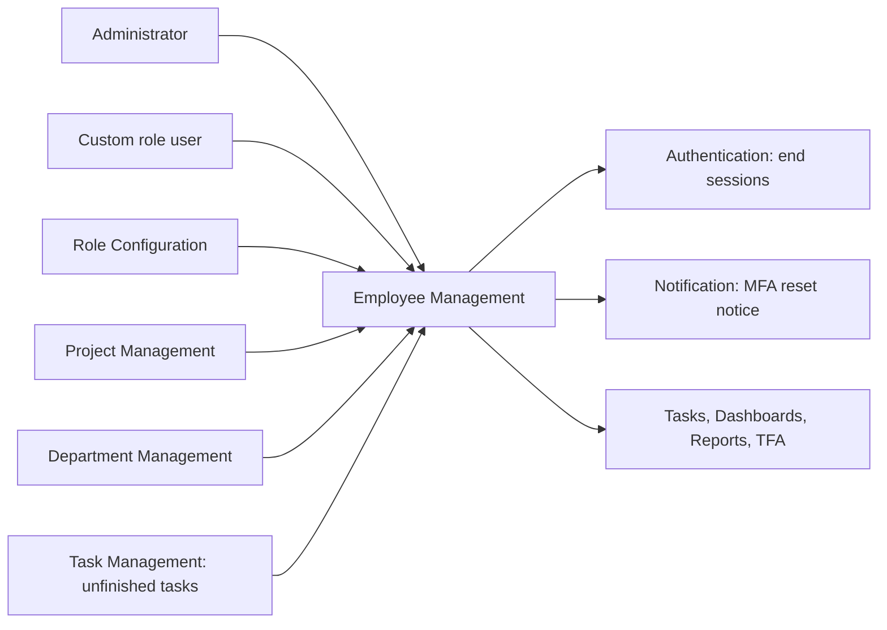
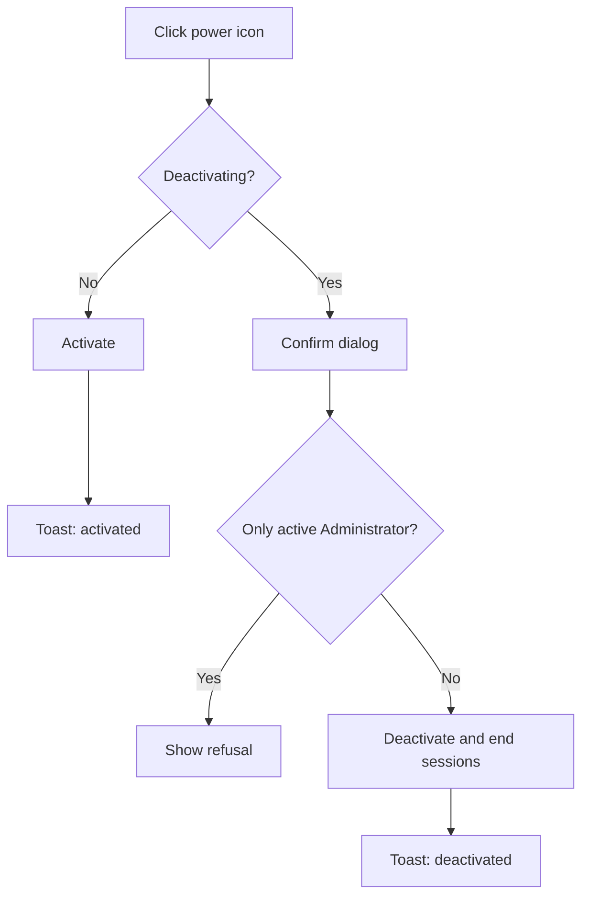
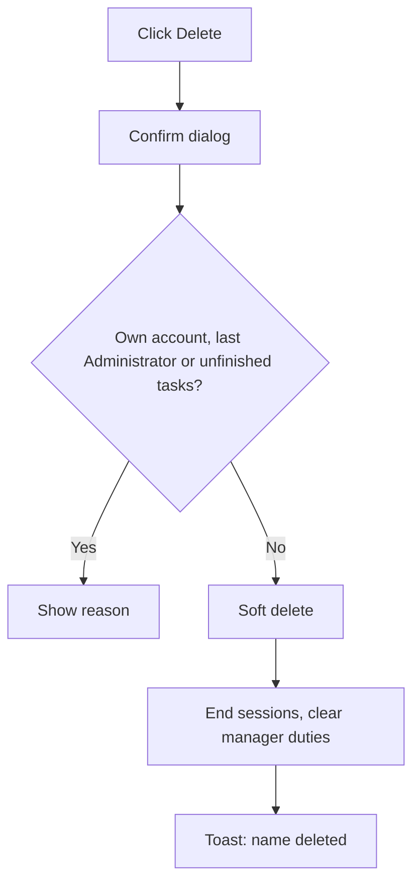
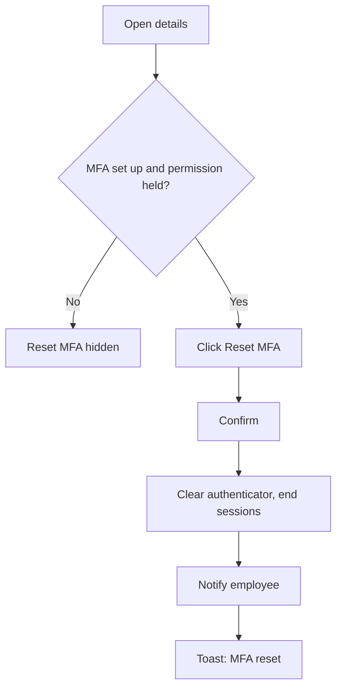
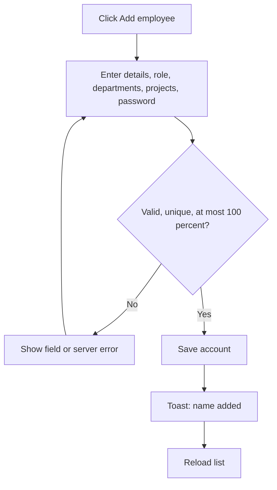
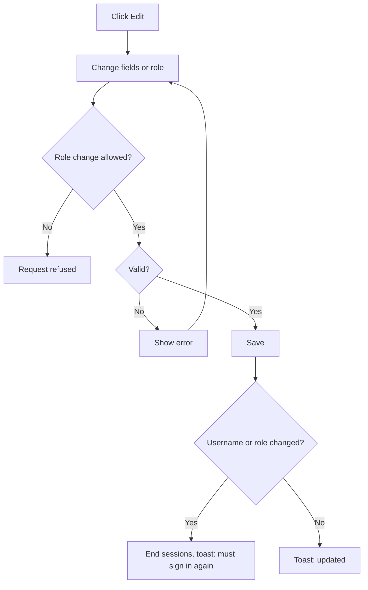
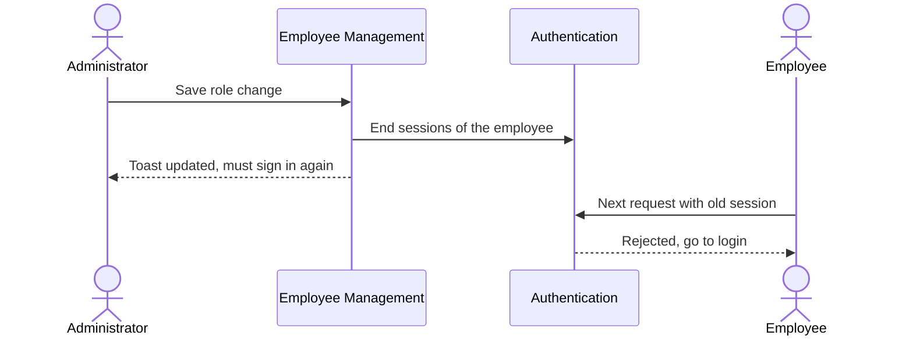
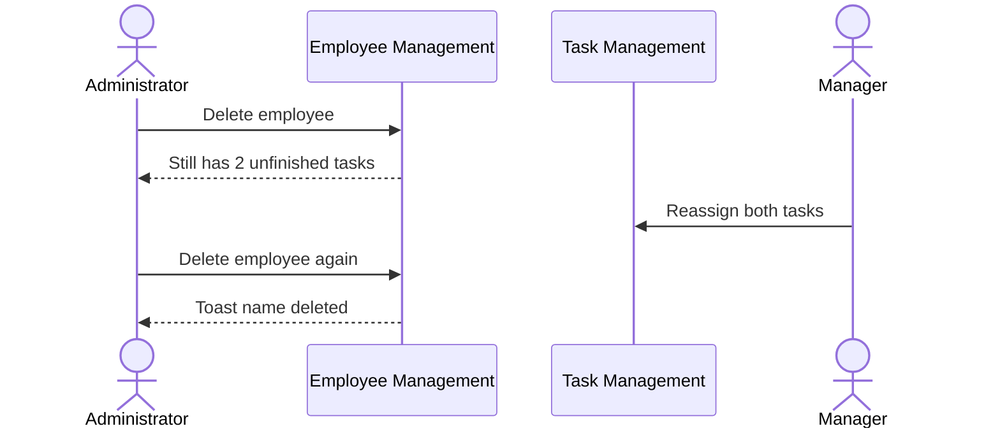
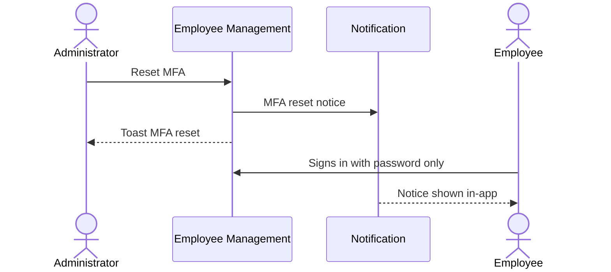

# Functional Requirements Document – Employee Management

## TaskFlow – Intelligent Task Allocation & Tracking System

> **Document:** Functional Requirements Document (sub-module EMP)  ·  **Version:** 1.0  ·  **Status:** Draft
> **Project type:** Personal Project (Skill Development)  ·  **Date:** 31-Oct-2026
> **Author:** Jojo George (jojogeorge3344@gmail.com)
> **Module:** TaskFlow Management  ·  **Sub-module:** 03.1 Employee Management (code `EMP`)
> **Based on:** `BRD-Employee-Management.md` v1.0
> © 2026 Jojo George. All rights reserved.

---

## Document Control

### Revision History

| Version | Date | Author | Summary of changes |
|---|---|---|---|
| 1.0 | 31-Oct-2026 | Jojo George | Initial version, written from the Employee Management BRD v1.0 and TaskFlow as built |

### Related Documents

| Document | Purpose | Location |
|---|---|---|
| BRD – Employee Management | Business needs this FRD details (`REQ-EMP-nn`, `BR-EMP-nn`) | `../../../BRD/03-TaskFlow-Management/03.1-Employee-Management/BRD-Employee-Management.md` |
| BRD – Overall | Roles, global rules `BR-nn`, global NFRs | `../../../BRD/00-Overall/BRD-TaskFlow-Overall.md` |
| FRD – Overall | Shared roles, Authentication, cross-cutting behaviour, index | `../../00-Overall/FRD-TaskFlow-Overall.md` |
| Related FRDs | Project Management, Department Management | `../03.2-Project-Management/FRD-Project-Management.md`, `../03.3-Department-Management/FRD-Department-Management.md` |
| Development Plan | Screen 5 – Employee Management | `TF - Documents/Screens Wise Feature Development Plan/05-employee-management-screen.md` |
| HLD / LLD | Technical design | `../../../HLD/03-TaskFlow-Management/03.1-Employee-Management/HLD-Employee-Management.md`, `../../../LLD/03-TaskFlow-Management/03.1-Employee-Management/LLD-Employee-Management.md` |
| TDD | Technical design document (whole system) | `TF - Documents/TF - TDD/TDD-TaskFlow.md` |

---

## 1. Introduction

### 1.1 Purpose
This FRD specifies the detailed, testable behaviour of the Employee Management sub-module: the employee list, the
employee details side panel and the add / edit employee side panel – their inputs, outputs, rules, validations,
messages and permissions.

### 1.2 Scope
**In scope:** listing, searching and filtering employees; viewing one employee's details with derived managers;
adding an employee with role, departments, project allocations, temporary password and status; editing code, name,
username, email and role; activating and deactivating; soft-deleting with safety checks; resetting an employee's
authenticator MFA.

**Out of scope** (BRD section 3.2): changing departments or allocations after creation (Department Management and
Project Management), setting another person's password, self-registration, bulk import / export, a Department filter
on the list.

### 1.3 Audience
Developer, tester, reviewer and product owner of TaskFlow (all Jojo George).

### 1.4 Conventions
- Requirement IDs: `FR-EMP-nn`. Use cases: `UC-EMP-nn`. Business rules: `BR-EMP-nn` (Employee Management BRD) and
  `BR-nn` (overall BRD). BRD requirements: `REQ-EMP-nn`.
- Priority: **Must / Should / Could** (MoSCoW), taken from the BRD requirement traced.
- "The system shall …" = mandatory behaviour.
- `{name}` / `{Full name}` / `{n}` in messages are replaced by the real value.
- Permission "System" = a rule the system applies whatever the user's permissions.

### 1.5 Definitions & Abbreviations

| Term | Meaning |
|---|---|
| Employee | Any person with a TaskFlow sign-in account, whatever their role |
| Live employee | An employee who has not been deleted |
| Allocation | The whole percentage (1–100) of a person's time given to one project, with a position |
| Position | A label for a person's job on a project (for example Developer); it grants no access |
| Derived manager | A manager worked out from a person's departments and projects, never typed in |
| Soft delete | Hiding a record from every list while keeping it and its history |
| MFA | Two-step verification with an authenticator app |
| Session | A signed-in state on a device; ending it forces a new sign-in |
| Employee action permission | Any of `employees.create`, `employees.edit`, `employees.status.change`, `employees.delete`, `employees.role.assign`, `employees.mfa.reset` |
| Scope | Own / Team / Organisation data visibility; Employee Management is always Organisation |

---

## 2. System Overview

### 2.1 Module Map

| Code | Module | Child modules / screens | Primary roles |
|---|---|---|---|
| EMP | TaskFlow Management → Employee Management (this FRD) | Employee Management list, Employee details (side panel), Add / Edit employee (side panel) | Administrator, custom roles with employee action permissions |
| PROJ | Project Management (related) | Supplies projects and positions; owns allocations after creation | Administrator, Manager |
| DEPT | Department Management (related) | Supplies departments; owns memberships after creation | Administrator |
| AUTH | Authentication (overall FRD) | Sessions ended by employee actions; MFA | All users |
| NOTIF | Notification (related) | Delivers the MFA-reset notification | All users |
| ROLE | Role Configuration (related) | Supplies the roles offered in the form and filter | Administrator |

### 2.2 Context Diagram

---

## 3. User Roles & Permissions

### 3.1 Roles

| Role | Description | Data scope |
|---|---|---|
| Administrator | Full system owner; adds, edits, activates / deactivates, deletes employees, assigns any role, resets MFA | Organisation |
| Manager | Holds `employees.view` only; no menu item or screen here, but other screens (for example the task assignee picker) list people with it | Organisation list, read only, through other screens |
| Employee | No access to this sub-module | None |
| Custom role | Sees the screen only with at least one employee action permission; can do what it is granted | As granted (Organisation) |

### 3.2 Permission Matrix (functional view)

| Module › Function | Permission key | Administrator | Manager | Employee | Custom role |
|---|---|:---:|:---:|:---:|:---:|
| Employees › View list and details | `employees.view` | Granted | Granted | Denied | Configurable |
| Employees › Add employee | `employees.create` | Granted | Denied | Denied | Configurable |
| Employees › Edit employee | `employees.edit` | Granted | Denied | Denied | Configurable |
| Employees › Activate / deactivate | `employees.status.change` | Granted | Denied | Denied | Configurable |
| Employees › Choose a role other than Employee | `employees.role.assign` | Granted | Denied | Denied | Configurable |
| Employees › Reset two-step verification | `employees.mfa.reset` | Granted | Denied | Denied | Configurable |
| Employees › Delete employee | `employees.delete` | Granted | Denied | Denied | Configurable |
| Settings › Give or take away the Administrator role (used here) | `roles.administrator.assign` | Granted | Denied | Denied | Denied (not assignable) |
| Projects › Fill the Project filter and allocation lists (supporting) | `projects.view` | Granted | Granted | Denied | Configurable |
| Departments › Fill the Departments list (supporting) | `departments.view` | Granted | Granted | Denied | Configurable |

Every `employees.*` key except `employees.view` also requires `employees.view`. Older roles may still hold
`employees.manage`, which acts like the finer employee keys it was split into.

---

## 4. Functional Requirements by Module

### 4.1 Module: Employee Management (EMP)

**Purpose:** Keep employee sign-in accounts accurate and control who can sign in.  ·  **BRD reference:** BRD-Employee-Management SCREEN 1–3, BR-EMP-01 – BR-EMP-14; overall BR-02, BR-21, BR-24, BR-25, BR-26

#### 4.1.1 Screen: Employee Management (list)

| Field | Value |
|---|---|
| Route / location | `/employees` – menu **TaskFlow Management → Employee Management** |
| Access | Administrator; custom roles holding at least one employee action permission (list data needs `employees.view`). Manager and Employee: no access (menu hidden, route redirects to their dashboard) |
| Entry points | Side menu; **View employees** on a Project Management card (opens the list filtered by that project) |

**Change from original BRD (Screen 5):** the Department filter is replaced by Project, Role and Status filters
(departments are a column); username and projects are added to the columns; deletion is a soft delete blocked only by
**unfinished** assigned tasks; own-account and last-Administrator protection are new.

**Screen elements**

| Element | Type | Description | Mandatory | Visible to |
|---|---|---|:---:|---|
| Employee count | Header text | "{n} employees", plus " match the current filters" when a filter is set | – | All with screen access |
| Add employee | Button | Opens the Add employee side panel | – | Users with `employees.create` |
| Search | Text input | Placeholder "Name or email"; also matches username | No | All with screen access |
| Project | Drop-down | Filter by project (all projects) | No | All with screen access |
| Role | Drop-down | Employee, Manager, Administrator, plus custom roles | No | Custom roles listed only to users with `employees.role.assign` |
| Status | Drop-down | All statuses / Active / Inactive | No | All with screen access |
| Reset | Button | Clears every filter | – | All with screen access |
| Employee | Column | Full name (link to details) and username | – | All with screen access |
| Email | Column | Email address | – | All with screen access |
| Projects | Column | Each project with percentage and position; a total when more than one | – | All with screen access |
| Departments | Column | Department names | – | All with screen access |
| Role / Status | Columns | Role name; Active or Inactive | – | All with screen access |
| Edit | Row icon (pencil) | Opens the Edit employee side panel | – | Users with `employees.edit` |
| Activate / Deactivate | Row icon (power) | Switches the account on or off | – | Users with `employees.status.change` |
| Delete | Row icon (trash) | Soft-deletes the employee | – | Users with `employees.delete`; never on the user's own row |

**Functional requirements**

| ID | Requirement | Priority | Permission | BRD trace |
|---|---|---|---|---|
| FR-EMP-01 | The system shall list every live (not deleted) employee, ordered by full name. | Must | `employees.view` | REQ-EMP-01, BR-EMP-07 |
| FR-EMP-02 | The system shall show per row the employee's full name and username, email, projects (each with percentage and position), departments, role and status. | Must | `employees.view` | REQ-EMP-02 |
| FR-EMP-03 | The system shall show a project total in the Projects column when an employee has more than one project. | Should | `employees.view` | REQ-EMP-03 |
| FR-EMP-04 | The system shall show the number of employees listed as "{n} employees" and append " match the current filters" while any filter is set. | Should | `employees.view` | REQ-EMP-04 |
| FR-EMP-05 | The system shall filter the list to employees whose full name, email or username contains the search text, ignoring case. | Must | `employees.view` | REQ-EMP-05 |
| FR-EMP-06 | The system shall filter the list to employees allocated to the selected project. | Must | `employees.view` (options need `projects.view`) | REQ-EMP-06 |
| FR-EMP-07 | The system shall filter the list by role, offering Employee, Manager and Administrator to everyone and custom roles only to users holding `employees.role.assign`. | Must | `employees.view`, `employees.role.assign` | REQ-EMP-07 |
| FR-EMP-08 | The system shall, when custom roles cannot be loaded, list only the standard roles and show "Custom roles could not be loaded. Only the standard roles are listed." | Should | `employees.role.assign` | REQ-EMP-07, REQ-EMP-36 |
| FR-EMP-09 | The system shall filter the list by status: All statuses, Active or Inactive. | Must | `employees.view` | REQ-EMP-08 |
| FR-EMP-10 | The system shall apply search and all filters together and clear them all when the user clicks **Reset**. | Should | `employees.view` | REQ-EMP-05 – REQ-EMP-09 |
| FR-EMP-11 | The system shall show "No employees yet – Add the first employee to get started." when there are no employees, "No employees match these filters – Try a different search or clear the filters." when filters hide every row, and "Could not load employees. Check your connection and try again." when loading fails. | Should | `employees.view` | REQ-EMP-01, REQ-EMP-04 |
| FR-EMP-12 | The system shall show the Employee Management menu item and open `/employees` only for users holding at least one employee action permission, and redirect other users (including Managers holding only `employees.view`) to their dashboard. | Must | Any employee action permission | REQ-EMP-10 |
| FR-EMP-13 | The system shall show **Add employee**, **Edit**, **Activate/Deactivate** and **Delete** only to users holding `employees.create`, `employees.edit`, `employees.status.change` and `employees.delete` respectively. | Must | As listed | REQ-EMP-11 |
| FR-EMP-14 | The system shall refuse every employee action requested without the matching permission, even when requested outside the screen, and show the action's generic failure message. | Must | As listed | REQ-EMP-11, NFR-EMP-02, BR-04 |
| FR-EMP-15 | The system shall never show **Delete** on the signed-in user's own row. | Must | `employees.delete` | REQ-EMP-12, BR-EMP-05 |
| FR-EMP-16 | The system shall ask "Deactivate employee?" – "{name} will not be able to sign in until they are activated again." before deactivating, and activate an inactive employee without confirmation. | Must | `employees.status.change` | REQ-EMP-13, NFR-EMP-04 |
| FR-EMP-17 | The system shall refuse to deactivate the only active Administrator with "The only active Administrator cannot be deactivated." | Must | System | REQ-EMP-15, BR-EMP-04, BR-26 |
| FR-EMP-18 | The system shall, on deactivation, switch the account off, end all of the person's sessions so their next request is rejected, and refuse their sign-in until they are activated again. | Must | `employees.status.change` | REQ-EMP-14, BR-EMP-01, BR-EMP-08, BR-02, NFR-EMP-01 |
| FR-EMP-19 | The system shall confirm a status change with "{name} activated" or "{name} deactivated" and refresh the row. | Should | `employees.status.change` | REQ-EMP-13 |
| FR-EMP-20 | The system shall ask "Delete employee?" – "{name} will no longer appear in the system or be able to sign in. Their tasks, comments and mail are kept." before deleting. | Must | `employees.delete` | REQ-EMP-16, NFR-EMP-04 |
| FR-EMP-21 | The system shall refuse to delete the user's own account with "You cannot delete your own account." | Must | System | REQ-EMP-17, BR-EMP-05, BR-26 |
| FR-EMP-22 | The system shall refuse to delete the only active Administrator with "The only active Administrator cannot be deleted." | Must | System | REQ-EMP-19, BR-EMP-04, BR-26 |
| FR-EMP-23 | The system shall refuse to delete an employee who still has unfinished assigned tasks with "{name} still has {n} unfinished task(s). Reassign it/them before deleting this employee." | Must | System | REQ-EMP-18, BR-EMP-06 |
| FR-EMP-24 | The system shall delete by soft delete: the person disappears from every list and cannot sign in, while their tasks, comments and mail are kept and stay visible in history and reports. | Must | `employees.delete` | REQ-EMP-16, BR-EMP-07, BR-21 |
| FR-EMP-25 | The system shall, on deletion, end all of the person's sessions and remove their project-manager flags and department-manager links. | Must | `employees.delete` | REQ-EMP-20, BR-EMP-08, BR-EMP-14 |
| FR-EMP-26 | The system shall keep a deleted person's email and username reserved so that no new or edited employee can use them. | Must | System | REQ-EMP-21, BR-EMP-03 |
| FR-EMP-27 | The system shall confirm a deletion with "{name} deleted" and remove the row. | Should | `employees.delete` | REQ-EMP-16 |

**Use case: UC-EMP-01 – Find employees**

| Item | Detail |
|---|---|
| Actor | Administrator |
| Preconditions | Signed in with MFA; holds an employee action permission and `employees.view` |
| Trigger | Opens **TaskFlow Management → Employee Management** |
| Main flow | 1. System lists live employees by full name with the count. 2. Administrator types in **Search** and picks Project, Role or Status. 3. System narrows the list and shows "{n} employees match the current filters". 4. Administrator clicks **Reset**; the full list returns. |
| Alternate flows | A1: opened from **View employees** on a project card → the Project filter is already set. |
| Exceptions | E1: no employee matches → "No employees match these filters – Try a different search or clear the filters." E2: load fails → "Could not load employees. Check your connection and try again." E3: user without an action permission opens `/employees` → redirected to their dashboard. |
| Postconditions | None (read only). |

**Use case: UC-EMP-02 – Activate or deactivate an employee**

| Item | Detail |
|---|---|
| Actor | Administrator |
| Preconditions | Holds `employees.status.change` |
| Trigger | Clicks the power icon on a row |
| Main flow | 1. For an active employee the system asks "Deactivate employee?". 2. Administrator clicks **Deactivate**. 3. System checks the last-Administrator rule, switches the account off and ends all sessions. 4. System shows "{name} deactivated". |
| Alternate flows | A1: the employee is inactive → the system activates at once and shows "{name} activated". |
| Exceptions | E1: only active Administrator → "The only active Administrator cannot be deactivated." E2: other failure → "Could not update the employee status." |
| Postconditions | Status changed; a deactivated person cannot sign in and their open sessions stop working. |

**Use case: UC-EMP-03 – Delete an employee**

| Item | Detail |
|---|---|
| Actor | Administrator |
| Preconditions | Holds `employees.delete`; the row is not the user's own |
| Trigger | Clicks the trash icon on a row |
| Main flow | 1. System asks "Delete employee?". 2. Administrator confirms. 3. System checks own account, last Administrator and unfinished tasks. 4. System soft-deletes the person, ends their sessions and clears their manager duties. 5. System shows "{name} deleted". |
| Alternate flows | – |
| Exceptions | E1: own account → "You cannot delete your own account." E2: only active Administrator → "The only active Administrator cannot be deleted." E3: unfinished tasks → "{name} still has {n} unfinished task(s). Reassign it/them before deleting this employee." E4: other failure → "Could not delete the employee." |
| Postconditions | Person hidden from every list and unable to sign in; history kept; email and username reserved. |

**Field validations**

| Field | Rule | Error message |
|---|---|---|
| Status change target | Must not be the only active Administrator when deactivating | "The only active Administrator cannot be deactivated." |
| Delete target | Not own account; not the only active Administrator; no unfinished assigned tasks | See FR-EMP-21 – FR-EMP-23 |

**Business rules applied:** BR-EMP-01, BR-EMP-03 – BR-EMP-08, BR-EMP-14; BR-02, BR-21, BR-26

**Notifications / side effects**

| Event | Who is notified | Channel |
|---|---|---|
| Employee deactivated or deleted | Nobody; the person's sessions end | – (no notification, no email) |

**Messages**

| Situation | Message |
|---|---|
| Activated / deactivated | "{name} activated" / "{name} deactivated" |
| Deleted | "{name} deleted" |
| Status change refused | "Could not update the employee status." |
| Delete refused | "Could not delete the employee." |
| No permission | Menu item hidden; `/employees` redirects to the dashboard; a refused call shows the action's failure message |

#### 4.1.2 Screen: Employee Details (side panel)

| Field | Value |
|---|---|
| Route / location | Side panel on `/employees`, opened by clicking an employee's name |
| Access | Same as 4.1.1; **Reset MFA** needs `employees.mfa.reset`. Opening another person's single record directly (not from the list) needs `employees.edit` |
| Entry points | Employee name link in the list |

**Change from original BRD (Screen 5):** the "Employee details view" is kept; derived managers, the Manager's own
projects and team, and the MFA reset are new.

**Screen elements**

| Element | Type | Description | Mandatory | Visible to |
|---|---|---|:---:|---|
| Employee code, Username, Email, Role | Read-only text | Identity of the person | – | All with screen access |
| Projects | Read-only list | Project, position and percentage | – | All with screen access |
| Departments | Read-only list | Department names | – | All with screen access |
| Managers | Read-only list | Derived from departments and flagged project managers | – | All with screen access |
| Manages projects / Team | Read-only lists | Shown when the person is a Manager | – | All with screen access |
| Status, Created, Two-step, Last login | Read-only text | Account facts | – | All with screen access |
| Reset MFA | Button | Removes the person's authenticator | – | Users with `employees.mfa.reset`, only when the person has MFA set up |
| Close | Button | Closes the panel | – | All with screen access |
| Edit | Button | Opens Edit employee for this person | – | All with screen access (see section 10) |

**Functional requirements**

| ID | Requirement | Priority | Permission | BRD trace |
|---|---|---|---|---|
| FR-EMP-28 | The system shall open a read-only Employee details side panel when the user clicks an employee's name. | Must | `employees.view` | REQ-EMP-22 |
| FR-EMP-29 | The system shall show the employee code, username, email, role, projects (with position and percentage), departments and managers. | Must | `employees.view` | REQ-EMP-23 |
| FR-EMP-30 | The system shall show, when the person is a Manager, the projects they manage and their team. | Should | `employees.view` | REQ-EMP-24 |
| FR-EMP-31 | The system shall show the account status, created date, two-step verification status and last login. | Should | `employees.view` | REQ-EMP-25 |
| FR-EMP-32 | The system shall derive a person's managers as the managers of the departments they belong to plus the flagged project managers of their projects, and shall not accept a typed manager value. | Must | System | REQ-EMP-26, BR-EMP-12 |
| FR-EMP-33 | The system shall open the Edit employee side panel for the same person when the user clicks **Edit**. | Must | `employees.edit` | REQ-EMP-22 |
| FR-EMP-34 | The system shall show **Reset MFA** only when the person has MFA set up and the user holds `employees.mfa.reset`. | Must | `employees.mfa.reset` | REQ-EMP-27 |
| FR-EMP-35 | The system shall ask "Reset two-step verification?" – "{name} will be signed out everywhere and can sign in with just their password. They can set up an authenticator app again from Profile." before resetting. | Must | `employees.mfa.reset` | REQ-EMP-28, NFR-EMP-04 |
| FR-EMP-36 | The system shall, after confirmation, remove the person's authenticator, end all of their sessions and let them sign in with their password and set MFA up again. | Must | `employees.mfa.reset` | REQ-EMP-28, BR-EMP-08, BR-25 |
| FR-EMP-37 | The system shall send the person the system notification "An administrator reset your authenticator MFA. Sign in with your password and set it up again from Profile." | Must | System | REQ-EMP-29 |
| FR-EMP-38 | The system shall confirm with "MFA reset for {Full name}", or show "Could not reset MFA." when the reset is refused. | Should | `employees.mfa.reset` | REQ-EMP-28 |

**Use case: UC-EMP-04 – View an employee's details**

| Item | Detail |
|---|---|
| Actor | Administrator |
| Preconditions | On the Employee Management list |
| Trigger | Clicks an employee's name |
| Main flow | 1. System opens the details panel. 2. System shows identity, projects, departments and derived managers. 3. For a Manager it also shows managed projects and team. 4. Administrator clicks **Close** or **Edit**. |
| Alternate flows | A1: **Edit** → Edit employee panel opens (UC-EMP-07). |
| Exceptions | – |
| Postconditions | None (read only). |

**Use case: UC-EMP-05 – Reset an employee's MFA**

| Item | Detail |
|---|---|
| Actor | Administrator |
| Preconditions | Holds `employees.mfa.reset`; the person has MFA set up |
| Trigger | Clicks **Reset MFA** in the details panel |
| Main flow | 1. System asks "Reset two-step verification?". 2. Administrator confirms. 3. System removes the authenticator and ends all of the person's sessions. 4. System sends the person the MFA-reset notification. 5. System shows "MFA reset for {Full name}". |
| Alternate flows | A1: the person has no MFA set up → **Reset MFA** is not shown. |
| Exceptions | E1: refused → "Could not reset MFA." |
| Postconditions | The person signs in with the password only and sets up a new authenticator from My Profile. |

**Field validations:** _Not applicable for this screen_ (read only).

**Business rules applied:** BR-EMP-08, BR-EMP-12; BR-25

**Notifications / side effects**

| Event | Who is notified | Channel |
|---|---|---|
| MFA reset | The employee whose MFA was reset | In-app system notification (N-EMP-01) |

**Messages**

| Situation | Message |
|---|---|
| Success | "MFA reset for {Full name}" |
| Refused | "Could not reset MFA." |

#### 4.1.3 Screen: Add / Edit Employee (side panel)

| Field | Value |
|---|---|
| Route / location | Side panel on `/employees` – titled **Add employee** ("New employee – Fill in the details below to add them to TaskFlow.") or **Edit employee** |
| Access | Administrator; custom roles with `employees.create` (add) or `employees.edit` (edit); the role field needs `employees.role.assign`; giving or removing the Administrator role needs `roles.administrator.assign` (Administrator role only). Manager and Employee: no access |
| Entry points | **Add employee** button; **Edit** row icon; **Edit** in the details panel |

**Change from original BRD (Screen 5):** departments are set only when adding; roles other than Employee need the
assign-roles permission and the Administrator role is Administrator-only; email uniqueness also covers usernames and
deleted people with the fixed `@taskflow.com` domain; project allocations, the temporary password and session end on
username or role change are new.

**Screen elements**

| Element | Type | Description | Mandatory | Visible to |
|---|---|---|:---:|---|
| Full name | Text input | Person's full name | Yes | Users with `employees.create` / `employees.edit` |
| Username | Text input | Sign-in name | Yes | Same |
| Email | Text input + fixed suffix | Part before the fixed `@taskflow.com` | Yes | Same |
| Employee code | Text input | Optional code | No | Same |
| Role | Drop-down | Employee by default; locked without `employees.role.assign` | Yes | Same (editable with `employees.role.assign`) |
| Departments | Tick boxes | Existing departments; view only on edit | No | Same |
| Project allocation rows | Project drop-down, Position (pick or type), Percentage | One row per project; view only on edit with the hint "Projects are assigned in Project management." | No | Same |
| Add project | Button | Adds an allocation row (add only) | – | Users with `employees.create` |
| Allocation bar | Indicator | "X% allocated, Y% remaining" | – | Users with `employees.create` |
| Temporary password | Password input + strength meter | Add only | Yes (add) | Users with `employees.create` |
| Status | Drop-down | Active or Inactive (add only) | Yes (add) | Users with `employees.create` |
| Sign-out notice | Text | "Changing the username or role signs this employee out. They must sign in again." (edit only) | – | Users with `employees.edit` |
| Add employee / Save changes | Button | Submits the panel | – | As above |

**Functional requirements**

| ID | Requirement | Priority | Permission | BRD trace |
|---|---|---|---|---|
| FR-EMP-39 | The system shall create an employee only with a full name (at most 200 characters), a username (at most 100) and an email (at most 256), with an optional employee code. | Must | `employees.create` | REQ-EMP-30 |
| FR-EMP-40 | The system shall accept only an email whose part before the fixed `@taskflow.com` holds letters, digits, dot, underscore or hyphen, and store it in lower case. | Must | `employees.create`, `employees.edit` | REQ-EMP-31, BR-EMP-02, BR-24 |
| FR-EMP-41 | The system shall reject an email whose part before `@` is already used by any employee, including deleted ones, with "Email already exists." | Must | System | REQ-EMP-32, BR-EMP-03 |
| FR-EMP-42 | The system shall reject a username already used by any employee, ignoring case and including deleted ones, with "Email or username already exists." | Must | System | REQ-EMP-33, BR-EMP-03 |
| FR-EMP-43 | The system shall keep email and username unique even when two users save at the same moment. | Must | System | REQ-EMP-32, REQ-EMP-33, NFR-EMP-06 |
| FR-EMP-44 | The system shall require a temporary password of at least 6 characters when adding, show its strength while typing, and store it only hashed. | Must | `employees.create` | REQ-EMP-34, NFR-EMP-03 |
| FR-EMP-45 | The system shall let the user choose the initial status, Active or Inactive, when adding. | Should | `employees.create` | REQ-EMP-35 |
| FR-EMP-46 | The system shall give a new employee the Employee role unless the user holds `employees.role.assign` and picks another role; without it the role field is locked and a role change is refused with "Changing a role needs the assign roles permission." | Must | `employees.role.assign` | REQ-EMP-36, BR-EMP-09 |
| FR-EMP-47 | The system shall allow giving or removing the Administrator role only to users holding `roles.administrator.assign`. | Must | `roles.administrator.assign` | REQ-EMP-37, BR-EMP-09 |
| FR-EMP-48 | The system shall let the user tick existing departments when adding, and reject an unknown department with "Department does not exist." | Must | `employees.create` (list needs `departments.view`) | REQ-EMP-38, BR-EMP-11 |
| FR-EMP-49 | The system shall let the user add allocation rows when adding, each with an existing project, a position picked or newly typed, and a whole percentage from 1 to 100. | Must | `employees.create` (lists need `projects.view`) | REQ-EMP-39, BR-EMP-10 |
| FR-EMP-50 | The system shall reject an unknown role, project or position with "Role does not exist.", "Project does not exist." or "Position does not exist." | Must | System | REQ-EMP-36, REQ-EMP-39 |
| FR-EMP-51 | The system shall allow a project only once per employee. | Must | System | REQ-EMP-40, BR-EMP-10 |
| FR-EMP-52 | The system shall show "X% allocated, Y% remaining" while allocations are edited and reject a total above 100%. | Must | System | REQ-EMP-41, BR-EMP-10 |
| FR-EMP-53 | The system shall, when editing, show departments and project allocations view only with the hint "Projects are assigned in Project management." and change only the code, full name, username, email and role. | Must | `employees.edit` | REQ-EMP-42, BR-EMP-11 |
| FR-EMP-54 | The system shall never change a person's password from the edit panel, even if a password is sent. | Must | System | REQ-EMP-43, BR-EMP-13 |
| FR-EMP-55 | The system shall show the notice "Changing the username or role signs this employee out. They must sign in again." on the edit panel. | Should | `employees.edit` | REQ-EMP-44 |
| FR-EMP-56 | The system shall end all of a person's sessions when their username or role changes and confirm with "{Full name} updated. They must sign in again." | Must | `employees.edit` | REQ-EMP-45, BR-EMP-08, NFR-EMP-01 |
| FR-EMP-57 | The system shall sign an administrator out at once and take them to the login page when they change their own username or role. | Must | System | REQ-EMP-46 |
| FR-EMP-58 | The system shall refuse to move the only active Administrator to another role with "The only active Administrator cannot be moved to another role." | Must | System | REQ-EMP-47, BR-EMP-04, BR-26 |
| FR-EMP-59 | The system shall remove a person's project-manager flags and department-manager links when their role changes away from Manager. | Must | System | REQ-EMP-48, BR-EMP-14 |
| FR-EMP-60 | The system shall confirm a save with "{Full name} added" or "{Full name} updated", close the panel and reload the list; a refused save shows "Could not add the employee." or "Could not update the employee." | Should | `employees.create`, `employees.edit` | REQ-EMP-49 |

**Use case: UC-EMP-06 – Add an employee**

| Item | Detail |
|---|---|
| Actor | Administrator |
| Preconditions | Holds `employees.create` (and `projects.view`, `departments.view` for the lists) |
| Trigger | Clicks **Add employee** |
| Main flow | 1. System opens the Add employee panel. 2. Administrator enters Full name, Username, Email (before `@taskflow.com`) and optional Employee code. 3. Administrator picks a Role (if allowed), ticks Departments and adds project rows with position and percentage; the bar shows "X% allocated, Y% remaining". 4. Administrator enters a Temporary password and Status and clicks **Add employee**. 5. System validates and saves. 6. System shows "{Full name} added" and reloads the list. |
| Alternate flows | A1: no `employees.role.assign` → role stays Employee. A2: a typed position does not exist → it is created and used (see Project Management FRD). |
| Exceptions | E1: required field empty → field message. E2: duplicate email → "Email already exists." E3: duplicate username → "Email or username already exists." E4: total above 100% → "Allocations total {n}%. A person can be allocated at most 100%." E5: refused → "Could not add the employee." |
| Postconditions | A sign-in account exists with role, departments and allocations; the temporary password is given to the person outside TaskFlow. |

**Use case: UC-EMP-07 – Edit an employee (including a role change)**

| Item | Detail |
|---|---|
| Actor | Administrator |
| Preconditions | Holds `employees.edit` (role change: `employees.role.assign`; Administrator role: `roles.administrator.assign`) |
| Trigger | Clicks **Edit** on a row or in the details panel |
| Main flow | 1. System opens Edit employee with saved data; departments and allocations view only. 2. Administrator changes code, name, username, email or role. 3. Administrator clicks **Save changes**. 4. System validates, checks role rights and the last-Administrator rule, and saves. 5. If username or role changed, system ends the person's sessions and shows "{Full name} updated. They must sign in again."; otherwise "{Full name} updated". |
| Alternate flows | A1: own username or role changed → the administrator is signed out and taken to the login page. A2: role changed away from Manager → project-manager flags and department-manager links removed. |
| Exceptions | E1: only active Administrator moved → "The only active Administrator cannot be moved to another role." E2: role change without permission → "Changing a role needs the assign roles permission." E3: refused → "Could not update the employee." |
| Postconditions | Details saved; access changes take effect on the person's next request. |

**Field validations**

| Field | Rule | Error message |
|---|---|---|
| Full name | Required; at most 200 characters | "Full name is required." |
| Username | Required; at most 100 characters; unique ignoring case, including deleted people | "Username is required." · "Email or username already exists." |
| Email | Required; at most 256 characters; letters, digits, dot, underscore or hyphen before `@taskflow.com`; unique by the part before `@`, including deleted people | "Email is required." · "Use letters, digits, dot, underscore or hyphen before @taskflow.com." (form) / "Email must be a name using letters, digits, dot, underscore or hyphen followed by @taskflow.com." (server) · "Email already exists." |
| Temporary password | Required on add; at least 6 characters | "Password is required." · "Use at least 6 characters." |
| Role | Must exist; non-Employee needs `employees.role.assign`; Administrator needs `roles.administrator.assign`; not moving the only active Administrator | "Role does not exist." · "Changing a role needs the assign roles permission." · "The only active Administrator cannot be moved to another role." |
| Departments | Each must exist | "Department does not exist." |
| Allocation row | Project, position and percentage all set | "Give every project row a project, a position and a whole percentage from 1 to 100." |
| Allocation percentage | Whole number 1–100 | "Allocation percentage must be a whole number from 1 to 100." |
| Allocation project | Once per person; must exist | "A project can only appear once." (form) / "A project can only appear once for a person." (server) · "Project does not exist." |
| Allocation position | Must exist (or is created when typed) | "Position does not exist." |
| Allocation total | At most 100% | "Allocations total {n}%. A person can be allocated at most 100%." (form) / "Allocations total {n}%, which is over 100%. A person can be allocated at most 100% in total." (server) |

**Business rules applied:** BR-EMP-02, BR-EMP-03, BR-EMP-04, BR-EMP-08 – BR-EMP-11, BR-EMP-13, BR-EMP-14; BR-24, BR-26, BR-28

**Notifications / side effects**

| Event | Who is notified | Channel |
|---|---|---|
| Employee added or updated | Nobody | – (no notification, no email) |
| Username or role changed | The person is signed out | Session end only |

**Messages**

| Situation | Message |
|---|---|
| Success | "{Full name} added" · "{Full name} updated" · "{Full name} updated. They must sign in again." |
| Roles list failed | "Custom roles could not be loaded. Only the standard roles are listed." |
| Refused | "Could not add the employee." / "Could not update the employee." |
| No permission | Buttons hidden; a refused call shows the failure message above |

---

## 5. Cross-Module Workflows

### 5.1 Role change takes effect at once

| Step | Module | Actor / System | Action | FR reference |
|---|---|---|---|---|
| 1 | EMP | Administrator | Changes Ravi Menon's role from Employee to Manager and saves | FR-EMP-46, FR-EMP-56 |
| 2 | EMP | System | Ends all of Ravi's sessions | FR-EMP-56 |
| 3 | AUTH | System | Rejects Ravi's next request and sends him to the login page | Overall FRD (Authentication) |
| 4 | AUTH | Ravi | Signs in again and receives the Manager permissions | Overall FRD (Authentication) |

### 5.2 A person leaves the organisation

| Step | Module | Actor / System | Action | FR reference |
|---|---|---|---|---|
| 1 | EMP | Administrator | Tries to delete Arun, who has 2 tasks In Progress | FR-EMP-23 |
| 2 | TASK | Manager | Reassigns both tasks with a reason | Task Management FRD |
| 3 | EMP | Administrator | Deletes Arun | FR-EMP-24, FR-EMP-25 |
| 4 | RPT | System | Keeps showing Arun's past tasks and comments | FR-EMP-24; Reports FRD |

### 5.3 Lost authenticator

| Step | Module | Actor / System | Action | FR reference |
|---|---|---|---|---|
| 1 | EMP | Administrator | Resets Sanjay's MFA | FR-EMP-35, FR-EMP-36 |
| 2 | NOTIF | System | Delivers the MFA-reset notification | FR-EMP-37; Notification FRD |
| 3 | AUTH / PROF | Sanjay | Signs in with his password and sets up a new authenticator from My Profile | Overall FRD; My Profile FRD |

---

## 6. Reports & Exports

_Not applicable for this sub-module._ The list header count is the only summary; Reports keep showing deleted people's
history (see the Reports FRD).

---

## 7. Notifications & Messages Catalogue

| Code | Trigger | Recipients | Channel | Text |
|---|---|---|---|---|
| N-EMP-01 | Administrator resets a person's MFA | The person | In-app system notification | "An administrator reset your authenticator MFA. Sign in with your password and set it up again from Profile." |
| M-EMP-01 | Employee added | Acting user | Toast | "{Full name} added" |
| M-EMP-02 | Employee updated | Acting user | Toast | "{Full name} updated" / "{Full name} updated. They must sign in again." |
| M-EMP-03 | Status changed | Acting user | Toast | "{name} activated" / "{name} deactivated" |
| M-EMP-04 | Employee deleted | Acting user | Toast | "{name} deleted" |
| M-EMP-05 | MFA reset | Acting user | Toast | "MFA reset for {Full name}" |

No other employee action sends a notification or an email.

---

## 8. Data Requirements (functional view)

| Data item | Description | Created by | Rules |
|---|---|---|---|
| Employee account | Code, full name, username, email, role, active status, created / last-login dates, two-step status | Administrator (add) | Soft delete; email (by part before `@`) and username (ignoring case) unique for ever |
| Email | Sign-in and contact address | Administrator | Fixed `@taskflow.com` domain; stored in lower case |
| Temporary password | First password | Administrator (add only) | At least 6 characters; stored hashed; never shown or changed on edit |
| Project allocation | Project, position, percentage, project-manager flag | Administrator (add); then Project Management | Whole 1–100; project once per person; total at most 100% |
| Department membership | Departments the person belongs to | Administrator (add); then Department Management | Departments must exist |
| Derived managers | Department managers plus flagged project managers | System | Never typed in |

---

## 9. Non-Functional Requirements (functional impact)

The global NFRs of the overall BRD apply (notably NFR-04 passwords, NFR-08 server validation, NFR-12 usability).

| ID | Requirement | Affects |
|---|---|---|
| NFR-EMP-01 | After a deactivation, deletion, username or role change, or MFA reset, the person's next request with an old session is rejected | FR-EMP-18, FR-EMP-25, FR-EMP-36, FR-EMP-56 |
| NFR-EMP-02 | Permission checks are enforced by the server, not only by hidden buttons | FR-EMP-14 |
| NFR-EMP-03 | Temporary passwords are stored hashed and never shown | FR-EMP-44 |
| NFR-EMP-04 | Deactivate, Delete and Reset MFA show a confirmation dialog | FR-EMP-16, FR-EMP-20, FR-EMP-35 |
| NFR-EMP-05 | Every refusal states the reason in plain words | Messages in section 4 |
| NFR-EMP-06 | No two accounts share an email local part or username, even under simultaneous saves | FR-EMP-43 |

---

## 10. Assumptions & Open Issues

| Type | Description | Owner |
|---|---|---|
| Assumption | One organisation with the fixed email domain `@taskflow.com`. | Jojo George |
| Assumption | The administrator gives the temporary password to the new employee outside TaskFlow. | Jojo George |
| Open issue | ⚠️ To be confirmed: the details panel always shows **Edit**, even to users without `employees.edit` (the save is refused by the server). Should the button be hidden? (R-EMP-06) | Jojo George |
| Open issue | ⚠️ To be confirmed: the TaskFlow Assistant's role-change path may not require `employees.role.assign` or `roles.administrator.assign`. Is that intended? (R-EMP-05) | Jojo George |
| Open issue | ⚠️ To be confirmed: the role-permission matrix lists `roles.administrator.assign` as configurable for custom roles, while the permission catalogue marks it not assignable. This FRD follows the catalogue. | Jojo George |
| Open issue | ⚠️ To be confirmed: the catalogue describes `employees.delete` as "Permanently remove an employee account", but deletion is a soft delete (FR-EMP-24). | Jojo George |
| Open issue | The search placeholder says "Name or email" but the search also matches username (FR-EMP-05). | Jojo George |
| Open issue | A custom role with employee rights but without `projects.view` / `departments.view` sees empty Project filter and form lists (R-EMP-04). | Jojo George |
| Open issue | Opening another person's single record directly needs `employees.edit`, while the list shows the same data with `employees.view`. | Jojo George |

---

## 11. Requirements Traceability Matrix

Test evidence lists the automated test suites that cover the behaviour; the mapping was checked against the test
sources. Frontend specs (`*.spec.ts`) are under `frontend/src/app`. "Manual UI" = screen behaviour checked by hand.

| BRD item | FRD requirement(s) | Screen | Use case | Test case |
|---|---|---|---|---|
| REQ-EMP-01 | FR-EMP-01, FR-EMP-11 | 4.1.1 | UC-EMP-01 | UsersEndpointsTests, AdminDeleteEndpointsTests, employee-list.component.spec.ts |
| REQ-EMP-02 | FR-EMP-02 | 4.1.1 | UC-EMP-01 | employee-list.component.spec.ts |
| REQ-EMP-03 | FR-EMP-03 | 4.1.1 | UC-EMP-01 | employee-list.component.spec.ts |
| REQ-EMP-04 | FR-EMP-04, FR-EMP-11 | 4.1.1 | UC-EMP-01 | employee-list.component.spec.ts |
| REQ-EMP-05 | FR-EMP-05, FR-EMP-10 | 4.1.1 | UC-EMP-01 | employee-list.component.spec.ts (server-side matching not covered) |
| REQ-EMP-06 | FR-EMP-06, FR-EMP-10 | 4.1.1 | UC-EMP-01 | UserAllocationServiceTests, ProjectTeamEndpointsTests, employee-list.component.spec.ts, allocation-services.spec.ts |
| REQ-EMP-07 | FR-EMP-07, FR-EMP-08, FR-EMP-10 | 4.1.1 | UC-EMP-01 | RoleAssignmentSafeguardTests (role options); Manual UI (filter and fallback message) |
| REQ-EMP-08 | FR-EMP-09, FR-EMP-10 | 4.1.1 | UC-EMP-01 | employee-list.component.spec.ts |
| REQ-EMP-09 | FR-EMP-10 | 4.1.1 | UC-EMP-01 | Manual UI |
| REQ-EMP-10 | FR-EMP-12 | 4.1.1 | UC-EMP-01 | app.routes.spec.ts, nav-items.spec.ts |
| REQ-EMP-11 | FR-EMP-13, FR-EMP-14 | 4.1.1 | UC-EMP-02, UC-EMP-03 | UsersEndpointsTests, AdminDeleteEndpointsTests, PermissionAuthorizationTests, employee-list.component.spec.ts |
| REQ-EMP-12 | FR-EMP-15 | 4.1.1 | UC-EMP-03 | employee-list.component.spec.ts |
| REQ-EMP-13 | FR-EMP-16, FR-EMP-19 | 4.1.1 | UC-EMP-02 | employee-list.component.spec.ts |
| REQ-EMP-14 | FR-EMP-18 | 4.1.1 | UC-EMP-02 | UsersEndpointsTests |
| REQ-EMP-15 | FR-EMP-17 | 4.1.1 | UC-EMP-02 | LastAdministratorStatusTests |
| REQ-EMP-16 | FR-EMP-20, FR-EMP-24, FR-EMP-27 | 4.1.1 | UC-EMP-03 | UserDeletionTests, AdminDeleteEndpointsTests, employee-list.component.spec.ts |
| REQ-EMP-17 | FR-EMP-21 | 4.1.1 | UC-EMP-03 | UserDeletionTests, AdminDeleteEndpointsTests |
| REQ-EMP-18 | FR-EMP-23 | 4.1.1 | UC-EMP-03 | UserDeletionTests, AdminDeleteEndpointsTests |
| REQ-EMP-19 | FR-EMP-22 | 4.1.1 | UC-EMP-03 | UserDeletionTests |
| REQ-EMP-20 | FR-EMP-25 | 4.1.1 | UC-EMP-03 | UserDeletionTests, AdminDeleteEndpointsTests |
| REQ-EMP-21 | FR-EMP-26 | 4.1.1 | UC-EMP-03 | UserDeletionTests, EmailDomainTests |
| REQ-EMP-22 | FR-EMP-28, FR-EMP-33 | 4.1.2 | UC-EMP-04 | employee-list.component.spec.ts, employee-form-panel.component.spec.ts |
| REQ-EMP-23 | FR-EMP-29 | 4.1.2 | UC-EMP-04 | employee-form-panel.component.spec.ts |
| REQ-EMP-24 | FR-EMP-30 | 4.1.2 | UC-EMP-04 | ManagerAssignmentTests, employee-form-panel.component.spec.ts |
| REQ-EMP-25 | FR-EMP-31 | 4.1.2 | UC-EMP-04 | employee-mfa-reset.spec.ts (two-step status); Manual UI (other fields) |
| REQ-EMP-26 | FR-EMP-32 | 4.1.2 | UC-EMP-04 | ManagerAssignmentTests, ManagerAssignmentEndpointsTests, employee-form-panel.component.spec.ts |
| REQ-EMP-27 | FR-EMP-34 | 4.1.2 | UC-EMP-05 | employee-mfa-reset.spec.ts |
| REQ-EMP-28 | FR-EMP-35, FR-EMP-36, FR-EMP-38 | 4.1.2 | UC-EMP-05 | MfaAdminResetEndpointsTests, MfaServiceTests, employee-mfa-reset.spec.ts |
| REQ-EMP-29 | FR-EMP-37 | 4.1.2 | UC-EMP-05 | MfaAdminResetEndpointsTests, MfaServiceTests |
| REQ-EMP-30 | FR-EMP-39 | 4.1.3 | UC-EMP-06 | UsersEndpointsTests, employee-form-panel.component.spec.ts |
| REQ-EMP-31 | FR-EMP-40 | 4.1.3 | UC-EMP-06, UC-EMP-07 | EmailDomainTests, employee-form-panel.component.spec.ts |
| REQ-EMP-32 | FR-EMP-41, FR-EMP-43 | 4.1.3 | UC-EMP-06 | EmailDomainTests, employee-form-panel.component.spec.ts (409 message) |
| REQ-EMP-33 | FR-EMP-42, FR-EMP-43 | 4.1.3 | UC-EMP-06 | EmailDomainTests, employee-form-panel.component.spec.ts (409 message) |
| REQ-EMP-34 | FR-EMP-44 | 4.1.3 | UC-EMP-06 | UsersEndpointsTests, employee-form-panel.component.spec.ts |
| REQ-EMP-35 | FR-EMP-45 | 4.1.3 | UC-EMP-06 | employee-form-panel.component.spec.ts |
| REQ-EMP-36 | FR-EMP-08, FR-EMP-46, FR-EMP-50 | 4.1.3 | UC-EMP-06, UC-EMP-07 | UsersEndpointsTests, RoleAssignmentSafeguardTests, UserAllocationServiceTests, employee-form-panel.component.spec.ts |
| REQ-EMP-37 | FR-EMP-47 | 4.1.3 | UC-EMP-07 | RoleAssignmentSafeguardTests |
| REQ-EMP-38 | FR-EMP-48 | 4.1.3 | UC-EMP-06 | UserAllocationServiceTests, employee-form-panel.component.spec.ts |
| REQ-EMP-39 | FR-EMP-49, FR-EMP-50 | 4.1.3 | UC-EMP-06 | UserAllocationServiceTests, employee-form-panel.component.spec.ts |
| REQ-EMP-40 | FR-EMP-51 | 4.1.3 | UC-EMP-06 | UserAllocationServiceTests, employee-form-panel.component.spec.ts |
| REQ-EMP-41 | FR-EMP-52 | 4.1.3 | UC-EMP-06 | UserAllocationServiceTests, employee-form-panel.component.spec.ts |
| REQ-EMP-42 | FR-EMP-53 | 4.1.3 | UC-EMP-07 | employee-form-panel.component.spec.ts |
| REQ-EMP-43 | FR-EMP-54 | 4.1.3 | UC-EMP-07 | UsersEndpointsTests, RoleAssignmentSafeguardTests, employee-form-panel.component.spec.ts |
| REQ-EMP-44 | FR-EMP-55 | 4.1.3 | UC-EMP-07 | employee-form-panel.component.spec.ts |
| REQ-EMP-45 | FR-EMP-56 | 4.1.3 | UC-EMP-07 | UsersEndpointsTests |
| REQ-EMP-46 | FR-EMP-57 | 4.1.3 | UC-EMP-07 | employee-form-panel.component.spec.ts |
| REQ-EMP-47 | FR-EMP-58 | 4.1.3 | UC-EMP-07 | LastAdministratorTests |
| REQ-EMP-48 | FR-EMP-59 | 4.1.3 | UC-EMP-07 | ManagerAssignmentTests |
| REQ-EMP-49 | FR-EMP-60 | 4.1.3 | UC-EMP-06, UC-EMP-07 | employee-form-panel.component.spec.ts |
| BR-EMP-01 | FR-EMP-18 | 4.1.1 | UC-EMP-02 | UsersEndpointsTests |
| BR-EMP-02 | FR-EMP-40 | 4.1.3 | UC-EMP-06 | EmailDomainTests |
| BR-EMP-03 | FR-EMP-26, FR-EMP-41, FR-EMP-42 | 4.1.1, 4.1.3 | UC-EMP-03, UC-EMP-06 | EmailDomainTests, UserDeletionTests |
| BR-EMP-04 | FR-EMP-17, FR-EMP-22, FR-EMP-58 | 4.1.1, 4.1.3 | UC-EMP-02, UC-EMP-03, UC-EMP-07 | LastAdministratorTests, LastAdministratorStatusTests, UserDeletionTests |
| BR-EMP-05 | FR-EMP-15, FR-EMP-21 | 4.1.1 | UC-EMP-03 | AdminDeleteEndpointsTests, UserDeletionTests, employee-list.component.spec.ts |
| BR-EMP-06 | FR-EMP-23 | 4.1.1 | UC-EMP-03 | UserDeletionTests |
| BR-EMP-07 | FR-EMP-01, FR-EMP-24 | 4.1.1 | UC-EMP-03 | UserDeletionTests, AdminDeleteEndpointsTests |
| BR-EMP-08 | FR-EMP-18, FR-EMP-25, FR-EMP-36, FR-EMP-56 | 4.1.1 – 4.1.3 | UC-EMP-02, UC-EMP-03, UC-EMP-05, UC-EMP-07 | UsersEndpointsTests, UserDeletionTests, MfaAdminResetEndpointsTests |
| BR-EMP-09 | FR-EMP-46, FR-EMP-47 | 4.1.3 | UC-EMP-06, UC-EMP-07 | UsersEndpointsTests, RoleAssignmentSafeguardTests |
| BR-EMP-10 | FR-EMP-49, FR-EMP-51, FR-EMP-52 | 4.1.3 | UC-EMP-06 | UserAllocationServiceTests |
| BR-EMP-11 | FR-EMP-48, FR-EMP-53 | 4.1.3 | UC-EMP-06, UC-EMP-07 | UserAllocationServiceTests, employee-form-panel.component.spec.ts |
| BR-EMP-12 | FR-EMP-32 | 4.1.2 | UC-EMP-04 | ManagerAssignmentTests |
| BR-EMP-13 | FR-EMP-54 | 4.1.3 | UC-EMP-07 | UsersEndpointsTests, RoleAssignmentSafeguardTests, employee-form-panel.component.spec.ts |
| BR-EMP-14 | FR-EMP-25, FR-EMP-59 | 4.1.1, 4.1.3 | UC-EMP-03, UC-EMP-07 | ManagerAssignmentTests, UserDeletionTests |

**Coverage:** 49 of 49 `REQ-EMP` requirements and 14 of 14 `BR-EMP` rules trace to at least one FR; 0 untraced.

---

## 12. Approvals

| Role | Name | Decision | Date |
|---|---|---|---|
| Product owner | Jojo George | Pending | – |
| Reviewer | Jojo George | Pending | – |

---
© 2026 Jojo George. All rights reserved. Unauthorized copying or distribution of this document is prohibited.
