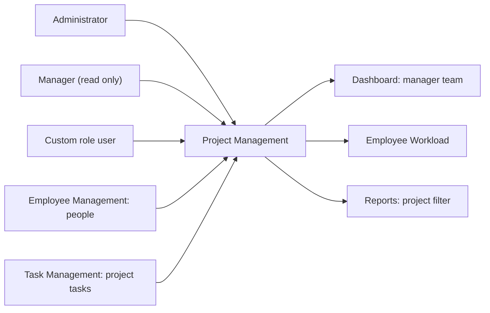
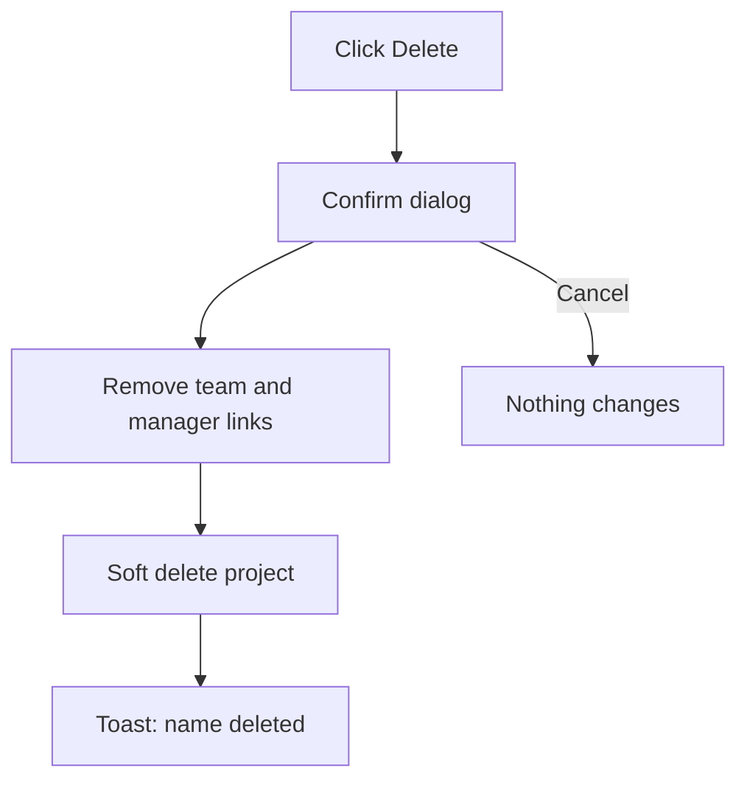
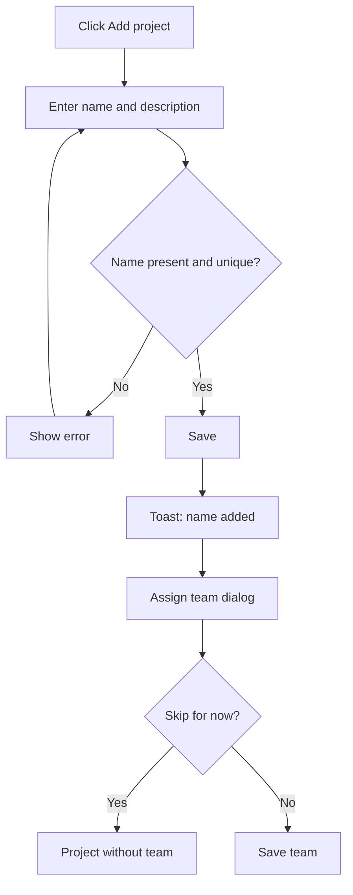
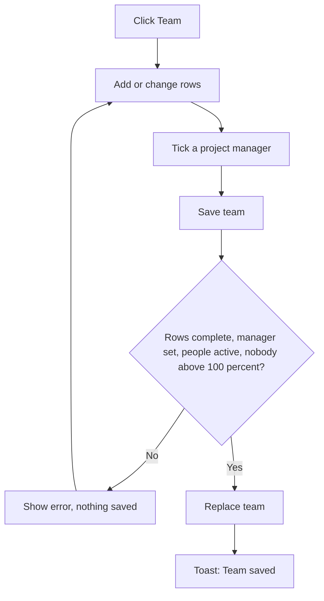
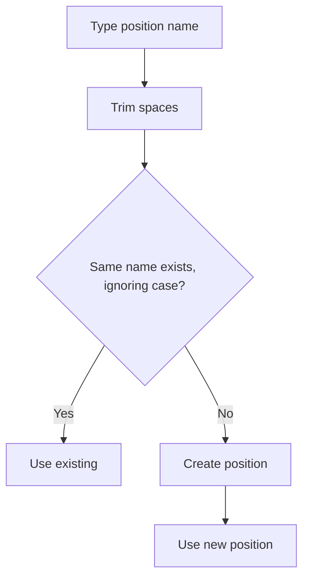
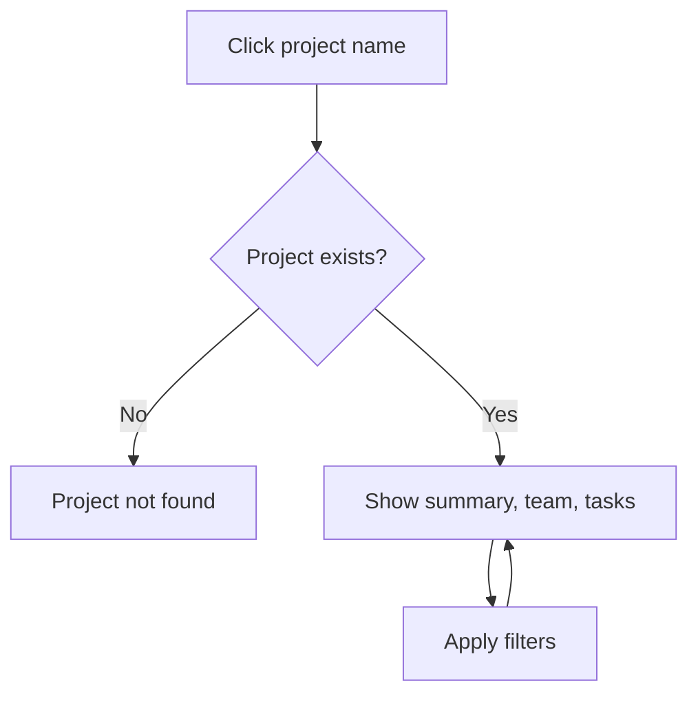
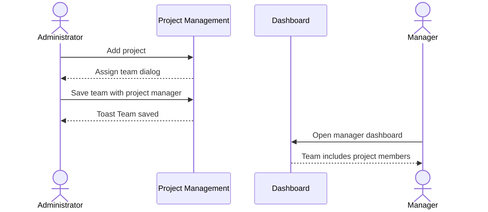
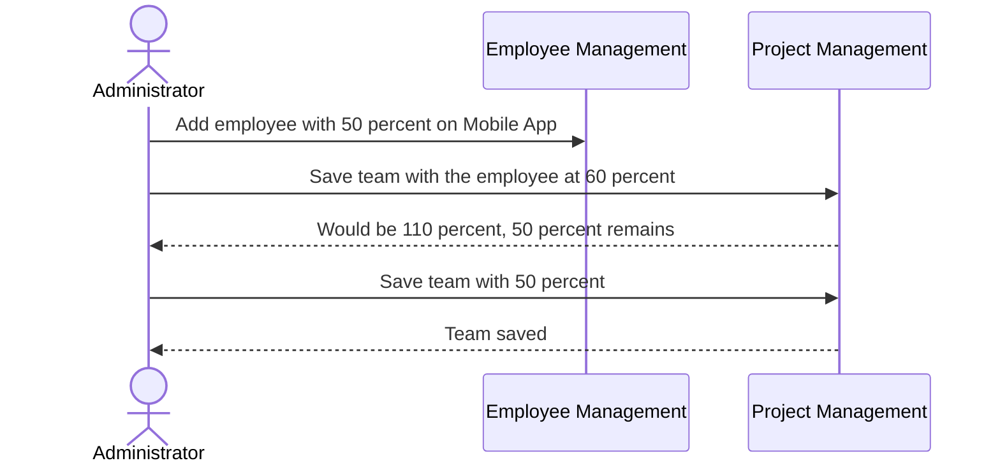

# Functional Requirements Document – Project Management

## TaskFlow – Intelligent Task Allocation & Tracking System

> **Document:** Functional Requirements Document (sub-module PROJ)  ·  **Version:** 1.0  ·  **Status:** Draft
> **Project type:** Personal Project (Skill Development)  ·  **Date:** 31-Oct-2026
> **Author:** Jojo George (jojogeorge3344@gmail.com)
> **Module:** TaskFlow Management  ·  **Sub-module:** 03.2 Project Management, including Positions (code `PROJ`)
> **Based on:** `BRD-Project-Management.md` v1.0
> © 2026 Jojo George. All rights reserved.

---

## Document Control

### Revision History

| Version | Date | Author | Summary of changes |
|---|---|---|---|
| 1.0 | 31-Oct-2026 | Jojo George | Initial version, written from the Project Management BRD v1.0 and TaskFlow as built |

### Related Documents

| Document | Purpose | Location |
|---|---|---|
| BRD – Project Management | Business needs this FRD details (`REQ-PROJ-nn`, `BR-PROJ-nn`) | `../../../BRD/03-TaskFlow-Management/03.2-Project-Management/BRD-Project-Management.md` |
| BRD – Overall | Roles, global rules `BR-nn`, global NFRs | `../../../BRD/00-Overall/BRD-TaskFlow-Overall.md` |
| FRD – Overall | Shared roles, cross-cutting behaviour, index | `../../00-Overall/FRD-TaskFlow-Overall.md` |
| Related FRDs | Employee Management, Department Management, Task Management | `../03.1-Employee-Management/FRD-Employee-Management.md`, `../03.3-Department-Management/FRD-Department-Management.md`, `../../02-TaskFlow-Monitoring/02.1-Task-Management/FRD-Task-Management.md` |
| Development Plan | No Project Management screen in the plan (projects were added during development) | `TF - Documents/Screens Wise Feature Development Plan/` |
| HLD / LLD | Technical design | `../../../HLD/03-TaskFlow-Management/03.2-Project-Management/HLD-Project-Management.md`, `../../../LLD/03-TaskFlow-Management/03.2-Project-Management/LLD-Project-Management.md` |
| TDD | Technical design document (whole system) | `TF - Documents/TF - TDD/TDD-TaskFlow.md` |

---

## 1. Introduction

### 1.1 Purpose
This FRD specifies the detailed, testable behaviour of the Project Management sub-module: the project list, the add /
edit project dialog, the project team dialog (including positions) and the Project Details screen – their inputs,
outputs, rules, validations, messages and permissions.

### 1.2 Scope
**In scope:** listing and searching projects; adding, editing and deleting projects; building each project's team with
position, allocation percentage and project-manager flag; picking or creating positions; Project Details with summary
figures, team and a filtered task list.

**Out of scope** (BRD section 3.2): renaming or deleting positions; project dates, budgets or status; creating tasks
from the project screens (Task Management); changing allocations from Employee Management after creation.

### 1.3 Audience
Developer, tester, reviewer and product owner of TaskFlow (all Jojo George).

### 1.4 Conventions
- Requirement IDs: `FR-PROJ-nn`. Use cases: `UC-PROJ-nn`. Business rules: `BR-PROJ-nn` (Project Management BRD) and
  `BR-nn` (overall BRD). BRD requirements: `REQ-PROJ-nn`.
- Priority: **Must / Should / Could** (MoSCoW), taken from the BRD requirement traced.
- "The system shall …" = mandatory behaviour.
- `{name}`, `{n}`, `{total}`, `{other}`, `{left}`, `{names}` in messages are replaced by the real values.
- Permission "System" = a rule the system applies whatever the user's permissions.

### 1.5 Definitions & Abbreviations

| Term | Meaning |
|---|---|
| Project | A body of work that tasks belong to |
| Live project | A project that has not been deleted |
| Team | The people allocated to a project |
| Allocation | The whole percentage (1–100) of a person's time given to one project |
| Project manager | A team member with the Manager role, flagged to manage the project |
| Position | A shared label for a person's job on a project (for example Developer); it grants no access |
| Manager's team | People in the departments a Manager manages plus people on the projects they manage |
| Soft delete | Hiding a record from every list while keeping it and its history |
| Scope | Own / Team / Organisation data visibility; Project Management is Organisation |

---

## 2. System Overview

### 2.1 Module Map

| Code | Module | Child modules / screens | Primary roles |
|---|---|---|---|
| PROJ | TaskFlow Management → Project Management (this FRD) | Project Management list, Add / Edit project (dialog), Project team / Assign team (dialog) with Positions, Project Details | Administrator (full), Manager (read only) |
| EMP | Employee Management (related) | Supplies people for the team picker; sets first allocations when an employee is added | Administrator |
| DEPT | Department Management (related) | Combined with project managers to form a manager's team | Administrator |
| TASK | Task Management (related) | Supplies the project's tasks; every task belongs to a project | Manager, Employee |
| DASH / WORK / RPT | Dashboard, Employee Workload, Reports (related) | Read projects, teams and allocations | All roles as permitted |

### 2.2 Context Diagram

---

## 3. User Roles & Permissions

### 3.1 Roles

| Role | Description | Data scope |
|---|---|---|
| Administrator | Adds, edits and deletes projects, manages teams, creates positions | Organisation |
| Manager | Views projects, Project Details and positions read only; can be flagged as a project manager | Organisation, read only |
| Employee | No access to this sub-module | None |
| Custom role | Needs `projects.view` to see the screens; can do what it is granted | As granted (Organisation) |

### 3.2 Permission Matrix (functional view)

| Module › Function | Permission key | Administrator | Manager | Employee | Custom role |
|---|---|:---:|:---:|:---:|:---:|
| Projects › View list, Project Details, team, tasks, positions | `projects.view` | Granted | Granted | Denied | Configurable |
| Projects › Add project | `projects.create` | Granted | Denied | Denied | Configurable |
| Projects › Edit project | `projects.edit` | Granted | Denied | Denied | Configurable |
| Projects › Delete project | `projects.delete` | Granted | Denied | Denied | Configurable |
| Projects › Manage project team | `projects.members.manage` | Granted | Denied | Denied | Configurable |
| Projects › Create position | `positions.create` | Granted | Denied | Denied | Configurable |
| Employees › People picker in the team dialog (supporting) | `employees.view` | Granted | Granted | Denied | Configurable |

Every key except `projects.view` also requires `projects.view`. Older roles may still hold `projects.manage`, which
acts like the finer project keys it was split into.

---

## 4. Functional Requirements by Module

### 4.1 Module: Project Management (PROJ)

**Purpose:** Keep one list of projects, staff each one without over-booking anyone, and give every team a responsible
manager.  ·  **BRD reference:** BRD-Project-Management SCREEN 1–4, BR-PROJ-01 – BR-PROJ-11; overall BR-06, BR-21

**Change from original BRD:** the original BRD has no Project Management screen; projects, teams, allocations,
positions and Project Details are new requirements recorded here as built.

#### 4.1.1 Screen: Project Management (list)

| Field | Value |
|---|---|
| Route / location | `/projects` – menu **TaskFlow Management → Project Management** |
| Access | Administrator (full); Manager (read only); custom roles with `projects.view`. Employee: no access (route redirects to the dashboard) |
| Entry points | Side menu |

**Screen elements**

| Element | Type | Description | Mandatory | Visible to |
|---|---|---|:---:|---|
| Project count | Header text | Number of projects | – | Users with `projects.view` |
| Add project | Button | Opens the Add project dialog | – | Users with `projects.create` |
| Search by name or description | Text input | Narrows the cards | No | Users with `projects.view` |
| Project card | Card | Name (link to Project Details), description, "{n} employees", **Manager/Managers** names | – | Users with `projects.view` |
| View employees | Link | Opens Employee Management filtered by the project | – | Users who can open Employee Management |
| Team | Card button | Opens the Project team dialog | – | Users with `projects.members.manage` |
| Edit | Card button | Opens the Edit project dialog | – | Users with `projects.edit` |
| Delete | Card button | Deletes the project after confirmation | – | Users with `projects.delete` |

**Functional requirements**

| ID | Requirement | Priority | Permission | BRD trace |
|---|---|---|---|---|
| FR-PROJ-01 | The system shall show every live project as a card with its name, description, "{n} employees" and the names of its project managers under **Manager** or **Managers**. | Must | `projects.view` | REQ-PROJ-01 |
| FR-PROJ-02 | The system shall show the number of projects in the header. | Should | `projects.view` | REQ-PROJ-02 |
| FR-PROJ-03 | The system shall narrow the cards to projects whose name or description contains the search text. | Should | `projects.view` | REQ-PROJ-03 |
| FR-PROJ-04 | The system shall show the Project Management menu item and open `/projects` and `/projects/{id}` only for users holding `projects.view`, and redirect other users to their dashboard. | Must | `projects.view` | REQ-PROJ-04 |
| FR-PROJ-05 | The system shall show **Add project**, **Team**, **Edit** and **Delete** only to users holding `projects.create`, `projects.members.manage`, `projects.edit` and `projects.delete` respectively, so a Manager sees the list read only. | Must | As listed | REQ-PROJ-05 |
| FR-PROJ-06 | The system shall refuse every project action requested without the matching permission, even when requested outside the screen, and show the action's failure message. | Must | As listed | REQ-PROJ-05, NFR-PROJ-03, BR-04 |
| FR-PROJ-07 | The system shall show **View employees** only to users who can open Employee Management, and open the employee list filtered by that project. | Could | Any employee action permission | REQ-PROJ-06 |
| FR-PROJ-08 | The system shall ask "Delete project?" – "\"{name}\" will be permanently deleted and its {n} employees will be taken off it." before deleting, using only the first sentence part when the project has no team. | Must | `projects.delete` | REQ-PROJ-07 |
| FR-PROJ-09 | The system shall, on delete, remove every allocation and project-manager link of the project so each member's percentage is free again, and hide the project by soft delete. | Must | `projects.delete` | REQ-PROJ-08, BR-PROJ-09, BR-21 |
| FR-PROJ-10 | The system shall keep the project's tasks when the project is deleted. | Must | System | REQ-PROJ-08, BR-PROJ-09 |
| FR-PROJ-11 | The system shall confirm a deletion with "{name} deleted", or show "Could not delete the project." when refused. | Should | `projects.delete` | REQ-PROJ-08 |
| FR-PROJ-12 | The system shall show "No projects yet – Add the first project to start organising employees." when there are no projects, and "Could not load projects. Check your connection and try again." when loading fails. | Could | `projects.view` | REQ-PROJ-09 |
| FR-PROJ-13 | The system shall show projects to every holder of `projects.view` organisation-wide, without a team limit. | Must | `projects.view` | BR-PROJ-11 |

**Use case: UC-PROJ-01 – Browse projects**

| Item | Detail |
|---|---|
| Actor | Manager (or Administrator) |
| Preconditions | Signed in with MFA; holds `projects.view` |
| Trigger | Opens **TaskFlow Management → Project Management** |
| Main flow | 1. System shows the project count and one card per live project. 2. User types in the search box. 3. System narrows the cards. 4. User clicks a project name → Project Details (UC-PROJ-07). |
| Alternate flows | A1: user can open Employee Management → **View employees** opens the employee list filtered by the project. |
| Exceptions | E1: no projects → empty-state message. E2: load fails → "Could not load projects. Check your connection and try again." |
| Postconditions | None (read only). |

**Use case: UC-PROJ-02 – Delete a project**

| Item | Detail |
|---|---|
| Actor | Administrator |
| Preconditions | Holds `projects.delete` |
| Trigger | Clicks **Delete** on a card |
| Main flow | 1. System asks "Delete project?" with the member count. 2. Administrator confirms. 3. System removes the team and manager links and soft-deletes the project. 4. System shows "{name} deleted". |
| Alternate flows | – |
| Exceptions | E1: refused → "Could not delete the project." |
| Postconditions | Project hidden; members' allocation freed; project tasks kept. |

**Field validations:** _Not applicable for this screen_ (no input other than search).

**Business rules applied:** BR-PROJ-09, BR-PROJ-11; BR-21

**Notifications / side effects**

| Event | Who is notified | Channel |
|---|---|---|
| Project deleted | Nobody; members' allocations are freed | – (no notification, no email) |

**Messages**

| Situation | Message |
|---|---|
| Deleted | "{name} deleted" |
| Delete refused | "Could not delete the project." |
| No permission | Buttons hidden; `/projects` redirects to the dashboard without `projects.view` |

#### 4.1.2 Screen: Add / Edit Project (dialog)

| Field | Value |
|---|---|
| Route / location | Dialog on `/projects` – **Add project** / **Edit project** |
| Access | Administrator; custom roles with `projects.create` (add) or `projects.edit` (edit). Manager and Employee: no access |
| Entry points | **Add project** button; **Edit** on a card |

**Screen elements**

| Element | Type | Description | Mandatory | Visible to |
|---|---|---|:---:|---|
| Name | Text input | Project name | Yes | Users with `projects.create` / `projects.edit` |
| Description | Text area | Optional description | No | Same |
| Add project / Save | Button | Submits the dialog | – | Same |

**Functional requirements**

| ID | Requirement | Priority | Permission | BRD trace |
|---|---|---|---|---|
| FR-PROJ-14 | The system shall create a project only with a name of at most 200 characters and an optional description of at most 500 characters. | Must | `projects.create` | REQ-PROJ-10, BR-PROJ-02 |
| FR-PROJ-15 | The system shall reject a name already used by a live project, ignoring case, with "Project name already exists." | Must | System | REQ-PROJ-11, BR-PROJ-02 |
| FR-PROJ-16 | The system shall let the user change a project's name and description under the same rules. | Must | `projects.edit` | REQ-PROJ-12 |
| FR-PROJ-17 | The system shall, straight after a project is created, open the team dialog titled **Assign team: {name}** with a **Skip for now** button. | Should | `projects.create` | REQ-PROJ-13 |
| FR-PROJ-18 | The system shall confirm a save with "{name} added" or "{name} updated", or show "Could not add the project." / "Could not update the project." when refused. | Should | `projects.create`, `projects.edit` | REQ-PROJ-14 |

**Use case: UC-PROJ-03 – Add a project**

| Item | Detail |
|---|---|
| Actor | Administrator |
| Preconditions | Holds `projects.create` |
| Trigger | Clicks **Add project** |
| Main flow | 1. Administrator enters Name and optional Description. 2. Clicks **Add project**. 3. System checks the name is unique and saves. 4. System shows "{name} added". 5. System opens **Assign team: {name}** (UC-PROJ-05). |
| Alternate flows | A1: **Skip for now** → project saved with no team; the team can be added later with **Team**. |
| Exceptions | E1: name missing → "Name is required." E2: duplicate → "Project name already exists." |
| Postconditions | Project listed; team set or left empty. |

**Use case: UC-PROJ-04 – Edit a project**

| Item | Detail |
|---|---|
| Actor | Administrator |
| Preconditions | Holds `projects.edit` |
| Trigger | Clicks **Edit** on a card |
| Main flow | 1. System opens Edit project with the saved values. 2. Administrator changes Name or Description and clicks **Save**. 3. System validates and saves. 4. System shows "{name} updated". |
| Alternate flows | – |
| Exceptions | E1: name missing or duplicate → field message. E2: refused → "Could not update the project." |
| Postconditions | Project renamed or re-described everywhere it is shown. |

**Field validations**

| Field | Rule | Error message |
|---|---|---|
| Name | Required; at most 200 characters; unique among live projects, ignoring case | "Name is required." · "Project name already exists." |
| Description | Optional; at most 500 characters | ⚠️ To be confirmed: exact over-length message not recorded |

**Business rules applied:** BR-PROJ-02

**Notifications / side effects**

| Event | Who is notified | Channel |
|---|---|---|
| Project added or edited | Nobody | – |

**Messages**

| Situation | Message |
|---|---|
| Success | "{name} added" · "{name} updated" |
| Refused | "Could not add the project." / "Could not update the project." |

#### 4.1.3 Screen: Project Team / Assign Team (dialog), including Positions

| Field | Value |
|---|---|
| Route / location | Dialog on `/projects` – **Project team**, titled **Assign team: {name}** when opened right after creation |
| Access | Administrator; custom roles with `projects.members.manage` (people picker also needs `employees.view`); creating a position needs `positions.create`. Manager and Employee: no access |
| Entry points | **Team** on a card; automatically after **Add project**; the Position field is also used in the Add employee panel (Employee Management) |

**Screen elements**

| Element | Type | Description | Mandatory | Visible to |
|---|---|---|:---:|---|
| Employee | Picker per row | Active person; shows "{n}% remaining" or "Fully allocated" | Yes | Users with `projects.members.manage` |
| Position | Pick-or-type field per row | Existing position or a new name; new rows start with **Member** | Yes | Same (creating needs `positions.create`) |
| Allocation % | Number input per row | Whole percentage 1–100 | Yes | Same |
| Project manager | Tick box per row | Enabled only for people with the Manager role; tooltip "Only a person with the Manager role can manage a project" | – | Same |
| Remove | Row button | Removes the row | – | Same |
| Add employee | Button | Adds a row | – | Same |
| Save team | Button | Saves the whole team | – | Same |
| Skip for now | Button | Closes without a team (after creation only) | – | Same |

**Functional requirements**

| ID | Requirement | Priority | Permission | BRD trace |
|---|---|---|---|---|
| FR-PROJ-19 | The system shall load the current team, one row per person with position, allocation percentage and project-manager flag, or show "Could not load the team. Close this and try again." | Must | `projects.members.manage` | REQ-PROJ-15 |
| FR-PROJ-20 | The system shall show, when picking a person, "{n}% remaining" or "Fully allocated" based on their allocations on other projects. | Should | `projects.members.manage`, `employees.view` | REQ-PROJ-16, NFR-PROJ-04 |
| FR-PROJ-21 | The system shall flag an over-capacity row before saving with "{name} is fully allocated on other projects." or "{name} has only {n}% remaining." | Should | System | REQ-PROJ-16, REQ-PROJ-22, NFR-PROJ-04 |
| FR-PROJ-22 | The system shall require every row to have an employee, a position and a whole percentage from 1 to 100. | Must | System | REQ-PROJ-17, BR-PROJ-04 |
| FR-PROJ-23 | The system shall allow a person only once on a project. | Must | System | REQ-PROJ-18, BR-PROJ-04 |
| FR-PROJ-24 | The system shall refuse a non-empty team in which no one is ticked as project manager. | Must | System | REQ-PROJ-19, BR-PROJ-05 |
| FR-PROJ-25 | The system shall allow only people with the Manager role to be ticked as project manager, and refuse others with "Only a person with the Manager role can manage a project: {names}." | Must | System | REQ-PROJ-20, BR-PROJ-05 |
| FR-PROJ-26 | The system shall accept only existing, active people on a team. | Must | System | REQ-PROJ-21, BR-PROJ-06 |
| FR-PROJ-27 | The system shall refuse a team in which any person's total across all projects would pass 100%, with "{name} would be allocated {total}% in total. They already have {other}% on other projects, so {left}% remains." | Must | System | REQ-PROJ-22, BR-PROJ-03 |
| FR-PROJ-28 | The system shall save the whole team or nothing: if any rule fails, no row changes, and the 100% cap holds even when two administrators save teams at the same time. | Must | System | REQ-PROJ-23, BR-PROJ-07, NFR-PROJ-01, NFR-PROJ-02 |
| FR-PROJ-29 | The system shall replace the project's team with the saved rows and confirm with "Team saved", or "Team cleared" when no one is left; a refused save shows "Could not save the team." | Should | `projects.members.manage` | REQ-PROJ-24 |
| FR-PROJ-30 | The system shall keep the project's manager links in step with the project-manager flags, so the flagged Managers' teams include everyone on the project for the manager dashboard and task visibility. | Must | System | REQ-PROJ-19, BR-PROJ-10 |
| FR-PROJ-31 | The system shall start each new row with the position **Member** when that position exists. | Could | System | REQ-PROJ-25 |
| FR-PROJ-32 | The system shall let the user pick a position or type a name, and reuse an existing position whose name matches ignoring case. | Must | `projects.view` | REQ-PROJ-26, BR-PROJ-08 |
| FR-PROJ-33 | The system shall create a typed position that does not exist and make it available in every position list; a failure shows "The position could not be created." | Must | `positions.create` | REQ-PROJ-27, BR-PROJ-08 |
| FR-PROJ-34 | The system shall require a position name, remove extra spaces and reject names longer than 100 characters. | Must | System | REQ-PROJ-28, BR-PROJ-08 |
| FR-PROJ-35 | The system shall provide the built-in positions Member, Manager, QA, Developer, DevOps and System Admin. | Should | System | REQ-PROJ-29 |
| FR-PROJ-36 | The system shall treat positions as labels only: holding a position grants no permission, and positions cannot be renamed or deleted. | Must | System | REQ-PROJ-30, BR-PROJ-08 |

**Use case: UC-PROJ-05 – Manage a project team**

| Item | Detail |
|---|---|
| Actor | Administrator |
| Preconditions | Holds `projects.members.manage` and `employees.view` |
| Trigger | Clicks **Team** on a card, or the dialog opens after **Add project** |
| Main flow | 1. System loads the team and positions. 2. Administrator clicks **Add employee** and picks a person (picker shows remaining percentage). 3. Picks or types a Position and enters Allocation %. 4. Ticks **Project manager** for at least one Manager. 5. Clicks **Save team**. 6. System checks every rule for the whole team and replaces it. 7. System shows "Team saved". |
| Alternate flows | A1: all rows removed → "Team cleared". A2: typed position is new → created and used (UC-PROJ-06). A3: opened after creation → **Skip for now** closes without a team. |
| Exceptions | E1: incomplete row → "Give every row an employee, a position and a percentage, or remove the row." E2: no manager → "Mark at least one person as the project manager." E3: non-Manager ticked → "Only a person with the Manager role can manage a project: {names}." E4: inactive person → "One or more people do not exist or are not active." E5: over 100% → capacity message (FR-PROJ-27). In every exception nothing is saved. |
| Postconditions | Team replaced; managers' teams updated; nobody above 100%. |

**Use case: UC-PROJ-06 – Create a position**

| Item | Detail |
|---|---|
| Actor | Administrator |
| Preconditions | Holds `positions.create`; a Position field is open (team dialog or Add employee panel) |
| Trigger | Types a position name and commits the field |
| Main flow | 1. System trims extra spaces. 2. System looks for a position with the same name, ignoring case. 3. If none exists, system creates it. 4. The row uses the position. |
| Alternate flows | A1: "qa" typed → existing "QA" is used, nothing created. |
| Exceptions | E1: empty → "Position name is required." E2: too long → "Position name must be 100 characters or fewer." E3: creation fails or not permitted → "The position could not be created." |
| Postconditions | Position available in every position list. |

**Field validations**

| Field | Rule | Error message |
|---|---|---|
| Row | Employee, position and percentage all set | "Give every row an employee, a position and a percentage, or remove the row." |
| Allocation % | Whole number 1–100 | "Use a whole percentage from 1 to 100." (form) · "Allocation percentage must be a whole number from 1 to 100." (server) |
| Employee | Once per project; exists and active | "A person can only appear once on a project." · "One or more people do not exist or are not active." |
| Employee total | At most 100% across all projects | "{name} is fully allocated on other projects." · "{name} has only {n}% remaining." (form) · "{name} would be allocated {total}% in total. They already have {other}% on other projects, so {left}% remains." (server) |
| Project manager | At least one on a non-empty team; Manager role only | "Mark at least one person as the project manager." (form) / "Mark at least one person on the team as the project's manager." (server) · "Only a person with the Manager role can manage a project: {names}." |
| Position name | Required; at most 100 characters; trimmed; unique ignoring case | "Position name is required." · "Position name must be 100 characters or fewer." · "The position could not be created." |

**Business rules applied:** BR-PROJ-03 – BR-PROJ-08, BR-PROJ-10

**Notifications / side effects**

| Event | Who is notified | Channel |
|---|---|---|
| Team saved | Nobody; flagged Managers' teams change | – (no notification, no email) |

**Messages**

| Situation | Message |
|---|---|
| Success | "Team saved" · "Team cleared" |
| Load / save errors | "Could not load the team. Close this and try again." · "Could not save the team." |
| No permission | **Team** hidden; a refused call shows "Could not save the team." |

#### 4.1.4 Screen: Project Details

| Field | Value |
|---|---|
| Route / location | `/projects/{id}` |
| Access | Administrator, Manager; custom roles with `projects.view`. Employee: no access |
| Entry points | Project name on a card |

**Screen elements**

| Element | Type | Description | Mandatory | Visible to |
|---|---|---|:---:|---|
| Project name | Heading | Name of the project | – | Users with `projects.view` |
| Summary figures | Tiles | Members, Tasks, **Overdue**, **Completed** (percentage) | – | Same |
| Team | List | Person, position, percentage | – | Same |
| Tasks | Table | Task, Assignee, Priority, Status, Deadline, "Overdue" badge | – | Same |
| Status, Priority, Assigned to, Role, Deadline from, Deadline to | Filters | Narrow the task table; Role = position on this project | No | Same |
| Clear filters | Button | Resets all task filters | – | Same |

**Functional requirements**

| ID | Requirement | Priority | Permission | BRD trace |
|---|---|---|---|---|
| FR-PROJ-37 | The system shall open Project Details when the user clicks a project name. | Must | `projects.view` | REQ-PROJ-31 |
| FR-PROJ-38 | The system shall show the project's number of members, number of tasks, number of overdue tasks and completed percentage. | Should | `projects.view` | REQ-PROJ-32 |
| FR-PROJ-39 | The system shall list the team with each person's position and percentage, or "No one is assigned to this project yet." | Must | `projects.view` | REQ-PROJ-33 |
| FR-PROJ-40 | The system shall list all of the project's tasks with task, assignee, priority, status and deadline, soonest deadline first, and mark overdue tasks with an "Overdue" badge. | Must | `projects.view` | REQ-PROJ-34, BR-12 |
| FR-PROJ-41 | The system shall filter the tasks by status, priority, assignee, the assignee's position on this project and a deadline range, applying all set filters together. | Should | `projects.view` | REQ-PROJ-35 |
| FR-PROJ-42 | The system shall reset every task filter when the user clicks **Clear filters**. | Could | `projects.view` | REQ-PROJ-36 |
| FR-PROJ-43 | The system shall show "Project not found – It may have been deleted, or the link is wrong." for a deleted or unknown project. | Must | `projects.view` | REQ-PROJ-37 |
| FR-PROJ-44 | The system shall show "No tasks yet – Tasks created for this project will appear here." when the project has no tasks, and "Could not load the project.", "Could not load the project tasks." or "Could not load the tasks." when loading fails. | Should | `projects.view` | REQ-PROJ-33, REQ-PROJ-34 |
| FR-PROJ-45 | The system shall show Project Details, its team and its tasks to every holder of `projects.view`, organisation-wide. | Must | `projects.view` | BR-PROJ-11, BR-PROJ-01 |

**Use case: UC-PROJ-07 – View project details**

| Item | Detail |
|---|---|
| Actor | Manager (or Administrator) |
| Preconditions | Holds `projects.view` |
| Trigger | Clicks a project name |
| Main flow | 1. System shows the summary figures, the team and all tasks, soonest deadline first. 2. User sets Status, Priority, Assigned to, Role or deadline filters. 3. System reloads the tasks with all filters applied. 4. User clicks **Clear filters** to see all tasks again. |
| Alternate flows | – |
| Exceptions | E1: project deleted or unknown → "Project not found – It may have been deleted, or the link is wrong." E2: load fails → load-error message. |
| Postconditions | None (read only). |

**Field validations**

| Field | Rule | Error message |
|---|---|---|
| Deadline from / to | Date filters; both optional | ⚠️ To be confirmed: no message is recorded for a "from" date after the "to" date |

**Business rules applied:** BR-PROJ-01, BR-PROJ-11; BR-12, BR-22

**Notifications / side effects:** _Not applicable for this screen_ (read only).

**Messages**

| Situation | Message |
|---|---|
| Not found | "Project not found – It may have been deleted, or the link is wrong." |
| Empty | "No one is assigned to this project yet." · "No tasks yet – Tasks created for this project will appear here." |
| Load errors | "Could not load the project." · "Could not load the project tasks." · "Could not load the tasks." |

---

## 5. Cross-Module Workflows

### 5.1 New project to manager dashboard

| Step | Module | Actor / System | Action | FR reference |
|---|---|---|---|---|
| 1 | PROJ | Administrator | Adds project *Website Revamp* | FR-PROJ-14, FR-PROJ-17 |
| 2 | PROJ | Administrator | Adds Ravi Menon (Manager, 30%, project manager) and Anu Thomas (Developer, 60%) and saves | FR-PROJ-24 – FR-PROJ-29 |
| 3 | PROJ | System | Makes Anu part of Ravi's team | FR-PROJ-30 |
| 4 | DASH / TASK | System | Ravi's manager dashboard and task visibility include Anu | Dashboard FRD, Task Management FRD |

### 5.2 Shared 100% cap with Employee Management

| Step | Module | Actor / System | Action | FR reference |
|---|---|---|---|---|
| 1 | EMP | Administrator | Adds Anu Thomas with 50% on *Mobile App* | FR-EMP-49, FR-EMP-52 |
| 2 | PROJ | Administrator | Adds Anu to *Website Revamp* at 60% | FR-PROJ-20, FR-PROJ-21 |
| 3 | PROJ | System | Refuses: 110% in total, 50% remains | FR-PROJ-27, FR-PROJ-28 |
| 4 | PROJ | Administrator | Changes the row to 50% and saves | FR-PROJ-29 |

### 5.3 Tasks appear in Project Details

| Step | Module | Actor / System | Action | FR reference |
|---|---|---|---|---|
| 1 | TASK | Manager | Creates a task for *Website Revamp* | Task Management FRD |
| 2 | PROJ | Manager | Opens Project Details and filters by assignee | FR-PROJ-40, FR-PROJ-41 |
| 3 | PROJ | Administrator | Deletes the project later; tasks stay | FR-PROJ-09, FR-PROJ-10 |

---

## 6. Reports & Exports

_Not applicable for this sub-module._ Project Details shows per-project summary figures (FR-PROJ-38); formal reports
filter by project in Reports (see the Reports FRD).

---

## 7. Notifications & Messages Catalogue

Project actions send no notification and no email. Success messages:

| Code | Trigger | Recipients | Channel | Text |
|---|---|---|---|---|
| M-PROJ-01 | Project added | Acting user | Toast | "{name} added" |
| M-PROJ-02 | Project updated | Acting user | Toast | "{name} updated" |
| M-PROJ-03 | Project deleted | Acting user | Toast | "{name} deleted" |
| M-PROJ-04 | Team saved | Acting user | Toast | "Team saved" / "Team cleared" |

---

## 8. Data Requirements (functional view)

| Data item | Description | Created by | Rules |
|---|---|---|---|
| Project | Name and description | Administrator | Name required, at most 200, unique among live projects ignoring case; description at most 500; soft delete |
| Team row (allocation) | Employee, project, position, percentage, project-manager flag | Administrator (team dialog or Add employee) | Whole 1–100; person once per project; total per person at most 100%; removed when the project is deleted |
| Project manager link | Which Managers manage the project | System (from the flags) | Manager role only; removed on project delete or when the person stops being a Manager |
| Position | Shared label | System (seed) or Administrator (typed) | Required, at most 100, trimmed, unique ignoring case; seeded Member, Manager, QA, Developer, DevOps, System Admin; no rename or delete |

---

## 9. Non-Functional Requirements (functional impact)

The global NFRs of the overall BRD apply (notably NFR-08 server validation, NFR-12 usability).

| ID | Requirement | Affects |
|---|---|---|
| NFR-PROJ-01 | No person's stored total ever exceeds 100%, even with simultaneous team saves | FR-PROJ-27, FR-PROJ-28 |
| NFR-PROJ-02 | A team save changes every row or none | FR-PROJ-28 |
| NFR-PROJ-03 | Permission checks are enforced by the server | FR-PROJ-06 |
| NFR-PROJ-04 | Allocation feedback is shown before saving | FR-PROJ-20, FR-PROJ-21 |
| NFR-PROJ-05 | Every refusal states the reason in plain words | Messages in section 4 |

---

## 10. Assumptions & Open Issues

| Type | Description | Owner |
|---|---|---|
| Assumption | "100%" means a person's full working time; part-time work is not modelled separately. | Jojo George |
| Assumption | Only people with the Manager system role manage projects; custom roles cannot be project managers. | Jojo George |
| Open issue | ⚠️ To be confirmed: Project Details shows every task of the project to anyone with `projects.view`, regardless of their task-view scope (R-PROJ-02). | Jojo George |
| Open issue | ⚠️ To be confirmed: how tasks of a deleted project should be shown (R-PROJ-03). | Jojo George |
| Open issue | ⚠️ To be confirmed: the Assign team dialog opens after creation and the Position field tries to create positions even for users without `projects.members.manage` / `positions.create`; the server refuses the save (R-PROJ-04). | Jojo George |
| Open issue | ⚠️ To be confirmed: the delete confirmation says "permanently deleted" although deletion is a soft delete (R-PROJ-05). | Jojo George |
| Open issue | Positions cannot be renamed or deleted, so misspelt positions stay (R-PROJ-06); mitigated by FR-PROJ-32 and FR-PROJ-34. | Jojo George |

---

## 11. Requirements Traceability Matrix

Test evidence lists the automated test suites that cover the behaviour; the mapping was checked against the test
sources. Frontend specs (`*.spec.ts`) are under `frontend/src/app`. "Manual UI" = screen behaviour checked by hand.

| BRD item | FRD requirement(s) | Screen | Use case | Test case |
|---|---|---|---|---|
| REQ-PROJ-01 | FR-PROJ-01 | 4.1.1 | UC-PROJ-01 | UserAllocationServiceTests (managers by name), project-list.component.spec.ts |
| REQ-PROJ-02 | FR-PROJ-02 | 4.1.1 | UC-PROJ-01 | project-list.component.spec.ts |
| REQ-PROJ-03 | FR-PROJ-03 | 4.1.1 | UC-PROJ-01 | project-list.component.spec.ts |
| REQ-PROJ-04 | FR-PROJ-04 | 4.1.1 | UC-PROJ-01 | app.routes.spec.ts, nav-items.spec.ts |
| REQ-PROJ-05 | FR-PROJ-05, FR-PROJ-06 | 4.1.1 | UC-PROJ-01 | ProjectTeamEndpointsTests, ModuleBasedPermissionEndpointsTests, project-list.component.spec.ts |
| REQ-PROJ-06 | FR-PROJ-07 | 4.1.1 | UC-PROJ-01 | project-list.component.spec.ts |
| REQ-PROJ-07 | FR-PROJ-08 | 4.1.1 | UC-PROJ-02 | project-list.component.spec.ts |
| REQ-PROJ-08 | FR-PROJ-09, FR-PROJ-10, FR-PROJ-11 | 4.1.1 | UC-PROJ-02 | ProjectTeamEndpointsTests, UserAllocationServiceTests, ManagerAssignmentTests, project-list.component.spec.ts (FR-PROJ-10 tasks kept: no automated test) |
| REQ-PROJ-09 | FR-PROJ-12 | 4.1.1 | UC-PROJ-01 | project-list.component.spec.ts |
| REQ-PROJ-10 | FR-PROJ-14 | 4.1.2 | UC-PROJ-03 | ProjectRequestValidatorsTests, UsersEndpointsTests, project-form-dialog.component.spec.ts |
| REQ-PROJ-11 | FR-PROJ-15 | 4.1.2 | UC-PROJ-03, UC-PROJ-04 | project-form-dialog.component.spec.ts (server message shown; no backend test of the duplicate check) |
| REQ-PROJ-12 | FR-PROJ-16 | 4.1.2 | UC-PROJ-04 | ProjectRequestValidatorsTests, project-form-dialog.component.spec.ts |
| REQ-PROJ-13 | FR-PROJ-17 | 4.1.2 | UC-PROJ-03 | project-form-dialog.component.spec.ts, project-list.component.spec.ts, project-team-dialog.component.spec.ts |
| REQ-PROJ-14 | FR-PROJ-18 | 4.1.2 | UC-PROJ-03, UC-PROJ-04 | project-form-dialog.component.spec.ts |
| REQ-PROJ-15 | FR-PROJ-19 | 4.1.3 | UC-PROJ-05 | ProjectTeamEndpointsTests, project-team-dialog.component.spec.ts |
| REQ-PROJ-16 | FR-PROJ-20, FR-PROJ-21 | 4.1.3 | UC-PROJ-05 | employee-picker.component.spec.ts, project-team-dialog.component.spec.ts |
| REQ-PROJ-17 | FR-PROJ-22 | 4.1.3 | UC-PROJ-05 | UserAllocationServiceTests, project-team-dialog.component.spec.ts |
| REQ-PROJ-18 | FR-PROJ-23 | 4.1.3 | UC-PROJ-05 | UserAllocationServiceTests, employee-picker.component.spec.ts |
| REQ-PROJ-19 | FR-PROJ-24, FR-PROJ-30 | 4.1.3 | UC-PROJ-05 | ProjectTeamEndpointsTests, UserAllocationServiceTests, project-team-dialog.component.spec.ts |
| REQ-PROJ-20 | FR-PROJ-25 | 4.1.3 | UC-PROJ-05 | ProjectTeamEndpointsTests, UserAllocationServiceTests, project-team-dialog.component.spec.ts |
| REQ-PROJ-21 | FR-PROJ-26 | 4.1.3 | UC-PROJ-05 | UserAllocationServiceTests |
| REQ-PROJ-22 | FR-PROJ-21, FR-PROJ-27 | 4.1.3 | UC-PROJ-05 | UserAllocationServiceTests, ProjectTeamEndpointsTests, project-team-dialog.component.spec.ts |
| REQ-PROJ-23 | FR-PROJ-28 | 4.1.3 | UC-PROJ-05 | ProjectTeamEndpointsTests, UserAllocationServiceTests |
| REQ-PROJ-24 | FR-PROJ-29 | 4.1.3 | UC-PROJ-05 | ProjectTeamEndpointsTests, UserAllocationServiceTests, project-team-dialog.component.spec.ts |
| REQ-PROJ-25 | FR-PROJ-31 | 4.1.3 | UC-PROJ-05 | project-team-dialog.component.spec.ts expects a new row to start with no position (conflicts with FR-PROJ-31) |
| REQ-PROJ-26 | FR-PROJ-32 | 4.1.3 | UC-PROJ-06 | ProjectTeamEndpointsTests, UserAllocationServiceTests, position-combobox.component.spec.ts |
| REQ-PROJ-27 | FR-PROJ-33 | 4.1.3 | UC-PROJ-06 | ProjectTeamEndpointsTests, position-combobox.component.spec.ts, project-team-dialog.component.spec.ts |
| REQ-PROJ-28 | FR-PROJ-34 | 4.1.3 | UC-PROJ-06 | ProjectTeamEndpointsTests, UserAllocationServiceTests |
| REQ-PROJ-29 | FR-PROJ-35 | 4.1.3 | UC-PROJ-06 | ProjectTeamEndpointsTests, UserAllocationServiceTests, UserProjectAllocationsMigrationTests |
| REQ-PROJ-30 | FR-PROJ-36 | 4.1.3 | UC-PROJ-06 | ProjectTeamEndpointsTests, UserAllocationServiceTests (no permission from a position); Manual check (no rename / delete) |
| REQ-PROJ-31 | FR-PROJ-37 | 4.1.4 | UC-PROJ-07 | project-list.component.spec.ts |
| REQ-PROJ-32 | FR-PROJ-38 | 4.1.4 | UC-PROJ-07 | project-detail.component.spec.ts |
| REQ-PROJ-33 | FR-PROJ-39, FR-PROJ-44 | 4.1.4 | UC-PROJ-07 | project-detail.component.spec.ts |
| REQ-PROJ-34 | FR-PROJ-40, FR-PROJ-44 | 4.1.4 | UC-PROJ-07 | ProjectTaskTests, project-detail.component.spec.ts |
| REQ-PROJ-35 | FR-PROJ-41 | 4.1.4 | UC-PROJ-07 | ProjectTaskTests, project-detail.component.spec.ts |
| REQ-PROJ-36 | FR-PROJ-42 | 4.1.4 | UC-PROJ-07 | project-detail.component.spec.ts |
| REQ-PROJ-37 | FR-PROJ-43 | 4.1.4 | UC-PROJ-07 | project-detail.component.spec.ts |
| BR-PROJ-01 | FR-PROJ-45 | 4.1.4 | UC-PROJ-07 | Manual UI (no test of organisation-wide access) |
| BR-PROJ-02 | FR-PROJ-14, FR-PROJ-15 | 4.1.2 | UC-PROJ-03 | ProjectRequestValidatorsTests, project-form-dialog.component.spec.ts |
| BR-PROJ-03 | FR-PROJ-27 | 4.1.3 | UC-PROJ-05 | UserAllocationServiceTests, ProjectTeamEndpointsTests |
| BR-PROJ-04 | FR-PROJ-22, FR-PROJ-23 | 4.1.3 | UC-PROJ-05 | UserAllocationServiceTests |
| BR-PROJ-05 | FR-PROJ-24, FR-PROJ-25 | 4.1.3 | UC-PROJ-05 | ProjectTeamEndpointsTests, UserAllocationServiceTests |
| BR-PROJ-06 | FR-PROJ-26 | 4.1.3 | UC-PROJ-05 | UserAllocationServiceTests |
| BR-PROJ-07 | FR-PROJ-28 | 4.1.3 | UC-PROJ-05 | ProjectTeamEndpointsTests, UserAllocationServiceTests |
| BR-PROJ-08 | FR-PROJ-32, FR-PROJ-33, FR-PROJ-34, FR-PROJ-36 | 4.1.3 | UC-PROJ-06 | ProjectTeamEndpointsTests, UserAllocationServiceTests, position-combobox.component.spec.ts |
| BR-PROJ-09 | FR-PROJ-09, FR-PROJ-10 | 4.1.1 | UC-PROJ-02 | ProjectTeamEndpointsTests, UserAllocationServiceTests (FR-PROJ-10 tasks kept: no automated test) |
| BR-PROJ-10 | FR-PROJ-30 | 4.1.3 | UC-PROJ-05 | ManagerAssignmentTests, UserAllocationServiceTests, ManagerAssignmentEndpointsTests |
| BR-PROJ-11 | FR-PROJ-13, FR-PROJ-45 | 4.1.1, 4.1.4 | UC-PROJ-01, UC-PROJ-07 | Manual UI |

**Coverage:** 37 of 37 `REQ-PROJ` requirements and 11 of 11 `BR-PROJ` rules trace to at least one FR; 0 untraced.

---

## 12. Approvals

| Role | Name | Decision | Date |
|---|---|---|---|
| Product owner | Jojo George | Pending | – |
| Reviewer | Jojo George | Pending | – |

---
© 2026 Jojo George. All rights reserved. Unauthorized copying or distribution of this document is prohibited.
