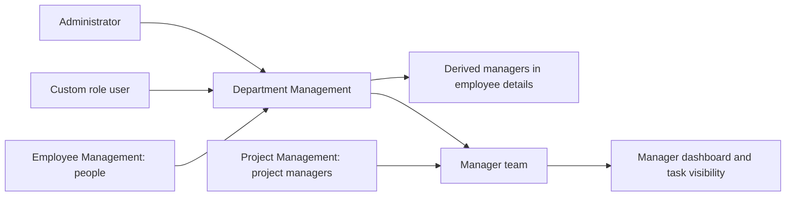
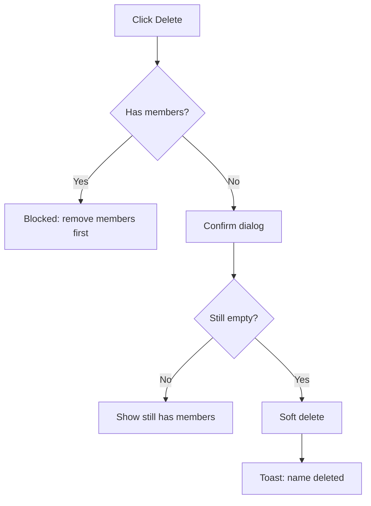
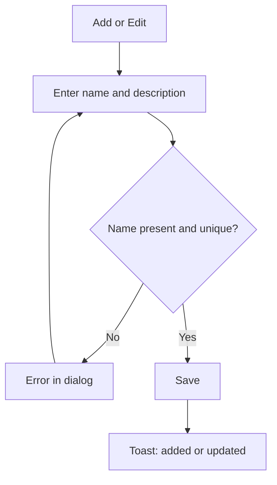
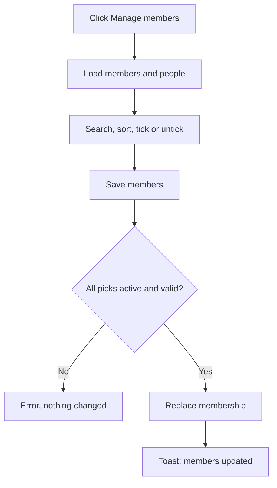
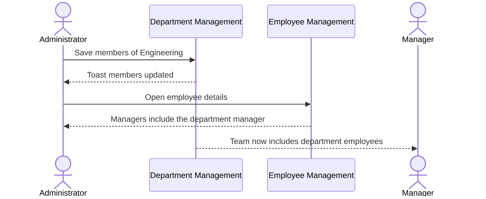

# Functional Requirements Document – Department Management

## TaskFlow – Intelligent Task Allocation & Tracking System

> **Document:** Functional Requirements Document (sub-module DEPT)  ·  **Version:** 1.0  ·  **Status:** Draft
> **Project type:** Personal Project (Skill Development)  ·  **Date:** 31-Oct-2026
> **Author:** Jojo George (jojogeorge3344@gmail.com)
> **Module:** TaskFlow Management  ·  **Sub-module:** 03.3 Department Management (code `DEPT`)
> **Based on:** `BRD-Department-Management.md` v1.0
> © 2026 Jojo George. All rights reserved.

---

## Document Control

### Revision History

| Version | Date | Author | Summary of changes |
|---|---|---|---|
| 1.0 | 31-Oct-2026 | Jojo George | Initial version, written from the Department Management BRD v1.0 and TaskFlow as built |

### Related Documents

| Document | Purpose | Location |
|---|---|---|
| BRD – Department Management | Business needs this FRD details (`REQ-DEPT-nn`, `BR-DEPT-nn`) | `../../../BRD/03-TaskFlow-Management/03.3-Department-Management/BRD-Department-Management.md` |
| BRD – Overall | Roles, global rules `BR-nn`, global NFRs | `../../../BRD/00-Overall/BRD-TaskFlow-Overall.md` |
| FRD – Overall | Shared roles, cross-cutting behaviour, index | `../../00-Overall/FRD-TaskFlow-Overall.md` |
| Related FRDs | Employee Management, Project Management | `../03.1-Employee-Management/FRD-Employee-Management.md`, `../03.2-Project-Management/FRD-Project-Management.md` |
| Development Plan | Screen 6 – Department Management | `TF - Documents/Screens Wise Feature Development Plan/06-department-management-screen.md` |
| HLD / LLD | Technical design | `../../../HLD/03-TaskFlow-Management/03.3-Department-Management/HLD-Department-Management.md`, `../../../LLD/03-TaskFlow-Management/03.3-Department-Management/LLD-Department-Management.md` |
| TDD | Technical design document (whole system) | `TF - Documents/TF - TDD/TDD-TaskFlow.md` |

---

## 1. Introduction

### 1.1 Purpose
This FRD specifies the detailed, testable behaviour of the Department Management sub-module: the department list, the
add / edit department dialog and the Manage members dialog – their inputs, outputs, rules, validations, messages and
permissions – and how department membership drives derived managers and manager teams.

### 1.2 Scope
**In scope:** listing and searching departments with member counts; adding, editing and deleting departments; choosing
each department's managers and employees; derived managers and manager teams based on membership.

**Out of scope** (BRD section 3.2): a read-only member list for users who cannot manage members; a Department filter on
the employee list; nested departments; paging of the department list.

### 1.3 Audience
Developer, tester, reviewer and product owner of TaskFlow (all Jojo George).

### 1.4 Conventions
- Requirement IDs: `FR-DEPT-nn`. Use cases: `UC-DEPT-nn`. Business rules: `BR-DEPT-nn` (Department Management BRD)
  and `BR-nn` (overall BRD). BRD requirements: `REQ-DEPT-nn`.
- Priority: **Must / Should / Could** (MoSCoW), taken from the BRD requirement traced.
- "The system shall …" = mandatory behaviour.
- `{name}`, `{department}`, `{n}`, `{id}` in messages are replaced by the real values.
- Permission "System" = a rule the system applies whatever the user's permissions.

### 1.5 Definitions & Abbreviations

| Term | Meaning |
|---|---|
| Department | A flat group of managers and employees |
| Live department | A department that has not been deleted |
| Department manager | An active person with the Manager role who manages a department |
| Department employee | An active person who belongs to a department |
| Derived manager | A manager worked out from a person's departments (and projects), never typed in |
| Manager's team | People in the departments a Manager manages plus people on the projects they manage |
| Department action permission | Any of `departments.create`, `departments.edit`, `departments.delete`, `departments.members.manage` |
| Soft delete | Hiding a record from every list while keeping it |
| Scope | Own / Team / Organisation data visibility; Department Management is Organisation |

---

## 2. System Overview

### 2.1 Module Map

| Code | Module | Child modules / screens | Primary roles |
|---|---|---|---|
| DEPT | TaskFlow Management → Department Management (this FRD) | Department Management list, Add / Edit department (dialog), Manage members (dialog) | Administrator, custom roles with department action permissions |
| EMP | Employee Management (related) | Supplies people for Manage members; sets first memberships when an employee is added; shows derived managers | Administrator |
| PROJ | Project Management (related) | Combined with department managers to form a manager's team | Administrator, Manager |
| DASH / TASK | Dashboard, Task Management (related) | Use the manager's team; the organisation dashboard counts departments | All roles as permitted |

### 2.2 Context Diagram

---

## 3. User Roles & Permissions

### 3.1 Roles

| Role | Description | Data scope |
|---|---|---|
| Administrator | Adds, edits and deletes departments; manages members | Organisation |
| Manager | Holds `departments.view` only; no menu item or screen here, but other screens (for example the employee form) list departments with it; can be a department manager | Organisation list, read only, through other screens |
| Employee | No access to this sub-module; can be a department member | None |
| Custom role | Sees the screen only with at least one department action permission; can do what it is granted | As granted (Organisation) |

### 3.2 Permission Matrix (functional view)

| Module › Function | Permission key | Administrator | Manager | Employee | Custom role |
|---|---|:---:|:---:|:---:|:---:|
| Departments › View list and counts | `departments.view` | Granted | Granted | Denied | Configurable |
| Departments › Add department | `departments.create` | Granted | Denied | Denied | Configurable |
| Departments › Edit department | `departments.edit` | Granted | Denied | Denied | Configurable |
| Departments › Delete department | `departments.delete` | Granted | Denied | Denied | Configurable |
| Departments › Manage members | `departments.members.manage` | Granted | Denied | Denied | Configurable |
| Employees › People list in Manage members (supporting) | `employees.view` | Granted | Granted | Denied | Configurable |

Every key except `departments.view` also requires `departments.view`. Older roles may still hold `departments.manage`,
which acts like the finer department keys it was split into.

---

## 4. Functional Requirements by Module

### 4.1 Module: Department Management (DEPT)

**Purpose:** Organise managers and employees into departments so that reporting lines and manager teams follow
automatically.  ·  **BRD reference:** BRD-Department-Management SCREEN 1–3, BR-DEPT-01 – BR-DEPT-10; overall BR-06, BR-21

#### 4.1.1 Screen: Department Management (list)

| Field | Value |
|---|---|
| Route / location | `/departments` – menu **TaskFlow Management → Department Management** |
| Access | Administrator; custom roles holding at least one department action permission (list data needs `departments.view`). Manager and Employee: no access (menu hidden, route redirects to their dashboard) |
| Entry points | Side menu |

**Change from original BRD (Screen 6):** the employee count is split into manager and employee counts; the people are
seen and changed in the Manage members dialog; deletion is blocked while the department has any member and is a soft
delete; department managers and the Manage members dialog are new; the Department filter on the employee list is not
offered (see section 10).

**Screen elements**

| Element | Type | Description | Mandatory | Visible to |
|---|---|---|:---:|---|
| Department count | Header text | Number of departments | – | All with screen access |
| Add department | Button | Opens the Add department dialog | – | Users with `departments.create` |
| Search by name | Text input | Filters the cards on screen | No | All with screen access |
| Department card | Card | Name, description ("No description" when empty), "{n} managers · {n} employees" | – | All with screen access |
| Manage members | Card icon (people) | Opens the Manage members dialog | – | Users with `departments.members.manage` |
| Edit | Card icon (pencil) | Opens the Edit department dialog | – | Users with `departments.edit` |
| Delete | Card icon (trash) | Deletes an empty department; tooltip "Remove its managers and employees before deleting" when it has members | – | Users with `departments.delete` |

**Functional requirements**

| ID | Requirement | Priority | Permission | BRD trace |
|---|---|---|---|---|
| FR-DEPT-01 | The system shall show every live department as a card with its name, description and "{n} managers · {n} employees". | Must | `departments.view` | REQ-DEPT-01, BR-DEPT-03 |
| FR-DEPT-02 | The system shall show "No description" on a card whose department has no description. | Could | `departments.view` | REQ-DEPT-02 |
| FR-DEPT-03 | The system shall show the number of departments in the header. | Should | `departments.view` | REQ-DEPT-03 |
| FR-DEPT-04 | The system shall narrow the cards on screen to departments whose name contains the search text. | Should | `departments.view` | REQ-DEPT-04 |
| FR-DEPT-05 | The system shall show the Department Management menu item and open `/departments` only for users holding at least one department action permission, and redirect other users (including Managers holding only `departments.view`) to their dashboard. | Must | Any department action permission | REQ-DEPT-05 |
| FR-DEPT-06 | The system shall show **Add department**, **Manage members**, **Edit** and **Delete** only to users holding `departments.create`, `departments.members.manage`, `departments.edit` and `departments.delete` respectively. | Must | As listed | REQ-DEPT-06 |
| FR-DEPT-07 | The system shall refuse every department action requested without the matching permission, even when requested outside the screen, and show the action's failure message. | Must | As listed | REQ-DEPT-06, NFR-DEPT-02, BR-04 |
| FR-DEPT-08 | The system shall do nothing when **Delete** is clicked on a department that has any manager or employee, and show the tooltip "Remove its managers and employees before deleting". | Must | `departments.delete` | REQ-DEPT-07, BR-DEPT-02, NFR-DEPT-03 |
| FR-DEPT-09 | The system shall check again at delete time and refuse with "Department cannot be deleted because it still has members. Remove them first." if members were added meanwhile. | Must | System | REQ-DEPT-07, BR-DEPT-02 |
| FR-DEPT-10 | The system shall ask "Delete department?" – "\"{name}\" will be permanently deleted." before deleting an empty department, then hide it by soft delete and show "{name} deleted". | Must | `departments.delete` | REQ-DEPT-08, BR-DEPT-03, BR-21 |
| FR-DEPT-11 | The system shall allow the name of a deleted department to be used again for a new or renamed department. | Should | System | REQ-DEPT-09, BR-DEPT-01 |
| FR-DEPT-12 | The system shall show "No departments yet – Add the first department to start grouping managers and employees." when there are none, "Could not load departments. Check your connection and try again." when loading fails, and "Could not delete the department." when a delete is refused. | Could | `departments.view` | REQ-DEPT-10 |

**Use case: UC-DEPT-01 – Browse departments**

| Item | Detail |
|---|---|
| Actor | Administrator |
| Preconditions | Signed in with MFA; holds a department action permission and `departments.view` |
| Trigger | Opens **TaskFlow Management → Department Management** |
| Main flow | 1. System shows the count and one card per live department with manager and employee counts. 2. Administrator types in **Search by name**. 3. System narrows the cards. |
| Alternate flows | – |
| Exceptions | E1: no departments → empty-state message. E2: load fails → "Could not load departments. Check your connection and try again." E3: user without an action permission opens `/departments` → redirected to their dashboard. |
| Postconditions | None (read only). |

**Use case: UC-DEPT-02 – Delete a department**

| Item | Detail |
|---|---|
| Actor | Administrator |
| Preconditions | Holds `departments.delete` |
| Trigger | Clicks **Delete** on a card |
| Main flow | 1. System checks the card has no members. 2. System asks "Delete department?". 3. Administrator confirms. 4. System checks again, soft-deletes the department and shows "{name} deleted". |
| Alternate flows | A1: the department has members → nothing happens; the tooltip explains why. |
| Exceptions | E1: members added meanwhile → "Department cannot be deleted because it still has members. Remove them first." E2: other failure → "Could not delete the department." |
| Postconditions | Department hidden; its name can be reused. |

**Field validations:** _Not applicable for this screen_ (no input other than search).

**Business rules applied:** BR-DEPT-01 – BR-DEPT-03; BR-21

**Notifications / side effects**

| Event | Who is notified | Channel |
|---|---|---|
| Department deleted | Nobody | – (no notification, no email) |

**Messages**

| Situation | Message |
|---|---|
| Deleted | "{name} deleted" |
| Delete refused | "Department cannot be deleted because it still has members. Remove them first." · "Could not delete the department." |
| No permission | Menu hidden; `/departments` redirects to the dashboard; buttons hidden without their permission |

#### 4.1.2 Screen: Add / Edit Department (dialog)

| Field | Value |
|---|---|
| Route / location | Dialog on `/departments` – **Add department** / **Edit department** |
| Access | Administrator; custom roles with `departments.create` (add) or `departments.edit` (edit). Manager and Employee: no access |
| Entry points | **Add department** button; **Edit** on a card |

**Change from original BRD (Screen 6):** "Allow administrators to create / edit departments" and "Prevent duplicate
department names" are kept; uniqueness ignores case and applies to live departments only.

**Screen elements**

| Element | Type | Description | Mandatory | Visible to |
|---|---|---|:---:|---|
| Name | Text input | Department name | Yes | Users with `departments.create` / `departments.edit` |
| Description | Text area | Optional description | No | Same |
| Add department / Save changes | Button | Submits the dialog | – | Same |

**Functional requirements**

| ID | Requirement | Priority | Permission | BRD trace |
|---|---|---|---|---|
| FR-DEPT-13 | The system shall create a department only with a name of at most 200 characters and an optional description of at most 500 characters. | Must | `departments.create` | REQ-DEPT-11, BR-DEPT-01 |
| FR-DEPT-14 | The system shall reject a name already used by a live department, ignoring case, with "Department name already exists." | Must | System | REQ-DEPT-12, BR-DEPT-01 |
| FR-DEPT-15 | The system shall let the user change a department's name and description under the same rules. | Must | `departments.edit` | REQ-DEPT-13 |
| FR-DEPT-16 | The system shall confirm a save with "{name} added" or "{name} updated" and refresh the list, or show "Could not add the department." / "Could not update the department." when refused. | Should | `departments.create`, `departments.edit` | REQ-DEPT-14 |

**Use case: UC-DEPT-03 – Add or edit a department**

| Item | Detail |
|---|---|
| Actor | Administrator |
| Preconditions | Holds `departments.create` (add) or `departments.edit` (edit) |
| Trigger | Clicks **Add department**, or **Edit** on a card |
| Main flow | 1. System opens the dialog (empty, or with saved values). 2. Administrator enters Name and optional Description. 3. Clicks **Add department** or **Save changes**. 4. System checks the name is present and unique ignoring case, and saves. 5. System shows "{name} added" or "{name} updated". |
| Alternate flows | A1: the name of a deleted department is entered → accepted. |
| Exceptions | E1: name missing → "Name is required." E2: duplicate → "Department name already exists." E3: refused → "Could not add the department." / "Could not update the department." |
| Postconditions | Department listed with the new values. |

**Field validations**

| Field | Rule | Error message |
|---|---|---|
| Name | Required; at most 200 characters; unique among live departments, ignoring case | "Name is required." · "Department name already exists." |
| Description | Optional; at most 500 characters | ⚠️ To be confirmed: exact over-length message not recorded |

**Business rules applied:** BR-DEPT-01

**Notifications / side effects**

| Event | Who is notified | Channel |
|---|---|---|
| Department added or edited | Nobody | – |

**Messages**

| Situation | Message |
|---|---|
| Success | "{name} added" · "{name} updated" |
| Refused | "Could not add the department." / "Could not update the department." |

#### 4.1.3 Screen: Manage Members (dialog)

| Field | Value |
|---|---|
| Route / location | Dialog on `/departments` – **Manage members** |
| Access | Administrator; custom roles with `departments.members.manage` (the people list also needs `employees.view`). Manager and Employee: no access |
| Entry points | **Manage members** on a card |

**Change from original BRD (Screen 6):** new screen; the original BRD has no department managers or member dialog.

**Screen elements**

| Element | Type | Description | Mandatory | Visible to |
|---|---|---|:---:|---|
| Search | Text input | "Search by name or username" | No | Users with `departments.members.manage` |
| Sort | Drop-down | Name A to Z, Name Z to A, Selected first, Role | No | Same |
| People list | Tick-box list | Active Managers and Employees; current members ticked; "Inactive" badge on current members no longer active | – | Same |
| Selected count | Text | "{n} selected" | – | Same |
| Select all shown / Clear shown | Button | Ticks or unticks the people currently shown | – | Same |
| Clear all | Button | Unticks everyone | – | Same |
| Save members | Button | Saves the membership | – | Same |

**Functional requirements**

| ID | Requirement | Priority | Permission | BRD trace |
|---|---|---|---|---|
| FR-DEPT-17 | The system shall list every active person with the Manager or Employee role for selection, with the department's current managers and employees ticked. | Must | `departments.members.manage`, `employees.view` | REQ-DEPT-15 |
| FR-DEPT-18 | The system shall keep current members who are no longer active in the list, ticked, with an "Inactive" badge. | Should | `departments.members.manage` | REQ-DEPT-16 |
| FR-DEPT-19 | The system shall narrow the people list to names or usernames containing the search text. | Should | `departments.members.manage` | REQ-DEPT-17, NFR-DEPT-04 |
| FR-DEPT-20 | The system shall sort the people list by Name A to Z, Name Z to A, Selected first, or Role. | Could | `departments.members.manage` | REQ-DEPT-18, NFR-DEPT-04 |
| FR-DEPT-21 | The system shall show "{n} selected" and offer **Select all shown / Clear shown** and **Clear all**. | Could | `departments.members.manage` | REQ-DEPT-19, NFR-DEPT-04 |
| FR-DEPT-22 | The system shall show "There are no active managers or employees to pick from." when no active Manager or Employee exists, and "Could not load the department members." when loading fails. | Should | `departments.members.manage` | REQ-DEPT-15 |
| FR-DEPT-23 | The system shall save each ticked person with the Manager role as a department manager and every other ticked person as a department employee. | Must | `departments.members.manage` | REQ-DEPT-20 |
| FR-DEPT-24 | The system shall accept as department managers only active people with the Manager role, refusing others with "User {id} is not an active manager." | Must | System | REQ-DEPT-21, BR-DEPT-04 |
| FR-DEPT-25 | The system shall accept as department employees only active people, refusing others with "User {id} is not an active user." | Must | System | REQ-DEPT-22, BR-DEPT-04 |
| FR-DEPT-26 | The system shall refuse the whole save if any picked person is not valid, changing nothing. | Must | System | REQ-DEPT-23, BR-DEPT-05, NFR-DEPT-01 |
| FR-DEPT-27 | The system shall replace the department's managers and employees in one step and change no other department's members. | Must | `departments.members.manage` | REQ-DEPT-24, BR-DEPT-05, NFR-DEPT-01 |
| FR-DEPT-28 | The system shall allow a person to belong to several departments. | Must | System | REQ-DEPT-25, BR-DEPT-06 |
| FR-DEPT-29 | The system shall show the department's managers as the managers of every employee in that department (for example in the Employee details panel), without any typed "reports to" value. | Must | System | REQ-DEPT-26, BR-DEPT-07 |
| FR-DEPT-30 | The system shall include everyone in the departments a Manager manages in that Manager's team, which the manager dashboard and task visibility use. | Must | System | REQ-DEPT-26, BR-DEPT-08 |
| FR-DEPT-31 | The system shall confirm a save with "{department} members updated", or show "Could not save the department members." when it fails. | Should | `departments.members.manage` | REQ-DEPT-27 |
| FR-DEPT-32 | The system shall store departments ticked when an employee is first added (Employee Management) as the same memberships, which are then changed only in Manage members. | Must | System | BR-DEPT-09 |
| FR-DEPT-33 | The system shall remove a person as department manager automatically when they stop being a Manager or are deleted. | Must | System | BR-DEPT-10 |

**Use case: UC-DEPT-04 – Manage department members**

| Item | Detail |
|---|---|
| Actor | Administrator |
| Preconditions | Holds `departments.members.manage` and `employees.view` |
| Trigger | Clicks **Manage members** on a card |
| Main flow | 1. System loads current members and every active Manager and Employee. 2. Administrator searches, sorts and ticks or unticks people; "{n} selected" updates. 3. Clicks **Save members**. 4. System checks every picked manager is an active Manager and every employee is active. 5. System replaces this department's membership in one step. 6. System shows "{department} members updated". |
| Alternate flows | A1: **Select all shown / Clear shown** or **Clear all** used for bulk selection. A2: all people unticked → the department becomes empty and can be deleted. |
| Exceptions | E1: a ticked current member has become inactive → save refused with "User {id} is not an active user." (or "… is not an active manager."), nothing changed. E2: nobody to pick → "There are no active managers or employees to pick from." E3: save fails → "Could not save the department members." |
| Postconditions | Membership replaced; derived managers and manager teams follow at once. |

**Field validations**

| Field | Rule | Error message |
|---|---|---|
| Picked manager | Active, Manager role | "User {id} is not an active manager." |
| Picked employee | Active | "User {id} is not an active user." |

**Business rules applied:** BR-DEPT-04 – BR-DEPT-10

**Notifications / side effects**

| Event | Who is notified | Channel |
|---|---|---|
| Members saved | Nobody; derived managers and manager teams change | – (no notification, no email) |

**Messages**

| Situation | Message |
|---|---|
| Success | "{department} members updated" |
| Load / save errors | "Could not load the department members." · "Could not save the department members." |
| No one to pick | "There are no active managers or employees to pick from." |

---

## 5. Cross-Module Workflows

### 5.1 Department membership drives reporting lines

| Step | Module | Actor / System | Action | FR reference |
|---|---|---|---|---|
| 1 | DEPT | Administrator | Adds department *Engineering* | FR-DEPT-13 |
| 2 | DEPT | Administrator | Ticks Ravi Menon (Manager), Anu Thomas and Arun K (Employees) and saves | FR-DEPT-23 – FR-DEPT-27 |
| 3 | EMP | System | Shows Ravi as the manager of Anu and Arun in their employee details | FR-DEPT-29, FR-EMP-32 |
| 4 | DASH / TASK | System | Ravi's manager dashboard and task visibility include Anu and Arun | FR-DEPT-30; Dashboard FRD |

### 5.2 Removing a department

| Step | Module | Actor / System | Action | FR reference |
|---|---|---|---|---|
| 1 | DEPT | Administrator | Clicks **Delete** on *Pilot Team*, which has 1 employee | FR-DEPT-08 |
| 2 | DEPT | Administrator | Unticks the employee in Manage members and saves | FR-DEPT-27 |
| 3 | DEPT | Administrator | Deletes *Pilot Team* | FR-DEPT-10 |
| 4 | DEPT | Administrator | Later creates a new *Pilot Team* | FR-DEPT-11 |

### 5.3 A Manager is demoted

| Step | Module | Actor / System | Action | FR reference |
|---|---|---|---|---|
| 1 | EMP | Administrator | Changes a department manager's role to Employee | FR-EMP-59 |
| 2 | DEPT | System | Removes them as department manager | FR-DEPT-33 |

---

## 6. Reports & Exports

_Not applicable for this sub-module._ The card counts (managers and employees) are the only summary shown here.

---

## 7. Notifications & Messages Catalogue

Department actions send no notification and no email. Success messages:

| Code | Trigger | Recipients | Channel | Text |
|---|---|---|---|---|
| M-DEPT-01 | Department added | Acting user | Toast | "{name} added" |
| M-DEPT-02 | Department updated | Acting user | Toast | "{name} updated" |
| M-DEPT-03 | Department deleted | Acting user | Toast | "{name} deleted" |
| M-DEPT-04 | Members saved | Acting user | Toast | "{department} members updated" |

---

## 8. Data Requirements (functional view)

| Data item | Description | Created by | Rules |
|---|---|---|---|
| Department | Name and description | Administrator | Name required, at most 200, unique among live departments ignoring case; description at most 500; soft delete; name reusable after delete |
| Department manager link | Which Managers manage the department | Administrator (Manage members) | Active Manager role only; removed when the person stops being a Manager or is deleted |
| Department membership | Which employees belong to the department | Administrator (Manage members or Add employee) | Active people only; a person may be in several departments |
| Derived managers / manager's team | Worked out from the links above (and project managers) | System | Never typed in |

---

## 9. Non-Functional Requirements (functional impact)

The global NFRs of the overall BRD apply (notably NFR-08 server validation, NFR-12 usability).

| ID | Requirement | Affects |
|---|---|---|
| NFR-DEPT-01 | A member save stores every change or none | FR-DEPT-26, FR-DEPT-27 |
| NFR-DEPT-02 | Permission checks are enforced by the server | FR-DEPT-07 |
| NFR-DEPT-03 | A blocked delete explains the fix | FR-DEPT-08 |
| NFR-DEPT-04 | Member selection supports search, sorting, select all shown and a selected count | FR-DEPT-19 – FR-DEPT-21 |

---

## 10. Assumptions & Open Issues

| Type | Description | Owner |
|---|---|---|
| Assumption | Departments are a flat list; there is no hierarchy. | Jojo George |
| Assumption | Only the Manager and Employee roles are offered in the member dialog. | Jojo George |
| Open issue | ⚠️ To be confirmed: whether the original BRD's Department filter on the employee list is still wanted (the list filters by project). | Jojo George |
| Open issue | ⚠️ To be confirmed: Administrators and custom-role users can never be picked as members, because the dialog lists only Managers and Employees (R-DEPT-02). | Jojo George |
| Open issue | ⚠️ To be confirmed: whether a read-only member view is needed for users without `departments.members.manage` (R-DEPT-03). | Jojo George |
| Open issue | ⚠️ To be confirmed: the empty-state **Add department** button may show to users without `departments.create`; the server refuses the save (R-DEPT-04). | Jojo George |
| Open issue | ⚠️ To be confirmed: the delete confirmation says "permanently deleted" although deletion is a soft delete. | Jojo George |
| Open issue | A custom role with `departments.members.manage` but without `employees.view` sees an empty people list (R-DEPT-05). | Jojo George |

---

## 11. Requirements Traceability Matrix

Test evidence lists the automated test suites whose names match the behaviour; their contents were not available
(⚠️ To be confirmed). "Manual UI" = screen behaviour checked by hand.

| BRD item | FRD requirement(s) | Screen | Use case | Test case |
|---|---|---|---|---|
| REQ-DEPT-01 | FR-DEPT-01 | 4.1.1 | UC-DEPT-01 | DepartmentsEndpointsTests |
| REQ-DEPT-02 | FR-DEPT-02 | 4.1.1 | UC-DEPT-01 | Manual UI |
| REQ-DEPT-03 | FR-DEPT-03 | 4.1.1 | UC-DEPT-01 | Manual UI |
| REQ-DEPT-04 | FR-DEPT-04 | 4.1.1 | UC-DEPT-01 | Manual UI |
| REQ-DEPT-05 | FR-DEPT-05 | 4.1.1 | UC-DEPT-01 | Manual UI |
| REQ-DEPT-06 | FR-DEPT-06, FR-DEPT-07 | 4.1.1 | UC-DEPT-01 | DepartmentsEndpointsTests |
| REQ-DEPT-07 | FR-DEPT-08, FR-DEPT-09 | 4.1.1 | UC-DEPT-02 | DepartmentsEndpointsTests |
| REQ-DEPT-08 | FR-DEPT-10 | 4.1.1 | UC-DEPT-02 | DepartmentsEndpointsTests |
| REQ-DEPT-09 | FR-DEPT-11 | 4.1.1 | UC-DEPT-02, UC-DEPT-03 | DepartmentsEndpointsTests |
| REQ-DEPT-10 | FR-DEPT-12 | 4.1.1 | UC-DEPT-01 | Manual UI |
| REQ-DEPT-11 | FR-DEPT-13 | 4.1.2 | UC-DEPT-03 | DepartmentRequestValidatorsTests |
| REQ-DEPT-12 | FR-DEPT-14 | 4.1.2 | UC-DEPT-03 | DepartmentsEndpointsTests |
| REQ-DEPT-13 | FR-DEPT-15 | 4.1.2 | UC-DEPT-03 | DepartmentsEndpointsTests |
| REQ-DEPT-14 | FR-DEPT-16 | 4.1.2 | UC-DEPT-03 | Manual UI |
| REQ-DEPT-15 | FR-DEPT-17, FR-DEPT-22 | 4.1.3 | UC-DEPT-04 | Manual UI |
| REQ-DEPT-16 | FR-DEPT-18 | 4.1.3 | UC-DEPT-04 | Manual UI |
| REQ-DEPT-17 | FR-DEPT-19 | 4.1.3 | UC-DEPT-04 | Manual UI |
| REQ-DEPT-18 | FR-DEPT-20 | 4.1.3 | UC-DEPT-04 | Manual UI |
| REQ-DEPT-19 | FR-DEPT-21 | 4.1.3 | UC-DEPT-04 | Manual UI |
| REQ-DEPT-20 | FR-DEPT-23 | 4.1.3 | UC-DEPT-04 | DepartmentsEndpointsTests |
| REQ-DEPT-21 | FR-DEPT-24 | 4.1.3 | UC-DEPT-04 | DepartmentsEndpointsTests, DepartmentRequestValidatorsTests |
| REQ-DEPT-22 | FR-DEPT-25 | 4.1.3 | UC-DEPT-04 | DepartmentsEndpointsTests |
| REQ-DEPT-23 | FR-DEPT-26 | 4.1.3 | UC-DEPT-04 | DepartmentsEndpointsTests |
| REQ-DEPT-24 | FR-DEPT-27 | 4.1.3 | UC-DEPT-04 | DepartmentsEndpointsTests |
| REQ-DEPT-25 | FR-DEPT-28 | 4.1.3 | UC-DEPT-04 | DepartmentsEndpointsTests |
| REQ-DEPT-26 | FR-DEPT-29, FR-DEPT-30 | 4.1.3 | UC-DEPT-04 | ManagerAssignmentTests |
| REQ-DEPT-27 | FR-DEPT-31 | 4.1.3 | UC-DEPT-04 | Manual UI |
| BR-DEPT-01 | FR-DEPT-11, FR-DEPT-13, FR-DEPT-14 | 4.1.1, 4.1.2 | UC-DEPT-03 | DepartmentRequestValidatorsTests |
| BR-DEPT-02 | FR-DEPT-08, FR-DEPT-09 | 4.1.1 | UC-DEPT-02 | DepartmentsEndpointsTests |
| BR-DEPT-03 | FR-DEPT-01, FR-DEPT-10 | 4.1.1 | UC-DEPT-02 | DepartmentsEndpointsTests |
| BR-DEPT-04 | FR-DEPT-24, FR-DEPT-25 | 4.1.3 | UC-DEPT-04 | DepartmentsEndpointsTests |
| BR-DEPT-05 | FR-DEPT-26, FR-DEPT-27 | 4.1.3 | UC-DEPT-04 | DepartmentsEndpointsTests |
| BR-DEPT-06 | FR-DEPT-28 | 4.1.3 | UC-DEPT-04 | DepartmentsEndpointsTests |
| BR-DEPT-07 | FR-DEPT-29 | 4.1.3 | UC-DEPT-04 | ManagerAssignmentTests |
| BR-DEPT-08 | FR-DEPT-30 | 4.1.3 | UC-DEPT-04 | ManagerAssignmentTests |
| BR-DEPT-09 | FR-DEPT-32 | 4.1.3 | UC-DEPT-04 | Manual UI |
| BR-DEPT-10 | FR-DEPT-33 | 4.1.3 | UC-DEPT-04 | ManagerAssignmentTests |

**Coverage:** 27 of 27 `REQ-DEPT` requirements and 10 of 10 `BR-DEPT` rules trace to at least one FR; 0 untraced.

---

## 12. Approvals

| Role | Name | Decision | Date |
|---|---|---|---|
| Product owner | Jojo George | Pending | – |
| Reviewer | Jojo George | Pending | – |

---
© 2026 Jojo George. All rights reserved. Unauthorized copying or distribution of this document is prohibited.
