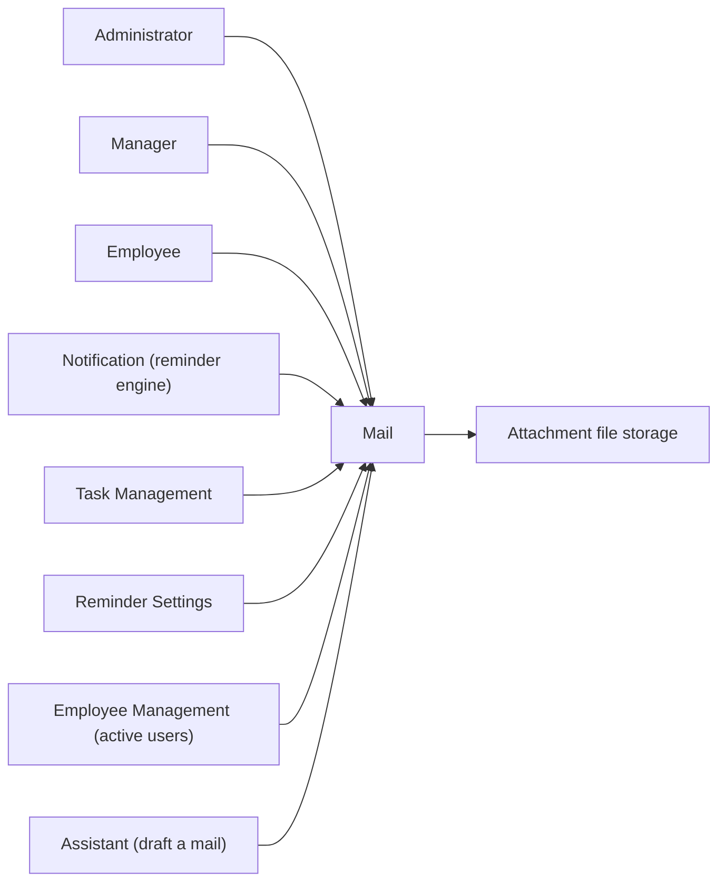
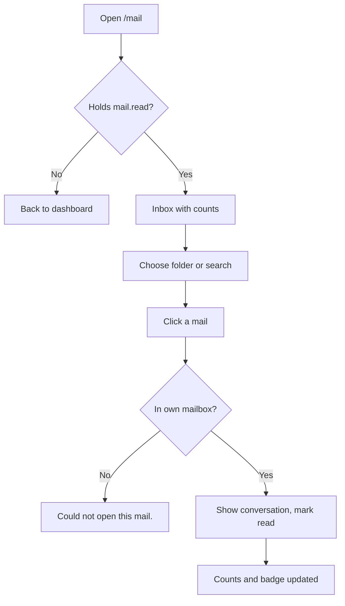
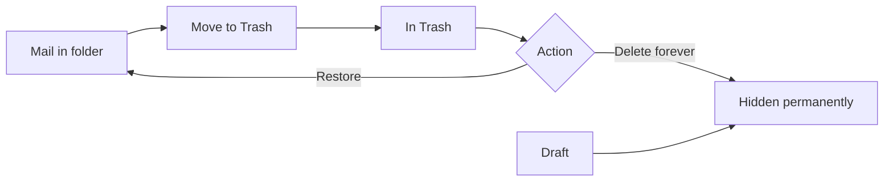
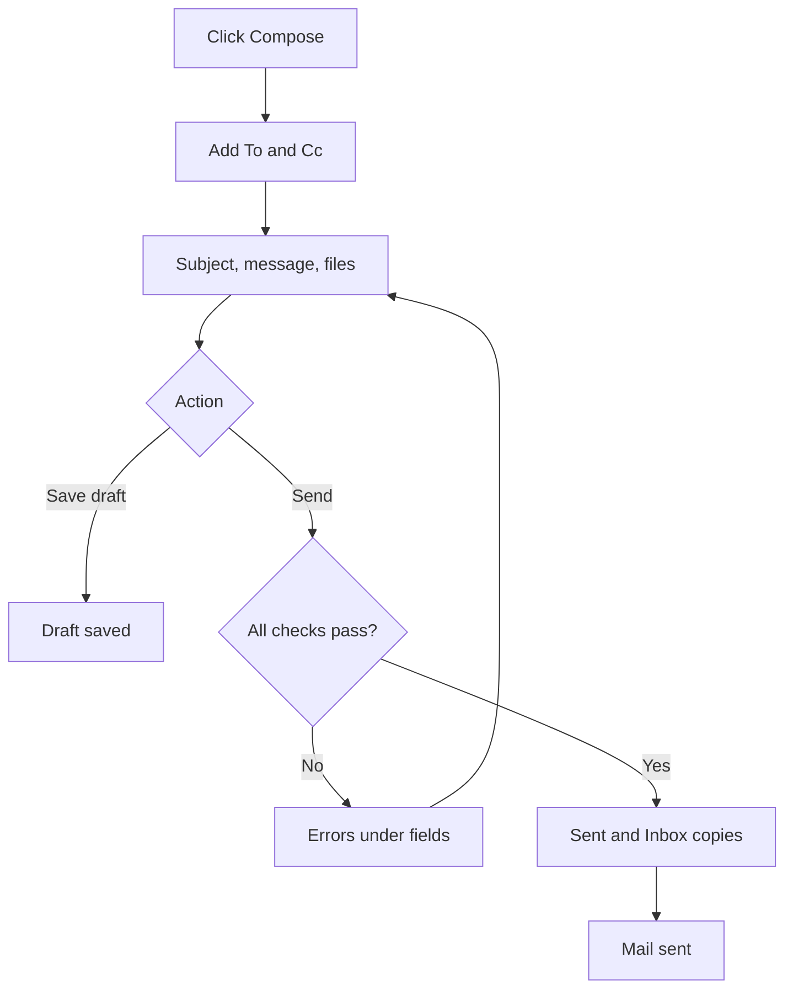
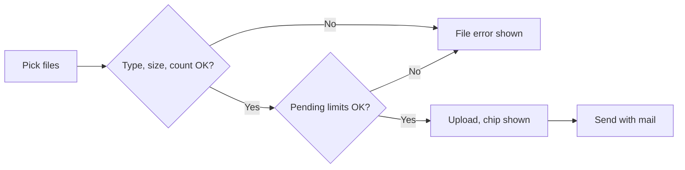
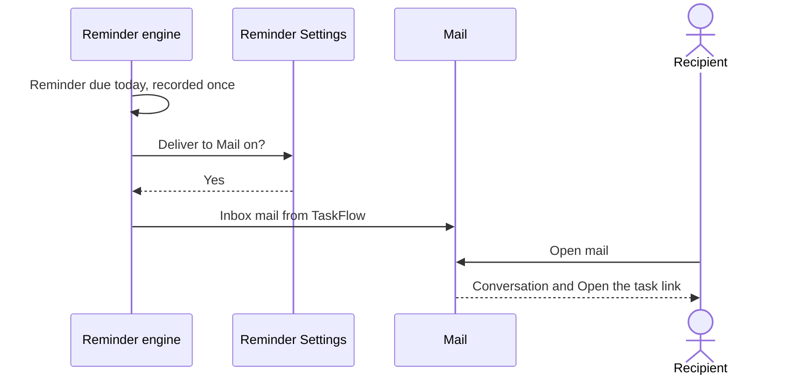
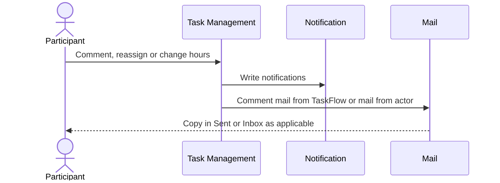

# Functional Requirements Document – Mail

## TaskFlow – Intelligent Task Allocation & Tracking System

> **Document:** Functional Requirements Document (Sub-module: Communication → Mail, code `MAIL`)  ·  **Version:** 1.0  ·  **Status:** Draft
> **Project type:** Personal Project (Skill Development)  ·  **Date:** 31-Oct-2026
> **Author:** Jojo George (jojogeorge3344@gmail.com)
> **Based on:** BRD-Mail.md v1.0
> © 2026 Jojo George. All rights reserved.

---

## Document Control

### Revision History

| Version | Date | Author | Summary of changes |
|---|---|---|---|
| 1.0 | 31-Oct-2026 | Jojo George | Initial version |

### Related Documents

| Document | Purpose | Location |
|---|---|---|
| BRD – Mail | Business needs this FRD details (`REQ-MAIL-nn`, `BR-MAIL-nn`, `AC-MAIL-nn`) | `../../../BRD/04-Communication/04.1-Mail/BRD-Mail.md` |
| FRD – Overall | Roles, global rules, Authentication, Legal, module index | `../../00-Overall/FRD-TaskFlow-Overall.md` |
| FRD – Notification (sibling) | Reminder engine that places reminder mails in the Inbox | `../04.2-Notification/FRD-Notification.md` |
| FRD – Reminder Settings | "Also deliver reminders to Mail" toggle | `../../06-Settings/06.1-Reminder-Settings/FRD-Reminder-Settings.md` |
| FRD – Task Management | Comments, reassignment and worked hours that produce mails | `../../02-TaskFlow-Monitoring/02.1-Task-Management/FRD-Task-Management.md` |
| FRD – Assistant | Finding users and drafting a mail through the assistant | `../../08-TFA-Assistant/08.1-Assistant/FRD-Assistant.md` |
| Development Plan | Screen 14 (marked SUPERSEDED by internal Mail) | `TF - Documents/Screens Wise Feature Development Plan/14-email-notification-settings-screen.md` |
| HLD / LLD | Technical design of Mail | `../../../HLD/04-Communication/04.1-Mail/HLD-Mail.md`, `../../../LLD/04-Communication/04.1-Mail/LLD-Mail.md` |

---

## 1. Introduction

### 1.1 Purpose
This FRD specifies the detailed, testable behaviour of the Mail sub-module: the Mail screen (folders, list, reading
pane, organising actions, attachment downloads), the compose panel (new mail, reply, reply all, forward, drafts,
attachments) and the system mails that other sub-modules place in a user's Inbox.

### 1.2 Scope
In scope: everything listed in BRD-Mail §3.1. Out of scope (BRD-Mail §3.2): outside email (SMTP) and its settings,
reading another person's mailbox, rich-text bodies, physical clean-up of deleted mail and files, and the generation of
deadline reminders (specified in the Notification FRD; this FRD covers only their arrival in the Inbox).

**Change from original BRD**

| Original BRD item | Current requirement |
|---|---|
| Screen 14 "Email Configuration" (SMTP server, port, sender, credentials, test email) | Superseded and not built; replaced by the internal Mail screen specified here (FR-MAIL-01 – FR-MAIL-56). |
| Screen 14 "Enable/disable email notifications" | The "Also deliver reminders to Mail" toggle in Reminder Settings decides whether reminders and comment alerts reach the Inbox (FR-MAIL-25). |
| Screen 14 FR 5 "Send deadline reminders" | Reminders arrive in the Inbox as mails from "TaskFlow" (§5.1; generated by the Notification sub-module). |
| Screen 14 FR 6 / FR 7 (delivery failures, fallback to in-app) | No outside mail service; the in-app notification is always created and the Inbox mail is an extra copy (open issue in §10). |

### 1.3 Audience
Developer, tester, reviewer and product owner of TaskFlow.

### 1.4 Conventions
- Requirement IDs: `FR-MAIL-nn`. Use cases: `UC-MAIL-nn`. BRD items: `REQ-MAIL-nn`, sub-module rules `BR-MAIL-nn`,
  global rules `BR-nn` (overall BRD), NFRs `NFR-MAIL-nn`, acceptance criteria `AC-MAIL-nn`.
- Priority: **Must / Should / Could** (MoSCoW), taken from the traced BRD requirement.
- "The system shall …" = mandatory behaviour. Text in *italics* inside messages is a value filled in at run time.

### 1.5 Definitions & Abbreviations

| Term | Meaning |
|---|---|
| Mailbox | A user's own folders and mail copies; scope is always **Own** |
| Mail copy | One user's entry for a mail in a folder (Inbox, Sent, Drafts) with personal read, star, important and trash state |
| Conversation | A mail and all its replies and forwards, shown together |
| Draft | A saved, unsent mail in the Drafts folder |
| System mail | A mail sent by TaskFlow itself, shown with the sender "TaskFlow" (reminders, comment alerts) |
| Pending upload | A file uploaded in the compose panel that is not yet part of a sent mail or saved draft |
| Delete forever | Removes a mail copy from the user's view permanently; only from Trash or for a draft |
| Active user | A TaskFlow user account that is not deactivated or deleted |

---

## 2. System Overview

### 2.1 Module Map

| Code | Module | Child modules | Primary roles |
|---|---|---|---|
| MAIL | Communication → Mail | Mailbox (Mail screen), Compose panel, Attachments, System mails received | Administrator, Manager, Employee, Custom Role (as granted) |

Other modules are described in the overall FRD (`../../00-Overall/FRD-TaskFlow-Overall.md`).

### 2.2 Context Diagram

---

## 3. User Roles & Permissions

### 3.1 Roles

| Role | Description | Data scope |
|---|---|---|
| Administrator | System administrator; also grants `mail.*` keys to custom roles in Role Configuration | Own mailbox; recipient suggestions over all active users |
| Manager | Leads a team or project | Own mailbox; recipient suggestions over all active users |
| Employee | Works on assigned tasks | Own mailbox; recipient suggestions over all active users |
| Custom Role | Role created by an Administrator | Own mailbox, as granted |

No role, including Administrator, can read another person's mailbox (BR-MAIL-02).

### 3.2 Permission Matrix (functional view)

| Module › Function | Permission key | Administrator | Manager | Employee | Custom role |
|---|---|:---:|:---:|:---:|:---:|
| Mail › Open Mail, read folders and mails, menu badge | `mail.read` | Granted | Granted | Granted | Configurable |
| Mail › Compose, reply, forward, drafts, recipient suggestions | `mail.compose` | Granted | Granted | Granted | Configurable |
| Mail › Star, important, unread, trash, restore, delete forever | `mail.organize` | Granted | Granted | Granted | Configurable |
| Mail › Upload, remove and download attachments | `mail.attachments` | Granted | Granted | Granted | Configurable |
| Reminder Settings › "Also deliver reminders to Mail" (controls system mails; specified in the Reminder Settings FRD) | `settings.reminders.manage` | see Reminder Settings FRD | | | |

A new custom role starts with none of the four `mail.*` keys.

---

## 4. Functional Requirements by Module

### 4.1 Module: Mail (MAIL)

**Purpose:** A private internal mailbox for messages between TaskFlow users, with system mails about tasks in the same
Inbox.  ·  **BRD reference:** BRD-Mail §5 SCREEN 1, SCREEN 2; BR-MAIL-01 – BR-MAIL-13; global BR on private messages.

#### 4.1.1 Screen: Mail

| Field | Value |
|---|---|
| Route / location | `/mail` (menu: Communication Management → Mail, with unread badge) |
| Access | `mail.read` (Administrator, Manager, Employee by default; Custom Role if granted); actions need `mail.organize`, `mail.compose` or `mail.attachments` |
| Entry points | Side menu item "Mail"; "Open the task" link leads out to the task |

**Screen elements**

| Element | Type | Description | Mandatory | Visible to |
|---|---|---|:---:|---|
| Folder rail | Navigation list | Inbox, Starred, Important, Sent, Drafts, Trash with counts | – | `mail.read` |
| Compose | Button | Opens the compose panel "New mail" | – | `mail.compose` |
| Search box | Text input | "Search inbox" (label follows the folder); searches the current folder | No | `mail.read` |
| Message list | List | Rows with sender / "To: …" / "TaskFlow", subject or "(no subject)", preview, date, important flag, paperclip | – | `mail.read` |
| Star toggle | Icon button | Stars / un-stars the row | – | `mail.organize` |
| Previous / Next | Buttons | Page through the list, 25 per page | – | `mail.read` |
| Reading pane | Panel | Subject, "Open the task" link, conversation (sender, recipients, Cc, date, message, attachments) | – | `mail.read` |
| Attachment buttons | Buttons | Download a file | – | Shown to every reader; use needs `mail.attachments` |
| Reply / Reply all | Buttons | Pre-filled compose panel; hidden for system mail and Trash | – | `mail.compose` |
| Forward | Button | Pre-filled compose panel | – | `mail.compose` |
| Star / Mark important / Mark unread / Move to Trash | Buttons | Personal flags; Mark unread in Inbox only | – | `mail.organize` |
| Restore / Delete forever | Buttons | Shown in Trash | – | `mail.organize` |
| Folder button | Button | Opens the folder rail on narrow screens | – | `mail.read` |

**Functional requirements**

| ID | Requirement | Priority | Permission | BRD trace |
|---|---|---|---|---|
| FR-MAIL-01 | The system shall open `/mail` only for a user holding `mail.read` and shall return any other user to their dashboard without a message. | Must | `mail.read` | REQ-MAIL-01 |
| FR-MAIL-02 | The system shall show the folders Inbox, Starred, Important, Sent, Drafts and Trash and shall open Inbox when the screen is opened. | Must | `mail.read` | REQ-MAIL-02 |
| FR-MAIL-03 | The system shall show the number of unread mails beside Inbox, Starred and Important, and the total number of drafts beside Drafts, and shall update them after every read, flag, trash, send or draft action. | Should | `mail.read` | REQ-MAIL-03 |
| FR-MAIL-04 | The system shall show on the Mail menu item a badge with the number of unread Inbox mails, refreshed on every page change and every 15 seconds, and hidden when the number is 0. | Should | `mail.read` | REQ-MAIL-04, NFR-MAIL-07 |
| FR-MAIL-05 | The system shall list the mails of the selected folder newest first, 25 per page, with Previous and Next. | Must | `mail.read` | REQ-MAIL-05, NFR-MAIL-01 |
| FR-MAIL-06 | The system shall show on each row the sender (in Sent and Drafts "To: …" followed by the recipients; "TaskFlow" for a system mail), the subject or "(no subject)", a preview of the message, the date, an important flag when set and a paperclip when the mail has attachments. | Must | `mail.read` | REQ-MAIL-06 |
| FR-MAIL-07 | The system shall search the current folder for the typed text in the subject, message text, sender and recipients, and restart the list at page 1. | Should | `mail.read` | REQ-MAIL-07 |
| FR-MAIL-08 | The system shall show "Nothing in *folder*." for an empty folder, "No mail matches your search." when a search finds nothing, and "Select a mail to read it." while no mail is open. | Should | `mail.read` | REQ-MAIL-05, REQ-MAIL-07 |
| FR-MAIL-09 | The system shall show, for an opened mail, the whole conversation oldest first, each mail with sender, To, Cc, date, message and attachments. | Must | `mail.read` | REQ-MAIL-08 |
| FR-MAIL-10 | The system shall mark the reader's copy of a mail as read when the reader opens it. | Must | `mail.read` | REQ-MAIL-09 |
| FR-MAIL-11 | The system shall show message text as plain text and make only web links starting with http or https clickable. | Could | `mail.read` | REQ-MAIL-10, NFR-MAIL-03 |
| FR-MAIL-12 | The system shall show an "Open the task" link on a mail that is about a task, opening that task's details. | Should | `mail.read` | REQ-MAIL-11 |
| FR-MAIL-13 | The system shall let a user star and un-star a mail from the list row and from the reading pane. | Should | `mail.organize` | REQ-MAIL-12 |
| FR-MAIL-14 | The system shall let a user mark and unmark a mail as important from the reading pane. | Should | `mail.organize` | REQ-MAIL-13 |
| FR-MAIL-15 | The system shall offer Mark unread only for mails in the Inbox and shall then show the mail as unread and raise the counts. | Should | `mail.organize` | REQ-MAIL-14 |
| FR-MAIL-16 | The system shall move a mail to Trash on Move to Trash and show "Moved to Trash". | Must | `mail.organize` | REQ-MAIL-15 |
| FR-MAIL-17 | The system shall return a mail from Trash to its folder on Restore and show "Restored". | Must | `mail.organize` | REQ-MAIL-15 |
| FR-MAIL-18 | The system shall delete forever only a mail that is in Trash, or a draft, show "Deleted forever", and refuse any other mail with "Move the mail to Trash before deleting it forever." | Must | `mail.organize` | REQ-MAIL-16, BR-MAIL-04 |
| FR-MAIL-19 | The system shall apply read state, star, important, trash, restore and delete forever only to the acting user's own copy; other people's copies of the same mail stay unchanged. | Must | `mail.organize` | REQ-MAIL-17, BR-MAIL-03 |
| FR-MAIL-20 | The system shall never list, open or change a mail that is not in the caller's mailbox and shall treat such a mail as not found ("Could not open this mail." / "Could not update the mail."). | Must | `mail.read`, `mail.organize` | REQ-MAIL-18, BR-MAIL-02, NFR-MAIL-02 |
| FR-MAIL-21 | The system shall show a system mail with the sender "TaskFlow" and offer only Forward for it (no Reply, no Reply all). | Must | `mail.compose` | REQ-MAIL-19, BR-MAIL-05 |
| FR-MAIL-22 | The system shall not offer Reply or Reply all for a mail in Trash. | Should | `mail.compose` | REQ-MAIL-20 |
| FR-MAIL-23 | The system shall keep showing the name of a sender or recipient whose account was later deactivated or deleted. | Should | `mail.read` | REQ-MAIL-21, BR-MAIL-12 |
| FR-MAIL-24 | The system shall show one pane at a time (folders, list or reading pane) on narrow screens, with a folder button to open the folder rail. | Could | `mail.read` | REQ-MAIL-22, NFR-MAIL-05 |
| FR-MAIL-25 | The system shall, while "Also deliver reminders to Mail" is on, place an Inbox mail from "TaskFlow" with the subject "Comment *verb*: *title*" in the mailbox of the task's assignee, recipients and the acting person whenever a comment is added, edited or deleted. | Should | System (no key) | REQ-MAIL-23, BR-MAIL-13 |
| FR-MAIL-26 | The system shall, when a task is reassigned, send a mail with the subject "Task reassigned: *title*" from the person who reassigned it to the task's active participants. | Should | System (no key) | REQ-MAIL-24, BR-MAIL-13 |
| FR-MAIL-27 | The system shall, when the worked hours of a task change, send a mail with the subject "Worked hours changed: *title*" from the person who changed them to the task's active assignee and recipients. | Could | System (no key) | REQ-MAIL-25, BR-MAIL-13 |
| FR-MAIL-28 | The system shall let a user download an attachment only when the user uploaded it or the mail is in the user's own (not deleted-forever) mailbox, and otherwise report "Could not download the file." | Must | `mail.attachments` | REQ-MAIL-26, BR-MAIL-11 |
| FR-MAIL-29 | The system shall always deliver an attachment as a file download and never display it inside the page. | Must | `mail.attachments` | REQ-MAIL-27, NFR-MAIL-03 |
| FR-MAIL-30 | The system shall show "Could not load your mail.", "Could not open this mail.", "Could not update the mail." or "Could not mark as unread." when loading, opening or changing a mail fails, including when the user lacks the needed permission. | Should | `mail.read`, `mail.organize` | REQ-MAIL-08, REQ-MAIL-12 – REQ-MAIL-15 |

**Use case: UC-MAIL-01 – Read a mail**

| Item | Detail |
|---|---|
| Actor | Any user (Administrator, Manager, Employee, Custom Role with `mail.read`) |
| Preconditions | Signed in; holds `mail.read` |
| Trigger | Opens Communication Management → Mail |
| Main flow | 1. System opens Inbox with folder counts (FR-MAIL-02, 03). 2. User picks a folder or types in the search box (FR-MAIL-05, 07). 3. User clicks a row. 4. System shows the conversation oldest first and marks the copy read (FR-MAIL-09, 10). 5. Counts and the menu badge drop (FR-MAIL-03, 04). |
| Alternate flows | A1: mail is about a task → user clicks "Open the task" (FR-MAIL-12). A2: narrow screen → one pane at a time (FR-MAIL-24). |
| Exceptions | E1: no `mail.read` → returned to the dashboard (FR-MAIL-01). E2: mail not in the user's mailbox → "Could not open this mail." (FR-MAIL-20). E3: empty folder / no hits → FR-MAIL-08 texts. |
| Postconditions | The user's copy is read; nobody else's copy changed |

**Use case: UC-MAIL-02 – Flag a mail (star, important, unread)**

| Item | Detail |
|---|---|
| Actor | User with `mail.organize` |
| Preconditions | Mail screen open; mail in own mailbox |
| Trigger | Clicks the star on a row, or Star / Mark important / Mark unread in the reading pane |
| Main flow | 1. System saves the flag on the user's own copy (FR-MAIL-13 – 15, 19). 2. The mail appears in or leaves Starred / Important. 3. Counts update. |
| Alternate flows | A1: Mark unread is offered only in Inbox (FR-MAIL-15). |
| Exceptions | E1: no `mail.organize` or foreign mail → "Could not update the mail." / "Could not mark as unread." (FR-MAIL-30). |
| Postconditions | Flag stored for this user only |

**Use case: UC-MAIL-03 – Trash, restore or delete forever**

| Item | Detail |
|---|---|
| Actor | User with `mail.organize` |
| Preconditions | Mail in own mailbox |
| Trigger | Clicks Move to Trash; in Trash clicks Restore or Delete forever |
| Main flow | 1. Move to Trash → "Moved to Trash" (FR-MAIL-16). 2. In Trash, Restore → "Restored" (FR-MAIL-17). 3. In Trash, Delete forever → "Deleted forever"; the mail no longer appears in any folder (FR-MAIL-18). |
| Alternate flows | A1: a draft can be deleted forever without passing through Trash (FR-MAIL-18). |
| Exceptions | E1: Delete forever on a mail not in Trash and not a draft → "Move the mail to Trash before deleting it forever." |
| Postconditions | Only the user's own copy changed (FR-MAIL-19) |

**Use case: UC-MAIL-04 – Download an attachment**

| Item | Detail |
|---|---|
| Actor | User with `mail.attachments` |
| Preconditions | Mail with attachments open in the reading pane |
| Trigger | Clicks an attachment button |
| Main flow | 1. System checks that the user uploaded the file or holds the mail in their mailbox (FR-MAIL-28). 2. The browser downloads the file under its original name (FR-MAIL-29). |
| Alternate flows | – |
| Exceptions | E1: no `mail.attachments`, not allowed or file missing → "Could not download the file." |
| Postconditions | File saved on the user's device; nothing changes in TaskFlow |

**Use case: UC-MAIL-05 – Receive a system mail**

| Item | Detail |
|---|---|
| Actor | System (Notification, Task Management); recipient |
| Preconditions | Recipient is an active user |
| Trigger | A reminder is delivered, a comment is added / edited / deleted, a task is reassigned or worked hours change |
| Main flow | 1. Reminder or comment and "Also deliver reminders to Mail" is on → Inbox mail from "TaskFlow" (FR-MAIL-25, §5.1). 2. Reassignment or worked hours → mail from the acting person (FR-MAIL-26, 27). 3. Recipient opens the mail; a task mail shows "Open the task" (FR-MAIL-12). |
| Alternate flows | A1: toggle off → no reminder or comment mail; the in-app notification is still created (Notification FRD). |
| Exceptions | E1: writing the comment mail fails → the comment is still saved, only the mail is dropped. |
| Postconditions | Mail in the recipient's Inbox; a system mail can only be forwarded (FR-MAIL-21) |

**Field validations**

| Field | Rule | Error message |
|---|---|---|
| Delete forever | Mail must be in Trash or be a draft | "Move the mail to Trash before deleting it forever." |
| Mail id (open / change) | Must be in the caller's mailbox | "Could not open this mail." / "Could not update the mail." |
| Attachment (download) | Caller uploaded it or holds the mail | "Could not download the file." |

**Business rules applied:** BR-MAIL-02, BR-MAIL-03, BR-MAIL-04, BR-MAIL-05, BR-MAIL-11, BR-MAIL-12, BR-MAIL-13; global
rules on authorised access and private messages (overall BRD §6).

**Notifications / side effects**

| Event | Who is notified | Channel |
|---|---|---|
| Mail opened | – (counts and menu badge decrease) | In-app (Mail) |
| Comment added / edited / deleted | Task assignee, recipients, acting person | Mail from "TaskFlow" (if toggle on); in-app per Notification FRD |
| Task reassigned | Task's active participants | Mail from the acting person; in-app per Notification FRD |
| Worked hours changed | Task's active assignee and recipients | Mail from the acting person; in-app per Notification FRD |

**Messages**

| Situation | Message |
|---|---|
| Trash actions | "Moved to Trash" · "Restored" · "Deleted forever" |
| Delete forever outside Trash | "Move the mail to Trash before deleting it forever." |
| Reply to a system mail | "Mails from TaskFlow cannot be replied to. Forward it instead." |
| Empty folder / no search hits / nothing selected | "Nothing in *folder*." · "No mail matches your search." · "Select a mail to read it." |
| Failures | "Could not load your mail." · "Could not open this mail." · "Could not update the mail." · "Could not mark as unread." · "Could not download the file." |
| No permission to open the screen | Returned to the dashboard; no message |
| No permission for an action | The related "Could not …" message |

#### 4.1.2 Screen: Compose Panel (inside Mail)

| Field | Value |
|---|---|
| Route / location | Side drawer on `/mail`, titled "New mail", "Reply", "Reply all", "Forward" or "Draft" |
| Access | `mail.compose`; Attach, chip removal and uploads need `mail.attachments`; Discard of a saved draft needs `mail.organize` (open issue §10) |
| Entry points | Compose button; Reply / Reply all / Forward in the reading pane; clicking a mail in Drafts; Assistant mail draft confirmed by the user (Assistant FRD) |

**Screen elements**

| Element | Type | Description | Mandatory | Visible to |
|---|---|---|:---:|---|
| To | Recipient picker (chips) | Names or emails; suggestions while typing; invalid chips marked "Not a TaskFlow user" | Yes (on send) | `mail.compose` |
| Cc | Recipient picker (chips) | Shown after clicking Cc | No | `mail.compose` |
| Subject | Text input | At most 200 characters | Subject or Message | `mail.compose` |
| Message | Multi-line text | Plain text, at most 20,000 characters | Subject or Message | `mail.compose` |
| Attach | Button (file picker) | Adds files, "Uploading…" while in progress | No | Shown to every composer; use needs `mail.attachments` |
| File chips | Chips with remove (x) | Attached and forwarded files | – | Same as Attach |
| Discard | Button | Closes the panel, removes uploads; deletes a saved draft | – | `mail.compose` |
| Save draft | Button | Saves to Drafts | – | `mail.compose` |
| Send | Button | Validates and sends | – | `mail.compose` |

**Functional requirements**

| ID | Requirement | Priority | Permission | BRD trace |
|---|---|---|---|---|
| FR-MAIL-31 | The system shall show Compose, Reply, Reply all and Forward only to users holding `mail.compose`. | Must | `mail.compose` | REQ-MAIL-28 |
| FR-MAIL-32 | The system shall title the panel "New mail", "Reply", "Reply all", "Forward" or "Draft" according to how it was opened. | Should | `mail.compose` | REQ-MAIL-28 |
| FR-MAIL-33 | The system shall suggest, while the user types in To or Cc, at most 10 active users whose name or email contains the typed text. | Should | `mail.compose` | REQ-MAIL-29 |
| FR-MAIL-34 | The system shall check each entered recipient, show "Checking recipients…" while checking, and mark any entry that is not an active TaskFlow user as "Not a TaskFlow user" with "Not a TaskFlow user: *addresses*. Mail can only go to people in TaskFlow." | Must | `mail.compose` | REQ-MAIL-30, BR-MAIL-01 |
| FR-MAIL-35 | The system shall refuse the whole send, delivering to nobody, when any recipient is not an active TaskFlow user, with "Remove or fix recipients that are not TaskFlow users." in the panel or "Not an active TaskFlow user: *addresses*." under To or Cc. | Must | `mail.compose` | REQ-MAIL-31, BR-MAIL-01, NFR-MAIL-06 |
| FR-MAIL-36 | The system shall require between 1 and 50 recipients across To and Cc, with "Add at least one recipient." for none and "A mail can have at most 50 recipients." / "Add between 1 and 50 recipients." for more than 50. | Must | `mail.compose` | REQ-MAIL-32, BR-MAIL-06 |
| FR-MAIL-37 | The system shall refuse a recipient address that is not in email form (needs "@", no spaces, at most 320 characters) with "'*address*' is not an email address." | Must | `mail.compose` | REQ-MAIL-30, REQ-MAIL-32 |
| FR-MAIL-38 | The system shall keep a person who is listed in both To and Cc in To only and count that person once. | Should | `mail.compose` | REQ-MAIL-33, BR-MAIL-06 |
| FR-MAIL-39 | The system shall refuse to send a mail that has neither subject nor message, with "Write a subject or a message before sending." | Must | `mail.compose` | REQ-MAIL-34, BR-MAIL-07 |
| FR-MAIL-40 | The system shall refuse a subject longer than 200 characters and a message longer than 20,000 characters. | Must | `mail.compose` | REQ-MAIL-35, BR-MAIL-07 |
| FR-MAIL-41 | The system shall, on a valid send, place the mail in the sender's Sent folder and in the Inbox of every To and Cc recipient, close the panel and show "Mail sent". | Must | `mail.compose` | REQ-MAIL-36 |
| FR-MAIL-42 | The system shall pre-fill Reply with the original sender as To (or the original recipients when the user sent the original), the subject prefixed "Re: " and the original text quoted under "On *dd MMM yyyy, HH:mm*, *name* wrote:". | Must | `mail.compose` | REQ-MAIL-37 |
| FR-MAIL-43 | The system shall pre-fill Reply all with the sender and everyone on the original To and Cc, leaving out the user. | Must | `mail.compose` | REQ-MAIL-38 |
| FR-MAIL-44 | The system shall pre-fill Forward with no recipients, the subject prefixed "Fwd: ", a "---------- Forwarded message ----------" header with the original text, and the original attachments as chips. | Must | `mail.compose`, `mail.attachments` | REQ-MAIL-39 |
| FR-MAIL-45 | The system shall add a sent reply or forward to the conversation of the original mail. | Should | `mail.compose` | REQ-MAIL-40 |
| FR-MAIL-46 | The system shall write dates in quoted and forwarded text in the application timezone and cut the pre-filled message at 20,000 characters. | Should | `mail.compose` | REQ-MAIL-37, REQ-MAIL-39 |
| FR-MAIL-47 | The system shall save a draft on Save draft, even with missing or invalid recipients, show "Draft saved", and check recipients only when the draft is sent. | Must | `mail.compose` | REQ-MAIL-41, BR-MAIL-10 |
| FR-MAIL-48 | The system shall reopen a draft from Drafts in the panel titled "Draft" with its recipients, subject, message and attachments, and on Send apply FR-MAIL-34 – FR-MAIL-41 and remove it from Drafts. | Must | `mail.compose` | REQ-MAIL-42 |
| FR-MAIL-49 | The system shall, on Discard, close the panel, remove the files uploaded in this panel and, for a saved draft, delete the draft, showing "Draft discarded". | Should | `mail.compose`, `mail.organize` | REQ-MAIL-43 |
| FR-MAIL-50 | The system shall allow at most 5 attachments on one mail and refuse more with "A mail can have at most 5 attachments." | Must | `mail.attachments` | REQ-MAIL-44, BR-MAIL-08 |
| FR-MAIL-51 | The system shall refuse a file larger than 10 MB ("*file* is larger than 10 MB." / "A file can be at most 10 MB.") and attachments totalling more than 25 MB on one mail, counting forwarded files ("Attachments on one mail can total at most 25 MB."). | Must | `mail.attachments` | REQ-MAIL-45, BR-MAIL-08 |
| FR-MAIL-52 | The system shall refuse empty files ("*file* is empty." / "The file is empty.") and files of type `.exe`, `.dll`, `.bat`, `.cmd`, `.com`, `.msi`, `.ps1`, `.sh`, `.js`, `.vbs` and `.scr` ("Files of type *.ext* are not allowed."), checking both in the browser and on the server. | Must | `mail.attachments` | REQ-MAIL-46, BR-MAIL-08, NFR-MAIL-03 |
| FR-MAIL-53 | The system shall refuse a new upload when the user already has 20 pending uploads ("You have *N* files waiting to be attached. Send or discard a mail before uploading more.") or when pending uploads reach 100 MB ("Your files waiting to be attached already total 100 MB. Send or discard a mail before uploading more."). | Should | `mail.attachments` | REQ-MAIL-47, BR-MAIL-09 |
| FR-MAIL-54 | The system shall let the user remove an attachment chip; a removed own upload that is on no mail is deleted. | Should | `mail.attachments` | REQ-MAIL-43, REQ-MAIL-44 |
| FR-MAIL-55 | The system shall accept on a mail only attachments uploaded by the sender that are not already on another mail, and otherwise refuse the send with "One or more attachments are not available." | Must | `mail.attachments` | REQ-MAIL-44, BR-MAIL-11 |
| FR-MAIL-56 | The system shall show each validation error under the field that caused it (To, Cc, Message or the files) and keep the panel open with the entered content. | Must | `mail.compose` | REQ-MAIL-31 – REQ-MAIL-35, NFR-MAIL-04 |

**Use case: UC-MAIL-06 – Compose and send a mail**

| Item | Detail |
|---|---|
| Actor | User with `mail.compose` |
| Preconditions | Mail screen open |
| Trigger | Clicks Compose |
| Main flow | 1. Panel "New mail" opens (FR-MAIL-32). 2. User types in To (and Cc); suggestions appear and entries are checked (FR-MAIL-33, 34). 3. User enters subject and/or message, may attach files (UC-MAIL-09). 4. User clicks Send. 5. System validates recipients, content and attachments (FR-MAIL-35 – 40, 50 – 55). 6. System stores Sent and Inbox copies and shows "Mail sent" (FR-MAIL-41). |
| Alternate flows | A1: Save draft → UC-MAIL-08. A2: mail started by the Assistant → the user reviews and confirms (Assistant FRD). |
| Exceptions | E1: non-user recipient → whole send refused (FR-MAIL-35). E2: 0 or more than 50 recipients (FR-MAIL-36). E3: no subject and no message (FR-MAIL-39). E4: send fails → "Could not send the mail." |
| Postconditions | Sender's Sent and each recipient's Inbox hold the mail; recipients' badges rise within 15 seconds |

**Use case: UC-MAIL-07 – Reply, reply all or forward**

| Item | Detail |
|---|---|
| Actor | User with `mail.compose` |
| Preconditions | A mail open in the reading pane |
| Trigger | Clicks Reply, Reply all or Forward |
| Main flow | 1. System pre-fills the panel (FR-MAIL-42 – 44, 46). 2. User edits and clicks Send. 3. Validation and delivery as UC-MAIL-06. 4. The new mail joins the conversation (FR-MAIL-45). |
| Alternate flows | A1: system mail → only Forward offered (FR-MAIL-21). A2: mail in Trash → only Forward offered (FR-MAIL-22). |
| Exceptions | E1: reply requested for a system mail → "Mails from TaskFlow cannot be replied to. Forward it instead." E2: pre-fill fails → "Could not prepare the reply." |
| Postconditions | Reply or forward delivered; conversation extended |

**Use case: UC-MAIL-08 – Save, continue or discard a draft**

| Item | Detail |
|---|---|
| Actor | User with `mail.compose` (`mail.organize` to discard a saved draft) |
| Preconditions | Compose panel open, or a draft in Drafts |
| Trigger | Clicks Save draft, opens a draft from Drafts, or clicks Discard |
| Main flow | 1. Save draft → stored with whatever recipients are present; "Draft saved" (FR-MAIL-47). 2. Later the user opens it from Drafts (FR-MAIL-48). 3. User clicks Send → full checks; draft leaves Drafts. |
| Alternate flows | A1: Discard → panel closes, panel uploads removed, saved draft deleted; "Draft discarded" (FR-MAIL-49). |
| Exceptions | E1: "Could not save the draft." · "Could not open the draft." · "Could not discard the draft." |
| Postconditions | Draft saved, sent or removed |

**Use case: UC-MAIL-09 – Attach files**

| Item | Detail |
|---|---|
| Actor | User with `mail.attachments` |
| Preconditions | Compose panel open |
| Trigger | Clicks Attach and picks files |
| Main flow | 1. System checks type, emptiness, 10 MB per file, 5 files and 25 MB total (FR-MAIL-50 – 52). 2. System checks the pending-upload limits (FR-MAIL-53). 3. Accepted files upload ("Uploading…") and appear as chips. 4. On send the files go with the mail (FR-MAIL-55). |
| Alternate flows | A1: user removes a chip (FR-MAIL-54). A2: Forward carries the original files (FR-MAIL-44). |
| Exceptions | E1: a limit is broken → the file's message under the files. E2: upload fails → "Could not upload *file*." E3: no file chosen → "Choose a file to upload." |
| Postconditions | Files attached to the mail or draft |

**Field validations**

| Field | Rule | Error message |
|---|---|---|
| To / Cc | At least one recipient after removing duplicates | "Add at least one recipient." |
| To / Cc | At most 50 recipients | "A mail can have at most 50 recipients." / "Add between 1 and 50 recipients." |
| To / Cc | Email form, at most 320 characters | "'*address*' is not an email address." |
| To / Cc | Every recipient is an active TaskFlow user (on send) | "Not an active TaskFlow user: *addresses*." / "Remove or fix recipients that are not TaskFlow users." |
| To / Cc | Checking in progress | "Checking recipients…" |
| Subject / Message | At least one present (on send) | "Write a subject or a message before sending." |
| Subject | At most 200 characters | Maximum-length message under the field |
| Message | At most 20,000 characters | Maximum-length message under the field |
| Attachments | At most 5 | "A mail can have at most 5 attachments." |
| Attachments | Total at most 25 MB | "Attachments on one mail can total at most 25 MB." |
| File | At most 10 MB | "*file* is larger than 10 MB." / "A file can be at most 10 MB." |
| File | Not empty | "*file* is empty." / "The file is empty." |
| File | Type not blocked | "Files of type *.ext* are not allowed." |
| File | A file chosen | "Choose a file to upload." |
| Pending uploads | At most 20 files and under 100 MB | "You have *N* files waiting to be attached. Send or discard a mail before uploading more." / "Your files waiting to be attached already total 100 MB. Send or discard a mail before uploading more." |
| Attachments | Own and unused | "One or more attachments are not available." |

**Business rules applied:** BR-MAIL-01, BR-MAIL-05, BR-MAIL-06, BR-MAIL-07, BR-MAIL-08, BR-MAIL-09, BR-MAIL-10,
BR-MAIL-11.

**Notifications / side effects**

| Event | Who is notified | Channel |
|---|---|---|
| Mail sent | Every To and Cc recipient | Mail (Inbox copy; menu badge) |

**Messages**

| Situation | Message |
|---|---|
| Success | "Mail sent" · "Draft saved" · "Draft discarded" |
| Failures | "Could not send the mail." · "Could not save the draft." · "Could not prepare the reply." · "Could not open the draft." · "Could not discard the draft." · "Could not upload *file*." |
| No permission | Compose actions are not shown; a refused action shows the related "Could not …" message |

---

## 5. Cross-Module Workflows

### 5.1 Deadline reminder delivered to the Inbox

| Step | Module | Actor / System | Action | FR reference |
|---|---|---|---|---|
| 1 | NOTIF | System (reminder engine) | Finds a reminder due today and records it | FR-NOTIF-32 – FR-NOTIF-44, FR-NOTIF-48 (Notification FRD) |
| 2 | NOTIF | System | Writes the in-app notification | FR-NOTIF-45, FR-NOTIF-46 |
| 3 | REM | System | Reads "Also deliver reminders to Mail" | Reminder Settings FRD |
| 4 | MAIL | System | If on, places an Inbox mail from "TaskFlow" ("Task reminder:", "Task due today:" or "Overdue task:" + title) with an "Open the task" link | FR-NOTIF-47, FR-MAIL-12, FR-MAIL-21 |
| 5 | MAIL | Recipient | Opens the mail, opens the task or forwards it | FR-MAIL-09, FR-MAIL-12, FR-MAIL-44 |

### 5.2 Task comment, reassignment or worked hours

| Step | Module | Actor / System | Action | FR reference |
|---|---|---|---|---|
| 1 | TASK | Participant | Adds, edits or deletes a comment; reassigns a task; changes worked hours | Task Management FRD |
| 2 | NOTIF | System | Writes in-app notifications | FR-NOTIF-23 – FR-NOTIF-26 |
| 3 | MAIL | System | Comment → mail from "TaskFlow" (if toggle on); reassignment / worked hours → mail from the acting person | FR-MAIL-25, FR-MAIL-26, FR-MAIL-27 |
| 4 | MAIL | Recipient | Reads the mail; replies only to mails from a person | FR-MAIL-21 |

> If writing the comment mail fails, the comment is still saved and only the mail is dropped (BR-NOTIF-13;
> Mail BRD §4.5).

---

## 6. Reports & Exports

_Not applicable for this sub-module._

---

## 7. Notifications & Messages Catalogue

| Code | Trigger | Recipients | Channel | Text |
|---|---|---|---|---|
| M-MAIL-01 | User sends a mail | To and Cc recipients | Mail (Inbox) | Subject and message as written by the sender |
| M-MAIL-02 | First or second reminder delivered (toggle on) | Reminder recipients | Mail from "TaskFlow" | Subject "Task reminder: *title*"; body = reminder text, "Open the task" link, "This is an automatic reminder from TaskFlow." |
| M-MAIL-03 | Due-today reminder delivered (toggle on) | Reminder recipients | Mail from "TaskFlow" | Subject "Task due today: *title*"; body as M-MAIL-02 |
| M-MAIL-04 | Overdue reminder delivered (toggle on) | Reminder recipients | Mail from "TaskFlow" | Subject "Overdue task: *title*"; body as M-MAIL-02 |
| M-MAIL-05 | Comment added / edited / deleted (toggle on) | Assignee, recipients, acting person | Mail from "TaskFlow" | Subject "Comment *verb*: *title*" |
| M-MAIL-06 | Task reassigned | Task's active participants | Mail from the acting person | Subject "Task reassigned: *title*" |
| M-MAIL-07 | Worked hours changed | Task's active assignee and recipients | Mail from the acting person | Subject "Worked hours changed: *title*" |

User messages are listed per screen in §4.1.1 and §4.1.2.

---

## 8. Data Requirements (functional view)

| Data item | Description | Created by | Rules |
|---|---|---|---|
| Mail message | One written mail or draft: subject, message, sender (none for TaskFlow), system flag, related task, related reminder, conversation, previous mail | User (send, draft); System (system mails) | Subject ≤ 200, message ≤ 20,000 characters; a draft has no sent time |
| Mail recipient | A user a sent mail is addressed to, as To or Cc | System on send | One entry per user per mail; To wins over Cc |
| Mailbox copy | One user's entry for a mail in Inbox, Sent or Drafts with read, starred, important, trashed and deleted-forever state | System on send / draft | Personal to the owner; delete forever hides the copy, it is not physically removed |
| Mail attachment | A file with name, type, size and uploader; on no mail while pending | User (upload) | Limits per BR-MAIL-08 and BR-MAIL-09; files kept even after delete forever; stored outside the database (NFR-MAIL-08) |

---

## 9. Non-Functional Requirements (functional impact)

| ID | Requirement | Affects |
|---|---|---|
| NFR-MAIL-01 | 25 mails per page | Message list (FR-MAIL-05) |
| NFR-MAIL-02 | Every action works only on the caller's mailbox; foreign mail reported as not found | All actions (FR-MAIL-20, FR-MAIL-28) |
| NFR-MAIL-03 | Files always downloaded; blocked types refused; plain text with only web links clickable | Reading pane, attachments (FR-MAIL-11, FR-MAIL-29, FR-MAIL-52) |
| NFR-MAIL-04 | Errors shown under the field that caused them | Compose panel (FR-MAIL-56) |
| NFR-MAIL-05 | One pane at a time on narrow screens | Mail screen (FR-MAIL-24) |
| NFR-MAIL-06 | A send is all or nothing | Send (FR-MAIL-35, FR-MAIL-55) |
| NFR-MAIL-07 | Menu badge refreshed on page change and every 15 seconds | Menu badge (FR-MAIL-04) |
| NFR-MAIL-08 | Attachment files stored outside the database and included in backups | Attachments (§8) |
| NFR-MAIL-09 | Access controlled by the four `mail.*` permissions, editable in Role Configuration | All screens (§3.2) |

---

## 10. Assumptions & Open Issues

| Type | Description | Owner |
|---|---|---|
| Assumption | All correspondents are TaskFlow users of one organisation; plain text is sufficient. | Jojo George |
| Assumption | Recipient suggestions over all active users are acceptable for a single organisation (BRD R-MAIL-02). | Jojo George |
| Open issue | ⚠️ To be confirmed: Attach, chip removal and download buttons are shown to every composer / reader even without `mail.attachments`; such users get the "Could not …" error. Confirm whether they should be hidden. | Jojo George |
| Open issue | ⚠️ To be confirmed: Discard of a saved draft needs `mail.organize`; a role with `mail.compose` only cannot discard a saved draft. Confirm whether intended. | Jojo George |
| Open issue | ⚠️ To be confirmed: reassignment and worked-hours mails are sent even when "Also deliver reminders to Mail" is off. Confirm whether they should follow the toggle. | Jojo George |
| Open issue | ⚠️ To be confirmed: original Screen 14 FR 6 / FR 7 (record delivery failures) – with internal Mail the notification and the Inbox mail are written together; confirm whether a separate failure record is needed. | Jojo George |
| Open issue | Deleted mail and attachment files are never physically removed and abandoned uploads are not cleaned up (future phase, BRD R-MAIL-01). | Jojo George |

---

## 11. Requirements Traceability Matrix

Test case column: automated test suites from the TaskFlow test projects (backend test classes and frontend `*.spec.ts`
files). The mapping was checked against the test sources; per-test mapping belongs in the LLD. "Manual UI check" = no
automated test covers the behaviour.

**BRD requirements → FRD**

| BRD item | FRD requirement(s) | Screen | Use case | Test case |
|---|---|---|---|---|
| REQ-MAIL-01 | FR-MAIL-01 | Mail | UC-MAIL-01 | `MailEndpointsTests` |
| REQ-MAIL-02 | FR-MAIL-02 | Mail | UC-MAIL-01 | `MailboxTests` |
| REQ-MAIL-03 | FR-MAIL-03 | Mail | UC-MAIL-01 | `MailboxTests` |
| REQ-MAIL-04 | FR-MAIL-04 | Mail (menu) | UC-MAIL-01 | `MailEndpointsTests`, `shell.component.spec.ts` |
| REQ-MAIL-05 | FR-MAIL-05, FR-MAIL-08 | Mail | UC-MAIL-01 | `MailboxTests`, `mail-list.component.spec.ts` |
| REQ-MAIL-06 | FR-MAIL-06 | Mail | UC-MAIL-01 | `MailboxTests`, `mail-list.component.spec.ts` |
| REQ-MAIL-07 | FR-MAIL-07, FR-MAIL-08 | Mail | UC-MAIL-01 | `MailboxTests` |
| REQ-MAIL-08 | FR-MAIL-09, FR-MAIL-30 | Mail | UC-MAIL-01 | `MailDraftAndThreadTests` |
| REQ-MAIL-09 | FR-MAIL-10 | Mail | UC-MAIL-01 | `MailboxTests` |
| REQ-MAIL-10 | FR-MAIL-11 | Mail | UC-MAIL-01 | `linkify.spec.ts`, `mail-reader.component.spec.ts` |
| REQ-MAIL-11 | FR-MAIL-12 | Mail | UC-MAIL-01, UC-MAIL-05 | `mail-reader.component.spec.ts` |
| REQ-MAIL-12 | FR-MAIL-13, FR-MAIL-30 | Mail | UC-MAIL-02 | `MailboxTests` |
| REQ-MAIL-13 | FR-MAIL-14, FR-MAIL-30 | Mail | UC-MAIL-02 | `MailboxTests` |
| REQ-MAIL-14 | FR-MAIL-15, FR-MAIL-30 | Mail | UC-MAIL-02 | `MailboxTests` |
| REQ-MAIL-15 | FR-MAIL-16, FR-MAIL-17, FR-MAIL-30 | Mail | UC-MAIL-03 | `MailboxTests` |
| REQ-MAIL-16 | FR-MAIL-18 | Mail | UC-MAIL-03 | `MailboxTests` |
| REQ-MAIL-17 | FR-MAIL-19 | Mail | UC-MAIL-02, UC-MAIL-03 | `MailboxTests` |
| REQ-MAIL-18 | FR-MAIL-20 | Mail | UC-MAIL-01 | `MailboxTests`, `MailEndpointsTests` |
| REQ-MAIL-19 | FR-MAIL-21 | Mail | UC-MAIL-05, UC-MAIL-07 | `MailDraftAndThreadTests` |
| REQ-MAIL-20 | FR-MAIL-22 | Mail | UC-MAIL-07 | `mail-reader.component.spec.ts` |
| REQ-MAIL-21 | FR-MAIL-23 | Mail | UC-MAIL-01 | Manual UI check |
| REQ-MAIL-22 | FR-MAIL-24 | Mail | UC-MAIL-01 | `mail.component.spec.ts` |
| REQ-MAIL-23 | FR-MAIL-25 | Mail | UC-MAIL-05 | `TaskCommentActivityNotificationTests` |
| REQ-MAIL-24 | FR-MAIL-26 | Mail | UC-MAIL-05 | `TaskServiceTests` |
| REQ-MAIL-25 | FR-MAIL-27 | Mail | UC-MAIL-05 | `TaskWorkedHoursNotificationTests` |
| REQ-MAIL-26 | FR-MAIL-28 | Mail | UC-MAIL-04 | `MailAttachmentTests` |
| REQ-MAIL-27 | FR-MAIL-29 | Mail | UC-MAIL-04 | `MailEndpointsTests` |
| REQ-MAIL-28 | FR-MAIL-31, FR-MAIL-32 | Compose panel | UC-MAIL-06 | `MailEndpointsTests`, `compose-dialog.component.spec.ts` |
| REQ-MAIL-29 | FR-MAIL-33 | Compose panel | UC-MAIL-06 | `MailboxTests`, `MailEndpointsTests`, `recipient-picker.component.spec.ts` |
| REQ-MAIL-30 | FR-MAIL-34, FR-MAIL-37 | Compose panel | UC-MAIL-06 | `MailSendTests`, `recipient-picker.component.spec.ts` |
| REQ-MAIL-31 | FR-MAIL-35, FR-MAIL-56 | Compose panel | UC-MAIL-06 | `MailSendTests` |
| REQ-MAIL-32 | FR-MAIL-36, FR-MAIL-37, FR-MAIL-56 | Compose panel | UC-MAIL-06 | `MailSendTests` |
| REQ-MAIL-33 | FR-MAIL-38 | Compose panel | UC-MAIL-06 | `MailSendTests` |
| REQ-MAIL-34 | FR-MAIL-39, FR-MAIL-56 | Compose panel | UC-MAIL-06 | `MailSendTests` |
| REQ-MAIL-35 | FR-MAIL-40, FR-MAIL-56 | Compose panel | UC-MAIL-06 | `MailSendTests` |
| REQ-MAIL-36 | FR-MAIL-41 | Compose panel | UC-MAIL-06 | `MailSendTests` |
| REQ-MAIL-37 | FR-MAIL-42, FR-MAIL-46 | Compose panel | UC-MAIL-07 | `MailDraftAndThreadTests` |
| REQ-MAIL-38 | FR-MAIL-43 | Compose panel | UC-MAIL-07 | `MailDraftAndThreadTests` |
| REQ-MAIL-39 | FR-MAIL-44, FR-MAIL-46 | Compose panel | UC-MAIL-07 | `MailDraftAndThreadTests` |
| REQ-MAIL-40 | FR-MAIL-45 | Compose panel | UC-MAIL-07 | `MailDraftAndThreadTests` |
| REQ-MAIL-41 | FR-MAIL-47 | Compose panel | UC-MAIL-08 | `MailDraftAndThreadTests` |
| REQ-MAIL-42 | FR-MAIL-48 | Compose panel | UC-MAIL-08 | `MailDraftAndThreadTests` |
| REQ-MAIL-43 | FR-MAIL-49, FR-MAIL-54 | Compose panel | UC-MAIL-08, UC-MAIL-09 | `MailAttachmentTests`, `compose-dialog.component.spec.ts` |
| REQ-MAIL-44 | FR-MAIL-50, FR-MAIL-54, FR-MAIL-55 | Compose panel | UC-MAIL-09 | `MailAttachmentTests` |
| REQ-MAIL-45 | FR-MAIL-51 | Compose panel | UC-MAIL-09 | `MailAttachmentTests` |
| REQ-MAIL-46 | FR-MAIL-52 | Compose panel | UC-MAIL-09 | `MailAttachmentTests` |
| REQ-MAIL-47 | FR-MAIL-53 | Compose panel | UC-MAIL-09 | `MailAttachmentTests` |

**BRD business rules and NFRs → FRD**

| BRD item | FRD requirement(s) | Screen | Use case | Test case |
|---|---|---|---|---|
| BR-MAIL-01 | FR-MAIL-34, FR-MAIL-35 | Compose panel | UC-MAIL-06 | `MailSendTests` |
| BR-MAIL-02 | FR-MAIL-20 | Mail | UC-MAIL-01 | `MailboxTests` |
| BR-MAIL-03 | FR-MAIL-19 | Mail | UC-MAIL-02 | `MailboxTests` |
| BR-MAIL-04 | FR-MAIL-18 | Mail | UC-MAIL-03 | `MailboxTests` |
| BR-MAIL-05 | FR-MAIL-21 | Mail, Compose panel | UC-MAIL-07 | `MailDraftAndThreadTests` |
| BR-MAIL-06 | FR-MAIL-36, FR-MAIL-38 | Compose panel | UC-MAIL-06 | `MailSendTests` |
| BR-MAIL-07 | FR-MAIL-39, FR-MAIL-40 | Compose panel | UC-MAIL-06 | `MailSendTests` |
| BR-MAIL-08 | FR-MAIL-50, FR-MAIL-51, FR-MAIL-52 | Compose panel | UC-MAIL-09 | `MailAttachmentTests` |
| BR-MAIL-09 | FR-MAIL-53 | Compose panel | UC-MAIL-09 | `MailAttachmentTests` |
| BR-MAIL-10 | FR-MAIL-47 | Compose panel | UC-MAIL-08 | `MailDraftAndThreadTests` |
| BR-MAIL-11 | FR-MAIL-28, FR-MAIL-55 | Mail, Compose panel | UC-MAIL-04 | `MailAttachmentTests` |
| BR-MAIL-12 | FR-MAIL-23 | Mail | UC-MAIL-01 | Manual UI check |
| BR-MAIL-13 | FR-MAIL-25, FR-MAIL-26, FR-MAIL-27 | Mail | UC-MAIL-05 | `TaskCommentActivityNotificationTests`, `TaskServiceTests`, `TaskWorkedHoursNotificationTests` |
| NFR-MAIL-01 | FR-MAIL-05 | Mail | UC-MAIL-01 | `MailboxTests` |
| NFR-MAIL-02 | FR-MAIL-20, FR-MAIL-28 | Mail | UC-MAIL-01, UC-MAIL-04 | `MailEndpointsTests` |
| NFR-MAIL-03 | FR-MAIL-11, FR-MAIL-29, FR-MAIL-52 | Mail, Compose panel | UC-MAIL-04, UC-MAIL-09 | `MailAttachmentTests`, `MailEndpointsTests`, `linkify.spec.ts`, `mail-reader.component.spec.ts` |
| NFR-MAIL-04 | FR-MAIL-56 | Compose panel | UC-MAIL-06 | `compose-dialog.component.spec.ts` |
| NFR-MAIL-05 | FR-MAIL-24 | Mail | UC-MAIL-01 | `mail.component.spec.ts` |
| NFR-MAIL-06 | FR-MAIL-35, FR-MAIL-55 | Compose panel | UC-MAIL-06 | `MailSendTests` |
| NFR-MAIL-07 | FR-MAIL-04 | Mail (menu) | UC-MAIL-01 | `shell.component.spec.ts`, `mail.service.spec.ts` |
| NFR-MAIL-08 | §8 Mail attachment | Mail, Compose panel | UC-MAIL-09 | – (deployment / backup check) |
| NFR-MAIL-09 | FR-MAIL-01, FR-MAIL-13 – FR-MAIL-18, FR-MAIL-28, FR-MAIL-31 (§3.2) | Mail, Compose panel | All | `MailEndpointsTests` |

**BRD acceptance criteria → FRD**

| Acceptance criterion | FRD requirement(s) |
|---|---|
| AC-MAIL-01 | FR-MAIL-01, FR-MAIL-02, FR-MAIL-03 |
| AC-MAIL-02 | FR-MAIL-04 |
| AC-MAIL-03 | FR-MAIL-05, FR-MAIL-06, FR-MAIL-07 |
| AC-MAIL-04 | FR-MAIL-09, FR-MAIL-10, FR-MAIL-11, FR-MAIL-12 |
| AC-MAIL-05 | FR-MAIL-13 – FR-MAIL-19 |
| AC-MAIL-06 | FR-MAIL-20 |
| AC-MAIL-07 | FR-MAIL-21, FR-MAIL-22 |
| AC-MAIL-08 | FR-MAIL-23, FR-MAIL-24 |
| AC-MAIL-09 | FR-MAIL-25, FR-MAIL-26, FR-MAIL-27 |
| AC-MAIL-10 | FR-MAIL-28, FR-MAIL-29 |
| AC-MAIL-11 | FR-MAIL-31 – FR-MAIL-35 |
| AC-MAIL-12 | FR-MAIL-36 – FR-MAIL-40 |
| AC-MAIL-13 | FR-MAIL-41 |
| AC-MAIL-14 | FR-MAIL-42 – FR-MAIL-46 |
| AC-MAIL-15 | FR-MAIL-47, FR-MAIL-48, FR-MAIL-49 |
| AC-MAIL-16 | FR-MAIL-50 – FR-MAIL-53 |

Untraced BRD items: 0.

---

## 12. Approvals

| Role | Name | Decision | Date |
|---|---|---|---|
| Product owner | Jojo George | Pending | – |
| Reviewer | To be assigned | Pending | – |

---
© 2026 Jojo George. All rights reserved. Unauthorized copying or distribution of this document is prohibited.
