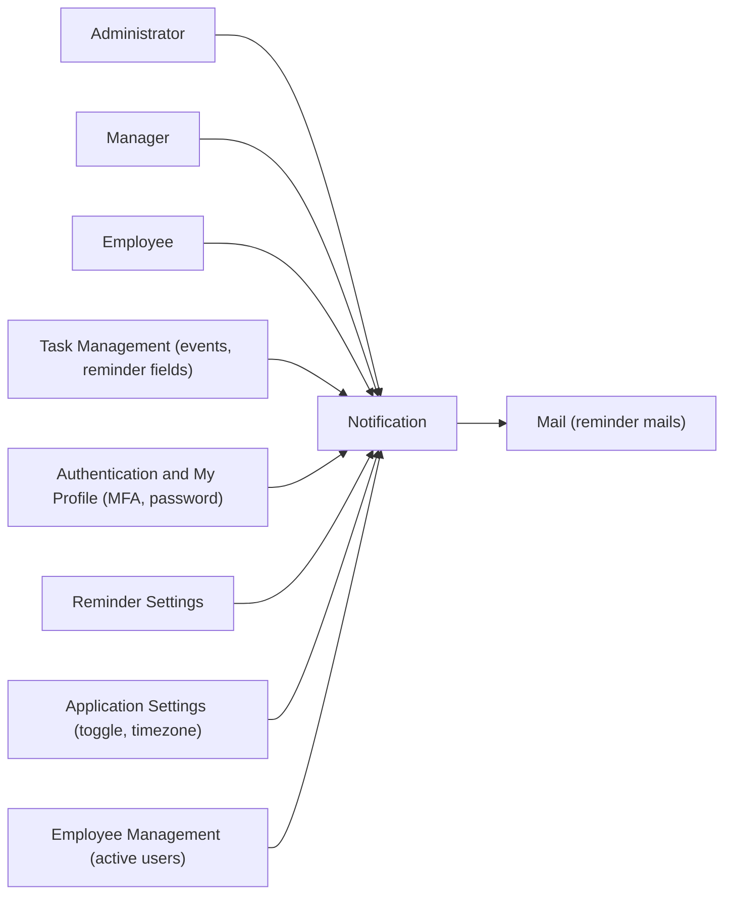
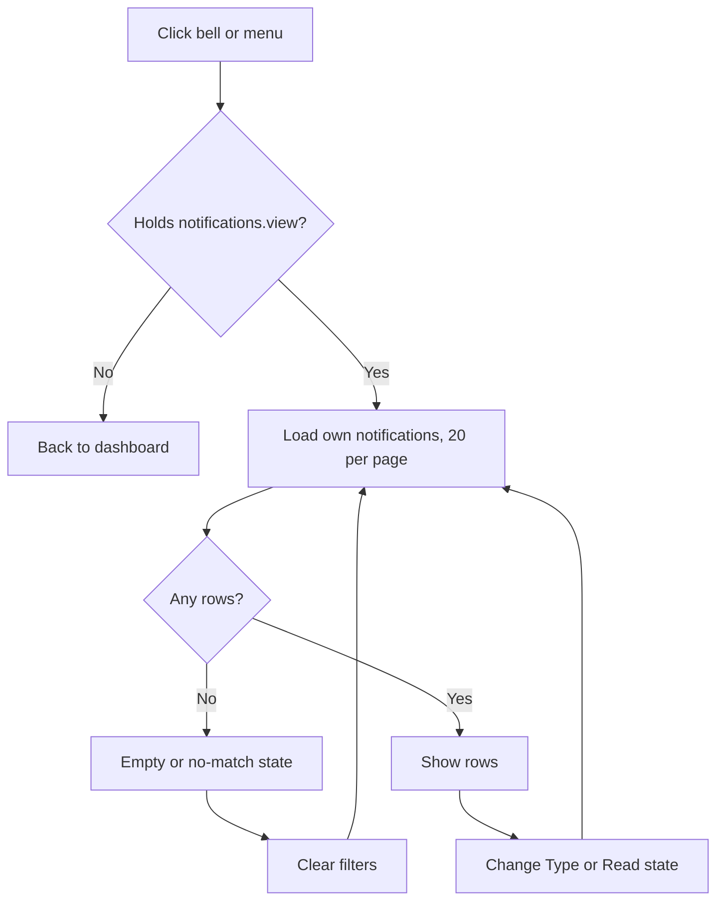
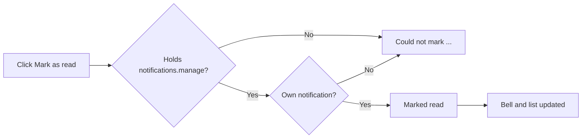
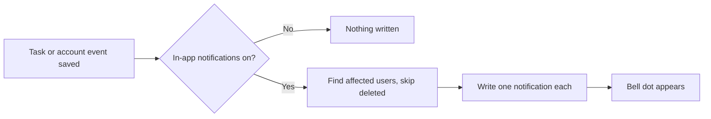
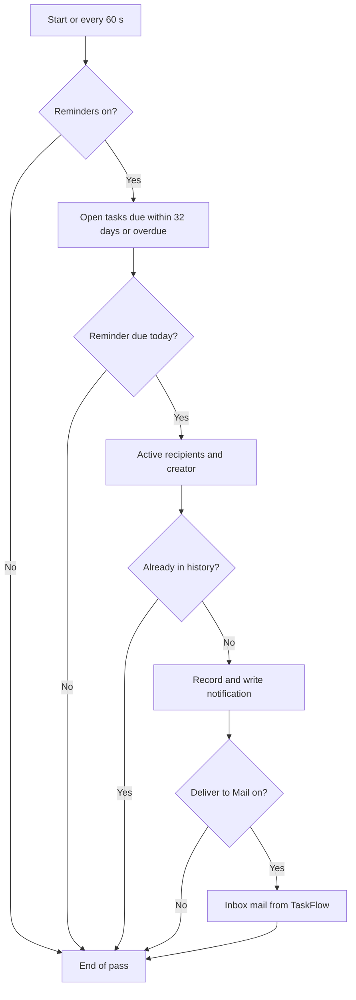
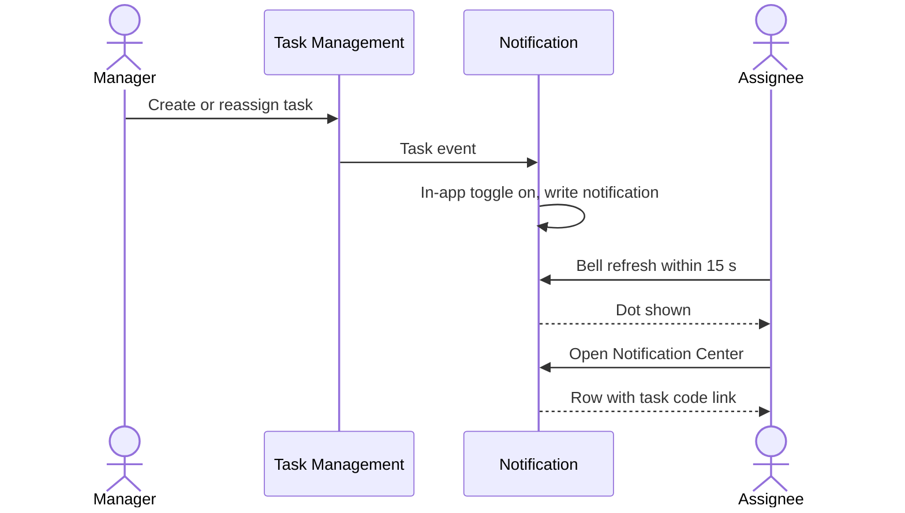
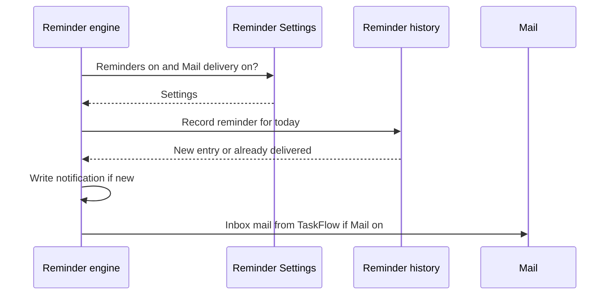

# Functional Requirements Document – Notification

## TaskFlow – Intelligent Task Allocation & Tracking System

> **Document:** Functional Requirements Document (Sub-module: Communication → Notification, incl. deadline reminder engine, code `NOTIF`)  ·  **Version:** 1.0  ·  **Status:** Draft
> **Project type:** Personal Project (Skill Development)  ·  **Date:** 31-Oct-2026
> **Author:** Jojo George (jojogeorge3344@gmail.com)
> **Based on:** BRD-Notification.md v1.0
> © 2026 Jojo George. All rights reserved.

---

## Document Control

### Revision History

| Version | Date | Author | Summary of changes |
|---|---|---|---|
| 1.0 | 31-Oct-2026 | Jojo George | Initial version |

### Related Documents

| Document | Purpose | Location |
|---|---|---|
| BRD – Notification | Business needs this FRD details (`REQ-NOTIF-nn`, `BR-NOTIF-nn`, `AC-NOTIF-nn`) | `../../../BRD/04-Communication/04.2-Notification/BRD-Notification.md` |
| FRD – Overall | Roles, global rules, Authentication, Legal, module index | `../../00-Overall/FRD-TaskFlow-Overall.md` |
| FRD – Mail (sibling) | Receives reminder mails in the Inbox | `../04.1-Mail/FRD-Mail.md` |
| FRD – Reminder Settings | Reminders on/off, deadline-day reminder, "Also deliver reminders to Mail", default reminder days | `../../06-Settings/06.1-Reminder-Settings/FRD-Reminder-Settings.md` |
| FRD – Application Settings | In-app notifications toggle, application timezone | `../../06-Settings/06.2-Application-Settings/FRD-Application-Settings.md` |
| FRD – Task Management | Task reminder fields, recipients, task events, task details screen | `../../02-TaskFlow-Monitoring/02.1-Task-Management/FRD-Task-Management.md` |
| Development Plan | Screen 12 Notification Center | `TF - Documents/Screens Wise Feature Development Plan/12-notification-center-screen.md` |
| HLD / LLD | Technical design of Notification | `../../../HLD/04-Communication/04.2-Notification/HLD-Notification.md`, `../../../LLD/04-Communication/04.2-Notification/LLD-Notification.md` |

---

## 1. Introduction

### 1.1 Purpose
This FRD specifies the detailed, testable behaviour of the Notification sub-module: the Notification Center screen and
header bell, the event notifications written when tasks and accounts change, and the automatic deadline reminder
engine that sends first, second, due-today and overdue reminders exactly once.

### 1.2 Scope
In scope: everything listed in BRD-Notification §3.1. Out of scope (BRD-Notification §3.2): editing reminder switches
and defaults (Reminder Settings FRD), setting a task's reminder days and recipients (Task Management FRD), outside
email or SMS, deleting or archiving notifications, live push, status-change notifications, catching up past days and
tracking failed deliveries.

**Change from original BRD**

| Original BRD item | Current requirement |
|---|---|
| Screen 12 "Access: All registered users" | Access by `notifications.view`, granted by default to Administrator, Manager, Employee (FR-NOTIF-01). |
| Screen 12 "Unread notification count" | The bell shows a dot while anything is unread; no number is printed (FR-NOTIF-03). |
| Screen 12 "Notification filters" | Two filters: Type and Read state (FR-NOTIF-09, FR-NOTIF-10). |
| Screen 12 FR 5 "Create due-today alerts" | Due-today reminders use the type "Deadline reminder" and the text "… is due today at *HH:mm*." (FR-NOTIF-39, FR-NOTIF-45, FR-NOTIF-46). |
| Section 3.2 fixed schedule (two days / one day before) | Per-task first and second reminder days (0–30, defaults 2 and 1) and a Daily or Weekly overdue frequency (FR-NOTIF-36 – FR-NOTIF-40). |
| Section 3.2 "Deadline changed → recalculate future reminders" | Every run uses the task's current deadline and status (FR-NOTIF-44, FR-NOTIF-50). |
| Section 3.4 "Email Notifications" via SMTP | Reminders are also placed in the internal Mail Inbox when "Also deliver reminders to Mail" is on (FR-NOTIF-47). |
| Section 3.5 history "processing status, delivery attempt details" | History records each delivered reminder with status "Sent"; attempts and failures are not tracked (FR-NOTIF-48). |
| Not in original BRD | Notifications for reassignment, comments, worked hours and account security events (FR-NOTIF-23 – FR-NOTIF-28). |

### 1.3 Audience
Developer, tester, reviewer and product owner of TaskFlow.

### 1.4 Conventions
- Requirement IDs: `FR-NOTIF-nn`. Use cases: `UC-NOTIF-nn`. BRD items: `REQ-NOTIF-nn`, sub-module rules
  `BR-NOTIF-nn`, global rules `BR-nn` (overall BRD), NFRs `NFR-NOTIF-nn`, acceptance criteria `AC-NOTIF-nn`.
- Priority: **Must / Should / Could** (MoSCoW), taken from the traced BRD requirement.
- "The system shall …" = mandatory behaviour. Text in *italics* inside messages is a value filled in at run time.
- "Today", "day" and dates in reminder texts are in the application timezone.

### 1.5 Definitions & Abbreviations

| Term | Meaning |
|---|---|
| Notification | A short in-app alert for one user; scope is always **Own** |
| Event notification | A notification caused by a change: assignment, reassignment, comment, worked hours, account event |
| Reminder engine | Background process that checks open tasks at start-up and every 60 seconds and sends deadline reminders |
| First / second reminder | Reminder sent exactly the task's first / second reminder days (0–30) before the deadline day |
| Due-today reminder | Reminder sent on the deadline day before the deadline time |
| Overdue reminder | Reminder sent after the deadline day, Daily or Weekly, while the task is open |
| Reminder recipients | The task's notification recipients (the assignee is always one) plus the task creator, active users only |
| Reminder history | Record of delivered reminders, one per task, person, reminder type and day |
| Open task | A task that is not completed, not cancelled and not deleted |
| Application timezone | The single timezone set in Application Settings (UTC when not set) |

---

## 2. System Overview

### 2.1 Module Map

| Code | Module | Child modules | Primary roles |
|---|---|---|---|
| NOTIF | Communication → Notification | Notification Center (with header bell), Event notifications, Deadline reminder engine | Administrator, Manager, Employee, Custom Role (as granted); System |

Other modules are described in the overall FRD (`../../00-Overall/FRD-TaskFlow-Overall.md`).

### 2.2 Context Diagram

---

## 3. User Roles & Permissions

### 3.1 Roles

| Role | Description | Data scope |
|---|---|---|
| Administrator | System administrator; grants `notifications.*` keys to custom roles; receives own notifications | Own notifications only |
| Manager | Leads a team or project; receives reminders for tasks created | Own notifications only |
| Employee | Works on assigned tasks; receives alerts as assignee or recipient | Own notifications only |
| Custom Role | Role created by an Administrator | Own notifications, as granted |
| System | Reminder engine and event sources; no user permission | Writes notifications for affected users |

No role, including Administrator, sees another user's notifications (BR-NOTIF-01).

### 3.2 Permission Matrix (functional view)

| Module › Function | Permission key | Administrator | Manager | Employee | Custom role |
|---|---|:---:|:---:|:---:|:---:|
| Notification › Open the Notification Center, header bell and unread dot | `notifications.view` | Granted | Granted | Granted | Configurable |
| Notification › Mark one or all notifications as read | `notifications.manage` | Granted | Granted | Granted | Configurable |
| Reminder Settings › Reminder switches (controls the engine; specified in the Reminder Settings FRD) | `settings.reminders.manage` | see Reminder Settings FRD | | | |
| Application Settings › In-app notifications toggle, timezone (specified in the Application Settings FRD) | `settings.application.manage` | see Application Settings FRD | | | |

A new custom role starts with neither `notifications.*` key. The reminder engine and event notifications need no user
permission.

---

## 4. Functional Requirements by Module

### 4.1 Module: Notification (NOTIF)

**Purpose:** Tell each user about their own work in one place and send deadline reminders automatically, once each.
·  **BRD reference:** BRD-Notification §5 SCREEN 1, workflows 4.1 – 4.3; BR-NOTIF-01 – BR-NOTIF-13; global rules on
notifications, reminders and timezone.

#### 4.1.1 Screen: Notification Center (with header bell)

| Field | Value |
|---|---|
| Route / location | `/notifications` (menu: Communication Management → Notifications); header bell on every page |
| Access | `notifications.view` (Administrator, Manager, Employee by default; Custom Role if granted); marking read needs `notifications.manage` |
| Entry points | Side menu item "Notifications"; bell icon in the header |

**Screen elements**

| Element | Type | Description | Mandatory | Visible to |
|---|---|---|:---:|---|
| Header bell | Icon link | Opens the Notification Center; dot while anything is unread | – | `notifications.view` |
| Title "Notifications" | Heading | Page title | – | `notifications.view` |
| Range label | Text | "1–20 of 45 notifications"; adds "match the current filters" when filtered | – | `notifications.view` |
| Mark all as read | Button | Marks every unread notification read; disabled when nothing is unread | – | `notifications.manage` |
| Type | Drop-down | All types, Task assigned, Task reassigned, Deadline reminder, Overdue, System | No | `notifications.view` |
| Read state | Drop-down | All, Unread, Read | No | `notifications.view` |
| Reset | Button | Clears both filters | – | `notifications.view` |
| Notification row | List row | Type chip, date and time, message, task code link; unread rows highlighted | – | `notifications.view` |
| Mark as read | Button (unread rows) | Marks the row read | – | Shown to every viewer; use needs `notifications.manage` |
| Previous / Next, "Page X of Y" | Paging | 20 per page | – | `notifications.view` |
| Empty / no-match / error states | Panels | "No notifications yet"; "No notifications match these filters" with Clear filters; error with Retry | – | `notifications.view` |

**Functional requirements**

| ID | Requirement | Priority | Permission | BRD trace |
|---|---|---|---|---|
| FR-NOTIF-01 | The system shall open `/notifications` only for a user holding `notifications.view` and shall return any other user to their dashboard without a message. | Must | `notifications.view` | REQ-NOTIF-01 |
| FR-NOTIF-02 | The system shall show a bell in the header of every page to users holding `notifications.view`, linking to the Notification Center. | Must | `notifications.view` | REQ-NOTIF-02 |
| FR-NOTIF-03 | The system shall show a dot on the bell while the user has at least one unread notification and none otherwise, refreshing the unread state on every page change, every 15 seconds and when the browser tab becomes visible again. | Must | `notifications.view` | REQ-NOTIF-03, NFR-NOTIF-02 |
| FR-NOTIF-04 | The system shall list only the signed-in user's own notifications, newest first. | Must | `notifications.view` | REQ-NOTIF-04, BR-NOTIF-01 |
| FR-NOTIF-05 | The system shall show 20 notifications per page with Previous, Next, "Page X of Y" and a range label such as "1–20 of 45 notifications", adding "match the current filters" when a filter is active. | Should | `notifications.view` | REQ-NOTIF-05 |
| FR-NOTIF-06 | The system shall accept a requested page size from 1 to 100 and use 20 for any value outside that range, without a message. | Should | `notifications.view` | REQ-NOTIF-05, NFR-NOTIF-03 |
| FR-NOTIF-07 | The system shall show on each row a type chip, the date and time, the message and, when the related task still exists and is not deleted, the task code as a link. | Must | `notifications.view` | REQ-NOTIF-06 |
| FR-NOTIF-08 | The system shall highlight unread rows. | Should | `notifications.view` | REQ-NOTIF-07 |
| FR-NOTIF-09 | The system shall filter the list by Type: All types, Task assigned, Task reassigned, Deadline reminder, Overdue, System. | Should | `notifications.view` | REQ-NOTIF-08 |
| FR-NOTIF-10 | The system shall filter the list by Read state: All, Unread, Read, and reload from page 1 whenever either filter changes. | Should | `notifications.view` | REQ-NOTIF-09 |
| FR-NOTIF-11 | The system shall clear both filters and reload from page 1 when the user clicks Reset or Clear filters. | Should | `notifications.view` | REQ-NOTIF-10 |
| FR-NOTIF-12 | The system shall mark one of the user's own notifications as read on Mark as read, and do nothing further when it is already read. | Must | `notifications.manage` | REQ-NOTIF-11 |
| FR-NOTIF-13 | The system shall show Mark all as read only to users holding `notifications.manage` and disable it while nothing is unread. | Should | `notifications.manage` | REQ-NOTIF-12 |
| FR-NOTIF-14 | The system shall mark all of the user's unread notifications as read on Mark all as read. | Must | `notifications.manage` | REQ-NOTIF-13 |
| FR-NOTIF-15 | The system shall, after marking read, remove the unread highlight, update the bell, and reload the list when a Read-state filter is active. | Should | `notifications.manage` | REQ-NOTIF-14 |
| FR-NOTIF-16 | The system shall open the related task's details when the user clicks its task code, applying the task's own access rules. | Must | Task access rules | REQ-NOTIF-15 |
| FR-NOTIF-17 | The system shall keep a notification whose task has been deleted and show it without a task link. | Should | `notifications.view` | REQ-NOTIF-16 |
| FR-NOTIF-18 | The system shall offer no way to delete a notification; notifications can only be marked as read. | Must | – | REQ-NOTIF-17, BR-NOTIF-02 |
| FR-NOTIF-19 | The system shall show "No notifications yet – Tasks assigned or reassigned to you will appear here." when the user has none, "No notifications match these filters – Try a different type or clear the filters." with Clear filters when filters match nothing, and "Could not load notifications. Check your connection and try again." with Retry when loading fails. | Should | `notifications.view` | REQ-NOTIF-18 |
| FR-NOTIF-20 | The system shall never show or change another user's notification and shall treat such a notification as not found. | Must | `notifications.manage` | REQ-NOTIF-19, BR-NOTIF-01, NFR-NOTIF-07 |
| FR-NOTIF-21 | The system shall show "Could not mark the notification as read." or "Could not mark all notifications as read." when marking fails, including for a user without `notifications.manage`. | Should | `notifications.manage` | REQ-NOTIF-11, REQ-NOTIF-13 |

**Use case: UC-NOTIF-01 – View and filter notifications**

| Item | Detail |
|---|---|
| Actor | Any user with `notifications.view` |
| Preconditions | Signed in |
| Trigger | Clicks the bell or Communication Management → Notifications |
| Main flow | 1. System checks `notifications.view` (FR-NOTIF-01). 2. System loads the newest 20 own notifications and the unread state (FR-NOTIF-04, 05). 3. User picks Type and/or Read state; list reloads from page 1 (FR-NOTIF-09, 10). 4. User pages with Previous / Next. |
| Alternate flows | A1: Reset / Clear filters → all notifications again (FR-NOTIF-11). |
| Exceptions | E1: no permission → dashboard. E2: none / no match / load error → FR-NOTIF-19 states. |
| Postconditions | Nothing changes; the user has seen their notifications |

**Use case: UC-NOTIF-02 – Mark notifications as read**

| Item | Detail |
|---|---|
| Actor | User with `notifications.manage` |
| Preconditions | Notification Center open with unread rows |
| Trigger | Clicks Mark as read on a row, or Mark all as read |
| Main flow | 1. System checks the key and ownership (FR-NOTIF-12, 14, 20). 2. Rows lose the highlight; the bell dot clears when nothing is unread (FR-NOTIF-15). 3. With a Read-state filter, the list reloads. |
| Alternate flows | A1: row already read → no change (FR-NOTIF-12). |
| Exceptions | E1: no key or foreign notification → "Could not mark the notification as read." / "Could not mark all notifications as read." (FR-NOTIF-21). |
| Postconditions | Notifications read; none deleted (FR-NOTIF-18) |

**Use case: UC-NOTIF-03 – Open the related task**

| Item | Detail |
|---|---|
| Actor | User with `notifications.view` |
| Preconditions | A row with a task code |
| Trigger | Clicks the task code |
| Main flow | 1. System opens the task details screen (FR-NOTIF-16). 2. The task screen applies its own access rules. |
| Alternate flows | A1: task deleted → no link shown (FR-NOTIF-17). |
| Exceptions | E1: user may not see that task → handled by the task screen (Task Management FRD). |
| Postconditions | Task details shown; the notification's read state is unchanged |

**Field validations**

| Field | Rule | Error message |
|---|---|---|
| Page size | 1–100; otherwise 20 is used | None |
| Type filter | One of the listed types or All types | None (drop-down) |
| Read state filter | All, Unread or Read | None (drop-down) |
| Notification id (mark read) | Must belong to the caller | "Could not mark the notification as read." |

**Business rules applied:** BR-NOTIF-01, BR-NOTIF-02; global rules on authorised access and private notifications.

**Notifications / side effects**

| Event | Who is notified | Channel |
|---|---|---|
| Notification marked read | – (bell dot clears when nothing unread) | In-app |

**Messages**

| Situation | Message |
|---|---|
| Empty list | "No notifications yet – Tasks assigned or reassigned to you will appear here." |
| No filter matches | "No notifications match these filters – Try a different type or clear the filters." |
| Load failed | "Could not load notifications. Check your connection and try again." |
| Mark one failed | "Could not mark the notification as read." |
| Mark all failed | "Could not mark all notifications as read." |
| No permission to open the screen | Returned to the dashboard; no message |

#### 4.1.2 Function: Event Notifications (system generated, no screen)

| Field | Value |
|---|---|
| Route / location | No screen; results appear in the Notification Center and on the bell |
| Access | System; recipients are the affected users |
| Entry points | Task created, task reassigned, comment added / edited / deleted, worked hours changed (Task Management); MFA reset by an administrator, password reset with the authenticator (Authentication / My Profile) |

**Functional requirements**

| ID | Requirement | Priority | Permission | BRD trace |
|---|---|---|---|---|
| FR-NOTIF-22 | The system shall notify the assignee when a task is created, with the type "Task assigned" and the text "A task was assigned to you: *task title*". | Must | System | REQ-NOTIF-20 |
| FR-NOTIF-23 | The system shall notify the new assignee of a reassignment with the type "Task reassigned" and the text "A task was reassigned to you: *task title*. Reason: *reason*". | Must | System | REQ-NOTIF-21 |
| FR-NOTIF-24 | The system shall notify the previous assignee, the recipients and the acting person of a reassignment with "*Name* reassigned task "*title*" (*code*) from *old* to *new*. Reason: *reason*". | Must | System | REQ-NOTIF-21 |
| FR-NOTIF-25 | The system shall notify the task's assignee, recipients and the acting person when a comment is added, edited or deleted, with the type Task comment and "*Name* *added / edited / deleted* a comment on "*title*": *detail*". | Must | System | REQ-NOTIF-22 |
| FR-NOTIF-26 | The system shall notify the task's assignee and recipients when the worked hours of a task change, with the type "System", stating what changed and the new total worked. | Should | System | REQ-NOTIF-23 |
| FR-NOTIF-27 | The system shall send the account owner a "System" notification "An administrator reset your authenticator MFA. Sign in with your password and set it up again from Profile." when an administrator resets their authenticator MFA. | Must | System | REQ-NOTIF-24 |
| FR-NOTIF-28 | The system shall send the account owner a "System" notification "Your password was reset with your authenticator app. If this was not you, contact an administrator now." when their password is reset with the authenticator app. | Must | System | REQ-NOTIF-25 |
| FR-NOTIF-29 | The system shall write no event notification while in-app notifications are switched off in Application Settings, and shall keep all existing notifications. | Must | System | REQ-NOTIF-26, BR-NOTIF-11 |
| FR-NOTIF-30 | The system shall write no notification for a deleted user. | Must | System | REQ-NOTIF-27 |
| FR-NOTIF-31 | The system shall keep the task change that caused a notification even when writing the notification fails. | Must | System | BR-NOTIF-13 |

**Use case: UC-NOTIF-04 – Receive an event notification**

| Item | Detail |
|---|---|
| Actor | System; affected users |
| Preconditions | In-app notifications on (Application Settings); affected users not deleted |
| Trigger | One of the entry-point events above |
| Main flow | 1. Event saved in its own module. 2. System determines the affected users (FR-NOTIF-22 – 28). 3. System writes one notification per user. 4. Each user's bell dot appears within 15 seconds or on the next page change (FR-NOTIF-03). |
| Alternate flows | A1: toggle off → nothing written; old notifications kept (FR-NOTIF-29). |
| Exceptions | E1: writing fails → the event itself stays saved (FR-NOTIF-31). |
| Postconditions | Notifications written for the affected users only |

**Business rules applied:** BR-NOTIF-11, BR-NOTIF-13; global rule that the assigned employee is always included in
task notifications.

**Notifications / side effects:** see §7 (N-01 – N-07). Comment, reassignment and worked-hours events also produce
mails (Mail FRD FR-MAIL-25 – FR-MAIL-27).

**Messages:** the notification texts in FR-NOTIF-22 – FR-NOTIF-28; no user-facing error messages.

#### 4.1.3 Function: Automatic Deadline Reminder Engine (background, no screen)

| Field | Value |
|---|---|
| Route / location | No screen; runs in the background of the application |
| Access | System; switches in Reminder Settings (`settings.reminders.manage`); per-task fields in Task Management |
| Entry points | Application start, then every 60 seconds |

**Functional requirements**

| ID | Requirement | Priority | Permission | BRD trace |
|---|---|---|---|---|
| FR-NOTIF-32 | The system shall run a reminder pass when the application starts and every 60 seconds after that, without user action. | Must | System | REQ-NOTIF-28, NFR-NOTIF-01 |
| FR-NOTIF-33 | The system shall send no reminders while reminders are switched off in Reminder Settings. | Must | System | REQ-NOTIF-29, BR-NOTIF-11 |
| FR-NOTIF-34 | The system shall consider only open tasks (not completed, not cancelled, not deleted) whose deadline is at most 32 days ahead or already passed. | Must | System | REQ-NOTIF-30, BR-NOTIF-03 |
| FR-NOTIF-35 | The system shall decide the current day and the days until the deadline in the application timezone, using UTC when no timezone is set, and count days correctly across daylight-saving changes. | Must | System | REQ-NOTIF-31, BR-NOTIF-07, NFR-NOTIF-06 |
| FR-NOTIF-36 | The system shall send the first reminder on the day that is exactly the task's first-reminder days before the deadline day. | Must | System | REQ-NOTIF-32 |
| FR-NOTIF-37 | The system shall send the second reminder on the day that is exactly the task's second-reminder days before the deadline day. | Must | System | REQ-NOTIF-33 |
| FR-NOTIF-38 | The system shall send only one reminder (the second reminder) on a day that matches both the first and the second reminder days. | Should | System | REQ-NOTIF-34 |
| FR-NOTIF-39 | The system shall send a due-today reminder on the deadline day, only while the deadline time has not passed, when the deadline-day reminder is on in Reminder Settings or the task's first or second reminder days is 0. | Must | System | REQ-NOTIF-35, BR-NOTIF-08 |
| FR-NOTIF-40 | The system shall send an overdue reminder, while the task stays open, every day from the day after the deadline day when the overdue frequency is Daily, or every 7th day after the deadline day (7, 14, 21 … days) when it is Weekly. | Must | System | REQ-NOTIF-36, BR-NOTIF-09 |
| FR-NOTIF-41 | The system shall send each reminder to the task's notification recipients (always including the assignee) and the task creator, each person once, active users only. | Must | System | REQ-NOTIF-37, BR-NOTIF-04 |
| FR-NOTIF-42 | The system shall deliver each reminder (task, person, reminder type, day) at most once, however often the engine runs, overlaps or restarts. | Must | System | REQ-NOTIF-38, BR-NOTIF-05, NFR-NOTIF-04 |
| FR-NOTIF-43 | The system shall send only reminders due on the current day and never send a reminder for a day that has ended. | Must | System | REQ-NOTIF-39, BR-NOTIF-06 |
| FR-NOTIF-44 | The system shall write nothing for a task that is completed, cancelled, deleted or given a new deadline while the pass is running. | Must | System | REQ-NOTIF-40 |
| FR-NOTIF-45 | The system shall use the texts "Reminder: "*title*" is due in *N* days (*dd MMM yyyy, HH:mm*)." ("1 day" when N is 1) for first and second reminders, "Reminder: "*title*" is due today at *HH:mm*." for due-today and "Overdue: "*title*" was due on *dd MMM yyyy, HH:mm*." for overdue. | Must | System | REQ-NOTIF-41 |
| FR-NOTIF-46 | The system shall give first, second and due-today reminders the type "Deadline reminder" and overdue reminders the type "Overdue". | Should | System | REQ-NOTIF-42 |
| FR-NOTIF-47 | The system shall, while "Also deliver reminders to Mail" is on, also place each reminder in the recipient's Inbox as a mail from "TaskFlow" with the subject "Task reminder: ", "Task due today: " or "Overdue task: " followed by the title, and a body with the reminder text, an "Open the task" link and "This is an automatic reminder from TaskFlow."; the in-app notification is always written. | Should | System | REQ-NOTIF-43, BR-NOTIF-12 |
| FR-NOTIF-48 | The system shall record every delivered reminder in the reminder history with task, recipient, reminder type (First, Second, Due today, Overdue), reminder day, status "Sent" and processing time. | Must | System | REQ-NOTIF-44 |
| FR-NOTIF-49 | The system shall log a failed pass and run the next pass at the next interval. | Should | System | REQ-NOTIF-45, NFR-NOTIF-05 |
| FR-NOTIF-50 | The system shall use the task's current deadline, status and reminder fields on every pass, so that a change takes effect from the next pass. | Must | System | REQ-NOTIF-30, REQ-NOTIF-40, BR-NOTIF-10 |

**Use case: UC-NOTIF-05 – Automatic deadline reminder pass**

| Item | Detail |
|---|---|
| Actor | System (reminder engine); recipients (assignee, task recipients, creator) |
| Preconditions | Application running; reminders on in Reminder Settings |
| Trigger | Application start or 60-second interval |
| Main flow | 1. Pass starts (FR-NOTIF-32). 2. Reminders on? (FR-NOTIF-33). 3. Find open candidate tasks (FR-NOTIF-34). 4. Decide today's reminder per task in the application timezone (FR-NOTIF-35 – 40). 5. Resolve active recipients (FR-NOTIF-41). 6. Skip reminders already in the history (FR-NOTIF-42). 7. Record, write the notification and, if on, the Inbox mail (FR-NOTIF-45 – 48). |
| Alternate flows | A1: first and second days equal → one reminder (FR-NOTIF-38). A2: Mail delivery off → notification only. |
| Exceptions | E1: task changed during the pass → nothing written (FR-NOTIF-44). E2: pass fails → logged; next pass retries (FR-NOTIF-49). E3: application stopped for a whole day → that day is not caught up (FR-NOTIF-43). |
| Postconditions | Each due reminder delivered exactly once and recorded |

**Worked example (defaults: first 2 days, second 1 day, overdue Daily, deadline-day reminder on)** – task "Prepare
Monthly Report", deadline 15-Oct-2026 17:00, assignee Rahul, creator Anita, recipient Priya:

| Day | Reminder type | Text (each of Rahul, Anita, Priya, once) |
|---|---|---|
| 13-Oct-2026 | First | Reminder: "Prepare Monthly Report" is due in 2 days (15 Oct 2026, 17:00). |
| 14-Oct-2026 | Second | Reminder: "Prepare Monthly Report" is due in 1 day (15 Oct 2026, 17:00). |
| 15-Oct-2026, before 17:00 | Due today | Reminder: "Prepare Monthly Report" is due today at 17:00. |
| 16-Oct-2026 onward | Overdue | Overdue: "Prepare Monthly Report" was due on 15 Oct 2026, 17:00. |
| After completion | – | None |

**Field validations**

| Field | Rule | Error message |
|---|---|---|
| Task reminder days (read from the task) | 0–30, set in Task Management | Validated in the Task Management FRD |
| Overdue frequency (read from the task) | Daily or Weekly | Validated in the Task Management FRD |

**Business rules applied:** BR-NOTIF-03 – BR-NOTIF-10, BR-NOTIF-12; global rules: overdue definition, completed and
cancelled tasks get no reminders, configurable reminder settings, duplicate prevention, one timezone, Mail failure
does not stop in-app notifications.

**Notifications / side effects:** see §7 (N-08 – N-11) and the Mail FRD §5.1.

**Messages:** the reminder texts in FR-NOTIF-45; no user-facing error messages (failures are logged).

---

## 5. Cross-Module Workflows

### 5.1 Task created or reassigned

| Step | Module | Actor / System | Action | FR reference |
|---|---|---|---|---|
| 1 | TASK | Manager | Creates or reassigns a task | Task Management FRD |
| 2 | APP | System | Checks the in-app notifications toggle | FR-NOTIF-29 |
| 3 | NOTIF | System | Writes "Task assigned" / "Task reassigned" notifications | FR-NOTIF-22, FR-NOTIF-23, FR-NOTIF-24 |
| 4 | MAIL | System | Reassignment also sends a mail from the acting person | FR-MAIL-26 (Mail FRD) |
| 5 | NOTIF | Assignee | Sees the bell dot, opens the Notification Center and the task | FR-NOTIF-03, FR-NOTIF-16 |

### 5.2 Deadline reminder with Mail delivery

| Step | Module | Actor / System | Action | FR reference |
|---|---|---|---|---|
| 1 | NOTIF | System | Pass starts; reads Reminder Settings | FR-NOTIF-32, FR-NOTIF-33 |
| 2 | NOTIF | System | Finds due reminders and active recipients | FR-NOTIF-34 – FR-NOTIF-41 |
| 3 | NOTIF | System | Records each reminder once and writes the notification | FR-NOTIF-42, FR-NOTIF-48 |
| 4 | MAIL | System | If "Also deliver reminders to Mail" is on, places the Inbox mail from "TaskFlow" | FR-NOTIF-47, FR-MAIL-21 |
| 5 | NOTIF / MAIL | Recipient | Reads the notification or mail and opens the task | FR-NOTIF-16, FR-MAIL-12 |

---

## 6. Reports & Exports

_Not applicable for this sub-module._

---

## 7. Notifications & Messages Catalogue

| Code | Trigger | Recipients | Channel | Text |
|---|---|---|---|---|
| N-01 | Task created | Assignee | In-app (Task assigned) | "A task was assigned to you: *task title*" |
| N-02 | Task reassigned | New assignee | In-app (Task reassigned) | "A task was reassigned to you: *task title*. Reason: *reason*" |
| N-03 | Task reassigned | Previous assignee, recipients, acting person | In-app (Task reassigned) | "*Name* reassigned task "*title*" (*code*) from *old* to *new*. Reason: *reason*" |
| N-04 | Comment added / edited / deleted | Assignee, recipients, acting person | In-app (Task comment); Mail if toggle on | "*Name* *added / edited / deleted* a comment on "*title*": *detail*" |
| N-05 | Worked hours changed | Assignee, recipients | In-app (System) | What changed and the new total worked |
| N-06 | Administrator resets authenticator MFA | Account owner | In-app (System) | "An administrator reset your authenticator MFA. Sign in with your password and set it up again from Profile." |
| N-07 | Password reset with the authenticator | Account owner | In-app (System) | "Your password was reset with your authenticator app. If this was not you, contact an administrator now." |
| N-08 | First reminder day | Reminder recipients | In-app (Deadline reminder); Mail "Task reminder: *title*" if on | "Reminder: "*title*" is due in *N* days (*dd MMM yyyy, HH:mm*)." |
| N-09 | Second reminder day | Reminder recipients | In-app (Deadline reminder); Mail "Task reminder: *title*" if on | As N-08 ("1 day" when N is 1) |
| N-10 | Deadline day, before the deadline time | Reminder recipients | In-app (Deadline reminder); Mail "Task due today: *title*" if on | "Reminder: "*title*" is due today at *HH:mm*." |
| N-11 | Each Daily / Weekly overdue day | Reminder recipients | In-app (Overdue); Mail "Overdue task: *title*" if on | "Overdue: "*title*" was due on *dd MMM yyyy, HH:mm*." |

Screen messages are listed in §4.1.1.

---

## 8. Data Requirements (functional view)

| Data item | Description | Created by | Rules |
|---|---|---|---|
| Notification | One alert for one user: recipient, related task (optional), type (Task assigned, Task reassigned, Deadline reminder, Overdue, System, Task comment), message, read flag, created time | System | Kept permanently; only the read flag changes; removed only together with its user or task |
| Reminder history | Proof of a delivered reminder: task, recipient, reminder type (First, Second, Due today, Overdue), reminder day, status, processed time | System (reminder engine) | Unique per task, recipient, reminder type and day; status "Sent" |
| Task reminder fields (read only) | Deadline, status, first and second reminder days, overdue frequency, creator, notification recipients | Task Management | Owned and validated by Task Management |

---

## 9. Non-Functional Requirements (functional impact)

| ID | Requirement | Affects |
|---|---|---|
| NFR-NOTIF-01 | Engine runs every 60 seconds; a day's reminder goes out on the first pass of that day | Reminder engine (FR-NOTIF-32) |
| NFR-NOTIF-02 | Bell refreshed on page change and at least every 15 seconds | Header bell (FR-NOTIF-03) |
| NFR-NOTIF-03 | 20 notifications per page, at most 100 | Notification Center (FR-NOTIF-05, FR-NOTIF-06) |
| NFR-NOTIF-04 | No duplicates across overlapping passes or restarts | Reminder engine (FR-NOTIF-42) |
| NFR-NOTIF-05 | A failed pass is logged and the next pass runs | Reminder engine (FR-NOTIF-49) |
| NFR-NOTIF-06 | Day boundaries correct across daylight-saving changes | Reminder engine (FR-NOTIF-35) |
| NFR-NOTIF-07 | Foreign notifications reported as not found | Notification Center (FR-NOTIF-20) |
| NFR-NOTIF-08 | Reminder switches and defaults edited in Reminder Settings; run interval set in configuration | Reminder engine (FR-NOTIF-32, FR-NOTIF-33) |

---

## 10. Assumptions & Open Issues

| Type | Description | Owner |
|---|---|---|
| Assumption | The application runs continuously; a day's reminders are sent while it runs on that day. | Jojo George |
| Assumption | One application timezone applies to all users; single-server deployment with one reminder engine. | Jojo George |
| Open issue | ⚠️ To be confirmed: comment notifications have their own type (Task comment), but the Type filter and type chip do not list it, so these rows show an empty chip and cannot be filtered. Confirm whether "Task comment" should be added to FR-NOTIF-09. | Jojo George |
| Open issue | ⚠️ To be confirmed: the per-row Mark as read button is shown to every viewer although marking needs `notifications.manage`. Confirm whether it should be hidden like Mark all as read. | Jojo George |
| Open issue | ⚠️ To be confirmed: deadline reminders are still written when in-app notifications are switched off in Application Settings (only event notifications follow that toggle, FR-NOTIF-29). Confirm the intended behaviour. | Jojo George |
| Open issue | ⚠️ To be confirmed: with the Weekly overdue frequency the first overdue reminder comes 7 days after the deadline day (FR-NOTIF-40), not on the day after. Confirm this is intended. | Jojo George |
| Open issue | Notifications are never deleted; clean-up is a later phase (BRD R-NOTIF-02). | Jojo George |

---

## 11. Requirements Traceability Matrix

Test case column: automated test suites from the TaskFlow test projects (backend test classes and frontend `*.spec.ts`
files). The mapping was checked against the test sources; per-test mapping belongs in the LLD. "Manual UI check" = no
automated test covers the behaviour.

**BRD requirements → FRD**

| BRD item | FRD requirement(s) | Screen / function | Use case | Test case |
|---|---|---|---|---|
| REQ-NOTIF-01 | FR-NOTIF-01 | Notification Center | UC-NOTIF-01 | `NotificationsEndpointsTests` |
| REQ-NOTIF-02 | FR-NOTIF-02 | Header bell | UC-NOTIF-01 | `shell.component.spec.ts` |
| REQ-NOTIF-03 | FR-NOTIF-03 | Header bell | UC-NOTIF-01, UC-NOTIF-04 | `NotificationsEndpointsTests`, `shell.component.spec.ts` |
| REQ-NOTIF-04 | FR-NOTIF-04 | Notification Center | UC-NOTIF-01 | `NotificationServiceTests` |
| REQ-NOTIF-05 | FR-NOTIF-05, FR-NOTIF-06 | Notification Center | UC-NOTIF-01 | `NotificationServiceTests` |
| REQ-NOTIF-06 | FR-NOTIF-07 | Notification Center | UC-NOTIF-01 | `NotificationServiceTests`, `notification-center.component.spec.ts` |
| REQ-NOTIF-07 | FR-NOTIF-08 | Notification Center | UC-NOTIF-01 | Manual UI check |
| REQ-NOTIF-08 | FR-NOTIF-09 | Notification Center | UC-NOTIF-01 | `NotificationServiceTests`, `notification-center.component.spec.ts` |
| REQ-NOTIF-09 | FR-NOTIF-10 | Notification Center | UC-NOTIF-01 | `NotificationServiceTests`, `notification-center.component.spec.ts` |
| REQ-NOTIF-10 | FR-NOTIF-11 | Notification Center | UC-NOTIF-01 | `notification-center.component.spec.ts` |
| REQ-NOTIF-11 | FR-NOTIF-12, FR-NOTIF-21 | Notification Center | UC-NOTIF-02 | `NotificationServiceTests`, `notification-center.component.spec.ts` |
| REQ-NOTIF-12 | FR-NOTIF-13 | Notification Center | UC-NOTIF-02 | Manual UI check |
| REQ-NOTIF-13 | FR-NOTIF-14, FR-NOTIF-21 | Notification Center | UC-NOTIF-02 | `NotificationServiceTests`, `notification-center.component.spec.ts` |
| REQ-NOTIF-14 | FR-NOTIF-15 | Notification Center | UC-NOTIF-02 | `notification-center.component.spec.ts`, `notification.service.spec.ts` |
| REQ-NOTIF-15 | FR-NOTIF-16 | Notification Center | UC-NOTIF-03 | `notification-center.component.spec.ts` |
| REQ-NOTIF-16 | FR-NOTIF-17 | Notification Center | UC-NOTIF-03 | `NotificationServiceTests` |
| REQ-NOTIF-17 | FR-NOTIF-18 | Notification Center | UC-NOTIF-02 | `NotificationsEndpointsTests` |
| REQ-NOTIF-18 | FR-NOTIF-19 | Notification Center | UC-NOTIF-01 | `notification-center.component.spec.ts` |
| REQ-NOTIF-19 | FR-NOTIF-20 | Notification Center | UC-NOTIF-02 | `NotificationServiceTests` |
| REQ-NOTIF-20 | FR-NOTIF-22 | Event notifications | UC-NOTIF-04 | `TaskManagementServiceTests` |
| REQ-NOTIF-21 | FR-NOTIF-23, FR-NOTIF-24 | Event notifications | UC-NOTIF-04 | `TaskServiceTests` |
| REQ-NOTIF-22 | FR-NOTIF-25 | Event notifications | UC-NOTIF-04 | `TaskCommentActivityNotificationTests` |
| REQ-NOTIF-23 | FR-NOTIF-26 | Event notifications | UC-NOTIF-04 | `TaskWorkedHoursNotificationTests` |
| REQ-NOTIF-24 | FR-NOTIF-27 | Event notifications | UC-NOTIF-04 | `MfaServiceTests`, `MfaAdminResetEndpointsTests` |
| REQ-NOTIF-25 | FR-NOTIF-28 | Event notifications | UC-NOTIF-04 | `PasswordRecoveryServiceTests` |
| REQ-NOTIF-26 | FR-NOTIF-29 | Event notifications | UC-NOTIF-04 | `NotificationPublisherTests`, `TaskCommentActivityNotificationTests` |
| REQ-NOTIF-27 | FR-NOTIF-30 | Event notifications | UC-NOTIF-04 | `ReminderServiceTests` |
| REQ-NOTIF-28 | FR-NOTIF-32 | Reminder engine | UC-NOTIF-05 | `ReminderSchedulerServiceTests` |
| REQ-NOTIF-29 | FR-NOTIF-33 | Reminder engine | UC-NOTIF-05 | `ReminderServiceTests` |
| REQ-NOTIF-30 | FR-NOTIF-34, FR-NOTIF-50 | Reminder engine | UC-NOTIF-05 | `ReminderServiceTests` |
| REQ-NOTIF-31 | FR-NOTIF-35 | Reminder engine | UC-NOTIF-05 | `ReminderCalculatorTests` |
| REQ-NOTIF-32 | FR-NOTIF-36 | Reminder engine | UC-NOTIF-05 | `ReminderCalculatorTests` |
| REQ-NOTIF-33 | FR-NOTIF-37 | Reminder engine | UC-NOTIF-05 | `ReminderCalculatorTests` |
| REQ-NOTIF-34 | FR-NOTIF-38 | Reminder engine | UC-NOTIF-05 | `ReminderCalculatorTests` |
| REQ-NOTIF-35 | FR-NOTIF-39 | Reminder engine | UC-NOTIF-05 | `ReminderCalculatorTests` |
| REQ-NOTIF-36 | FR-NOTIF-40 | Reminder engine | UC-NOTIF-05 | `ReminderCalculatorTests` |
| REQ-NOTIF-37 | FR-NOTIF-41 | Reminder engine | UC-NOTIF-05 | `ReminderServiceTests` |
| REQ-NOTIF-38 | FR-NOTIF-42 | Reminder engine | UC-NOTIF-05 | `ReminderIdempotencyTests` |
| REQ-NOTIF-39 | FR-NOTIF-43 | Reminder engine | UC-NOTIF-05 | `ReminderCalculatorTests` |
| REQ-NOTIF-40 | FR-NOTIF-44, FR-NOTIF-50 | Reminder engine | UC-NOTIF-05 | `ReminderIdempotencyTests` |
| REQ-NOTIF-41 | FR-NOTIF-45 | Reminder engine | UC-NOTIF-05 | `ReminderServiceTests` |
| REQ-NOTIF-42 | FR-NOTIF-46 | Reminder engine | UC-NOTIF-05 | `ReminderServiceTests` |
| REQ-NOTIF-43 | FR-NOTIF-47 | Reminder engine | UC-NOTIF-05 | `ReminderServiceTests` |
| REQ-NOTIF-44 | FR-NOTIF-48 | Reminder engine | UC-NOTIF-05 | `ReminderIdempotencyTests` |
| REQ-NOTIF-45 | FR-NOTIF-49 | Reminder engine | UC-NOTIF-05 | `ReminderSchedulerServiceTests` |

**BRD business rules and NFRs → FRD**

| BRD item | FRD requirement(s) | Screen / function | Use case | Test case |
|---|---|---|---|---|
| BR-NOTIF-01 | FR-NOTIF-04, FR-NOTIF-20 | Notification Center | UC-NOTIF-01, UC-NOTIF-02 | `NotificationServiceTests` |
| BR-NOTIF-02 | FR-NOTIF-18 | Notification Center | UC-NOTIF-02 | `NotificationsEndpointsTests` |
| BR-NOTIF-03 | FR-NOTIF-34 | Reminder engine | UC-NOTIF-05 | `ReminderServiceTests` |
| BR-NOTIF-04 | FR-NOTIF-41 | Reminder engine | UC-NOTIF-05 | `ReminderServiceTests` |
| BR-NOTIF-05 | FR-NOTIF-42 | Reminder engine | UC-NOTIF-05 | `ReminderIdempotencyTests` |
| BR-NOTIF-06 | FR-NOTIF-43 | Reminder engine | UC-NOTIF-05 | `ReminderCalculatorTests` |
| BR-NOTIF-07 | FR-NOTIF-35 | Reminder engine | UC-NOTIF-05 | `ReminderCalculatorTests` |
| BR-NOTIF-08 | FR-NOTIF-39 | Reminder engine | UC-NOTIF-05 | `ReminderCalculatorTests` |
| BR-NOTIF-09 | FR-NOTIF-40 | Reminder engine | UC-NOTIF-05 | `ReminderCalculatorTests` |
| BR-NOTIF-10 | FR-NOTIF-50 | Reminder engine | UC-NOTIF-05 | `ReminderIdempotencyTests` |
| BR-NOTIF-11 | FR-NOTIF-29, FR-NOTIF-33 | Event notifications, Reminder engine | UC-NOTIF-04, UC-NOTIF-05 | `NotificationPublisherTests`, `ReminderServiceTests` |
| BR-NOTIF-12 | FR-NOTIF-47 | Reminder engine | UC-NOTIF-05 | `ReminderServiceTests` |
| BR-NOTIF-13 | FR-NOTIF-31 | Event notifications | UC-NOTIF-04 | `TaskWorkedHoursNotificationTests` (mail failure only); no test fails a notification during a task change (see LLD §11) |
| NFR-NOTIF-01 | FR-NOTIF-32 | Reminder engine | UC-NOTIF-05 | `ReminderSchedulerServiceTests` |
| NFR-NOTIF-02 | FR-NOTIF-03 | Header bell | UC-NOTIF-01 | `shell.component.spec.ts` |
| NFR-NOTIF-03 | FR-NOTIF-05, FR-NOTIF-06 | Notification Center | UC-NOTIF-01 | `NotificationServiceTests` |
| NFR-NOTIF-04 | FR-NOTIF-42 | Reminder engine | UC-NOTIF-05 | `ReminderIdempotencyTests` |
| NFR-NOTIF-05 | FR-NOTIF-49 | Reminder engine | UC-NOTIF-05 | `ReminderSchedulerServiceTests` |
| NFR-NOTIF-06 | FR-NOTIF-35 | Reminder engine | UC-NOTIF-05 | `ReminderCalculatorTests` |
| NFR-NOTIF-07 | FR-NOTIF-20 | Notification Center | UC-NOTIF-02 | `NotificationServiceTests` |
| NFR-NOTIF-08 | FR-NOTIF-32, FR-NOTIF-33 | Reminder engine | UC-NOTIF-05 | `SettingsEndpointsTests` (Reminder Settings) |

**BRD acceptance criteria → FRD**

| Acceptance criterion | FRD requirement(s) |
|---|---|
| AC-NOTIF-01 | FR-NOTIF-01, FR-NOTIF-02 |
| AC-NOTIF-02 | FR-NOTIF-03, FR-NOTIF-15 |
| AC-NOTIF-03 | FR-NOTIF-04 – FR-NOTIF-08 |
| AC-NOTIF-04 | FR-NOTIF-09, FR-NOTIF-10, FR-NOTIF-11 |
| AC-NOTIF-05 | FR-NOTIF-12, FR-NOTIF-13, FR-NOTIF-14 |
| AC-NOTIF-06 | FR-NOTIF-16, FR-NOTIF-17, FR-NOTIF-18 |
| AC-NOTIF-07 | FR-NOTIF-19, FR-NOTIF-20 |
| AC-NOTIF-08 | FR-NOTIF-22 – FR-NOTIF-26 |
| AC-NOTIF-09 | FR-NOTIF-27, FR-NOTIF-28 |
| AC-NOTIF-10 | FR-NOTIF-29, FR-NOTIF-30 |
| AC-NOTIF-11 | FR-NOTIF-32 – FR-NOTIF-40 |
| AC-NOTIF-12 | FR-NOTIF-41 |
| AC-NOTIF-13 | FR-NOTIF-42, FR-NOTIF-43 |
| AC-NOTIF-14 | FR-NOTIF-34, FR-NOTIF-44, FR-NOTIF-50 |
| AC-NOTIF-15 | FR-NOTIF-45, FR-NOTIF-46, FR-NOTIF-47 |
| AC-NOTIF-16 | FR-NOTIF-48, FR-NOTIF-49 |

Untraced BRD items: 0.

---

## 12. Approvals

| Role | Name | Decision | Date |
|---|---|---|---|
| Product owner | Jojo George | Pending | – |
| Reviewer | To be assigned | Pending | – |

---
© 2026 Jojo George. All rights reserved. Unauthorized copying or distribution of this document is prohibited.
