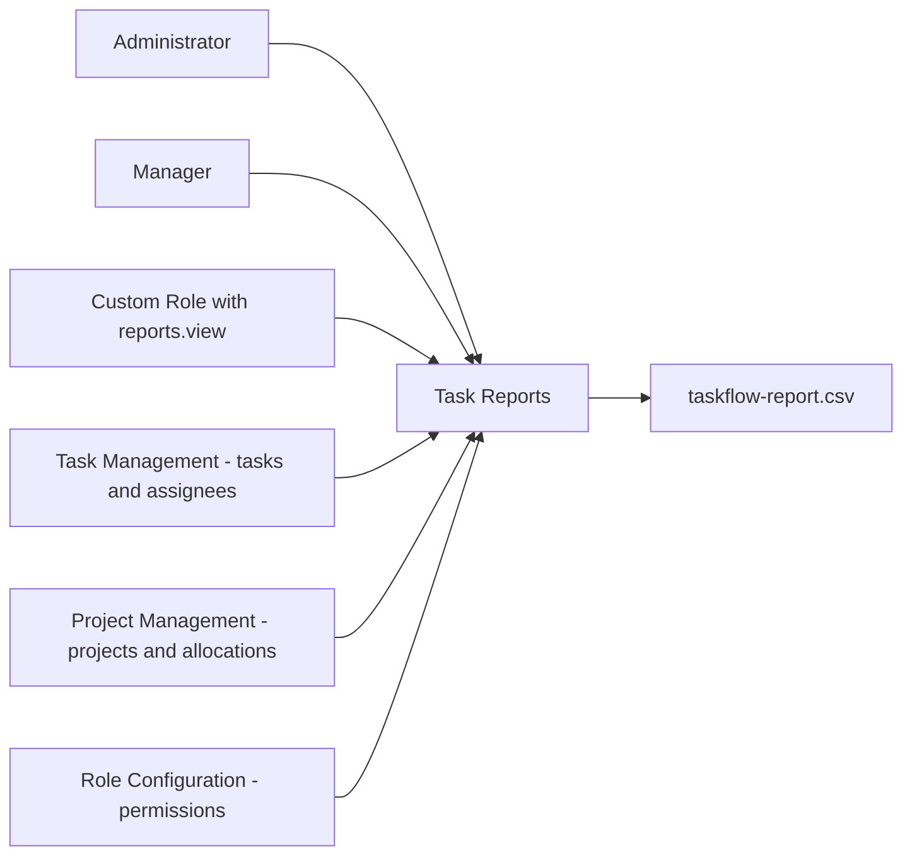
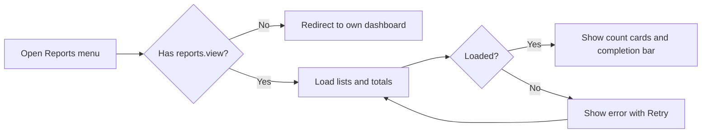
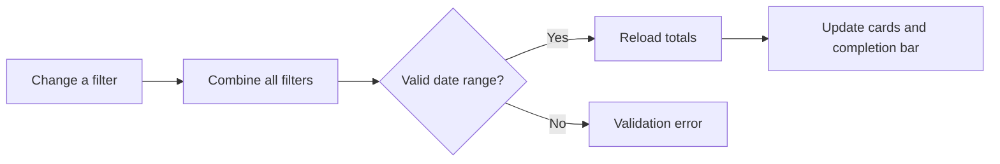
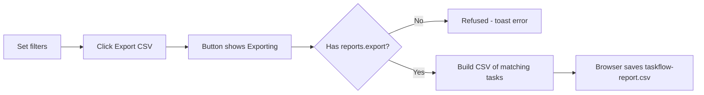
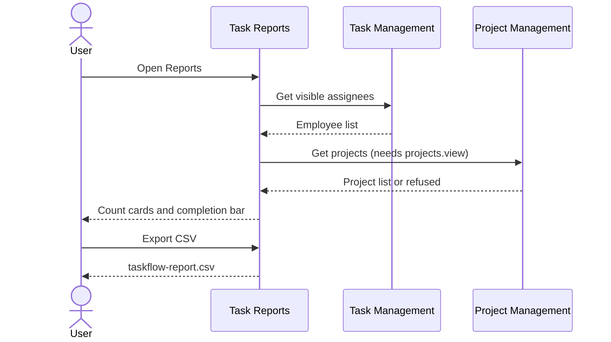

# Functional Requirements Document – Reports

## TaskFlow – Intelligent Task Allocation & Tracking System

> **Document:** Functional Requirements Document (sub-module 10 – RPT)  ·  **Version:** 1.0  ·  **Status:** Draft
> **Project type:** Personal Project (Skill Development)  ·  **Date:** 31-Oct-2026
> **Author:** Jojo George (jojogeorge3344@gmail.com)
> **Based on:** BRD – Reports (`BRD-Reports.md` v1.0)
> © 2026 Jojo George. All rights reserved.

---

## Document Control

### Revision History

| Version | Date | Author | Summary of changes |
|---|---|---|---|
| 1.0 | 31-Oct-2026 | Jojo George | Initial version of the Reports FRD (Task Reports screen, filters, count cards, completion summary and CSV export), detailed from BRD – Reports v1.0 and TaskFlow as built |

### Related Documents

| Document | Purpose | Location |
|---|---|---|
| BRD – Reports | Business needs this FRD details (REQ-RPT-01 – REQ-RPT-39, BR-RPT-01 – BR-RPT-10) | `../../../BRD/05-Reports/05.1-Reports/BRD-Reports.md` |
| BRD – Overall | Roles, global rules `BR-nn`, global NFRs | `../../../BRD/00-Overall/BRD-TaskFlow-Overall.md` |
| FRD – Overall | Shared roles, permission model, cross-cutting behaviour | `../../00-Overall/FRD-TaskFlow-Overall.md` |
| FRD – Dashboard | Charts and team / organisation analytics | `../../01-Dashboard/01.1-Dashboard/FRD-Dashboard.md` |
| Development Plan | Screen-wise build plan (Screen 17) | `TF - Documents/Screens Wise Feature Development Plan/17-reports-screen.md` |
| HLD / LLD – Reports | Technical design | `../../../HLD/05-Reports/05.1-Reports/HLD-Reports.md`, `../../../LLD/05-Reports/05.1-Reports/LLD-Reports.md` |
| TDD | System-wide technical design | `TF - Documents/TF - TDD/TDD-TaskFlow.md` (v2.0) |

---

## 1. Introduction

### 1.1 Purpose
This FRD specifies the detailed, testable behaviour of the Reports sub-module of TaskFlow: who can open the Task Reports
screen, how each filter narrows the tasks, how the Total, Completed, Pending and Overdue counts and the completion summary
are calculated, and exactly what the CSV export contains.

### 1.2 Scope
In scope: the **Reports** menu item, the Task Reports screen (`/reports`), its filters, count cards, completion summary and
CSV export (`taskflow-report.csv`). Out of scope (BRD §3.2): a Department filter, per-status / per-employee breakdowns and
charts, per-user data scope, PDF / Excel export, scheduled or emailed reports, and workload reports (Employee Workload
sub-module).

### 1.3 Audience
Developer and tester (Jojo George), reviewers, and the product owner.

### 1.4 Conventions
- Requirement IDs: `FR-RPT-nn`. Use cases: `UC-RPT-nn`. Messages: `MSG-RPT-nn`. BRD items: `REQ-RPT-nn`, sub-module rules
  `BR-RPT-nn`, global rules `BR-nn` (overall BRD §6).
- Priority: **Must / Should / Could** (MoSCoW), taken from the traced BRD requirement.
- "The system shall …" = mandatory behaviour.

### 1.5 Definitions & Abbreviations

| Term | Meaning |
|---|---|
| Scope | Data visibility; Reports are organisation-wide for every holder of `reports.view` |
| Matching task | A non-deleted task that satisfies every selected filter |
| Pending (Reports) | A task that is neither Completed nor Cancelled (ToDo, InProgress, InQA, Blocked) |
| Overdue | A pending task whose deadline has passed at the moment the report runs |
| Allocation | The link between an employee and a project they work on |
| CSV | Comma-separated values file that spreadsheet tools open |
| Formula protection | Writing a leading `'` before a cell that starts with `=`, `+`, `-` or `@` |

---

## 2. System Overview

### 2.1 Module Map

| Code | Module | Child modules | Primary roles |
|---|---|---|---|
| RPT | Reports | Task Reports (summary, filters, CSV export) | Administrator, Manager, Custom Role with `reports.view` |
| TASK | Task Management (related) | Source of the Employee filter list (assignees) | All signed-in users |
| PROJ | Project Management (related) | Source of the Project filter list | Users with `projects.view` |
| ROLE | Role Configuration (related) | Grants `reports.view` and `reports.export` | Administrator |

### 2.2 Context Diagram

---

## 3. User Roles & Permissions

### 3.1 Roles

| Role | Description | Data scope in Reports |
|---|---|---|
| Administrator | Runs the system and its settings; views and exports reports | Organisation |
| Manager | Leads departments or projects; views and exports reports | Organisation (not limited to the team) |
| Employee | Works on assigned tasks; no report access by default | None, unless an Administrator grants `reports.view` (then Organisation) |
| Custom Role | Role created by an Administrator | Organisation, if `reports.view` is granted |

### 3.2 Permission Matrix (functional view)

| Module › Function | Permission key | Administrator | Manager | Employee | Custom role |
|---|---|:---:|:---:|:---:|:---:|
| Reports › Open Task Reports, see totals, filter | `reports.view` | Granted | Granted | Denied | Configurable |
| Reports › Export CSV (requires `reports.view`) | `reports.export` | Granted | Granted | Denied | Configurable |
| Project Management › Fill the Project filter list | `projects.view` | Granted | Granted | Denied | Configurable |

The Administrator is re-granted every permission on each application start; Manager and Employee values are seed defaults
that an Administrator can change in Role Configuration; a custom role starts with no permissions. Permissions are checked
by the server on every request (BR-04).

---

## 4. Functional Requirements by Module

### 4.1 Module: Reports (RPT)

**Purpose:** Give authorised users filtered task totals with a completion summary and a safe CSV export of the same
tasks.  ·  **BRD reference:** BRD – Reports §5 SCREEN 1, BR-RPT-01 – BR-RPT-10; global BR-04, BR-06, BR-12, BR-21, BR-22.

#### 4.1.1 Screen: Task Reports

| Field | Value |
|---|---|
| Route / location | `/reports` (side menu → **Reports**) |
| Access | Users holding `reports.view`; **Export CSV** also needs `reports.export`; Project list needs `projects.view` |
| Entry points | Side menu **Reports**, direct address |

**Screen elements**

| Element | Type | Description | Mandatory | Visible to |
|---|---|---|:---:|---|
| Header | Text | "Task Reports"; subtitle "Task allocation and completion for the selected filters." ("Loading report…" on first load) | – | Users with `reports.view` |
| Export CSV | Button (top right) | Downloads the filtered tasks; label "Exporting…" while running | – | Users with `reports.export` |
| Deadline from | Date picker | Start of the deadline range | No | Users with `reports.view` |
| Deadline to | Date picker | End of the deadline range; cannot be earlier than Deadline from | No | Users with `reports.view` |
| Employee | Drop-down | "All employees" or one employee | No | Users with `reports.view` |
| Project | Drop-down | "All projects" or one project | No | Users with `reports.view` (list filled with `projects.view`) |
| Status | Drop-down | "All statuses", ToDo, InProgress, InQA, Blocked, Completed, Cancelled | No | Users with `reports.view` |
| Priority | Drop-down | "All priorities", Low, Medium, High, Critical | No | Users with `reports.view` |
| Reset | Button | Clears every filter | – | Users with `reports.view` |
| Count cards | 4 cards | Total Tasks, Completed, Pending, Overdue (Overdue highlighted) | – | Users with `reports.view` |
| Completion summary | Progress bar + text | "X of Y completed · Z%" | – | Users with `reports.view` |
| Error panel | Panel with **Retry** | "Something went wrong" when the report cannot be loaded | – | Users with `reports.view` |

**Functional requirements – access and loading**

| ID | Requirement | Priority | Permission | BRD trace |
|---|---|---|---|---|
| FR-RPT-01 | The system shall show the **Reports** side-menu item only to users holding `reports.view`. | Must | `reports.view` | REQ-RPT-01 |
| FR-RPT-02 | The system shall send a user without `reports.view` who opens `/reports` to their own dashboard without a message. | Must | `reports.view` | REQ-RPT-02 |
| FR-RPT-03 | The system shall refuse report totals and export data to a user without `reports.view`, independently of the screen, and record the refused request. | Must | `reports.view` | REQ-RPT-03, NFR-RPT-01 |
| FR-RPT-04 | The system shall load, when the screen opens, the report totals with no filter applied, together with the Employee and Project lists. | Must | `reports.view` | REQ-RPT-04 |
| FR-RPT-05 | The system shall show the subtitle "Loading report…" during the first load and "Task allocation and completion for the selected filters." once loaded. | Could | `reports.view` | REQ-RPT-05 |
| FR-RPT-06 | The system shall show an error panel "Something went wrong" with MSG-RPT-01 and a **Retry** button when the report cannot be loaded; **Retry** shall load it again with the current filters. | Must | `reports.view` | REQ-RPT-27 |

**Functional requirements – counts and completion summary**

| ID | Requirement | Priority | Permission | BRD trace |
|---|---|---|---|---|
| FR-RPT-07 | The system shall show four count cards – Total Tasks, Completed, Pending and Overdue – with the Overdue card highlighted. | Must | `reports.view` | REQ-RPT-06 |
| FR-RPT-08 | The system shall count in **Total** every non-deleted task that matches the filters, including Cancelled tasks. | Must | `reports.view` | REQ-RPT-07, BR-RPT-02 |
| FR-RPT-09 | The system shall count in **Completed** the matching tasks with status Completed. | Must | `reports.view` | REQ-RPT-08, BR-RPT-02 |
| FR-RPT-10 | The system shall count in **Pending** the matching tasks that are neither Completed nor Cancelled (ToDo, InProgress, InQA, Blocked). | Must | `reports.view` | REQ-RPT-09, BR-RPT-02 |
| FR-RPT-11 | The system shall count in **Overdue** the pending tasks whose deadline is earlier than the current time when the report runs. | Must | `reports.view` | REQ-RPT-10, BR-RPT-02, BR-RPT-10, BR-12 |
| FR-RPT-12 | The system shall count Cancelled tasks only in Total, not in Completed, Pending or Overdue. | Must | `reports.view` | REQ-RPT-07, BR-RPT-02 |
| FR-RPT-13 | The system shall show a completion bar and the text "X of Y completed · Z%", where X = Completed, Y = Total and Z = Completed ÷ Total rounded to a whole number, and 0 % when Total is 0. | Must | `reports.view` | REQ-RPT-11, BR-RPT-03 |
| FR-RPT-14 | The system shall return all four counts as 0 when no task matches the filters. | Must | `reports.view` | REQ-RPT-11, REQ-RPT-21 |

**Functional requirements – filters and data rules**

| ID | Requirement | Priority | Permission | BRD trace |
|---|---|---|---|---|
| FR-RPT-15 | The system shall keep, when **Deadline from** is set, only tasks whose deadline is on or after the start of that day. | Must | `reports.view` | REQ-RPT-12, BR-RPT-04 |
| FR-RPT-16 | The system shall keep, when **Deadline to** is set, only tasks whose deadline is on or before the end of that day (its last millisecond). | Must | `reports.view` | REQ-RPT-12, BR-RPT-04 |
| FR-RPT-17 | The system shall stop the **Deadline to** picker from accepting a date earlier than **Deadline from**. | Must | `reports.view` | REQ-RPT-13 |
| FR-RPT-18 | The system shall refuse a request whose "to" deadline is before its "from" deadline with MSG-RPT-02. | Must | `reports.view` | REQ-RPT-14 |
| FR-RPT-19 | The system shall keep, when an **Employee** is chosen, only tasks assigned to that employee. | Must | `reports.view` | REQ-RPT-15 |
| FR-RPT-20 | The system shall fill the Employee list with the assignees the user can see in the Task List. | Should | `reports.view` | REQ-RPT-16 |
| FR-RPT-21 | The system shall keep, when a **Project** is chosen, only tasks whose assignee is allocated to that project (the task's own project is not used). | Should | `reports.view` | REQ-RPT-17, BR-RPT-05 |
| FR-RPT-22 | The system shall fill the Project list only for users holding `projects.view`; for other users the list stays empty and the report still works. | Should | `projects.view` | REQ-RPT-18 |
| FR-RPT-23 | The system shall keep, when a **Status** is chosen, only tasks with that status, accepting only ToDo, InProgress, InQA, Blocked, Completed or Cancelled. | Must | `reports.view` | REQ-RPT-19 |
| FR-RPT-24 | The system shall keep, when a **Priority** is chosen, only tasks with that priority, accepting only Low, Medium, High or Critical. | Must | `reports.view` | REQ-RPT-20 |
| FR-RPT-25 | The system shall treat every filter as optional (an empty filter does not restrict its field) and combine all selected filters. | Must | `reports.view` | REQ-RPT-21 |
| FR-RPT-26 | The system shall reload the totals immediately when any filter changes, without an "Apply" button. | Should | `reports.view` | REQ-RPT-22, NFR-RPT-05 |
| FR-RPT-27 | The system shall clear every filter and reload the full report when **Reset** is clicked. | Should | `reports.view` | REQ-RPT-23 |
| FR-RPT-28 | The system shall leave deleted tasks out of the totals and the export. | Must | `reports.view` | REQ-RPT-24, BR-RPT-06, BR-21 |
| FR-RPT-29 | The system shall keep the tasks of removed employees in the totals and the export, with that person's name. | Must | `reports.view` | REQ-RPT-25, BR-RPT-06 |
| FR-RPT-30 | The system shall report over the whole organisation for every holder of `reports.view`, with no team or own-records limit. | Must | `reports.view` | REQ-RPT-26, BR-RPT-07 |

**Functional requirements – CSV export**

| ID | Requirement | Priority | Permission | BRD trace |
|---|---|---|---|---|
| FR-RPT-31 | The system shall show the **Export CSV** button only to users holding `reports.export`. | Must | `reports.export` | REQ-RPT-28 |
| FR-RPT-32 | The system shall refuse an export to a user who does not hold both `reports.view` and `reports.export`, and record the refused request. | Must | `reports.export` + `reports.view` | REQ-RPT-29, BR-RPT-01, NFR-RPT-01 |
| FR-RPT-33 | The system shall export the tasks that match the current filters (same rules as FR-RPT-15 – FR-RPT-30), ordered by deadline, earliest first. | Must | `reports.export` | REQ-RPT-30, BR-RPT-08 |
| FR-RPT-34 | The system shall export at most 50,000 rows per file; beyond that only the first 50,000 by deadline are included. | Must | `reports.export` | REQ-RPT-31, BR-RPT-08, NFR-RPT-04 |
| FR-RPT-35 | The system shall deliver the file as `taskflow-report.csv` for the browser to save. | Should | `reports.export` | REQ-RPT-32 |
| FR-RPT-36 | The system shall write a header row and the columns TaskCode, Title, Assignee, Project, Priority, Status, StartDate, Deadline, EstimatedHours and CompletedAt, in that order. | Must | `reports.export` | REQ-RPT-33, NFR-RPT-03 |
| FR-RPT-37 | The system shall list in the Project column every project the assignee is allocated to, comma-separated and sorted by name. | Should | `reports.export` | REQ-RPT-34, BR-RPT-05 |
| FR-RPT-38 | The system shall write StartDate, Deadline and CompletedAt as `yyyy-MM-dd` and leave CompletedAt empty for tasks that are not finished. | Should | `reports.export` | REQ-RPT-35, NFR-RPT-03 |
| FR-RPT-39 | The system shall write a leading `'` before any cell value that starts with `=`, `+`, `-` or `@`. | Must | `reports.export` | REQ-RPT-36, BR-RPT-09, NFR-RPT-02 |
| FR-RPT-40 | The system shall change the button label to "Exporting…" and disable it while an export runs, and restore it when the export ends. | Should | `reports.export` | REQ-RPT-37 |
| FR-RPT-41 | The system shall show the toast MSG-RPT-03 when an export fails. | Must | `reports.export` | REQ-RPT-38 |
| FR-RPT-42 | The system shall create no notification, mail or activity entry when a report is viewed, filtered or exported. | Must | `reports.view` | REQ-RPT-39 |

**Use case: UC-RPT-01 – View the report**

| Item | Detail |
|---|---|
| Actor | Administrator, Manager, Custom Role with `reports.view` |
| Preconditions | Signed in; holds `reports.view` |
| Trigger | Clicks **Reports** in the side menu or opens `/reports` |
| Main flow | 1. The system checks `reports.view`. 2. The subtitle shows "Loading report…". 3. The system loads the Employee and Project lists and the unfiltered totals. 4. The system shows the four count cards and the completion summary. |
| Alternate flows | A1: the user lacks `projects.view` → the Project list stays empty; the rest of the screen works. |
| Exceptions | E1: no `reports.view` → taken to own dashboard, no message (menu item hidden). E2: load fails → "Something went wrong" + MSG-RPT-01 with **Retry**. |
| Postconditions | Totals shown; no data changed (FR-RPT-42). |

Example (BRD §4.1): 40 tasks – 12 Completed, 2 Cancelled, 26 pending of which 5 have a passed deadline → Total 40,
Completed 12, Pending 26, Overdue 5, "12 of 40 completed · 30%".

**Use case: UC-RPT-02 – Filter the report**

| Item | Detail |
|---|---|
| Actor | Administrator, Manager, Custom Role with `reports.view` |
| Preconditions | On Task Reports |
| Trigger | Changes Deadline from, Deadline to, Employee, Project, Status or Priority |
| Main flow | 1. The system combines all selected filters. 2. The system checks the date range. 3. The system reloads the totals at once. 4. The cards and completion summary update. |
| Alternate flows | A1: the user clears one filter (sets "All …") → that field no longer restricts the report. |
| Exceptions | E1: a "to" deadline before "from" reaches the server → refused with MSG-RPT-02. E2: an invalid status or priority value → refused. E3: load fails → MSG-RPT-01 with **Retry**. |
| Postconditions | Totals match the filters. |

Example (BRD §4.2): Deadline 01-Oct-2026 – 31-Oct-2026, Employee "Arun Kumar", Priority "High" → Total 6, Completed 2,
Pending 4, Overdue 1, "2 of 6 completed · 33%".

**Use case: UC-RPT-03 – Reset filters**

| Item | Detail |
|---|---|
| Actor | Administrator, Manager, Custom Role with `reports.view` |
| Preconditions | On Task Reports with one or more filters set |
| Trigger | Clicks **Reset** |
| Main flow | 1. The system clears every filter. 2. The system reloads the unfiltered totals. |
| Alternate flows | _None._ |
| Exceptions | E1: load fails → MSG-RPT-01 with **Retry**. |
| Postconditions | The full organisation report is shown. |

**Use case: UC-RPT-04 – Export CSV**

| Item | Detail |
|---|---|
| Actor | Administrator, Manager, Custom Role with `reports.export` |
| Preconditions | On Task Reports; holds `reports.view` and `reports.export` |
| Trigger | Clicks **Export CSV** |
| Main flow | 1. The button shows "Exporting…" and is disabled. 2. The system checks both permissions. 3. The system collects the matching tasks, earliest deadline first, at most 50,000. 4. The system writes the header and rows with formula protection. 5. The browser saves `taskflow-report.csv`. 6. The button is restored. |
| Alternate flows | A1: more than 50,000 matching tasks → only the first 50,000 by deadline are exported. |
| Exceptions | E1: permission missing or export fails → toast MSG-RPT-03. |
| Postconditions | File saved; no notification, mail or activity entry. |

Example (BRD §4.3): with the October filter, 6 rows are exported; a task of Arun Kumar (allocated to "Portal" and
"Website") shows `Portal, Website` in Project; CompletedAt is empty for an unfinished task; a title `=SUM(A1)` is written
as `'=SUM(A1)`.

**Field validations**

| Field | Rule | Error message |
|---|---|---|
| Deadline from / Deadline to | Optional; each is a valid date | Refused by the server (request not processed) |
| Deadline to | On or after Deadline from (picker blocks earlier dates; server re-checks) | "The report 'to' deadline must be on or after the 'from' deadline." |
| Employee | Optional; one employee | – |
| Project | Optional; one project | – |
| Status | Optional; ToDo, InProgress, InQA, Blocked, Completed or Cancelled | Refused; only the listed values are accepted |
| Priority | Optional; Low, Medium, High or Critical | Refused; only the listed values are accepted |

**Business rules applied:** BR-RPT-01 – BR-RPT-10; BR-04, BR-06, BR-12, BR-21, BR-22.

**Notifications / side effects**

| Event | Who is notified | Channel |
|---|---|---|
| Report viewed, filtered or exported | Nobody (FR-RPT-42) | – |
| Request refused for a missing permission | Nobody; the refusal is recorded for audit | Server log |

**Messages**

| Situation | Message |
|---|---|
| First load | "Loading report…" |
| Loaded | "Task allocation and completion for the selected filters." |
| Completion summary | "X of Y completed · Z%" |
| Load failed (MSG-RPT-01) | "Something went wrong" – "Could not load the report. Check your connection and try again." (**Retry**) |
| Invalid date range (MSG-RPT-02) | "The report 'to' deadline must be on or after the 'from' deadline." |
| Export failed (MSG-RPT-03) | "Could not export the report. Please try again." |
| Export running | "Exporting…" (button) |
| No permission to open the screen | No message – user sent to own dashboard; **Reports** menu item hidden |
| No permission to export | No message – **Export CSV** button hidden |

---

## 5. Cross-Module Workflows

### 5.1 Report filter lists from other modules

| Step | Module | Actor / System | Action | FR reference |
|---|---|---|---|---|
| 1 | RPT | User | Opens Task Reports | FR-RPT-04 |
| 2 | TASK | System | Supplies the assignees the user can see in the Task List | FR-RPT-20 |
| 3 | PROJ | System | Supplies the project list if the user holds `projects.view` | FR-RPT-22 |
| 4 | RPT | System | Loads the unfiltered organisation totals | FR-RPT-04, FR-RPT-30 |

### 5.2 Grant report access (Role Configuration → Reports)

| Step | Module | Actor / System | Action | FR reference |
|---|---|---|---|---|
| 1 | ROLE | Administrator | Grants `reports.view` (and optionally `reports.export`) to a role | Role Configuration FRD |
| 2 | RPT | System | Shows the **Reports** menu item and, with `reports.export`, the **Export CSV** button on the user's next action | FR-RPT-01, FR-RPT-31 |
| 3 | RPT | User | Opens and exports the report | FR-RPT-04, FR-RPT-33 |

---

## 6. Reports & Exports

| Report | Module | Filters | Columns | Export | Access |
|---|---|---|---|---|---|
| Task Reports summary | RPT | Deadline from / to, employee, project, status, priority | Total Tasks, Completed, Pending, Overdue; "X of Y completed · Z%" | – (screen) | `reports.view` |
| Task Reports export | RPT | Same as the summary | TaskCode, Title, Assignee, Project, Priority, Status, StartDate, Deadline, EstimatedHours, CompletedAt | CSV `taskflow-report.csv`, at most 50,000 rows, earliest deadline first | `reports.view` + `reports.export` |

Charts and team / organisation analytics: Dashboard FRD (`../../01-Dashboard/01.1-Dashboard/FRD-Dashboard.md`).

---

## 7. Notifications & Messages Catalogue

Reports sends no notification or mail (FR-RPT-42). On-screen messages:

| Code | Trigger | Recipients | Channel | Text |
|---|---|---|---|---|
| MSG-RPT-01 | Report could not be loaded | Current user | On screen (error panel + **Retry**) | "Something went wrong" – "Could not load the report. Check your connection and try again." |
| MSG-RPT-02 | "To" deadline before "from" deadline reaches the server | Current user | Validation response | "The report 'to' deadline must be on or after the 'from' deadline." |
| MSG-RPT-03 | Export failed or refused | Current user | Toast | "Could not export the report. Please try again." |
| MSG-RPT-04 | First load running | Current user | Subtitle | "Loading report…" |
| MSG-RPT-05 | Export running | Current user | Button label | "Exporting…" |

---

## 8. Data Requirements (functional view)

Reports store no data of their own; they read:

| Data item | Description | Created by | Rules |
|---|---|---|---|
| Task code, title, priority, status, start date, deadline, estimated hours, completed date | Counts and export rows | Task Management | Deleted tasks excluded (FR-RPT-28) |
| Assignee name | Employee filter and Assignee column | Employee Management | Removed employees' names are kept on their tasks (FR-RPT-29) |
| Project allocations | Project filter and Project column | Project Management | Assignee's allocations decide the project (FR-RPT-21, FR-RPT-37) |
| Project names | Project list and column | Project Management | Sorted by name in the Project column |

---

## 9. Non-Functional Requirements (functional impact)

| ID | Requirement | Affects |
|---|---|---|
| NFR-RPT-01 | View and export permissions are enforced by the server; refused requests are recorded (FR-RPT-03, FR-RPT-32) | Task Reports, export |
| NFR-RPT-02 | No exported cell starts with `=`, `+`, `-` or `@` without a leading `'` (FR-RPT-39) | Export |
| NFR-RPT-03 | Standard comma-separated format with a header row; dates `yyyy-MM-dd` (FR-RPT-36, FR-RPT-38) | Export |
| NFR-RPT-04 | At most 50,000 rows per file (FR-RPT-34) | Export |
| NFR-RPT-05 | Filters apply at once; every failure shows a plain-language message (FR-RPT-26, §7) | Task Reports |
| NFR-RPT-06 | Totals reload after each filter change. > ⚠️ To be confirmed: a measured response-time target. | Task Reports |

Global NFRs of the overall BRD / FRD apply.

---

## 10. Assumptions & Open Issues

| Type | Description | Owner |
|---|---|---|
| Assumption | Managers may see organisation-wide report figures (same choice as the dashboards). | Jojo George |
| Assumption | A task's project for reporting is the set of projects its assignee is allocated to. | Jojo George |
| Assumption | The 50,000-row limit is fixed; only CSV is offered. | Jojo George |
| Assumption | The test suites in §11 are named from the project's test file list; individual test cases are not listed. | Jojo George |
| Open issue | > ⚠️ To be confirmed: whether reports must be limited to the records each user may access (original BRD FR6) instead of organisation-wide (R-RPT-01). | Jojo George |
| Open issue | > ⚠️ To be confirmed: whether to warn the user when an export is cut at 50,000 rows (R-RPT-02). | Jojo George |
| Open issue | > ⚠️ To be confirmed: the deadline-day bounds use the browser's time zone, not the application timezone of BR-17 (R-RPT-03). | Jojo George |
| Open issue | > ⚠️ To be confirmed: show a message when the Project or Employee list is empty because of a missing permission or a load failure (R-RPT-04). | Jojo George |
| Open issue | > ⚠️ To be confirmed: align the Employee list (Task List access) with the organisation-wide report scope for custom roles (R-RPT-05). | Jojo George |
| Open issue | > ⚠️ To be confirmed: use the task's own project instead of the assignee's allocations for the Project filter and column (R-RPT-06). | Jojo George |
| Open issue | > ⚠️ To be confirmed: the dashboards leave Cancelled tasks out of their totals and split open tasks into Pending and In progress, while Reports counts Cancelled in Total and all open tasks as Pending (BR-RPT-10). | Jojo George |
| Open issue | > ⚠️ To be confirmed: the server's validation message MSG-RPT-02 is not shown on the screen, which shows MSG-RPT-01 instead; normally the date picker prevents this case. | Jojo George |

---

## 11. Requirements Traceability Matrix

| BRD item | FRD requirement(s) | Screen | Use case | Test case |
|---|---|---|---|---|
| REQ-RPT-01 | FR-RPT-01 | Task Reports | UC-RPT-01 | AC-RPT-01 (manual UI check) |
| REQ-RPT-02 | FR-RPT-02 | Task Reports | UC-RPT-01 | AC-RPT-01 (manual UI check) |
| REQ-RPT-03 | FR-RPT-03 | Task Reports | UC-RPT-01 | AC-RPT-01 · `ReportEndpointsTests` |
| REQ-RPT-04 | FR-RPT-04 | Task Reports | UC-RPT-01 | AC-RPT-02 · `ReportEndpointsTests` |
| REQ-RPT-05 | FR-RPT-05 | Task Reports | UC-RPT-01 | AC-RPT-02 (manual UI check) |
| REQ-RPT-06 | FR-RPT-07 | Task Reports | UC-RPT-01 | AC-RPT-02 (manual UI check) |
| REQ-RPT-07 | FR-RPT-08, FR-RPT-12 | Task Reports | UC-RPT-01 | AC-RPT-02 · `ReportServiceTests` |
| REQ-RPT-08 | FR-RPT-09 | Task Reports | UC-RPT-01 | AC-RPT-02 · `ReportServiceTests` |
| REQ-RPT-09 | FR-RPT-10 | Task Reports | UC-RPT-01 | AC-RPT-02 · `ReportServiceTests` |
| REQ-RPT-10 | FR-RPT-11 | Task Reports | UC-RPT-01 | AC-RPT-02 · `ReportServiceTests` |
| REQ-RPT-11 | FR-RPT-13, FR-RPT-14 | Task Reports | UC-RPT-01 | AC-RPT-03 (manual UI check) |
| REQ-RPT-12 | FR-RPT-15, FR-RPT-16 | Task Reports | UC-RPT-02 | AC-RPT-04 · `ReportServiceTests` |
| REQ-RPT-13 | FR-RPT-17 | Task Reports | UC-RPT-02 | AC-RPT-04 (manual UI check) |
| REQ-RPT-14 | FR-RPT-18 | Task Reports | UC-RPT-02 | AC-RPT-04 · `ReportEndpointsTests` |
| REQ-RPT-15 | FR-RPT-19 | Task Reports | UC-RPT-02 | AC-RPT-05 · `ReportServiceTests` |
| REQ-RPT-16 | FR-RPT-20 | Task Reports | UC-RPT-01 | AC-RPT-05 (manual UI check) |
| REQ-RPT-17 | FR-RPT-21 | Task Reports | UC-RPT-02 | AC-RPT-05 · `ReportServiceTests` |
| REQ-RPT-18 | FR-RPT-22 | Task Reports | UC-RPT-01 | AC-RPT-05 (manual UI check) |
| REQ-RPT-19 | FR-RPT-23 | Task Reports | UC-RPT-02 | AC-RPT-05 · `ReportEndpointsTests` |
| REQ-RPT-20 | FR-RPT-24 | Task Reports | UC-RPT-02 | AC-RPT-05 · `ReportEndpointsTests` |
| REQ-RPT-21 | FR-RPT-25, FR-RPT-14 | Task Reports | UC-RPT-02 | AC-RPT-05 · `ReportServiceTests` |
| REQ-RPT-22 | FR-RPT-26 | Task Reports | UC-RPT-02 | AC-RPT-05 (manual UI check) |
| REQ-RPT-23 | FR-RPT-27 | Task Reports | UC-RPT-03 | AC-RPT-06 (manual UI check) |
| REQ-RPT-24 | FR-RPT-28 | Task Reports | UC-RPT-01, UC-RPT-04 | AC-RPT-07 · `ReportServiceTests` |
| REQ-RPT-25 | FR-RPT-29 | Task Reports | UC-RPT-01, UC-RPT-04 | AC-RPT-07 · `ReportServiceTests` |
| REQ-RPT-26 | FR-RPT-30 | Task Reports | UC-RPT-01 | AC-RPT-08 · `ReportEndpointsTests` |
| REQ-RPT-27 | FR-RPT-06 | Task Reports | UC-RPT-01 | AC-RPT-09 (manual UI check) |
| REQ-RPT-28 | FR-RPT-31 | Task Reports | UC-RPT-04 | AC-RPT-10 (manual UI check) |
| REQ-RPT-29 | FR-RPT-32 | Task Reports | UC-RPT-04 | AC-RPT-10 · `ReportEndpointsTests` |
| REQ-RPT-30 | FR-RPT-33 | Task Reports | UC-RPT-04 | AC-RPT-11 · `ReportServiceTests` |
| REQ-RPT-31 | FR-RPT-34 | Task Reports | UC-RPT-04 | AC-RPT-11 · `ReportServiceTests` |
| REQ-RPT-32 | FR-RPT-35 | Task Reports | UC-RPT-04 | AC-RPT-11 · `ReportEndpointsTests` |
| REQ-RPT-33 | FR-RPT-36 | Task Reports | UC-RPT-04 | AC-RPT-11 · `ReportCsvTests` |
| REQ-RPT-34 | FR-RPT-37 | Task Reports | UC-RPT-04 | AC-RPT-11 · `ReportCsvTests` |
| REQ-RPT-35 | FR-RPT-38 | Task Reports | UC-RPT-04 | AC-RPT-11 · `ReportCsvTests` |
| REQ-RPT-36 | FR-RPT-39 | Task Reports | UC-RPT-04 | AC-RPT-12 · `ReportCsvTests` |
| REQ-RPT-37 | FR-RPT-40 | Task Reports | UC-RPT-04 | AC-RPT-13 (manual UI check) |
| REQ-RPT-38 | FR-RPT-41 | Task Reports | UC-RPT-04 | AC-RPT-13 (manual UI check) |
| REQ-RPT-39 | FR-RPT-42 | Task Reports | UC-RPT-01, UC-RPT-04 | AC-RPT-13 (manual check – no data change) |
| BR-RPT-01 | FR-RPT-01, FR-RPT-03, FR-RPT-31, FR-RPT-32 | Task Reports | UC-RPT-01, UC-RPT-04 | AC-RPT-01, AC-RPT-10 · `ReportEndpointsTests` |
| BR-RPT-02 | FR-RPT-08 – FR-RPT-12 | Task Reports | UC-RPT-01 | AC-RPT-02 · `ReportServiceTests` |
| BR-RPT-03 | FR-RPT-13 | Task Reports | UC-RPT-01 | AC-RPT-03 (manual UI check) |
| BR-RPT-04 | FR-RPT-15, FR-RPT-16 | Task Reports | UC-RPT-02 | AC-RPT-04 · `ReportServiceTests` |
| BR-RPT-05 | FR-RPT-21, FR-RPT-37 | Task Reports | UC-RPT-02, UC-RPT-04 | AC-RPT-05, AC-RPT-11 · `ReportServiceTests` |
| BR-RPT-06 | FR-RPT-28, FR-RPT-29 | Task Reports | UC-RPT-01 | AC-RPT-07 · `ReportServiceTests` |
| BR-RPT-07 | FR-RPT-30 | Task Reports | UC-RPT-01 | AC-RPT-08 · `ReportEndpointsTests` |
| BR-RPT-08 | FR-RPT-33, FR-RPT-34 | Task Reports | UC-RPT-04 | AC-RPT-11 · `ReportServiceTests` |
| BR-RPT-09 | FR-RPT-39 | Task Reports | UC-RPT-04 | AC-RPT-12 · `ReportCsvTests` |
| BR-RPT-10 | FR-RPT-11 | Task Reports | UC-RPT-01 | AC-RPT-02 · `ReportServiceTests` |

Untraced BRD items: 0 (REQ-RPT-01 – REQ-RPT-39 and BR-RPT-01 – BR-RPT-10 all map to at least one FR).

---

## 12. Approvals

| Role | Name | Decision | Date |
|---|---|---|---|
| Product owner | Jojo George | Pending | – |
| Reviewer | Jojo George | Pending | – |

---
© 2026 Jojo George. All rights reserved. Unauthorized copying or distribution of this document is prohibited.
