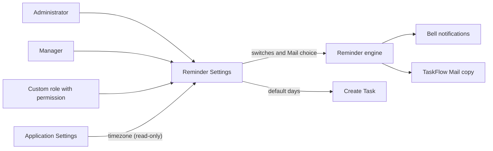
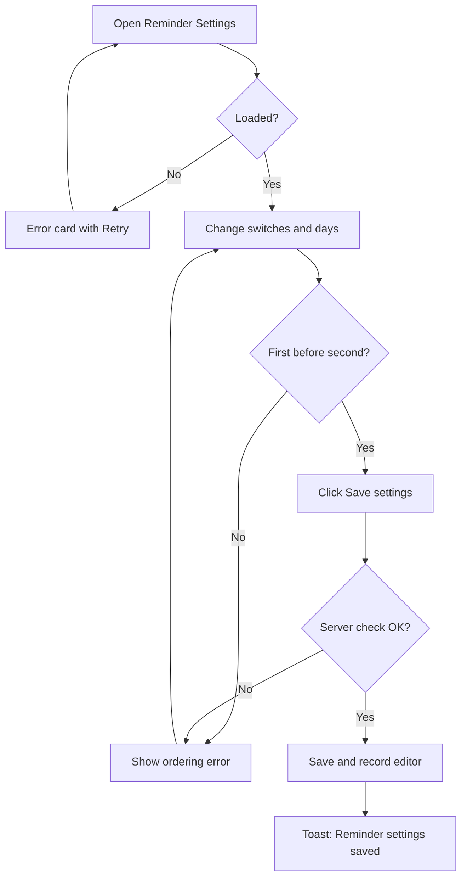
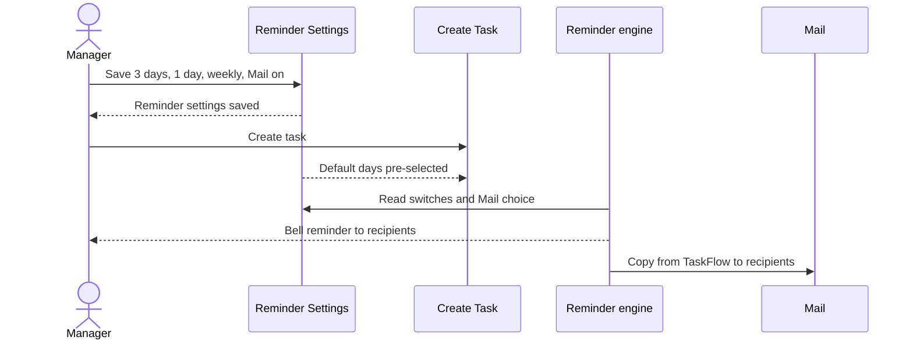

# Functional Requirements Document – Reminder Settings

## TaskFlow – Intelligent Task Allocation & Tracking System

> **Document:** Functional Requirements Document  ·  **Version:** 1.0  ·  **Status:** Draft
> **Project type:** Personal Project (Skill Development)  ·  **Date:** 31-Oct-2026
> **Author:** Jojo George (jojogeorge3344@gmail.com)
> **Based on:** BRD-Reminder-Settings.md v1.0
> **Module:** Settings  ·  **Sub-module:** 06.1 Reminder Settings  ·  **Code:** REM
> © 2026 Jojo George. All rights reserved.

---

## Document Control

### Revision History

| Version | Date | Author | Summary of changes |
|---|---|---|---|
| 1.0 | 31-Oct-2026 | Jojo George | Initial version |

### Related Documents

| Document | Purpose | Location |
|---|---|---|
| BRD – Reminder Settings | Business needs this FRD details (REQ-REM-nn, BR-REM-nn, AC-REM-nn) | `../../../BRD/06-Settings/06.1-Reminder-Settings/BRD-Reminder-Settings.md` |
| Overall FRD | Roles, global rules, Authentication, cross-cutting behaviour | `../../00-Overall/FRD-TaskFlow-Overall.md` |
| FRD – Notification | Reminder engine that reads this configuration | `../../04-Communication/04.2-Notification/FRD-Notification.md` |
| FRD – Application Settings | Application timezone and in-app notifications switch | `../06.2-Application-Settings/FRD-Application-Settings.md` |
| FRD – Task Management | Create Task, which starts with the default reminder days | `../../02-TaskFlow-Monitoring/02.1-Task-Management/FRD-Task-Management.md` |
| Development Plan | Screen-wise build plan (Screen 13) | `TF - Documents/Screens Wise Feature Development Plan/13-deadline-reminder-settings-screen.md` |
| HLD / LLD | Technical design | `../../../HLD/06-Settings/06.1-Reminder-Settings/HLD-Reminder-Settings.md`, `../../../LLD/06-Settings/06.1-Reminder-Settings/LLD-Reminder-Settings.md` |

---

## 1. Introduction

### 1.1 Purpose
This FRD specifies the detailed, testable behaviour of the Reminder Settings screen: what it shows, which values can be
changed, how they are validated and saved, who may use it, and how the saved values are used by the reminder engine and
by Create Task.

### 1.2 Scope
In scope: viewing and changing the organization-wide reminder configuration – the reminders on/off switch, the
deadline-day reminder switch, the default first and second reminder and overdue frequency for new tasks, Mail delivery
of reminder copies, and the read-only application timezone.

Out of scope (BRD §3.2): generating, scheduling and de-duplicating reminders (Notification FRD); changing the timezone or
the in-app notifications switch (Application Settings FRD); per-task reminder days (Task Management FRD); outbound SMTP
email (superseded by internal Mail); a one-click reset to defaults.

### 1.3 Audience
Developer, tester, reviewer and product owner of TaskFlow.

### 1.4 Conventions
- Requirement IDs: `FR-REM-nn`. Use cases: `UC-REM-nn`. Business rules: `BR-REM-nn` (sub-module BRD) and `BR-nn` (overall BRD).
- Priority: **Must / Should / Could** (MoSCoW).
- "The system shall …" = mandatory behaviour; "should" = recommended.
- "BRD trace" refers to `REQ-REM-nn` in the Reminder Settings BRD.

### 1.5 Definitions & Abbreviations

| Term | Meaning |
|---|---|
| First reminder | Reminder sent a number of days before the deadline (default 2) |
| Second reminder | Later reminder, 1 day before or on the deadline day (default 1 day before) |
| Deadline-day reminder | "Due today" reminder on the deadline day while the task is open |
| Overdue frequency | How often reminders repeat after the deadline: Every day or Every week |
| Bell notification | In-app notification shown in the Notification Center |
| TaskFlow Mail | Internal mailbox inside TaskFlow; reminder copies arrive from "TaskFlow" |
| Reminder run | One pass of the reminder engine (every 60 seconds by default) |
| Recipient | Assignee, task creator or additional recipient of a task |

---

## 2. System Overview

### 2.1 Module Map

| Code | Module | Child modules | Primary roles |
|---|---|---|---|
| REM | Settings → Reminder Settings | Reminder Settings (one screen) | Administrator, Manager, Custom role with `settings.reminders.manage` |
| NOTIF | Communication → Notification (related) | Reminder engine, Notification Center | System; all users as recipients |
| APP | Settings → Application Settings (related) | Application timezone, in-app switch | Administrator |
| TASK | Monitoring → Task Management (related) | Create Task | Manager, Administrator |

### 2.2 Context Diagram

---

## 3. User Roles & Permissions

### 3.1 Roles

| Role | Description | Data scope |
|---|---|---|
| Administrator | Manages the whole system; views and changes reminder settings | Organization |
| Manager | Assigns and monitors tasks; views and changes reminder settings (granted by default) | Organization |
| Employee | Works on assigned tasks; only receives reminders, no access to the screen by default | – |
| Custom role | Role defined on Role Configuration; full screen when `settings.reminders.manage` is granted | Organization |

### 3.2 Permission Matrix (functional view)

| Module › Function | Permission key | Administrator | Manager | Employee | Custom role |
|---|---|:---:|:---:|:---:|:---:|
| Settings › Reminder Settings › View and change reminder settings | `settings.reminders.manage` | Granted | Granted | Denied | Configurable |

> Manager and Employee values are the defaults given when the permission is first created. The Administrator role is
> given every permission again each time the application starts. All functions of the screen are controlled by this one key.

---

## 4. Functional Requirements by Module

### 4.1 Module: Reminder Settings (REM)

**Purpose:** Let authorized users configure the automatic deadline reminders for the whole organization.  ·
**BRD reference:** BRD-Reminder-Settings SCREEN 1, BR-REM-01…BR-REM-07 (original BRD Screen 13 "Deadline Reminder Settings")

#### 4.1.1 Screen: Reminder Settings

| Field | Value |
|---|---|
| Route / location | `/settings/reminders` (menu **Settings → Reminder Settings**) |
| Access | Administrator, Manager; Custom role with `settings.reminders.manage` |
| Entry points | Sidebar menu item **Reminder Settings**; link in the **Reminder defaults** group of Application Settings |

**Screen elements**

| Element | Type | Description | Mandatory | Visible to |
|---|---|---|:---:|---|
| **Reminder settings** | Page title | With the line "Control the automatic deadline reminders sent to assignees, task creators and selected recipients." | – | Holders of `settings.reminders.manage` |
| **Send deadline reminders** | Switch | Organization-wide on/off. Hint: "When off, no reminders are generated for any task." | Yes | Same |
| **Remind on the deadline day** | Switch | "Due today" reminder on/off. Hint: "Sends a "due today" reminder while the task is still open." | Yes | Same |
| **Defaults for new tasks** | Group hint | "Create Task starts with these values. Existing tasks keep the intervals they were created with." | – | Same |
| **First reminder** | Drop-down | 3, 2 or 1 days before the deadline | Yes | Same |
| **Second reminder** | Drop-down | 1 day before the deadline, or on the deadline day | Yes | Same |
| **After the deadline** | Drop-down | Every day or Every week | Yes | Same |
| **Also deliver reminders to Mail** | Switch | Hint: "Each reminder also arrives in the recipient's Mail inbox from "TaskFlow". Bell notifications are always sent." | Yes | Same |
| **Application timezone** | Read-only text | Hint: "Decides which calendar day a reminder belongs to. Changed in Application Settings." | – | Same |
| **Save settings** | Button | Saves all six values | – | Same |
| **Saved** | Tick | Shown after a successful save | – | Same |
| Loading placeholder | Placeholder | Shown while the settings load | – | Same |
| Error card with **Retry** | Card + button | Shown when the settings cannot be loaded | – | Same |

**Functional requirements**

| ID | Requirement | Priority | Permission | BRD trace |
|---|---|---|---|---|
| FR-REM-01 | The system shall load and display the current values of all six reminder settings and the application timezone when the screen opens. | Must | `settings.reminders.manage` | REQ-REM-01 |
| FR-REM-02 | The system shall show a loading placeholder while loading and, if loading fails, the error card "Could not load the reminder settings." with a **Retry** button that loads again. | Should | `settings.reminders.manage` | REQ-REM-01 |
| FR-REM-03 | The system shall let the user switch **Send deadline reminders** on or off; the value applies to the whole organization. | Must | `settings.reminders.manage` | REQ-REM-02, BR-REM-01 |
| FR-REM-04 | The system shall generate no deadline reminder of any kind, for any task, on any reminder run while **Send deadline reminders** is off. | Must | – (system) | REQ-REM-03 |
| FR-REM-05 | The system shall let the user switch **Remind on the deadline day** on or off; while it is off, the reminder engine shall skip only the "due today" reminder and still create the first, second and overdue reminders. | Must | `settings.reminders.manage` | REQ-REM-04 |
| FR-REM-06 | The system shall offer **First reminder** as 3, 2 or 1 days before the deadline. | Must | `settings.reminders.manage` | REQ-REM-05, BR-REM-03 |
| FR-REM-07 | The system shall offer **Second reminder** as "1 day before the deadline" (1) or "on the deadline day" (0). | Must | `settings.reminders.manage` | REQ-REM-06, BR-REM-03 |
| FR-REM-08 | The system shall offer **After the deadline** as Every day or Every week. | Must | `settings.reminders.manage` | REQ-REM-07 |
| FR-REM-09 | The system shall let the user switch **Also deliver reminders to Mail** on or off; while it is on, each reminder shall also be placed in each recipient's TaskFlow Mail inbox, sent by "TaskFlow". | Should | `settings.reminders.manage` | REQ-REM-08 |
| FR-REM-10 | The system shall always create the bell notification for each reminder recipient when a reminder is generated, whether Mail delivery is on or off. | Must | – (system) | REQ-REM-09, BR-REM-06 |
| FR-REM-11 | The system shall display the application timezone read-only with its hint, and shall never change the timezone from this screen. | Should | `settings.reminders.manage` | REQ-REM-10, BR-REM-07 |
| FR-REM-12 | The system shall show "The first reminder must come earlier than the second reminder." under **Second reminder**, and shall not save, when the first reminder is not more days before the deadline than the second. | Must | `settings.reminders.manage` | REQ-REM-11, BR-REM-02 |
| FR-REM-13 | The system shall check every value again when a save is received, independently of the screen: first reminder 1–30 days, second reminder 0–30 days, first greater than second, overdue frequency Every day or Every week. | Must | `settings.reminders.manage` | REQ-REM-12, BR-REM-02, BR-REM-03 |
| FR-REM-14 | The system shall refuse a save in which any of the six values (two switches, first, second, overdue frequency, Mail delivery) is missing, without filling it with a default. | Must | `settings.reminders.manage` | REQ-REM-13 |
| FR-REM-15 | The system shall use reminders on, deadline-day reminder on, first 2 days, second 1 day, overdue Every day and Mail delivery on for any value that has never been saved, and shall create missing values with these defaults at start-up without overwriting saved values. | Must | – (system) | REQ-REM-14, BR-REM-04 |
| FR-REM-16 | The system shall pre-select the saved default first reminder, second reminder and overdue frequency on the Create Task form. | Must | – (Create Task) | REQ-REM-15, BR-REM-05 |
| FR-REM-17 | The system shall leave the reminder days and overdue frequency of existing tasks unchanged when the defaults are changed. | Must | – (system) | REQ-REM-16, BR-REM-05 |
| FR-REM-18 | The system shall apply the saved switches and Mail choice from the next reminder run, without a restart. | Must | – (system) | REQ-REM-17 |
| FR-REM-19 | The system shall record the user who last saved the reminder settings and the date and time of the save. | Should | `settings.reminders.manage` | REQ-REM-18 |
| FR-REM-20 | The system shall confirm a successful save with the toast "Reminder settings saved" and the **Saved** tick, and show "Could not save the reminder settings." when the save fails. | Should | `settings.reminders.manage` | REQ-REM-19 |
| FR-REM-21 | The system shall hide the **Reminder Settings** menu item from users without `settings.reminders.manage` and return such users to their dashboard when they open `/settings/reminders`. | Must | `settings.reminders.manage` | REQ-REM-20 |
| FR-REM-22 | The system shall refuse every read and every save of reminder settings requested by a user without `settings.reminders.manage`, whatever the screen shows. | Must | `settings.reminders.manage` | REQ-REM-21 |
| FR-REM-23 | The system shall still display a saved first or second reminder value that is not one of the screen's fixed choices (for example 5 days), as an extra entry in the list. | Could | `settings.reminders.manage` | REQ-REM-22 |

**Use case: UC-REM-01 – Change and save reminder settings**

| Item | Detail |
|---|---|
| Actor | Administrator, Manager or Custom role user |
| Preconditions | Signed in; holds `settings.reminders.manage` |
| Trigger | Opens **Settings → Reminder Settings** |
| Main flow | 1. System loads and shows the current six values and the application timezone (FR-REM-01). 2. User changes switches and/or the first reminder, second reminder and **After the deadline**. 3. System checks that the first reminder is earlier than the second (FR-REM-12). 4. User clicks **Save settings**. 5. System checks all values again (FR-REM-13, FR-REM-14). 6. System saves, records editor and time (FR-REM-19) and shows "Reminder settings saved" with the **Saved** tick (FR-REM-20). 7. The next reminder run uses the new switches; new tasks start with the new defaults (FR-REM-16, FR-REM-18). |
| Alternate flows | A1: Loading fails → error card "Could not load the reminder settings." → user clicks **Retry** → step 1. A2: User only views the values and leaves without saving → nothing changes. |
| Exceptions | E1: First reminder not earlier than second → "The first reminder must come earlier than the second reminder." under **Second reminder**; save refused. E2: Value missing or out of range in the request → save refused. E3: Save fails → "Could not save the reminder settings."; values remain as before. |
| Postconditions | Six values saved organization-wide; last editor and time recorded; existing tasks unchanged (FR-REM-17). |

**Use case: UC-REM-02 – Stop all reminders for a period**

| Item | Detail |
|---|---|
| Actor | Administrator or Manager |
| Preconditions | Signed in; holds `settings.reminders.manage`; **Send deadline reminders** is on |
| Trigger | The organization wants no reminders, for example during a holiday period |
| Main flow | 1. User switches **Send deadline reminders** off. 2. User clicks **Save settings**. 3. System saves (UC-REM-01 steps 5–6). 4. From the next reminder run, no reminder is generated for any task (FR-REM-04). 5. Later the user switches it on again and saves; reminders resume from the next run (FR-REM-18). |
| Alternate flows | A1: Only the "due today" reminder is unwanted → user switches **Remind on the deadline day** off instead; other reminders continue (FR-REM-05). |
| Exceptions | E1: Save refused or failed → as UC-REM-01 E2/E3; reminders continue with the old values. |
| Postconditions | Reminder generation stopped (or resumed) organization-wide; task reminder days unchanged. |

**Use case: UC-REM-03 – Choose Mail delivery of reminders**

| Item | Detail |
|---|---|
| Actor | Administrator or Manager; System (reminder engine) |
| Preconditions | Signed in; holds `settings.reminders.manage` |
| Trigger | User wants reminders also (or no longer) to arrive in TaskFlow Mail |
| Main flow | 1. User switches **Also deliver reminders to Mail** on. 2. User saves. 3. When a reminder is next due, the system creates the bell notification for each recipient (FR-REM-10) and a Mail copy from "TaskFlow" in each recipient's inbox (FR-REM-09). |
| Alternate flows | A1: Switch off → only the bell notification is created. |
| Exceptions | E1: In-app notifications are switched off on Application Settings → no new bell notification is created (Application Settings FRD); the Mail copy still follows this switch. |
| Postconditions | Delivery choice saved and used from the next reminder run. |

**Field validations**

| Field | Rule | Error message |
|---|---|---|
| First reminder | Required; whole number 1–30 days before the deadline; screen offers 3, 2, 1 | Save refused (out-of-range values are refused by the server check) |
| Second reminder | Required; whole number 0–30 (0 = on the deadline day); screen offers 1, 0 | Save refused |
| First vs second | First must be greater than second (more days before the deadline) | "The first reminder must come earlier than the second reminder." (under **Second reminder**) |
| After the deadline | Required; Every day or Every week | Save refused |
| Send deadline reminders, Remind on the deadline day, Also deliver reminders to Mail | Required; on or off | Save refused when missing |
| Application timezone | Not editable on this screen | – |

> ⚠️ To be confirmed: the exact wording returned for a missing or out-of-range value (the server uses standard
> validation wording); the screen shows these next to the matching field.

**Business rules applied:** BR-REM-01, BR-REM-02, BR-REM-03, BR-REM-04, BR-REM-05, BR-REM-06, BR-REM-07; global rules of
the overall BRD: reminder settings are configurable, completed and cancelled tasks receive no further reminders,
duplicate reminders are prevented, one application timezone is used for deadline comparisons (applied by the reminder
engine, Notification FRD).

**Notifications / side effects**

| Event | Who is notified | Channel |
|---|---|---|
| Reminder settings saved | The saving user | Toast "Reminder settings saved" |
| Reminder due (engine, using these settings) | Assignee, task creator, additional recipients | Bell notification always; Mail copy from "TaskFlow" when Mail delivery is on |
| Defaults changed | – (new tasks only) | Create Task pre-selection |

**Messages**

| Situation | Message |
|---|---|
| Success | "Reminder settings saved" (toast) and **Saved** tick |
| First reminder not earlier than second | "The first reminder must come earlier than the second reminder." |
| Load failed | "Could not load the reminder settings." with **Retry** |
| Save failed | "Could not save the reminder settings." |
| No permission | Menu item hidden; opening `/settings/reminders` returns the user to their dashboard; a direct request is refused |

---

## 5. Cross-Module Workflows

### 5.1 From saved settings to delivered reminders

| Step | Module | Actor / System | Action | FR reference |
|---|---|---|---|---|
| 1 | REM | Manager | Saves first 3 days, second 1 day, Every week, Mail delivery on | FR-REM-06…FR-REM-09, FR-REM-13 |
| 2 | TASK | Manager | Creates a task; Create Task starts with 3 / 1 / Every week | FR-REM-16 |
| 3 | NOTIF | System | On each reminder run, checks **Send deadline reminders** and **Remind on the deadline day** | FR-REM-04, FR-REM-05, FR-REM-18 |
| 4 | NOTIF | System | Creates the bell notification for each recipient | FR-REM-10 |
| 5 | MAIL | System | Places a copy from "TaskFlow" in each recipient's Mail inbox | FR-REM-09 |

**Example:** Manager Anita saves 3 days / 1 day / Every week on 1 October. On 2 October she creates "Prepare Monthly
Report" for Rahul, due 15 October 5:00 PM (Asia/Kolkata). Rahul, Anita and the additional recipient Priya receive
reminders on 12 and 14 October, a "due today" reminder on 15 October, then one overdue reminder a week. A task created on
30 September keeps 2 days / 1 day / Every day.

### 5.2 Timezone ownership

| Step | Module | Actor / System | Action | FR reference |
|---|---|---|---|---|
| 1 | APP | Administrator | Changes the application timezone on Application Settings | Application Settings FRD |
| 2 | REM | Authorized user | Sees the new timezone read-only on Reminder Settings | FR-REM-11 |
| 3 | NOTIF | System | Uses that timezone to decide the reminder calendar day | Notification FRD |

---

## 6. Reports & Exports

_Not applicable for this sub-module._

---

## 7. Notifications & Messages Catalogue

| Code | Trigger | Recipients | Channel | Text |
|---|---|---|---|---|
| N-REM-01 | Successful save | Saving user | Toast | "Reminder settings saved" |
| N-REM-02 | Ordering rule broken | Saving user | Inline under **Second reminder** | "The first reminder must come earlier than the second reminder." |
| N-REM-03 | Load failed | Current user | Error card | "Could not load the reminder settings." |
| N-REM-04 | Save failed | Saving user | Toast / inline | "Could not save the reminder settings." |
| N-REM-05 | Reminder due (generated by the reminder engine using these settings) | Assignee, task creator, additional recipients | Bell; Mail copy from "TaskFlow" when Mail delivery is on | Reminder texts are specified in the Notification FRD |

---

## 8. Data Requirements (functional view)

| Data item | Description | Created by | Rules |
|---|---|---|---|
| Send deadline reminders | Organization-wide on/off | System at start-up (default on); changed by user | One value; missing value treated as on |
| Remind on the deadline day | "Due today" reminder on/off | System at start-up (default on); changed by user | One value |
| Default first reminder | Days before the deadline for new tasks | System at start-up (default 2) | 1–30; greater than the second reminder |
| Default second reminder | Days before the deadline for new tasks | System at start-up (default 1) | 0–30; 0 = deadline day |
| Default overdue frequency | Repeat after the deadline for new tasks | System at start-up (default Every day) | Every day or Every week |
| Mail delivery | Copy reminders into TaskFlow Mail | System at start-up (default on) | One value |
| Last changed by / at | Editor and time of the last save | System on save | Kept per value; no history of earlier values |
| Application timezone | Shown read-only | Application Settings | Never written here |
| Task reminder days | Values actually used for a task | Create Task (copied from the defaults) | Not changed when the defaults change |

---

## 9. Non-Functional Requirements (functional impact)

| ID | Requirement | Affects |
|---|---|---|
| NFR-REM-01 | The screen loads and saves without noticeable delay (global performance NFR) | Reminder Settings |
| NFR-REM-02 | Access is checked on every request, not only by hiding the menu | FR-REM-21, FR-REM-22 |
| NFR-REM-03 | Every switch and list has a plain hint; errors appear next to the field | Screen elements, FR-REM-12 |
| NFR-REM-04 | Saved settings take effect without restart (next reminder run, every 60 seconds by default) and survive restarts | FR-REM-18 |
| NFR-REM-05 | Missing settings never stop reminders; defaults are used and created at start-up without overwriting saved ones | FR-REM-15 |
| NFR-REM-06 | Configuration is kept apart from the reminder engine; the screen never generates reminders | FR-REM-04, FR-REM-10 |
| NFR-REM-07 | Works in current desktop browsers with a responsive layout | Reminder Settings |
| NFR-REM-08 | Switches and lists are usable by keyboard and labelled | Screen elements |

---

## 10. Assumptions & Open Issues

| Type | Description | Owner |
|---|---|---|
| Assumption | One organization per installation, so one set of reminder settings. | Jojo George |
| Assumption | Managers keep `settings.reminders.manage` as granted by default; an organization may change this on Role Configuration. | Jojo George |
| Assumption | The screen offers only fixed choices (3/2/1, 1/0, Every day/Every week); wider values (up to 30) can only arrive outside the screen and are still displayed (FR-REM-23). | Jojo George |
| Open issue | ⚠️ To be confirmed: exact wording of the server messages for a missing or out-of-range value (standard validation wording is used). | Jojo George |
| Open issue | ⚠️ To be confirmed: whether any outbound SMTP email channel should be tied to **Also deliver reminders to Mail** (original Screen 13 "Email notification setting"); currently it controls internal Mail only. | Jojo George |
| Open issue | No history of earlier values is kept; only the last editor and time (BRD R-REM-04). | Jojo George |

**Change from original BRD**

| Original BRD item | Current requirement |
|---|---|
| Screen 13 "Email notification setting" | **Also deliver reminders to Mail** copies each reminder into the internal TaskFlow Mail inbox (FR-REM-09); SMTP (Screen 14) superseded. |
| Screen 13 FR-5, FR-6, FR-8 | Reminder engine behaviour, specified in the Notification FRD. |
| Screen 13 FR-7 (consistent timezone) | Timezone shown read-only (FR-REM-11); changed on Application Settings. |
| Not in original BRD | Overdue frequency Every week; separate deadline-day switch (FR-REM-05, FR-REM-08). |

---

## 11. Requirements Traceability Matrix

| BRD item | FRD requirement(s) | Screen | Use case | Test case |
|---|---|---|---|---|
| REQ-REM-01 | FR-REM-01, FR-REM-02 | Reminder Settings | UC-REM-01 | AC-REM-01 |
| REQ-REM-02 | FR-REM-03 | Reminder Settings | UC-REM-02 | AC-REM-02 |
| REQ-REM-03 | FR-REM-04 | Reminder Settings (engine) | UC-REM-02 | AC-REM-02 |
| REQ-REM-04 | FR-REM-05 | Reminder Settings | UC-REM-02 | AC-REM-03 |
| REQ-REM-05 | FR-REM-06 | Reminder Settings | UC-REM-01 | AC-REM-04 |
| REQ-REM-06 | FR-REM-07 | Reminder Settings | UC-REM-01 | AC-REM-04 |
| REQ-REM-07 | FR-REM-08 | Reminder Settings | UC-REM-01 | AC-REM-04 |
| REQ-REM-08 | FR-REM-09 | Reminder Settings | UC-REM-03 | AC-REM-05 |
| REQ-REM-09 | FR-REM-10 | Reminder Settings (engine) | UC-REM-03 | AC-REM-05 |
| REQ-REM-10 | FR-REM-11 | Reminder Settings | UC-REM-01 | AC-REM-01 |
| REQ-REM-11 | FR-REM-12 | Reminder Settings | UC-REM-01 | AC-REM-06 |
| REQ-REM-12 | FR-REM-13 | Reminder Settings | UC-REM-01 | AC-REM-06 |
| REQ-REM-13 | FR-REM-14 | Reminder Settings | UC-REM-01 | AC-REM-07 |
| REQ-REM-14 | FR-REM-15 | Reminder Settings | UC-REM-01 | AC-REM-08 |
| REQ-REM-15 | FR-REM-16 | Create Task | UC-REM-01 | AC-REM-04 |
| REQ-REM-16 | FR-REM-17 | Create Task | UC-REM-01 | AC-REM-04 |
| REQ-REM-17 | FR-REM-18 | Reminder Settings (engine) | UC-REM-02 | AC-REM-09 |
| REQ-REM-18 | FR-REM-19 | Reminder Settings | UC-REM-01 | AC-REM-10 |
| REQ-REM-19 | FR-REM-20 | Reminder Settings | UC-REM-01 | AC-REM-10 |
| REQ-REM-20 | FR-REM-21 | Reminder Settings | – | AC-REM-11 |
| REQ-REM-21 | FR-REM-22 | Reminder Settings | – | AC-REM-11 |
| REQ-REM-22 | FR-REM-23 | Reminder Settings | UC-REM-01 | AC-REM-12 |
| BR-REM-01 | FR-REM-03 | Reminder Settings | UC-REM-02 | AC-REM-02 |
| BR-REM-02 | FR-REM-12, FR-REM-13 | Reminder Settings | UC-REM-01 | AC-REM-06 |
| BR-REM-03 | FR-REM-06, FR-REM-07, FR-REM-13 | Reminder Settings | UC-REM-01 | AC-REM-06 |
| BR-REM-04 | FR-REM-15 | Reminder Settings | UC-REM-01 | AC-REM-08 |
| BR-REM-05 | FR-REM-16, FR-REM-17 | Create Task | UC-REM-01 | AC-REM-04 |
| BR-REM-06 | FR-REM-10 | Reminder Settings (engine) | UC-REM-03 | AC-REM-05 |
| BR-REM-07 | FR-REM-11 | Reminder Settings | UC-REM-01 | AC-REM-01 |

Untraced BRD items: **0**.

---

## 12. Approvals

| Role | Name | Decision | Date |
|---|---|---|---|
| Product owner | Jojo George | Pending | – |
| Reviewer | Jojo George | Pending | – |

---
© 2026 Jojo George. All rights reserved. Unauthorized copying or distribution of this document is prohibited.
