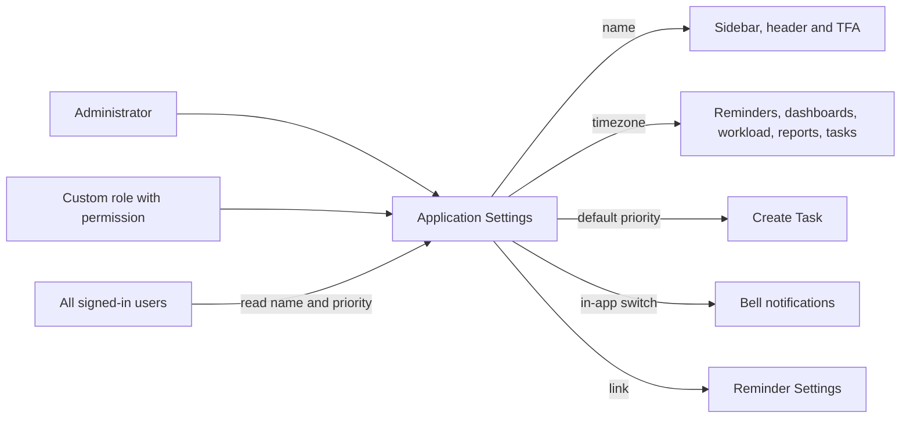
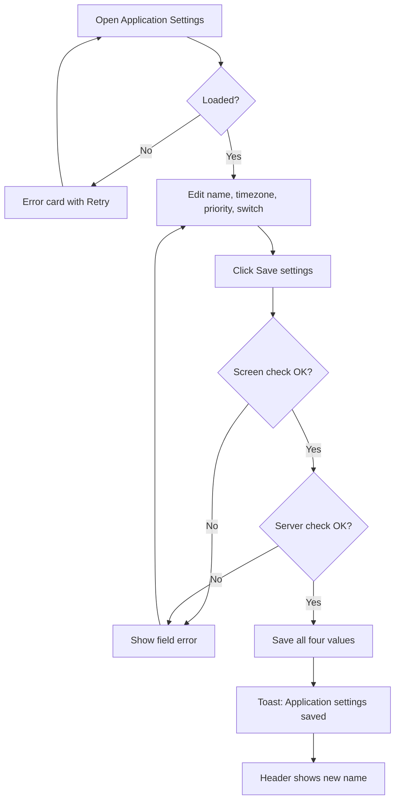
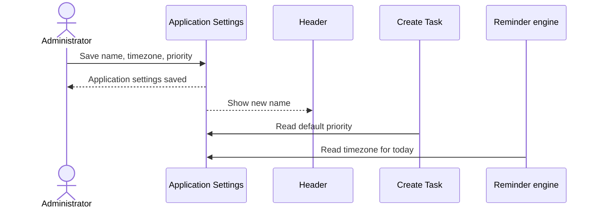

# Functional Requirements Document – Application Settings

## TaskFlow – Intelligent Task Allocation & Tracking System

> **Document:** Functional Requirements Document  ·  **Version:** 1.0  ·  **Status:** Draft
> **Project type:** Personal Project (Skill Development)  ·  **Date:** 31-Oct-2026
> **Author:** Jojo George (jojogeorge3344@gmail.com)
> **Based on:** BRD-Application-Settings.md v1.0
> **Module:** Settings  ·  **Sub-module:** 06.2 Application Settings  ·  **Code:** APP
> © 2026 Jojo George. All rights reserved.

---

## Document Control

### Revision History

| Version | Date | Author | Summary of changes |
|---|---|---|---|
| 1.0 | 31-Oct-2026 | Jojo George | Initial version |

### Related Documents

| Document | Purpose | Location |
|---|---|---|
| BRD – Application Settings | Business needs this FRD details (REQ-APP-nn, BR-APP-nn, AC-APP-nn) | `../../../BRD/06-Settings/06.2-Application-Settings/BRD-Application-Settings.md` |
| Overall FRD | Roles, global rules, Authentication, cross-cutting behaviour | `../../00-Overall/FRD-TaskFlow-Overall.md` |
| FRD – Reminder Settings | Reminder defaults and Mail delivery; shows this timezone read-only | `../06.1-Reminder-Settings/FRD-Reminder-Settings.md` |
| FRD – Notification | Bell notifications controlled by the in-app switch | `../../04-Communication/04.2-Notification/FRD-Notification.md` |
| FRD – Task Management | Create Task, which pre-selects the default priority | `../../02-TaskFlow-Monitoring/02.1-Task-Management/FRD-Task-Management.md` |
| Development Plan | Screen-wise build plan (Screen 20) | `TF - Documents/Screens Wise Feature Development Plan/20-application-settings-screen.md` |
| HLD / LLD | Technical design | `../../../HLD/06-Settings/06.2-Application-Settings/HLD-Application-Settings.md`, `../../../LLD/06-Settings/06.2-Application-Settings/LLD-Application-Settings.md` |

---

## 1. Introduction

### 1.1 Purpose
This FRD specifies the detailed, testable behaviour of the Application Settings screen and of the organization-wide
values it maintains: the application name, the application timezone, the default task priority and the in-app
notifications switch – including how other screens read and use them.

### 1.2 Scope
In scope: viewing and changing the four values; validation and saving; showing the name in the application shell; using
the timezone for every "today" decision; pre-selecting the default priority on Create Task; pausing bell notifications;
the link to Reminder Settings; reading of the non-secret values by every signed-in user.

Out of scope (BRD §3.2): reminder intervals and Mail delivery (Reminder Settings); AI provider configuration (TFA
Settings); a full change history; reset to factory defaults; outbound SMTP settings (superseded by internal Mail).

### 1.3 Audience
Developer, tester, reviewer and product owner of TaskFlow.

### 1.4 Conventions
- Requirement IDs: `FR-APP-nn`. Use cases: `UC-APP-nn`. Business rules: `BR-APP-nn` (sub-module BRD) and `BR-nn` (overall BRD).
- Priority: **Must / Should / Could** (MoSCoW).
- "The system shall …" = mandatory behaviour; "should" = recommended.
- "BRD trace" refers to `REQ-APP-nn` in the Application Settings BRD.

### 1.5 Definitions & Abbreviations

| Term | Meaning |
|---|---|
| Application name | Brand name shown in the sidebar and header (default "TaskFlow") |
| Application timezone | The one timezone (for example `Asia/Kolkata`) that decides which calendar day a deadline falls on |
| Default task priority | Priority pre-selected on Create Task: Low, Medium, High or Critical |
| In-app notifications | Bell notifications shown in the Notification Center |
| Configured timezone | The timezone set in the server configuration by whoever installs TaskFlow; first value and fallback |

---

## 2. System Overview

### 2.1 Module Map

| Code | Module | Child modules | Primary roles |
|---|---|---|---|
| APP | Settings → Application Settings | Application Settings (one screen) | Administrator, Custom role with `settings.application.manage` |
| REM | Settings → Reminder Settings (related) | Reminder defaults, Mail delivery | Administrator, Manager |
| NOTIF | Communication → Notification (related) | Notification Center, reminder engine | All users |
| TASK | Monitoring → Task Management (related) | Create Task | Manager, Administrator |

### 2.2 Context Diagram

---

## 3. User Roles & Permissions

### 3.1 Roles

| Role | Description | Data scope |
|---|---|---|
| Administrator | Views and changes application settings | Organization |
| Manager | No access to the screen by default; sees the name and gets the default priority on Create Task | Organization (read behind the scenes) |
| Employee | No access to the screen by default; sees the name | Organization (read behind the scenes) |
| Custom role | Full screen when `settings.application.manage` is granted; otherwise reads behind the scenes only | Organization |

### 3.2 Permission Matrix (functional view)

| Module › Function | Permission key | Administrator | Manager | Employee | Custom role |
|---|---|:---:|:---:|:---:|:---:|
| Settings › Application Settings › Open screen and change settings | `settings.application.manage` | Granted | Denied | Denied | Configurable |
| Application shell, Create Task › Read application name and default priority | – (signed in) | Always On | Always On | Always On | Always On |

> Manager and Employee values are the defaults given when the permission is first created. The Administrator role is
> given every permission again each time the application starts.

---

## 4. Functional Requirements by Module

### 4.1 Module: Application Settings (APP)

**Purpose:** Maintain the organization-wide basic configuration of TaskFlow.  ·  **BRD reference:**
BRD-Application-Settings SCREEN 1, BR-APP-01…BR-APP-06 (original BRD Screen 20 "System Settings")

#### 4.1.1 Screen: Application Settings

| Field | Value |
|---|---|
| Route / location | `/settings/application` (menu **Settings → Application Settings**) |
| Access | Administrator; Custom role with `settings.application.manage` |
| Entry points | Sidebar menu item **Application Settings** |

**Screen elements**

| Element | Type | Description | Mandatory | Visible to |
|---|---|---|:---:|---|
| **Application settings** | Page title | With the line "Application-wide configuration: the brand name, timezone, default task priority and in-app notifications." | – | Holders of `settings.application.manage` |
| **Application name** | Text input | Hint: "Shown in the sidebar and header." | Yes | Same |
| **Default timezone** | Text input with suggestions | Suggestions UTC, Asia/Kolkata, Asia/Dubai, Europe/London, Europe/Berlin, America/New_York, America/Chicago, America/Los_Angeles, Australia/Sydney; any valid timezone name can be typed. Hint: "Decides which calendar day a deadline belongs to. Applied immediately, no restart needed." | Yes | Same |
| **Default task priority** | Drop-down | Low, Medium, High, Critical. Hint: "Pre-selected on the Create Task form." | Yes | Same |
| **Enable in-app notifications** | Switch | Hint: "When off, no new bell notifications are created for any event. Existing notifications are kept." | Yes | Same |
| **Reminder defaults** | Link | Opens **Reminder Settings**, where reminder intervals and Mail delivery are kept | – | Same |
| **Save settings** | Button | Saves all four values; shows "Saving…" while saving | – | Same |
| **Saved** | Tick | Shown after a successful save | – | Same |
| Loading placeholder / error card with **Retry** | Placeholder, card + button | While loading / when loading fails | – | Same |

**Functional requirements**

| ID | Requirement | Priority | Permission | BRD trace |
|---|---|---|---|---|
| FR-APP-01 | The system shall load and display the current application name, timezone, default task priority and in-app notifications switch when the screen opens. | Must | `settings.application.manage` | REQ-APP-01 |
| FR-APP-02 | The system shall show a loading placeholder while loading and, if loading fails, the error card "Could not load the application settings." (or the server's message) with a **Retry** button that loads again. | Should | `settings.application.manage` | REQ-APP-01 |
| FR-APP-03 | The system shall let the user change **Application name**. | Must | `settings.application.manage` | REQ-APP-02 |
| FR-APP-04 | The system shall require an application name of 1–100 characters after removing spaces before and after it, and shall save the trimmed name. | Must | `settings.application.manage` | REQ-APP-03 |
| FR-APP-05 | The system shall show the saved application name in the sidebar and header straight after a successful save, without a page reload, and to every other signed-in user. | Must | – (signed in) | REQ-APP-04 |
| FR-APP-06 | The system shall offer timezone suggestions in **Default timezone** and accept any typed timezone name the server recognises. | Must | `settings.application.manage` | REQ-APP-05 |
| FR-APP-07 | The system shall refuse a blank timezone ("Timezone is required." on the screen; "Timezone cannot be blank." when saving) and an unrecognised one ("Unknown timezone."). | Must | `settings.application.manage` | REQ-APP-06 |
| FR-APP-08 | The system shall use the saved timezone for every "today", "due today" and "overdue" decision – reminders, dashboards, workload, reports and task deadline checks – straight after saving, without a restart. | Must | – (system) | REQ-APP-07, BR-APP-02 |
| FR-APP-09 | The system shall use UTC, and record the problem in the server log, when the saved timezone cannot be recognised at run time, so that reminders and dashboards keep working. | Must | – (system) | REQ-APP-08 |
| FR-APP-10 | The system shall let the user choose **Default task priority** as Low, Medium, High or Critical. | Must | `settings.application.manage` | REQ-APP-09 |
| FR-APP-11 | The system shall pre-select the saved default task priority on the Create Task form. | Must | – (Create Task) | REQ-APP-10 |
| FR-APP-12 | The system shall let the user switch **Enable in-app notifications** on or off for the whole organization. | Must | `settings.application.manage` | REQ-APP-11, BR-APP-01 |
| FR-APP-13 | The system shall create no new bell notification for any event while in-app notifications are off, and shall keep all existing notifications. | Must | – (system) | REQ-APP-12, BR-APP-05 |
| FR-APP-14 | The system shall show in the **Reminder defaults** group a link that opens Reminder Settings, and shall not offer reminder intervals or Mail delivery on this screen. | Should | `settings.application.manage` | REQ-APP-13, BR-APP-06 |
| FR-APP-15 | The system shall check every value again when a save is received, independently of the screen (name, timezone, priority). | Must | `settings.application.manage` | REQ-APP-14 |
| FR-APP-16 | The system shall refuse a save in which any of the four values is missing, without filling it with a default. | Must | `settings.application.manage` | REQ-APP-15, BR-APP-03 |
| FR-APP-17 | The system shall use name "TaskFlow", priority Medium, in-app notifications on and the configured timezone (or UTC when none is configured) for any value that is missing or unreadable, and shall create missing values at start-up without overwriting saved ones. | Must | – (system) | REQ-APP-16 |
| FR-APP-18 | The system shall let every signed-in user read the application settings, for the brand name and the default priority. | Must | – (signed in) | REQ-APP-17, BR-APP-04 |
| FR-APP-19 | The system shall return only the application name, timezone, default priority and in-app switch to readers, and no secret or sensitive configuration. | Must | – (signed in) | REQ-APP-18 |
| FR-APP-20 | The system shall record the user who last saved the application settings and the date and time of the save. | Should | `settings.application.manage` | REQ-APP-19 |
| FR-APP-21 | The system shall show "Saving…" on the button while saving, confirm a successful save with the toast "Application settings saved" and the **Saved** tick, and show "Could not save the application settings." when the save fails. | Should | `settings.application.manage` | REQ-APP-20 |
| FR-APP-22 | The system shall hide the **Application Settings** menu item from users without `settings.application.manage` and return such users to their dashboard when they open `/settings/application`. | Must | `settings.application.manage` | REQ-APP-21 |
| FR-APP-23 | The system shall refuse every save of application settings requested by a user without `settings.application.manage`. | Must | `settings.application.manage` | REQ-APP-22, BR-APP-04 |

**Use case: UC-APP-01 – Change and save application settings**

| Item | Detail |
|---|---|
| Actor | Administrator or Custom role user |
| Preconditions | Signed in; holds `settings.application.manage` |
| Trigger | Opens **Settings → Application Settings** |
| Main flow | 1. System shows the current four values (FR-APP-01). 2. User changes the name, timezone, default priority and/or the in-app switch. 3. User clicks **Save settings**; the button shows "Saving…". 4. The screen checks name and timezone (FR-APP-04, FR-APP-07). 5. System checks all values again (FR-APP-15, FR-APP-16). 6. System saves all four values and records editor and time (FR-APP-20). 7. Toast "Application settings saved" and **Saved** tick (FR-APP-21). 8. The new name appears in the sidebar and header at once (FR-APP-05); the new timezone is used at once (FR-APP-08). |
| Alternate flows | A1: Loading fails → error card with **Retry** → step 1. A2: User follows the **Reminder Settings** link (FR-APP-14). |
| Exceptions | E1: Name blank or over 100 characters → "Application name is required and must be 100 characters or fewer." E2: Timezone blank → "Timezone is required." E3: Timezone unrecognised → "Unknown timezone." E4: Value missing / invalid priority → save refused. E5: Save fails → "Could not save the application settings." |
| Postconditions | Four values saved together; last editor and time recorded. |

**Use case: UC-APP-02 – Use the application timezone for "today"**

| Item | Detail |
|---|---|
| Actor | System (reminder engine, dashboards, workload, reports, tasks) |
| Preconditions | A timezone is saved or configured |
| Trigger | Any calculation needs the current calendar day |
| Main flow | 1. System reads the saved timezone. 2. System converts the current time into it. 3. System decides "due today" and "overdue" by that calendar day (FR-APP-08). |
| Alternate flows | A1: No timezone saved → configured timezone, or UTC (FR-APP-17). |
| Exceptions | E1: Saved timezone not recognised on the server → problem recorded, UTC used until a valid timezone is saved (FR-APP-09). |
| Postconditions | Every screen gives the same answer for "due today" and "overdue". |

**Use case: UC-APP-03 – Pause bell notifications**

| Item | Detail |
|---|---|
| Actor | Administrator; System |
| Preconditions | Signed in; holds `settings.application.manage` |
| Trigger | The organization wants no new bell notifications for a period |
| Main flow | 1. User switches **Enable in-app notifications** off and saves (UC-APP-01). 2. For every later event, the system creates no bell notification (FR-APP-13). 3. Existing notifications stay in the Notification Center. 4. Switching it on again resumes new bell notifications. |
| Alternate flows | – |
| Exceptions | E1: Value unreadable → treated as on (FR-APP-17). |
| Postconditions | No new bell notifications while off; Mail copies of reminders follow the Reminder Settings switch. |

**Field validations**

| Field | Rule | Error message |
|---|---|---|
| Application name | Required; 1–100 characters after trimming | Screen: "Application name is required and must be 100 characters or fewer." Server: "Application name cannot be blank." |
| Default timezone | Required; must be a timezone name the server recognises | Screen: "Timezone is required." Server: "Timezone cannot be blank." / "Unknown timezone." |
| Default task priority | Required; Low, Medium, High or Critical | Save refused |
| Enable in-app notifications | Required; on or off | Save refused when missing |

**Business rules applied:** BR-APP-01, BR-APP-02, BR-APP-03, BR-APP-04, BR-APP-05, BR-APP-06; global rules of the overall
BRD: one consistent timezone for deadline comparisons; consistent calculation rules for dashboards and reports; in-app
notifications work independently of other delivery channels.

**Notifications / side effects**

| Event | Who is notified | Channel |
|---|---|---|
| Settings saved | Saving user | Toast "Application settings saved" |
| Name changed | Every user | Sidebar and header (and the TFA brand name) |
| In-app switch off | All users | No new bell notifications; existing kept |
| Timezone changed | – | Reminders, dashboards, workload, reports, tasks use it at once |

**Messages**

| Situation | Message |
|---|---|
| Success | "Application settings saved" (toast) and **Saved** tick |
| Name blank or too long (screen) | "Application name is required and must be 100 characters or fewer." |
| Name blank (server) | "Application name cannot be blank." |
| Timezone blank (screen / server) | "Timezone is required." / "Timezone cannot be blank." |
| Timezone not recognised | "Unknown timezone." |
| Load failed | "Could not load the application settings." with **Retry** |
| Save failed | "Could not save the application settings." |
| No permission | Menu item hidden; opening `/settings/application` returns the user to their dashboard; a direct save is refused |

---

## 5. Cross-Module Workflows

### 5.1 Rename and re-zone the application

| Step | Module | Actor / System | Action | FR reference |
|---|---|---|---|---|
| 1 | APP | Administrator | Saves "Acme TaskFlow", `Asia/Dubai`, priority High | FR-APP-03…FR-APP-10, FR-APP-15 |
| 2 | APP | System | Shows "Acme TaskFlow" in sidebar and header | FR-APP-05 |
| 3 | TASK | Manager | Opens Create Task; High is pre-selected | FR-APP-11 |
| 4 | NOTIF | System | Next reminder run decides the deadline day in `Asia/Dubai` | FR-APP-08 |
| 5 | REM | Authorized user | Sees `Asia/Dubai` read-only on Reminder Settings | Reminder Settings FRD |

### 5.2 In-app switch and notifications

| Step | Module | Actor / System | Action | FR reference |
|---|---|---|---|---|
| 1 | APP | Administrator | Switches **Enable in-app notifications** off | FR-APP-12 |
| 2 | NOTIF | System | Checks the switch before creating any bell notification; creates none | FR-APP-13 |
| 3 | MAIL | System | Reminder copies still follow Reminder Settings Mail delivery | Reminder Settings FRD |

---

## 6. Reports & Exports

_Not applicable for this sub-module._ Reports use the application timezone (Reports FRD).

---

## 7. Notifications & Messages Catalogue

| Code | Trigger | Recipients | Channel | Text |
|---|---|---|---|---|
| N-APP-01 | Successful save | Saving user | Toast | "Application settings saved" |
| N-APP-02 | Name invalid (screen) | Saving user | Inline | "Application name is required and must be 100 characters or fewer." |
| N-APP-03 | Name blank (server) | Saving user | Inline | "Application name cannot be blank." |
| N-APP-04 | Timezone blank | Saving user | Inline | "Timezone is required." / "Timezone cannot be blank." |
| N-APP-05 | Timezone unknown | Saving user | Inline | "Unknown timezone." |
| N-APP-06 | Load failed | Current user | Error card | "Could not load the application settings." |
| N-APP-07 | Save failed | Saving user | Toast / inline | "Could not save the application settings." |

---

## 8. Data Requirements (functional view)

| Data item | Description | Created by | Rules |
|---|---|---|---|
| Application name | Brand name | System at start-up (default "TaskFlow"); changed by user | 1–100 characters, trimmed |
| Application timezone | Timezone for "today" | System at start-up (configured timezone); changed by user | Must be recognised; UTC used at run time if not |
| Default task priority | Pre-selection on Create Task | System at start-up (Medium); changed by user | Low, Medium, High or Critical |
| In-app notifications | Bell notifications on/off | System at start-up (on); changed by user | Missing or unreadable counts as on |
| Last changed by / at | Editor and time of the last save | System on save | No history of earlier values |

---

## 9. Non-Functional Requirements (functional impact)

| ID | Requirement | Affects |
|---|---|---|
| NFR-APP-01 | The screen loads and saves without noticeable delay | Application Settings |
| NFR-APP-02 | Readable settings never contain secrets | FR-APP-18, FR-APP-19 |
| NFR-APP-03 | Changes are checked on every request | FR-APP-15, FR-APP-23 |
| NFR-APP-04 | A bad or missing value never stops the application | FR-APP-09, FR-APP-17 |
| NFR-APP-05 | Changes are visible immediately (name without reload, timezone without restart) | FR-APP-05, FR-APP-08 |
| NFR-APP-06 | Works in current desktop browsers, responsive layout | Application Settings |
| NFR-APP-07 | Every field has a label and hint; errors appear next to the field | Screen elements, validations |

---

## 10. Assumptions & Open Issues

| Type | Description | Owner |
|---|---|---|
| Assumption | One organization per installation, so one set of application settings. | Jojo George |
| Assumption | The server knows standard timezone names such as `Asia/Kolkata` and `UTC`. | Jojo George |
| Open issue | ⚠️ To be confirmed: whether a full change history of settings (original Screen 20 FR-6) is still required; only the last editor and time are kept. | Jojo George |
| Open issue | ⚠️ To be confirmed: the exact message returned for an invalid priority or a missing value (standard validation wording is used). | Jojo George |

**Change from original BRD**

| Original BRD item | Current requirement |
|---|---|
| Screen 20 "Default task reminder intervals" / FR-3 | Kept on Reminder Settings; this screen only links to it (FR-APP-14). |
| Screen 20 "Notification preferences" | One organization-wide switch **Enable in-app notifications** (FR-APP-12, FR-APP-13). |
| Screen 20 FR-6 "Record significant configuration changes" | Last editor and time recorded (FR-APP-20); no history. |
| Screen 20 access "Administrator" | Controlled by `settings.application.manage` (Administrator by default). |

---

## 11. Requirements Traceability Matrix

| BRD item | FRD requirement(s) | Screen | Use case | Test case |
|---|---|---|---|---|
| REQ-APP-01 | FR-APP-01, FR-APP-02 | Application Settings | UC-APP-01 | AC-APP-01 |
| REQ-APP-02 | FR-APP-03 | Application Settings | UC-APP-01 | AC-APP-02 |
| REQ-APP-03 | FR-APP-04 | Application Settings | UC-APP-01 | AC-APP-03 |
| REQ-APP-04 | FR-APP-05 | Sidebar / header | UC-APP-01 | AC-APP-02 |
| REQ-APP-05 | FR-APP-06 | Application Settings | UC-APP-01 | AC-APP-04 |
| REQ-APP-06 | FR-APP-07 | Application Settings | UC-APP-01 | AC-APP-04 |
| REQ-APP-07 | FR-APP-08 | All "today" calculations | UC-APP-02 | AC-APP-05 |
| REQ-APP-08 | FR-APP-09 | All "today" calculations | UC-APP-02 | AC-APP-06 |
| REQ-APP-09 | FR-APP-10 | Application Settings | UC-APP-01 | AC-APP-07 |
| REQ-APP-10 | FR-APP-11 | Create Task | UC-APP-01 | AC-APP-07 |
| REQ-APP-11 | FR-APP-12 | Application Settings | UC-APP-03 | AC-APP-08 |
| REQ-APP-12 | FR-APP-13 | Notification Center | UC-APP-03 | AC-APP-08 |
| REQ-APP-13 | FR-APP-14 | Application Settings | UC-APP-01 | AC-APP-09 |
| REQ-APP-14 | FR-APP-15 | Application Settings | UC-APP-01 | AC-APP-03 |
| REQ-APP-15 | FR-APP-16 | Application Settings | UC-APP-01 | AC-APP-10 |
| REQ-APP-16 | FR-APP-17 | Application Settings | UC-APP-02 | AC-APP-11 |
| REQ-APP-17 | FR-APP-18 | Sidebar / header, Create Task | UC-APP-01 | AC-APP-12 |
| REQ-APP-18 | FR-APP-19 | Sidebar / header | – | AC-APP-12 |
| REQ-APP-19 | FR-APP-20 | Application Settings | UC-APP-01 | AC-APP-13 |
| REQ-APP-20 | FR-APP-21 | Application Settings | UC-APP-01 | AC-APP-13 |
| REQ-APP-21 | FR-APP-22 | Application Settings | – | AC-APP-14 |
| REQ-APP-22 | FR-APP-23 | Application Settings | – | AC-APP-14 |
| BR-APP-01 | FR-APP-12 | Application Settings | UC-APP-03 | AC-APP-08 |
| BR-APP-02 | FR-APP-08 | All "today" calculations | UC-APP-02 | AC-APP-05 |
| BR-APP-03 | FR-APP-16 | Application Settings | UC-APP-01 | AC-APP-10 |
| BR-APP-04 | FR-APP-18, FR-APP-23 | Application Settings | UC-APP-01 | AC-APP-12, AC-APP-14 |
| BR-APP-05 | FR-APP-13 | Notification Center | UC-APP-03 | AC-APP-08 |
| BR-APP-06 | FR-APP-14 | Application Settings | UC-APP-01 | AC-APP-09 |

Untraced BRD items: **0**.

---

## 12. Approvals

| Role | Name | Decision | Date |
|---|---|---|---|
| Product owner | Jojo George | Pending | – |
| Reviewer | Jojo George | Pending | – |

---
© 2026 Jojo George. All rights reserved. Unauthorized copying or distribution of this document is prohibited.
