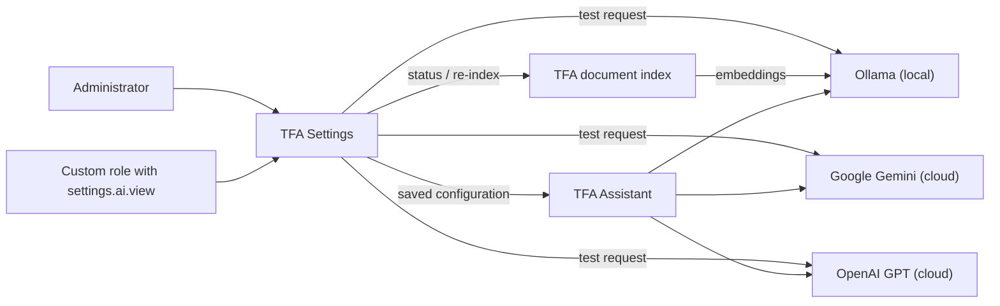
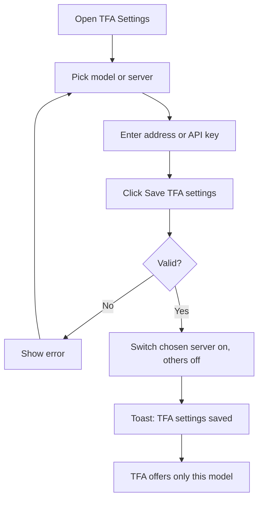
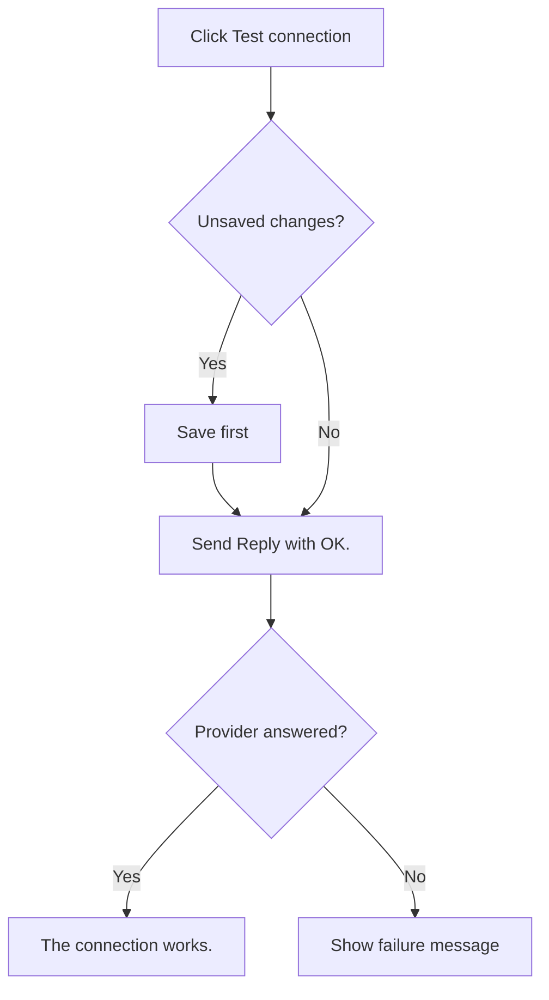
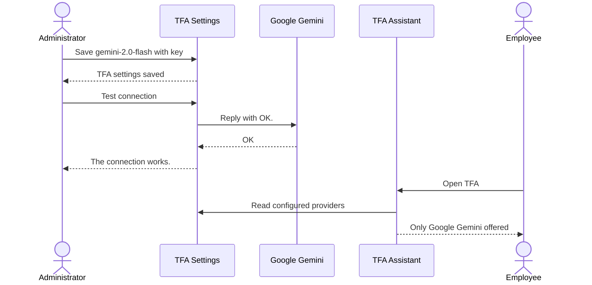

# Functional Requirements Document – TFA Settings

## TaskFlow – Intelligent Task Allocation & Tracking System

> **Document:** Functional Requirements Document  ·  **Version:** 1.1  ·  **Status:** Draft
> **Project type:** Personal Project (Skill Development)  ·  **Date:** 31-Oct-2026
> **Author:** Jojo George (jojogeorge3344@gmail.com)
> **Based on:** BRD-TFA-Settings.md v1.1
> **Module:** Settings  ·  **Sub-module:** 06.3 TFA Settings  ·  **Code:** TFAS
> © 2026 Jojo George. All rights reserved.

---

## Document Control

### Revision History

| Version | Date | Author | Summary of changes |
|---|---|---|---|
| 1.0 | 31-Oct-2026 | Jojo George | Initial version |
| 1.1 | 31-Oct-2026 | Jojo George | TFA answers TaskFlow questions from the documents folder (OpenSpec change `tfa-document-rag`), traced to BRD-TFA-Settings v1.1: Document search card (screen elements, FR-TFAS-29 – FR-TFAS-36, UC-TFAS-04, messages N-TFAS-12 – N-TFAS-16, data, NFR-TFAS-09 – NFR-TFAS-10, traceability); cloud explanation (FR-TFAS-23) mentions matching document text. |

### Related Documents

| Document | Purpose | Location |
|---|---|---|
| BRD – TFA Settings | Business needs this FRD details (REQ-TFAS-nn, BR-TFAS-nn, AC-TFAS-nn) | `../../../BRD/06-Settings/06.3-TFA-Settings/BRD-TFA-Settings.md` |
| Overall FRD | Roles, global rules, Authentication, cross-cutting behaviour | `../../00-Overall/FRD-TaskFlow-Overall.md` |
| FRD – TFA Assistant | Chat window that uses this configuration; answers from the TaskFlow documents (4.1.2) | `../../08-TFA-Assistant/08.1-Assistant/FRD-Assistant.md` |
| FRD – Role Configuration | Grants the four `settings.ai.*` permissions | `../06.4-Role-Configuration/FRD-Role-Configuration.md` |
| Development Plan | Screen-wise build plan | _Not applicable – not in the original 20-screen plan._ |
| HLD / LLD | Technical design | `../../../HLD/06-Settings/06.3-TFA-Settings/HLD-TFA-Settings.md`, `../../../LLD/06-Settings/06.3-TFA-Settings/LLD-TFA-Settings.md` |

---

## 1. Introduction

### 1.1 Purpose
This FRD specifies the detailed, testable behaviour of the TFA Settings screen, where an authorized user chooses the AI
provider and model behind TFA (the TaskFlow Assistant), adds and removes models, sets the Ollama server address, manages
cloud API keys and tests the connection, and (v1.1) where they see the state of TFA's document search and start a
re-index.

### 1.2 Scope
In scope: viewing the three providers with tag, status and key status; the linked Model and Server lists; adding and
removing models; the Ollama server address; entering, keeping and removing Gemini and OpenAI keys; saving (one active
server); the connection test; initial configuration; permission control of each action; the Document search card
(status and **Re-index now**).

Out of scope (BRD §3.2): the TFA chat window (TFA Assistant FRD); providers other than Ollama, Google Gemini and OpenAI
GPT; usage or cost tracking; installing models on the Ollama server; choosing the documents folder, embedding model or
search settings on the screen (server configuration `DocumentKnowledge`); uploading documents; PDF and Excel documents.

### 1.3 Audience
Developer, tester, reviewer and product owner of TaskFlow.

### 1.4 Conventions
- Requirement IDs: `FR-TFAS-nn`. Use cases: `UC-TFAS-nn`. Business rules: `BR-TFAS-nn` (sub-module BRD) and `BR-nn` (overall BRD).
- Priority: **Must / Should / Could** (MoSCoW).
- "The system shall …" = mandatory behaviour; "should" = recommended.
- In messages, `Provider` stands for the provider's display name and `model` for the model name.

### 1.5 Definitions & Abbreviations

| Term | Meaning |
|---|---|
| TFA | TaskFlow Assistant, the AI chat assistant inside TaskFlow |
| Provider / server | Ollama (local), Google Gemini or OpenAI GPT (cloud) |
| Model | AI model name on a provider, for example `llama3.2:3b` |
| Built-in model | A model that ships with TaskFlow and cannot be removed |
| Added model | A model name an administrator typed with **Add new model…** |
| Saved model | The model stored for a provider at the last save |
| Configured provider | Switched on, has a model, and has an address (Ollama) or a readable key (cloud) |
| Connection test | One short request ("Reply with OK.") to check that the provider answers |
| Document search | TFA's index of the Markdown documents in the documents folder, used to answer questions about TaskFlow |
| Embedding model | Ollama model (`nomic-embed-text` by default) that turns document text into vectors |
| Chunk | One section of a document as stored in the index |
| Indexing run | One check of the documents folder: changed files are re-embedded, deleted ones removed |

---

## 2. System Overview

### 2.1 Module Map

| Code | Module | Child modules | Primary roles |
|---|---|---|---|
| TFAS | Settings → TFA Settings | TFA Settings (one screen) | Administrator, Custom role with `settings.ai.view` |
| TFA | TFA Assistant (related) | Chat window | Users with `assistant.chat` |
| ROLE | Settings → Role Configuration (related) | Grants `settings.ai.*` | Administrator |

### 2.2 Context Diagram

---

## 3. User Roles & Permissions

### 3.1 Roles

| Role | Description | Data scope |
|---|---|---|
| Administrator | Views, edits, tests and removes models | Organization |
| Manager | No access to the screen by default | – |
| Employee | No access to the screen by default | – |
| Custom role | `settings.ai.view` opens the screen; `settings.ai.edit`, `settings.ai.test`, `settings.ai.model.remove` allow the actions | Organization |

### 3.2 Permission Matrix (functional view)

| Module › Function | Permission key | Administrator | Manager | Employee | Custom role |
|---|---|:---:|:---:|:---:|:---:|
| Settings › TFA Settings › View providers, models and key status | `settings.ai.view` | Granted | Denied | Denied | Configurable |
| Settings › TFA Settings › Choose model/server, add model, address, key, save | `settings.ai.edit` (needs `settings.ai.view`) | Granted | Denied | Denied | Configurable |
| Settings › TFA Settings › Test connection | `settings.ai.test` (needs `settings.ai.view`) | Granted | Denied | Denied | Configurable |
| Settings › TFA Settings › Remove a model from the list | `settings.ai.model.remove` (needs `settings.ai.view`) | Granted | Denied | Denied | Configurable |
| Settings › TFA Settings › Document search status (v1.1) | `settings.ai.view` | Granted | Denied | Denied | Configurable |
| Settings › TFA Settings › Re-index now (v1.1) | `settings.ai.edit` (needs `settings.ai.view`) | Granted | Denied | Denied | Configurable |

> Manager and Employee values are the defaults given when the permission is first created. The Administrator role is
> given every permission again each time the application starts.

---

## 4. Functional Requirements by Module

### 4.1 Module: TFA Settings (TFAS)

**Purpose:** Choose the AI model and server behind TFA, manage models and API keys, test the connection, and see and
refresh TFA's document search.  ·  **BRD reference:** BRD-TFA-Settings SCREEN 1, BR-TFAS-01…BR-TFAS-10

#### 4.1.1 Screen: TFA Settings

| Field | Value |
|---|---|
| Route / location | `/settings/tfa` (menu **Settings → TFA Settings**) |
| Access | Administrator; Custom role with `settings.ai.view` (actions: `settings.ai.edit`, `settings.ai.test`, `settings.ai.model.remove`) |
| Entry points | Sidebar menu item **TFA Settings** |

**Screen elements**

| Element | Type | Description | Mandatory | Visible to |
|---|---|---|:---:|---|
| **TFA settings** | Page title | – | – | `settings.ai.view` |
| **Model and server** | Explanation | Ollama runs on your own server and is free; Google Gemini has a free tier with limits; OpenAI GPT has no free tier; Gemini and OpenAI are cloud services, so a user's question, related task details and matching TaskFlow document text are sent to them | – | `settings.ai.view` |
| **Model** | Drop-down grouped by provider | Built-in and added models; **Add new model…** in each group | Yes | `settings.ai.view` |
| **New model name** | Text input | Shown after **Add new model…**; placeholder "For example phi3:mini" | Yes, when adding | `settings.ai.view` |
| **Server** | Drop-down | "Ollama · http://localhost:11434", "Google Gemini · generativelanguage.googleapis.com", "OpenAI GPT · api.openai.com" | Yes | `settings.ai.view` |
| **Remove this model from the list** | Button | Only for an added model that is not the saved one | – | `settings.ai.model.remove` |
| Usage line | Text | "TFA uses **`model`** on **`Provider`**." or "After you save, TFA will use …" | – | `settings.ai.view` |
| Provider card | Card | Name, **Local** / **Cloud** tag, status **In use**, **Ready to use**, **Needs an API key** or **Not configured** | – | `settings.ai.view` |
| **Server address** | Text input (Ollama card) | Address of the Ollama server | Yes (Ollama) | `settings.ai.view` |
| **API key** | Password input (cloud cards) | Key status, for example "A key is saved (ends …1234). Leave the box empty to keep it." | No (empty keeps the key) | `settings.ai.view` |
| **Remove the key** / **Keep the key** | Buttons (cloud cards) | Mark the saved key for removal / undo that mark | – | `settings.ai.view` |
| **Test connection** | Button + result text | Runs the connection test | – | `settings.ai.test` |
| **Save TFA settings** | Button | Saves the configuration | – | `settings.ai.edit` |
| **Document search** (v1.1) | Card | Title and explanation: "TFA answers questions about TaskFlow's features, screens, rules and design only from the Markdown documents in this folder. They are embedded with a free local Ollama model and checked for changes every few minutes." | – | `settings.ai.view` |
| State | Pill | **Up to date**, **Indexing…** or **Switched off** | – | `settings.ai.view` |
| **Documents folder** | Text | Full path of the folder; **Not found** when it does not exist | – | `settings.ai.view` |
| **Embedding model**, **Files**, **Chunks** | Text | Model name; indexed files and chunks | – | `settings.ai.view` |
| **Last indexed** | Date-time | When the last run finished (`d MMM y, HH:mm`), or "Not yet" | – | `settings.ai.view` |
| Last error | Alert | Error text and "File: `path`" when it concerns one document | – | `settings.ai.view` |
| **Re-index now** | Button | Starts an indexing run; disabled while one is running | – | `settings.ai.edit` (and document search switched on) |

**Functional requirements**

| ID | Requirement | Priority | Permission | BRD trace |
|---|---|---|---|---|
| FR-TFAS-01 | The system shall support exactly three providers: Ollama (local, no API key), Google Gemini and OpenAI GPT (cloud, API key needed). | Must | `settings.ai.view` | REQ-TFAS-01 |
| FR-TFAS-02 | The system shall show a card for the selected provider with its name, a **Local** or **Cloud** tag and its status **In use**, **Ready to use**, **Needs an API key** or **Not configured**, and shall mark the provider TFA uses now. | Must | `settings.ai.view` | REQ-TFAS-02 |
| FR-TFAS-03 | The system shall offer the built-in models Ollama `llama3.2:3b`, `llama3.2:1b`, `llama3.1:8b`, `qwen2.5:7b`, `mistral:7b`; Gemini `gemini-2.0-flash`, `gemini-2.5-flash`, `gemini-2.5-pro`; OpenAI `gpt-4o-mini`, `gpt-4o`, `gpt-4.1-mini`, grouped by provider, the first of each group being that provider's default. | Must | `settings.ai.view` | REQ-TFAS-03 |
| FR-TFAS-04 | The system shall select the matching server when a model is chosen, and the provider's model when a server is chosen, and update the usage line accordingly. | Should | `settings.ai.view` | REQ-TFAS-04 |
| FR-TFAS-05 | The system shall let the user choose **Add new model…**, type a model name of 1–100 characters and, after saving, keep offering that model in the provider's group. | Should | `settings.ai.edit` | REQ-TFAS-05 |
| FR-TFAS-06 | The system shall let the user enter the Ollama **Server address**. | Must | `settings.ai.edit` | REQ-TFAS-06 |
| FR-TFAS-07 | The system shall accept only a valid http or https server address of at most 300 characters; it shall refuse link-local and cloud metadata addresses (for example 169.254.x.x, `metadata.google.internal`) and allow `localhost` and private addresses. | Must | `settings.ai.edit` | REQ-TFAS-07, BR-TFAS-06 |
| FR-TFAS-08 | The system shall let the user enter an API key for Gemini or OpenAI of at most 500 characters without spaces. | Must | `settings.ai.edit` | REQ-TFAS-08 |
| FR-TFAS-09 | The system shall refuse an API key sent for Ollama with "Ollama does not use an API key." | Must | `settings.ai.edit` | REQ-TFAS-09 |
| FR-TFAS-10 | The system shall store API keys protected and shall never display a saved key on any screen or return it in any response. | Must | `settings.ai.view` | REQ-TFAS-10, BR-TFAS-01 |
| FR-TFAS-11 | The system shall show for a saved key only that a key is saved and its last four characters, as "A key is saved (ends …1234). Leave the box empty to keep it." | Must | `settings.ai.view` | REQ-TFAS-11, BR-TFAS-01 |
| FR-TFAS-12 | The system shall keep the saved key unchanged when the **API key** box is left empty on save. | Must | `settings.ai.edit` | REQ-TFAS-12 |
| FR-TFAS-13 | The system shall remove the saved key when **Remove the key** is chosen and saved, let **Keep the key** undo that choice before saving, and refuse a save that sends a new key and removal together with "Provide a new key or clear the key, not both." | Must | `settings.ai.edit` | REQ-TFAS-13 |
| FR-TFAS-14 | The system shall, when saving from the screen, switch the chosen server on and the other servers off, keeping their keys, addresses and models stored, and show "TFA settings saved". | Must | `settings.ai.edit` | REQ-TFAS-14, BR-TFAS-02 |
| FR-TFAS-15 | The system shall refuse a save in which the same provider appears more than once. | Must | `settings.ai.edit` | BR-TFAS-05 |
| FR-TFAS-16 | The system shall offer in the TFA window only providers that are configured: switched on, with a model, and with an address (Ollama) or a readable key (cloud). | Must | – (TFA) | REQ-TFAS-15, BR-TFAS-03 |
| FR-TFAS-17 | The system shall, on **Test connection**, send one short request ("Reply with OK.") to the provider and show next to the button "The connection works." or the plain failure message for the failure kind (not configured, key refused, rate limit, timeout, Ollama not reachable, model missing on Ollama). | Must | `settings.ai.test` | REQ-TFAS-16 |
| FR-TFAS-18 | The system shall always report a test result as a message and never as a screen error. | Must | `settings.ai.test` | REQ-TFAS-16 |
| FR-TFAS-19 | The system shall save unsaved changes before running a connection test. | Should | `settings.ai.test` + `settings.ai.edit` | REQ-TFAS-17 |
| FR-TFAS-20 | The system shall let the user remove a model an administrator added, reload the screen from the saved state (dropping other unsaved edits) and show "Removed `model` from the list". | Should | `settings.ai.model.remove` | REQ-TFAS-18 |
| FR-TFAS-21 | The system shall refuse to remove a built-in model ("A built-in model cannot be removed."), the model saved for its server ("That model is the one saved for its server. Choose another model and save before removing it.") or an unknown model ("That model is not in the list."). | Must | `settings.ai.model.remove` | REQ-TFAS-19, BR-TFAS-04 |
| FR-TFAS-22 | The system shall show "The saved key can no longer be read. Enter it again." and treat the cloud provider as not configured when a saved key can no longer be read. | Should | `settings.ai.view` | REQ-TFAS-20 |
| FR-TFAS-23 | The system shall explain on the screen that Gemini and OpenAI are cloud services that receive the user's question, related task details and matching TaskFlow document text. | Should | `settings.ai.view` | REQ-TFAS-21 |
| FR-TFAS-24 | The system shall, on a brand-new installation, switch Ollama on at `http://localhost:11434` and leave both cloud providers off without a key; on an upgraded installation it shall leave TFA off until an administrator turns a provider on. | Should | – (system) | REQ-TFAS-22 |
| FR-TFAS-25 | The system shall control viewing, editing/saving, testing and model removal by `settings.ai.view`, `settings.ai.edit`, `settings.ai.test` and `settings.ai.model.remove`, refuse each action on the server without its permission, and hide **Save TFA settings**, **Test connection** and **Remove this model from the list** from users without the matching permission. | Must | `settings.ai.*` | REQ-TFAS-23, BR-TFAS-07 |
| FR-TFAS-26 | The system shall allow `settings.ai.edit`, `settings.ai.test` and `settings.ai.model.remove` to be held only together with `settings.ai.view`. | Must | – (Role Configuration) | BR-TFAS-07 |
| FR-TFAS-27 | The system shall hide the **TFA Settings** menu item from users without `settings.ai.view` and return them to their dashboard when they open `/settings/tfa`. | Must | `settings.ai.view` | REQ-TFAS-24 |
| FR-TFAS-28 | The system shall confirm a save with the toast "TFA settings saved" and a removal with "Removed `model` from the list", and show "Could not load the TFA settings.", "Could not save the TFA settings." or "Could not remove the model." when these fail. | Should | `settings.ai.*` | REQ-TFAS-25 |
| FR-TFAS-29 | The system shall show users with `settings.ai.view` a **Document search** card with the documents folder (full path), the embedding model, the number of indexed files and chunks, and when indexing last finished ("Not yet" before the first run), and refuse the status to other users (403). | Must | `settings.ai.view` | REQ-TFAS-26, BR-TFAS-08 |
| FR-TFAS-30 | The system shall mark the folder **Not found** when the documents folder does not exist. | Should | `settings.ai.view` | REQ-TFAS-27 |
| FR-TFAS-31 | The system shall show the state **Indexing…** while a run is going and **Up to date** otherwise. | Must | `settings.ai.view` | REQ-TFAS-26 |
| FR-TFAS-32 | The system shall show the last indexing error and, when it concerns one document, "File: `path`" (for example the Ollama server not reachable, the embedding model not installed, the folder not found, or a document that could not be indexed). | Must | `settings.ai.view` | REQ-TFAS-28 |
| FR-TFAS-33 | The system shall show **Re-index now** only to users with `settings.ai.edit` while document search is switched on; a click asks the server to check the folder at once and answers 202 Accepted with the status shown as running. Users without `settings.ai.edit` are refused (403). | Must | `settings.ai.edit` | REQ-TFAS-29, BR-TFAS-08 |
| FR-TFAS-34 | The system shall accept a re-index request while a run is going or already requested without starting a second run, and disable the button while a run is going. | Must | `settings.ai.edit` | REQ-TFAS-30, BR-TFAS-09 |
| FR-TFAS-35 | The system shall ask for the status again every 3 seconds while a run is going, and stop when it has finished. | Should | `settings.ai.view` | REQ-TFAS-31 |
| FR-TFAS-36 | The system shall, when document search is switched off in the server configuration (`DocumentKnowledge:Enabled` = false), show **Switched off** with "Document search is switched off in the server configuration (DocumentKnowledge:Enabled). TFA cannot answer questions about TaskFlow's documents until it is switched on.", hide **Re-index now**, and refuse a re-index request (400) with "Document search is switched off in the server configuration (DocumentKnowledge:Enabled)." | Should | `settings.ai.edit` | REQ-TFAS-32 |

**Use case: UC-TFAS-01 – Choose the model and save**

| Item | Detail |
|---|---|
| Actor | Administrator or Custom role user |
| Preconditions | Signed in; holds `settings.ai.view` and `settings.ai.edit` |
| Trigger | Opens **Settings → TFA Settings** to set up or change TFA's model |
| Main flow | 1. System shows the providers and marks the one in use (FR-TFAS-02). 2. User picks a model (server follows) or a server (model follows) (FR-TFAS-04). 3. For Ollama, user checks **Server address**; for Gemini/OpenAI, user pastes the **API key** or leaves it empty to keep the saved key. 4. User clicks **Save TFA settings**. 5. System checks model name, address and key (FR-TFAS-05, FR-TFAS-07, FR-TFAS-08). 6. System saves; only the chosen server is on (FR-TFAS-14). 7. Toast "TFA settings saved". 8. TFA offers only this configuration (FR-TFAS-16). |
| Alternate flows | A1: **Add new model…** → user types a name (1–100 characters) → saved and offered from then on (FR-TFAS-05). A2: **Remove the key** → key cleared on save (FR-TFAS-13); **Keep the key** undoes it. |
| Exceptions | E1: Bad address → "The server address must be a valid http or https URL, and not a link-local or cloud metadata address." (screen: "Enter a valid http or https address."). E2: Key with spaces → "The API key cannot contain spaces." E3: New key and removal together → "Provide a new key or clear the key, not both." E4: Key for Ollama → "Ollama does not use an API key." E5: Model name blank → "Model name cannot be blank." E6: Save fails → "Could not save the TFA settings." |
| Postconditions | Chosen provider on, others off with keys and models kept; key never shown again (FR-TFAS-10, FR-TFAS-11). |

**Use case: UC-TFAS-02 – Test the connection**

| Item | Detail |
|---|---|
| Actor | Administrator or Custom role user; AI provider |
| Preconditions | Signed in; holds `settings.ai.view` and `settings.ai.test` |
| Trigger | Clicks **Test connection** on the provider card |
| Main flow | 1. If there are unsaved changes, system saves them first (FR-TFAS-19). 2. System sends "Reply with OK." to the provider (FR-TFAS-17). 3. Provider answers. 4. System shows "The connection works." |
| Alternate flows | A1: No unsaved changes → test runs on the saved configuration. |
| Exceptions | E1: Not configured → "`Provider` is not configured. Choose another model, or ask an administrator to set it up." E2: Key refused → "`Provider` did not accept the API key. …" E3: Rate limit → "`Provider`'s free limit or rate limit has been reached. Try again in about a minute, or choose another model." E4: Timeout → "`Provider` took too long to answer. You can retry, or choose another model." E5: Ollama not reachable → "Ollama is not running or cannot be reached. Ask an administrator to start it, or choose another model." E6: Model missing on Ollama → "The configured model is not available on Ollama. …" E7: Automatic save refused (for example user lacks `settings.ai.edit`) → test not run; see §10. |
| Postconditions | Result message shown; configuration unchanged by the test itself. |

**Use case: UC-TFAS-04 – Check document search and re-index (v1.1)**

| Item | Detail |
|---|---|
| Actor | Administrator or Custom role user |
| Preconditions | Signed in; holds `settings.ai.view` (and `settings.ai.edit` to re-index) |
| Trigger | Opens TFA Settings; clicks **Re-index now** |
| Main flow | 1. Card loads the status (FR-TFAS-29). 2. User clicks **Re-index now** (FR-TFAS-33). 3. Server accepts (202); card shows **Indexing…** and refreshes every 3 s (FR-TFAS-35). 4. Run ends; card shows **Up to date**, the new counts and last indexed time. |
| Alternate flows | A1: a run is already going → request accepted, no second run (FR-TFAS-34). |
| Exceptions | E1: status cannot be loaded → "Could not load the document search status." with **Retry**. E2: request fails → "Could not start indexing." E3: run ends with an error → error and its file shown (FR-TFAS-32). E4: document search switched off → **Switched off**, no button (FR-TFAS-36). |
| Postconditions | Index matches the folder: changed documents re-embedded, deleted ones removed; TFA answers from the new text. |

**Use case: UC-TFAS-03 – Remove an added model**

| Item | Detail |
|---|---|
| Actor | Administrator or Custom role user |
| Preconditions | Signed in; holds `settings.ai.view` and `settings.ai.model.remove`; an added model exists that is not the saved one |
| Trigger | Selects the added model and clicks **Remove this model from the list** |
| Main flow | 1. System checks the model is not built-in and not saved (FR-TFAS-21). 2. System removes it. 3. Screen reloads from the saved state; toast "Removed `model` from the list" (FR-TFAS-20). |
| Alternate flows | – |
| Exceptions | E1: Built-in → "A built-in model cannot be removed." E2: Saved model → "That model is the one saved for its server. …" E3: Not found → "That model is not in the list." E4: Failure → "Could not remove the model." |
| Postconditions | Model no longer offered; other unsaved edits dropped. |

**Field validations**

| Field | Rule | Error message |
|---|---|---|
| New model name | Required when adding; 1–100 characters | Server: "Model name cannot be blank." Screen: "Type the model name (100 characters at most)." |
| Server address (Ollama) | Valid http/https URL; at most 300 characters; not link-local or cloud metadata | Server: "The server address must be a valid http or https URL, and not a link-local or cloud metadata address." Screen: "Enter a valid http or https address." |
| API key (cloud) | Optional; at most 500 characters; no spaces; empty keeps the saved key | "The API key cannot contain spaces." / screen "The key cannot contain spaces." |
| API key (Ollama) | Not allowed | "Ollama does not use an API key." |
| New key + Remove the key | Not both in one save | "Provide a new key or clear the key, not both." |
| Providers in one save | Each provider at most once | Save refused |

**Business rules applied:** BR-TFAS-01 … BR-TFAS-10; global security NFRs of the overall BRD (role-based access
control, server-side validation, secure handling of credentials – original BRD NFR 5.2).

**Notifications / side effects**

| Event | Who is notified | Channel |
|---|---|---|
| Settings saved | Saving user | Toast "TFA settings saved" |
| Model removed | Removing user | Toast "Removed `model` from the list" |
| Test run | Testing user | Result text next to **Test connection** |
| Provider switched | TFA users | TFA window offers only the configured provider |
| Re-index finished | TFA users | TFA answers from the updated documents (no message) |

**Messages**

| Situation | Message |
|---|---|
| Saved | "TFA settings saved" |
| Model removed | "Removed `model` from the list" |
| Test OK | "The connection works." |
| Test failures | See UC-TFAS-02 E1–E6 and §7 |
| Saved key unreadable | "The saved key can no longer be read. Enter it again." |
| Load / save / remove failed | "Could not load the TFA settings." / "Could not save the TFA settings." / "Could not remove the model." |
| No permission | Menu item hidden; opening `/settings/tfa` returns the user to their dashboard; buttons for forbidden actions hidden |
| Document search | See N-TFAS-12 – N-TFAS-16 in §7 |

---

## 5. Cross-Module Workflows

### 5.1 Switch TFA to a cloud provider

| Step | Module | Actor / System | Action | FR reference |
|---|---|---|---|---|
| 1 | TFAS | Administrator | Chooses `gemini-2.0-flash`, pastes a key ending 1234, saves | FR-TFAS-04, FR-TFAS-08, FR-TFAS-14 |
| 2 | TFAS | System | Shows "A key is saved (ends …1234)…"; Ollama off, address and models kept | FR-TFAS-11, FR-TFAS-14 |
| 3 | TFAS | Administrator | Clicks **Test connection**; "The connection works." | FR-TFAS-17 |
| 4 | TFA | Employee | Opens TFA; only Google Gemini is offered | FR-TFAS-16 |

### 5.2 Granting TFA Settings to a custom role

| Step | Module | Actor / System | Action | FR reference |
|---|---|---|---|---|
| 1 | ROLE | Administrator | Ticks `settings.ai.test` on a custom role; `settings.ai.view` is ticked automatically | FR-TFAS-26, Role Configuration FRD |
| 2 | TFAS | Custom role user | Opens TFA Settings; sees **Test connection**, no **Save TFA settings** | FR-TFAS-25 |

### 5.3 Re-index after a document change (TFAS → TFA, v1.1)

| Step | Module | Actor / System | Action | FR reference |
|---|---|---|---|---|
| 1 | – | Project owner | Edits a document in the documents folder | – |
| 2 | TFAS | Administrator | Clicks **Re-index now**; card shows **Indexing…** | FR-TFAS-33, FR-TFAS-35 |
| 3 | TFA | System | Re-embeds only the changed document and swaps its sections | FRD-Assistant FR-TFA-66 |
| 4 | TFA | Employee | Asks about the changed rule; the answer uses the new text and lists it under Sources | FRD-Assistant FR-TFA-57, FR-TFA-61 |

Without the click the change is picked up at the next automatic check (every 5 minutes by default).

---

## 6. Reports & Exports

_Not applicable for this sub-module._

---

## 7. Notifications & Messages Catalogue

| Code | Trigger | Recipients | Channel | Text |
|---|---|---|---|---|
| N-TFAS-01 | Save succeeded | Saving user | Toast | "TFA settings saved" |
| N-TFAS-02 | Model removed | Removing user | Toast | "Removed `model` from the list" |
| N-TFAS-03 | Test OK | Testing user | Inline | "The connection works." |
| N-TFAS-04 | Test – not configured | Testing user | Inline | "`Provider` is not configured. Choose another model, or ask an administrator to set it up." |
| N-TFAS-05 | Test – key refused | Testing user | Inline | "`Provider` did not accept the API key. Ask an administrator to check the key in TFA Settings, or choose another model." |
| N-TFAS-06 | Test – rate limit | Testing user | Inline | "`Provider`'s free limit or rate limit has been reached. Try again in about a minute, or choose another model." |
| N-TFAS-07 | Test – timeout | Testing user | Inline | "`Provider` took too long to answer. You can retry, or choose another model." |
| N-TFAS-08 | Test – Ollama not reachable | Testing user | Inline | "Ollama is not running or cannot be reached. Ask an administrator to start it, or choose another model." |
| N-TFAS-09 | Test – model missing on Ollama | Testing user | Inline | "The configured model is not available on Ollama. Ask an administrator to install it, or choose another model." |
| N-TFAS-10 | Saved key unreadable | Current user | Card | "The saved key can no longer be read. Enter it again." |
| N-TFAS-11 | Load / save / remove failed | Current user | Toast / card | "Could not load the TFA settings." / "Could not save the TFA settings." / "Could not remove the model." |
| N-TFAS-12 | Document search status not loaded | Current user | Card | "Could not load the document search status." with **Retry** |
| N-TFAS-13 | Re-index request failed | Current user | Card | "Could not start indexing." |
| N-TFAS-14 | Documents folder missing | Current user | Card | "The documents folder was not found: `folder`" |
| N-TFAS-15 | Ollama or embedding model unavailable | Current user | Card | "The Ollama server at `address` cannot be reached. Start Ollama and try again." / "The Ollama server at `address` did not answer in time." / "The embedding model '`model`' is not installed in Ollama. Run: ollama pull `model`" |
| N-TFAS-16 | Document could not be indexed / run failed | Current user | Card | "`path` could not be indexed: `reason`" with "File: `path`" / "Indexing failed. See the API log for details." |

---

## 8. Data Requirements (functional view)

| Data item | Description | Created by | Rules |
|---|---|---|---|
| Provider configuration | One record per provider: switched on, model, server address (Ollama), protected key, last four characters, last changed by and at | System at start-up; changed by user | One record per provider; key replaced or removed, never shown |
| Model list | Models offered per provider, with built-in flag | System (built-in) and user (added) | Provider + name unique; built-in models cannot be removed |
| Document search status (v1.1) | Switched on, folder, folder found, embedding model, files, chunks, last indexed, running, last error, error file | System (indexer) | Held in memory; the stored index is described in FRD-Assistant §8 |

---

## 9. Non-Functional Requirements (functional impact)

| ID | Requirement | Affects |
|---|---|---|
| NFR-TFAS-01 | API keys protected when stored and never sent to the browser | FR-TFAS-10, FR-TFAS-11 |
| NFR-TFAS-02 | Server addresses cannot reach link-local or cloud metadata addresses | FR-TFAS-07 |
| NFR-TFAS-03 | Every action checked by permission on the server | FR-TFAS-25 |
| NFR-TFAS-04 | A test never breaks the screen; failures are messages | FR-TFAS-17, FR-TFAS-18 |
| NFR-TFAS-05 | An unreadable key is detected and reported | FR-TFAS-22 |
| NFR-TFAS-06 | Failure messages are plain and say what to do next | §7 |
| NFR-TFAS-07 | Users are told which providers are cloud services | FR-TFAS-02, FR-TFAS-23 |
| NFR-TFAS-08 | Works in current desktop browsers, responsive layout | TFA Settings |
| NFR-TFAS-09 | Re-indexing processes only changed documents | FR-TFAS-33 |
| NFR-TFAS-10 | Status refreshes itself while indexing runs | FR-TFAS-35 |

---

## 10. Assumptions & Open Issues

| Type | Description | Owner |
|---|---|---|
| Assumption | The organization obtains its own Gemini or OpenAI key, or runs Ollama on its own server. | Jojo George |
| Assumption | Models used with Ollama are installed on the Ollama server outside TaskFlow, including the embedding model `nomic-embed-text` for document search (the AI setup scripts pull it). | Jojo George |
| Open issue | ⚠️ To be confirmed: without `settings.ai.edit` the inputs stay editable and only **Save** is hidden; whether the screen should be fully read-only for view-only users. | Jojo George |
| Open issue | ⚠️ To be confirmed: a user with `settings.ai.test` but without `settings.ai.edit` cannot test while there are unsaved changes (the automatic save is refused); whether such users should test the saved configuration instead. | Jojo George |
| Open issue | ⚠️ To be confirmed: only the screen ensures that one server is active; whether more than one active provider should also be refused when saving. | Jojo George |
| Note | Checked against `ai-provider-settings.component.ts` (`statusText()`): the active server (the first enabled server that is configured, else the first enabled one) shows **In use** when it is configured, otherwise **Not configured**; any other server shows **Ready to use**, or **Needs an API key** when it needs a key that is missing or unreadable. | Jojo George |

**Change from original BRD**

| Original BRD item | Current requirement |
|---|---|
| Not in original BRD | TFA Settings is a new screen added with the TFA Assistant. |
| Original NFR 5.2 "Secure handling of email credentials" | Applied to AI API keys: stored protected, write-only, never returned (FR-TFAS-10, FR-TFAS-11). |

---

## 11. Requirements Traceability Matrix

| BRD item | FRD requirement(s) | Screen | Use case | Test case |
|---|---|---|---|---|
| REQ-TFAS-01 | FR-TFAS-01 | TFA Settings | UC-TFAS-01 | AC-TFAS-01 |
| REQ-TFAS-02 | FR-TFAS-02 | TFA Settings | UC-TFAS-01 | AC-TFAS-01 |
| REQ-TFAS-03 | FR-TFAS-03 | TFA Settings | UC-TFAS-01 | AC-TFAS-02 |
| REQ-TFAS-04 | FR-TFAS-04 | TFA Settings | UC-TFAS-01 | AC-TFAS-02 |
| REQ-TFAS-05 | FR-TFAS-05 | TFA Settings | UC-TFAS-01 | AC-TFAS-03 |
| REQ-TFAS-06 | FR-TFAS-06 | TFA Settings | UC-TFAS-01 | AC-TFAS-04 |
| REQ-TFAS-07 | FR-TFAS-07 | TFA Settings | UC-TFAS-01 | AC-TFAS-04 |
| REQ-TFAS-08 | FR-TFAS-08 | TFA Settings | UC-TFAS-01 | AC-TFAS-05 |
| REQ-TFAS-09 | FR-TFAS-09 | TFA Settings | UC-TFAS-01 | AC-TFAS-05 |
| REQ-TFAS-10 | FR-TFAS-10 | TFA Settings | UC-TFAS-01 | AC-TFAS-06 |
| REQ-TFAS-11 | FR-TFAS-11 | TFA Settings | UC-TFAS-01 | AC-TFAS-06 |
| REQ-TFAS-12 | FR-TFAS-12 | TFA Settings | UC-TFAS-01 | AC-TFAS-07 |
| REQ-TFAS-13 | FR-TFAS-13 | TFA Settings | UC-TFAS-01 | AC-TFAS-07 |
| REQ-TFAS-14 | FR-TFAS-14 | TFA Settings | UC-TFAS-01 | AC-TFAS-08 |
| REQ-TFAS-15 | FR-TFAS-16 | TFA window | UC-TFAS-01 | AC-TFAS-08 |
| REQ-TFAS-16 | FR-TFAS-17, FR-TFAS-18 | TFA Settings | UC-TFAS-02 | AC-TFAS-09 |
| REQ-TFAS-17 | FR-TFAS-19 | TFA Settings | UC-TFAS-02 | AC-TFAS-10 |
| REQ-TFAS-18 | FR-TFAS-20 | TFA Settings | UC-TFAS-03 | AC-TFAS-11 |
| REQ-TFAS-19 | FR-TFAS-21 | TFA Settings | UC-TFAS-03 | AC-TFAS-11 |
| REQ-TFAS-20 | FR-TFAS-22 | TFA Settings | UC-TFAS-01 | AC-TFAS-12 |
| REQ-TFAS-21 | FR-TFAS-23 | TFA Settings | UC-TFAS-01 | AC-TFAS-13 |
| REQ-TFAS-22 | FR-TFAS-24 | TFA Settings | – | AC-TFAS-14 |
| REQ-TFAS-23 | FR-TFAS-25 | TFA Settings | UC-TFAS-01, UC-TFAS-02, UC-TFAS-03 | AC-TFAS-15 |
| REQ-TFAS-24 | FR-TFAS-27 | TFA Settings | – | AC-TFAS-15 |
| REQ-TFAS-25 | FR-TFAS-28 | TFA Settings | UC-TFAS-01, UC-TFAS-03 | AC-TFAS-11, AC-TFAS-16 |
| BR-TFAS-01 | FR-TFAS-10, FR-TFAS-11 | TFA Settings | UC-TFAS-01 | AC-TFAS-06 |
| BR-TFAS-02 | FR-TFAS-14 | TFA Settings | UC-TFAS-01 | AC-TFAS-08 |
| BR-TFAS-03 | FR-TFAS-16, FR-TFAS-22 | TFA window | UC-TFAS-01 | AC-TFAS-08, AC-TFAS-12 |
| BR-TFAS-04 | FR-TFAS-21 | TFA Settings | UC-TFAS-03 | AC-TFAS-11 |
| BR-TFAS-05 | FR-TFAS-15 | TFA Settings | UC-TFAS-01 | – |
| BR-TFAS-06 | FR-TFAS-07 | TFA Settings | UC-TFAS-01 | AC-TFAS-04 |
| BR-TFAS-07 | FR-TFAS-25, FR-TFAS-26 | TFA Settings, Role Configuration | – | AC-TFAS-15 |
| REQ-TFAS-26 | FR-TFAS-29, FR-TFAS-31 | TFA Settings | UC-TFAS-04 | AC-TFAS-17, AC-TFAS-20 |
| REQ-TFAS-27 | FR-TFAS-30 | TFA Settings | UC-TFAS-04 | AC-TFAS-17 |
| REQ-TFAS-28 | FR-TFAS-32 | TFA Settings | UC-TFAS-04 | AC-TFAS-18 |
| REQ-TFAS-29 | FR-TFAS-33 | TFA Settings | UC-TFAS-04 | AC-TFAS-19, AC-TFAS-20 |
| REQ-TFAS-30 | FR-TFAS-34 | TFA Settings | UC-TFAS-04 | AC-TFAS-19 |
| REQ-TFAS-31 | FR-TFAS-35 | TFA Settings | UC-TFAS-04 | AC-TFAS-19 |
| REQ-TFAS-32 | FR-TFAS-36 | TFA Settings | UC-TFAS-04 | AC-TFAS-21 |
| BR-TFAS-08 | FR-TFAS-29, FR-TFAS-33 | TFA Settings | UC-TFAS-04 | AC-TFAS-20 |
| BR-TFAS-09 | FR-TFAS-34 | TFA Settings | UC-TFAS-04 | AC-TFAS-19 |
| BR-TFAS-10 | FRD-Assistant FR-TFA-58, FR-TFA-66 (embeddings always on Ollama) | TFA window | – | – |

Untraced BRD items: **0**.

---

## 12. Approvals

| Role | Name | Decision | Date |
|---|---|---|---|
| Product owner | Jojo George | Pending | – |
| Reviewer | Jojo George | Pending | – |

---
© 2026 Jojo George. All rights reserved. Unauthorized copying or distribution of this document is prohibited.
