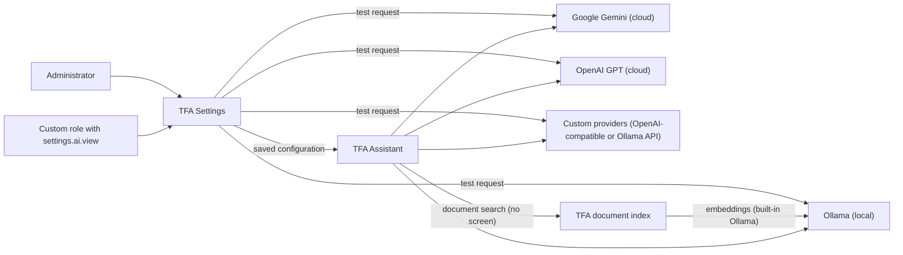
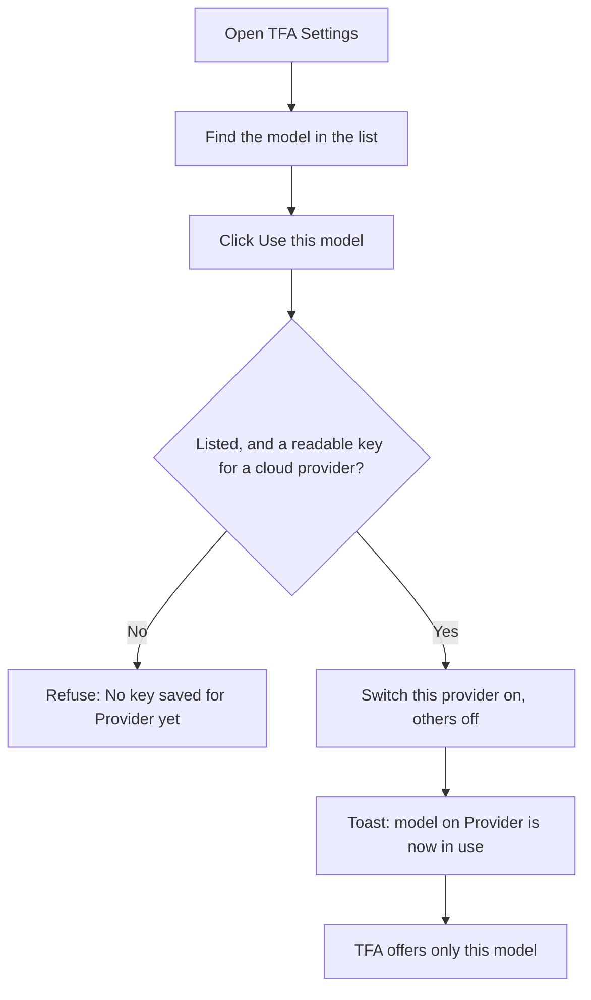
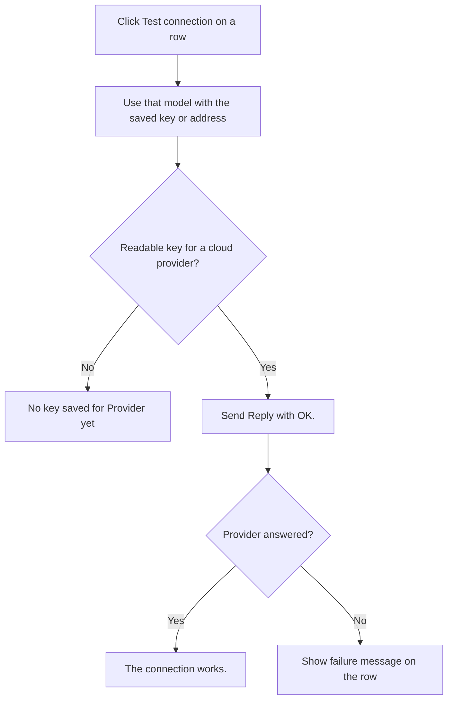
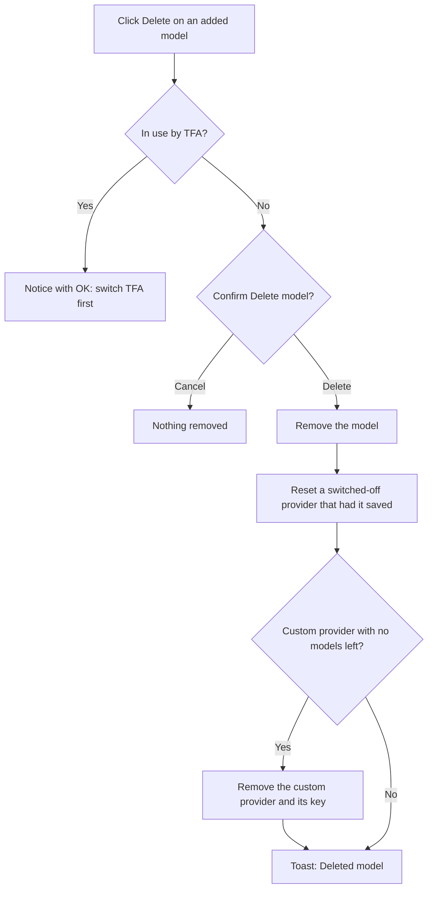
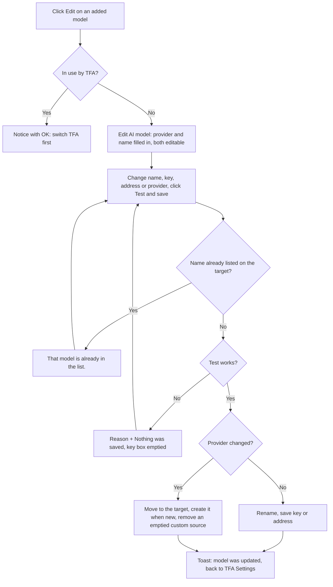
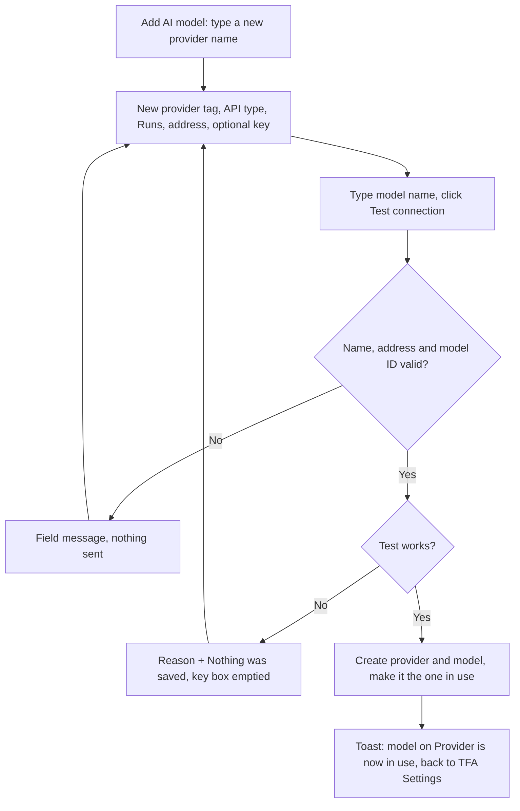
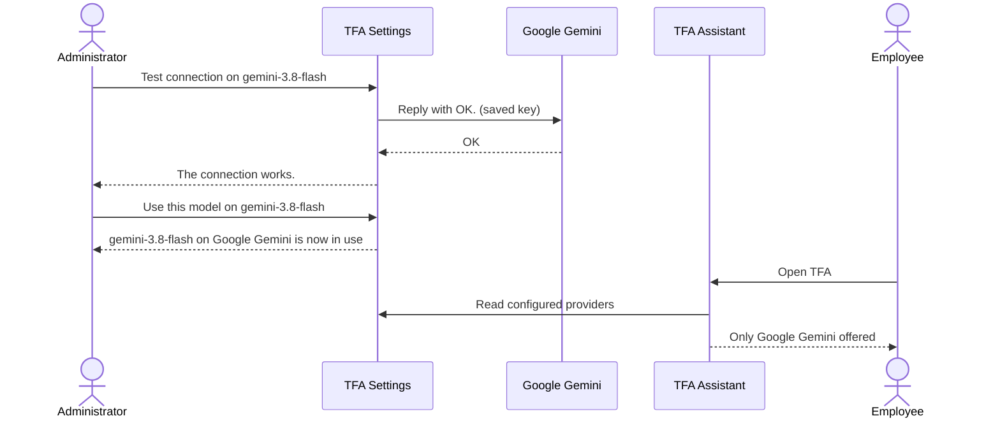

# Functional Requirements Document – TFA Settings

## TaskFlow – Intelligent Task Allocation & Tracking System

> **Document:** Functional Requirements Document  ·  **Version:** 1.5  ·  **Status:** Draft
> **Project type:** Personal Project (Skill Development)  ·  **Date:** 01-Nov-2026
> **Author:** Jojo George (jojogeorge3344@gmail.com)
> **Based on:** BRD-TFA-Settings.md v1.4
> **Module:** Settings  ·  **Sub-module:** 06.3 TFA Settings  ·  **Code:** TFAS
> © 2026 Jojo George. All rights reserved.

---

## Document Control

### Revision History

| Version | Date | Author | Summary of changes |
|---|---|---|---|
| 1.0 | 31-Oct-2026 | Jojo George | Initial version |
| 1.1 | 31-Oct-2026 | Jojo George | TFA answers TaskFlow questions from the documents folder (OpenSpec change `tfa-document-rag`), traced to BRD-TFA-Settings v1.1: Document search card (screen elements, FR-TFAS-29 – FR-TFAS-36, UC-TFAS-04, messages N-TFAS-12 – N-TFAS-16, data, NFR-TFAS-09 – NFR-TFAS-10, traceability); cloud explanation (FR-TFAS-23) mentions matching document text. |
| 1.2 | 01-Nov-2026 | Jojo George | OpenSpec change `tfa-document-rag` (revised, design D13 and D14), traced to BRD-TFA-Settings v1.2. **Document search** card, **Re-index now**, the 3-second status refresh and the endpoints `GET api/v1/assistant/documents/status` and `POST api/v1/assistant/documents/reindex` removed; indexing problems are written to the server log as warnings naming the folder or file. Withdrawn: permission-matrix rows, card screen elements, FR-TFAS-29 – FR-TFAS-36, UC-TFAS-04, workflow 5.3, N-TFAS-12 – N-TFAS-16, NFR-TFAS-10 and their traceability rows; reworded: context diagram, data, NFR-TFAS-09, BR-TFAS-10 trace. Added FR-TFAS-37 (model name is a model ID without spaces; example per provider; Google AI Studio hint), FR-TFAS-38 (Gemini model-name refusal reported as model not available), FR-TFAS-39 (Test connection adds the provider's status and reason, max 200 characters, keys as `[key]`), N-TFAS-17 – N-TFAS-19, NFR-TFAS-11; FR-TFAS-17, UC-TFAS-01/02 and field validations updated. Built-in Gemini models now `gemini-3.8-flash` (default), `gemini-3.5-flash`, `gemini-3.5-flash-lite` (FR-TFAS-03, workflow 5.1). |
| 1.3 | 01-Nov-2026 | Jojo George | OpenSpec change `tfa-gemini-model-id-validation`. FR-TFAS-37: model ID format per provider (Google Gemini: lowercase letters, digits, dots and hyphens; a leading `models/` is removed; OpenAI GPT and Ollama: no spaces), checked on the Add AI model screen and on the server, and on save for a switched-on provider or a changed name. FR-TFAS-38: a Gemini model-name refusal is now reported as an invalid model ID (failure kind `InvalidModelName`), separately from a model that is not available. Field validations and N-TFAS-17 updated. |
| 1.4 | 01-Nov-2026 | Jojo George | OpenSpec change `tfa-model-list-and-edit`, traced to BRD-TFA-Settings v1.3. TFA Settings is a read-only model list grouped by provider (heading **AI models**) with **Use this model**, **Test connection** and, on added models, **Edit** and **Delete**; the Add AI model screen gains an edit mode (**Edit AI model**, route `/settings/tfa/models/:kind/:name/edit`) with **Test and save** and **Remove the key**. Removed from the screen: Model and Server dropdowns, provider card with key / address inputs, **Remove the key** / **Keep the key**, **Remove this model from the list**, **Save TFA settings**. Added FR-TFAS-40 – FR-TFAS-48, UC-TFAS-05, N-TFAS-20 – N-TFAS-28, NFR-TFAS-12; withdrawn FR-TFAS-04, FR-TFAS-19, N-TFAS-01; reworded FR-TFAS-02, -05, -06, -11 – -15, -17, -20, -21, -25, -28, -37, UC-TFAS-01 – UC-TFAS-03 (with diagrams), permission matrix, screen elements, field validations, messages, workflows 5.1 and 5.2, open issues and traceability. The key stays one per provider; no data change. |
| 1.5 | 01-Nov-2026 | Jojo George | OpenSpec change `tfa-custom-ai-providers`, traced to BRD-TFA-Settings v1.4. **Custom providers**: the **AI provider** field on Add AI model and Edit AI model becomes a required text box with suggestions of the existing providers (no dropdown); a name matching an existing provider (ignoring case) behaves as that provider; a new name shows the **New provider** tag with **API type** (OpenAI-compatible or Ollama), **Runs** (Cloud or Local), **Server address** (required) and **API key** (optional), and the provider is created only when the test works. Edit can change the provider: the model moves to the target (existing or new) only on a passing test; the edit route is now `/settings/tfa/models/:providerId/:name/edit`. TFA Settings lists custom provider groups after the built-in ones; an emptied custom provider is removed. Added FR-TFAS-49 – FR-TFAS-58, UC-TFAS-06, N-TFAS-29 – N-TFAS-36, NFR-TFAS-13 – NFR-TFAS-14; reworded FR-TFAS-01, -05, -06, -07, -16, -23, -37, -40, -44, -45, -48, UC-TFAS-03, UC-TFAS-05 (with diagram), context diagram, definitions, scope, screen elements, field validations, messages, data, open issues and traceability. One data migration keeps all existing data. |

### Related Documents

| Document | Purpose | Location |
|---|---|---|
| BRD – TFA Settings | Business needs this FRD details (REQ-TFAS-nn, BR-TFAS-nn, AC-TFAS-nn) | `../../../BRD/06-Settings/06.3-TFA-Settings/BRD-TFA-Settings.md` |
| Overall FRD | Roles, global rules, Authentication, cross-cutting behaviour | `../../00-Overall/FRD-TaskFlow-Overall.md` |
| FRD – TFA Assistant | Chat window that uses this configuration; answers from the TaskFlow documents (4.1.2) | `../../08-TFA-Assistant/08.1-Assistant/FRD-Assistant.md` |
| FRD – Role Configuration | Grants the four `settings.ai.*` permissions | `../06.4-Role-Configuration/FRD-Role-Configuration.md` |
| OpenSpec change (custom AI providers, v1.5) | Source of the custom-provider requirements | `openspec/changes/tfa-custom-ai-providers/` |
| Development Plan | Screen-wise build plan | _Not applicable – not in the original 20-screen plan._ |
| HLD / LLD | Technical design | `../../../HLD/06-Settings/06.3-TFA-Settings/HLD-TFA-Settings.md`, `../../../LLD/06-Settings/06.3-TFA-Settings/LLD-TFA-Settings.md` |

---

## 1. Introduction

### 1.1 Purpose
This FRD specifies the detailed, testable behaviour of the TFA Settings screen, where an authorized user sees every AI
model TFA can use as a read-only list, switches TFA (the TaskFlow Assistant) to one of them, tests any of them, and adds,
edits and deletes models; the Ollama server address and cloud API keys are set on the Add AI model screen and its edit
mode (v1.4). Since v1.5 an administrator can also add custom providers (OpenAI-compatible or Ollama API) by typing a new
provider name, and move an added model to another provider on the edit mode. (The v1.1 Document search card was
withdrawn in v1.2; the document index has
no screen, and indexing problems go to the server log.)

### 1.2 Scope
In scope: the read-only model list grouped by provider with tag, key status (or Ollama address), origin and the model in
use (v1.4); **Use this model** (one active server); the per-model connection test, with the provider's own reason for an
unexpected error or a missing model; adding models, and editing and deleting added models (v1.4); the Ollama server
address; entering, keeping and removing Gemini and OpenAI keys on the Add AI model screen and its edit mode; the
model-name format; initial configuration; permission control of each action; (v1.5) custom providers – the **AI
provider** text box, creating a custom provider on a passing test, listing it, moving a model between providers, and
removing an emptied custom provider; the upgrade of the existing providers to built-in providers.

Out of scope (BRD §3.2): the TFA chat window (TFA Assistant FRD); usage or cost tracking; installing models on the
Ollama server; a separate key per model and hiding built-in models (v1.4); a custom provider using the Google Gemini
API, renaming a provider or changing its API type, listing a provider's models from its API, and document search through
a custom Ollama provider (v1.5); choosing the documents folder, embedding model or
search settings on the screen (server configuration `DocumentKnowledge`); uploading documents; PDF and Excel documents;
a screen or endpoint for the document index status or for starting a re-index (removed in v1.2 – the server builds the
index at start-up, re-checks the folder every `RescanMinutes` (default 5) and logs indexing problems as warnings).
_Withdrawn from out of scope in v1.5: "providers other than Ollama, Google Gemini and OpenAI GPT" and "custom
providers"._

### 1.3 Audience
Developer, tester, reviewer and product owner of TaskFlow.

### 1.4 Conventions
- Requirement IDs: `FR-TFAS-nn`. Use cases: `UC-TFAS-nn`. Business rules: `BR-TFAS-nn` (sub-module BRD) and `BR-nn` (overall BRD).
- Priority: **Must / Should / Could** (MoSCoW).
- "The system shall …" = mandatory behaviour; "should" = recommended.
- In messages, `Provider` stands for the provider's display name and `model` for the model name.

### 1.5 Definitions & Abbreviations

| Term | Meaning |
|---|---|
| TFA | TaskFlow Assistant, the AI chat assistant inside TaskFlow |
| Provider / server | A built-in provider – Ollama (local), Google Gemini or OpenAI GPT (cloud) – or (v1.5) a custom provider |
| Built-in provider | Google Gemini, OpenAI GPT or Ollama; shipped with TaskFlow, never removed (v1.5) |
| Custom provider | A provider added by typing a new name on Add AI model, with API type OpenAI-compatible or Ollama, its own server address, Local or Cloud, and an optional key; removed when its last model is deleted or moved away (v1.5) |
| API type | The client TaskFlow uses for a provider: OpenAI-compatible (chat completions at the provider's address), Google Gemini or Ollama (v1.5) |
| Move | Changing an added model's provider on Edit AI model; saved only when the test on the target works (v1.5) |
| Model | AI model name on a provider, for example `llama3.2:3b`; it is the provider's model ID and contains no spaces (v1.2) |
| Built-in model | A model that ships with TaskFlow; read-only, it cannot be changed or removed (v1.4 wording) |
| Added model | A model an administrator added on the **Add AI model** screen after its connection test worked; shown as **Added by you** and editable and deletable when not in use |
| Saved model | The model stored for a provider (by **Use this model**, adding a model, or a rename) |
| Model in use | The saved model of the enabled provider: the one TFA answers with, marked **In use** (v1.4) |
| Edit mode | The Add AI model screen opened by **Edit** (**Edit AI model**, `/settings/tfa/models/:providerId/:name/edit` since v1.5; v1.4: `:kind`, with the provider fixed); the provider is editable since v1.5 |
| Configured provider | Switched on, has a model, and has an address (Ollama, custom provider) or a readable key (built-in Gemini and OpenAI) |
| Connection test | One short request ("Reply with OK.") to check that the provider answers |
| Document search | TFA's index of the Markdown documents in the documents folder, used to answer questions about TaskFlow; built and kept current by the server, not shown on this screen since v1.2 |
| Embedding model | Ollama model (`nomic-embed-text` by default) that turns document text into vectors |
| Chunk | One section of a document as stored in the index |
| Indexing run | One check of the documents folder, at start-up and then every `RescanMinutes` (default 5): changed files are re-embedded, deleted ones removed |
| Provider's reason | The provider's own HTTP status and error text, shortened to 200 characters with any API key replaced by `[key]`, added to a failed connection test (v1.2) |

---

## 2. System Overview

### 2.1 Module Map

| Code | Module | Child modules | Primary roles |
|---|---|---|---|
| TFAS | Settings → TFA Settings | TFA Settings; Add AI model (add and edit mode) | Administrator, Custom role with `settings.ai.view` |
| TFA | TFA Assistant (related) | Chat window | Users with `assistant.chat` |
| ROLE | Settings → Role Configuration (related) | Grants `settings.ai.*` | Administrator |

### 2.2 Context Diagram

---

## 3. User Roles & Permissions

### 3.1 Roles

| Role | Description | Data scope |
|---|---|---|
| Administrator | Views, uses, tests, adds, edits and deletes models | Organization |
| Manager | No access to the screen by default | – |
| Employee | No access to the screen by default | – |
| Custom role | `settings.ai.view` opens the screen; `settings.ai.edit`, `settings.ai.test`, `settings.ai.model.remove` allow the actions | Organization |

### 3.2 Permission Matrix (functional view)

| Module › Function | Permission key | Administrator | Manager | Employee | Custom role |
|---|---|:---:|:---:|:---:|:---:|
| Settings › TFA Settings › View the model list, key status and the model in use | `settings.ai.view` | Granted | Denied | Denied | Configurable |
| Settings › TFA Settings › Use this model (v1.4) | `settings.ai.edit` (needs `settings.ai.view`) | Granted | Denied | Denied | Configurable |
| Settings › TFA Settings › Add AI model; Edit an added model, its key or address (v1.4); add a custom provider, move a model to another provider (v1.5) | `settings.ai.edit` + `settings.ai.test` (each needs `settings.ai.view`) | Granted | Denied | Denied | Configurable |
| Settings › TFA Settings › Test connection of a listed model | `settings.ai.test` (needs `settings.ai.view`) | Granted | Denied | Denied | Configurable |
| Settings › TFA Settings › Delete an added model | `settings.ai.model.remove` (needs `settings.ai.view`) | Granted | Denied | Denied | Configurable |
| Settings › TFA Settings › Choose model/server in dropdowns, address and key on the card, save (v1.0 – v1.3) | _Withdrawn in v1.4 – the screen is a read-only list; see the rows above._ | – | – | – | – |
| Settings › TFA Settings › Document search status / Re-index now (v1.1) | _Withdrawn in v1.2 – the Document search card was removed; indexing problems go to the server log._ | – | – | – | – |

> Manager and Employee values are the defaults given when the permission is first created. The Administrator role is
> given every permission again each time the application starts.

---

## 4. Functional Requirements by Module

### 4.1 Module: TFA Settings (TFAS)

**Purpose:** Show every model TFA can use, switch TFA to one, test any of them, and add, edit and delete added models.  ·
**BRD reference:** BRD-TFA-Settings SCREEN 1, BR-TFAS-01…BR-TFAS-18 (BR-TFAS-08 and BR-TFAS-09 withdrawn in v1.2)

#### 4.1.1 Screen: TFA Settings

| Field | Value |
|---|---|
| Route / location | `/settings/tfa` (menu **Settings → TFA Settings**) |
| Access | Administrator; Custom role with `settings.ai.view` (actions: `settings.ai.edit`, `settings.ai.test`, `settings.ai.model.remove`) |
| Entry points | Sidebar menu item **TFA Settings**; **Back to TFA settings** on the Add AI model and Edit AI model screens |

**Screen elements**

| Element | Type | Description | Mandatory | Visible to |
|---|---|---|:---:|---|
| **TFA settings** | Page title | – | – | `settings.ai.view` |
| **AI models** (v1.4; was **Model and server**) | Section heading + explanation | **Use this model** switches TFA to a model; a model is added, or one you added is changed, on the Add AI model screen. Ollama runs on your own server and is free; Google Gemini has a free tier with limits; OpenAI GPT has no free tier; Gemini and OpenAI are cloud services, so a user's question, related task details and matching TaskFlow document text are sent to them (v1.5: the same applies to a custom provider marked Cloud) | – | `settings.ai.view` |
| **Add AI model** | Button next to the section heading | Opens the Add AI model screen (`/settings/tfa/models/new`) | – | `settings.ai.edit` + `settings.ai.test` |
| Usage line | Text | "TFA uses **`model`** on **`Provider`**."; when no model is in use: "TFA has no model in use yet. Choose **Use this model** on a model below." | – | `settings.ai.view` |
| Provider group (v1.4) | Card per provider | Provider name and **Local** / **Cloud** tag, followed by one row per model (built-in first, then added ones); groups in the order Ollama, Google Gemini, OpenAI GPT, then custom providers by name (v1.5) | – | `settings.ai.view` |
| Model row (v1.4) | Read-only row | Model ID; "`Provider` · Local" or "`Provider` · Cloud"; key status "Key saved, ends …`last4`", "No key saved" or "The saved key can no longer be read" (built-in Gemini and OpenAI) or the server address (Ollama, default `http://localhost:11434`; custom provider, followed by " · key ends …`last4`" when a key is saved, v1.5); **Built-in** or **Added by you** (every custom-provider model is **Added by you**, v1.5); **In use** badge on the model TFA uses; for a cloud provider without a readable key the hint "No key saved for `Provider` yet. Add it on the Add AI model screen." At phone width the row is a stacked card | – | `settings.ai.view` |
| **Use this model** (v1.4) | Button on each row not in use | Makes that model the one TFA uses ("Switching…" while it runs); disabled with the no-key hint as tooltip when a cloud provider has no readable key | – | `settings.ai.edit` |
| **Test connection** (v1.4: per row) | Button + result on the row | Tests that row's model with the saved key or address ("Testing…" while it runs); nothing is saved | – | `settings.ai.test` |
| **Edit** (v1.4) | Button on added models only | Opens the Edit AI model screen; on the model in use shows the in-use notice instead | – | `settings.ai.edit` + `settings.ai.test` |
| **Delete** (v1.4) | Button on added models only | Asks "Delete `model`?" and deletes; on the model in use shows the in-use notice instead | – | `settings.ai.model.remove` |
| Notice / confirmation dialog (v1.4) | Dialog | In-use notice with only **OK**; delete confirmation with **Cancel** and **Delete** (danger) | – | as the button that opens it |
| **Model** / **Server** drop-downs, **Remove this model from the list**, provider card with **Server address** / **API key** and **Remove the key** / **Keep the key**, **Save TFA settings** | – | _Withdrawn in v1.4 – TFA Settings is a read-only model list; address and key are typed on the Add AI model screen and its edit mode._ | – | – |
| **Document search** card (v1.1) | – | _Withdrawn in v1.2 – the Document search card was removed; indexing problems go to the server log._ (v1.1: state, documents folder, embedding model, files, chunks, last indexed, last error and **Re-index now**.) | – | – |

**Add AI model screen – AI provider and new provider fields (v1.5)**

| Element | Type | Description | Mandatory | Visible to |
|---|---|---|:---:|---|
| **AI provider** | Text input with suggestions (datalist), not a dropdown | Placeholder "For example Google Gemini, or a new name such as Groq"; suggests Google Gemini, OpenAI GPT, Ollama and every custom provider, each with Local or Cloud; a typed name that matches an existing provider ignoring case and surrounding spaces behaves as that provider | Yes | `settings.ai.edit` + `settings.ai.test` |
| **New provider** tag and hint | Tag next to the label + text | Shown when the typed name matches no provider: "A provider TaskFlow does not know yet. It is added when the test works. Most services (Groq, Mistral, OpenRouter, LM Studio, vLLM) use the OpenAI-compatible API." | – | `settings.ai.edit` + `settings.ai.test` |
| **API type** (new provider) | Select | **OpenAI-compatible** (default) or **Ollama** | Yes | `settings.ai.edit` + `settings.ai.test` |
| **Runs** (new provider) | Select | "Cloud: questions leave the organisation" (default) or "Local: on your own server" | Yes | `settings.ai.edit` + `settings.ai.test` |
| **Server address** (new provider) | Text input | Placeholder "For example https://api.groq.com/openai/v1" (or `http://localhost:11434` for Ollama); hint "The address the service gives for its API, including the version path (for example /v1)." | Yes | `settings.ai.edit` + `settings.ai.test` |
| **API key** (new provider, OpenAI-compatible) | Password input | "(optional)"; hint "A local server may need no key. The key is stored encrypted and never shown again." Not shown for API type Ollama | No | `settings.ai.edit` + `settings.ai.test` |
| **Server address** / **API key** (existing custom provider) | Text inputs | Optional; an empty address uses the saved one; an empty key keeps the saved key ("Optional: a key for `Provider`, if its server needs one." when none is saved) | No | `settings.ai.edit` + `settings.ai.test` |

**Add AI model screen – model name and key hints (v1.2)**

| Element | Type | Description | Mandatory | Visible to |
|---|---|---|:---:|---|
| **Model name** | Text input | Placeholder shows an example model ID for the chosen provider's API type: "For example gemini-3.8-flash" (Google Gemini), "For example gpt-4o-mini" (OpenAI GPT and OpenAI-compatible), "For example llama3.2:3b" (Ollama) | Yes | `settings.ai.edit` + `settings.ai.test` |
| Gemini key hint | Text under **API key** | "Create a Gemini key in Google AI Studio: aistudio.google.com/apikey." (link); shown only for Google Gemini; the key is not judged by its prefix | – | `settings.ai.edit` + `settings.ai.test` |

**Add AI model screen – edit mode (Edit AI model, v1.4)**

| Element | Type | Description | Mandatory | Visible to |
|---|---|---|:---:|---|
| Route | – | `/settings/tfa/models/:providerId/:name/edit` (v1.5; v1.4: `:kind`), opened by **Edit** on an added model; same guard as `/settings/tfa/models/new` | – | `settings.ai.edit` + `settings.ai.test` |
| **Edit AI model** | Page title + text | "Change the model name, enter a new key or server address, or type another provider to move the model there, and test the connection. The changes are saved only when the test works; the model TFA uses does not change." (v1.5 wording) | – | `settings.ai.edit` + `settings.ai.test` |
| **AI provider** | Text input with suggestions (v1.5; v1.4: select, disabled) | Prefilled with the model's provider and editable; another existing provider or a new name (with the new-provider fields) makes the edit a move, shown by the hint "The model moves to `target` when the test works." | Yes | `settings.ai.edit` + `settings.ai.test` |
| **Model name** | Text input | Prefilled with the current name; same rules as on Add AI model | Yes | `settings.ai.edit` + `settings.ai.test` |
| **API key** (Gemini, OpenAI) | Password input | Empty; hint "A key is saved (ends …1234). Leave the box empty to keep it. A new key replaces it for every `Provider` model." | No | `settings.ai.edit` + `settings.ai.test` |
| **Remove the key** | Button under the key | Shown for a provider with a saved key; hidden while the provider is changed (v1.5); asks for confirmation, then removes the key without a test ("Removing…" while it runs) | – | `settings.ai.edit` + `settings.ai.test` |
| **Server address** (Ollama, custom provider) | Text input | Optional; empty uses the saved address or `http://localhost:11434` | No | `settings.ai.edit` + `settings.ai.test` |
| **Test and save** | Button | Tests the typed values; saves only when the test works ("Testing…" while it runs) | – | `settings.ai.edit` + `settings.ai.test` |
| **Back to TFA settings** / **Cancel** | Links | Return to TFA Settings without saving | – | `settings.ai.edit` + `settings.ai.test` |

**Functional requirements**

| ID | Requirement | Priority | Permission | BRD trace |
|---|---|---|---|---|
| FR-TFAS-01 | The system shall support three API types – OpenAI-compatible, Google Gemini and Ollama – with the built-in providers Ollama (local, no API key), Google Gemini and OpenAI GPT (cloud, API key needed), plus any number of custom providers of type OpenAI-compatible or Ollama (v1.5; v1.0 – v1.4: exactly three providers). | Must | `settings.ai.view` | REQ-TFAS-01 |
| FR-TFAS-02 | The system shall show one group per provider with its name and a **Local** or **Cloud** tag, listing its models, and shall mark the model TFA uses now with **In use** (v1.4; v1.0 – v1.3: a card for the selected provider with the status **In use**, **Ready to use**, **Needs an API key** or **Not configured**). | Must | `settings.ai.view` | REQ-TFAS-02 |
| FR-TFAS-03 | The system shall offer the built-in models Ollama `llama3.2:3b`, `llama3.2:1b`, `llama3.1:8b`, `qwen2.5:7b`, `mistral:7b`; Gemini `gemini-3.8-flash`, `gemini-3.5-flash`, `gemini-3.5-flash-lite` (v1.2; they replace the retired `gemini-2.0-flash`, `gemini-2.5-flash`, `gemini-2.5-pro`; saved settings that still name an old model keep it, and Test connection reports it); OpenAI `gpt-4o-mini`, `gpt-4o`, `gpt-4.1-mini`, grouped by provider, the first of each group being that provider's default. | Must | `settings.ai.view` | REQ-TFAS-03 |
| FR-TFAS-04 | _Withdrawn in v1.4 – the Model and Server drop-downs were removed; the model is chosen with **Use this model** (FR-TFAS-41)._ (v1.0: The system shall select the matching server when a model is chosen, and the provider's model when a server is chosen, and update the usage line accordingly.) | – | – | REQ-TFAS-04 (withdrawn) |
| FR-TFAS-05 | The system shall let the user add a model on a separate **Add AI model** screen opened from TFA Settings: type or pick the **AI provider** first (required; a text box with suggestions since v1.5, a new name adds a custom provider, FR-TFAS-49 – FR-TFAS-52), type a **Model name** of 1–100 characters (required), enter the **API key** for Gemini/OpenAI (required only when the provider has no readable saved key) or optionally the Ollama **Server address**, and click **Test connection**. The system shall test the typed values without saving them; only when the test works shall it add the model, save the key or address for the provider, make that provider and model the one TFA uses, and return to TFA Settings, where the model is listed as **Added by you** and **In use**. A failed test shall save nothing and show the reason on the screen. **Back to TFA settings** shall return without saving. | Should | `settings.ai.edit` + `settings.ai.test` | REQ-TFAS-05 |
| FR-TFAS-06 | The system shall let the user enter the **Server address** of Ollama or (v1.5) a custom provider on the Add AI model screen and its edit mode (v1.4; no longer on TFA Settings), and show the saved address on every row of that provider. | Must | `settings.ai.edit` + `settings.ai.test` | REQ-TFAS-06 |
| FR-TFAS-07 | The system shall accept only a valid http or https server address of at most 300 characters; it shall refuse link-local and cloud metadata addresses (for example 169.254.x.x, `metadata.google.internal`) and allow `localhost` and private addresses; since v1.5 this applies to every provider address, including a new custom provider's. | Must | `settings.ai.edit` | REQ-TFAS-07, BR-TFAS-06 |
| FR-TFAS-08 | The system shall let the user enter an API key for Gemini or OpenAI of at most 500 characters without spaces. | Must | `settings.ai.edit` | REQ-TFAS-08 |
| FR-TFAS-09 | The system shall refuse an API key sent for Ollama with "Ollama does not use an API key." | Must | `settings.ai.edit` | REQ-TFAS-09 |
| FR-TFAS-10 | The system shall store API keys protected and shall never display a saved key on any screen or return it in any response. | Must | `settings.ai.view` | REQ-TFAS-10, BR-TFAS-01 |
| FR-TFAS-11 | The system shall show for a saved key only that a key is saved and its last four characters: on every row of that provider as "Key saved, ends …1234" (v1.4), and on the Add AI model and Edit AI model screens as "A key is saved (ends …1234). Leave the box empty to keep it. A new key replaces it for every `Provider` model." | Must | `settings.ai.view` | REQ-TFAS-11, BR-TFAS-01, BR-TFAS-13 |
| FR-TFAS-12 | The system shall keep the saved key unchanged when the **API key** box on the Add AI model or Edit AI model screen is left empty (v1.4 wording). | Must | `settings.ai.edit` + `settings.ai.test` | REQ-TFAS-12 |
| FR-TFAS-13 | The system shall remove the saved key with **Remove the key** on the Edit AI model screen after confirmation (FR-TFAS-46, v1.4; **Keep the key** on the TFA Settings card was withdrawn), and refuse a request that sends a new key and removal together with "Provide a new key or clear the key, not both." | Must | `settings.ai.edit` + `settings.ai.test` | REQ-TFAS-13, REQ-TFAS-42 |
| FR-TFAS-14 | The system shall, on **Use this model** (FR-TFAS-41) and when a model is added (FR-TFAS-05), switch the chosen provider on and the other providers off, keeping their keys, addresses and models stored (v1.4; v1.0 – v1.3: when saving from the screen, with "TFA settings saved"). | Must | `settings.ai.edit` | REQ-TFAS-14, BR-TFAS-02 |
| FR-TFAS-15 | The system shall refuse a save request in which the same provider appears more than once (v1.4: the save request is kept for compatibility; the screen no longer sends it). | Must | `settings.ai.edit` | BR-TFAS-05 |
| FR-TFAS-16 | The system shall offer in the TFA window only providers that are configured: switched on, with a model, and with an address (Ollama, custom provider) or a readable key (built-in Gemini and OpenAI); a custom provider is offered like a built-in one (v1.5). | Must | – (TFA) | REQ-TFAS-15, BR-TFAS-03 |
| FR-TFAS-17 | The system shall, on **Test connection**, send one short request ("Reply with OK.") to the provider (v1.4: with the row's model, FR-TFAS-42) and show on the row "The connection works." or the plain failure message for the failure kind (not configured, key refused, rate limit, timeout, Ollama not reachable, model missing on Ollama, model not available on a cloud provider, unexpected error; the last two with the provider's reason, FR-TFAS-39). | Must | `settings.ai.test` | REQ-TFAS-16 |
| FR-TFAS-18 | The system shall always report a test result as a message and never as a screen error. | Must | `settings.ai.test` | REQ-TFAS-16 |
| FR-TFAS-19 | _Withdrawn in v1.4 – TFA Settings has nothing to save; the test uses the saved key or address (FR-TFAS-42)._ (v1.0: The system shall save unsaved changes before running a connection test.) | – | – | REQ-TFAS-17 (withdrawn) |
| FR-TFAS-20 | The system shall let the user delete a model an administrator added with **Delete** on its row, after confirmation, refresh the list from the response and show "Deleted `model`" (v1.4; v1.0 – v1.3: **Remove this model from the list** and "Removed `model` from the list"; see FR-TFAS-48). | Should | `settings.ai.model.remove` | REQ-TFAS-18 |
| FR-TFAS-21 | The system shall refuse to delete a built-in model ("A built-in model cannot be changed or removed.", v1.4), the model TFA uses ("`model` is in use by TFA. Switch TFA to another model first, then delete it.", v1.4; replaces "That model is the one saved for its server. …") or an unknown model ("That model is not in the list."). | Must | `settings.ai.model.remove` | REQ-TFAS-19, BR-TFAS-04, BR-TFAS-12 |
| FR-TFAS-22 | The system shall show "The saved key can no longer be read. Enter it again." and treat the cloud provider as not configured when a saved key can no longer be read. | Should | `settings.ai.view` | REQ-TFAS-20 |
| FR-TFAS-23 | The system shall explain on the screen that Gemini and OpenAI are cloud services that receive the user's question, related task details and matching TaskFlow document text; a custom provider marked Cloud is tagged **Cloud** and treated the same (v1.5). | Should | `settings.ai.view` | REQ-TFAS-21 |
| FR-TFAS-24 | The system shall, on a brand-new installation, switch Ollama on at `http://localhost:11434` and leave both cloud providers off without a key; on an upgraded installation it shall leave TFA off until an administrator turns a provider on. | Should | – (system) | REQ-TFAS-22 |
| FR-TFAS-25 | The system shall control viewing, using, editing, testing and model removal by `settings.ai.view`, `settings.ai.edit`, `settings.ai.test` and `settings.ai.model.remove`, refuse each action on the server without its permission, and hide **Use this model** (edit), **Test connection** (test), **Add AI model** and **Edit** (edit and test) and **Delete** (model removal) from users without the matching permission (v1.4). | Must | `settings.ai.*` | REQ-TFAS-23, BR-TFAS-07 |
| FR-TFAS-26 | The system shall allow `settings.ai.edit`, `settings.ai.test` and `settings.ai.model.remove` to be held only together with `settings.ai.view`. | Must | – (Role Configuration) | BR-TFAS-07 |
| FR-TFAS-27 | The system shall hide the **TFA Settings** menu item from users without `settings.ai.view` and return them to their dashboard when they open `/settings/tfa`. | Must | `settings.ai.view` | REQ-TFAS-24 |
| FR-TFAS-28 | The system shall confirm actions with the toasts "`model` on `Provider` is now in use" (use or add), "`model` was updated" (edit), "The `Provider` key was removed" and "Deleted `model`", and show "Could not load the TFA settings.", "Could not switch TFA to that model.", "Could not delete the model.", "Could not remove the key." or "The test could not be run." when these fail (v1.4; v1.0 – v1.3: "TFA settings saved" and "Removed `model` from the list"). | Should | `settings.ai.*` | REQ-TFAS-25 |
| FR-TFAS-29 | _Withdrawn in v1.2 – the Document search card was removed; indexing problems go to the server log._ (v1.1: The system shall show users with `settings.ai.view` a **Document search** card with the documents folder (full path), the embedding model, the number of indexed files and chunks, and when indexing last finished ("Not yet" before the first run), and refuse the status to other users (403).) | – | – | REQ-TFAS-26, BR-TFAS-08 (withdrawn) |
| FR-TFAS-30 | _Withdrawn in v1.2 – the Document search card was removed; indexing problems go to the server log._ (v1.1: The system shall mark the folder **Not found** when the documents folder does not exist.) | – | – | REQ-TFAS-27 (withdrawn) |
| FR-TFAS-31 | _Withdrawn in v1.2 – the Document search card was removed; indexing problems go to the server log._ (v1.1: The system shall show the state **Indexing…** while a run is going and **Up to date** otherwise.) | – | – | REQ-TFAS-26 (withdrawn) |
| FR-TFAS-32 | _Withdrawn in v1.2 – the Document search card was removed; indexing problems go to the server log._ (v1.1: The system shall show the last indexing error and, when it concerns one document, "File: `path`" (for example the Ollama server not reachable, the embedding model not installed, the folder not found, or a document that could not be indexed).) | – | – | REQ-TFAS-28 (withdrawn) |
| FR-TFAS-33 | _Withdrawn in v1.2 – the Document search card was removed; indexing problems go to the server log._ (v1.1: The system shall show **Re-index now** only to users with `settings.ai.edit` while document search is switched on; a click asks the server to check the folder at once and answers 202 Accepted with the status shown as running. Users without `settings.ai.edit` are refused (403).) | – | – | REQ-TFAS-29, BR-TFAS-08 (withdrawn) |
| FR-TFAS-34 | _Withdrawn in v1.2 – the Document search card was removed; indexing problems go to the server log._ (v1.1: The system shall accept a re-index request while a run is going or already requested without starting a second run, and disable the button while a run is going.) | – | – | REQ-TFAS-30, BR-TFAS-09 (withdrawn) |
| FR-TFAS-35 | _Withdrawn in v1.2 – the Document search card was removed; indexing problems go to the server log._ (v1.1: The system shall ask for the status again every 3 seconds while a run is going, and stop when it has finished.) | – | – | REQ-TFAS-31 (withdrawn) |
| FR-TFAS-36 | _Withdrawn in v1.2 – the Document search card was removed; indexing problems go to the server log._ (v1.1: The system shall, when document search is switched off in the server configuration (`DocumentKnowledge:Enabled` = false), show **Switched off** with "Document search is switched off in the server configuration (DocumentKnowledge:Enabled). TFA cannot answer questions about TaskFlow's documents until it is switched on.", hide **Re-index now**, and refuse a re-index request (400) with "Document search is switched off in the server configuration (DocumentKnowledge:Enabled).") | – | – | REQ-TFAS-32 (withdrawn) |
| FR-TFAS-37 | The system shall refuse a model name that is not a model ID for the chosen provider – on the Add AI model screen and its edit mode (before any test is sent, v1.4) and in a save request (for a switched-on provider, or a name that differs from the saved one) – both on the screen and on the server. For Google Gemini a model ID is lowercase letters, digits, dots and hyphens, starting with a letter or digit, and a leading `models/` is removed before the check and before saving (v1.3); the message is "A Google Gemini model name is its model ID: lowercase letters, digits, dots and hyphens, for example gemini-3.8-flash. The name you gave your key in Google AI Studio is not a model ID." For OpenAI GPT and Ollama only whitespace is refused, with "A model name is the provider's model ID, without spaces, for example gpt-4o-mini." (or `llama3.2:3b`). Since v1.5 the rule follows the provider's API type: custom OpenAI-compatible and Ollama providers refuse only whitespace, so IDs such as `meta-llama/Llama-3.3-70B-Instruct` and `llama3.2:3b` are accepted. There is no allow-list of model names; Test connection checks that the model exists. The Add AI model screen shall show an example model ID for the chosen provider and, for Google Gemini, say that the key is created in Google AI Studio (aistudio.google.com/apikey), without judging a key by its prefix. | Must | `settings.ai.edit` | REQ-TFAS-33, BR-TFAS-11 |
| FR-TFAS-38 | The system shall report a Google Gemini answer HTTP 400 `INVALID_ARGUMENT` whose message mentions the model name (for example "unexpected model name format") as an invalid model ID (failure kind `InvalidModelName`, v1.3: "Google Gemini did not accept the configured model name as a model ID. Ask an administrator to set a valid model ID, for example gemini-3.8-flash, or choose another model."), not as model not available or an unexpected error; a 404 `NOT_FOUND` stays "The configured model is not available on Google Gemini. …"; a 400 about the API key (for example "API key not valid") shall still be reported as "Google Gemini did not accept the API key. …". | Should | `settings.ai.test` | REQ-TFAS-34 |
| FR-TFAS-39 | The system shall, when a connection test (on TFA Settings or on Add AI model) fails with an unexpected error or model not available, add the provider's own status and reason to the message as "`Provider` said: HTTP `status` - `reason`" (for example "Google Gemini said: HTTP 404 - NOT_FOUND: This model models/gemini-2.0-flash is no longer available … use models/gemini-3.8-flash"); the reason shall be at most 200 characters with any API key replaced by `[key]`. TFA chat replies to users shall keep the plain message without the reason, and the server log warning for the failed test shall include the same reason. | Should | `settings.ai.test` | REQ-TFAS-35 |
| FR-TFAS-40 | The system shall show on TFA Settings every model of every provider as a read-only list grouped by provider (Ollama, Google Gemini, OpenAI GPT, then custom providers by name, v1.5), each row with the model ID, "`Provider` · Local" or "`Provider` · Cloud", the provider's key status ("Key saved, ends …1234", "No key saved", "The saved key can no longer be read") or for Ollama and custom providers its server address (a custom provider adds " · key ends …1234" when a key is saved, v1.5), **Built-in** or **Added by you**, and an **In use** badge on exactly the model saved on the enabled provider; above the list the line "TFA uses `model` on `Provider`."; no Model or Server drop-down, key or address input, or Save button; at phone width each row shall be a stacked card with the same details and actions, without horizontal scrolling (v1.4). | Must | `settings.ai.view` | REQ-TFAS-36, BR-TFAS-14 |
| FR-TFAS-41 | The system shall show **Use this model** on each row not in use to users holding `settings.ai.edit`; a click shall make that provider and model the ones TFA uses in one step, switch the other providers off without deleting their keys or models, refresh the list and show the toast "`model` on `Provider` is now in use". For a cloud provider without a readable key the button shall be disabled with the hint "No key saved for `Provider` yet. Add it on the Add AI model screen.", and the server shall refuse such a request (400) with the same text and change nothing; an unknown model shall be refused (404 "That model is not in the list.") (v1.4). | Must | `settings.ai.edit` | REQ-TFAS-37, BR-TFAS-02 |
| FR-TFAS-42 | The system shall show **Test connection** on every row to users holding `settings.ai.test`; it shall send one short request to that row's provider with that row's model and the saved key or address, also when the provider is switched off, save nothing, leave the model in use unchanged, and show the result on that row with the same messages as Add AI model (FR-TFAS-17, FR-TFAS-39); a cloud provider without a readable key gives "No key saved for `Provider` yet. Add it on the Add AI model screen." (v1.4). | Must | `settings.ai.test` | REQ-TFAS-38 |
| FR-TFAS-43 | The system shall show no **Edit** or **Delete** on built-in models (they keep **Use this model** and **Test connection**), and refuse a request to edit or delete one with "A built-in model cannot be changed or removed." (400) (v1.4). | Must | `settings.ai.edit` / `settings.ai.model.remove` | REQ-TFAS-39, BR-TFAS-04 |
| FR-TFAS-44 | The system shall show **Edit** on models an administrator added to users holding `settings.ai.edit` and `settings.ai.test`; it shall open the Add AI model screen in edit mode at `/settings/tfa/models/:providerId/:name/edit` (v1.5; v1.4: `:kind`) with the title **Edit AI model**, the provider filled in and editable (v1.5, FR-TFAS-55; v1.4: fixed), the model name filled in, the key box empty with "A key is saved (ends …1234). Leave the box empty to keep it. A new key replaces it for every `Provider` model." (Gemini, OpenAI, custom OpenAI-compatible) or the optional **Server address** (Ollama, custom provider), and **Test and save**. Opening the edit address of an unknown, built-in or in-use model shall return to TFA Settings with the reason as an error toast (v1.4). | Should | `settings.ai.edit` + `settings.ai.test` | REQ-TFAS-40 |
| FR-TFAS-45 | The system shall, on **Test and save**, test the typed values without saving; only when the test works shall it rename the model if the name changed (a switched-off provider that had the old name saved follows the rename), save a typed key or Ollama address for the provider, keep the model TFA uses unchanged, show "`model` was updated" and return to TFA Settings. A failed test shall save nothing, show the reason followed by "Nothing was saved.", keep the typed name and empty the key box. A new name already listed for that provider shall be refused with "That model is already in the list." before any test. The model ID rules of FR-TFAS-37 apply (v1.4). When the provider was changed, the move rules of FR-TFAS-56 apply instead (v1.5). | Should | `settings.ai.edit` + `settings.ai.test` | REQ-TFAS-41, BR-TFAS-14 |
| FR-TFAS-46 | The system shall show **Remove the key** on the Edit AI model screen of a cloud provider with a saved key; a click shall ask "Remove the `Provider` key?" with "The key is removed for every `Provider` model." and, when TFA uses that provider, " TFA uses `Provider`, so TFA is unavailable until a key is added again."; after confirming, the key shall be removed without a test being sent, every row of that provider shall show "No key saved", the toast "The `Provider` key was removed" shall be shown and the screen shall return to TFA Settings. A removal sent together with other changes shall be refused with "Remove the key on its own, without other changes." (v1.4). | Should | `settings.ai.edit` + `settings.ai.test` | REQ-TFAS-42, BR-TFAS-13 |
| FR-TFAS-47 | The system shall not edit or delete the model TFA uses: **Edit** or **Delete** on the row marked **In use** shall show the notice "`model` is in use by TFA. Switch TFA to another model first, then edit it." (or "… then delete it.") with only an **OK** button, and nothing shall change; the server shall refuse an edit or delete request for that model (400) with the same message (v1.4). | Must | `settings.ai.edit` / `settings.ai.model.remove` | REQ-TFAS-43, BR-TFAS-04, BR-TFAS-12 |
| FR-TFAS-48 | The system shall show **Delete** on models an administrator added to users holding `settings.ai.model.remove`; for a model TFA does not use it shall ask "Delete `model`?" ("`model` is removed from the `Provider` models. The `Provider` key stays saved.", danger) and, after confirmation, remove it from the list and show "Deleted `model`"; **Cancel** removes nothing. If a switched-off provider still has that model saved, its saved model shall be reset to the provider's default (`llama3.2:3b`, `gemini-3.8-flash`, `gpt-4o-mini`) and the provider stays switched off (v1.4). Deleting a custom provider's last model removes that provider (FR-TFAS-54, v1.5). | Should | `settings.ai.model.remove` | REQ-TFAS-44, BR-TFAS-12 |
| FR-TFAS-49 | The system shall make **AI provider** on Add AI model and Edit AI model a required text input with a list of suggestions holding every existing provider name (built-in and custom), not a dropdown; a blank value shall be refused on the screen with "Enter the AI provider." and nothing sent (v1.5). | Must | `settings.ai.edit` + `settings.ai.test` | REQ-TFAS-45 |
| FR-TFAS-50 | The system shall treat a typed name that matches an existing provider, ignoring case and surrounding spaces, as that provider: show its own key field (Gemini, OpenAI-compatible) and/or address field (Ollama, custom provider), and no API type, Runs or second address field. A name that only resembles a built-in one (for example "gemini") is a new provider (v1.5). | Must | `settings.ai.edit` + `settings.ai.test` | REQ-TFAS-46 |
| FR-TFAS-51 | The system shall, for a typed name that matches no provider, show the **New provider** tag and the fields **API type** (OpenAI-compatible or Ollama), **Runs** (Cloud or Local, default Cloud), **Server address** (required) and **API key** (optional, OpenAI-compatible only, at most 500 characters, no spaces). The name shall be 2 to 40 characters ("The provider name must be 2 to 40 characters.") and not used by another provider ignoring case ("A provider with that name already exists."); an empty address shall give "Enter the server address."; an unsafe address the FR-TFAS-07 message; nothing is sent while a field is invalid (v1.5). | Must | `settings.ai.edit` + `settings.ai.test` | REQ-TFAS-47, BR-TFAS-15 |
| FR-TFAS-52 | The system shall test a new provider's typed values without saving; only when the test works shall it create the custom provider, add the model, save the key protected, make that provider and model the ones TFA uses (other providers switched off), show "`model` on `Provider` is now in use" and return to TFA Settings. A failed test shall create no provider and no model, show the reason followed by "Nothing was saved." and empty the key box (v1.5). | Must | `settings.ai.edit` + `settings.ai.test` | REQ-TFAS-48 |
| FR-TFAS-53 | The system shall refuse a custom provider of type Google Gemini with "A custom provider can use the OpenAI-compatible or Ollama API.", and a request that names both an existing provider and a new one with "Choose an existing provider or a new one, not both." (v1.5). | Must | `settings.ai.edit` + `settings.ai.test` | REQ-TFAS-49 |
| FR-TFAS-54 | The system shall list each custom provider as its own group after the built-in ones, with its name, **Local** or **Cloud**, server address and key status; its models shall be added models with **Use this model**, **Test connection**, **Edit** and **Delete** under FR-TFAS-41 – FR-TFAS-48. When a custom provider's last model is deleted or moved away, the provider and its key shall be removed and its group disappears; a built-in provider shall never be removed (v1.5). | Must | `settings.ai.view` | REQ-TFAS-50, REQ-TFAS-51, BR-TFAS-16 |
| FR-TFAS-55 | The system shall, on Edit AI model, prefill **AI provider** with the model's provider and keep it editable; when the typed provider differs from the current one it shall show "The model moves to `target` when the test works.", hide **Remove the key**, and show the target's fields (an existing provider's key or address, or the new-provider fields of FR-TFAS-51) (v1.5). | Should | `settings.ai.edit` + `settings.ai.test` | REQ-TFAS-52 |
| FR-TFAS-56 | The system shall, on **Test and save** with a changed provider, refuse a name the target already lists with "That model is already in the list." before any test; otherwise test the model on the target with the typed key or address, or the target's saved ones; only on a pass shall it, in one step, create the target when it is new, remove the model from the old provider, add it to the target, save a typed key or address for the target, reset a switched-off source provider that had it saved to its default model, and remove the source when it is a custom provider with no models left. Which model TFA uses shall not change; the model in use is still refused (FR-TFAS-47); **Remove the key** together with a move shall be refused with "Remove the key on its own, without other changes."; a failed test shall leave the model where it was, show the reason and "Nothing was saved." and empty the key box (v1.5). | Should | `settings.ai.edit` + `settings.ai.test` | REQ-TFAS-52, BR-TFAS-17 |
| FR-TFAS-57 | The system shall name the provider in every test and chat failure message, also for a custom provider (for example "Groq did not accept the API key. …"), and treat a Local custom provider like Ollama ("`Provider` is not running or cannot be reached. …") and a Cloud one like Gemini and OpenAI (v1.5). | Should | `settings.ai.test` | REQ-TFAS-53, BR-TFAS-18 |
| FR-TFAS-58 | The system shall, on upgrading an installation from before v1.5, keep Google Gemini, OpenAI GPT and Ollama as built-in providers with their keys, models, saved model and enabled flag unchanged, and keep the provider shown on earlier chat messages; an unknown provider in a request shall be refused (404 "That AI provider does not exist.") (v1.5). | Must | – (system) | REQ-TFAS-54 |

**Use case: UC-TFAS-01 – Choose the model TFA uses (v1.4)**

| Item | Detail |
|---|---|
| Actor | Administrator or Custom role user |
| Preconditions | Signed in; holds `settings.ai.view` and `settings.ai.edit` |
| Trigger | Opens **Settings → TFA Settings** to set up or change TFA's model |
| Main flow | 1. System lists every model grouped by provider and marks the one in use (FR-TFAS-02, FR-TFAS-40). 2. User clicks **Use this model** on a row that is not in use (FR-TFAS-41). 3. System checks the model is listed and, for a cloud provider, that a readable key is saved. 4. System switches that provider on with this model and the others off, keeping their keys and models (FR-TFAS-14). 5. List refreshed; toast "`model` on `Provider` is now in use" (FR-TFAS-28). 6. TFA offers only this configuration (FR-TFAS-16). |
| Alternate flows | A1: The model is not listed → **Add AI model** → provider, model name, key or address → **Test connection** → saved and made the one in use only if the test works (FR-TFAS-05). A2: A key or address must change → **Edit** on an added model of that provider (UC-TFAS-05), or **Add AI model** for a provider with only built-in models. |
| Exceptions | E1: Cloud provider without a readable key → button disabled with "No key saved for `Provider` yet. Add it on the Add AI model screen."; a direct request is refused (400) with the same text and nothing changes. E2: Model not in the list → "That model is not in the list." (404). E3: Request fails → "Could not switch TFA to that model." E4: User without `settings.ai.edit` → no **Use this model** shown; a direct request gets 403. E5: Model name with whitespace on Add AI model (for example `Gemini API Key`) → "A model name is the provider's model ID, without spaces, for example gemini-3.8-flash."; no test sent, nothing saved (FR-TFAS-37). |
| Postconditions | Chosen provider on, others off with keys and models kept; key never shown again (FR-TFAS-10, FR-TFAS-11). |

_v1.0 – v1.3 main flow withdrawn in v1.4: pick a model (server follows) or a server (model follows), type the address or key
on the provider card, click **Save TFA settings**, toast "TFA settings saved"._

**Use case: UC-TFAS-02 – Test a listed model (v1.4)**

| Item | Detail |
|---|---|
| Actor | Administrator or Custom role user; AI provider |
| Preconditions | Signed in; holds `settings.ai.view` and `settings.ai.test` |
| Trigger | Clicks **Test connection** on a model's row |
| Main flow | 1. System builds the request with that row's model and the provider's saved key or address, whether or not the provider is switched on (FR-TFAS-42). 2. System sends "Reply with OK." to the provider (FR-TFAS-17). 3. Provider answers. 4. System shows "The connection works." on that row; nothing is saved. |
| Alternate flows | A1: Clicking **Test connection** again starts the test over. |
| Exceptions | E1: Not configured → "`Provider` is not configured. Choose another model, or ask an administrator to set it up." E2: Key refused → "`Provider` did not accept the API key. …" E3: Rate limit → "`Provider`'s free limit or rate limit has been reached. Try again in about a minute, or choose another model." E4: Timeout → "`Provider` took too long to answer. You can retry, or choose another model." E5: Ollama not reachable → "Ollama is not running or cannot be reached. Ask an administrator to start it, or choose another model." E6: Model missing on Ollama → "The configured model is not available on Ollama. …" E7: Cloud provider without a readable key → "No key saved for `Provider` yet. Add it on the Add AI model screen." (v1.4; the v1.0 – v1.3 exception "automatic save refused" was withdrawn with FR-TFAS-19). E8: Model not available on Google Gemini or OpenAI GPT (including a Gemini 400 `INVALID_ARGUMENT` about the model name, FR-TFAS-38) → "The configured model is not available on `Provider`. Ask an administrator to check the model name, or choose another model." followed by the provider's reason (FR-TFAS-39). E9: Unexpected error → "`Provider` returned an unexpected error. Please try again, or choose another model." followed by "`Provider` said: HTTP `status` - `reason`" (FR-TFAS-39). E10: Request fails → "The test could not be run." |
| Postconditions | Result message shown on the row; configuration and the model in use unchanged. |

**Use case: UC-TFAS-04 – Check document search and re-index (v1.1) – Withdrawn in v1.2**

_Withdrawn in v1.2 – the Document search card was removed; indexing problems go to the server log._ The server builds
the document index at start-up and re-checks the folder every `RescanMinutes` (default 5), re-embedding only changed
files; there is no screen or endpoint to view the index status or start a run (`GET api/v1/assistant/documents/status`
and `POST api/v1/assistant/documents/reindex` now answer 404). A missing documents folder, an embedding model that
cannot be reached (the run stops) and a file that could not be indexed are written to the server log as warnings naming
the folder or file. TFA tells users when the documents cannot be searched right now or are still being prepared
(FRD-Assistant).

**Use case: UC-TFAS-03 – Delete an added model (v1.4)**

| Item | Detail |
|---|---|
| Actor | Administrator or Custom role user |
| Preconditions | Signed in; holds `settings.ai.view` and `settings.ai.model.remove`; an added model exists |
| Trigger | Clicks **Delete** on the row of an added model |
| Main flow | 1. The model is not in use, so the system asks "Delete `model`?" (FR-TFAS-48). 2. User clicks **Delete**. 3. System checks the model is not built-in and not in use (FR-TFAS-21). 4. System removes it; a switched-off provider that still had it saved goes back to its default model; a custom provider left with no models is removed with its key (v1.5, FR-TFAS-54). 5. List refreshed; toast "Deleted `model`" (FR-TFAS-20). |
| Alternate flows | A1: User clicks **Cancel** → nothing removed. |
| Exceptions | E1: Model in use → notice "`model` is in use by TFA. Switch TFA to another model first, then delete it." with only **OK**; nothing changes (FR-TFAS-47). E2: Built-in (direct request) → "A built-in model cannot be changed or removed." E3: Not found → "That model is not in the list." E4: Failure → "Could not delete the model." |
| Postconditions | Model no longer listed; no other model changes; an emptied custom provider's group is gone (v1.5). |

**Use case: UC-TFAS-05 – Edit an added model (v1.4)**

| Item | Detail |
|---|---|
| Actor | Administrator or Custom role user; AI provider |
| Preconditions | Signed in; holds `settings.ai.view`, `settings.ai.edit` and `settings.ai.test`; an added model exists that TFA does not use |
| Trigger | Clicks **Edit** on the row of an added model |
| Main flow | 1. System opens **Edit AI model** with the provider filled in and editable (v1.5; v1.4: fixed), the name filled in and the key box empty (FR-TFAS-44). 2. User changes the name and/or types a new key or server address. 3. User clicks **Test and save**. 4. System checks the fields and that the new name is not already listed. 5. System tests the typed values (an empty key box uses the saved key) (FR-TFAS-45). 6. Test works → model renamed, key or address saved, model in use unchanged. 7. Toast "`model` was updated"; back to TFA Settings. |
| Alternate flows | A1: **Remove the key** → confirmation "Remove the `Provider` key?" → key removed without a test; toast "The `Provider` key was removed"; back to TFA Settings (FR-TFAS-46). A2: **Back to TFA settings** or **Cancel** → nothing saved. A3 (v1.5): User types another existing provider or a new name → hint "The model moves to `target` when the test works." and the target's fields (FR-TFAS-55) → **Test and save** → test on the target → on a pass the model is moved (a new target is created, an emptied custom source removed) (FR-TFAS-56). |
| Exceptions | E1: Model in use → notice "`model` is in use by TFA. Switch TFA to another model first, then edit it." with only **OK**; the edit screen does not open (FR-TFAS-47). E2: Edit address of an unknown, built-in or in-use model → back to TFA Settings with the reason as an error toast. E3: Name already listed (on the target, when moving) → "That model is already in the list."; nothing tested or saved. E4: Test fails → reason + "Nothing was saved."; key box emptied; a model being moved stays where it was. E5: Model ID format → FR-TFAS-37 messages (by the target's API type). E6: New key and removal together → "Provide a new key or clear the key, not both."; removal with other changes, including a move → "Remove the key on its own, without other changes." E7: Removing the key fails → "Could not remove the key." E8 (v1.5): New target invalid → FR-TFAS-51 and FR-TFAS-53 messages. |
| Postconditions | Model renamed and/or provider key or address replaced (for every model of that provider), or (v1.5) moved to the target provider; which model TFA uses is unchanged. |

**Use case: UC-TFAS-06 – Add a custom provider (v1.5)**

| Item | Detail |
|---|---|
| Actor | Administrator or Custom role user; AI provider |
| Preconditions | Signed in; holds `settings.ai.view`, `settings.ai.edit` and `settings.ai.test` |
| Trigger | Clicks **Add AI model** and types a provider name that matches no existing provider |
| Main flow | 1. System shows the **New provider** tag and the API type, Runs, Server address and API key fields (FR-TFAS-51). 2. User chooses API type and Runs, types the address, model name and an optional key. 3. User clicks **Test connection**. 4. System checks the name, address and model ID (FR-TFAS-07, FR-TFAS-37, FR-TFAS-51, FR-TFAS-53). 5. System tests the typed values without saving. 6. Test works → provider created, model added, key saved protected, model made the one TFA uses (FR-TFAS-52). 7. Toast "`model` on `Provider` is now in use"; back to TFA Settings, where the provider's group is listed after the built-in ones (FR-TFAS-54). |
| Alternate flows | A1: The typed name matches an existing provider in any case → the screen behaves as for that provider (FR-TFAS-50). A2: **Back to TFA settings** or **Cancel** → nothing saved. |
| Exceptions | E1: Blank provider → "Enter the AI provider." E2: Name length → "The provider name must be 2 to 40 characters." E3: Name used → "A provider with that name already exists." E4: Address empty → "Enter the server address."; unsafe → "The server address must be a valid http or https URL, and not a link-local or cloud metadata address." E5: Type Google Gemini (direct request) → "A custom provider can use the OpenAI-compatible or Ollama API." E6: Test fails → no provider or model created; reason (naming the provider, FR-TFAS-57) + "Nothing was saved."; key box emptied. |
| Postconditions | Custom provider with one model exists and is in use; the other providers are switched off with their keys and models kept. |

**Field validations**

| Field | Rule | Error message |
|---|---|---|
| Add AI model / Edit AI model: provider (v1.5) | Required text; matches an existing provider ignoring case, or is a new name | Screen and server: "Enter the AI provider." (v1.4: "Choose the AI provider.") |
| New provider: name (v1.5) | 2–40 characters; not used by another provider, ignoring case | "The provider name must be 2 to 40 characters." / "A provider with that name already exists." |
| New provider: API type (v1.5) | OpenAI-compatible or Ollama | "A custom provider can use the OpenAI-compatible or Ollama API." |
| New provider: server address (v1.5) | Required; same rules as the Ollama address | "Enter the server address." / server-address message below |
| New provider: Runs (v1.5) | Local or Cloud; default Cloud | – |
| Provider in the request (v1.5) | An existing provider id or a new provider, not both; the id must exist | "Choose an existing provider or a new one, not both." / "That AI provider does not exist." (404) |
| Add AI model: model name | Required; 1–100 characters; model ID format of the chosen provider (v1.3) | Server: "Enter the model name." / "The model name can be at most 100 characters." Screen: "Enter the model name (100 characters at most)." Format, server and screen: Gemini "A Google Gemini model name is its model ID: lowercase letters, digits, dots and hyphens, for example gemini-3.8-flash. The name you gave your key in Google AI Studio is not a model ID."; others "A model name is the provider's model ID, without spaces, for example gpt-4o-mini / llama3.2:3b." |
| Model name in a save request (v1.3; the screen no longer saves since v1.4) | Model ID format of the provider, for a switched-on provider or a changed name | "Google Gemini: A Google Gemini model name is its model ID: lowercase letters, digits, dots and hyphens, for example gemini-3.8-flash. The name you gave your key in Google AI Studio is not a model ID." (others: "A model name is the provider's model ID, without spaces, for example gpt-4o-mini / llama3.2:3b.") |
| Add AI model: API key | Gemini/OpenAI: required when no readable key is saved; no spaces; max 500 | Server and screen: "Enter the API key." |
| Server address (Ollama, custom provider) | Valid http/https URL; at most 300 characters; not link-local or cloud metadata | Server: "The server address must be a valid http or https URL, and not a link-local or cloud metadata address." Screen: "Enter a valid http or https address." |
| API key (cloud, custom OpenAI-compatible) | Optional; at most 500 characters; no spaces; empty keeps the saved key | "The API key cannot contain spaces." / screen "The key cannot contain spaces." |
| API key (Ollama) | Not allowed | "Ollama does not use an API key." |
| New key + Remove the key | Not both in one request | "Provide a new key or clear the key, not both." |
| Providers in one save request | Each provider at most once | Save refused |
| Edit: model name (v1.4) | Same rules as Add AI model; must not already be listed for the provider | "That model is already in the list." |
| Edit: Remove the key (v1.4) | Sent on its own, with the current name, no address and (v1.5) no change of provider | "Remove the key on its own, without other changes." |
| Edit: move (v1.5) | Model name not already listed on the target; test on the target passes | "That model is already in the list." / test message + "Nothing was saved." |
| Edit / delete target (v1.4) | Must be listed, added (not built-in) and not in use | "That model is not in the list." / "A built-in model cannot be changed or removed." / "`model` is in use by TFA. Switch TFA to another model first, then edit it." (or "… delete it.") |
| Use this model (v1.4) | Model listed; cloud provider has a readable key | "That model is not in the list." / "No key saved for `Provider` yet. Add it on the Add AI model screen." |

**Business rules applied:** BR-TFAS-01 … BR-TFAS-07, BR-TFAS-10 … BR-TFAS-18 (BR-TFAS-08 and BR-TFAS-09 withdrawn in v1.2); global security NFRs of the overall BRD (role-based access
control, server-side validation, secure handling of credentials – original BRD NFR 5.2).

**Notifications / side effects**

| Event | Who is notified | Channel |
|---|---|---|
| Model in use changed (v1.4) | Acting user | Toast "`model` on `Provider` is now in use" |
| Model edited / key removed (v1.4) | Editing user | Toast "`model` was updated" / "The `Provider` key was removed" |
| Custom provider created (v1.5) | Acting user | Toast "`model` on `Provider` is now in use"; the new group in the list |
| Model moved (v1.5) | Editing user | Toast "`model` was updated"; the model listed under the target |
| Custom provider emptied (v1.5) | Acting user | Its group disappears from the list (no separate message) |
| Model deleted | Deleting user | Toast "Deleted `model`" (v1.4; was "Removed `model` from the list") |
| Test run | Testing user | Result text on the model's row |
| Settings saved (v1.0 – v1.3) | – | _Withdrawn in v1.4 – the screen has no Save button._ |
| Provider switched | TFA users | TFA window offers only the configured provider |
| Automatic indexing run finished | TFA users | TFA answers from the updated documents (no message) |
| Indexing problem (folder not found, embedding model unavailable, file not indexed) (v1.2) | Server operator | Server log warning naming the folder or file |
| Test failed | Server operator | Server log warning with the failure kind, HTTP status and the provider's reason (v1.2) |

**Messages**

| Situation | Message |
|---|---|
| Model in use (v1.4) | "`model` on `Provider` is now in use" |
| Model edited (v1.4) | "`model` was updated" |
| Key removed (v1.4) | "The `Provider` key was removed" |
| Model deleted (v1.4) | "Deleted `model`" |
| Edit / delete the model in use (v1.4) | "`model` is in use by TFA. Switch TFA to another model first, then edit it." / "… then delete it." |
| No key for Use this model or a test (v1.4) | "No key saved for `Provider` yet. Add it on the Add AI model screen." |
| Built-in model refused (v1.4) | "A built-in model cannot be changed or removed." |
| Custom provider fields (v1.5) | "Enter the AI provider." / "The provider name must be 2 to 40 characters." / "A provider with that name already exists." / "Enter the server address." / "A custom provider can use the OpenAI-compatible or Ollama API." |
| Move hint (v1.5) | "The model moves to `target` when the test works." |
| New provider hint (v1.5) | "A provider TaskFlow does not know yet. It is added when the test works. …" |
| Test OK | "The connection works." |
| Test failures | See UC-TFAS-02 E1–E9 and §7 |
| Model name that is not a model ID (v1.3) | Gemini: "A Google Gemini model name is its model ID: lowercase letters, digits, dots and hyphens, for example gemini-3.8-flash. The name you gave your key in Google AI Studio is not a model ID." Others: "A model name is the provider's model ID, without spaces, for example gpt-4o-mini / llama3.2:3b." |
| Saved key unreadable | Row: "The saved key can no longer be read"; Add AI model / Edit AI model key hint: "The saved key can no longer be read. Enter it again." |
| Load / action failed | "Could not load the TFA settings." / "Could not switch TFA to that model." / "Could not delete the model." / "Could not remove the key." / "The test could not be run." (v1.4) |
| No permission | Menu item hidden; opening `/settings/tfa` returns the user to their dashboard; buttons for forbidden actions hidden |
| Document search | _Withdrawn in v1.2_ (N-TFAS-12 – N-TFAS-16); indexing problems go to the server log |

---

## 5. Cross-Module Workflows

### 5.1 Switch TFA to a cloud provider (v1.4)

| Step | Module | Actor / System | Action | FR reference |
|---|---|---|---|---|
| 1 | TFAS | Administrator | Google Gemini has a key ending 1234, so every Gemini row shows "Key saved, ends …1234"; clicks **Test connection** on `gemini-3.8-flash`: "The connection works." | FR-TFAS-11, FR-TFAS-42 |
| 2 | TFAS | Administrator | Clicks **Use this model** on `gemini-3.8-flash` | FR-TFAS-41 |
| 3 | TFAS | System | Marks it **In use**; Ollama off, address and models kept; toast "gemini-3.8-flash on Google Gemini is now in use" | FR-TFAS-14, FR-TFAS-28 |
| 4 | TFA | Employee | Opens TFA; only Google Gemini is offered | FR-TFAS-16 |

### 5.2 Granting TFA Settings to a custom role

| Step | Module | Actor / System | Action | FR reference |
|---|---|---|---|---|
| 1 | ROLE | Administrator | Ticks `settings.ai.test` on a custom role; `settings.ai.view` is ticked automatically | FR-TFAS-26, Role Configuration FRD |
| 2 | TFAS | Custom role user | Opens TFA Settings; sees **Test connection** on every row, but no **Use this model**, **Add AI model**, **Edit** or **Delete** (v1.4) | FR-TFAS-25, FR-TFAS-42 |

### 5.3 Re-index after a document change (TFAS → TFA, v1.1) – Withdrawn in v1.2

_Withdrawn in v1.2 – the Document search card and **Re-index now** were removed; indexing problems go to the server
log._ A changed document is picked up at the next automatic check (every 5 minutes by default): only the changed
document is re-embedded and its sections swapped (FRD-Assistant FR-TFA-66), and TFA then answers from the new text with
it under Sources (FRD-Assistant FR-TFA-57, FR-TFA-61).

---

## 6. Reports & Exports

_Not applicable for this sub-module._

---

## 7. Notifications & Messages Catalogue

| Code | Trigger | Recipients | Channel | Text |
|---|---|---|---|---|
| N-TFAS-01 | _Withdrawn in v1.4 – the screen has no Save button._ (v1.0: Save succeeded, toast "TFA settings saved") | – | – | – |
| N-TFAS-02 | Model deleted | Deleting user | Toast | "Deleted `model`" (v1.4; was "Removed `model` from the list") |
| N-TFAS-03 | Test OK | Testing user | Inline (row) | "The connection works." |
| N-TFAS-04 | Test – not configured | Testing user | Inline | "`Provider` is not configured. Choose another model, or ask an administrator to set it up." |
| N-TFAS-05 | Test – key refused | Testing user | Inline | "`Provider` did not accept the API key. Ask an administrator to check the key in TFA Settings, or choose another model." |
| N-TFAS-06 | Test – rate limit | Testing user | Inline | "`Provider`'s free limit or rate limit has been reached. Try again in about a minute, or choose another model." |
| N-TFAS-07 | Test – timeout | Testing user | Inline | "`Provider` took too long to answer. You can retry, or choose another model." |
| N-TFAS-08 | Test – Ollama not reachable | Testing user | Inline | "Ollama is not running or cannot be reached. Ask an administrator to start it, or choose another model." |
| N-TFAS-09 | Test – model missing on Ollama | Testing user | Inline | "The configured model is not available on Ollama. Ask an administrator to install it, or choose another model." |
| N-TFAS-10 | Saved key unreadable | Current user | Row / key hint | Row: "The saved key can no longer be read"; key hint on Add AI model and Edit AI model: "The saved key can no longer be read. Enter it again." (v1.4; was on the card) |
| N-TFAS-11 | Load / action failed | Current user | Alert | "Could not load the TFA settings." / "Could not switch TFA to that model." / "Could not delete the model." / "Could not remove the key." / "The test could not be run." (v1.4; was "Could not save the TFA settings." / "Could not remove the model.") |
| N-TFAS-12 | _Withdrawn in v1.2 – the Document search card was removed; indexing problems go to the server log._ (v1.1: Document search status not loaded) | – | – | – |
| N-TFAS-13 | _Withdrawn in v1.2 – the Document search card was removed; indexing problems go to the server log._ (v1.1: Re-index request failed) | – | – | – |
| N-TFAS-14 | _Withdrawn in v1.2 – the Document search card was removed; indexing problems go to the server log._ (v1.1: Documents folder missing) | – | – | – |
| N-TFAS-15 | _Withdrawn in v1.2 – the Document search card was removed; indexing problems go to the server log._ (v1.1: Ollama or embedding model unavailable) | – | – | – |
| N-TFAS-16 | _Withdrawn in v1.2 – the Document search card was removed; indexing problems go to the server log._ (v1.1: Document could not be indexed / run failed) | – | – | – |
| N-TFAS-17 | Model name that is not a model ID (v1.3) | Current user | Inline (Add AI model) / save error | Gemini: "A Google Gemini model name is its model ID: lowercase letters, digits, dots and hyphens, for example gemini-3.8-flash. The name you gave your key in Google AI Studio is not a model ID." Others: "A model name is the provider's model ID, without spaces, for example gpt-4o-mini / llama3.2:3b." |
| N-TFAS-18 | Test – model not available on Google Gemini or OpenAI GPT (v1.2) | Testing user | Inline | "The configured model is not available on `Provider`. Ask an administrator to check the model name, or choose another model." + provider's reason (N-TFAS-19) |
| N-TFAS-19 | Test – unexpected error, or model not available, with the provider's reason (v1.2) | Testing user | Inline | "`Provider` returned an unexpected error. Please try again, or choose another model." (or N-TFAS-18) followed by "`Provider` said: HTTP `status` - `reason`" (reason at most 200 characters, keys as `[key]`); not shown in TFA chat |
| N-TFAS-20 | Use this model succeeded, or a model was added (v1.4) | Acting user | Toast | "`model` on `Provider` is now in use" |
| N-TFAS-21 | Cloud provider without a readable key (v1.4) | Current user | Row hint / inline / error | "No key saved for `Provider` yet. Add it on the Add AI model screen." |
| N-TFAS-22 | Edit or Delete on the model in use (v1.4) | Current user | Notice dialog (**OK** only) / error | "`model` is in use by TFA. Switch TFA to another model first, then edit it." / "… then delete it." |
| N-TFAS-23 | Delete clicked (v1.4) | Current user | Confirmation (danger) | "Delete `model`?" – "`model` is removed from the `Provider` models. The `Provider` key stays saved." |
| N-TFAS-24 | Edit saved (v1.4) | Editing user | Toast | "`model` was updated" |
| N-TFAS-25 | Rename to a listed name (v1.4) | Editing user | Inline | "That model is already in the list." |
| N-TFAS-26 | Remove the key clicked (v1.4) | Editing user | Confirmation (danger) | "Remove the `Provider` key?" – "The key is removed for every `Provider` model." + " TFA uses `Provider`, so TFA is unavailable until a key is added again." when TFA uses that provider |
| N-TFAS-27 | Key removed (v1.4) | Editing user | Toast | "The `Provider` key was removed" |
| N-TFAS-28 | Built-in model edited or deleted by a direct request, or edit address opened for an unknown, built-in or in-use model (v1.4) | Current user | Error / error toast | "A built-in model cannot be changed or removed." / "That model is not in the list." / N-TFAS-22 text |
| N-TFAS-29 | AI provider blank (v1.5) | Current user | Inline | "Enter the AI provider." |
| N-TFAS-30 | New provider name length (v1.5) | Current user | Inline / error | "The provider name must be 2 to 40 characters." |
| N-TFAS-31 | New provider name taken (v1.5) | Current user | Error | "A provider with that name already exists." |
| N-TFAS-32 | New provider without an address (v1.5) | Current user | Inline / error | "Enter the server address." |
| N-TFAS-33 | Custom provider of type Google Gemini (v1.5) | Current user | Error | "A custom provider can use the OpenAI-compatible or Ollama API." |
| N-TFAS-34 | Provider changed on Edit (v1.5) | Editing user | Inline hint | "The model moves to `target` when the test works." |
| N-TFAS-35 | New provider typed (v1.5) | Current user | Tag + hint | **New provider**; "A provider TaskFlow does not know yet. It is added when the test works. Most services (Groq, Mistral, OpenRouter, LM Studio, vLLM) use the OpenAI-compatible API." |
| N-TFAS-36 | Unknown provider id, or existing and new provider together (v1.5) | Current user | Error | "That AI provider does not exist." (404) / "Choose an existing provider or a new one, not both." |

---

## 8. Data Requirements (functional view)

| Data item | Description | Created by | Rules |
|---|---|---|---|
| Provider configuration | One record per provider, built-in or custom (v1.5): name (unique ignoring case), API type, Local or Cloud, built-in flag, switched on, model, server address (Ollama, custom provider), protected key, last four characters, last changed by and at | System at start-up (built-in); user, when a new provider's test works (custom, v1.5); changed by user | One record per provider; key replaced or removed, never shown; a custom provider is removed with its key when its last model goes; built-in providers are never removed (v1.5) |
| Model list | Models listed per provider, with built-in flag | System (built-in) and user (added) | Provider + name unique; built-in models cannot be changed or removed; an added model can be renamed, moved to another provider (v1.5) or deleted when not in use (v1.4) |
| Chat message provider (v1.5) | The provider that answered each TFA message | System | Kept on upgrade; left empty when a custom provider is removed (FRD-Assistant) |
| Document index status (v1.1; reworded v1.2) | Switched on, folder found, files, chunks, last indexed, running, last error, error file | System (indexer) | Held in memory and used only by TFA to say the documents cannot be searched or are still being prepared; not shown on any screen or returned by any endpoint since v1.2; the stored index is described in FRD-Assistant §8 |

---

## 9. Non-Functional Requirements (functional impact)

| ID | Requirement | Affects |
|---|---|---|
| NFR-TFAS-01 | API keys protected when stored and never sent to the browser | FR-TFAS-10, FR-TFAS-11 |
| NFR-TFAS-02 | Server addresses cannot reach link-local or cloud metadata addresses | FR-TFAS-07 |
| NFR-TFAS-03 | Every action checked by permission on the server | FR-TFAS-25 |
| NFR-TFAS-04 | A test never breaks the screen; failures are messages | FR-TFAS-17, FR-TFAS-18 |
| NFR-TFAS-05 | An unreadable key is detected and reported | FR-TFAS-22 |
| NFR-TFAS-06 | Failure messages are plain and say what to do next | §7 |
| NFR-TFAS-07 | Users are told which providers are cloud services | FR-TFAS-02, FR-TFAS-23 |
| NFR-TFAS-08 | Works in current desktop browsers, responsive layout | TFA Settings |
| NFR-TFAS-09 | The automatic re-check processes only changed documents (reworded v1.2) | FRD-Assistant FR-TFA-66 |
| NFR-TFAS-10 | _Withdrawn in v1.2 – the Document search card was removed; indexing problems go to the server log._ (v1.1: status refreshes itself while indexing runs) | – |
| NFR-TFAS-11 | The provider's reason on a failed test never contains an API key, is at most 200 characters and is shown only on Test connection (v1.2) | FR-TFAS-39 |
| NFR-TFAS-12 | At phone width each model row is a stacked card with the same details and actions, without horizontal scrolling (v1.4) | FR-TFAS-40 |
| NFR-TFAS-13 | Upgrading loses no key, model, saved model, enabled flag or chat history; no manual step (v1.5) | FR-TFAS-58 |
| NFR-TFAS-14 | A custom provider's key is protected like a built-in one's and sent only when saved; its address follows the FR-TFAS-07 rules (v1.5) | FR-TFAS-07, FR-TFAS-10, FR-TFAS-51 |

---

## 10. Assumptions & Open Issues

| Type | Description | Owner |
|---|---|---|
| Assumption | The organization obtains its own Gemini or OpenAI key, or runs Ollama on its own server. | Jojo George |
| Assumption | Models used with Ollama are installed on the Ollama server outside TaskFlow, including the embedding model `nomic-embed-text` for document search (the AI setup scripts pull it). | Jojo George |
| Resolved (v1.4) | Read-only screen for view-only users: TFA Settings has no inputs since v1.4. Test-only users: **Test connection** uses the saved key or address, so no save is needed. | Jojo George |
| Open issue | ⚠️ To be confirmed: **Use this model** and adding a model switch the other providers off, but the save request kept for compatibility (no longer sent by the screen) still accepts more than one active provider; whether it should refuse that. | Jojo George |
| Note | Checked against `ai-provider-settings.component.ts` (v1.4): a row is **In use** when its provider is enabled and the model is the provider's saved model; a row is ready for **Use this model** when the provider needs no key, or has a saved key that can still be read. The v1.0 – v1.3 card status (`statusText()`: In use, Ready to use, Needs an API key, Not configured) was removed. | Jojo George |
| Assumption (v1.5) | A custom provider's service accepts the OpenAI chat-completions format, or is an Ollama server, at the address given including its version path (for example `https://api.groq.com/openai/v1`). | Jojo George |
| Risk (v1.5) | A typed name close to a built-in one (for example "gemini") creates a new custom provider instead of matching "Google Gemini"; the **New provider** tag next to the field makes this visible (OpenSpec `tfa-custom-ai-providers`). | Jojo George |
| Risk | An administrator looks for the removed Save button to change a key: key changes move to **Edit** on an added model, or to **Add AI model** for a provider that has only built-in models; the disabled **Use this model** hint says where (OpenSpec `tfa-model-list-and-edit`). | Jojo George |

**Change from original BRD**

| Original BRD item | Current requirement |
|---|---|
| Not in original BRD | TFA Settings is a new screen added with the TFA Assistant. |
| Original NFR 5.2 "Secure handling of email credentials" | Applied to AI API keys: stored protected, write-only, never returned (FR-TFAS-10, FR-TFAS-11). |

---

## 11. Requirements Traceability Matrix

| BRD item | FRD requirement(s) | Screen | Use case | Test case |
|---|---|---|---|---|
| REQ-TFAS-01 | FR-TFAS-01 | TFA Settings | UC-TFAS-01 | AC-TFAS-01 |
| REQ-TFAS-02 | FR-TFAS-02, FR-TFAS-40 | TFA Settings | UC-TFAS-01 | AC-TFAS-01 |
| REQ-TFAS-03 | FR-TFAS-03 | TFA Settings | UC-TFAS-01 | AC-TFAS-02 |
| REQ-TFAS-04 (withdrawn in v1.3) | FR-TFAS-04 (withdrawn) | – | – | AC-TFAS-02 (part withdrawn) |
| REQ-TFAS-05 | FR-TFAS-05 | TFA Settings | UC-TFAS-01 | AC-TFAS-03 |
| REQ-TFAS-06 | FR-TFAS-06 | Add AI model, Edit AI model | UC-TFAS-01, UC-TFAS-05 | AC-TFAS-04 |
| REQ-TFAS-07 | FR-TFAS-07 | TFA Settings | UC-TFAS-01 | AC-TFAS-04 |
| REQ-TFAS-08 | FR-TFAS-08 | TFA Settings | UC-TFAS-01 | AC-TFAS-05 |
| REQ-TFAS-09 | FR-TFAS-09 | TFA Settings | UC-TFAS-01 | AC-TFAS-05 |
| REQ-TFAS-10 | FR-TFAS-10 | TFA Settings | UC-TFAS-01 | AC-TFAS-06 |
| REQ-TFAS-11 | FR-TFAS-11 | TFA Settings | UC-TFAS-01 | AC-TFAS-06 |
| REQ-TFAS-12 | FR-TFAS-12 | Add AI model, Edit AI model | UC-TFAS-05 | AC-TFAS-07 |
| REQ-TFAS-13 | FR-TFAS-13 | Edit AI model | UC-TFAS-05 | AC-TFAS-07 |
| REQ-TFAS-14 | FR-TFAS-14 | TFA Settings | UC-TFAS-01 | AC-TFAS-08, AC-TFAS-26 |
| REQ-TFAS-15 | FR-TFAS-16 | TFA window | UC-TFAS-01 | AC-TFAS-08 |
| REQ-TFAS-16 | FR-TFAS-17, FR-TFAS-18, FR-TFAS-42 | TFA Settings | UC-TFAS-02 | AC-TFAS-09 |
| REQ-TFAS-17 (withdrawn in v1.3) | FR-TFAS-19 (withdrawn) | – | – | AC-TFAS-10 (withdrawn) |
| REQ-TFAS-18 | FR-TFAS-20 | TFA Settings | UC-TFAS-03 | AC-TFAS-11 |
| REQ-TFAS-19 | FR-TFAS-21, FR-TFAS-43, FR-TFAS-47 | TFA Settings | UC-TFAS-03, UC-TFAS-05 | AC-TFAS-11 |
| REQ-TFAS-20 | FR-TFAS-22 | TFA Settings | UC-TFAS-01 | AC-TFAS-12 |
| REQ-TFAS-21 | FR-TFAS-23 | TFA Settings | UC-TFAS-01 | AC-TFAS-13 |
| REQ-TFAS-22 | FR-TFAS-24 | TFA Settings | – | AC-TFAS-14 |
| REQ-TFAS-23 | FR-TFAS-25 | TFA Settings | UC-TFAS-01, UC-TFAS-02, UC-TFAS-03, UC-TFAS-05 | AC-TFAS-15 |
| REQ-TFAS-24 | FR-TFAS-27 | TFA Settings | – | AC-TFAS-15 |
| REQ-TFAS-25 | FR-TFAS-28 | TFA Settings, Edit AI model | UC-TFAS-01, UC-TFAS-03, UC-TFAS-05 | AC-TFAS-11, AC-TFAS-16 |
| BR-TFAS-01 | FR-TFAS-10, FR-TFAS-11 | TFA Settings | UC-TFAS-01 | AC-TFAS-06 |
| BR-TFAS-02 | FR-TFAS-14, FR-TFAS-41 | TFA Settings | UC-TFAS-01 | AC-TFAS-08, AC-TFAS-26 |
| BR-TFAS-03 | FR-TFAS-16, FR-TFAS-22 | TFA window | UC-TFAS-01 | AC-TFAS-08, AC-TFAS-12 |
| BR-TFAS-04 | FR-TFAS-21, FR-TFAS-43, FR-TFAS-47 | TFA Settings | UC-TFAS-03, UC-TFAS-05 | AC-TFAS-11, AC-TFAS-29, AC-TFAS-32 |
| BR-TFAS-05 | FR-TFAS-15 | TFA Settings | UC-TFAS-01 | – |
| BR-TFAS-06 | FR-TFAS-07 | TFA Settings | UC-TFAS-01 | AC-TFAS-04 |
| BR-TFAS-07 | FR-TFAS-25, FR-TFAS-26 | TFA Settings, Role Configuration | – | AC-TFAS-15 |
| REQ-TFAS-26 (withdrawn in v1.2) | FR-TFAS-29, FR-TFAS-31 (withdrawn) | – | UC-TFAS-04 (withdrawn) | AC-TFAS-17, AC-TFAS-20 (withdrawn) |
| REQ-TFAS-27 (withdrawn in v1.2) | FR-TFAS-30 (withdrawn) | – | UC-TFAS-04 (withdrawn) | AC-TFAS-17 (withdrawn) |
| REQ-TFAS-28 (withdrawn in v1.2) | FR-TFAS-32 (withdrawn) | – | UC-TFAS-04 (withdrawn) | AC-TFAS-18 (withdrawn) |
| REQ-TFAS-29 (withdrawn in v1.2) | FR-TFAS-33 (withdrawn) | – | UC-TFAS-04 (withdrawn) | AC-TFAS-19, AC-TFAS-20 (withdrawn) |
| REQ-TFAS-30 (withdrawn in v1.2) | FR-TFAS-34 (withdrawn) | – | UC-TFAS-04 (withdrawn) | AC-TFAS-19 (withdrawn) |
| REQ-TFAS-31 (withdrawn in v1.2) | FR-TFAS-35 (withdrawn) | – | UC-TFAS-04 (withdrawn) | AC-TFAS-19 (withdrawn) |
| REQ-TFAS-32 (withdrawn in v1.2) | FR-TFAS-36 (withdrawn) | – | UC-TFAS-04 (withdrawn) | AC-TFAS-21 (withdrawn) |
| BR-TFAS-08 (withdrawn in v1.2) | FR-TFAS-29, FR-TFAS-33 (withdrawn) | – | UC-TFAS-04 (withdrawn) | AC-TFAS-20 (withdrawn) |
| BR-TFAS-09 (withdrawn in v1.2) | FR-TFAS-34 (withdrawn) | – | UC-TFAS-04 (withdrawn) | AC-TFAS-19 (withdrawn) |
| BR-TFAS-10 | FRD-Assistant FR-TFA-58, FR-TFA-66 (embeddings always on Ollama) | TFA window | – | – |
| REQ-TFAS-33 | FR-TFAS-37 | TFA Settings, Add AI model | UC-TFAS-01 | AC-TFAS-22 |
| REQ-TFAS-34 | FR-TFAS-38 | TFA Settings, Add AI model | UC-TFAS-02 | AC-TFAS-23 |
| REQ-TFAS-35 | FR-TFAS-39 | TFA Settings, Add AI model | UC-TFAS-02 | AC-TFAS-24 |
| BR-TFAS-11 | FR-TFAS-37 | TFA Settings, Add AI model | UC-TFAS-01 | AC-TFAS-22 |
| REQ-TFAS-36 | FR-TFAS-40 | TFA Settings | UC-TFAS-01 | AC-TFAS-25 |
| REQ-TFAS-37 | FR-TFAS-41 | TFA Settings | UC-TFAS-01 | AC-TFAS-26, AC-TFAS-27 |
| REQ-TFAS-38 | FR-TFAS-42 | TFA Settings | UC-TFAS-02 | AC-TFAS-28 |
| REQ-TFAS-39 | FR-TFAS-43 | TFA Settings | UC-TFAS-03, UC-TFAS-05 | AC-TFAS-29 |
| REQ-TFAS-40 | FR-TFAS-44 | TFA Settings, Edit AI model | UC-TFAS-05 | AC-TFAS-30 |
| REQ-TFAS-41 | FR-TFAS-45 | Edit AI model | UC-TFAS-05 | AC-TFAS-30 |
| REQ-TFAS-42 | FR-TFAS-46, FR-TFAS-13 | Edit AI model | UC-TFAS-05 | AC-TFAS-31 |
| REQ-TFAS-43 | FR-TFAS-47 | TFA Settings | UC-TFAS-03, UC-TFAS-05 | AC-TFAS-32 |
| REQ-TFAS-44 | FR-TFAS-48, FR-TFAS-20 | TFA Settings | UC-TFAS-03 | AC-TFAS-33 |
| BR-TFAS-12 | FR-TFAS-21, FR-TFAS-47, FR-TFAS-48 | TFA Settings | UC-TFAS-03, UC-TFAS-05 | AC-TFAS-32, AC-TFAS-33 |
| BR-TFAS-13 | FR-TFAS-11, FR-TFAS-46 | TFA Settings, Edit AI model | UC-TFAS-05 | AC-TFAS-25, AC-TFAS-31 |
| BR-TFAS-14 | FR-TFAS-40, FR-TFAS-45 | TFA Settings, Edit AI model | UC-TFAS-01, UC-TFAS-05 | AC-TFAS-25, AC-TFAS-30 |
| REQ-TFAS-45 | FR-TFAS-49 | Add AI model, Edit AI model | UC-TFAS-06 | AC-TFAS-34 |
| REQ-TFAS-46 | FR-TFAS-50 | Add AI model | UC-TFAS-06 | AC-TFAS-35 |
| REQ-TFAS-47 | FR-TFAS-51 | Add AI model | UC-TFAS-06 | AC-TFAS-36, AC-TFAS-37, AC-TFAS-38 |
| REQ-TFAS-48 | FR-TFAS-52 | Add AI model | UC-TFAS-06 | AC-TFAS-36, AC-TFAS-37 |
| REQ-TFAS-49 | FR-TFAS-53 | Add AI model | UC-TFAS-06 | AC-TFAS-38 |
| REQ-TFAS-50 | FR-TFAS-54 | TFA Settings | UC-TFAS-06 | AC-TFAS-36 |
| REQ-TFAS-51 | FR-TFAS-54, FR-TFAS-48 | TFA Settings | UC-TFAS-03 | AC-TFAS-39 |
| REQ-TFAS-52 | FR-TFAS-55, FR-TFAS-56 | Edit AI model | UC-TFAS-05 | AC-TFAS-40 |
| REQ-TFAS-53 | FR-TFAS-23, FR-TFAS-57 | TFA Settings, TFA window | UC-TFAS-06 | AC-TFAS-41 |
| REQ-TFAS-54 | FR-TFAS-58 | – (system) | – | AC-TFAS-42 |
| BR-TFAS-15 | FR-TFAS-51, FR-TFAS-52 | Add AI model | UC-TFAS-06 | AC-TFAS-36, AC-TFAS-38 |
| BR-TFAS-16 | FR-TFAS-54 | TFA Settings | UC-TFAS-03, UC-TFAS-05 | AC-TFAS-39 |
| BR-TFAS-17 | FR-TFAS-56 | Edit AI model | UC-TFAS-05 | AC-TFAS-40 |
| BR-TFAS-18 | FR-TFAS-23, FR-TFAS-57 | TFA Settings, TFA window | – | AC-TFAS-41 |

Untraced BRD items: **0**.

---

## 12. Approvals

| Role | Name | Decision | Date |
|---|---|---|---|
| Product owner | Jojo George | Pending | – |
| Reviewer | Jojo George | Pending | – |

---
© 2026 Jojo George. All rights reserved. Unauthorized copying or distribution of this document is prohibited.
