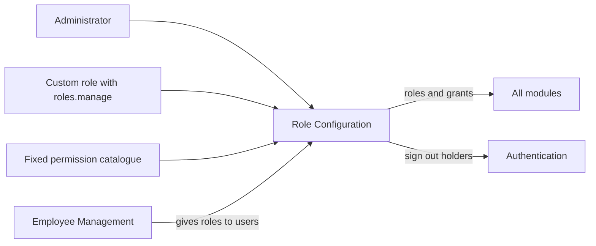
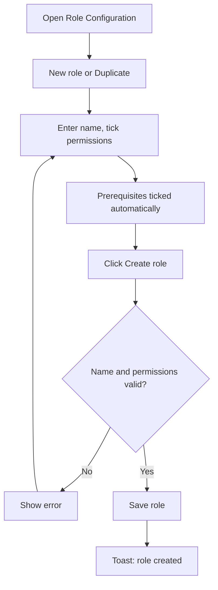
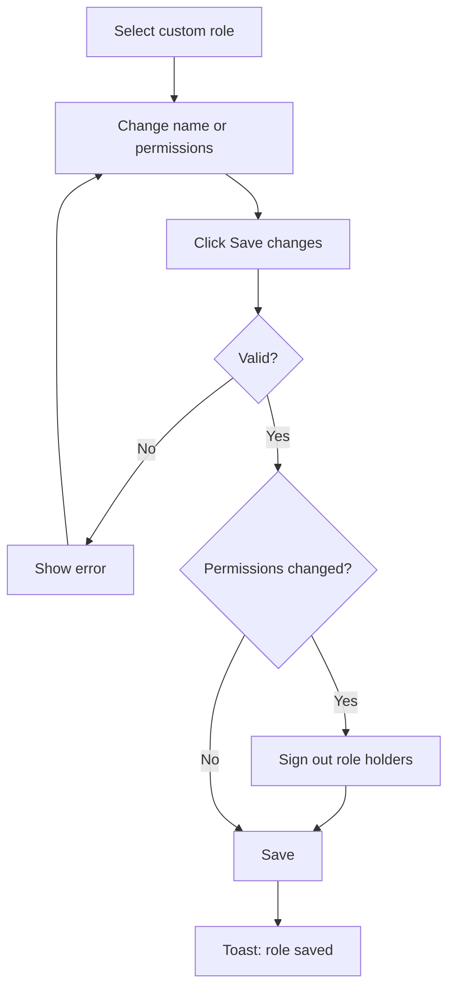
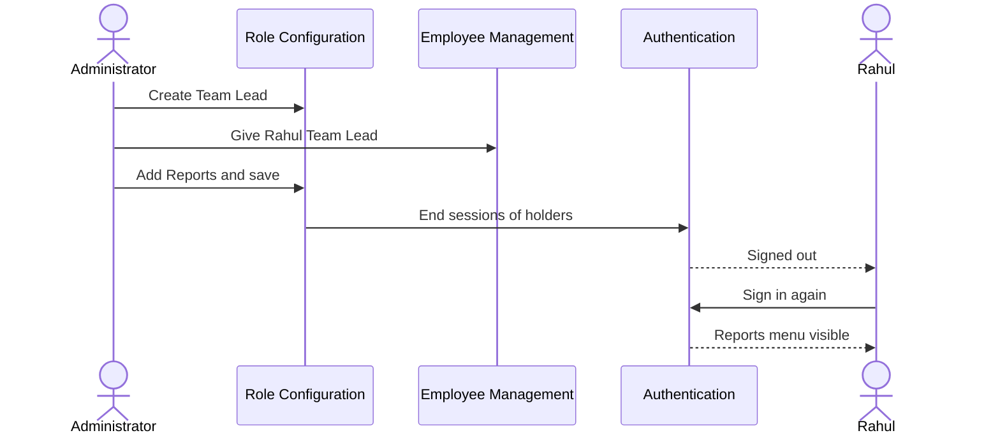

# Functional Requirements Document – Role Configuration

## TaskFlow – Intelligent Task Allocation & Tracking System

> **Document:** Functional Requirements Document  ·  **Version:** 1.0  ·  **Status:** Draft
> **Project type:** Personal Project (Skill Development)  ·  **Date:** 31-Oct-2026
> **Author:** Jojo George (jojogeorge3344@gmail.com)
> **Based on:** BRD-Role-Configuration.md v1.0
> **Module:** Settings  ·  **Sub-module:** 06.4 Role Configuration  ·  **Code:** ROLE
> © 2026 Jojo George. All rights reserved.

---

## Document Control

### Revision History

| Version | Date | Author | Summary of changes |
|---|---|---|---|
| 1.0 | 31-Oct-2026 | Jojo George | Initial version |

### Related Documents

| Document | Purpose | Location |
|---|---|---|
| BRD – Role Configuration | Business needs this FRD details (REQ-ROLE-nn, BR-ROLE-nn, AC-ROLE-nn) | `../../../BRD/06-Settings/06.4-Role-Configuration/BRD-Role-Configuration.md` |
| Overall FRD | Roles, access model, Authentication (sign-in again after sign-out) | `../../00-Overall/FRD-TaskFlow-Overall.md` |
| FRD – Employee Management | Gives roles to users; users must be moved before a role is deleted | `../../03-TaskFlow-Management/03.1-Employee-Management/FRD-Employee-Management.md` |
| Development Plan | Screen-wise build plan | _Not applicable – not in the original 20-screen plan._ |
| HLD / LLD | Technical design | `../../../HLD/06-Settings/06.4-Role-Configuration/HLD-Role-Configuration.md`, `../../../LLD/06-Settings/06.4-Role-Configuration/LLD-Role-Configuration.md` |

---

## 1. Introduction

### 1.1 Purpose
This FRD specifies the detailed, testable behaviour of the Role Configuration screen: listing roles, viewing and
comparing their permissions, creating, duplicating, editing and deleting custom roles, the rules that protect the system
roles and the fixed permission catalogue, and the sign-out of role holders after a permission change.

### 1.2 Scope
In scope: role list with user counts and search; permission tree and compare view; permission search and filter;
create, duplicate, copy permissions from, edit and delete custom roles; prerequisites, scope levels, always-on and
Administrator-only permissions; read-only modes driven by `roles.view.all` and `roles.modify.access`; sign-out of holders.

Out of scope (BRD §3.2): giving a role to a user (Employee Management FRD); changing the permission catalogue; changing
the system roles; a history of role changes; per-user permissions outside a role.

### 1.3 Audience
Developer, tester, reviewer and product owner of TaskFlow.

### 1.4 Conventions
- Requirement IDs: `FR-ROLE-nn`. Use cases: `UC-ROLE-nn`. Business rules: `BR-ROLE-nn` (sub-module BRD) and `BR-nn` (overall BRD).
- Priority: **Must / Should / Could** (MoSCoW).
- "The system shall …" = mandatory behaviour; "should" = recommended.
- In messages, `Role name`, `name`, `permission`, `needed permission`, `keys` and `n` are filled in by the system.

### 1.5 Definitions & Abbreviations

| Term | Meaning |
|---|---|
| System role | Administrator, Manager or Employee; built in and read-only |
| Custom role | A role created by the organization on this screen |
| Permission | One screen or action a role may use, for example `settings.reminders.manage` |
| Permission catalogue | The fixed list of all permissions (64 entries, grouped by module, screen and section) |
| Prerequisite | A permission another permission needs (normally the screen's View) |
| Scope level | How far a permission reaches: Own, Team or Organization (or own / all tasks) |
| Always on | A feature every user has (own profile, own dashboard, own tasks); not stored as a grant |
| Administrator only | A permission only the Administrator role can hold (`roles.administrator.assign`) |
| Holder | A user who has been given a role |

---

## 2. System Overview

### 2.1 Module Map

| Code | Module | Child modules | Primary roles |
|---|---|---|---|
| ROLE | Settings → Role Configuration | Role Configuration (one screen: Tree and Compare roles views) | Administrator, Custom role with `roles.manage` |
| EMP | Management → Employee Management (related) | Assign role to a user | Administrator |
| AUTH | Authentication (related) | Sign-in after sign-out | All users |

### 2.2 Context Diagram

---

## 3. User Roles & Permissions

### 3.1 Roles

| Role | Description | Data scope |
|---|---|---|
| Administrator | Views all roles; creates, edits, duplicates and deletes custom roles; always holds every permission | Organization |
| Manager | System role, read-only; no access to the screen by default | – |
| Employee | System role, read-only; no access to the screen by default | – |
| Custom role | `roles.manage` opens the screen; `roles.view.all` shows all roles; `roles.modify.access` allows changes | Organization (own role only without `roles.view.all`) |

### 3.2 Permission Matrix (functional view)

| Module › Function | Permission key | Administrator | Manager | Employee | Custom role |
|---|---|:---:|:---:|:---:|:---:|
| Settings › Role Configuration › Open the screen, view roles and the catalogue | `roles.manage` | Granted | Denied | Denied | Configurable |
| Settings › Role Configuration › See all roles (otherwise only one's own) | `roles.view.all` | Granted | Denied | Denied | Configurable |
| Settings › Role Configuration › Create, edit, duplicate, delete custom roles (otherwise view mode) | `roles.modify.access` | Granted | Denied | Denied | Configurable |
| Employee Management › Give or take away the Administrator role | `roles.administrator.assign` | Granted | Denied | Denied | Denied (Administrator only, not assignable) |

> Manager and Employee values are the defaults given when the permission is first created; both are system roles and
> cannot be changed here. The Administrator role is given every permission again each time the application starts.

---

## 4. Functional Requirements by Module

### 4.1 Module: Role Configuration (ROLE)

**Purpose:** Choose exactly what each role can see and do, and manage custom roles.  ·  **BRD reference:**
BRD-Role-Configuration SCREEN 1, BR-ROLE-01…BR-ROLE-10

#### 4.1.1 Screen: Role Configuration

| Field | Value |
|---|---|
| Route / location | `/settings/permissions` (menu **Settings → Role Configuration**) |
| Access | Administrator; Custom role with `roles.manage` (+ `roles.view.all` to see all roles, + `roles.modify.access` to change) |
| Entry points | Sidebar menu item **Role Configuration** |

**Screen elements**

| Element | Type | Description | Mandatory | Visible to |
|---|---|---|:---:|---|
| **Role Configuration** | Page title | "Choose exactly what each role can see and do. Administrator, Manager and Employee are protected; create your own roles for anyone else." | – | `roles.manage` |
| **New role** | Button | Starts an empty custom role draft | – | `roles.manage` + `roles.modify.access` |
| **Find a role** | Search box | Filters the role list | – | `roles.manage` |
| Role list | List | Roles, system roles first, each with its number of holders | – | `roles.manage` (all roles with `roles.view.all`, else own role) |
| **Role name** | Text input | Name of a custom role | Yes | `roles.manage` (editable with `roles.modify.access`) |
| **System role** badge and note | Badge + text | "… is a system role. Its permissions are read-only and it cannot be changed or deleted. Duplicate it to start a custom role from the same permissions." | – | `roles.manage` |
| **Duplicate as custom role** | Button | Creates a draft "… copy" with the role's permissions | – | `roles.manage` |
| **Copy permissions from…** | Drop-down | Copies another role's permissions into the draft | – | `roles.manage` + `roles.modify.access` (editable roles) |
| **Delete role** | Button | Deletes the custom role after confirmation | – | `roles.manage` + `roles.modify.access` (custom roles) |
| Progress | Bar + text | "N of M permissions", "x% enabled" | – | `roles.manage` |
| **Search permissions** | Search box | Filters the permission tree | – | `roles.manage` |
| **All / Enabled / Disabled** | Filter | Shows all, granted or not granted permissions | – | `roles.manage` |
| **Tree** / **Compare roles** | View switch | Tree of the selected role, or matrix of every permission against every role | – | `roles.manage` |
| Tree | Tree with tick boxes | Module list, **Expand all / Collapse all**, **Select all / Deselect all**, tick boxes per module, screen and permission, scope selectors (for example Dashboard Own / Team / Organization, Tasks own / all), tags **Always on** and **Administrator only** | – | `roles.manage` (editable with `roles.modify.access`) |
| Save bar | Bar | "N unsaved changes", **Discard**, **Create role** / **Save changes** | – | `roles.manage` + `roles.modify.access` |
| Discard dialog | Confirmation | "Discard unsaved changes?" – "The changes you made to this role have not been saved and will be lost." | – | Same |
| Delete dialog | Confirmation | "Delete `Role name`?" – "The role and its permissions are removed. This cannot be undone." with **Delete role** | – | Same |

**Functional requirements**

| ID | Requirement | Priority | Permission | BRD trace |
|---|---|---|---|---|
| FR-ROLE-01 | The system shall list the roles, system roles first, each with the number of users holding it, and filter the list by the text typed in **Find a role**. | Must | `roles.manage` | REQ-ROLE-01 |
| FR-ROLE-02 | The system shall list only the user's own role when the user does not hold `roles.view.all`. | Must | `roles.manage` | REQ-ROLE-02 |
| FR-ROLE-03 | The system shall show the selected role's permissions as a tree grouped by module and screen, with tick boxes per module, screen and permission, **Expand all / Collapse all** and **Select all / Deselect all**. | Must | `roles.manage` | REQ-ROLE-03 |
| FR-ROLE-04 | The system shall show in **Compare roles** a matrix of every permission against every listed role. | Should | `roles.manage` | REQ-ROLE-04 |
| FR-ROLE-05 | The system shall filter the permissions by the text in **Search permissions** and by **All**, **Enabled** or **Disabled**. | Should | `roles.manage` | REQ-ROLE-05 |
| FR-ROLE-06 | The system shall show Administrator, Manager and Employee with a **System role** badge and read-only permissions, and refuse any rename, permission change or deletion of them with "`Role name` is a system role and is read-only: it cannot be changed or deleted." | Must | `roles.manage` | REQ-ROLE-06, BR-ROLE-01 |
| FR-ROLE-07 | The system shall let the user start a new custom role with **New role**, enter a name, tick permissions and save it with **Create role**, showing "`Role name` created". | Must | `roles.manage` + `roles.modify.access` | REQ-ROLE-07 |
| FR-ROLE-08 | The system shall let the user duplicate any role with **Duplicate as custom role**, creating a draft named "`Role name` copy" with the same permissions. | Should | `roles.manage` + `roles.modify.access` (to save) | REQ-ROLE-08 |
| FR-ROLE-09 | The system shall let the user copy the permissions of another role, chosen in **Copy permissions from…**, into the role being edited. | Should | `roles.manage` + `roles.modify.access` | REQ-ROLE-09 |
| FR-ROLE-10 | The system shall require a role name of 1–100 characters after trimming, unique regardless of letter case, refusing with "Enter a name for the role.", "The role name can be at most 100 characters." or "A role named "`name`" already exists." | Must | `roles.manage` + `roles.modify.access` | REQ-ROLE-10, BR-ROLE-03 |
| FR-ROLE-11 | The system shall tick a permission's prerequisite automatically when the permission is ticked, and refuse to save a permission without its prerequisite with ""`permission`" also needs "`needed permission`"." | Must | `roles.manage` + `roles.modify.access` | REQ-ROLE-11, BR-ROLE-04 |
| FR-ROLE-12 | The system shall refuse to save an unknown permission with "Unknown permission: `keys`." | Must | `roles.manage` + `roles.modify.access` | REQ-ROLE-11, REQ-ROLE-20 |
| FR-ROLE-13 | The system shall tag `roles.administrator.assign` **Administrator only** and refuse to give it to any role other than Administrator with "`permission` can only be held by the Administrator role and cannot be given to another role." | Must | `roles.manage` + `roles.modify.access` | REQ-ROLE-12, BR-ROLE-05 |
| FR-ROLE-14 | The system shall show own profile, own dashboard and own tasks as **Always on** for every role, not let them be unticked, and not store them as grants. | Must | – (all roles) | REQ-ROLE-13, BR-ROLE-06 |
| FR-ROLE-15 | The system shall offer scope levels as selectors where choosing a higher level includes the lower ones (Organization includes Team and Own; View all tasks includes View my tasks). | Must | `roles.manage` + `roles.modify.access` | REQ-ROLE-14, BR-ROLE-07 |
| FR-ROLE-16 | The system shall let the user rename a custom role and change its permissions and save with **Save changes**, showing "`Role name` saved". | Must | `roles.manage` + `roles.modify.access` | REQ-ROLE-15 |
| FR-ROLE-17 | The system shall count the unsaved changes in the save bar ("N unsaved changes"), undo them with **Discard**, and ask "Discard unsaved changes?" before another role is selected while changes are unsaved. | Should | `roles.manage` + `roles.modify.access` | REQ-ROLE-16 |
| FR-ROLE-18 | The system shall sign out every holder of a custom role when its permissions change, so that they sign in again with the new access, and shall not sign anyone out when only the name changes. | Must | – (system) | REQ-ROLE-17, BR-ROLE-09 |
| FR-ROLE-19 | The system shall delete a custom role only after the user confirms "Delete `Role name`?", remove its permission grants with it, and show "`Role name` deleted". | Must | `roles.manage` + `roles.modify.access` | REQ-ROLE-18 |
| FR-ROLE-20 | The system shall refuse to delete a role that any user holds, with "1 user still holds this role. Move them to another role first." or "`n` users still hold this role. Move them to another role first." | Must | `roles.manage` + `roles.modify.access` | REQ-ROLE-19, BR-ROLE-08 |
| FR-ROLE-21 | The system shall keep the permission catalogue fixed and refuse every attempt to add, change or remove a permission with "The permission list is fixed and cannot be changed." | Must | `roles.manage` | REQ-ROLE-20, BR-ROLE-02 |
| FR-ROLE-22 | The system shall give the Administrator role every permission of the catalogue, including new ones, each time the application starts. | Must | – (system) | REQ-ROLE-21, BR-ROLE-10 |
| FR-ROLE-23 | The system shall show the role name, tree and save bar read-only, hide **New role**, and refuse create, save and delete when the user does not hold `roles.modify.access`. | Must | `roles.modify.access` | REQ-ROLE-22 |
| FR-ROLE-24 | The system shall show for the selected role "N of M permissions" and "x% enabled". | Could | `roles.manage` | REQ-ROLE-23 |
| FR-ROLE-25 | The system shall hide the **Role Configuration** menu item from users without `roles.manage`, return them to their dashboard when they open `/settings/permissions`, and refuse their requests. | Must | `roles.manage` | REQ-ROLE-24 |
| FR-ROLE-26 | The system shall confirm actions with "`Role name` created", "`Role name` saved" and "`Role name` deleted", and show "Could not load roles and permissions.", "Could not save the role." or "Could not delete the role." when these fail, and "That role does not exist." for an unknown role. | Should | `roles.manage` | REQ-ROLE-25 |

**Use case: UC-ROLE-01 – Create a custom role**

| Item | Detail |
|---|---|
| Actor | Administrator or Custom role user |
| Preconditions | Signed in; holds `roles.manage` and `roles.modify.access` |
| Trigger | Clicks **New role**, or selects a role and clicks **Duplicate as custom role** |
| Main flow | 1. System opens an empty draft, or a draft "`Role name` copy" with that role's permissions (FR-ROLE-07, FR-ROLE-08). 2. User types the **Role name**. 3. User ticks permissions; prerequisites are ticked automatically (FR-ROLE-11); optionally **Copy permissions from…** (FR-ROLE-09). 4. Save bar counts the changes (FR-ROLE-17). 5. User clicks **Create role**. 6. System checks name and permissions (FR-ROLE-10…FR-ROLE-13). 7. System saves; toast "`Role name` created". |
| Alternate flows | A1: User clicks **Discard** → draft cleared. A2: User selects another role → "Discard unsaved changes?" first. |
| Exceptions | E1: Name blank → "Enter a name for the role." E2: Name over 100 characters → "The role name can be at most 100 characters." E3: Name used (any letter case) → "A role named "`name`" already exists." E4: Missing prerequisite → ""`permission`" also needs "`needed permission`"." E5: Administrator-only permission → refused (FR-ROLE-13). E6: Unknown permission → "Unknown permission: `keys`." E7: Save fails → "Could not save the role." |
| Postconditions | Custom role exists with its grants and 0 holders; can be given to users in Employee Management. |

**Use case: UC-ROLE-02 – Edit a custom role**

| Item | Detail |
|---|---|
| Actor | Administrator or Custom role user; holders of the role |
| Preconditions | Signed in; holds `roles.manage` and `roles.modify.access`; a custom role exists |
| Trigger | Selects the custom role in the role list |
| Main flow | 1. System shows the role's permissions (FR-ROLE-03). 2. User renames it and/or ticks and unticks permissions; "N unsaved changes" shown. 3. User clicks **Save changes**. 4. System checks as in UC-ROLE-01 step 6. 5. If permissions changed, system signs out every holder (FR-ROLE-18). 6. System saves; toast "`Role name` saved" (FR-ROLE-16). |
| Alternate flows | A1: Name-only change → nobody signed out. A2: User selects another role first → "Discard unsaved changes?" (FR-ROLE-17). |
| Exceptions | E1: Role is a system role → read-only message (FR-ROLE-06). E2: Validation errors as UC-ROLE-01 E1–E6. E3: Role no longer exists → "That role does not exist." |
| Postconditions | Role updated; holders sign in again with the new access. |

**Use case: UC-ROLE-03 – Delete a custom role**

| Item | Detail |
|---|---|
| Actor | Administrator or Custom role user |
| Preconditions | Signed in; holds `roles.manage` and `roles.modify.access`; a custom role is selected |
| Trigger | Clicks **Delete role** |
| Main flow | 1. System asks "Delete `Role name`?" – "The role and its permissions are removed. This cannot be undone." 2. User clicks **Delete role**. 3. System checks that nobody holds the role (FR-ROLE-20). 4. System deletes the role and its grants; toast "`Role name` deleted" (FR-ROLE-19). |
| Alternate flows | A1: User cancels → nothing changes. |
| Exceptions | E1: Role held → "`n` users still hold this role. Move them to another role first." E2: System role → read-only message. E3: Failure → "Could not delete the role." |
| Postconditions | Role and its grants removed. |

**Use case: UC-ROLE-04 – Review access across roles**

| Item | Detail |
|---|---|
| Actor | Administrator or Custom role user |
| Preconditions | Signed in; holds `roles.manage` (and `roles.view.all` to see every role) |
| Trigger | Switches to **Compare roles**, or searches/filters permissions |
| Main flow | 1. System shows every permission against every listed role (FR-ROLE-04). 2. User types in **Search permissions** and/or chooses **Enabled** (FR-ROLE-05). 3. System narrows the list. |
| Alternate flows | A1: Without `roles.view.all`, only the user's own role is listed (FR-ROLE-02). A2: Without `roles.modify.access`, everything stays read-only (FR-ROLE-23). |
| Exceptions | E1: Loading fails → "Could not load roles and permissions." |
| Postconditions | No data changed. |

**Field validations**

| Field | Rule | Error message |
|---|---|---|
| Role name | Required; 1–100 characters after trimming | "Enter a name for the role." / "The role name can be at most 100 characters." |
| Role name | Unique regardless of letter case | "A role named "`name`" already exists." |
| Permissions | Every key in the catalogue | "Unknown permission: `keys`." |
| Permissions | Prerequisite present | ""`permission`" also needs "`needed permission`"." |
| Permissions | No Administrator-only permission on a custom role | "`permission` can only be held by the Administrator role and cannot be given to another role." |
| Role | Not a system role (save, delete) | "`Role name` is a system role and is read-only: it cannot be changed or deleted." |
| Role (delete) | No holders | "1 user still holds this role. Move them to another role first." / "`n` users still hold this role. Move them to another role first." |

**Business rules applied:** BR-ROLE-01 … BR-ROLE-10; global rules of the overall BRD: only authorized users may create,
change or manage records (authorization is decided by the permissions defined here); records with dependent data are
not deleted in a way that damages history (a role in use cannot be deleted).

**Notifications / side effects**

| Event | Who is notified | Channel |
|---|---|---|
| Role created / saved / deleted | Acting user | Toast |
| Permissions of a custom role changed | Every holder of the role | Signed out; must sign in again |
| Name-only change | – | No sign-out |

**Messages**

| Situation | Message |
|---|---|
| Created / saved / deleted | "`Role name` created" / "`Role name` saved" / "`Role name` deleted" |
| Validation | See field validations |
| Role not found | "That role does not exist." |
| Catalogue change attempt | "The permission list is fixed and cannot be changed." |
| Leaving with unsaved changes | "Discard unsaved changes?" – "The changes you made to this role have not been saved and will be lost." |
| Load failed | "Could not load roles and permissions." |
| Save / delete failed | "Could not save the role." / "Could not delete the role." |
| No permission | Menu item hidden; opening `/settings/permissions` returns the user to their dashboard |

---

## 5. Cross-Module Workflows

### 5.1 New custom role from creation to use

| Step | Module | Actor / System | Action | FR reference |
|---|---|---|---|---|
| 1 | ROLE | Administrator | Duplicates Manager as "Team Lead", unticks Employee Management, creates it | FR-ROLE-08, FR-ROLE-07 |
| 2 | EMP | Administrator | Gives Rahul the role Team Lead | Employee Management FRD |
| 3 | ROLE | Administrator | Adds Reports to Team Lead and saves | FR-ROLE-16 |
| 4 | AUTH | System | Signs Rahul out | FR-ROLE-18 |
| 5 | AUTH | Rahul | Signs in again and sees the Reports menu | Overall FRD (FR-AUTH) |

### 5.2 Delete a role in use

| Step | Module | Actor / System | Action | FR reference |
|---|---|---|---|---|
| 1 | ROLE | Administrator | Tries to delete Team Lead (held by Rahul and Priya) | FR-ROLE-20 |
| 2 | ROLE | System | Refuses: "2 users still hold this role. Move them to another role first." | FR-ROLE-20 |
| 3 | EMP | Administrator | Moves both users to Manager | Employee Management FRD |
| 4 | ROLE | Administrator | Deletes Team Lead after confirmation | FR-ROLE-19 |

---

## 6. Reports & Exports

_Not applicable for this sub-module._ The **Compare roles** view (FR-ROLE-04) gives an on-screen overview of permissions per role.

---

## 7. Notifications & Messages Catalogue

| Code | Trigger | Recipients | Channel | Text |
|---|---|---|---|---|
| N-ROLE-01 | Role created | Acting user | Toast | "`Role name` created" |
| N-ROLE-02 | Role saved | Acting user | Toast | "`Role name` saved" |
| N-ROLE-03 | Role deleted | Acting user | Toast | "`Role name` deleted" |
| N-ROLE-04 | Delete requested | Acting user | Dialog | "Delete `Role name`?" – "The role and its permissions are removed. This cannot be undone." |
| N-ROLE-05 | Leaving with unsaved changes | Acting user | Dialog | "Discard unsaved changes?" – "The changes you made to this role have not been saved and will be lost." |
| N-ROLE-06 | Role in use | Acting user | Error | "`n` users still hold this role. Move them to another role first." |
| N-ROLE-07 | System role change | Acting user | Error | "`Role name` is a system role and is read-only: it cannot be changed or deleted." |
| N-ROLE-08 | Catalogue change attempt | Caller | Error | "The permission list is fixed and cannot be changed." |
| N-ROLE-09 | Permissions of a role changed | Role holders | Session ended | Signed out; must sign in again |

---

## 8. Data Requirements (functional view)

| Data item | Description | Created by | Rules |
|---|---|---|---|
| Role | System or custom role: name, system flag, created at, number of holders | System (system roles at start-up); user (custom) | Name unique ignoring case, at most 100 characters; system roles never changed; a role in use cannot be deleted |
| Permission catalogue | Key, name, description, module, screen, section, action, prerequisite, scope level, assignable, always on | Application (fixed) | Never changed from the screen |
| Role permission grant | Which permissions a role holds | User (custom roles); system (Administrator gets all at start-up) | Removed with the role; always-on features not stored |
| User session | Signed-in holder of a role | Authentication | Ended when the role's permissions change |

---

## 9. Non-Functional Requirements (functional impact)

| ID | Requirement | Affects |
|---|---|---|
| NFR-ROLE-01 | Access is checked on the server for every request, not only by hiding the menu | FR-ROLE-23, FR-ROLE-25 |
| NFR-ROLE-02 | New permissions apply without waiting for users to sign out | FR-ROLE-18 |
| NFR-ROLE-03 | System roles are protected at every level, also by the stored data | FR-ROLE-06, FR-ROLE-21 |
| NFR-ROLE-04 | Large permission lists stay manageable (search, filter, expand/collapse, select all, compare) | FR-ROLE-03, FR-ROLE-04, FR-ROLE-05 |
| NFR-ROLE-05 | No accidental loss of edits | FR-ROLE-17 |
| NFR-ROLE-06 | The screen loads and saves without noticeable delay | Role Configuration |
| NFR-ROLE-07 | Works in current desktop browsers, responsive layout | Role Configuration |

---

## 10. Assumptions & Open Issues

| Type | Description | Owner |
|---|---|---|
| Assumption | Each user holds exactly one role. | Jojo George |
| Assumption | Only Administrators normally hold `roles.manage`. | Jojo George |
| Open issue | ⚠️ To be confirmed: `roles.manage` can be given to a custom role; a custom role holding `roles.manage` and `roles.modify.access` can create a role that may assign roles to users. Whether `roles.manage` should be Administrator-only. | Jojo George |
| Open issue | ⚠️ To be confirmed: a user with `roles.manage` but without `roles.view.all` sees only their own role in the list but can still open another role directly; whether that should be refused. | Jojo George |
| Open issue | ⚠️ To be confirmed: **Duplicate as custom role** is shown to users without `roles.modify.access`, but the draft cannot be saved; whether the button should be hidden. | Jojo George |
| Open issue | ⚠️ To be confirmed: a refusal for missing `roles.modify.access` shows only "Could not save the role."; whether a specific message is wanted. | Jojo George |
| Open issue | ⚠️ To be confirmed: the holder count used for the list and for the delete check also counts soft-deleted (removed) user accounts; whether such accounts should block deletion of a role. | Jojo George |

**Change from original BRD**

| Original BRD item | Current requirement |
|---|---|
| Section 1.4: three fixed roles | Kept as protected system roles (FR-ROLE-06); custom roles added (FR-ROLE-07). |
| Screen 5 FR-5 "Assign appropriate roles" | Roles are given in Employee Management; making someone an Administrator needs `roles.administrator.assign` (FR-ROLE-13). |
| Not in original BRD | Role Configuration is a new screen; access is decided by permissions, not role names. |

---

## 11. Requirements Traceability Matrix

| BRD item | FRD requirement(s) | Screen | Use case | Test case |
|---|---|---|---|---|
| REQ-ROLE-01 | FR-ROLE-01 | Role Configuration | UC-ROLE-04 | AC-ROLE-01 |
| REQ-ROLE-02 | FR-ROLE-02 | Role Configuration | UC-ROLE-04 | AC-ROLE-02 |
| REQ-ROLE-03 | FR-ROLE-03 | Role Configuration (Tree) | UC-ROLE-02 | AC-ROLE-03 |
| REQ-ROLE-04 | FR-ROLE-04 | Role Configuration (Compare roles) | UC-ROLE-04 | AC-ROLE-03 |
| REQ-ROLE-05 | FR-ROLE-05 | Role Configuration | UC-ROLE-04 | AC-ROLE-03 |
| REQ-ROLE-06 | FR-ROLE-06 | Role Configuration | UC-ROLE-02 | AC-ROLE-04 |
| REQ-ROLE-07 | FR-ROLE-07 | Role Configuration | UC-ROLE-01 | AC-ROLE-05 |
| REQ-ROLE-08 | FR-ROLE-08 | Role Configuration | UC-ROLE-01 | AC-ROLE-05 |
| REQ-ROLE-09 | FR-ROLE-09 | Role Configuration | UC-ROLE-01 | AC-ROLE-05 |
| REQ-ROLE-10 | FR-ROLE-10 | Role Configuration | UC-ROLE-01 | AC-ROLE-06 |
| REQ-ROLE-11 | FR-ROLE-11, FR-ROLE-12 | Role Configuration | UC-ROLE-01 | AC-ROLE-07 |
| REQ-ROLE-12 | FR-ROLE-13 | Role Configuration | UC-ROLE-01 | AC-ROLE-08 |
| REQ-ROLE-13 | FR-ROLE-14 | Role Configuration | UC-ROLE-01 | AC-ROLE-09 |
| REQ-ROLE-14 | FR-ROLE-15 | Role Configuration | UC-ROLE-01 | AC-ROLE-09 |
| REQ-ROLE-15 | FR-ROLE-16 | Role Configuration | UC-ROLE-02 | AC-ROLE-10 |
| REQ-ROLE-16 | FR-ROLE-17 | Role Configuration | UC-ROLE-02 | AC-ROLE-10 |
| REQ-ROLE-17 | FR-ROLE-18 | Role Configuration / Authentication | UC-ROLE-02 | AC-ROLE-11 |
| REQ-ROLE-18 | FR-ROLE-19 | Role Configuration | UC-ROLE-03 | AC-ROLE-12 |
| REQ-ROLE-19 | FR-ROLE-20 | Role Configuration | UC-ROLE-03 | AC-ROLE-12 |
| REQ-ROLE-20 | FR-ROLE-21, FR-ROLE-12 | Role Configuration | – | AC-ROLE-13 |
| REQ-ROLE-21 | FR-ROLE-22 | – (application start) | – | AC-ROLE-14 |
| REQ-ROLE-22 | FR-ROLE-23 | Role Configuration | UC-ROLE-04 | AC-ROLE-15 |
| REQ-ROLE-23 | FR-ROLE-24 | Role Configuration | UC-ROLE-04 | AC-ROLE-03 |
| REQ-ROLE-24 | FR-ROLE-25 | Role Configuration | – | AC-ROLE-15 |
| REQ-ROLE-25 | FR-ROLE-26 | Role Configuration | UC-ROLE-01, UC-ROLE-02, UC-ROLE-03 | AC-ROLE-05 |
| BR-ROLE-01 | FR-ROLE-06 | Role Configuration | UC-ROLE-02 | AC-ROLE-04 |
| BR-ROLE-02 | FR-ROLE-21 | Role Configuration | – | AC-ROLE-13 |
| BR-ROLE-03 | FR-ROLE-10 | Role Configuration | UC-ROLE-01 | AC-ROLE-06 |
| BR-ROLE-04 | FR-ROLE-11 | Role Configuration | UC-ROLE-01 | AC-ROLE-07 |
| BR-ROLE-05 | FR-ROLE-13 | Role Configuration | UC-ROLE-01 | AC-ROLE-08 |
| BR-ROLE-06 | FR-ROLE-14 | Role Configuration | UC-ROLE-01 | AC-ROLE-09 |
| BR-ROLE-07 | FR-ROLE-15 | Role Configuration | UC-ROLE-01 | AC-ROLE-09 |
| BR-ROLE-08 | FR-ROLE-20 | Role Configuration | UC-ROLE-03 | AC-ROLE-12 |
| BR-ROLE-09 | FR-ROLE-18 | Role Configuration / Authentication | UC-ROLE-02 | AC-ROLE-11 |
| BR-ROLE-10 | FR-ROLE-22 | – (application start) | – | AC-ROLE-14 |

Untraced BRD items: **0**.

---

## 12. Approvals

| Role | Name | Decision | Date |
|---|---|---|---|
| Product owner | Jojo George | Pending | – |
| Reviewer | Jojo George | Pending | – |

---
© 2026 Jojo George. All rights reserved. Unauthorized copying or distribution of this document is prohibited.
