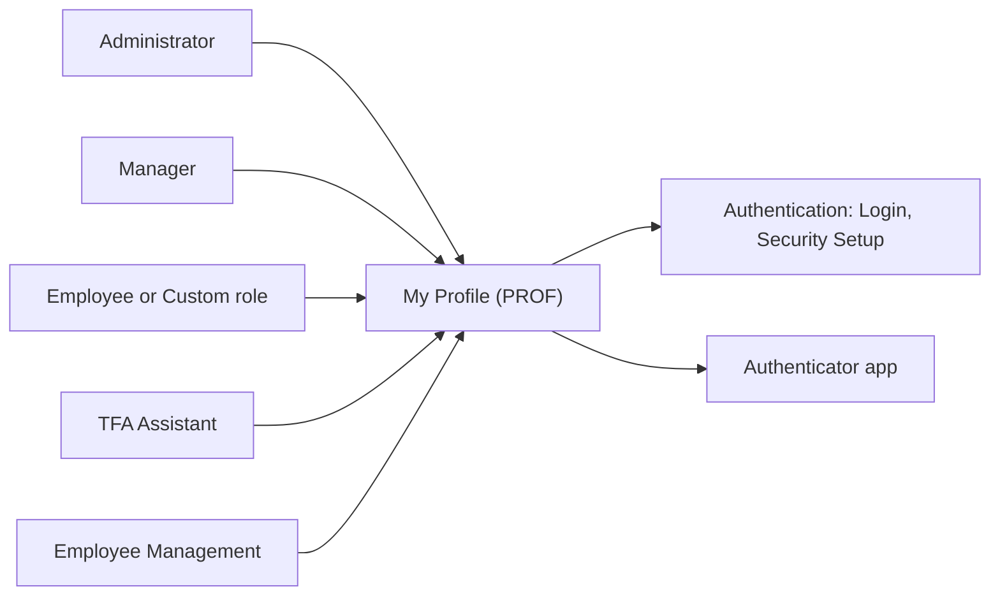
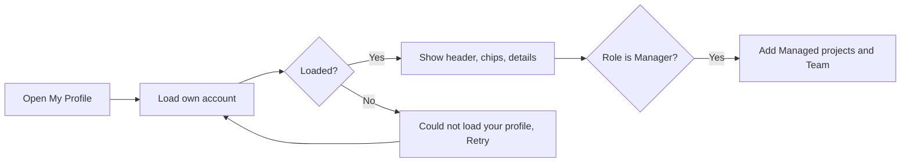
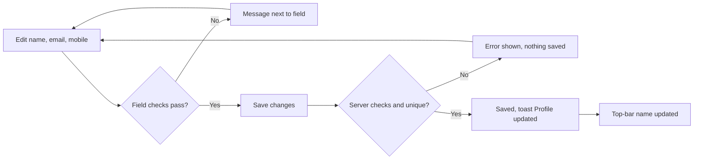
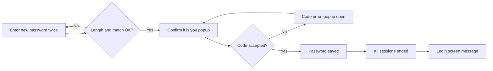
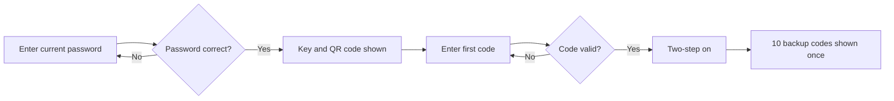
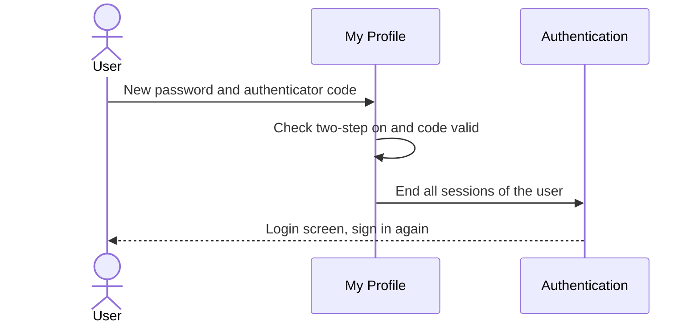
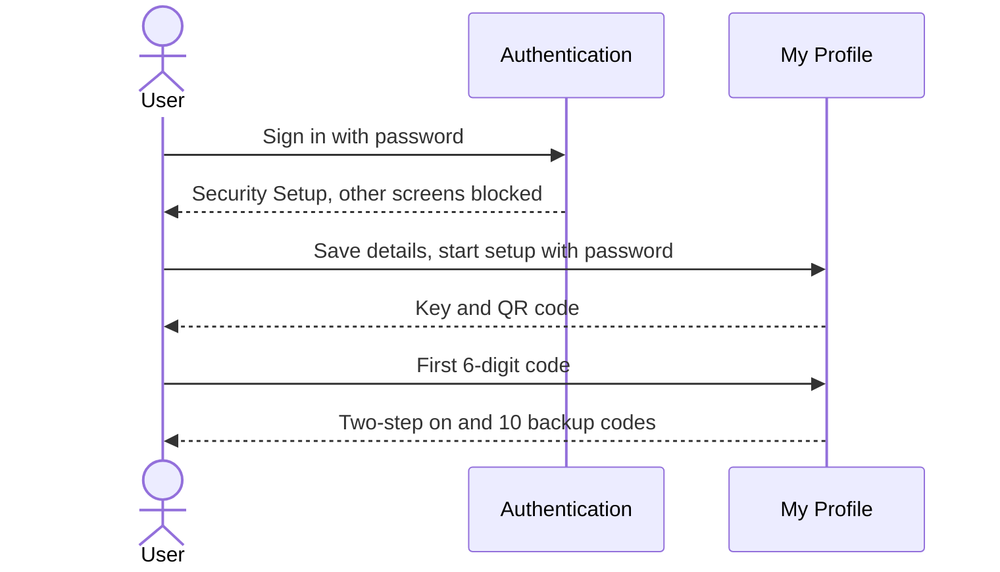
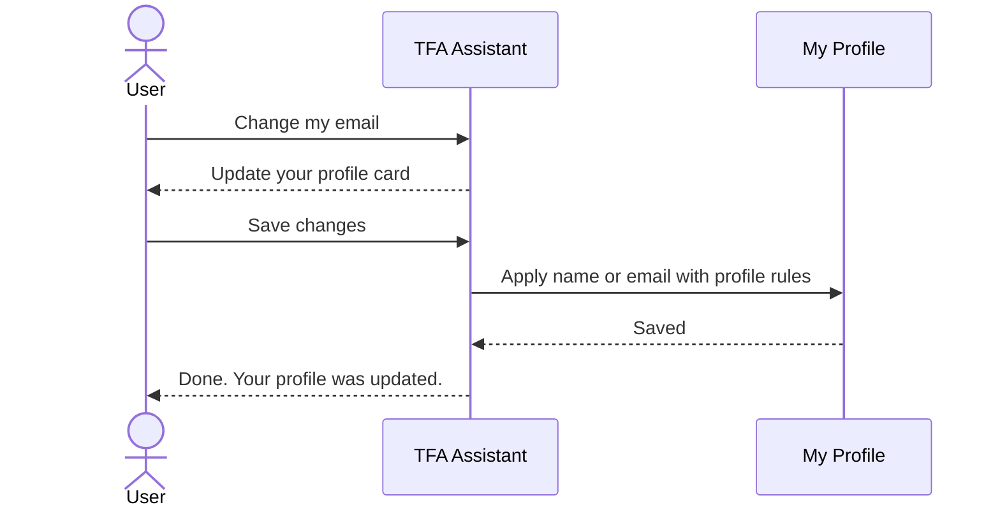

# Functional Requirements Document – My Profile

## TaskFlow – Intelligent Task Allocation & Tracking System

> **Document:** Functional Requirements Document (sub-module 07.1 My Profile, code `PROF`)  ·  **Version:** 1.0  ·  **Status:** Draft
> **Project type:** Personal Project (Skill Development)  ·  **Date:** 31-Oct-2026
> **Author:** Jojo George (jojogeorge3344@gmail.com)
> **Based on:** BRD-My-Profile.md v1.0
> © 2026 Jojo George. All rights reserved.

---

## Document Control

### Revision History

| Version | Date | Author | Summary of changes |
|---|---|---|---|
| 1.0 | 31-Oct-2026 | Jojo George | Initial version: My Profile, Change Password and self-service two-step verification, traced to BRD-My-Profile v1.0 |

### Related Documents

| Document | Purpose | Location |
|---|---|---|
| BRD – My Profile | Business needs this FRD details (`REQ-PROF-nn`, `BR-PROF-nn`) | `../../../BRD/07-My-Profile/07.1-My-Profile/BRD-My-Profile.md` |
| BRD / FRD – Overall | Roles, global rules `BR-nn`, global NFRs, Authentication (Login, Security Setup, Account Recovery) | `../../../BRD/00-Overall/BRD-TaskFlow-Overall.md`, `../../00-Overall/FRD-TaskFlow-Overall.md` |
| FRD – Employee Management | Administrator-managed account fields, administrator two-step reset | `../../03-TaskFlow-Management/03.1-Employee-Management/FRD-Employee-Management.md` |
| FRD – TFA Assistant | Action Card that prepares an own-profile change | `../../08-TFA-Assistant/08.1-Assistant/FRD-Assistant.md` |
| Development Plan | Screen 19 – User Profile | `TF - Documents/Screens Wise Feature Development Plan/19-user-profile-screen.md` |
| HLD / LLD / TDD | Technical design | `../../../HLD/07-My-Profile/07.1-My-Profile/HLD-My-Profile.md`, `../../../LLD/07-My-Profile/07.1-My-Profile/LLD-My-Profile.md`, `TF - Documents/TF - TDD/TDD-TaskFlow.md` |

---

## 1. Introduction

### 1.1 Purpose
This FRD specifies the detailed, testable behaviour of the My Profile sub-module: the My Profile screen, the Change Password screen and the self-service two-step verification actions used by the Security Setup screen. It turns every `REQ-PROF-nn` and `BR-PROF-nn` of the My Profile BRD into functional requirements `FR-PROF-nn` with inputs, outputs, validations, messages and permissions.

### 1.2 Scope
**In scope:** viewing the own account; editing full name, email address and mobile number; changing the own password with an authenticator or backup code; starting authenticator setup, turning two-step verification on, receiving backup codes; regenerating backup codes and checking a code (server actions without a screen); the profile rules applied to a TFA own-profile change.

**Out of scope** (BRD §3.2): another user's profile (Employee Management); changing own role, projects, departments, username, employee code or status; profile photo; forgotten-password recovery and the sign-in flow (Authentication, overall FRD); the layout and step order of the Security Setup screen (Authentication, overall FRD); turning two-step verification off by the user.

### 1.3 Audience
Developer and tester of TaskFlow, reviewers, and the product owner (Jojo George).

### 1.4 Conventions
- Requirement IDs: `FR-PROF-nn`. Use cases: `UC-PROF-nn`. Business rules: `BR-PROF-nn` (sub-module BRD) and `BR-nn` (overall BRD).
- BRD trace: `REQ-PROF-nn` (sub-module BRD §5).
- Priority: **Must / Should / Could** (MoSCoW).
- "The system shall …" = mandatory behaviour.
- Text in `{braces}` inside backticks is a value filled in at run time.

### 1.5 Definitions & Abbreviations

| Term | Meaning |
|---|---|
| Own scope | The user acts only on their own account; the account is always taken from the sign-in session |
| Two-step verification (MFA) | A second factor from an authenticator app (6-digit time-based code) or a single-use backup code |
| Backup code | One of 10 single-use codes issued when two-step verification is turned on |
| Setup pending | State of a signed-in user who has not yet turned on two-step verification |
| Always On | A permission held by every role that cannot be removed in Role Configuration |
| TFA | TaskFlow Assistant, the built-in AI assistant |

---

## 2. System Overview

### 2.1 Module Map

| Code | Module | Child modules / screens | Primary roles |
|---|---|---|---|
| PROF | My Profile (07.1) | My Profile, Change Password, Two-step verification self-service (used by Security Setup) | Administrator, Manager, Employee, Custom role |
| AUTH | Authentication (overall FRD) – interface only | Login, Security Setup, Account Recovery | All users |
| EMP | Employee Management – interface only | Maintains role, projects, departments, status; administrator two-step reset | Administrator |
| TFA | TFA Assistant – interface only | Action Card "Update your profile", password guidance | Holders of `assistant.chat` |

### 2.2 Context Diagram

---

## 3. User Roles & Permissions

### 3.1 Roles

| Role | Description | Data scope |
|---|---|---|
| Administrator | Full system user; maintains own profile, password and authenticator here (other accounts in Employee Management) | Own |
| Manager | Leads teams and projects; also sees own Managed projects and Team | Own |
| Employee | Works on assigned tasks | Own |
| Custom role | Role created in Role Configuration; same profile rights as Employee | Own |

### 3.2 Permission Matrix (functional view)

| Module › Function | Permission key | Administrator | Manager | Employee | Custom role |
|---|---|:---:|:---:|:---:|:---:|
| My Profile › View my profile | `profile.view` | Always On | Always On | Always On | Always On |
| My Profile › Edit my personal information | `profile.edit` | Always On | Always On | Always On | Always On |
| My Profile › Change my password | `profile.password.change` | Always On | Always On | Always On | Always On |
| My Profile › Manage my authenticator (setup, backup codes) | `profile.mfa.manage` | Always On | Always On | Always On | Always On |

The four keys are given to every user automatically, are not stored per role and cannot be assigned or removed in Role Configuration (`BR-PROF-05`, global `BR-05`). The **My Profile** menu item is always shown.

---

## 4. Functional Requirements by Module

### 4.1 Module: My Profile (PROF)

**Purpose:** Self-service maintenance of the signed-in user's own account: contact details, password and second factor.  ·  **BRD reference:** BRD-My-Profile §5 SCREEN 1–3, `BR-PROF-01` – `BR-PROF-13`; overall `BR-03`, `BR-05`, `BR-24`, `BR-25`, `BR-28`

#### 4.1.1 Screen: My Profile

| Field | Value |
|---|---|
| Route / location | `/profile` |
| Access | Administrator, Manager, Employee, Custom role – `profile.view`, `profile.edit` (Always On); own account only |
| Entry points | Side menu **My Profile**; name/avatar link in the top bar; TFA link button **My Profile**; reachable while setup is pending |

**Screen elements**

| Element | Type | Description | Mandatory | Visible to |
|---|---|---|:---:|---|
| Avatar | Initials | Initials of the full name | – | All users |
| Full name, `@username`, email | Header text | Identity of the signed-in user | – | All users |
| Summary chips | Chips | Role; Active/Inactive; one chip per project allocation; "Two-step on"/"Two-step off"; "Last sign-in …" when a last sign-in exists | – | All users |
| Account details | Read-only card | Username, Employee code, Role, Projects with total "% allocated", Departments, Managers, Account status; note "Your role, project and status are managed by an administrator." | – | All users |
| Managed projects, Team | Read-only rows | Projects the user manages and the user's team | – | Manager |
| Full name | Text input | Own full name | Yes | All users |
| Email address | Text input + fixed suffix | Part before the fixed `@taskflow.com` suffix | Yes | All users |
| Mobile number | Text input | International format, e.g. `+919876543210` | No | All users |
| Save changes | Button | Saves the personal information; shows "Saving…" while saving and "Saved" afterwards | – | All users |
| Password card – Change password | Button/link | Opens the Change Password screen | – | All users |
| Loading placeholders | Skeleton | Shown while the account loads | – | All users |
| Error state – Retry | Message + button | Shown when the account cannot be loaded | – | All users |

**Functional requirements**

| ID | Requirement | Priority | Permission | BRD trace |
|---|---|---|---|---|
| FR-PROF-01 | The system shall load the account of the signed-in user taken from the sign-in session, and shall offer no way to choose or open another user's profile. | Must | `profile.view` | REQ-PROF-01, BR-PROF-01 |
| FR-PROF-02 | The system shall show the header (initials avatar, full name, `@username`, email) and the summary chips: role, Active/Inactive, one chip per project allocation, "Two-step on"/"Two-step off", and "Last sign-in …" when a last sign-in time exists. | Must | `profile.view` | REQ-PROF-02 |
| FR-PROF-03 | The system shall show Username, Employee code, Role, Projects with the total "% allocated", Departments, Managers and Account status as read-only values with the note "Your role, project and status are managed by an administrator." | Must | `profile.view` | REQ-PROF-02, BR-PROF-02 |
| FR-PROF-04 | The system shall additionally show the rows Managed projects and Team when the user's role is Manager, and shall not show them for other roles. | Should | `profile.view` | REQ-PROF-03 |
| FR-PROF-05 | The system shall offer exactly three editable fields – Full name, Email address and Mobile number – pre-filled with the current values, and shall ignore any attempt to change role, projects, departments, username, employee code or status through the profile save. | Must | `profile.edit` | REQ-PROF-04, BR-PROF-02 |
| FR-PROF-06 | The system shall validate each editable field while the user types and show the message next to the field (rules in "Field validations"). | Must | `profile.edit` | REQ-PROF-05 |
| FR-PROF-07 | The system shall validate all fields again when **Save changes** is clicked and save nothing when any rule fails, showing the error above the form and next to the field concerned. | Must | `profile.edit` | REQ-PROF-05 |
| FR-PROF-08 | The system shall build the email from the typed part plus the fixed suffix `@taskflow.com`, trim it and store it in lower case. | Must | `profile.edit` | REQ-PROF-06, BR-PROF-03, BR-24 |
| FR-PROF-09 | The system shall refuse an email whose part before `@` matches that of another account, including deleted accounts, with "Email already exists." | Must | `profile.edit` | REQ-PROF-07, BR-PROF-03 |
| FR-PROF-10 | The system shall refuse a save when another user has both the same email and the same mobile number, with "A user with this email and mobile number already exists.", and shall accept a mobile number shared with colleagues otherwise. | Must | `profile.edit` | REQ-PROF-08, BR-PROF-04 |
| FR-PROF-11 | The system shall remove spaces, dashes, dots and brackets from the mobile number before checking it, and shall remove the saved mobile number when the field is left empty. | Should | `profile.edit` | REQ-PROF-09 |
| FR-PROF-12 | The system shall, after a successful save, show the toast "Profile updated", show "Saved" next to the button and update the user's name in the top bar without a page reload. | Must | `profile.edit` | REQ-PROF-10 |
| FR-PROF-13 | The system shall refuse a save when the record was changed by someone else since it was loaded, with "Someone else changed this record while you were saving. Reload it and try again." | Must | `profile.edit` | REQ-PROF-05, NFR-PROF-05 |
| FR-PROF-14 | The system shall show "Could not load your profile." with a **Retry** button when the account cannot be loaded, and Retry shall load it again. | Should | `profile.view` | REQ-PROF-11 |
| FR-PROF-15 | The system shall keep My Profile viewable and saveable while the user's two-step setup is pending; Security Setup step 1 (Your details) shall save through the same rules. | Must | `profile.view`, `profile.edit` | REQ-PROF-12, BR-PROF-05, BR-03 |
| FR-PROF-16 | The system shall apply FR-PROF-07 to FR-PROF-10 and FR-PROF-13 when a TFA "Update your profile" card is confirmed, change only the name and/or email named on the card, and leave the mobile number unchanged. | Should | `profile.edit` (+ `assistant.actions.confirm` on the card) | REQ-PROF-13, BR-PROF-13 |
| FR-PROF-17 | The system shall create no notification, mail or task activity entry for a profile save. | Should | `profile.edit` | BR-PROF-12 |
| FR-PROF-18 | The system shall open the Change Password screen when **Change password** on the Password card is clicked. | Must | `profile.password.change` | SCREEN 1 elements (Password card), REQ-PROF-15 |

**Use case: UC-PROF-01 – View my profile**

| Item | Detail |
|---|---|
| Actor | Any signed-in user (Administrator, Manager, Employee, Custom role) |
| Preconditions | Signed in; `profile.view` (Always On) |
| Trigger | Clicks **My Profile** in the side menu or the name/avatar in the top bar |
| Main flow | 1. System shows loading placeholders. 2. System loads the own account from the session. 3. System shows header, chips and Account details. 4. For a Manager, the system also shows Managed projects and Team. |
| Alternate flows | A1: user opens the screen while setup is pending – the screen opens normally (FR-PROF-15). |
| Exceptions | E1: account cannot be loaded → "Could not load your profile." with **Retry** (FR-PROF-14). |
| Postconditions | Own account shown; nothing changed |

**Use case: UC-PROF-02 – Edit personal information**

| Item | Detail |
|---|---|
| Actor | Any signed-in user |
| Preconditions | My Profile loaded; `profile.edit` (Always On) |
| Trigger | Changes Full name, Email address and/or Mobile number and clicks **Save changes** |
| Main flow | 1. System checks each field while typing. 2. User clicks **Save changes**; button shows "Saving…". 3. System re-checks format, length and uniqueness. 4. System stores the email in lower case on `@taskflow.com` and the normalised mobile number. 5. System shows "Profile updated" and "Saved" and updates the top-bar name. |
| Alternate flows | A1: Mobile number cleared → saved number removed (FR-PROF-11). A2: Started from Security Setup step 1 → same rules, then setup continues (FR-PROF-15). |
| Exceptions | E1: invalid field → field message, nothing saved. E2: email used by another or a deleted account → "Email already exists.". E3: same email and mobile as another user → "A user with this email and mobile number already exists.". E4: concurrent change → "Someone else changed this record while you were saving. Reload it and try again.". E5: other failure → "Could not update your profile." / "Something went wrong. Please try again." |
| Postconditions | Contact details saved; no notification, mail or activity entry (FR-PROF-17) |

**Field validations**

| Field | Rule | Error message |
|---|---|---|
| Full name | Required; spaces at start and end trimmed; max 200 characters | "Full name is required." / "This field is too long." |
| Email address | Required | "Email is required." |
| Email address (screen) | Part before `@taskflow.com`: letters, digits, dot, underscore or hyphen; no leading, trailing or double dots; max 64 characters | "Use letters, digits, dot, underscore or hyphen before @taskflow.com." |
| Email address (server) | Full address max 256 characters, fixed domain `@taskflow.com` | "Email must be a name using letters, digits, dot, underscore or hyphen followed by @taskflow.com." |
| Email address | Unique by the part before `@`, deleted accounts included | "Email already exists." |
| Mobile number (screen) | Optional; international format | "Use international format, for example +919876543210." |
| Mobile number (server) | After removing spaces, dashes, dots and brackets: plus sign, 8–15 digits, no leading zero after the plus | "Mobile number must be in international format, for example +919876543210." |
| Email + Mobile number | Pair must not match another user | "A user with this email and mobile number already exists." |

**Business rules applied:** BR-PROF-01, BR-PROF-02, BR-PROF-03, BR-PROF-04, BR-PROF-05, BR-PROF-12, BR-PROF-13; overall BR-03, BR-05, BR-24.

**Notifications / side effects**

| Event | Who is notified | Channel |
|---|---|---|
| Profile saved | Nobody (BR-PROF-12) | – (top-bar name refreshed for the user only) |

**Messages**

| Situation | Message |
|---|---|
| Success | "Profile updated" (toast) · "Saved" (next to the button) |
| Save failed, no specific reason | "Could not update your profile." |
| Load failed | "Could not load your profile." |
| Concurrent change | "Someone else changed this record while you were saving. Reload it and try again." |
| Unexpected error | "Something went wrong. Please try again." |
| No permission | _Not applicable – all profile permissions are Always On._ |

#### 4.1.2 Screen: Change Password

| Field | Value |
|---|---|
| Route / location | `/profile/change-password` |
| Access | Administrator, Manager, Employee, Custom role – `profile.password.change` (Always On); own account; two-step verification must be on |
| Entry points | My Profile → Password card → **Change password**; TFA password guidance links to My Profile |

**Screen elements**

| Element | Type | Description | Mandatory | Visible to |
|---|---|---|:---:|---|
| Back to profile | Link | Returns to My Profile | – | All users |
| New password | Password input + show/hide | New password with strength meter Weak / Fair / Good / Strong | Yes | All users |
| Confirm new password | Password input + show/hide | Repeats the new password | Yes | All users |
| Hint | Text | "At least 6 and at most 128 characters. Mix upper and lower case, numbers and symbols for a stronger one." | – | All users |
| Change password | Button | Checks the form and opens the code popup | – | All users |
| "Confirm it is you" popup – Authenticator code | Text input | 6-digit authenticator code or an unused backup code | Yes | All users |
| Cancel | Button | Closes the popup | – | All users |
| Confirm | Button | Sends the change; shows "Changing…" while working | – | All users |

**Functional requirements**

| ID | Requirement | Priority | Permission | BRD trace |
|---|---|---|---|---|
| FR-PROF-19 | The system shall accept a new password of 6 to 128 characters on the screen and on the server, the same range as sign-in. | Must | `profile.password.change` | REQ-PROF-14 |
| FR-PROF-20 | The system shall require both password fields, require them to match, and open the code popup only when the form is valid, sending nothing before that. | Must | `profile.password.change` | REQ-PROF-15 |
| FR-PROF-21 | The system shall update the strength meter (Weak, Fair, Good, Strong) while the user types, as guidance only; only the length rule shall be enforced. | Could | `profile.password.change` | REQ-PROF-16 |
| FR-PROF-22 | The system shall confirm the change with a 6-digit authenticator code or an unused backup code entered in the "Confirm it is you" popup, and shall not ask for the current password. | Must | `profile.password.change` | REQ-PROF-17, BR-PROF-06 |
| FR-PROF-23 | The system shall refuse the change while two-step verification is not on, with "Set up two-step verification before changing your password." | Must | `profile.password.change` | REQ-PROF-18, BR-PROF-07 |
| FR-PROF-24 | The system shall refuse an authenticator or backup code that has already been accepted once. | Must | `profile.password.change` | REQ-PROF-19, BR-PROF-10 |
| FR-PROF-25 | The system shall lock code checks for 5 minutes after 5 wrong codes in a row, using the same counter as sign-in, with "Too many wrong codes. Try again in a few minutes." | Must | `profile.password.change` | REQ-PROF-20, BR-PROF-09 |
| FR-PROF-26 | The system shall, after a successful change, end every session of the user on every device including the current browser, and open the Login screen with "Your username or password was changed. Sign in again with your new details." | Must | `profile.password.change` | REQ-PROF-21, BR-PROF-08, BR-25 |
| FR-PROF-27 | The system shall keep the popup open with the code error when the code is wrong or expired, and close the popup and show the error on the form when the password itself is rejected. | Should | `profile.password.change` | REQ-PROF-22 |
| FR-PROF-28 | The system shall close the popup without changing the password when **Cancel** is clicked, and return to My Profile when **Back to profile** is clicked. | Should | `profile.password.change` | REQ-PROF-15, REQ-PROF-22 |
| FR-PROF-29 | The system shall send no notification or mail for a password change. | Should | `profile.password.change` | BR-PROF-12 |

**Use case: UC-PROF-03 – Change my password**

| Item | Detail |
|---|---|
| Actor | Any signed-in user with two-step verification on |
| Preconditions | Signed in; `profile.password.change` (Always On); two-step verification on |
| Trigger | Clicks **Change password** on the Password card |
| Main flow | 1. User enters New password and Confirm new password. 2. User clicks **Change password**; system checks length and match. 3. System opens "Confirm it is you". 4. User enters a 6-digit or backup code and clicks **Confirm** ("Changing…"). 5. System checks two-step is on and the code is valid and unused. 6. System saves the new password. 7. System ends every session and opens Login with "Your username or password was changed. Sign in again with your new details." |
| Alternate flows | A1: user enters a backup code instead of an app code – accepted once (FR-PROF-24). A2: **Cancel** – popup closes, nothing changed. |
| Exceptions | E1: length or mismatch → field message, popup not opened. E2: code wrong or expired → "The code is incorrect or has expired.", popup stays open. E3: 5 wrong codes → "Too many wrong codes. Try again in a few minutes.". E4: two-step not on → "Set up two-step verification before changing your password.". E5: password rejected → error on the form ("Could not change your password." when no reason). |
| Postconditions | New password stored as a hash; all sessions ended; user signs in again |

**Field validations**

| Field | Rule | Error message |
|---|---|---|
| New password, Confirm new password | Required | "Required." |
| New password | At least 6 characters | "Password must be at least 6 characters." |
| New password | At most 128 characters | "Password must be at most 128 characters." |
| Confirm new password | Equal to New password | "Passwords do not match." |
| Authenticator code | Required | "Enter the code from your authenticator app." |
| Authenticator code | Valid, unexpired, not used before | "The code is incorrect or has expired." |

**Business rules applied:** BR-PROF-01, BR-PROF-06, BR-PROF-07, BR-PROF-08, BR-PROF-09, BR-PROF-10, BR-PROF-12; overall BR-25, BR-28.

**Notifications / side effects**

| Event | Who is notified | Channel |
|---|---|---|
| Password changed | Nobody; the user's sessions on every device end | – |

**Messages**

| Situation | Message |
|---|---|
| Success | Login screen: "Your username or password was changed. Sign in again with your new details." |
| Too many wrong codes | "Too many wrong codes. Try again in a few minutes." |
| Two-step not on | "Set up two-step verification before changing your password." |
| Code rejected, no reason | "That code did not work. Try the new code from your app." |
| Password rejected, no reason | "Could not change your password." |
| No permission | _Not applicable – Always On; while setup is pending the screen is blocked with "Set up two-step verification to continue." (FR-PROF-36)._ |

#### 4.1.3 Screen: Two-Step Verification (self-service actions used by Security Setup)

| Field | Value |
|---|---|
| Route / location | `/security-setup` (screen owned by Authentication, see overall FRD); status chip on `/profile` |
| Access | Administrator, Manager, Employee, Custom role – `profile.mfa.manage` (Always On); own account |
| Entry points | Opened automatically after sign-in while setup is pending; every blocked screen redirects there |

**Screen elements** (only the elements that call the account actions of this sub-module)

| Element | Type | Description | Mandatory | Visible to |
|---|---|---|:---:|---|
| Current password | Password input + Show/Hide | Starts setup | Yes | Users with setup pending |
| Show my QR code | Button | Starts setup after the password check | – | Users with setup pending |
| QR code and setup key, Copy key | Image, text, button | New authenticator key | – | Users after setup start |
| 6-digit code | Text input | First code from the new authenticator | Yes | Users after setup start |
| Verify and turn on | Button | Turns two-step verification on | – | Users after setup start |
| Backup codes list – Copy all, Download | List, buttons | 10 backup codes shown once; download file `taskflow-backup-codes.txt` | – | Users who just turned two-step on |
| "Two-step on"/"Two-step off" chip | Chip on My Profile | Current status | – | All users |

**Functional requirements**

| ID | Requirement | Priority | Permission | BRD trace |
|---|---|---|---|---|
| FR-PROF-30 | The system shall start authenticator setup only after the user's current password is checked, allowing 5 password attempts in 5 minutes per account. | Must | `profile.mfa.manage` | REQ-PROF-23 |
| FR-PROF-31 | The system shall, when setup starts, show a new key and QR code for a standard authenticator app while two-step verification stays off. | Must | `profile.mfa.manage` | REQ-PROF-23 |
| FR-PROF-32 | The system shall refuse to start setup while two-step verification is already on, with "Authenticator MFA is already on. Turn it off first to set it up again." | Must | `profile.mfa.manage` | REQ-PROF-24 |
| FR-PROF-33 | The system shall turn two-step verification on only after the first valid code from the new authenticator, and refuse a code sent before setup was started with "Start the setup first to get a key." | Must | `profile.mfa.manage` | REQ-PROF-25 |
| FR-PROF-34 | The system shall issue 10 single-use backup codes when two-step verification is turned on, show them only once, and offer Copy all and Download (`taskflow-backup-codes.txt`). | Must | `profile.mfa.manage` | REQ-PROF-26, BR-PROF-11 |
| FR-PROF-35 | The system shall keep the authenticator key only in encrypted form and backup codes only in hashed form, and never show either again after setup. | Must | `profile.mfa.manage` | REQ-PROF-27, BR-PROF-11, BR-28 |
| FR-PROF-36 | The system shall, while setup is pending, block every screen and function except My Profile, Security Setup and these two-step actions, showing "Set up two-step verification to continue." | Must | `profile.mfa.manage` | REQ-PROF-28, BR-03 |
| FR-PROF-37 | The system shall show "Two-step on" on My Profile once two-step verification is on, and "Two-step off" otherwise. | Must | `profile.view` | REQ-PROF-02, REQ-PROF-25 |
| FR-PROF-38 | The system shall let a user with two-step verification on replace all backup codes with 10 new ones, shown once, after the current password (5 attempts in 5 minutes) and a valid code, making every old code stop working; refused with "Authenticator MFA is not on." when two-step is off. | Could | `profile.mfa.manage` | REQ-PROF-29 |
| FR-PROF-39 | The system shall let a user with two-step verification on check a code without using it up; wrong codes count toward the lock of FR-PROF-25. | Could | `profile.mfa.manage` | REQ-PROF-29 (BRD SCREEN 3 note) |

> ⚠️ To be confirmed: FR-PROF-38 and FR-PROF-39 exist as server actions only; no screen offers them yet (BRD SCREEN 3 note).

**Use case: UC-PROF-04 – Turn on two-step verification**

| Item | Detail |
|---|---|
| Actor | Signed-in user with setup pending |
| Preconditions | Signed in; two-step verification off; `profile.mfa.manage` (Always On) |
| Trigger | System opens Security Setup after sign-in |
| Main flow | 1. User enters the current password and clicks **Show my QR code**. 2. System checks the password. 3. System shows the key and QR code (two-step still off). 4. User scans the code and enters the first 6-digit code, clicks **Verify and turn on**. 5. System checks the code and turns two-step on. 6. System shows 10 backup codes once. 7. My Profile shows "Two-step on". |
| Alternate flows | A1: QR code cannot be scanned → user copies the key with **Copy key**. A2: user downloads `taskflow-backup-codes.txt`. |
| Exceptions | E1: wrong password → "Current password is incorrect.". E2: 5 password attempts in 5 minutes → "Too many attempts. Try again in a few minutes.". E3: already on → "Authenticator MFA is already on. Turn it off first to set it up again.". E4: code before setup → "Start the setup first to get a key.". E5: wrong code → "The code is incorrect or has expired."; after 5 → "Too many wrong codes. Try again in a few minutes." |
| Postconditions | Two-step verification on; encrypted key and 10 hashed backup codes stored; all screens unblocked |

**Use case: UC-PROF-05 – Regenerate backup codes (server action, no screen)**

| Item | Detail |
|---|---|
| Actor | Signed-in user with two-step verification on |
| Preconditions | Two-step verification on; `profile.mfa.manage` (Always On) |
| Trigger | ⚠️ To be confirmed: no screen offers this action yet |
| Main flow | 1. User supplies the current password and a valid code. 2. System checks the password (5 attempts in 5 minutes) and that two-step is on. 3. System checks the code. 4. System replaces all backup codes with 10 new ones, shown once. |
| Alternate flows | – |
| Exceptions | E1: two-step off → "Authenticator MFA is not on.". E2: wrong password → "Current password is incorrect.". E3: wrong code → "The code is incorrect or has expired." |
| Postconditions | Every old backup code stops working |

**Field validations**

| Field | Rule | Error message |
|---|---|---|
| Current password | Must match the account password; 5 attempts in 5 minutes per account | "Current password is incorrect." / "Too many attempts. Try again in a few minutes." |
| 6-digit code | Valid code of the new key; setup must have been started | "The code is incorrect or has expired." / "Start the setup first to get a key." |
| Code (all checks) | 5 wrong codes in a row → 5-minute lock, shared with sign-in | "Too many wrong codes. Try again in a few minutes." |

**Business rules applied:** BR-PROF-01, BR-PROF-05, BR-PROF-09, BR-PROF-10, BR-PROF-11; overall BR-03, BR-28.

**Notifications / side effects**

| Event | Who is notified | Channel |
|---|---|---|
| Two-step verification turned on | Nobody; the user's screens are unblocked | – |
| Backup codes regenerated | Nobody | – |

**Messages**

| Situation | Message |
|---|---|
| Already on | "Authenticator MFA is already on. Turn it off first to set it up again." |
| Two-step not on (backup codes) | "Authenticator MFA is not on." |
| Blocked screen while setup pending | "Set up two-step verification to continue." |
| No permission | _Not applicable – Always On._ |

---

## 5. Cross-Module Workflows

### 5.1 Password change and sign-in again (PROF → AUTH)

| Step | Module | Actor / System | Action | FR reference |
|---|---|---|---|---|
| 1 | PROF | User | Enters new password twice and a code | FR-PROF-19, FR-PROF-20, FR-PROF-22 |
| 2 | PROF | System | Checks two-step is on and the code; saves the password | FR-PROF-23, FR-PROF-24, FR-PROF-25 |
| 3 | AUTH | System | Ends every session of the user on every device | FR-PROF-26 |
| 4 | AUTH | User | Signs in again with the new password and a code | Overall FRD (`FR-AUTH-nn`) |

### 5.2 First sign-in and security setup (AUTH → PROF)

| Step | Module | Actor / System | Action | FR reference |
|---|---|---|---|---|
| 1 | AUTH | User | Signs in without two-step verification | Overall FRD (`FR-AUTH-nn`) |
| 2 | PROF | System | Blocks all screens except My Profile and Security Setup | FR-PROF-36 |
| 3 | PROF | User | Confirms name, email and mobile (Security Setup step 1) | FR-PROF-15 |
| 4 | PROF | User | Starts setup, enters first code, receives backup codes | FR-PROF-30 – FR-PROF-35 |
| 5 | PROF | System | Shows "Two-step on" and unblocks the screens | FR-PROF-37 |

### 5.3 Own profile change through TFA (TFA → PROF)

| Step | Module | Actor / System | Action | FR reference |
|---|---|---|---|---|
| 1 | TFA | User | Asks TFA to change own name or email | FRD-Assistant (`FR-TFA-nn`) |
| 2 | TFA | System | Checks the values with the profile rules and shows "Update your profile" | FR-PROF-16 |
| 3 | TFA | User | Clicks **Save changes** on the card | FRD-Assistant |
| 4 | PROF | System | Saves name/email with the profile rules, mobile unchanged | FR-PROF-16 |

---

## 6. Reports & Exports

_Not applicable for this sub-module._

---

## 7. Notifications & Messages Catalogue

My Profile sends no in-app notification and no mail (BR-PROF-12). The main user-facing messages are:

| Code | Trigger | Recipients | Channel | Text |
|---|---|---|---|---|
| M-PROF-01 | Profile saved | Signed-in user | Toast | "Profile updated" |
| M-PROF-02 | Profile load failed | Signed-in user | On screen | "Could not load your profile." |
| M-PROF-03 | Concurrent profile change | Signed-in user | On screen | "Someone else changed this record while you were saving. Reload it and try again." |
| M-PROF-04 | Password changed | Signed-in user | Login screen | "Your username or password was changed. Sign in again with your new details." |
| M-PROF-05 | Password change without two-step | Signed-in user | On screen | "Set up two-step verification before changing your password." |
| M-PROF-06 | 5 wrong codes | Signed-in user | Popup / screen | "Too many wrong codes. Try again in a few minutes." |
| M-PROF-07 | Screen opened while setup pending | Signed-in user | On screen | "Set up two-step verification to continue." |
| M-PROF-08 | Setup started while two-step on | Signed-in user | On screen | "Authenticator MFA is already on. Turn it off first to set it up again." |

---

## 8. Data Requirements (functional view)

| Data item | Description | Created by | Rules |
|---|---|---|---|
| Full name | Own display name | User | Required; trimmed; max 200 characters |
| Email | Own address on `@taskflow.com` | Administrator (created), User (edited) | Lower case; max 256; unique by part before `@`; deleted accounts' addresses reserved |
| Mobile number | Own contact number | User | Optional; `+` and 8–15 digits, no leading zero; may be shared, not with the same email |
| Username, employee code, role, projects, departments, managers, status | Administrator-managed account facts | Administrator (Employee Management) | Read-only on My Profile |
| Password | Sign-in secret | User | 6–128 characters; stored only as a salted hash; never shown |
| Session marker | Ends all sessions | System | Renewed on password change |
| Authenticator key | Second-factor secret | System at setup start | Encrypted; shown once |
| Backup codes | Recovery second factor | System when two-step turns on | 10 codes, hashed, single use; all replaced on regeneration |
| Code failure counter | Brute-force protection | System | 5 wrong codes → 5-minute lock; shared with sign-in |

---

## 9. Non-Functional Requirements (functional impact)

| ID | Requirement | Affects |
|---|---|---|
| NFR-PROF-01 | Passwords stored only as salted hashes; never shown or logged | Change Password (FR-PROF-26) |
| NFR-PROF-02 | Authenticator keys encrypted, backup codes hashed | Two-step actions (FR-PROF-35) |
| NFR-PROF-03 | 5 wrong codes → 5-minute lock; 5 password tries per 5 minutes | FR-PROF-25, FR-PROF-30, FR-PROF-38 |
| NFR-PROF-04 | Field errors shown while typing, next to the field | FR-PROF-06, FR-PROF-20, FR-PROF-27 |
| NFR-PROF-05 | Concurrent edits never silently overwrite each other | FR-PROF-13 |
| NFR-PROF-06 | My Profile opens in under 2 seconds for 95% of loads on a normal office network | UC-PROF-01 |

---

## 10. Assumptions & Open Issues

| Type | Description | Owner |
|---|---|---|
| Assumption | Every user has a smartphone with a standard time-based authenticator app | Jojo George |
| Assumption | All staff email addresses use the single domain `@taskflow.com` | Jojo George |
| Assumption | A user cannot turn two-step verification off; the route back is an administrator reset in Employee Management | Jojo George |
| Open issue | ⚠️ To be confirmed: FR-PROF-38 (regenerate backup codes) and FR-PROF-39 (check a code) have no screen yet | Jojo George |
| Open issue | ⚠️ To be confirmed: TFA password guidance and the "Change your password" help topic still mention the current password and say only other sessions end; they should match FR-PROF-22 and FR-PROF-26 (BRD R-PROF-05) | Jojo George |
| Open issue | ⚠️ To be confirmed: the employee edit in Employee Management accepts a new password with only `employees.edit`, outside the code-protected flow of FR-PROF-22; decide whether this route should remain | Jojo George |
| Open issue | ⚠️ To be confirmed: the global `BR-nn` numbers cited here follow the overall BRD v1.0 numbering | Jojo George |

---

## 11. Requirements Traceability Matrix

Test cases are the automated test files whose names match the behaviour; coverage is inferred from the file names only.

| BRD item | FRD requirement(s) | Screen | Use case | Test case |
|---|---|---|---|---|
| REQ-PROF-01 | FR-PROF-01 | My Profile | UC-PROF-01 | `UserProfileEndpointsTests` |
| REQ-PROF-02 | FR-PROF-02, FR-PROF-03, FR-PROF-37 | My Profile | UC-PROF-01 | `UserProfileEndpointsTests` |
| REQ-PROF-03 | FR-PROF-04 | My Profile | UC-PROF-01 | `UserProfileEndpointsTests` |
| REQ-PROF-04 | FR-PROF-05 | My Profile | UC-PROF-02 | `UpdateOwnProfileRequestValidatorTests` |
| REQ-PROF-05 | FR-PROF-06, FR-PROF-07, FR-PROF-13 | My Profile | UC-PROF-02 | `UpdateOwnProfileRequestValidatorTests` |
| REQ-PROF-06 | FR-PROF-08 | My Profile | UC-PROF-02 | `UpdateOwnProfileRequestValidatorTests` |
| REQ-PROF-07 | FR-PROF-09 | My Profile | UC-PROF-02 | `UserProfileEndpointsTests` |
| REQ-PROF-08 | FR-PROF-10 | My Profile | UC-PROF-02 | `UserProfileEndpointsTests` |
| REQ-PROF-09 | FR-PROF-11 | My Profile | UC-PROF-02 | `UpdateOwnProfileRequestValidatorTests` |
| REQ-PROF-10 | FR-PROF-12 | My Profile | UC-PROF-02 | ⚠️ To be confirmed (no frontend spec) |
| REQ-PROF-11 | FR-PROF-14 | My Profile | UC-PROF-01 | ⚠️ To be confirmed (no frontend spec) |
| REQ-PROF-12 | FR-PROF-15 | My Profile, Security Setup | UC-PROF-01, UC-PROF-02 | `MfaSetupGateEndpointsTests` |
| REQ-PROF-13 | FR-PROF-16 | My Profile (via TFA card) | UC-PROF-02 | `AssistantActionServiceTests` |
| REQ-PROF-14 | FR-PROF-19 | Change Password | UC-PROF-03 | `MfaStepUpEndpointsTests` |
| REQ-PROF-15 | FR-PROF-18, FR-PROF-20, FR-PROF-28 | Change Password | UC-PROF-03 | ⚠️ To be confirmed (no frontend spec) |
| REQ-PROF-16 | FR-PROF-21 | Change Password | UC-PROF-03 | ⚠️ To be confirmed (no frontend spec) |
| REQ-PROF-17 | FR-PROF-22 | Change Password | UC-PROF-03 | `MfaStepUpEndpointsTests` |
| REQ-PROF-18 | FR-PROF-23 | Change Password | UC-PROF-03 | `MfaStepUpEndpointsTests` |
| REQ-PROF-19 | FR-PROF-24 | Change Password | UC-PROF-03 | `MfaServiceTests` |
| REQ-PROF-20 | FR-PROF-25 | Change Password | UC-PROF-03 | `MfaServiceTests`, `MfaSignInEndpointsTests` |
| REQ-PROF-21 | FR-PROF-26 | Change Password | UC-PROF-03 | `MfaStepUpEndpointsTests` |
| REQ-PROF-22 | FR-PROF-27, FR-PROF-28 | Change Password | UC-PROF-03 | ⚠️ To be confirmed (no frontend spec) |
| REQ-PROF-23 | FR-PROF-30, FR-PROF-31 | Security Setup | UC-PROF-04 | `MfaEnrolmentEndpointsTests` |
| REQ-PROF-24 | FR-PROF-32 | Security Setup | UC-PROF-04 | `MfaEnrolmentEndpointsTests` |
| REQ-PROF-25 | FR-PROF-33, FR-PROF-37 | Security Setup | UC-PROF-04 | `MfaEnrolmentEndpointsTests` |
| REQ-PROF-26 | FR-PROF-34 | Security Setup | UC-PROF-04 | `MfaEnrolmentEndpointsTests` |
| REQ-PROF-27 | FR-PROF-35 | Security Setup | UC-PROF-04 | `MfaServiceTests`, `TotpTests` |
| REQ-PROF-28 | FR-PROF-36 | All signed-in screens | UC-PROF-04 | `MfaSetupGateEndpointsTests` |
| REQ-PROF-29 | FR-PROF-38, FR-PROF-39 | – (server only) | UC-PROF-05 | ⚠️ To be confirmed (no test file name) |
| BR-PROF-01 | FR-PROF-01 | My Profile, Change Password, Security Setup | UC-PROF-01 – UC-PROF-05 | `UserProfileEndpointsTests` |
| BR-PROF-02 | FR-PROF-03, FR-PROF-05 | My Profile | UC-PROF-02 | `UpdateOwnProfileRequestValidatorTests` |
| BR-PROF-03 | FR-PROF-08, FR-PROF-09 | My Profile | UC-PROF-02 | `UserProfileEndpointsTests` |
| BR-PROF-04 | FR-PROF-10 | My Profile | UC-PROF-02 | `UserProfileEndpointsTests` |
| BR-PROF-05 | §3.2, FR-PROF-15, FR-PROF-36 | All | UC-PROF-01 | ⚠️ To be confirmed |
| BR-PROF-06 | FR-PROF-22 | Change Password | UC-PROF-03 | `MfaStepUpEndpointsTests` |
| BR-PROF-07 | FR-PROF-23 | Change Password | UC-PROF-03 | `MfaStepUpEndpointsTests` |
| BR-PROF-08 | FR-PROF-26 | Change Password | UC-PROF-03 | `MfaStepUpEndpointsTests` |
| BR-PROF-09 | FR-PROF-25, FR-PROF-39 | Change Password, Security Setup | UC-PROF-03, UC-PROF-04 | `MfaServiceTests` |
| BR-PROF-10 | FR-PROF-24 | Change Password, Security Setup | UC-PROF-03 | `MfaServiceTests` |
| BR-PROF-11 | FR-PROF-34, FR-PROF-35 | Security Setup | UC-PROF-04 | `MfaEnrolmentEndpointsTests` |
| BR-PROF-12 | FR-PROF-17, FR-PROF-29 | My Profile, Change Password | UC-PROF-02, UC-PROF-03 | ⚠️ To be confirmed |
| BR-PROF-13 | FR-PROF-16 | My Profile (via TFA card) | UC-PROF-02 | `AssistantActionToolsTests` |

**Untraced BRD items:** 0 (29 of 29 `REQ-PROF-nn`, 13 of 13 `BR-PROF-nn`).

---

## 12. Approvals

| Role | Name | Decision | Date |
|---|---|---|---|
| Product owner | Jojo George | Pending | – |
| Reviewer | Jojo George | Pending | – |

---
© 2026 Jojo George. All rights reserved. Unauthorized copying or distribution of this document is prohibited.
