# Functional Requirements Document – TFA Assistant

## TaskFlow – Intelligent Task Allocation & Tracking System

> **Document:** Functional Requirements Document (sub-module 08.1 Assistant, code `TFA`)  ·  **Version:** 1.1  ·  **Status:** Draft
> **Project type:** Personal Project (Skill Development)  ·  **Date:** 31-Oct-2026
> **Author:** Jojo George (jojogeorge3344@gmail.com)
> **Based on:** BRD-Assistant.md v1.1
> © 2026 Jojo George. All rights reserved.

---

## Document Control

### Revision History

| Version | Date | Author | Summary of changes |
|---|---|---|---|
| 1.0 | 31-Oct-2026 | Jojo George | Initial version: TFA Panel, how-to help, Action Card, voice controls and background safeguards, traced to BRD-Assistant v1.0 |
| 1.1 | 31-Oct-2026 | Jojo George | TFA answers TaskFlow questions from the documents folder (OpenSpec change `tfa-document-rag`), traced to BRD-Assistant v1.1. 4.1.2 becomes "Answers from TaskFlow Documents": FR-TFA-25 – FR-TFA-28 superseded by FR-TFA-57 – FR-TFA-66; UC-TFA-04 rewritten; cloud notice text (FR-TFA-15 element, M-TFA-03) and side effects updated; sources added to the conversation feed; messages M-TFA-10 – M-TFA-12, data, NFR-TFA-09 – NFR-TFA-12, open issues and traceability updated. |

### Related Documents

| Document | Purpose | Location |
|---|---|---|
| BRD – TFA Assistant | Business needs this FRD details (`REQ-TFA-nn`, `BR-TFA-nn`) | `../../../BRD/08-TFA-Assistant/08.1-Assistant/BRD-Assistant.md` |
| BRD / FRD – Overall | Roles, global rules `BR-nn`, global NFRs | `../../../BRD/00-Overall/BRD-TaskFlow-Overall.md`, `../../00-Overall/FRD-TaskFlow-Overall.md` |
| FRD – TFA Settings | AI provider, model and API key configuration | `../../06-Settings/06.3-TFA-Settings/FRD-TFA-Settings.md` |
| FRD – Mail | Mail rules applied to mail drafts | `../../04-Communication/04.1-Mail/FRD-Mail.md` |
| FRD – My Profile | Profile rules applied to own-profile changes | `../../07-My-Profile/07.1-My-Profile/FRD-My-Profile.md` |
| FRD – Task Management | Task access rules used by task answers | `../../02-TaskFlow-Monitoring/02.1-Task-Management/FRD-Task-Management.md` |
| FRD – Employee Management | Role change of a user | `../../03-TaskFlow-Management/03.1-Employee-Management/FRD-Employee-Management.md` |
| FRD – TFA Settings (Document search) | Document index status and Re-index now | `../../06-Settings/06.3-TFA-Settings/FRD-TFA-Settings.md` |
| HLD / LLD / TDD | Technical design | `../../../HLD/08-TFA-Assistant/08.1-Assistant/HLD-Assistant.md`, `../../../LLD/08-TFA-Assistant/08.1-Assistant/LLD-Assistant.md`, `TF - Documents/TF - TDD/TDD-TaskFlow.md` (section 16) |

---

## 1. Introduction

### 1.1 Purpose
This FRD specifies the detailed, testable behaviour of TFA (TaskFlow Assistant): the chat panel on every signed-in screen, task answers and the ranked work order, answers about TaskFlow taken only from the TaskFlow documents with their sources, Action Cards that run only after confirmation, voice input, and the background safeguards (message limit and action audit). It turns every `REQ-TFA-nn` and `BR-TFA-nn` of the TFA BRD into functional requirements `FR-TFA-nn`.

### 1.2 Scope
**In scope:** TFA Panel (conversation, model selector, cloud notice, new chat, provider failures); task answers and ranked list; Action Cards for mail drafts, own-profile changes and role changes; user lookup, password guidance, administrator guidance; answers about TaskFlow from the Markdown documents in the TaskFlow documents folder, with sources; secret screen, 20-messages-per-minute limit, action audit; voice input in Chrome and Edge.

**Out of scope** (BRD §3.2): AI provider, model and API key setup and the document index status and re-index (TFA Settings); PDF and Excel documents, uploading documents, limiting documents by role; creating, editing or reassigning tasks through TFA; password changes through TFA; a screen to view the audit log; deleting one's own conversation history.

### 1.3 Audience
Developer and tester of TaskFlow, reviewers, and the product owner (Jojo George).

### 1.4 Conventions
- Requirement IDs: `FR-TFA-nn`. Use cases: `UC-TFA-nn`. Business rules: `BR-TFA-nn` (sub-module BRD) and `BR-nn` (overall BRD).
- BRD trace: `REQ-TFA-nn` (sub-module BRD §5).
- Priority: **Must / Should / Could** (MoSCoW).
- "The system shall …" = mandatory behaviour.
- Text in `{braces}` inside backticks is a value filled in at run time.

### 1.5 Definitions & Abbreviations

| Term | Meaning |
|---|---|
| TFA | TaskFlow Assistant, the built-in AI assistant |
| AI provider | Service that writes TFA's answers: Ollama (local), Google Gemini or OpenAI GPT (cloud) |
| Lookup | A read TFA makes while answering (own tasks, user directory) |
| TaskFlow documents | The Markdown files (BRD, FRD, HLD, LLD, TDD, screen specifications) in the documents folder TFA answers from |
| Document section | A part of a document under one heading; the unit TFA finds and cites |
| Source | Document name and section heading shown under an answer that was given document text |
| Action Card | Card in the conversation showing a prepared action that runs only on the user's Confirm click |
| Pending action | Prepared action waiting for Confirm or Cancel; expires 10 minutes after it is created |
| Work order | System-ranked list of the user's open assigned tasks |
| Secret screen | Check that stops messages that look like a password or API key |
| Wake phrase | "Hey TF assistant" |

---

## 2. System Overview

### 2.1 Module Map

| Code | Module | Child modules / screens | Primary roles |
|---|---|---|---|
| TFA | TFA Assistant (08.1) | TFA Panel (chat), Answers from TaskFlow documents, Action Card, Voice controls, Background safeguards (no screen) | Administrator, Manager, Employee; Custom role if granted |
| TFAS | TFA Settings – interface only | Provider, model and API key configuration | Administrator |
| MAIL | Mail – interface only | Sends confirmed mail drafts | All users with Mail |
| PROF | My Profile – interface only | Applies confirmed own-profile changes | All users |
| EMP | Employee Management – interface only | Applies confirmed role changes | Administrator |
| TASK | Task Management – interface only | Task access rules and task pages linked from answers | All users |

### 2.2 Context Diagram

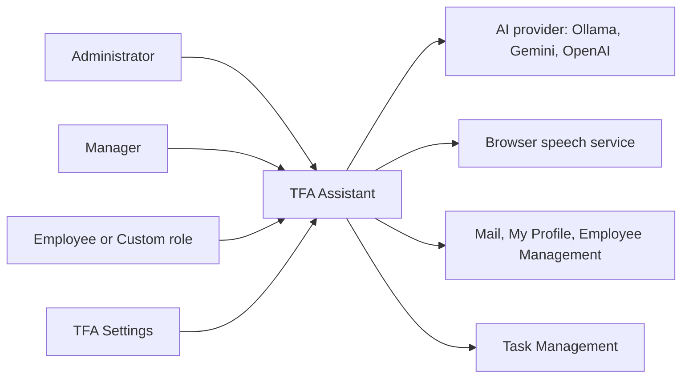

---

## 3. User Roles & Permissions

### 3.1 Roles

| Role | Description | Data scope |
|---|---|---|
| Administrator | Full system user; chat, mail drafts, own profile change, change another user's role | Own conversation and actions; role change across the organisation |
| Manager | Leads teams and projects; chat, mail drafts, own profile change | Own conversation and actions; task answers follow own task access |
| Employee | Works on assigned tasks; chat, mail drafts, own profile change | Own conversation and actions; task answers follow own task access |
| Custom role | Role created in Role Configuration | As granted |

### 3.2 Permission Matrix (functional view)

| Module › Function | Permission key | Administrator | Manager | Employee | Custom role |
|---|---|:---:|:---:|:---:|:---:|
| TFA › Chat with the assistant (panel, messages, new chat, models) | `assistant.chat` | Granted | Granted | Granted | Configurable |
| TFA › Confirm, edit or cancel prepared actions | `assistant.actions.confirm` | Granted | Granted | Granted | Configurable |
| TFA › Prepare and confirm a role change (Role Configuration key) | `roles.manage` | Granted | Denied | Denied | Configurable |

Mail, profile and task answers additionally follow the user's own rights in those modules (BR-TFA-01). Background safeguards apply to everyone and need no permission.

---

## 4. Functional Requirements by Module

### 4.1 Module: TFA Assistant (TFA)

**Purpose:** An AI assistant on every signed-in screen that answers questions about TaskFlow and the user's work and prepares actions that run only after the user confirms.  ·  **BRD reference:** BRD-Assistant §5 SCREEN 1–5, `BR-TFA-01` – `BR-TFA-16`; overall `BR-04`, `BR-20`, `BR-27`, `BR-28`

#### 4.1.1 Screen: TFA Panel (chat)

| Field | Value |
|---|---|
| Route / location | Panel on the right of every signed-in screen; opened from the floating **TFA** button (bottom right) or the wake phrase |
| Access | Administrator, Manager, Employee (default); Custom role with `assistant.chat` |
| Entry points | Floating **TFA** button; "Hey TF assistant" (see 4.1.4) |

**Screen elements**

| Element | Type | Description | Mandatory | Visible to |
|---|---|---|:---:|---|
| TFA button | Floating button + voice hint | Opens/closes the panel | – | Users with `assistant.chat` |
| Header | Title + buttons | "TFA – TaskFlow Assistant", **New chat** (+), **Close** (×) | – | Users with `assistant.chat` |
| Model selector | Menu | Chosen provider and model with **Local**/**Cloud** tag; menu opens only with 2 or more configured providers | – | Users with `assistant.chat` |
| Cloud notice | Inline notice | "`{Provider}` is a cloud provider. Your message, related task details and matching TaskFlow document text are sent to it." with **I understand**, **Cancel** | – | Users with `assistant.chat` |
| Conversation feed | List | User messages, TFA answers with provider name (e.g. "TFA · Gemini"), "Permission required" bubble, notices, numbered ranked task list with tags, screen link buttons, **Sources** chips (4.1.2), Action Cards | – | Users with `assistant.chat` |
| Welcome bubble + suggestions | Text + chips | "Hi, I'm TFA. I can explain how TaskFlow works, tell you what is coming up and what to do first, and draft mail for you to review."; *What are my upcoming tasks?*, *What should I prioritise?*, *How do I change a task status?*, *Send a mail to my manager* | – | Users with `assistant.chat` (empty chat only) |
| Message box | Text area | "Ask TFA anything about TaskFlow…"; Enter sends, Shift+Enter new line | Yes (to send) | Users with `assistant.chat` |
| Microphone, Send | Buttons | Dictate (4.1.4); send the message | – | Users with `assistant.chat` |
| Footer | Text | "TFA can make mistakes. Actions always need your confirmation." | – | Users with `assistant.chat` |
| Provider failure card | Card | Plain failure text with **Retry** and **Use** `{other provider}` | – | Users with `assistant.chat` |

**Functional requirements**

| ID | Requirement | Priority | Permission | BRD trace |
|---|---|---|---|---|
| FR-TFA-01 | The system shall show the TFA button and panel on every signed-in screen only to users holding `assistant.chat`, and refuse every chat request from other users. | Must | `assistant.chat` | REQ-TFA-01, BR-TFA-01 |
| FR-TFA-02 | The system shall open and close the panel from the TFA button and the **Close** (×) button. | Must | `assistant.chat` | REQ-TFA-01 |
| FR-TFA-03 | The system shall, when the panel opens, load the configured providers and the user's own latest conversation with up to the last 100 messages. | Must | `assistant.chat` | REQ-TFA-02, BR-TFA-04 |
| FR-TFA-04 | The system shall show the welcome bubble and the four starter suggestions when the conversation is empty, and send a suggestion like a typed message when it is clicked. | Should | `assistant.chat` | REQ-TFA-01, REQ-TFA-12 |
| FR-TFA-05 | The system shall send the message on **Send** or Enter and insert a new line on Shift+Enter. | Must | `assistant.chat` | REQ-TFA-04 |
| FR-TFA-06 | The system shall report another user's conversation or prepared action as "not found" to everyone, Administrators included. | Must | `assistant.chat` | REQ-TFA-03, BR-TFA-04, BR-20 |
| FR-TFA-07 | The system shall accept messages of 1 to 2000 characters and refuse others with "A message must be between 1 and 2000 characters." | Must | `assistant.chat` | REQ-TFA-04 |
| FR-TFA-08 | The system shall neither send to any provider nor store a message that looks like it contains a password or API key/token, and shall show "For your safety I did not send or keep that message: it looks like it contains a password or an API key. Please never type passwords into chat. To change your password, open My Profile and use the Change password form." | Must | `assistant.chat` | REQ-TFA-05, BR-TFA-03, BR-28 |
| FR-TFA-09 | The system shall answer questions about upcoming, due-today, overdue and all open tasks using the same access rules as Task Management – the user's own tasks by default and every task the user may see on request – each task linking to its task page. | Must | `assistant.chat` | REQ-TFA-06, BR-TFA-05 |
| FR-TFA-10 | The system shall rank the user's open assigned tasks (To Do, In Progress, In QA, Blocked): overdue first (longest overdue first), then due today, then nearest due date, higher priority first on the same day; Completed and Cancelled excluded; blocked tasks kept and tagged **Blocked**. | Must | `assistant.chat` | REQ-TFA-07, BR-TFA-06 |
| FR-TFA-11 | The system shall show the top 5 ranked tasks (up to 10 when asked) as a numbered list with tags Overdue, Today, Tomorrow, `{n}` days or Blocked, each linking to its task page; the order shall be calculated by the system and be identical for every provider. | Must | `assistant.chat` | REQ-TFA-08, BR-TFA-06 |
| FR-TFA-12 | The system shall list in the model selector only providers configured by an administrator, with a Local or Cloud tag, open the menu only when 2 or more are configured, remember the choice in the browser, and keep the same conversation when the model is switched. | Must | `assistant.chat` | REQ-TFA-09, BR-TFA-11 |
| FR-TFA-13 | The system shall show "TFA is not available yet. An administrator needs to choose an AI model in TFA Settings." when no provider is configured, and "`{Provider}` is not configured. Choose another model, or ask an administrator to set it up." when the chosen provider was removed. | Must | `assistant.chat` | REQ-TFA-09, BR-TFA-11 |
| FR-TFA-14 | The system shall show the name of the provider that answered under each TFA answer. | Could | `assistant.chat` | REQ-TFA-09 |
| FR-TFA-15 | The system shall hold the first message to each cloud provider and show the cloud notice; **I understand** sends it and is remembered in that browser, **Cancel** puts the text back into the message box. | Must | `assistant.chat` | REQ-TFA-10, BR-TFA-11 |
| FR-TFA-16 | The system shall save nothing when a provider fails (rate limit, rejected key, timeout, unreachable, model missing, unexpected error), show the matching plain message, and offer **Retry** (same text) and **Use** `{other provider}` for each other configured provider. | Must | `assistant.chat` | REQ-TFA-11 |
| FR-TFA-17 | The system shall start a new conversation on **New chat**, empty the panel and show the welcome bubble; earlier messages stay stored but are no longer used as context. On failure it shall show "Could not start a new chat." | Should | `assistant.chat` | REQ-TFA-12 |
| FR-TFA-18 | The system shall use at most the last 12 messages, about 6000 characters, of the current conversation as context, excluding notices. | Should | `assistant.chat` | REQ-TFA-13 |
| FR-TFA-19 | The system shall allow at most 4 rounds of lookups per answer, after which TFA shall answer in words. | Should | `assistant.chat` | REQ-TFA-14 |
| FR-TFA-20 | The system shall treat task, comment and mail text that TFA reads as data, never as an instruction. | Must | `assistant.chat` | REQ-TFA-15, BR-TFA-02 |
| FR-TFA-21 | The system shall clear the panel and load the new person's own conversation when a different user signs in on the same browser. | Must | `assistant.chat` | REQ-TFA-16, BR-TFA-04 |
| FR-TFA-22 | The system shall use the application name and time zone from Application Settings in answers and when deciding which tasks are due today. | Should | `assistant.chat` | REQ-TFA-17, BR-17 |
| FR-TFA-23 | The system shall show a refused request as a "Permission required" bubble with "You do not have the required permission to perform this action. `{Action}` can only be performed by `{who}`. Please contact your system administrator for assistance." | Must | `assistant.chat` | REQ-TFA-01, REQ-TFA-23, BR-TFA-01 |
| FR-TFA-24 | The system shall show the footer "TFA can make mistakes. Actions always need your confirmation." at all times in the panel. | Should | `assistant.chat` | REQ-TFA-22, BR-TFA-02 |

**Use case: UC-TFA-01 – Ask TFA a question**

| Item | Detail |
|---|---|
| Actor | Any user with `assistant.chat` |
| Preconditions | Signed in; at least one provider configured |
| Trigger | Opens the panel, types a question (or clicks a suggestion) and presses **Send** |
| Main flow | 1. System loads providers and the latest conversation. 2. User sends a message. 3. If the chosen provider is Cloud and not yet acknowledged, the cloud notice is shown; user clicks **I understand**. 4. System checks length (1–2000) and the secret screen. 5. System checks the 20-per-minute limit (FR-TFA-53). 6. System finds the matching TaskFlow document sections (FR-TFA-58); TFA answers using them and up to 4 rounds of lookups. 7. System saves the question and answer and shows them with task links, ranked list, screen links or sources. |
| Alternate flows | A1: **Cancel** on the cloud notice → text returned to the box, nothing sent. A2: user switches model → same conversation continues. |
| Exceptions | E1: length outside 1–2000 → "A message must be between 1 and 2000 characters.". E2: password/key detected → safety notice, nothing sent or stored. E3: over the limit → "You are sending messages too quickly. Please wait about `{n}` seconds and try again.". E4: provider failure → plain message, **Retry**, **Use** `{other provider}`, nothing saved. E5: no provider → "TFA is not available yet. An administrator needs to configure an AI provider." E6: no answer → "I could not come up with an answer. Please try again, or ask in a different way." |
| Postconditions | Question and answer stored in the user's own conversation |

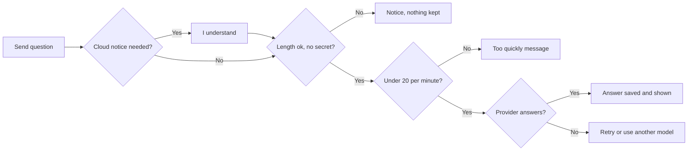

**Use case: UC-TFA-02 – What should I work on first?**

| Item | Detail |
|---|---|
| Actor | Any user with `assistant.chat` |
| Preconditions | Signed in; provider available |
| Trigger | Asks "What should I prioritise?" |
| Main flow | 1. System loads the user's open assigned tasks. 2. System ranks them (FR-TFA-10). 3. System shows the top 5 as a numbered list with tags and task links. 4. TFA explains the order in words. |
| Alternate flows | A1: user asks for more → up to 10 tasks. |
| Exceptions | E1: no open tasks → TFA says so in words. |
| Postconditions | Same order for every provider; nothing changed |

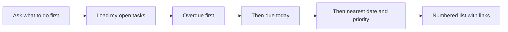

**Use case: UC-TFA-03 – Start a new chat**

| Item | Detail |
|---|---|
| Actor | Any user with `assistant.chat` |
| Preconditions | Panel open |
| Trigger | Clicks **New chat** (+) |
| Main flow | 1. System creates a new conversation for the user. 2. Panel empties and shows the welcome bubble and suggestions. |
| Alternate flows | – |
| Exceptions | E1: failure → "Could not start a new chat." |
| Postconditions | Earlier messages stored but no longer used as context |

**Field validations**

| Field | Rule | Error message |
|---|---|---|
| Message | 1 to 2000 characters | "A message must be between 1 and 2000 characters." |
| Message | Must not look like a password or API key/token | "For your safety I did not send or keep that message: it looks like it contains a password or an API key. …" |
| Message | At most 20 per user per minute | "You are sending messages too quickly. Please wait about `{n}` seconds and try again." |

**Business rules applied:** BR-TFA-01, BR-TFA-03, BR-TFA-04, BR-TFA-05, BR-TFA-06, BR-TFA-11; overall BR-04, BR-17, BR-20, BR-28.

**Notifications / side effects**

| Event | Who is notified | Channel |
|---|---|---|
| Message sent to a cloud provider | The provider receives the message, related task details and the matching TaskFlow document text (after the cloud notice) | Provider |
| Answer received | The user only | TFA Panel |

**Messages**

| Situation | Message |
|---|---|
| Provider rate limit | "`{Provider}`'s free limit or rate limit has been reached. Try again in about `{n}` seconds, or choose another model." |
| Provider rejected key | "`{Provider}` did not accept the API key. Ask an administrator to check the key in TFA Settings, or choose another model." |
| Provider timeout | "`{Provider}` took too long to answer. You can retry, or choose another model." |
| Ollama not running | "Ollama is not running or cannot be reached. Ask an administrator to start it, or choose another model." |
| Cloud provider unreachable | "`{Provider}` cannot be reached right now. Check the connection and retry, or choose another model." |
| Model not installed (Ollama) | "The configured model is not available on Ollama. Ask an administrator to install it, or choose another model." |
| Model not available (cloud) | "The configured model is not available on `{Provider}`. Ask an administrator to check the model name, or choose another model." |
| Other provider error | "`{Provider}` returned an unexpected error. Please try again, or choose another model." |
| Any other send error | "TFA could not answer. Please try again." |
| No permission | "You do not have the required permission to perform this action. `{Action}` can only be performed by `{who}`. Please contact your system administrator for assistance." |

#### 4.1.2 Screen: Answers from TaskFlow Documents (inside the TFA Panel)

> v1.1: replaces "How-to Help" (answers from 19 built-in help topics, FR-TFA-25 – FR-TFA-28). The help topics were removed.

| Field | Value |
|---|---|
| Route / location | TFA Panel – answers to questions about TaskFlow's features, screens, rules and design |
| Access | Administrator, Manager, Employee (default); Custom role with `assistant.chat` |
| Entry points | Any question about TaskFlow; starter suggestion *How do I change a task status?* |

**Screen elements**

| Element | Type | Description | Mandatory | Visible to |
|---|---|---|:---:|---|
| Answer | Text | TFA's answer, written only from the matching document sections | – | Users with `assistant.chat` |
| Sources | Label + chips | "Sources", then one chip per document section given to TFA: the document title and the section's last heading; the tooltip shows the full heading path and the document's file path | – | Users with `assistant.chat` (answers that were given document text) |

**Functional requirements**

| ID | Requirement | Priority | Permission | BRD trace |
|---|---|---|---|---|
| FR-TFA-25 | *Superseded in v1.1 by FR-TFA-57 and FR-TFA-59.* (Was: answer how-to questions only from the 19 built-in help topics, using at most the 3 best matches.) | – | – | REQ-TFA-18 (superseded) |
| FR-TFA-26 | *Superseded in v1.1 by FR-TFA-61.* (Was: add a link button to the screen named in the matching topic.) | – | – | REQ-TFA-19 (superseded) |
| FR-TFA-27 | *Superseded in v1.1 by FR-TFA-64.* (Was: role-restricted topics give other roles only who can do it.) | – | – | REQ-TFA-20 (superseded) |
| FR-TFA-28 | *Superseded in v1.1 by FR-TFA-59.* (Was: say it does not have the information when no topic matches.) | – | – | REQ-TFA-21 (superseded) |
| FR-TFA-57 | The system shall answer questions about TaskFlow's features, screens, rules, design and behaviour only from the Markdown (`.md`) documents in the configured documents folder and its sub-folders; other file types (such as PDF and Excel) are not used. | Must | `assistant.chat` | REQ-TFA-46, BR-TFA-07 |
| FR-TFA-58 | The system shall, for every message that passes the chat checks, find the best-matching document sections before the AI model is called – at most 5 sections, each at least as similar to the message as the configured minimum, and at most 4000 characters of text in total (the best section is always kept) – so that this works with every provider and with models that cannot use lookups. A message shorter than 40 characters that matches nothing on its own is matched again together with the user's previous message. | Must | `assistant.chat` | REQ-TFA-47 |
| FR-TFA-59 | The system shall instruct TFA to answer questions about TaskFlow only from the sections it was given and, when they do not contain the answer, to say that the TaskFlow documents do not cover it; when no section matches, TFA is told that no document matched and says the same. TFA shall never answer such questions from general knowledge or invent screens, rules or features. | Must | `assistant.chat` | REQ-TFA-48, BR-TFA-07 |
| FR-TFA-60 | The system shall instruct TFA to answer only questions about TaskFlow and the user's work in it, and to decline anything else (such as general knowledge) by saying it can only answer from the TaskFlow documents and the user's own work in TaskFlow. | Must | `assistant.chat` | REQ-TFA-49 |
| FR-TFA-61 | The system shall attach to an answer that was given document text one source per document section (document title, section heading path, file path), without duplicates, show them as **Sources** chips under the answer, and keep them with the stored message so they are shown again after a reload. Fixed replies (refusals, prepared actions), the "no answer" text and notices carry no sources; messages stored before v1.1 show none. | Should | `assistant.chat` | REQ-TFA-50 |
| FR-TFA-62 | The system shall answer questions about the user's own tasks, priorities, mail and profile with the live-data lookups of 4.1.1 and 4.1.3, never from the document text, even when document sections were found for the message. | Must | `assistant.chat` | REQ-TFA-51, BR-TFA-16 |
| FR-TFA-63 | The system shall pass document text to TFA marked as data, between fixed start and end markers that the document text cannot close early, and TFA shall not follow instructions written in it. | Must | `assistant.chat` | REQ-TFA-52, BR-TFA-16 |
| FR-TFA-64 | The system shall search every indexed document for every user with `assistant.chat`, whatever their role. | Must | `assistant.chat` | REQ-TFA-53, BR-TFA-15 |
| FR-TFA-65 | The system shall, when the documents cannot be searched (the local AI server or embedding model is unavailable, document search is switched off, or the index is empty), still answer task, mail and profile questions and instruct TFA to say that the TaskFlow documents cannot be searched right now; while the first indexing has stored nothing yet, TFA shall say the documents are still being prepared. | Must | `assistant.chat` | REQ-TFA-54 |
| FR-TFA-66 | The system shall use added, changed and deleted documents without a restart: the folder is checked 10 seconds after start and then every 5 minutes by default, or at once when an administrator clicks **Re-index now** (FRD-TFA-Settings). A changed document's earlier sections stay in use until its new sections are stored. | Should | – (automatic) | REQ-TFA-55 |

**Use case: UC-TFA-04 – Ask about TaskFlow**

| Item | Detail |
|---|---|
| Actor | Any user with `assistant.chat` |
| Preconditions | Signed in; provider available; documents indexed |
| Trigger | Asks, e.g., "What validations apply when creating a task?" |
| Main flow | 1. System checks the message as in UC-TFA-01. 2. System finds the best-matching document sections. 3. TFA answers only from them. 4. System shows the answer with its **Sources** and stores both. |
| Alternate flows | A1: short follow-up ("and for managers?") → matched together with the previous question. A2: question about the user's own tasks → answered from live data (UC-TFA-01, UC-TFA-02). |
| Exceptions | E1: no section matches, or the sections do not answer it → TFA says the TaskFlow documents do not cover it. E2: question not about TaskFlow → TFA declines. E3: documents cannot be searched → TFA says so; live-data questions still work. E4: first indexing not finished and nothing stored → TFA says the documents are still being prepared. |
| Postconditions | Question and answer, with sources, stored in the user's own conversation |

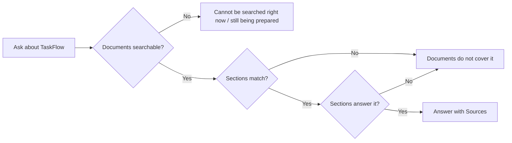

**Field validations:** _Not applicable – the chat field rules of 4.1.1 apply._

**Business rules applied:** BR-TFA-07, BR-TFA-15, BR-TFA-16.

**Notifications / side effects**

| Event | Who is notified | Channel |
|---|---|---|
| Answer from the documents | The user only | TFA Panel |
| Cloud provider selected | The provider receives the matching document sections with the message (cloud notice, FR-TFA-15) | Provider |

**Messages**

| Situation | Message |
|---|---|
| Not covered | TFA says the TaskFlow documents do not cover it (wording by the AI model) |
| Not about TaskFlow | TFA says it can only answer from the TaskFlow documents and the user's own work in TaskFlow (wording by the AI model) |
| Documents cannot be searched | TFA says the TaskFlow documents cannot be searched right now (wording by the AI model) |
| First indexing not finished | TFA says the TaskFlow documents are still being prepared (wording by the AI model) |
| Sources | "Sources" followed by one chip per document section |

#### 4.1.3 Screen: Action Card (inside the TFA Panel)

| Field | Value |
|---|---|
| Route / location | TFA Panel – card in the conversation feed |
| Access | Card shown to holders of `assistant.chat`; Confirm, Edit and Cancel need `assistant.actions.confirm`; role change also needs `roles.manage` (Administrator by default) |
| Entry points | A request such as "Send a mail to my manager about TSK-12", "Change my email to …", "Make Ravi a Manager" |

**Screen elements**

| Element | Type | Description | Mandatory | Visible to |
|---|---|---|:---:|---|
| Title + expiry | Text | **Mail draft**, **Update your profile** or **Change role**; "Expires in 10 minutes" while pending | – | Users with `assistant.chat` |
| Fields | Read-only list | To, Subject and message (mail); Name/Email old → new (profile); User and Role old → new (role) | – | Users with `assistant.chat` |
| Confirm button | Button | **Send mail** / **Save changes** / **Change role** | – | Users with `assistant.actions.confirm` |
| Edit | Button | Opens the edit form (mail only) | – | Users with `assistant.actions.confirm` |
| Cancel | Button | Discards the action | – | Users with `assistant.actions.confirm` |
| Hint | Text | "Nothing happens until you confirm." | – | Users with `assistant.chat` |
| Edit form | Form | **To (email addresses)**, **Subject**, **Message**, **Save changes**, **Back** | To: Yes | Users with `assistant.actions.confirm` |
| Final status | Label | **Done**, **Cancelled**, **Expired. Ask TFA again.**, **Not allowed**, **Not done** | – | Users with `assistant.chat` |

**Functional requirements**

| ID | Requirement | Priority | Permission | BRD trace |
|---|---|---|---|---|
| FR-TFA-29 | The system shall let TFA only prepare an action and show it as an Action Card with "I have prepared this for you. Please review it. Nothing happens until you confirm."; only the user's own click on the confirm button shall run it. | Must | `assistant.chat` (prepare), `assistant.actions.confirm` (run) | REQ-TFA-22, BR-TFA-02, BR-27 |
| FR-TFA-30 | The system shall check the user's permission when the action is prepared and again, with the user's current sign-in, when it is confirmed, and mark a refused confirm **Not allowed**. | Must | `assistant.actions.confirm` | REQ-TFA-23, BR-TFA-01 |
| FR-TFA-31 | The system shall expire a pending action 10 minutes after it is created; a confirm after that shall show "This request has expired. Please ask TFA again." and the status **Expired. Ask TFA again.** | Must | `assistant.actions.confirm` | REQ-TFA-24, BR-TFA-08 |
| FR-TFA-32 | The system shall run an action at most once, even when confirm is clicked several times at the same moment; a later confirm shall show "This action has already been done." and an action no longer pending "This action can no longer be confirmed (`{status}`). Please ask TFA again." | Must | `assistant.actions.confirm` | REQ-TFA-25, BR-TFA-08 |
| FR-TFA-33 | The system shall discard a pending action on **Cancel** and show **Cancelled**; nothing is sent or changed. | Must | `assistant.actions.confirm` | REQ-TFA-22 |
| FR-TFA-34 | The system shall prepare internal TaskFlow mail drafts that pass the Mail rules (subject or message required; 1–50 recipients; subject max 200, message max 20,000 characters) and, on **Send mail**, send them from the user's own mailbox with "Done. Your mail "`{subject}`" was sent to `{names}`." | Must | `assistant.chat`, `assistant.actions.confirm` | REQ-TFA-26, BR-TFA-09 |
| FR-TFA-35 | The system shall, for a mail to "my manager", use the task's creator when that is another active user, otherwise the single active Manager of the user's departments, and ask the user which person is meant when none or several match. | Should | `assistant.chat` | REQ-TFA-27 |
| FR-TFA-36 | The system shall refuse a mail draft about a task the user cannot open with "That task was not found, or you do not have access to it." | Must | `assistant.chat` | REQ-TFA-26, BR-TFA-05 |
| FR-TFA-37 | The system shall allow **Edit** only on mail drafts ("Only a mail can be edited." otherwise), accept as recipients only email addresses of active TaskFlow users, and name unknown addresses with "These are not active TaskFlow users: `{addresses}`." | Must | `assistant.actions.confirm` | REQ-TFA-28 |
| FR-TFA-38 | The system shall refuse to edit an action that is no longer pending with "This action can no longer be changed. Please ask TFA again." | Must | `assistant.actions.confirm` | REQ-TFA-28, BR-TFA-08 |
| FR-TFA-39 | The system shall prepare an "Update your profile" card only for the signed-in user's own full name and/or email, checked with the My Profile rules (name required, max 200; valid `@taskflow.com` email, max 256; not used by another account); on **Save changes** it shall apply the change and reply "Done. Your profile was updated." | Should | `assistant.chat`, `assistant.actions.confirm` | REQ-TFA-29, BR-TFA-09 |
| FR-TFA-40 | The system shall prepare a "Change role" card only for holders of `roles.manage`, for an existing role named exactly and an active user, never for the requester's own role ("For safety I do not change your own role. Please ask another administrator to do it."), and shall say nothing needs to change when the user already has that role. | Should | `roles.manage`, `assistant.actions.confirm` | REQ-TFA-30, BR-TFA-10 |
| FR-TFA-41 | The system shall, after a confirmed role change, end the target user's sessions and reply "Done. `{name}` is now a `{role}`. They were signed out and will use the new role the next time they sign in." | Should | `roles.manage` | REQ-TFA-31 |
| FR-TFA-42 | The system shall find active users by name or email (at most 10 matches) to address a mail. | Should | `assistant.chat` | REQ-TFA-32 |
| FR-TFA-43 | The system shall answer password questions with fixed guidance and a link to My Profile, never ask for or accept a password, and never change a password. | Must | `assistant.chat` | REQ-TFA-33, BR-TFA-10, BR-28 |
| FR-TFA-44 | The system shall answer requests that need an administrator with "This needs an administrator. Please contact your system administrator for assistance." | Could | `assistant.chat` | REQ-TFA-34 |
| FR-TFA-45 | The system shall mark a failed action **Not done** and reply "I could not do that: `{reason}`. Nothing was sent." (mail) or "… Nothing was changed." (profile, role), with nothing sent or changed. | Must | `assistant.actions.confirm` | REQ-TFA-35 |
| FR-TFA-46 | The system shall show "Could not confirm that action.", "Could not cancel that action." or "Could not save your changes." when the request fails for network reasons, leaving the card pending. | Should | `assistant.actions.confirm` | REQ-TFA-35 |

**Use case: UC-TFA-05 – Send a mail with TFA**

| Item | Detail |
|---|---|
| Actor | Any user with `assistant.chat` and `assistant.actions.confirm` |
| Preconditions | Signed in; provider available |
| Trigger | Asks, e.g., "Send a mail to my manager about TSK-12" |
| Main flow | 1. TFA resolves the recipient ("my manager" or named users). 2. System checks the Mail rules and shows a **Mail draft** card. 3. User optionally clicks **Edit**, changes To/Subject/Message, clicks **Save changes**. 4. User clicks **Send mail**. 5. System re-checks permission and expiry, sends from the user's mailbox and replies "Done. Your mail "`{subject}`" was sent to `{names}`." 6. Outcome recorded in the audit. |
| Alternate flows | A1: no or several matching managers → TFA asks who is meant. A2: **Cancel** → **Cancelled**. |
| Exceptions | E1: unknown recipient in edit → "These are not active TaskFlow users: `{addresses}`.". E2: Mail rule broken → "Write a subject or a message before sending." / "Add between 1 and 50 recipients." / "'`{value}`' is not an email address.". E3: expired → "This request has expired. Please ask TFA again.". E4: failure → **Not done**, "Nothing was sent." |
| Postconditions | Mail in the recipients' TaskFlow inboxes and the user's sent items; audit record written |

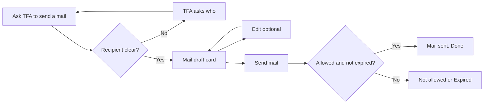

**Use case: UC-TFA-06 – Update my profile with TFA**

| Item | Detail |
|---|---|
| Actor | Any user with `assistant.chat` and `assistant.actions.confirm` |
| Preconditions | Signed in |
| Trigger | Asks, e.g., "Change my email to asha.menon@taskflow.com" |
| Main flow | 1. TFA checks the new name/email with the My Profile rules. 2. System shows **Update your profile** with old → new. 3. User clicks **Save changes**. 4. System applies the change (mobile number unchanged) and replies "Done. Your profile was updated." |
| Alternate flows | A1: **Cancel** → nothing changes. |
| Exceptions | E1: invalid or taken email → TFA explains the problem, no card. E2: failure at confirm → **Not done**, "Nothing was changed." |
| Postconditions | Own name/email updated (see FRD-My-Profile FR-PROF-16) |

**Use case: UC-TFA-07 – Change a user's role (Administrator)**

| Item | Detail |
|---|---|
| Actor | Administrator (or custom role with `roles.manage`) |
| Preconditions | Signed in; `roles.manage`, `assistant.actions.confirm` |
| Trigger | Asks, e.g., "Make Ravi a Manager" |
| Main flow | 1. System checks `roles.manage`. 2. TFA finds the role by exact name and the person among active users. 3. System shows **Change role** (User, Role old → new). 4. Administrator clicks **Change role**. 5. System re-checks the permission, changes the role, ends the user's sessions and replies with the "Done. … signed out …" text. |
| Alternate flows | A1: person already has the role → TFA says nothing needs to change. |
| Exceptions | E1: no `roles.manage` → "Permission required" bubble "You do not have the required permission to perform this action. Changing a user's role can only be performed by an authorized administrator. Please contact your system administrator for assistance." (refusal recorded). E2: own role → "For safety I do not change your own role. Please ask another administrator to do it." |
| Postconditions | Target user has the new role at next sign-in; audit record written |

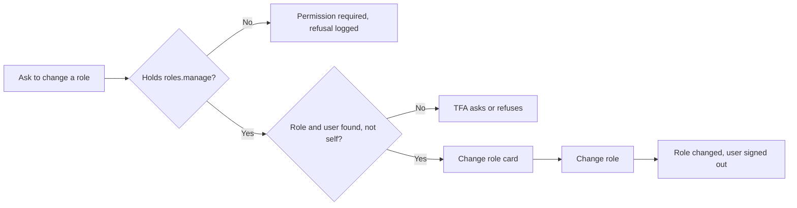

**Field validations**

| Field | Rule | Error message |
|---|---|---|
| To (email addresses) | 1–50 addresses; each an email of an active TaskFlow user | "Add between 1 and 50 recipients." / "'`{value}`' is not an email address." / "These are not active TaskFlow users: `{addresses}`." |
| Subject, Message | At least one filled; subject max 200, message max 20,000 characters | "Write a subject or a message before sending." |
| Profile name / email | My Profile rules (FRD-My-Profile 4.1.1) | Reason shown in "I could not do that: `{reason}`. Nothing was changed." |
| Role | Existing role, named exactly; not the requester's own role | "For safety I do not change your own role. Please ask another administrator to do it." |

**Business rules applied:** BR-TFA-01, BR-TFA-02, BR-TFA-04, BR-TFA-08, BR-TFA-09, BR-TFA-10; overall BR-24, BR-27, BR-28.

**Notifications / side effects**

| Event | Who is notified | Channel |
|---|---|---|
| Mail confirmed | Recipients | TaskFlow Mail (Mail rules apply) |
| Profile confirmed | Nobody (BR-PROF-12) | – |
| Role change confirmed | Target user: sessions ended, new role at next sign-in | – |
| Any action outcome | Nobody; audit record written (4.1.5) | – |

**Messages**

| Situation | Message |
|---|---|
| Prepared | "I have prepared this for you. Please review it. Nothing happens until you confirm." |
| Done | "Done. Your mail "`{subject}`" was sent to `{names}`." / "Done. Your profile was updated." / "Done. `{name}` is now a `{role}`. They were signed out and will use the new role the next time they sign in." |
| Failed | "I could not do that: `{reason}`. Nothing was sent." / "Nothing was changed." |
| Expired | "This request has expired. Please ask TFA again." |
| Already done | "This action has already been done." |
| Password question | Fixed guidance with a **My Profile** link (see open issue in §10) |
| No permission | "You do not have the required permission to perform this action. Changing a user's role can only be performed by an authorized administrator. Please contact your system administrator for assistance." |

#### 4.1.4 Screen: Voice Controls (inside the TFA Panel)

| Field | Value |
|---|---|
| Route / location | TFA Panel message box, listening bar, TFA button hint |
| Access | Administrator, Manager, Employee (default); Custom role with `assistant.chat`; Chrome or Edge |
| Entry points | Wake phrase "Hey TF assistant"; microphone button |

**Screen elements**

| Element | Type | Description | Mandatory | Visible to |
|---|---|---|:---:|---|
| Microphone | Button | "Speak a command (Chrome or Edge)" – dictates one command | – | Users with `assistant.chat` |
| Listening bar | Status + buttons | Waiting for "Hey TF assistant", Listening… say your command, Hands-free is off, Voice is paused; **Turn on "Hey TF assistant"** / **Turn on hands-free** / **Turn off** | – | Users with `assistant.chat` |
| Heard text | Text | Heard: "…" under the TFA button | – | Users with `assistant.chat` |
| Voice hint | Text | say "Hey TF assistant", Listening… say your command, or voice is off | – | Users with `assistant.chat` |

**Functional requirements**

| ID | Requirement | Priority | Permission | BRD trace |
|---|---|---|---|---|
| FR-TFA-47 | The system shall, when "Hey TF assistant" is heard, open the panel and say "Hi `{first name}`, how can I help you?" | Could | `assistant.chat` | REQ-TFA-36 |
| FR-TFA-48 | The system shall show the spoken words in the message box while the user speaks and send the question after about 2 seconds of silence, applying every chat rule of 4.1.1. | Could | `assistant.chat` | REQ-TFA-37 |
| FR-TFA-49 | The system shall let the microphone button listen once and fill the message box with a single command. | Could | `assistant.chat` | REQ-TFA-38 |
| FR-TFA-50 | The system shall read aloud only answers to spoken questions, up to 500 characters, and pause the microphone while speaking; typed questions get text only. | Could | `assistant.chat` | REQ-TFA-39 |
| FR-TFA-51 | The system shall remember a deliberate **Turn off** in the browser, offer **Turn on "Hey TF assistant"** / **Turn on hands-free**, and never turn voice off permanently because of an error. | Could | `assistant.chat` | REQ-TFA-40 |
| FR-TFA-52 | The system shall use the browser's own speech service, keep no recording, and show the matching message when voice is unavailable so the user can type instead. | Must | `assistant.chat` | REQ-TFA-41, BR-TFA-14 |

**Use case: UC-TFA-08 – Ask by voice**

| Item | Detail |
|---|---|
| Actor | Any user with `assistant.chat` in Chrome or Edge |
| Preconditions | Hands-free on; microphone allowed |
| Trigger | Says "Hey TF assistant" |
| Main flow | 1. System opens the panel and greets the user by first name. 2. User speaks; words appear in the message box. 3. After about 2 seconds of silence the question is sent (UC-TFA-01). 4. The answer is shown and read aloud; the microphone rests meanwhile. |
| Alternate flows | A1: user clicks the microphone instead → one command dictated into the box, sent by the user. |
| Exceptions | E1: unsupported browser, blocked or missing microphone, no internet → matching message, typing works. |
| Postconditions | Same as UC-TFA-01; no recording kept |

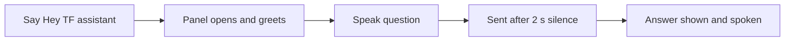

**Field validations:** _Not applicable – the chat field rules of 4.1.1 apply to spoken questions._

**Business rules applied:** BR-TFA-14.

**Notifications / side effects**

| Event | Who is notified | Channel |
|---|---|---|
| Spoken answer | The user | Browser speech output |

**Messages**

| Situation | Message |
|---|---|
| Browser without voice | "Voice input is not supported in this browser. Try Chrome or Edge, or type your question." |
| Microphone blocked | "Microphone access was denied. Allow it in your browser to use voice, or type your question." |
| No microphone | "No microphone was found. You can type your question instead." |
| No internet for voice | "Voice needs an internet connection in this browser. You can type your question instead." |
| Auto start blocked | "Click anywhere on the page to turn "Hey TF assistant" back on." |
| No permission | _Not applicable – without `assistant.chat` the panel and voice controls are not shown._ |

#### 4.1.5 Screen: Background Safeguards (no screen)

| Field | Value |
|---|---|
| Route / location | None – applied automatically |
| Access | Applies to every TFA user (Administrator, Manager, Employee, Custom role); nobody can view the audit |
| Entry points | Every message and every action outcome |

**Screen elements:** _Not applicable – the user only sees the "too quickly" message._

**Functional requirements**

| ID | Requirement | Priority | Permission | BRD trace |
|---|---|---|---|---|
| FR-TFA-53 | The system shall allow at most 20 messages per user in any one-minute window, counting only messages that passed the length and secret checks, and reply "You are sending messages too quickly. Please wait about `{n}` seconds and try again." | Must | – (always) | REQ-TFA-42, BR-TFA-12 |
| FR-TFA-54 | The system shall record every action outcome – prepared, confirmed, cancelled, expired, refused, failed – with user, action kind (Send mail, Update own profile, Change user role) and time. | Must | – (always) | REQ-TFA-43, BR-TFA-13, BR-27 |
| FR-TFA-55 | The system shall never store message bodies, passwords or API keys in the audit record. | Must | – (always) | REQ-TFA-44, BR-TFA-13 |
| FR-TFA-56 | The system shall record a refusal both when TFA refuses to prepare an action and when a confirm is refused. | Should | – (always) | REQ-TFA-45 |

**Use case: UC-TFA-09 – Message limit reached**

| Item | Detail |
|---|---|
| Actor | System (on behalf of any TFA user) |
| Preconditions | User has sent 20 messages in the last minute |
| Trigger | User sends another message |
| Main flow | 1. System counts the user's messages of the last minute. 2. At 20, it replies with the "too quickly" message and does not call the provider. |
| Alternate flows | A1: under 20 → message continues (UC-TFA-01). |
| Exceptions | – |
| Postconditions | Provider quota protected |

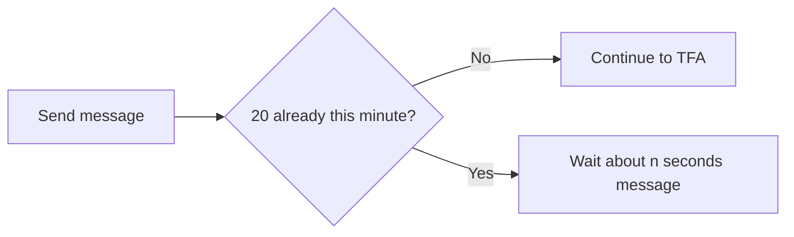

**Field validations:** _Not applicable for this screen._

**Business rules applied:** BR-TFA-12, BR-TFA-13; overall BR-27.

**Notifications / side effects**

| Event | Who is notified | Channel |
|---|---|---|
| Action outcome | Nobody; audit record stored | – |

**Messages**

| Situation | Message |
|---|---|
| Over the limit | "You are sending messages too quickly. Please wait about `{n}` seconds and try again." |
| No permission | _Not applicable – safeguards need no permission._ |

---

## 5. Cross-Module Workflows

### 5.1 Mail draft confirmed (TFA → MAIL)

| Step | Module | Actor / System | Action | FR reference |
|---|---|---|---|---|
| 1 | TFA | User | Asks TFA to mail "my manager" about a task | FR-TFA-35, FR-TFA-36 |
| 2 | TFA | System | Checks the Mail rules, shows **Mail draft** | FR-TFA-29, FR-TFA-34 |
| 3 | TFA | User | Clicks **Send mail** | FR-TFA-30 – FR-TFA-32 |
| 4 | MAIL | System | Sends from the user's own mailbox | FR-TFA-34, FRD-Mail (`FR-MAIL-nn`) |
| 5 | TFA | System | Records the outcome | FR-TFA-54 |

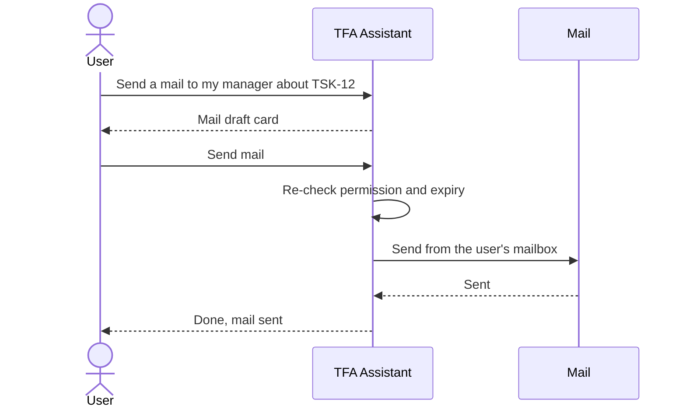

### 5.2 Role change confirmed (TFA → EMP → AUTH)

| Step | Module | Actor / System | Action | FR reference |
|---|---|---|---|---|
| 1 | TFA | Administrator | Asks "Make Ravi a Manager" | FR-TFA-40 |
| 2 | TFA | Administrator | Clicks **Change role** | FR-TFA-30 |
| 3 | EMP | System | Changes the user's role | FRD-Employee-Management (`FR-EMP-nn`) |
| 4 | AUTH | System | Ends the target user's sessions | FR-TFA-41 |
| 5 | TFA | System | Records the outcome | FR-TFA-54 |

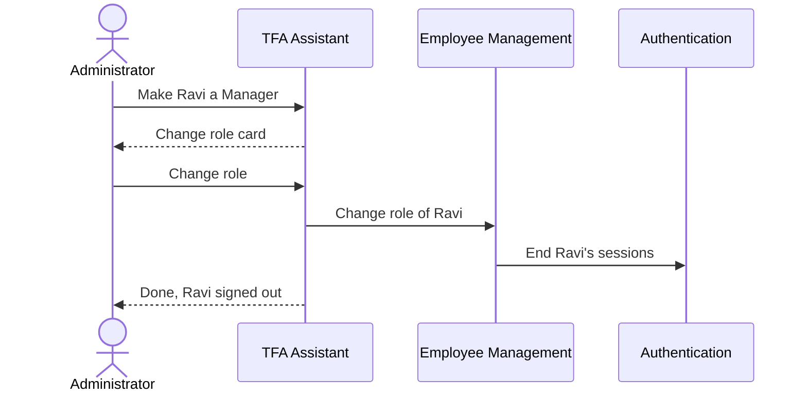

### 5.3 Provider configuration used by the panel (TFAS → TFA)

| Step | Module | Actor / System | Action | FR reference |
|---|---|---|---|---|
| 1 | TFAS | Administrator | Configures providers and models | FRD-TFA-Settings (`FR-TFAS-nn`) |
| 2 | TFA | System | Lists only configured providers in the selector | FR-TFA-12, FR-TFA-13 |
| 3 | TFA | User | Sends a message; cloud notice for a cloud provider | FR-TFA-15 |

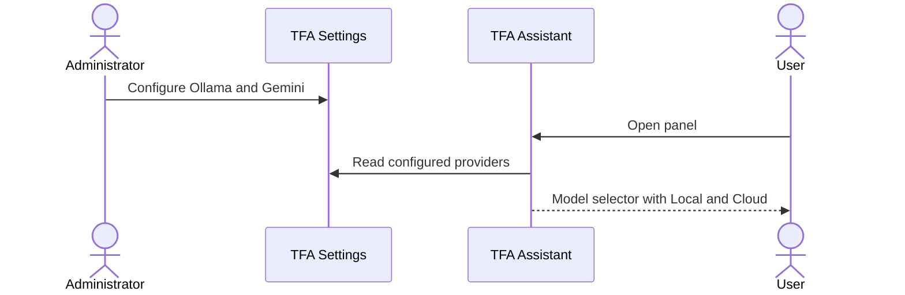

---

## 6. Reports & Exports

_Not applicable for this sub-module._ The audit log has no report or screen in this release.

---

## 7. Notifications & Messages Catalogue

TFA sends no in-app notification of its own; a confirmed mail is delivered through TaskFlow Mail. Main user-facing messages:

| Code | Trigger | Recipients | Channel | Text |
|---|---|---|---|---|
| M-TFA-01 | No provider configured | Requesting user | TFA Panel | "TFA is not available yet. An administrator needs to choose an AI model in TFA Settings." |
| M-TFA-02 | Password or key detected | Requesting user | TFA Panel | "For your safety I did not send or keep that message: …" |
| M-TFA-03 | First message to a cloud provider | Requesting user | TFA Panel | "`{Provider}` is a cloud provider. Your message, related task details and matching TaskFlow document text are sent to it." |
| M-TFA-04 | Message limit reached | Requesting user | TFA Panel | "You are sending messages too quickly. Please wait about `{n}` seconds and try again." |
| M-TFA-05 | Action prepared | Requesting user | Action Card | "I have prepared this for you. Please review it. Nothing happens until you confirm." |
| M-TFA-06 | Mail sent | Requesting user; recipients get the mail | TFA Panel; TaskFlow Mail | "Done. Your mail "`{subject}`" was sent to `{names}`." |
| M-TFA-07 | Role changed | Administrator; target user signed out | TFA Panel | "Done. `{name}` is now a `{role}`. They were signed out and will use the new role the next time they sign in." |
| M-TFA-08 | Action expired | Requesting user | Action Card | "This request has expired. Please ask TFA again." |
| M-TFA-09 | Wake phrase | Requesting user | Speech | "Hi `{first name}`, how can I help you?" |
| M-TFA-10 | Question about TaskFlow not covered by the documents | Requesting user | TFA Panel | TFA says the TaskFlow documents do not cover it (AI wording, FR-TFA-59) |
| M-TFA-11 | Documents cannot be searched | Requesting user | TFA Panel | TFA says the TaskFlow documents cannot be searched right now (AI wording, FR-TFA-65) |
| M-TFA-12 | First indexing not finished | Requesting user | TFA Panel | TFA says the TaskFlow documents are still being prepared (AI wording, FR-TFA-65) |

---

## 8. Data Requirements (functional view)

| Data item | Description | Created by | Rules |
|---|---|---|---|
| Conversation | A user's chat thread | System on first message / New chat | Own only; kept indefinitely (see §10) |
| Message | Question, answer, lookup result or notice, with provider used, sources (document, section, file) and time | System | Last 100 shown; detected secrets never stored; nothing stored on provider failure |
| Pending action | Prepared action (Send mail, Update own profile, Change user role) with details and status | System | Status Pending, Confirmed, Cancelled, Expired, Refused, Failed; expires 10 minutes after creation; resolved once |
| Audit record | Action outcome: user, kind, outcome, time | System | No message bodies, passwords or keys |
| Help topics | *Removed in v1.1* (replaced by the document index) | – | – |
| Document index | One entry per Markdown document (file path, title, content fingerprint, embedding model, section count, indexed time) and its sections (heading path, text, search vector) | System (background indexing) | Rebuilt from the documents folder; changed documents replaced, deleted ones removed; holds no user data |
| Browser settings | Chosen model, cloud acknowledgement per provider, hands-free off | User's browser | Not stored on the server |

---

## 9. Non-Functional Requirements (functional impact)

| ID | Requirement | Affects |
|---|---|---|
| NFR-TFA-01 | Secret screen on every message before any provider call | FR-TFA-08 |
| NFR-TFA-02 | Permission re-checked at confirm time | FR-TFA-30 |
| NFR-TFA-03 | Local provider option (Ollama) where nothing leaves the machine | FR-TFA-12 |
| NFR-TFA-04 | Provider failures lose nothing; Retry resends the same text | FR-TFA-16 |
| NFR-TFA-05 | Concurrent confirms never run an action twice | FR-TFA-32 |
| NFR-TFA-06 | 20 messages per user per minute | FR-TFA-53 |
| NFR-TFA-07 | Voice in Chrome and Edge; typing works in every supported browser | FR-TFA-47 – FR-TFA-52 |
| NFR-TFA-08 | Every provider problem has a plain message and a next step | FR-TFA-13, FR-TFA-16 |
| NFR-TFA-09 | Documents are searched on the local AI server at no cost; only matching sections reach a cloud provider | FR-TFA-15, FR-TFA-58 |
| NFR-TFA-10 | Document changes used without a restart | FR-TFA-66 |
| NFR-TFA-11 | Unchanged documents are not processed again (first full indexing of 89 documents about 28 minutes on a laptop CPU; later checks seconds) | FR-TFA-66 |
| NFR-TFA-12 | TFA keeps working when the documents cannot be searched | FR-TFA-65 |

---

## 10. Assumptions & Open Issues

| Type | Description | Owner |
|---|---|---|
| Assumption | An administrator configures at least one AI provider before users rely on TFA | Jojo George |
| Assumption | Users understand that AI answers can be wrong (footer FR-TFA-24) | Jojo George |
| Assumption | The message limit is held in memory; a server restart resets it | Jojo George |
| Open issue | ⚠️ To be confirmed: the fixed password guidance mentions the current password (the "Change your password" topic that did the same was removed in v1.1) and say only other sessions end; the Change Password screen uses an authenticator code and ends every session (FRD-My-Profile FR-PROF-22, FR-PROF-26) | Jojo George |
| Open issue | Resolved in v1.1: the role-restricted help topics (FR-TFA-27) were removed; every role gets answers from every document (BR-TFA-15) | Jojo George |
| Assumption | Ollama runs with the `nomic-embed-text` model pulled, and the documents in the documents folder are kept current (v1.1) | Jojo George |
| Open issue | ⚠️ To be confirmed: the Confirm, Edit and Cancel buttons are shown to users without `assistant.actions.confirm`; the click is then refused. Decide whether to hide them | Jojo George |
| Open issue | ⚠️ To be confirmed: a TFA role change checks only `roles.manage`, while Employee Management also requires `employees.role.assign` (and `roles.administrator.assign` for the Administrator role); BR-TFA-09 says role changes follow Employee Management rules | Jojo George |
| Open issue | ⚠️ To be confirmed: "my manager" finds only users with the system Manager role who manage one of the user's departments; department managers in custom roles are ignored (FR-TFA-35) | Jojo George |
| Open issue | ⚠️ To be confirmed: retention period or "delete my history" for conversations (BRD R-TFA-04) | Jojo George |
| Open issue | The card shows a fixed "Expires in 10 minutes" label, not a countdown; expiry is applied when the card is read or confirmed | Jojo George |

---

## 11. Requirements Traceability Matrix

Test cases are the automated test suites (backend test classes and frontend `*.spec.ts` files) that cover the behaviour; the mapping was checked against the test sources.

| BRD item | FRD requirement(s) | Screen | Use case | Test case |
|---|---|---|---|---|
| REQ-TFA-01 | FR-TFA-01, FR-TFA-02, FR-TFA-04, FR-TFA-23 | TFA Panel | UC-TFA-01 | `AssistantEndpointsTests`, `AssistantToolGateTests`, `tfa-panel.component.spec.ts` |
| REQ-TFA-02 | FR-TFA-03 | TFA Panel | UC-TFA-01 | `AssistantEndpointsTests` |
| REQ-TFA-03 | FR-TFA-06 | TFA Panel | UC-TFA-01 | `AssistantEndpointsTests` |
| REQ-TFA-04 | FR-TFA-05, FR-TFA-07 | TFA Panel | UC-TFA-01 | `AssistantServiceTests`, `tfa-panel.component.spec.ts` |
| REQ-TFA-05 | FR-TFA-08 | TFA Panel | UC-TFA-01 | `SecretScreenTests` |
| REQ-TFA-06 | FR-TFA-09 | TFA Panel | UC-TFA-01 | `AssistantReadToolsTests` |
| REQ-TFA-07 | FR-TFA-10 | TFA Panel | UC-TFA-02 | `TaskPrioritiserTests` |
| REQ-TFA-08 | FR-TFA-11 | TFA Panel | UC-TFA-02 | `TaskPrioritiserTests`, `AssistantReadToolsTests` |
| REQ-TFA-09 | FR-TFA-12, FR-TFA-13, FR-TFA-14 | TFA Panel | UC-TFA-01 | `ChatModelGatewayTests`, `AssistantServiceTests`, `tfa-panel.component.spec.ts`, `assistant.service.spec.ts` |
| REQ-TFA-10 | FR-TFA-15 | TFA Panel | UC-TFA-01 | `tfa-panel.component.spec.ts`, `assistant.service.spec.ts` |
| REQ-TFA-11 | FR-TFA-16 | TFA Panel | UC-TFA-01 | `ProviderFailureHandlingTests`, `tfa-panel.component.spec.ts`, `assistant.service.spec.ts` |
| REQ-TFA-12 | FR-TFA-04, FR-TFA-17 | TFA Panel | UC-TFA-03 | `AssistantEndpointsTests`, `tfa-panel.component.spec.ts` |
| REQ-TFA-13 | FR-TFA-18 | TFA Panel | UC-TFA-01 | `AssistantServiceTests` |
| REQ-TFA-14 | FR-TFA-19 | TFA Panel | UC-TFA-01 | `AssistantServiceTests` |
| REQ-TFA-15 | FR-TFA-20 | TFA Panel | UC-TFA-01 | `AssistantServiceTests` |
| REQ-TFA-16 | FR-TFA-21 | TFA Panel | UC-TFA-01 | `assistant.service.spec.ts` |
| REQ-TFA-17 | FR-TFA-22 | TFA Panel | UC-TFA-01, UC-TFA-02 | `AssistantReadToolsTests` |
| REQ-TFA-18 | FR-TFA-25 (superseded) | Answers from TaskFlow Documents | – | – (superseded in BRD v1.1) |
| REQ-TFA-19 | FR-TFA-26 (superseded) | Answers from TaskFlow Documents | – | – (superseded in BRD v1.1) |
| REQ-TFA-20 | FR-TFA-27 (superseded) | Answers from TaskFlow Documents | – | – (superseded in BRD v1.1) |
| REQ-TFA-21 | FR-TFA-28 (superseded) | Answers from TaskFlow Documents | – | – (superseded in BRD v1.1) |
| REQ-TFA-22 | FR-TFA-24, FR-TFA-29, FR-TFA-33 | Action Card | UC-TFA-05 – UC-TFA-07 | `AssistantActionServiceTests`, `tfa-panel.component.spec.ts` (footer: no automated test) |
| REQ-TFA-23 | FR-TFA-23, FR-TFA-30 | Action Card | UC-TFA-05 – UC-TFA-07 | `AssistantToolGateTests`, `AssistantActionServiceTests` |
| REQ-TFA-24 | FR-TFA-31 | Action Card | UC-TFA-05 | `AssistantActionServiceTests` |
| REQ-TFA-25 | FR-TFA-32 | Action Card | UC-TFA-05 | `AssistantActionConcurrencyTests`, `AssistantActionServiceTests`, `tfa-panel.component.spec.ts` |
| REQ-TFA-26 | FR-TFA-34, FR-TFA-36 | Action Card | UC-TFA-05 | `AssistantActionToolsTests` |
| REQ-TFA-27 | FR-TFA-35 | Action Card | UC-TFA-05 | `AssistantActionToolsTests` |
| REQ-TFA-28 | FR-TFA-37, FR-TFA-38 | Action Card | UC-TFA-05 | `AssistantActionServiceTests` |
| REQ-TFA-29 | FR-TFA-39 | Action Card | UC-TFA-06 | `AssistantActionToolsTests` |
| REQ-TFA-30 | FR-TFA-40 | Action Card | UC-TFA-07 | `AssistantActionToolsTests`, `AssistantToolGateTests` |
| REQ-TFA-31 | FR-TFA-41 | Action Card | UC-TFA-07 | `AssistantActionServiceTests` |
| REQ-TFA-32 | FR-TFA-42 | Action Card | UC-TFA-05 | `AssistantReadToolsTests` |
| REQ-TFA-33 | FR-TFA-43 | Action Card | – | `AssistantReadToolsTests` |
| REQ-TFA-34 | FR-TFA-44 | Action Card | – | `AssistantReadToolsTests` |
| REQ-TFA-35 | FR-TFA-45, FR-TFA-46 | Action Card | UC-TFA-05, UC-TFA-06 | `AssistantActionServiceTests` (FR-TFA-46 network-failure texts: no automated test) |
| REQ-TFA-36 | FR-TFA-47 | Voice Controls | UC-TFA-08 | `wake-phrase.service.spec.ts`, `tfa-panel.component.spec.ts`, `speak.service.spec.ts` |
| REQ-TFA-37 | FR-TFA-48 | Voice Controls | UC-TFA-08 | `wake-phrase.service.spec.ts`, `tfa-panel.component.spec.ts` |
| REQ-TFA-38 | FR-TFA-49 | Voice Controls | UC-TFA-08 | `wake-phrase.service.spec.ts`, `tfa-panel.component.spec.ts` |
| REQ-TFA-39 | FR-TFA-50 | Voice Controls | UC-TFA-08 | `tfa-panel.component.spec.ts`, `speak.service.spec.ts` |
| REQ-TFA-40 | FR-TFA-51 | Voice Controls | UC-TFA-08 | `wake-phrase.service.spec.ts`, `tfa-panel.component.spec.ts` |
| REQ-TFA-41 | FR-TFA-52 | Voice Controls | UC-TFA-08 | `wake-phrase.service.spec.ts`, `tfa-panel.component.spec.ts` |
| REQ-TFA-42 | FR-TFA-53 | Background Safeguards | UC-TFA-09 | `ProviderFailureHandlingTests`, `AssistantServiceTests`, `AssistantEndpointsTests` |
| REQ-TFA-43 | FR-TFA-54 | Background Safeguards | UC-TFA-05 – UC-TFA-07 | `AssistantActionServiceTests` |
| REQ-TFA-44 | FR-TFA-55 | Background Safeguards | – | `AssistantActionServiceTests` |
| REQ-TFA-45 | FR-TFA-56 | Background Safeguards | UC-TFA-07 | `AssistantToolGateTests`, `AssistantActionServiceTests` |
| REQ-TFA-46 | FR-TFA-57 | Answers from TaskFlow Documents | UC-TFA-04 | `DocumentIndexerTests`, `MarkdownChunkerTests` |
| REQ-TFA-47 | FR-TFA-58 | Answers from TaskFlow Documents | UC-TFA-04 | `AssistantDocumentPromptTests`, `DocumentSearchTests`, `DocumentVectorIndexTests` |
| REQ-TFA-48 | FR-TFA-59 | Answers from TaskFlow Documents | UC-TFA-04 | `AssistantDocumentPromptTests` |
| REQ-TFA-49 | FR-TFA-60 | Answers from TaskFlow Documents | UC-TFA-04 | `AssistantDocumentPromptTests` |
| REQ-TFA-50 | FR-TFA-61 | Answers from TaskFlow Documents | UC-TFA-04 | `AssistantSourcesTests`, `DocumentAnswerEndpointsTests`, `tfa-message.component.spec.ts` |
| REQ-TFA-51 | FR-TFA-62 | Answers from TaskFlow Documents | UC-TFA-04 | `AssistantLiveDataTests` |
| REQ-TFA-52 | FR-TFA-63 | Answers from TaskFlow Documents | UC-TFA-04 | `AssistantDocumentPromptTests` |
| REQ-TFA-53 | FR-TFA-64 | Answers from TaskFlow Documents | UC-TFA-04 | `DocumentAnswerEndpointsTests` |
| REQ-TFA-54 | FR-TFA-65 | Answers from TaskFlow Documents | UC-TFA-04 | `DocumentSearchTests`, `AssistantDocumentPromptTests` |
| REQ-TFA-55 | FR-TFA-66 | Answers from TaskFlow Documents | – | `DocumentIndexerTests`, `DocumentIndexerServiceTests` |
| BR-TFA-01 | FR-TFA-01, FR-TFA-23, FR-TFA-30 | TFA Panel, Action Card | UC-TFA-07 | `AssistantToolGateTests` |
| BR-TFA-02 | FR-TFA-20, FR-TFA-24, FR-TFA-29 | Action Card | UC-TFA-05 | `AssistantActionServiceTests` |
| BR-TFA-03 | FR-TFA-08 | TFA Panel | UC-TFA-01 | `SecretScreenTests` |
| BR-TFA-04 | FR-TFA-03, FR-TFA-06, FR-TFA-21 | TFA Panel, Action Card | UC-TFA-01 | `AssistantEndpointsTests` |
| BR-TFA-05 | FR-TFA-09, FR-TFA-36 | TFA Panel | UC-TFA-01 | `AssistantReadToolsTests` |
| BR-TFA-06 | FR-TFA-10, FR-TFA-11 | TFA Panel | UC-TFA-02 | `TaskPrioritiserTests` |
| BR-TFA-07 | FR-TFA-57, FR-TFA-59 | Answers from TaskFlow Documents | UC-TFA-04 | `AssistantDocumentPromptTests` |
| BR-TFA-08 | FR-TFA-31, FR-TFA-32, FR-TFA-38 | Action Card | UC-TFA-05 | `AssistantActionConcurrencyTests` |
| BR-TFA-09 | FR-TFA-34, FR-TFA-39 | Action Card | UC-TFA-05, UC-TFA-06 | `AssistantActionToolsTests` |
| BR-TFA-10 | FR-TFA-40, FR-TFA-43 | Action Card | UC-TFA-07 | `AssistantActionToolsTests` |
| BR-TFA-11 | FR-TFA-12, FR-TFA-13, FR-TFA-15 | TFA Panel | UC-TFA-01 | `ChatModelGatewayTests` |
| BR-TFA-12 | FR-TFA-53 | Background Safeguards | UC-TFA-09 | `ProviderFailureHandlingTests`, `AssistantServiceTests`, `AssistantEndpointsTests` |
| BR-TFA-13 | FR-TFA-54, FR-TFA-55 | Background Safeguards | – | `AssistantActionServiceTests` |
| BR-TFA-14 | FR-TFA-52 | Voice Controls | UC-TFA-08 | `wake-phrase.service.spec.ts`, `tfa-panel.component.spec.ts` |
| BR-TFA-15 | FR-TFA-64 | Answers from TaskFlow Documents | UC-TFA-04 | `DocumentAnswerEndpointsTests` |
| BR-TFA-16 | FR-TFA-62, FR-TFA-63 | Answers from TaskFlow Documents | UC-TFA-04 | `AssistantLiveDataTests`, `AssistantDocumentPromptTests` |

**Untraced BRD items:** 0 (55 of 55 `REQ-TFA-nn`, of which REQ-TFA-18 – REQ-TFA-21 are superseded; 16 of 16 `BR-TFA-nn`).

---

## 12. Approvals

| Role | Name | Decision | Date |
|---|---|---|---|
| Product owner | Jojo George | Pending | – |
| Reviewer | Jojo George | Pending | – |

---
© 2026 Jojo George. All rights reserved. Unauthorized copying or distribution of this document is prohibited.
