# High-Level Design (HLD)

## TaskFlow – Intelligent Task Allocation & Tracking System

> **Document:** High-Level Design – Overall (all modules, incl. Authentication and Legal)  ·  **Version:** 1.0  ·  **Status:** Draft
> **Project type:** Personal Project (Skill Development)  ·  **Date:** 31-Oct-2026
> **Author:** Jojo George (jojogeorge3344@gmail.com)
> **Based on:** BRD-TaskFlow-Overall v1.0, FRD-TaskFlow-Overall v1.0, TDD v2.0, the TaskFlow source code (backend, frontend and tests)
> © 2026 Jojo George. All rights reserved.

---

## Document Control

| Version | Date | Author | Summary of changes |
|---|---|---|---|
| 1.0 | 31-Oct-2026 | Jojo George | Initial version: whole-system architecture as built, Authentication and Legal design, cross-cutting security, stack, deployment, decisions D-01 – D-16, index of the 16 sub-module HLDs |

**Related documents:**

| Document | Location |
|---|---|
| BRD – Overall | `../../BRD/00-Overall/BRD-TaskFlow-Overall.md` |
| FRD – Overall (FR-AUTH-01 – 51, FR-LEGAL-01 – 16) | `../../FRD/00-Overall/FRD-TaskFlow-Overall.md` |
| LLD – Overall | `../../LLD/00-Overall/LLD-TaskFlow-Overall.md` |
| Sub-module HLDs (16) | Section 5.2 (links relative to this file) |
| TDD v2.0 | `TDD-TaskFlow.md` §1 – §5, §9, §11, §14 – §19 |
| README (setup, data folder, technologies) | `README.md` |

**How this document is organised.** This overall HLD holds everything shared by the whole system: context,
architecture style and layers, the module map, data stores, integrations, cross-cutting security, technology stack,
deployment, non-functional design and the system-level decisions `D-nn`. Authentication and Legal have no sub-module
document, so their design is given here in full. Every other sub-module has its own HLD (section 5.2) with its components,
flows and decisions `D-<CODE>-n`; that detail is not repeated here.

---

## 1. Introduction

### 1.1 Purpose
This HLD describes the overall architecture of TaskFlow as built: the major parts of the system, what each is responsible
for, how they interact with each other and with external services, where data is kept, how the system is secured and
where it runs. Class-, column- and endpoint-level detail is in the LLDs.

### 1.2 Scope

**In scope:** the Angular single-page application, the ASP.NET Core Web API (`TaskFlow.Api`) with its background
reminder engine, the SQLite database and the data folder, the optional AI providers, and all ten modules: Authentication,
Dashboard, TaskFlow Monitoring, TaskFlow Management, Communication, Reports, Settings, My Profile, TFA Assistant and Legal.

**Out of scope:** external e-mail or SMS (SMTP of the original Screen 14 is superseded by internal Mail), several
organisations in one installation, more than one API instance, scheduled backups (an operational task), editing legal
documents from the application.

**Change from original BRD (architecture level)**

| Original BRD | As built (this design) |
|---|---|
| Recommended stack Python Flask + SQLAlchemy + APScheduler, HTML/Bootstrap | ASP.NET Core Web API on .NET 10 + EF Core 10 + SQLite; Angular 19 SPA with custom CSS tokens; `BackgroundService` reminder engine (D-01, D-04) |
| Fixed roles Administrator / Manager / Employee | Permission-based authorization from a fixed catalogue (64 permissions, 70 keys incl. 6 legacy combined keys), read-only system roles plus custom roles (D-08) |
| Password-only login | Password + mandatory TOTP two-step verification, 10 backup codes, self-service recovery with an authenticator code (D-09) |
| Screen 14 SMTP e-mail notifications | **Superseded** by internal Mail; reminders optionally copied into the Inbox (D-10) |
| Five task statuses | Six statuses (**In QA** added); overdue derived, never stored (D-05) |
| Not in original | Projects/positions/allocations, departments with managers, TFA assistant (Ollama/Gemini/OpenAI), Legal pages, single data folder `C:\TaskFlow` (D-11, D-12, D-14) |

### 1.3 Audience
Developer and maintainer of TaskFlow (Jojo George), reviewers and technical leads checking the design against the BRD
and FRD, testers, and whoever installs and operates TaskFlow.

### 1.4 Definitions & Abbreviations

| Term | Meaning |
|---|---|
| SPA | Single Page Application – the Angular 19 frontend |
| API | The ASP.NET Core Web API `TaskFlow.Api`, REST/JSON under `/api/v1` |
| JWT | JSON Web Token – the 30-minute bearer access token |
| Refresh cookie | `taskflow_refresh`, the 7-day HttpOnly renewal cookie, rotated at every renewal |
| MFA / TOTP | Two-step verification with a time-based 6-digit authenticator code |
| Security stamp | Per-user value inside tokens; changing it ends every session of that user |
| Permission key | Dotted key such as `tasks.create`; each key is a server policy `perm:<key>` |
| Scope | Data visibility: Own, Team or Organization |
| Reminder engine | `ReminderSchedulerService` + `ReminderService` – the background deadline-reminder job |
| TFA | TaskFlow Assistant – the built-in AI chat assistant |
| Pending action | A prepared TFA action that runs only after the user confirms it |
| Key ring | ASP.NET Core Data Protection keys in `dp-keys` (DPAPI-protected on Windows) |
| Data folder | `C:\TaskFlow` on Windows (override `Storage:Root`): database, attachments, key ring |
| SpaProxy | `Microsoft.AspNetCore.SpaProxy` – starts the Angular dev server when the API starts |

---

## 2. System Context

### 2.1 Context Diagram

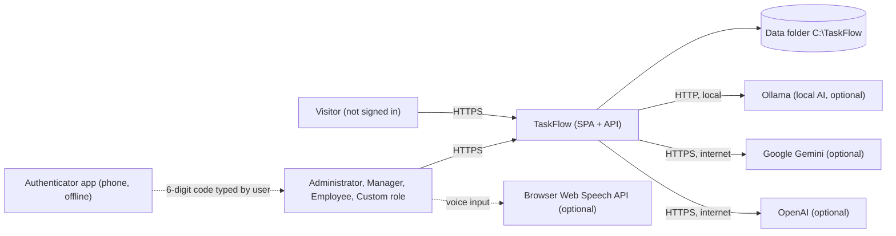

TaskFlow sends nothing by external e-mail or SMS (BR-23). The authenticator app never talks to TaskFlow; the user types
its code. The only outbound connections are to the AI provider an administrator enables in TFA Settings.

### 2.2 Actors & External Systems

| Actor / system | Interaction | Protocol |
|---|---|---|
| Visitor | Sign in, account recovery, legal pages | HTTPS (browser → SPA → API) |
| Administrator | Everything in the permission catalogue: management, settings, roles, MFA reset | HTTPS |
| Manager | Tasks (no delete), workload, reports, reminder settings, read-only master data | HTTPS |
| Employee | Own tasks, status, hours, comments, board, Mail, notifications, profile, TFA | HTTPS |
| Custom-role user | Whatever an administrator granted from the catalogue | HTTPS |
| Authenticator app | Generates TOTP codes from the key shown at Security Setup (QR code) | None (offline, user types the code) |
| Ollama | Local chat model for TFA (default on a new install: `llama3.2:3b` at `http://localhost:11434`) | HTTP / REST |
| Google Gemini | Cloud chat model for TFA, when enabled | HTTPS / REST, API key |
| OpenAI | Cloud chat model for TFA, when enabled | HTTPS / REST, API key |
| Browser Web Speech API | Voice input for the TFA panel (Chrome, Edge) | In-browser |
| Operator | Installs, configures, backs up the data folder | File system, configuration, environment variables |

---

## 3. Architecture Goals, Constraints & Principles

### 3.1 Quality Goals

| Goal | How the architecture supports it |
|---|---|
| Security | Server-side permission policy on every function; mandatory MFA enforced by middleware, not only by the SPA; session revalidated on every request; secrets encrypted with the key ring; generic failure messages (D-03, D-08, D-09, D-12) |
| Correctness of reminders | Stateless engine + database uniqueness on (task, person, type, day) so each reminder is delivered at most once, also after restarts (D-04) |
| Consistency | One status-transition table, one overdue rule, one application timezone and one bucket definition shared by tasks, board, dashboards, reports and reminders (D-05, D-16) |
| Maintainability | One API project, layer-first with module sub-folders; structure enforced by `ArchitectureTests` and `npm run check:structure` (D-07) |
| Privacy / offline | Notifications and Mail are internal; local AI model by default; cloud AI only when chosen (D-10, D-11) |
| Operability | All state in one data folder; schema migrations and seeders run at start-up; data folder checked before use (D-02, D-12) |
| Usability | Menus and screens built from the user's permissions; ProblemDetails messages; confirmation for destructive and TFA actions |

### 3.2 Constraints
- Single-server deployment with a file database (SQLite `taskflow.db`); one API instance (in-memory limiters, uncoordinated scheduler).
- One organisation per installation; one application timezone (default `Asia/Kolkata`).
- Must work without the internet (only cloud AI providers need it).
- Every employee email uses the fixed `@taskflow.com` domain (BR-24).
- No message broker, cache server or external identity provider is installed; everything runs in-process.
- Only packages referenced in the project files (`*.csproj`, `package.json`) may be relied on (no Serilog, Playwright, AutoMapper, Bootstrap, SMTP client).

### 3.3 Architecture Principles
- **Clean layering:** Controller → Service → Repository → EF Core, always through interfaces; services commit through `IUnitOfWork`; controllers are HTTP-only.
- **Server is the authority:** every rule, permission and scope is checked by the API; SPA guards and hidden menus only mirror it.
- **Same tree in every layer:** modules and sub-modules follow the permission catalogue (`Auth`, `Dashboard`, `Management`, `Monitoring`, `Communication`, `Reports`, `Profile`, `Settings`, `Assistant`) in controllers, services, repositories, DTOs and SPA modules.
- **Derive, do not store:** overdue, workload and dashboard figures are computed at query time.
- **History is kept:** soft delete for history-bearing records; activity log is append-only for users.
- **Confirm before acting:** the AI assistant prepares, the user confirms, the server re-checks.
- **Secrets never leave:** passwords hashed, keys encrypted, bodies never logged, only the last 4 characters of a key shown.

---

## 4. Architecture Overview

### 4.1 Architecture Style
Three-tier web application: an Angular 19 SPA (standalone components, lazy-loaded module routes) talks REST/JSON to a
single ASP.NET Core Web API, which stores data in SQLite through EF Core. Inside the API the style is a **layered
(clean) monolith** organised layer-first with module sub-folders, plus one in-process **background worker** (reminder
engine) and an **integration layer** for tokens, one-time codes, key protection, file storage and AI providers.

### 4.2 Logical Architecture

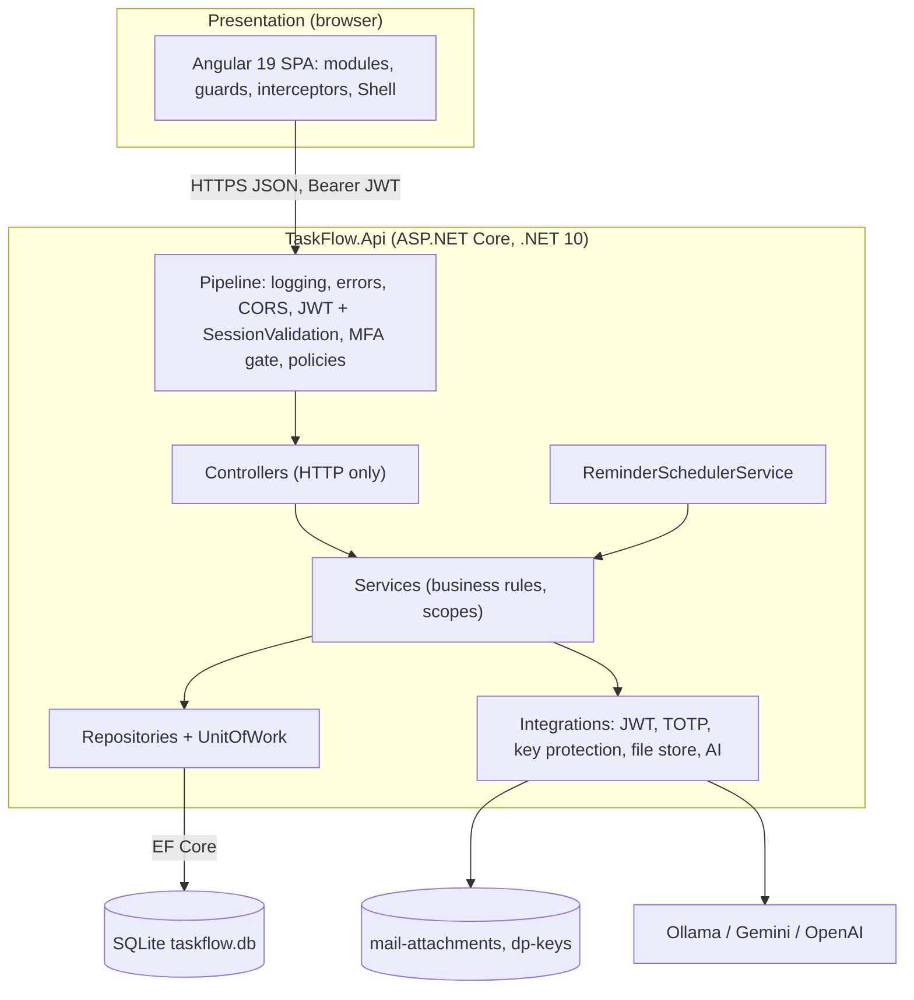

### 4.3 Layers & Responsibilities

| Layer | Responsibility | May call |
|---|---|---|
| Presentation (SPA) | Screens per module, routing, `authGuard` / `mfaSetupGuard` / `permissionGuard`, `authInterceptor` (bearer token, silent renewal), menu from permissions, Shell with session check, legal footer, TFA panel | API only |
| Pipeline / middleware | Forwarded headers, request logging, global exception handling, HTTPS redirect, CORS `SpaClient`, JWT validation + `SessionValidation`, `MfaSetupGateMiddleware`, permission policies, `TaskAccess` resource check, `ValidationFilter` | Controllers |
| API / Controllers | HTTP binding, status codes, routes under `/api/v1`; no rules, no entities | Services |
| Services | Business rules, scope checks (Own/Team/Organization), state transitions, notifications, transactions via `IUnitOfWork` | Repositories, Integrations, other services' interfaces |
| Repositories | Data access over EF Core; no `IQueryable` leaks, no saving | `AppDbContext` → SQLite |
| Integrations | `JwtTokenService`, `Totp`/`Base32`, `MfaSecretProtector`, `AiKeyProtector`, `LocalMailFileStore`, `ChatModelProviderRegistry` with `OllamaProvider`, `GeminiProvider`, `OpenAiProvider` | Key ring, file system, external AI |
| Background job | `ReminderSchedulerService` runs a reminder pass at start-up and every `Reminders:TickSeconds` (60 s) | Reminder service |
| Persistence | `AppDbContext`, 21 migrations, seeders (`SettingsInitializer`, `AccessControlSeeder`, `AiProviderSeeder`, `DatabaseSeeder`), `StorageRoot` | SQLite file |

---

## 5. Component / Module Design

| Module (code) | Responsibility | Key components (high level) | API base | Depends on |
|---|---|---|---|---|
| **Authentication** (AUTH) | Sign-in with password + TOTP, sign-in challenge, sessions (access token + rotating refresh cookie), sign-out, self-service account recovery, Security Setup gate, attempt limiting | SPA: `login`, `account-recovery`, `security-setup` pages, `AuthService`, `TokenStore`, guards, interceptor. API: `AuthController`, `PasswordRecoveryController`, `AuthService`, `SessionService`, `MfaService`, `PasswordRecoveryService`, `AttemptLimiter`, `SessionValidation`, `MfaSetupGateMiddleware`, `JwtTokenService`, `Totp`, `MfaSecretProtector` | `/api/v1/auth`, `/api/v1/auth/password-recovery` | Users/roles data, key ring, Notification (reset notice), My Profile (MFA set-up functions) |
| Dashboard (DASH) | Organisation, team and own dashboards, analytics, filters, drill-down | `DashboardController`, `AnalyticsController`, scope and analytics services; `admin`, `manager`, `me` pages | `/api/v1/dashboard` | Task data, Task Management bucket rules, Application Settings (timezone) |
| TaskFlow Monitoring › Task Management (TASK) | Task CRUD, copy, status transitions, worked hours, recipients, reassign, soft delete, comments, activity history | `TasksController`, `TaskCommentsController`, `TaskActivityController`, `TaskService`, `TaskAccessService`, `TaskStatusTransitions`, `TaskActivityService`, `TaskCommentService`; `tasks` pages | `/api/v1/tasks` | Management (people, projects), Notification (`NotificationPublisher`), Mail, Application Settings |
| TaskFlow Monitoring › Employee Workload (WORK) | Per-employee counts, allocation and high-load flag | `WorkloadController`, `WorkloadService`; `workload` page | `/api/v1/workload` | Task data, project allocations |
| TaskFlow Monitoring › Board (BOARD) | Five status columns with drag and drop under the same transition rules | Frontend-only `board` page over the tasks API | `/api/v1/tasks/board` | Task Management |
| TaskFlow Management › Employee Management (EMP) | Employees, activation, role assignment, delete protections, **Reset MFA** | `EmployeesController`, `EmployeeService`, `UserAllocationService`; `employees` page | `/api/v1/users` | Roles, Projects, Departments, Auth (security stamp) |
| TaskFlow Management › Project Management (PROJ) | Projects, members, positions, allocation percentages, project managers | `ProjectsController`, `PositionsController`, `ProjectService`, `PositionService`; `projects` pages | `/api/v1/projects`, `/api/v1/positions` | Employees, Tasks |
| TaskFlow Management › Department Management (DEPT) | Departments, managers, members | `DepartmentsController`, `DepartmentService`; `departments` page | `/api/v1/departments` | Employees |
| Communication › Mail (MAIL) | Private internal mailbox, folders, drafts, reply/forward, attachments, system mail from "TaskFlow" | `MailController`, `MailService`, `MailAttachmentService`, `LocalMailFileStore`; `mail` page | `/api/v1/mail` | Users, mail-attachments folder |
| Communication › Notification (NOTIF) | Notification Center and bell, event notifications, reminder engine | `NotificationsController`, `NotificationService`, `NotificationPublisher`, `ReminderSchedulerService`, `ReminderService`, `ReminderCalculator`; `notifications` page | `/api/v1/notifications` | Tasks, Reminder/Application Settings, Mail |
| Reports (RPT) | Filtered task totals, completion summary, CSV export (≤ 50,000 rows) | `ReportController`, `ReportService`, `ReportCsv`; `reports` page | `/api/v1/reports` | Task data, shared bucket rules |
| Settings › Reminder Settings (REM) | Reminder on/off, defaults, overdue frequency, Mail delivery | `ReminderSettingsController`, `ReminderSettingsService` | `/api/v1/settings/reminders` | `ApplicationSettings` table |
| Settings › Application Settings (APP) | Name, timezone, default priority, notifications | `ApplicationSettingsController`, `ApplicationSettingsService`, `AppClock` | `/api/v1/settings/application` | `ApplicationSettings` table |
| Settings › TFA Settings (TFAS) | AI providers, models, server address, encrypted keys, connection test | `AiProvidersController`, `AiProviderConfigService`, `AiProviderConnectionTester`, `AiKeyProtector` | `/api/v1/assistant/providers` | Key ring, AI providers |
| Settings › Role Configuration (ROLE) | Roles, permission tree, custom roles, prerequisites | `RolesController`, `RoleService`, `PermissionCatalog`, `AccessControlSeeder` | `/api/v1/roles`, `/api/v1/permissions` | Users (sessions pick up changes) |
| My Profile (PROF) | Own details, change password with code, self-service MFA | `ProfileController`, `ProfileService`, `MfaService`; `profile` pages | `/api/v1/users/me` | Auth (security stamp, lockout), key ring |
| TFA Assistant (TFA) | Chat, help topics, read tools, prepared actions with confirm, audit, rate limit, voice | `AssistantController`, `AssistantService`, `AssistantActionService`, `AssistantAuthorizer`, `ChatModelGateway`, `HelpKnowledgeBase`, `SecretScreen`, `AssistantRateLimiter`; TFA panel in the Shell | `/api/v1/assistant` | TFA Settings, Tasks, Mail, Profile, Employees |
| **Legal** (LEGAL) | Five public legal documents and the ownership footer | SPA only: `legal` module (`LegalPageComponent`, document definitions, one owner record), shared `legal-footer` component, page title/meta set at start-up | – (no API) | None |

### 5.1 Module Interaction

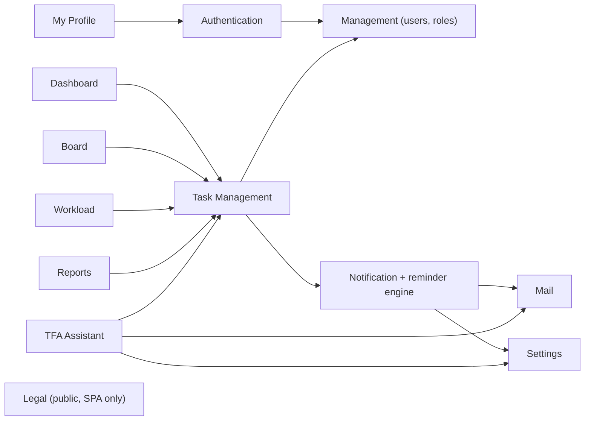

| From → To | Interaction |
|---|---|
| Authentication → Management | Reads the user, role and permissions; security stamp of the user decides session validity |
| My Profile / Employee Management → Authentication | Password change, recovery and administrator MFA reset rotate the security stamp and revoke refresh tokens |
| Dashboard, Board, Workload, Reports → Task Management | Reuse the task scope, status and bucket rules; no module keeps its own copy |
| Task Management → Notification | `NotificationPublisher` writes assigned, reassigned and comment notifications |
| Notification → Mail, Settings | Reminder engine reads Reminder/Application Settings and, when Mail delivery is on, puts a system mail in the Inbox |
| TFA → Task, Mail, Profile, Employees, Settings | Read tools over the caller's own data; confirmed actions call the same services as the screens; provider settings from TFA Settings |
| Legal | Independent; the footer is placed by the Shell and the public pages |

### 5.2 Sub-module HLD Index

| # | Code | Module | Sub-module | Sub-module HLD | FRD range | Decisions |
|---|---|---|---|---|---|---|
| 0 | ALL | (all) | Overall, incl. Authentication and Legal | This document | FR-AUTH-01 – 51, FR-LEGAL-01 – 16 | D-01 – D-16 |
| 1 | DASH | Dashboard | Dashboard | [HLD-Dashboard](../01-Dashboard/01.1-Dashboard/HLD-Dashboard.md) | FR-DASH-01 – 75 | D-DASH-1 – 10 |
| 2 | TASK | TaskFlow Monitoring | Task Management (incl. comments and activity history) | [HLD-Task-Management](../02-TaskFlow-Monitoring/02.1-Task-Management/HLD-Task-Management.md) | FR-TASK-01 – 73 | D-TASK-1 – 12 |
| 3 | WORK | TaskFlow Monitoring | Employee Workload | [HLD-Employee-Workload](../02-TaskFlow-Monitoring/02.2-Employee-Workload/HLD-Employee-Workload.md) | FR-WORK-01 – 22 | D-WORK-1 – 8 |
| 4 | BOARD | TaskFlow Monitoring | Board | [HLD-Board](../02-TaskFlow-Monitoring/02.3-Board/HLD-Board.md) | FR-BOARD-01 – 22 | D-BOARD-1 – 9 |
| 5 | EMP | TaskFlow Management | Employee Management | [HLD-Employee-Management](../03-TaskFlow-Management/03.1-Employee-Management/HLD-Employee-Management.md) | FR-EMP-01 – 60 | D-EMP-1 – 9 |
| 6 | PROJ | TaskFlow Management | Project Management (incl. positions) | [HLD-Project-Management](../03-TaskFlow-Management/03.2-Project-Management/HLD-Project-Management.md) | FR-PROJ-01 – 45 | D-PROJ-1 – 9 |
| 7 | DEPT | TaskFlow Management | Department Management | [HLD-Department-Management](../03-TaskFlow-Management/03.3-Department-Management/HLD-Department-Management.md) | FR-DEPT-01 – 33 | D-DEPT-1 – 7 |
| 8 | MAIL | Communication | Mail | [HLD-Mail](../04-Communication/04.1-Mail/HLD-Mail.md) | FR-MAIL-01 – 56 | D-MAIL-1 – 9 |
| 9 | NOTIF | Communication | Notification (incl. reminder engine) | [HLD-Notification](../04-Communication/04.2-Notification/HLD-Notification.md) | FR-NOTIF-01 – 50 | D-NOTIF-1 – 9 |
| 10 | RPT | Reports | Reports | [HLD-Reports](../05-Reports/05.1-Reports/HLD-Reports.md) | FR-RPT-01 – 42 | D-RPT-1 – 9 |
| 11 | REM | Settings | Reminder Settings | [HLD-Reminder-Settings](../06-Settings/06.1-Reminder-Settings/HLD-Reminder-Settings.md) | FR-REM-01 – 23 | D-REM-1 – 8 |
| 12 | APP | Settings | Application Settings | [HLD-Application-Settings](../06-Settings/06.2-Application-Settings/HLD-Application-Settings.md) | FR-APP-01 – 23 | D-APP-1 – 8 |
| 13 | TFAS | Settings | TFA Settings | [HLD-TFA-Settings](../06-Settings/06.3-TFA-Settings/HLD-TFA-Settings.md) | FR-TFAS-01 – 28 | D-TFAS-1 – 9 |
| 14 | ROLE | Settings | Role Configuration | [HLD-Role-Configuration](../06-Settings/06.4-Role-Configuration/HLD-Role-Configuration.md) | FR-ROLE-01 – 26 | D-ROLE-1 – 9 |
| 15 | PROF | My Profile | My Profile (profile, change password, two-step verification) | [HLD-My-Profile](../07-My-Profile/07.1-My-Profile/HLD-My-Profile.md) | FR-PROF-01 – 39 | D-PROF-1 – 8 |
| 16 | TFA | TFA Assistant | Assistant | [HLD-Assistant](../08-TFA-Assistant/08.1-Assistant/HLD-Assistant.md) | FR-TFA-01 – 56 | D-TFA-1 – 10 |

### 5.3 Authentication – component design

Authentication has no sub-module HLD, so its design is given here.

| Component | Side | Responsibility |
|---|---|---|
| Login page (`/login`) | SPA | Credentials step, two-step code step, notice area (why the user was returned), remembered identifier, redirect to return address or role dashboard |
| Account Recovery page (`/account-recovery`) | SPA | Two steps: identifier + authenticator code → new password twice; **Start over** on an expired grant |
| Security Setup page (`/security-setup`) | SPA | Three steps: details → current password, QR code (`qrcode`) and first code → 10 backup codes; guarded by `securitySetupGuard` |
| `AuthService`, `TokenStore`, `authInterceptor` | SPA | Session restore at app start, access token in memory, silent renewal on 401 and retry, sign-out |
| `authGuard`, `mfaSetupGuard`, `permissionGuard` | SPA | Mirror the server: signed-in check, setup-pending redirect, screen permission → own dashboard |
| Shell session check | SPA | Asks the API every 15 s (`SESSION_CHECK_INTERVAL_MS`) and when the tab becomes visible; applies current role and permissions |
| `AuthController` | API | Login, MFA verify, refresh, logout, me (`/api/v1/auth`) |
| `PasswordRecoveryController` | API | Authenticator verify and reset (`/api/v1/auth/password-recovery`) |
| `AuthService`, `SessionService` | API | Credential check (`PasswordHasher` PBKDF2, rehash), challenge, token issue, refresh rotation, revoke |
| `MfaService` | API | TOTP check (±1 step, each step once), lockout counter, backup codes, set-up and enable (shared with My Profile) |
| `PasswordRecoveryService`, `AttemptLimiter` | API | Recovery checks, single-use 10-minute `PasswordResetGrant`, sliding-window limits per account and per address |
| `SessionValidation` | API pipeline | On every token: user exists, active, not deleted, security stamp unchanged; reloads role and permission claims |
| `MfaSetupGateMiddleware` | API pipeline | Setup pending → 403 `mfa_setup_required` for everything except `/api/v1/auth/*`, `/api/v1/users/me` and `/api/v1/users/me/mfa/*` |
| `JwtTokenService`, `Totp`, `Base32`, `MfaSecretProtector` | Integrations | Token creation, one-time codes, encrypted authenticator keys |

### 5.4 Legal – component design

| Component | Responsibility |
|---|---|
| `legal.routes.ts` | Five public routes `/legal/copyright`, `/legal/terms`, `/legal/privacy`, `/legal/disclaimer`, `/legal/licenses`, outside the Shell and its guards |
| `LegalPageComponent` | Renders title, summary, last-updated date, contents list with in-page jumps, body and ownership line; "Legal document not found" when nothing matches; back link by sign-in state and role |
| `legal-documents.ts`, `legal-owner.ts` | Fixed document content and the single owner record (name, year, contact email, rights statement, application name) inserted into every document and the footer |
| `legal-footer` (shared component) | Ownership line and five links in fixed order on Login, Account Recovery and every signed-in screen; not on the legal pages |
| Start-up page metadata | Browser title "TaskFlow — Intelligent Task Allocation & Tracking System", author and copyright meta |

No API, table, permission or record is involved: opening a legal page creates no data (FR-LEGAL-08).

---

## 6. Data Architecture (high level)

### 6.1 Data Stores

| Store | Technology | Holds | Notes |
|---|---|---|---|
| Main database `taskflow.db` | SQLite via EF Core 10.0.12 (31 entity sets, 21 code-first migrations) | Users, roles, permissions, projects, departments, tasks, comments, activity, notifications, reminder history, settings, mail, AI configuration, assistant conversations and audit | In the data folder; migrations and seeders run at every start; backed up together with attachments |
| `mail-attachments\` | Local folder (`LocalMailFileStore`, `Mail:AttachmentsPath`) | Mail attachment files under generated names | Rows and files must be backed up together |
| `dp-keys\` | ASP.NET Core Data Protection key ring (`AiProviders:KeyRingPath`), DPAPI-protected on Windows | Keys that decrypt AI provider API keys, MFA secrets and sign-in challenges | Backed up **separately** and never committed; loss means re-entering AI keys and MFA reset for every user |
| SPA memory | Browser | 30-minute access token (`TokenStore`), current user and permissions | Lost on reload; restored through the refresh cookie |
| Browser storage / cookie | Browser | `taskflow_refresh` cookie (HttpOnly, Secure, SameSite Strict, path `/api/v1/auth`); last used sign-in identifier | Cookie not readable by scripts |
| API process memory | In-process | `AttemptLimiter` and `AssistantRateLimiter` windows | Reset on restart; single instance only |
| Configuration | `appsettings.json`, environment-specific files, user-secrets, environment variables | Non-secret defaults; secrets such as `Jwt:Key` (`<secret>`) only from user-secrets or environment | Runtime-editable values live in the `ApplicationSettings` table |

Data folder: `C:\TaskFlow` on Windows (`TaskFlow` under the common application-data folder elsewhere), override with
`Storage:Root` / `Storage__Root`. `StorageRoot.EnsureAvailable` creates it and stops start-up if it is not writable.

### 6.2 Main Data Domains

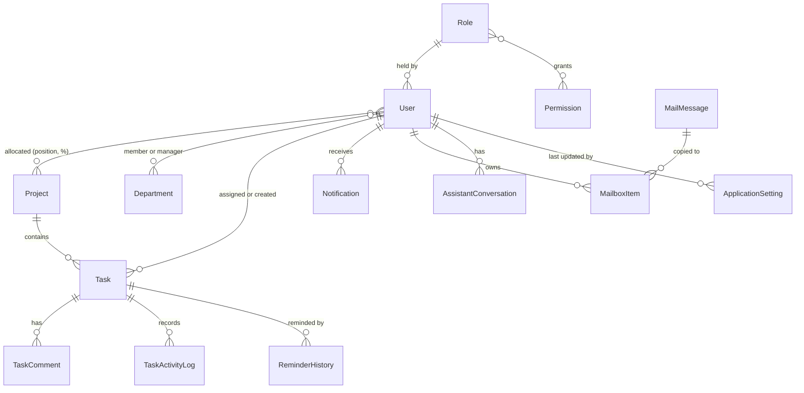

| Domain | Entities (names only) | Owning sub-module |
|---|---|---|
| Identity & sessions | `User`, `RefreshToken`, `PasswordResetGrant`, `MfaBackupCode` | Authentication, My Profile, Employee Management |
| Access control | `Role`, `Permission`, `RolePermission` | Role Configuration |
| Organisation | `Project`, `ManagerProject`, `Position`, `UserProjectAllocation`, `Department`, `DepartmentManager`, `UserDepartment` | Project, Department, Employee Management |
| Work | `Task`, `TaskRecipient`, `TaskComment`, `TaskActivityLog` | Task Management |
| Notification | `Notification`, `ReminderHistory` | Notification |
| Mail | `MailMessage`, `MailRecipient`, `MailboxItem`, `MailAttachment` | Mail |
| Settings | `ApplicationSetting`, `AiProviderConfig`, `AiModel` | Application, Reminder, TFA Settings |
| Assistant | `AssistantConversation`, `AssistantMessage`, `AssistantPendingAction`, `AssistantAudit` | TFA Assistant |

Who may edit settings is decided by permissions (section 9), not by the data model.

### 6.3 Data Flow
1. **Create task → notify:** Create Task → `TaskService` validates and saves `Task` (+ `TaskRecipient`, `TaskActivityLog`) in one unit of work → `NotificationPublisher` writes a `Notification` for the assignee.
2. **Work on task:** status, hours, comments and reassignment update `Task` and append `TaskActivityLog`; comment and reassignment notifications are written for the people involved.
3. **Reminder:** `ReminderSchedulerService` → `ReminderService` reads open tasks and settings → inserts `ReminderHistory` (unique per task, person, type, day) + `Notification` (+ a system `MailMessage`/`MailboxItem` when Mail delivery is on) in one transaction.
4. **Read models:** dashboards, workload, board and reports read `Task` with scope filters and compute counts at query time; nothing is pre-aggregated.
5. **Assistant:** a message is stored in `AssistantConversation`/`AssistantMessage`; a prepared action becomes `AssistantPendingAction`; its outcome goes to `AssistantAudit`.

---

## 7. Integration Design

| Integration | Direction | Purpose | Failure behaviour |
|---|---|---|---|
| Ollama (`OllamaProvider`) | Outbound HTTP to a local server (default `http://localhost:11434`) | TFA chat model, no internet needed; default provider on a new install | Timeout `AiProviders:TimeoutSeconds` (60 s); failure classified (`ProviderFailureKind`: RateLimited, InvalidKey, Timeout, Unreachable, ModelUnavailable, Unexpected) and shown as a friendly message; no automatic switch to another provider |
| Google Gemini (`GeminiProvider`) | Outbound HTTPS | Cloud chat model when enabled in TFA Settings | Same classification; key decrypted in memory for one call only; user sees a notice the first time a cloud model is used |
| OpenAI (`OpenAiProvider`) | Outbound HTTPS | Cloud chat model when enabled | Same as Gemini |
| AI connection test | Outbound, on demand from TFA Settings | Verify server address, model and key before saving | Result shown to the administrator; settings not changed |
| Authenticator app | None (user types the code) | TOTP codes (SHA1, 6 digits, 30 s) | Lost phone → backup code at sign-in, or administrator MFA reset |
| Browser Web Speech API | In-browser | TFA voice input | Unsupported browser → typing only |
| Local file system | API ↔ data folder | Database, attachments, key ring | Data folder not writable → start-up stops with a clear message |

All AI `HttpClient`s are typed, do not follow redirects (SSRF), have header/body logging removed, and the Ollama address
validator refuses link-local and cloud-metadata hosts. Provider choice and keys are managed in
[HLD-TFA-Settings](../06-Settings/06.3-TFA-Settings/HLD-TFA-Settings.md); the chat and tool design is in
[HLD-Assistant](../08-TFA-Assistant/08.1-Assistant/HLD-Assistant.md).

---

## 8. Key Flows (high level)

### 8.1 Sign-in with two-step verification (MFA)

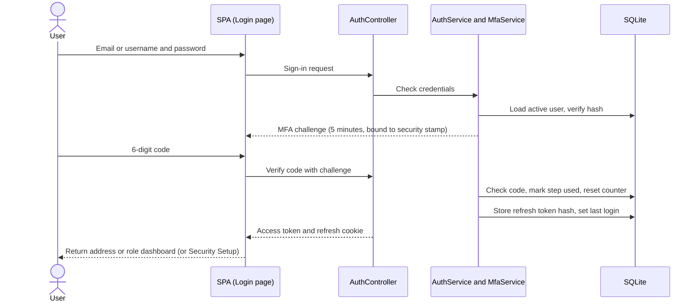

Every credential failure is a bare 401 with "Invalid email or password." on screen. Five wrong codes lock code entry for
5 minutes. If MFA is required but not set up, the session opens in setup-pending mode: the SPA shows
`/security-setup` and `MfaSetupGateMiddleware` refuses every other function (FR-AUTH-28 – 40).

### 8.2 Session renewal and revalidation

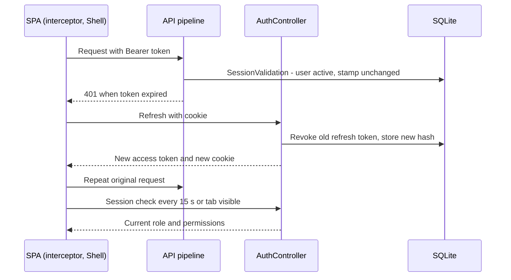

A password change, password reset or administrator MFA reset rotates the security stamp and revokes every refresh token,
so all sessions of that user end on the next request (BR-25, FR-AUTH-48).

### 8.3 Self-service account recovery

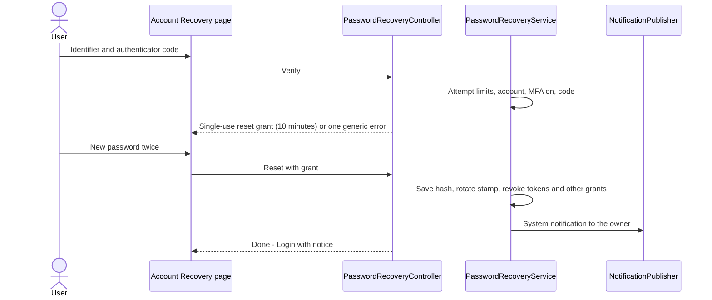

### 8.4 Task lifecycle (main business flow)

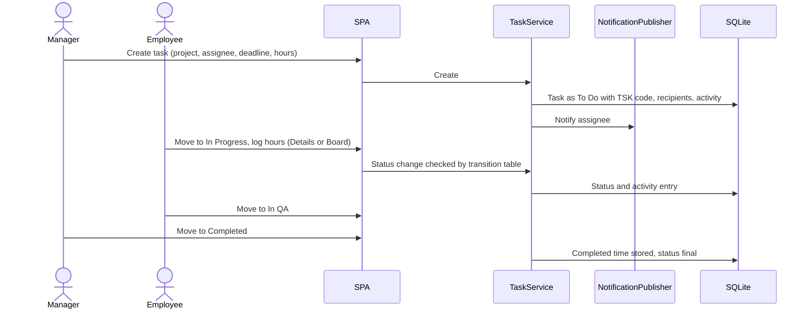

Transitions, recipients, reassignment and comments are detailed in
[HLD-Task-Management](../02-TaskFlow-Monitoring/02.1-Task-Management/HLD-Task-Management.md) and
[HLD-Board](../02-TaskFlow-Monitoring/02.3-Board/HLD-Board.md).

### 8.5 Reminder job (background)

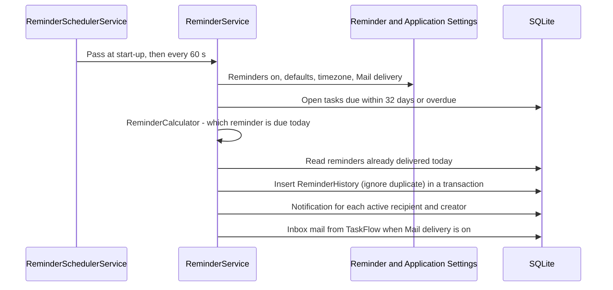

A failed pass is logged and the next tick continues; the unique index on (task, recipient, type, day) guarantees each
reminder at most once even after a restart (BR-15). Design detail:
[HLD-Notification](../04-Communication/04.2-Notification/HLD-Notification.md).

### 8.6 TFA confirm-before-act (integration flow)

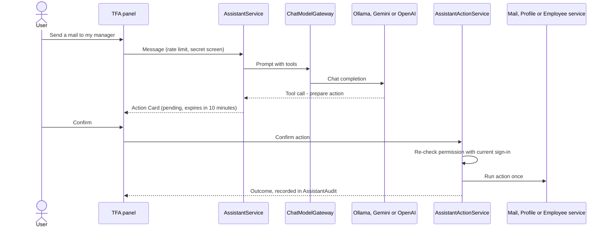

The model never decides access: tools and actions are authorised by `AssistantAuthorizer` against the API's own
permission policies (BR-27). Detail: [HLD-Assistant](../08-TFA-Assistant/08.1-Assistant/HLD-Assistant.md).

---

## 9. Security Architecture

| Concern | Approach |
|---|---|
| Authentication | Password (`PasswordHasher`, PBKDF2, 6 – 128 characters, old hashes upgraded) + mandatory TOTP (`Mfa:Required` = true); sign-in challenge of 5 minutes bound to the security stamp; each TOTP step usable once; 10 single-use backup codes stored as hashes; lockout after 5 wrong codes for 5 minutes |
| Sessions | Access token 30 minutes (in memory); refresh token 7 days in the `taskflow_refresh` cookie (HttpOnly, Secure, SameSite Strict, path `/api/v1/auth`), stored as a hash and rotated on every refresh; `SessionValidation` rejects inactive/deleted users and stale security stamps and reloads claims on every request |
| MFA enforcement | `MfaSetupGateMiddleware` between authentication and authorization – the SPA guards only mirror it |
| Authorization | One policy `perm:<key>` per catalogue permission (`RequirePermission` / `Authorize(Policy = …)`); `TaskAccess` resource handler (assignee, creator, recipient or `tasks.view.all`); Own/Team/Organization scopes in services; another user's mail, notification or assistant conversation is reported as not found (BR-20) |
| Roles | System roles Administrator, Manager, Employee read-only; Administrator re-granted every permission at each start; custom roles from the catalogue; `roles.administrator.assign` never assignable to custom roles; Always On permissions cannot be removed |
| Abuse protection | `AttemptLimiter` (sliding 5 minutes): recovery 5 per account and 20 per address (IPv6 pooled by /64), current-password re-entry 5 per account; `AssistantRateLimiter` 20 messages per minute per user; recovery failures never lock sign-in |
| Anti-enumeration | One message for every login failure and every recovery failure |
| Data protection | Authenticator keys and AI provider keys encrypted with the Data Protection key ring (`dp-keys`, DPAPI on Windows, start-up check `KeyRingProtectionCheck`); only `KeyLast4` of an AI key shown; reset grants and refresh tokens stored as SHA-256 hashes; `SecretScreen` blocks passwords and keys typed into TFA; `Jwt:Key` only from user-secrets or environment (`<secret>`) |
| Input and queries | FluentValidation on write DTOs via `ValidationFilter` (400 with an `errors` map); EF Core parameterised queries; `LIKE` wildcards escaped |
| Transport | HTTPS redirection; development API `https://localhost:7055`; CORS policy `SpaClient` from `Cors:AllowedOrigins` with credentials; forwarded headers trusted only from loopback or `Proxy:KnownProxies` |
| Output | `GlobalExceptionHandler` returns ProblemDetails (400/403/404/409/429), generic 500 without stack trace; attachments served as downloads with `X-Content-Type-Options: nosniff`; upload extension block-list; plain-text mail bodies |
| SSRF | AI clients do not follow redirects; Ollama address validator refuses link-local and metadata hosts |
| Auditing | `RequestLoggingMiddleware`: method, path, status, elapsed ms, user id, trace id – never bodies; `DeniedActionAuditHandler` logs refused authorizations; `AssistantAudit` records every TFA action outcome; `TaskActivityLog` records task history |
| Development-only surface | OpenAPI document and the diagnostic route are mapped only in Development |

> ⚠️ To be confirmed: no HSTS, Content-Security-Policy, `X-Frame-Options` or `Referrer-Policy` headers are set by the
> API; whether a reverse proxy adds them in deployment is not documented.
>
> ⚠️ To be confirmed: password sign-in has no attempt limit (only the code step is limited) – see R-06.

---

## 10. Technology Stack

Versions are taken from the project files (`*.csproj`, `package.json`).

| Area | Technology | Version | Reason |
|---|---|---|---|
| Backend runtime | .NET, target framework `net10.0` | 10 | Current LTS-line runtime; runs on Windows, Linux and macOS |
| Web framework | ASP.NET Core Web API (ProblemDetails, hosted services, Data Protection) | 10 | REST API, background worker and key protection in one host |
| OpenAPI | `Microsoft.AspNetCore.OpenApi` | 10.0.8 | API description in Development |
| ORM | `Microsoft.EntityFrameworkCore`, `Microsoft.EntityFrameworkCore.Design` | 10.0.12 | Code-first model and migrations |
| Database provider | `Microsoft.EntityFrameworkCore.Sqlite` | 10.0.12 | File database, zero administration |
| Validation | `FluentValidation`, `FluentValidation.DependencyInjectionExtensions` | 12.2.0 | Server-side request validation |
| Authentication | `Microsoft.AspNetCore.Authentication.JwtBearer` | 10.0.12 | Bearer token validation |
| Tokens | `System.IdentityModel.Tokens.Jwt` | 8.23.0 | Token creation |
| SPA integration | `Microsoft.AspNetCore.SpaProxy` | 10.0.12 | Starts the Angular dev server with the API |
| Password hashing, MFA, scheduler, logging | `PasswordHasher` (PBKDF2), in-house `Totp`/`Base32`, `BackgroundService` + `PeriodicTimer`, `Microsoft.Extensions.Logging` | built-in | No extra dependency |
| Frontend framework | Angular (`@angular/core`, `common`, `compiler`, `forms`, `router`, `platform-browser`, `platform-browser-dynamic`) | ^19.2.0 | Standalone components, lazy module routes |
| UI toolkit | `@angular/cdk` | ^19.2.19 | Board drag and drop |
| Charts | `chart.js` + `ng2-charts` | ^4.6.1 / ^8.0.0 | Dashboard analytics |
| QR codes | `qrcode` (+ `@types/qrcode` ^1.5.6) | ^1.5.4 | Authenticator setup QR code |
| Reactive / runtime | `rxjs`, `zone.js`, `tslib` | ~7.8.0, ~0.15.0, ^2.3.0 | HTTP and state streams |
| Language | TypeScript | ~5.7.2 | Typed frontend |
| Build | `@angular/cli`, `@angular-devkit/build-angular`, `@angular/compiler-cli` | ^19.2.27, ^19.2.27, ^19.2.0 | Build and dev server (`ng serve`) |
| Frontend tests | `jasmine-core`, `karma` (+ chrome launcher, coverage, jasmine, html reporter), `@types/jasmine` | ~5.6.0, ~6.4.0, ~5.1.0 | Unit tests (97 `*.spec.ts` files, 1,099 specs); `npm test` runs `check:structure` first |
| Backend tests | xUnit: `TaskFlow.UnitTests` (101 files, 1,042 tests, with `NetArchTest.Rules`), `TaskFlow.IntegrationTests` (50 files, 467 tests, with `Microsoft.AspNetCore.Mvc.Testing`) | xUnit 2.9.3, NetArchTest.Rules 1.3.2, Mvc.Testing 10.0.12 | Unit, integration (`WebApplicationFactory`) and architecture tests |
| Styling | Custom CSS design tokens and `.tf-*` primitives | – | Responsive layout without a CSS framework |
| Runtime tools | .NET 10 SDK, Node.js 22 LTS (recommended); optional Ollama | – | Build and run |

Not used (not installed): Serilog, Playwright, AutoMapper, Bootstrap, any SMTP client.

---

## 11. Deployment Architecture

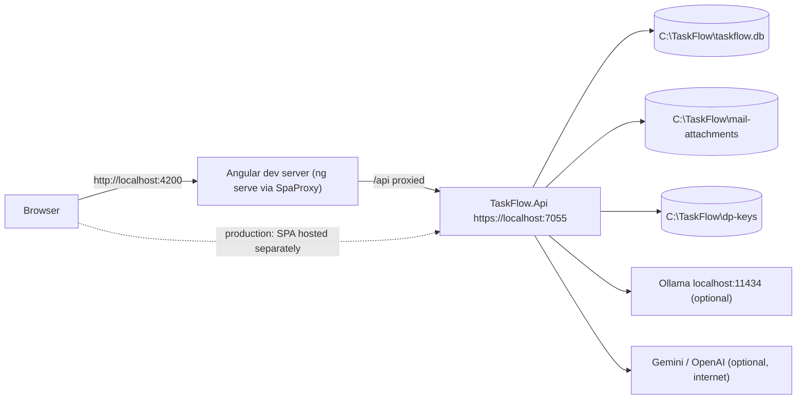

| Environment | Purpose | Notes |
|---|---|---|
| Development | Local build and run | `dotnet run --project src/TaskFlow.Api` (or F5); SpaProxy runs `npm start` and waits for `http://localhost:4200`; API on `https://localhost:7055`; SPA calls `/api/*` relative (`local` environment); `dotnet dev-certs https --trust`; demo sign-ins only when `Seed:Enabled`; OpenAPI and diagnostic route mapped |
| develop / qa / production | Hosted builds | `ng build` output hosted separately from the API (the API has no static-file middleware); SPA uses an absolute API URL selected in `config/api-base-url.ts`; CORS origins from `Cors:AllowedOrigins`; secrets from environment variables; one API instance |

| Deployment rule | Value |
|---|---|
| Process model | One API process hosting controllers and `ReminderSchedulerService` (disable with `Reminders:SchedulerEnabled` = false) |
| Data folder | `C:\TaskFlow` (Windows) or `TaskFlow` under the common application-data folder; `Storage:Root` override; checked writable at start |
| Start-up | Resolve data folder → key-ring protection check (Windows) → apply migrations → `SettingsInitializer`, `AccessControlSeeder`, `AiProviderSeeder`, `DatabaseSeeder` → pipeline → scheduler |
| Configuration | `appsettings.json` → environment files → user-secrets (Development) → environment variables (`Section__Key`); runtime settings in the `ApplicationSettings` table |

`proxy.conf.json` forwards `/api` to `https://localhost:7055`. `launchSettings.json` runs the API on
`https://localhost:7055` and `http://localhost:5110` in `Development`, with the SPA proxy on the `https` profile.
`appsettings.Development.json` sets only log levels. `appsettings.Environment.json` holds the active Local values
(`Cors:AllowedOrigins` and `Mail:AppBaseUrl` = `http://localhost:4200`, `Seed:Enabled` = `false`) and commented-out
values for the other environments. The develop target is on Render (`config/api-base-url.ts`,
`appsettings.Environment.json`); QA and production use `example.com` placeholders.

> ⚠️ To be confirmed: the production hosting target (QA and production URLs are placeholders).

---

## 12. Non-Functional Design

| Area | Design decision | NFR |
|---|---|---|
| Performance | Paged lists (tasks and notifications 20 per page, max 100; Mail 25); totals computed by server queries; async EF Core; reminder pass pre-reads delivered reminders before writing; CSV export capped at 50,000 rows | NFR-01 – NFR-03 |
| Scalability | Single instance by design: in-memory limiters, uncoordinated scheduler (duplicates still blocked by the database); SQLite single writer with short transactions | R-01, R-08 |
| Reliability | All data in SQLite; stateless reminder engine at start-up and every 60 s; failed pass logged, next tick retries; one transaction per reminder delivery; migrations and seeders on every start | NFR-13, NFR-14 |
| Availability | Works offline (internal Mail and notifications, local Ollama); AI outage affects only TFA, with a clear message | NFR-20 |
| Security | Section 9 | NFR-04 – NFR-10 |
| Privacy | Local model default; first-use notice for cloud models; secrets blocked in chat; no external e-mail | NFR-11 |
| Usability | Permission-driven menus; ProblemDetails messages; confirmation for destructive actions and TFA actions | NFR-12 |
| Maintainability | Layer-first, module sub-folders; `ArchitectureTests` and `npm run check:structure`; pure rule classes (`TaskStatusTransitions`, `ReminderCalculator`) unit-tested; DI per layer in `Config/` | NFR-15 |
| Compatibility | Modern desktop browsers, responsive layout; voice input Chrome/Edge; backend on Windows, Linux, macOS (DPAPI only on Windows) | NFR-16 |
| Observability | One log entry per request (no bodies); refused authorizations; TFA audit; built-in logging providers | NFR-19 |
| Backup & Recovery | One data folder; back up `taskflow.db` + `mail-attachments` together (stop the API or `VACUUM INTO`), `dp-keys` separately; back up before upgrades (some migrations are irreversible) | NFR-17 |
| Accessibility | Keyboard-usable standard controls | NFR-18 (⚠️ To be confirmed: no target defined) |

---

## 13. Design Decisions

| ID | Decision | Alternatives considered | Rationale |
|---|---|---|---|
| D-01 | Angular SPA + REST/JSON API under `/api/v1` on ASP.NET Core (.NET 10) | Server-rendered pages; Flask stack recommended by the original BRD | Clear separation of UI and rules; typed stack end to end; one API serves every screen and TFA |
| D-02 | EF Core code-first on SQLite, 21 migrations applied at start-up, required seeders on every start | Hand-written SQL scripts; server database (SQL Server, PostgreSQL) | Zero administration for a single-server install; reproducible, self-configuring schema |
| D-03 | Short JWT access token + rotating HttpOnly refresh cookie; session revalidated on every request (`SessionValidation`) | Server sessions; long-lived tokens; token in local storage | Stateless API, yet deactivation, role and password changes take effect on the next request; cookie unreadable by scripts |
| D-04 | In-process `BackgroundService` reminder engine with database deduplication | External scheduler or broker (Hangfire, cron, queue) | No extra infrastructure; restart-safe; "at most once" guaranteed by a unique index |
| D-05 | Overdue derived at query time; six statuses with one transition table | Stored "Overdue" status updated by a job | One source of truth, never stale; same rule everywhere |
| D-06 | Soft delete for history-bearing records (tasks, employees, projects, departments, comments) | Hard delete with cascade | Keeps history, comments and reports intact (BR-21) |
| D-07 | One API project, layer-first with module sub-folders; Controller → Service → Repository via interfaces; structure enforced by tests | Four-project solution (Api/Application/Domain/Infrastructure) of TDD v1.0; vertical-slice projects | Simpler build with the same separation; rules checked on every test run |
| D-08 | Permission-based authorization from a fixed catalogue; read-only system roles, custom roles; policy per key | Fixed role checks in code | Fine-grained, configurable access; every checkbox enforced by the server |
| D-09 | Mandatory TOTP MFA enforced server-side by `MfaSetupGateMiddleware`; recovery with an authenticator code only | Optional MFA; e-mail/SMS codes; admin-set passwords | No external messaging needed; the SPA cannot bypass the gate; stolen password alone is useless |
| D-10 | Internal Mail instead of SMTP; reminders optionally copied into the Inbox | SMTP e-mail (original Screen 14) | Works offline, no mail credentials to store, nothing leaves TaskFlow (BR-23) |
| D-11 | Pluggable AI providers (Ollama, Gemini, OpenAI) behind `ChatModelGateway`; confirm-before-act with server-side permission re-check | Single hard-wired cloud provider; assistant acting directly | Free local default; the model never decides access; every action audited |
| D-12 | All local state in one data folder; secrets encrypted with the Data Protection key ring (DPAPI on Windows), key ring backed up separately | Secrets in configuration or plain columns; data spread over the solution folder | Simple backup and move; a copied database alone cannot read keys or generate MFA codes |
| D-13 | One application timezone (`Application.Timezone`, default `Asia/Kolkata`, fallback UTC) through `AppClock` | Per-user timezones; server local time | "Due today" and "overdue" are the same for everyone and for the reminder engine (BR-17) |
| D-14 | Legal documents and footer are static SPA content from one owner record, public, no API | Documents stored in the database and editable | Identical, always-available ownership statement; nothing to secure or migrate (BR-29) |
| D-15 | In-memory sliding-window limiters (`AttemptLimiter`, `AssistantRateLimiter`) | Database or distributed cache counters | Adequate for the single-instance constraint; no extra store; reset on restart accepted (R-10) |
| D-16 | Board is frontend-only over the tasks API; dashboards, workload and reports reuse Task Management's scope and bucket rules | Separate board/report back ends with their own rules | One status and scope rule set; figures consistent across screens (BR-22) |

---

## 14. Risks, Assumptions & Open Issues

| Type | ID | Description | Mitigation / owner |
|---|---|---|---|
| Risk | R-01 | Reminders run twice if more than one API instance is started | Unique `ReminderHistory` index blocks duplicates; single instance documented – Jojo George |
| Risk | R-02 | Loss of the `dp-keys` key ring | Back it up separately; otherwise AI keys re-entered and every user needs an MFA reset |
| Risk | R-03 | User loses phone and backup codes | Administrator MFA reset (`employees.mfa.reset`) ends sessions and forces new setup |
| Risk | R-04 | Task details leave the server when a cloud AI model is used | Local model default; first-use notice; `SecretScreen`; Legal texts state it |
| Risk | R-05 | Wrong "due today" / "overdue" from timezone mistakes | One application timezone; unknown timezone falls back to UTC (D-13) |
| Risk | R-06 | Password guessing at sign-in (no attempt limit on the password step) | Code step required for every account; ⚠️ To be confirmed whether a password limit is needed |
| Risk | R-07 | Irreversible migrations (e.g. email domain normalisation) | Back up before every upgrade |
| Risk | R-08 | SQLite write contention with many concurrent users | Short transactions; reminder pass skips delivered reminders before writing |
| Risk | R-09 | Managers see organisation-wide reports and workload | Documented in BRD/HLD-Reports and Employee-Workload; ⚠️ To be confirmed whether a team limit is required |
| Risk | R-10 | In-memory limiters reset on restart | Accepted for single instance (D-15) |
| Risk | R-11 | TFA role-change tool checks only `roles.manage`, not `employees.role.assign` / `roles.administrator.assign` | Known gap (TDD §14.5); see HLD-Assistant |
| Assumption | A-01 | One organisation, one API instance, one application timezone | Section 3.2 |
| Assumption | A-02 | Users have an authenticator app on a phone | BR-03 |
| Open issue | O-01 | No security headers (HSTS, CSP, X-Frame-Options, Referrer-Policy) set by the API | ⚠️ To be confirmed: reverse proxy responsibility |
| Open issue | O-02 | Production hosting of the built SPA is not set: QA and production URLs in `config/api-base-url.ts` and `appsettings.Environment.json` are `example.com` placeholders | ⚠️ To be confirmed |
| Open issue | O-03 | Login form asks for an email format although the server accepts a username; code box takes 6 characters while backup codes are `XXXXX-XXXXX` | ⚠️ To be confirmed (overall BRD SCREEN 1) |
| Open issue | O-04 | An unknown `/legal/...` address is caught by the catch-all route and opens Login, so "Legal document not found" may not be reached | ⚠️ To be confirmed (FR-LEGAL-07) |
| Open issue | O-05 | Mail UI does not check `mail.attachments` / `mail.organize`; TFA card does not check `assistant.actions.confirm` (server still refuses) | See HLD-Mail, HLD-Assistant |
| Open issue | O-06 | No scheduled backup job; backups are operational | Procedure in section 12 / TDD §19 |

---

## 15. Traceability (requirements → components)

### 15.1 Authentication and Legal (overall FRD)

| FRD item | Module / component | Section |
|---|---|---|
| FR-AUTH-01 – FR-AUTH-07 (credentials, generic failure, hashing, show password, remembered identifier, last login) | Login page; `AuthController`; `AuthService` (`PasswordHasher`) | §5.3, §8.1 |
| FR-AUTH-08 – FR-AUTH-11 (MFA step, redirect to return address / role dashboard, setup redirect, notices) | Login page, `role-routes`, `login-reasons`; `AuthService` challenge | §5.3, §8.1 |
| FR-AUTH-12 – FR-AUTH-15 (challenge 5 min, TOTP ±1 step once, lockout, field clearing) | `MfaService`, `Totp`, `MfaSecretProtector`; Login page | §5.3, §9 |
| FR-AUTH-16 – FR-AUTH-27 (account recovery) | Account Recovery page; `PasswordRecoveryController`, `PasswordRecoveryService`, `AttemptLimiter`; `NotificationPublisher` | §5.3, §8.3 |
| FR-AUTH-28 – FR-AUTH-40 (Security Setup, setup gate, backup codes) | Security Setup page, `securitySetupGuard`, `mfaSetupGuard`; `MfaSetupGateMiddleware`; `MfaService` via `/api/v1/users/me/mfa` | §5.3, §9 |
| FR-AUTH-41 – FR-AUTH-43 (access token, refresh cookie, silent renewal, rotation) | `TokenStore`, `authInterceptor`; `AuthController`, `SessionService`, `JwtTokenService` | §8.2, §9 |
| FR-AUTH-44 – FR-AUTH-48 (15-second check, revalidation, sign-out, renewal failure, stamp rotation) | Shell session check; `SessionValidation`; `AuthService` logout; Profile, Recovery, Employee MFA reset | §8.2, §9 |
| FR-AUTH-49 – FR-AUTH-51 (server permission check, menu/route guard, public routes and return address, unknown address → Login) | `perm:<key>` policies, `TaskAccess`, `DeniedActionAuditHandler`; `permissionGuard`, `authGuard`, `nav-items`, catch-all route in `app.routes.ts` | §9 |
| FR-LEGAL-01 – FR-LEGAL-08 (five public pages, contents, owner record, back link, not found, read-only) | `legal.routes.ts`, `LegalPageComponent`, `legal-documents.ts`, `legal-owner.ts` | §5.4 |
| FR-LEGAL-09 – FR-LEGAL-11 (privacy, cloud-AI and advisory statements) | `legal-documents.ts` content | §5.4, §7 |
| FR-LEGAL-12 – FR-LEGAL-16 (footer, fixed link order, same owner record, not on legal pages, page title/meta) | `legal-footer` component, Shell, Login and Account Recovery pages, start-up metadata | §5.4 |

### 15.2 Global business rules and NFRs

| Overall BRD item | Component / mechanism | Section |
|---|---|---|
| BR-01 – BR-03 (signed-in active users, mandatory MFA) | `SessionValidation`, `MfaSetupGateMiddleware`, SPA guards | §9 |
| BR-04 – BR-06 (permissions, system roles, scopes) | Permission policies, `PermissionCatalog`, `AccessControlSeeder`, scope services | §9, D-08 |
| BR-07 – BR-13, BR-18, BR-19, BR-21, BR-22 (task rules, history, soft delete, shared figures) | Task Management services and rules | D-05, D-06, D-16 |
| BR-14 – BR-17 (reminder schedule, once only, recipients, timezone) | Reminder engine, `ReminderHistory` uniqueness, `AppClock` | §8.5, D-04, D-13 |
| BR-20, BR-23 (privacy of mail/notifications/conversations, nothing external) | Owner checks returning not found; internal Mail | §9, D-10 |
| BR-24 – BR-26 (email domain, sessions end on security change, last administrator) | `EmailPolicy`, security stamp, Employee Management rules | §9 |
| BR-27, BR-28 (TFA confirm, secrets) | `AssistantActionService`, `AssistantAuthorizer`, key ring, `SecretScreen` | §8.6, D-11, D-12 |
| BR-29 (public legal content) | Legal module | §5.4, D-14 |
| NFR-01 – NFR-20 | Section 12 | §12 |

### 15.3 Module-level requirements

Each sub-module HLD traces its own `FR-<CODE>-nn` to components in its §15.

| FRD items | Module / component | Sub-module HLD |
|---|---|---|
| FR-DASH-01 – 75 | Dashboard › `DashboardController`, `AnalyticsController`, scope services | [HLD-Dashboard](../01-Dashboard/01.1-Dashboard/HLD-Dashboard.md) §15 |
| FR-TASK-01 – 73 | Task Management › `TaskService`, `TaskCommentService`, `TaskActivityService`, `TaskAccess` | [HLD-Task-Management](../02-TaskFlow-Monitoring/02.1-Task-Management/HLD-Task-Management.md) §15 |
| FR-WORK-01 – 22 | Employee Workload › `WorkloadService` | [HLD-Employee-Workload](../02-TaskFlow-Monitoring/02.2-Employee-Workload/HLD-Employee-Workload.md) §15 |
| FR-BOARD-01 – 22 | Board page over the tasks API | [HLD-Board](../02-TaskFlow-Monitoring/02.3-Board/HLD-Board.md) §15 |
| FR-EMP-01 – 60 | Employee Management › `EmployeeService`, MFA reset | [HLD-Employee-Management](../03-TaskFlow-Management/03.1-Employee-Management/HLD-Employee-Management.md) §15 |
| FR-PROJ-01 – 45 | Project Management › `ProjectService`, `PositionService` | [HLD-Project-Management](../03-TaskFlow-Management/03.2-Project-Management/HLD-Project-Management.md) §15 |
| FR-DEPT-01 – 33 | Department Management › `DepartmentService` | [HLD-Department-Management](../03-TaskFlow-Management/03.3-Department-Management/HLD-Department-Management.md) §15 |
| FR-MAIL-01 – 56 | Mail › `MailService`, `MailAttachmentService`, `LocalMailFileStore` | [HLD-Mail](../04-Communication/04.1-Mail/HLD-Mail.md) §15 |
| FR-NOTIF-01 – 50 | Notification › `NotificationService`, `NotificationPublisher`, reminder engine | [HLD-Notification](../04-Communication/04.2-Notification/HLD-Notification.md) §15 |
| FR-RPT-01 – 42 | Reports › `ReportService`, `ReportCsv` | [HLD-Reports](../05-Reports/05.1-Reports/HLD-Reports.md) §15 |
| FR-REM-01 – 23 | Reminder Settings › `ReminderSettingsService` | [HLD-Reminder-Settings](../06-Settings/06.1-Reminder-Settings/HLD-Reminder-Settings.md) §15 |
| FR-APP-01 – 23 | Application Settings › `ApplicationSettingsService`, `AppClock` | [HLD-Application-Settings](../06-Settings/06.2-Application-Settings/HLD-Application-Settings.md) §15 |
| FR-TFAS-01 – 28 | TFA Settings › `AiProviderConfigService`, `AiProviderConnectionTester`, `AiKeyProtector` | [HLD-TFA-Settings](../06-Settings/06.3-TFA-Settings/HLD-TFA-Settings.md) §15 |
| FR-ROLE-01 – 26 | Role Configuration › `RoleService`, `PermissionCatalog` | [HLD-Role-Configuration](../06-Settings/06.4-Role-Configuration/HLD-Role-Configuration.md) §15 |
| FR-PROF-01 – 39 | My Profile › `ProfileService`, `MfaService` | [HLD-My-Profile](../07-My-Profile/07.1-My-Profile/HLD-My-Profile.md) §15 |
| FR-TFA-01 – 56 | TFA Assistant › `AssistantService`, `AssistantActionService`, `ChatModelGateway` | [HLD-Assistant](../08-TFA-Assistant/08.1-Assistant/HLD-Assistant.md) §15 |

---
© 2026 Jojo George. All rights reserved. Unauthorized copying or distribution of this document is prohibited.
