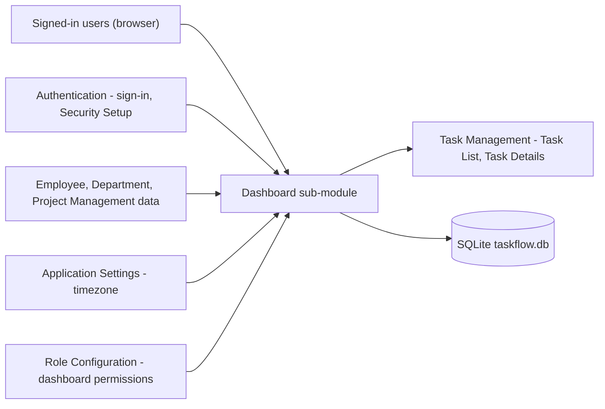
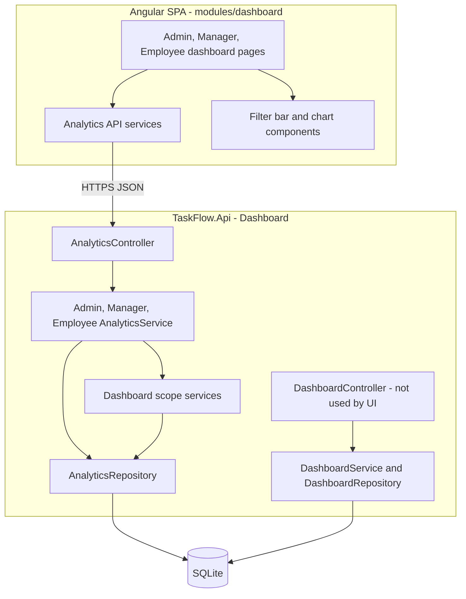
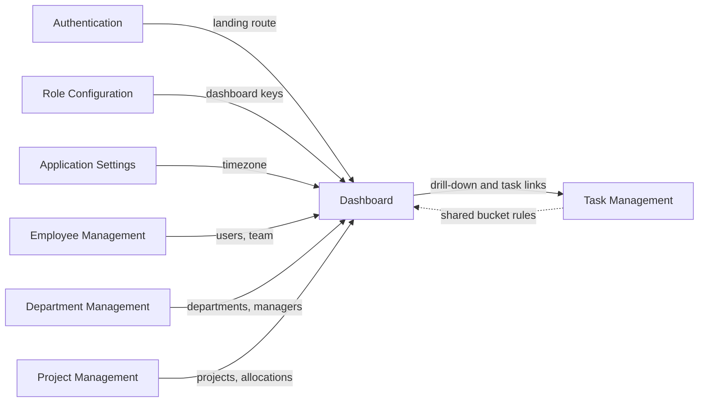
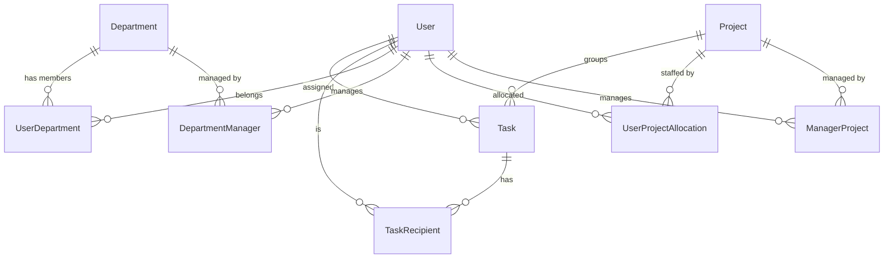
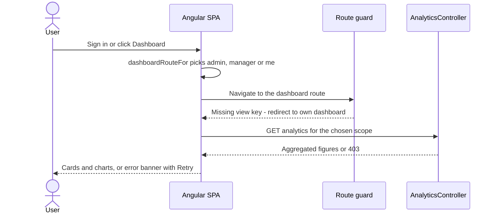
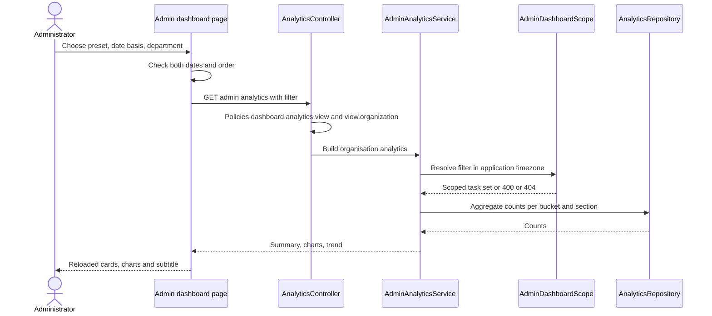
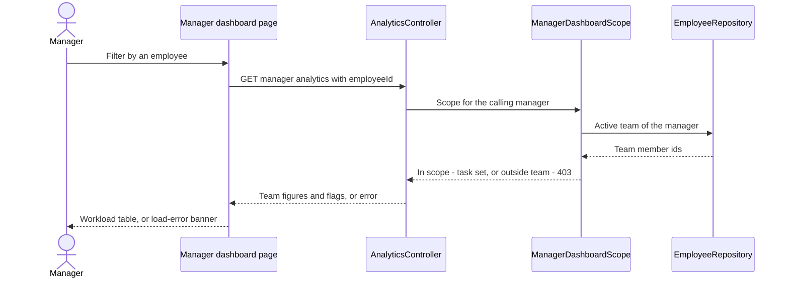
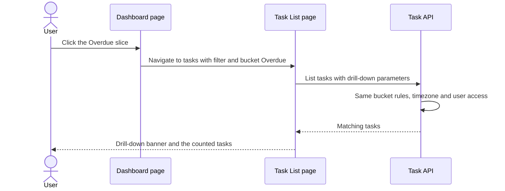

# High-Level Design – Dashboard

## TaskFlow – Intelligent Task Allocation & Tracking System

> **Document:** High-Level Design (sub-module 1 – DASH)  ·  **Version:** 1.0  ·  **Status:** Draft
> **Project type:** Personal Project (Skill Development)  ·  **Date:** 31-Oct-2026
> **Author:** Jojo George (jojogeorge3344@gmail.com)
> **Based on:** BRD – Dashboard v1.0, FRD – Dashboard v1.0 (FR-DASH-01 – FR-DASH-75), TDD v2.0, TaskFlow as built
> © 2026 Jojo George. All rights reserved.

---

## Document Control

| Version | Date | Author | Summary of changes |
|---|---|---|---|
| 1.0 | 31-Oct-2026 | Jojo George | Initial version of the Dashboard HLD (Administrator, Manager and Employee dashboards, analytics, filters, drill-down), written from the Dashboard BRD / FRD and the code as built |

**Related documents**

| Document | Location |
|---|---|
| HLD – Overall (stack, deployment, cross-cutting design) | `../../00-Overall/HLD-TaskFlow-Overall.md` |
| BRD – Dashboard | `../../../BRD/01-Dashboard/01.1-Dashboard/BRD-Dashboard.md` |
| FRD – Dashboard | `../../../FRD/01-Dashboard/01.1-Dashboard/FRD-Dashboard.md` |
| LLD – Dashboard (classes, endpoints, queries, tests) | `../../../LLD/01-Dashboard/01.1-Dashboard/LLD-Dashboard.md` |
| HLD – Task Management (drill-down target) | `../../02-TaskFlow-Monitoring/02.1-Task-Management/HLD-Task-Management.md` |
| HLD – Reports (file export of task figures) | `../../05-Reports/05.1-Reports/HLD-Reports.md` |
| TDD | `TF - Documents/TF - TDD/TDD-TaskFlow.md` (v2.0) – §2.3, §3, §6.6, §7.5, §8.3 |

---

## 1. Introduction

### 1.1 Purpose
This HLD describes how the Dashboard sub-module is built: where it sits in TaskFlow, its frontend and backend components
and their responsibilities, the data it reads, how it interacts with Task Management, Management and Settings, its key
flows, its security model and the design decisions behind it. Classes, methods, queries, columns and the full endpoint
list are in the LLD.

### 1.2 Scope
In scope: dashboard landing and routing (`/admin`, `/manager`, `/me`), the three dashboard pages, the analytics backend
(organisation, team and own scopes), the filter bar and period chips, and the drill-down hand-off to the Task List.
Also in scope: the Overview counter endpoints that exist in the code but are not called by any screen.
Out of scope: the Task List and Task Details themselves (Task Management HLD), file export (Reports HLD), and the shared
stack, deployment and cross-cutting design (overall HLD).

### 1.3 Audience
Developer and reviewer (Jojo George), technical reviewers, and anyone maintaining the dashboards or the shared bucket
rules.

### 1.4 Definitions & Abbreviations

| Term | Meaning |
|---|---|
| SPA | Single Page Application (Angular frontend) |
| Scope | Data visibility level: Own, Team or Organisation |
| Scope service | Backend component that turns the caller and the filter into the set of tasks to count (`AdminDashboardScope`, `ManagerDashboardScope`, `EmployeeDashboardScope`) |
| Bucket | Completed, Overdue, In progress or Pending – each counted task is in exactly one (`TaskBucketRules`) |
| Deadline bucket | Overdue, Due today, Next 7 days, Later for open tasks (`DeadlineBucketRules`) |
| Drill-down | Opening the Task List with the filter of a clicked chart part |
| Application timezone | Timezone from Application Settings (fallback `Application:Timezone`, default Asia/Kolkata) |
| KPI | Key performance indicator – a summary card |

---

## 2. System Context

### 2.1 Context Diagram

### 2.2 Actors & External Systems

| Actor / system | Interaction | Protocol |
|---|---|---|
| Administrator | Opens the Administrator Dashboard (organisation scope); may open the Manager Dashboard by address | HTTPS (SPA → REST JSON) |
| Manager | Opens the Manager Dashboard (team scope) | HTTPS (SPA → REST JSON) |
| Employee / any signed-in user | Opens the Employee Dashboard (own scope) | HTTPS (SPA → REST JSON) |
| Custom role | Lands on the dashboard its view keys allow | HTTPS (SPA → REST JSON) |
| Authentication (internal) | Sends the user to the dashboard after sign-in and Security Setup | In-app navigation |
| Task Management (internal) | Receives drill-down navigation; applies the same bucket rules | In-app navigation + REST |
| Application Settings (internal) | Supplies the application timezone through `IAppClock` | In-process call |
| Role Configuration (internal) | Grants the five dashboard keys | Database (role permissions) |

No external (third-party) system is used by this sub-module.

---

## 3. Architecture Goals, Constraints & Principles

### 3.1 Quality Goals

| Goal | How the architecture supports it |
|---|---|
| Consistency | One bucket definition (`TaskBucketRules`, `DeadlineBucketRules`) is used by every card, chart and the Task List drill-down |
| Security / privacy | Scope is decided on the server by the endpoint and the scope service, never by a client parameter; the own-scope endpoint accepts no subject id |
| Correct dates | Day boundaries are computed in the application timezone and converted to UTC before querying |
| Performance | The server returns aggregated counts, not task lists; lists are capped (5, 10, top 10) |
| Maintainability | Controller → Service → Scope / Repository layering; one service per audience; shared rules in `Common/Rules` |
| Read-only safety | No write path exists in the sub-module; it creates no notification, mail or activity entry |

### 3.2 Constraints
- Single SQLite database shared with all modules; no reporting replica, cache or snapshot tables.
- Thresholds are code constants (default range 30 days, maximum range under 3660 days, daily trend up to 31 days, top 10,
  lists of 5 and 10, 7-day window, High workload at 5 open tasks and 1.5 × average, department minimum 3 active members).
- Permissions come from the fixed catalogue; only five dashboard keys exist (no per-card permission).
- No direct-report relation exists; a manager's team is derived from departments managed and project-manager allocations.

### 3.3 Architecture Principles
- Server-side scope: every request is narrowed by a scope service before any count runs.
- One rule, many consumers: bucket and deadline rules are shared with Task Management so a drill-down lists exactly the counted tasks.
- Aggregate in the database, shape in the service: repositories return counts; services build the DTOs (trend buckets, flags).
- Read-only module: no unit-of-work commit, no side effects.

---

## 4. Architecture Overview

### 4.1 Architecture Style
The Dashboard follows the system-wide style – Angular SPA calling a layered ASP.NET Core REST API over SQLite – described
in the overall HLD (`../../00-Overall/HLD-TaskFlow-Overall.md`), which also covers the technology stack, deployment, the
request pipeline (JWT, session validation, MFA gate, permission policies) and logging. This section only shows the
Dashboard's own slice of that architecture.

### 4.2 Logical Architecture

### 4.3 Layers & Responsibilities

| Layer | Dashboard responsibility | May call |
|---|---|---|
| Presentation | Landing route choice, route guards, three pages, filter bar, charts, drill-down navigation | Dashboard API, Task List route |
| API / Controllers | Bind the filter, enforce the permission policies, read the caller id from the token | Services |
| Services | Build each dashboard's DTO: summary, charts, trend, flags, attention lists, department privacy rule | Scope services, repositories, `IAppClock` |
| Scope services | Resolve and check the filter, produce the task set for Organisation, Team or Own | Analytics repository, Employee repository (team) |
| Repositories | Read-only aggregate queries over tasks, people, departments and projects | Database |
| Shared rules | Bucket, deadline-bucket and team-threshold rules | – |

---

## 5. Component / Module Design

| Component | Responsibility | Key components (high level) | Depends on |
|---|---|---|---|
| Dashboard landing (frontend) | Pick the dashboard for a role and permissions; single **Dashboard** menu item; guard `/admin` and `/manager` | `dashboardRouteFor` (role routes), `nav-items`, `dashboard.routes` with `permissionGuard` | Auth session (role, permissions) |
| Dashboard pages (frontend) | Administrator, Manager and Employee pages; loading placeholders, error banner with **Retry**, empty states | Admin / Manager / Employee dashboard page components | Analytics API services |
| Analytics UI (frontend) | Filter bar, period chips, KPI cards, donut, stacked-bar, line and progress charts; drill-down query building | `DashboardFilterBarComponent`, chart components, `analytics-filter` and `drill-down` utilities | `chart.js` / `ng2-charts`, Task List route |
| Analytics API services (frontend) | Call the analytics endpoints, hold page state, drop stale responses, clear state on sign-out | `DashboardAnalyticsService`, `ManagerAnalyticsService`, `EmployeeAnalyticsService` | Analytics API |
| Analytics API (backend) | Five read-only endpoints: analytics and filter options per scope | `AnalyticsController` | Analytics services, permission policies |
| Analytics services (backend) | Organisation, team and own figures; trend; workload flags; attention lists; department overview | `AdminAnalyticsService`, `ManagerAnalyticsService`, `EmployeeAnalyticsService` | Scope services, `AnalyticsRepository`, `IAppClock` |
| Scope services (backend) | Filter resolution (defaults, limits, timezone bounds); team and project scope checks; own scope from the session | `AdminDashboardScope`, `ManagerDashboardScope`, `EmployeeDashboardScope`, `AnalyticsFilterResolver` | `AnalyticsRepository`, `EmployeeRepository` (team) |
| Analytics data access (backend) | Aggregate counts, lists and option lists | `AnalyticsRepository` | SQLite via EF Core |
| Shared rules | Bucket, deadline bucket, team thresholds – shared with Task Management | `TaskBucketRules`, `DeadlineBucketRules`, `ManagerTeamThresholds` | – |
| Overview counters (backend, unused by UI) | Simple counter endpoints for the three audiences | `DashboardController`, `DashboardService`, `DashboardRepository` | `ManagerDashboardScope`, `IAppClock` |

### 5.1 Module Interaction

| Interacting sub-module | Direction | What is exchanged |
|---|---|---|
| Authentication (overall) | In | After sign-in and Security Setup the SPA opens the dashboard chosen by role and permissions |
| Role Configuration | In | Grants `dashboard.view.team`, `dashboard.view.organization`, `dashboard.analytics.view`, `dashboard.filters.use` (`dashboard.view.own` is always on) |
| Application Settings | In | Application timezone for "today", presets and deadline windows |
| Employee / Department / Project Management | In (read) | People, active flags, department membership and managers, projects, manager projects, allocations with the project-manager flag |
| Task Management | Out / shared | Drill-down to `/tasks` with bucket and filter parameters; task links to `/tasks/:id`; the Task List reuses the dashboard bucket and date-range rules |
| Reports | Related | Reports offers the file export of task figures; the dashboard is screen-only |

---

## 6. Data Architecture (high level)

### 6.1 Data Stores

| Store | Technology | Holds (for this sub-module) | Notes |
|---|---|---|---|
| Main database | SQLite (`taskflow.db`, EF Core) | Tasks, recipients, users, departments, projects and their link tables, role permissions, application settings | Read only; the Dashboard owns no table and adds no migration |
| Browser memory | Angular signals | Current filter, period and last response per dashboard | Cleared on sign-out; nothing persisted |

### 6.2 Main Data Domains

Also read: `RolePermission` (to leave roles holding `tasks.view.all` out of the Employees card) and `ApplicationSetting`
(timezone, through `IAppClock`).

| Domain | Owner sub-module | Use in the Dashboard |
|---|---|---|
| Tasks and recipients | Task Management | Every count, list and trend; a recipient counts as an owner |
| People | Employee Management | Employees / Managers cards, names, active team members |
| Departments, members, managers | Department Management | Department-wise figures, manager teams, department overview |
| Projects, allocations, manager projects | Project Management | Project figures, manager project scope, My projects, team widening by project-manager flag |
| Roles and permissions | Role Configuration | Employees card rule |
| Application settings | Application Settings | Timezone |

### 6.3 Data Flow
1. The page sends the filter (range, date basis, optional department / project / employee / manager) or the period.
2. The scope service fills defaults, checks limits and scope, and turns local dates into UTC bounds in the application timezone.
3. The repository counts the scoped, non-deleted, non-cancelled tasks per bucket, priority, deadline window, department, person, manager and project.
4. The service shapes the result (trend per day or week, top 10, flags, attention lists, department privacy rule) and returns one DTO.
5. A click on a chart part sends the same filter plus the clicked part to the Task List, which applies the same rules and the user's task access.

---

## 7. Integration Design

| Integration | Direction | Purpose | Failure behaviour |
|---|---|---|---|
| Task Management – Task List / Task Details | Outbound (SPA navigation) | Drill-down with `bucket`, `deadlineBucket`, `departmentId`, `projectId`, `employeeId`, `managerId`, `from`, `to`, `basis`; task links | Task List validates the parameters and applies the user's access; dates in reverse order are refused there |
| Application Settings – `IAppClock` | Inbound (in-process) | Application timezone and current time | Unknown timezone id falls back to UTC |
| Management – team resolution | Inbound (in-process) | `EmployeeRepository` supplies the manager's active team | Empty team → no-team note on the page |

API surface of the sub-module (details in the LLD): `/api/v1/dashboard/admin/analytics`,
`/api/v1/dashboard/admin/analytics/filters`, `/api/v1/dashboard/manager/analytics`,
`/api/v1/dashboard/manager/analytics/filters` and `/api/v1/dashboard/employee/analytics` (used by the pages), plus the
Overview counters `/api/v1/dashboard/admin`, `/api/v1/dashboard/manager` and `/api/v1/dashboard/employee` (not used by any
screen). All are GET and read-only. No external service is called.

---

## 8. Key Flows (high level)

### 8.1 Sign-in to the right dashboard

### 8.2 Filter the Administrator Dashboard (main business flow)

### 8.3 Manager team scope check

### 8.4 Drill-down to the Task List (integration flow)

### 8.5 Background job
_Not applicable for this sub-module._ The Dashboard computes all figures on request; it has no scheduled job.

---

## 9. Security Architecture

| Concern | Approach |
|---|---|
| Authentication | Shared JWT bearer token + refresh-token cookie with session revalidation and MFA gate (overall HLD); the caller id comes from the token |
| Authorization | Permission policies per key. Analytics endpoints need `dashboard.analytics.view` (or `dashboard.filters.use` for filter options) **and** the scope key `dashboard.view.organization` or `dashboard.view.team`; the own analytics endpoint needs only `dashboard.analytics.view` and the own counter endpoint only a signed-in user (`dashboard.view.own` is always on). Scope levels expand: organisation implies team, team implies own; legacy keys `dashboard.admin` / `dashboard.manager` map to the new keys |
| Data scope | Organisation – `AdminDashboardScope`; Team – `ManagerDashboardScope` (403 for an employee or project outside the team); Own – `EmployeeDashboardScope` (session user only, no subject parameter) |
| Privacy | Department overview shows aggregates only and nothing for departments with fewer than 3 active members; Employee Dashboard never returns colleague names |
| Frontend | `permissionGuard` on `/admin` and `/manager` redirects silently to the user's own dashboard; filter bar hidden without `dashboard.filters.use`. UI hiding is a convenience; the server is the authority |
| Data protection | No personal data is written; responses hold names and counts only |
| Auditing | Refused requests (403) are logged by the shared denied-action audit handler; normal reads are covered by request logging |

---

## 10. Technology Stack

The shared stack (ASP.NET Core / .NET 10, EF Core 10.0.12 with SQLite, Angular 19.2, FluentValidation, JWT) is described in
the overall HLD (`../../00-Overall/HLD-TaskFlow-Overall.md`). Sub-module-specific items:

| Area | Technology | Version | Reason |
|---|---|---|---|
| Charts | `chart.js` + `ng2-charts` | ^4.6.1 / ^8.0.0 | Donut, stacked-bar and line charts with click events for drill-down |
| Frontend state | Angular signals + RxJS `switchMap` | Angular ^19.2.0, RxJS ~7.8.0 | Simple page state; stale responses are dropped when filters change quickly |
| Data access | EF Core LINQ aggregates on SQLite | 10.0.12 | Counts computed in the database; no extra reporting store |

---

## 11. Deployment Architecture

_Not applicable for this sub-module._ The Dashboard runs inside the single `TaskFlow.Api` process and the Angular SPA;
it adds no process, port, folder or configuration of its own. Deployment and environments are in the overall HLD
(`../../00-Overall/HLD-TaskFlow-Overall.md`). The only configuration it reads is `Application:Timezone` (fallback
timezone), `ConnectionStrings:Default` (`<secret>`) and the shared `Jwt:*` lifetimes.

---

## 12. Non-Functional Design

| Area | Design decision |
|---|---|
| Performance | Aggregated counts only; capped lists (5 overdue tasks, 5 projects, 10 deadlines, top 10 employees); queries are no-tracking and use the task deadline and assignee indexes; trend counted per quarter hour in SQL and grouped into local days in the service. > ⚠️ To be confirmed: a measured load-time target (NFR-DASH-05) |
| Scalability | Single API instance on SQLite; bounded ranges (under 3660 days) keep queries bounded (NFR-DASH-06) |
| Reliability | Stateless, read-only requests; a failed request leaves nothing to repair; the page offers **Retry** |
| Availability | Same as the API process (overall HLD) |
| Consistency | Shared bucket and deadline rules for cards, charts and drill-down (NFR-DASH-03) |
| Security | Scope enforced on the server (NFR-DASH-01); department privacy threshold (NFR-DASH-02) |
| Usability | Placeholders, plain-language empty and error messages, **Retry** (NFR-DASH-04) |
| Maintainability | One service and one scope per audience; rules in `Common/Rules`; structure checked by architecture tests (overall HLD) |
| Observability | Shared request logging and denied-action audit; no dashboard-specific logging |
| Backup & Recovery | Nothing owned; covered by the data-folder backup in the overall HLD |

---

## 13. Design Decisions

| ID | Decision | Alternatives considered | Rationale |
|---|---|---|---|
| D-DASH-1 | One analytics endpoint per audience (organisation, team, own), each protected by its own scope key | One endpoint with a `scope` parameter; client-side filtering of a full task list | The server, not the client, decides the scope; the own endpoint takes no subject id, so one user cannot ask for another's data |
| D-DASH-2 | Scope services turn caller + filter into one task set used by every count | Each chart builds its own query and checks | One place for filter defaults, limits, timezone bounds and team / project checks; every section agrees |
| D-DASH-3 | One shared bucket definition (`TaskBucketRules`, `DeadlineBucketRules`) reused by the Task List drill-down | Separate rules in Dashboard and Task Management | A drill-down lists exactly the counted tasks (BR-DASH-12); overdue is derived at query time (system decision D5) |
| D-DASH-4 | Aggregate on request in SQLite; no cache or snapshot tables | Materialised daily statistics; in-memory cache | Figures are always current; the data volume of a single-organisation deployment does not need a cache |
| D-DASH-5 | Day boundaries computed in the application timezone and converted to UTC; trend counted per quarter hour then grouped in the service | UTC calendar days; SQLite date functions | "Today" matches deadline reminders and the Task List; quarter-hour slots work for any timezone offset |
| D-DASH-6 | Team = active members of managed departments plus members of projects where the manager is flagged project manager | A direct-report relation; department membership only | Uses existing management data; no new relation to maintain |
| D-DASH-7 | Drill-down hands off to the Task List by query parameters instead of the dashboard listing tasks | Task tables inside the dashboard | Reuses Task List paging, access rules and actions; the dashboard stays aggregate-only |
| D-DASH-8 | Department overview hidden for departments with fewer than 3 active members | Always show; show with names | Prevents inferring one colleague's workload (NFR-DASH-02) |
| D-DASH-9 | Thresholds are code constants | Settings in Application Settings | Fewer settings to manage; values are stable business rules (BRD §12) |
| D-DASH-10 | Overview counter endpoints kept but not used by the pages | Remove them; switch the pages to them | Kept as simple counters; the pages need the richer analytics DTOs. > ⚠️ To be confirmed: remove or use them (their counting differs, see §14) |

---

## 14. Risks, Assumptions & Open Issues

| Type | Description | Mitigation / owner |
|---|---|---|
| Risk | A role without `dashboard.analytics.view` opens a dashboard and sees only the generic load-error banner (R-DASH-01) | Grant the key with the view keys. > ⚠️ To be confirmed: a "no permission" message – Jojo George |
| Risk | Server filter messages (range too long, employee outside the team, project outside scope) are shown as a connection error (R-DASH-02) | Client checks dates first. > ⚠️ To be confirmed: show the server message – Jojo George |
| Risk | The Manager Dashboard team differs from the team used by the Administrator's Manager filter and "Manager-wise teams" (department membership only, inactive users included) (R-DASH-03) | > ⚠️ To be confirmed: one team definition – Jojo George |
| Risk | Administrator trend counts tasks completed in the range even if later reopened; Employee trend counts only tasks still completed (R-DASH-04) | > ⚠️ To be confirmed: one rule – Jojo George |
| Risk | Unused Overview counters count Cancelled tasks in Total and treat all open tasks as Pending, unlike Analytics | Not shown on any screen. > ⚠️ To be confirmed: remove or align (D-DASH-10) – Jojo George |
| Risk | The "Managers" card counts only the Manager system role; custom roles holding `dashboard.view.team` are not counted | Documented behaviour (FR-DASH-18) |
| Assumption | A user may be in zero or more departments; the Department overview uses the first by name | BRD §12 |
| Assumption | Data volume fits on-request aggregation on SQLite | Re-check if task volume grows (NFR-DASH-05) |
| Open issue | > ⚠️ To be confirmed: measured performance target for dashboard loads (NFR-DASH-05) | Jojo George |

---

## 15. Traceability (requirements → components)

| FRD item(s) | Module / component | Section |
|---|---|---|
| FR-DASH-01, FR-DASH-02 | Dashboard landing (`dashboardRouteFor`, menu item) | §5, §8.1 |
| FR-DASH-03, FR-DASH-04, FR-DASH-05 | Dashboard landing (`dashboard.routes` with `permissionGuard`) | §5, §9 |
| FR-DASH-06, FR-DASH-07 | Analytics API (`AnalyticsController` permission policies) | §5, §9 |
| FR-DASH-08, FR-DASH-09 | Dashboard pages (placeholders, error banner, **Retry**) | §5 |
| FR-DASH-10, FR-DASH-11, FR-DASH-12 | Shared rules (`TaskBucketRules`) via `AnalyticsRepository` | §5, D-DASH-3 |
| FR-DASH-13 | Analytics data access (assignee or recipient ownership) | §5, §6.2 |
| FR-DASH-14 | Scope services (`AnalyticsFilterResolver`) + `IAppClock` | §6.3, D-DASH-5 |
| FR-DASH-15 | Whole sub-module (read-only, no write path) | §3.3 |
| FR-DASH-16, FR-DASH-17, FR-DASH-18, FR-DASH-19 | `AdminAnalyticsService` summary and donuts; Analytics UI (KPI and donut charts) | §5 |
| FR-DASH-20, FR-DASH-21, FR-DASH-22 | `AdminAnalyticsService` trend; line chart | §5, D-DASH-5 |
| FR-DASH-23 | Shared rules (`DeadlineBucketRules`) via `AdminAnalyticsService` | §5 |
| FR-DASH-24, FR-DASH-25, FR-DASH-26, FR-DASH-27, FR-DASH-28 | `AdminAnalyticsService` sections; Admin analytics components | §5 |
| FR-DASH-29 | Dashboard pages and Admin analytics components (empty states) | §5 |
| FR-DASH-30, FR-DASH-31 | `DashboardFilterBarComponent`; filter-options endpoint (`dashboard.filters.use`) | §5, §9 |
| FR-DASH-32, FR-DASH-33, FR-DASH-34, FR-DASH-35 | Filter bar + `analytics-filter` utility; `AnalyticsFilterResolver` / `AdminDashboardScope` | §5, §8.2 |
| FR-DASH-36 | Filter bar client-side date check | §8.2 |
| FR-DASH-37 | `AnalyticsFilterResolver` (range, basis, entity existence) | §8.2 |
| FR-DASH-38, FR-DASH-39 | Admin dashboard page + `DashboardAnalyticsService` | §5 |
| FR-DASH-40, FR-DASH-41, FR-DASH-42 | `ManagerAnalyticsService` + `ManagerDashboardScope` (team via `EmployeeRepository`) | §5, §8.3, D-DASH-6 |
| FR-DASH-43, FR-DASH-44 | Manager dashboard page (no-team notes) | §5 |
| FR-DASH-45, FR-DASH-46, FR-DASH-47, FR-DASH-48 | `ManagerAnalyticsService` attention lists; team attention component; Task Management navigation | §5, §8.4 |
| FR-DASH-49, FR-DASH-50 | `ManagerAnalyticsService`; team task and team employee components | §5 |
| FR-DASH-51, FR-DASH-52, FR-DASH-53 | `ManagerAnalyticsService` + `ManagerTeamThresholds` | §5 |
| FR-DASH-54, FR-DASH-55, FR-DASH-56 | `ManagerDashboardScope` (scope checks) + manager filter-options endpoint | §8.3, §9 |
| FR-DASH-57 | Manager dashboard page (empty state) | §5 |
| FR-DASH-58 | Permission expansion (organisation implies team) | §9 |
| FR-DASH-59, FR-DASH-60, FR-DASH-61 | `EmployeeAnalyticsService` + `EmployeeDashboardScope` (own scope) | §5, §9, D-DASH-1 |
| FR-DASH-62, FR-DASH-63, FR-DASH-64 | `EmployeeAnalyticsService` upcoming deadlines; Employee page; Task Details link | §5 |
| FR-DASH-65, FR-DASH-66, FR-DASH-67 | `EmployeeAnalyticsService` period handling and trend; period chips | §5 |
| FR-DASH-68 | `EmployeeAnalyticsService` My projects | §5 |
| FR-DASH-69, FR-DASH-70, FR-DASH-71 | `EmployeeAnalyticsService` department overview (privacy threshold) | §9, D-DASH-8 |
| FR-DASH-72, FR-DASH-73 | Analytics UI (`drill-down` utility) → Task List banner (Task Management) | §7, §8.4, D-DASH-7 |
| FR-DASH-74, FR-DASH-75 | Shared rules reused by Task Management; Task List access rules | §8.4, D-DASH-3 |

All 75 FRs (FR-DASH-01 – FR-DASH-75) are traced to at least one component.

---
© 2026 Jojo George. All rights reserved. Unauthorized copying or distribution of this document is prohibited.
