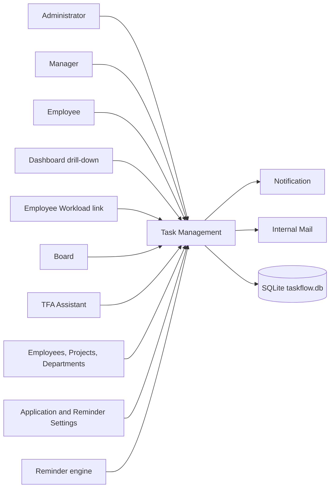
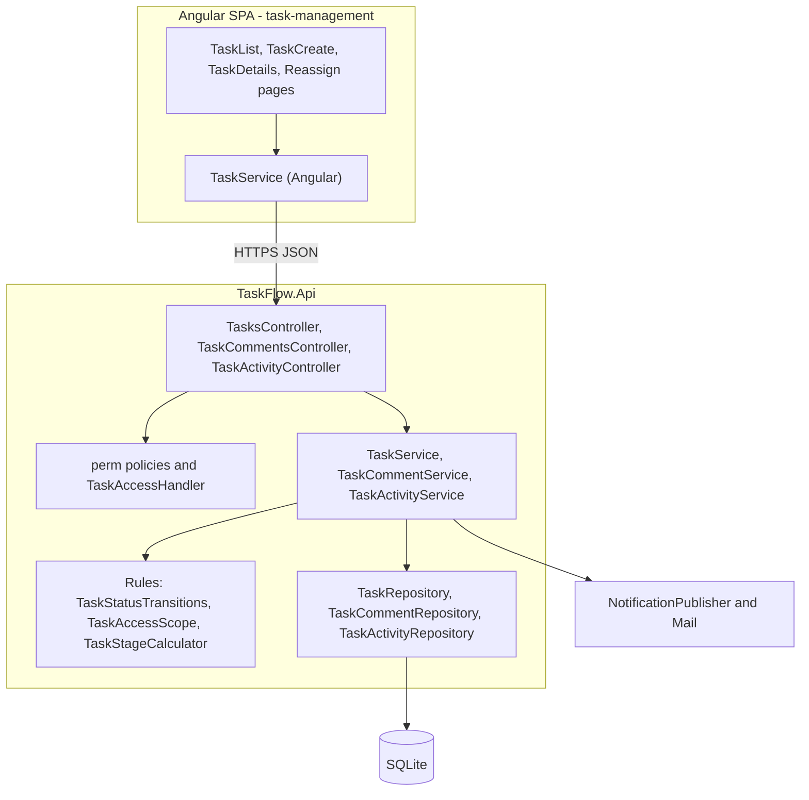
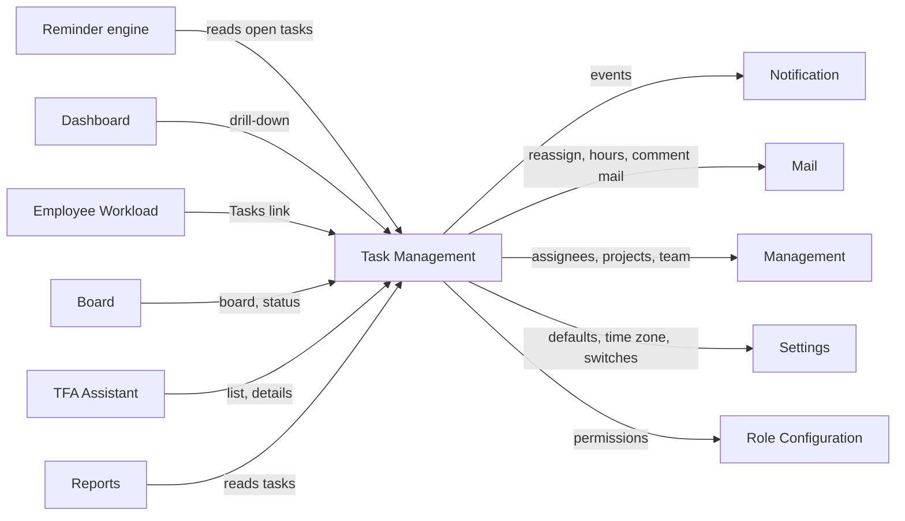
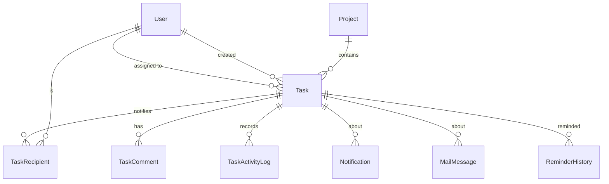
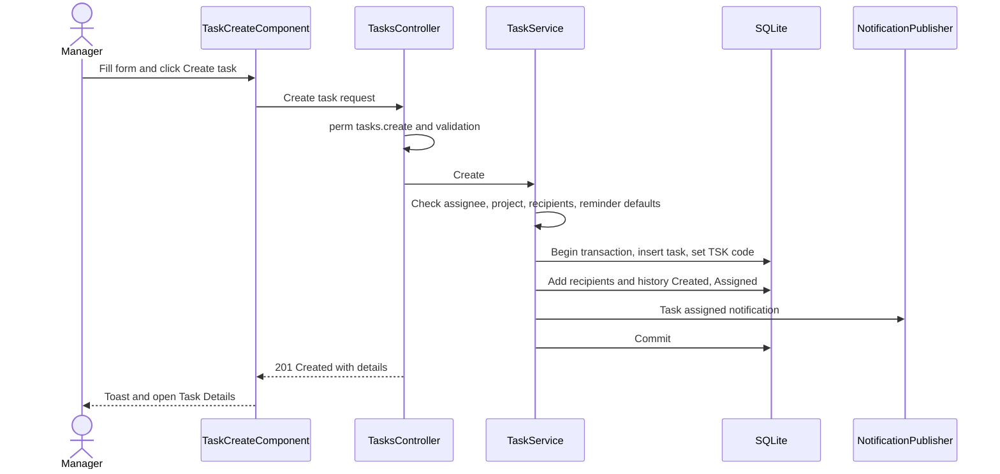
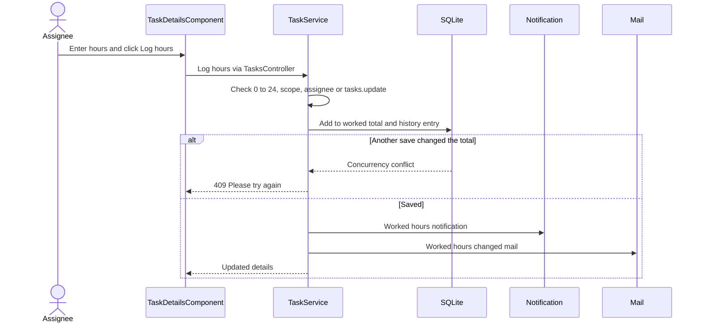
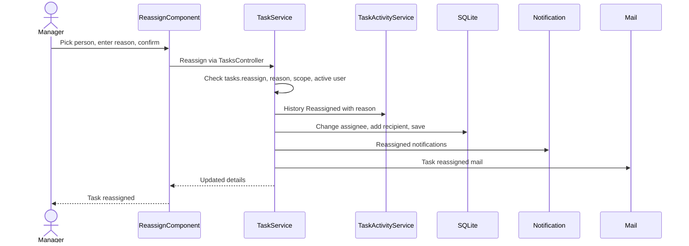
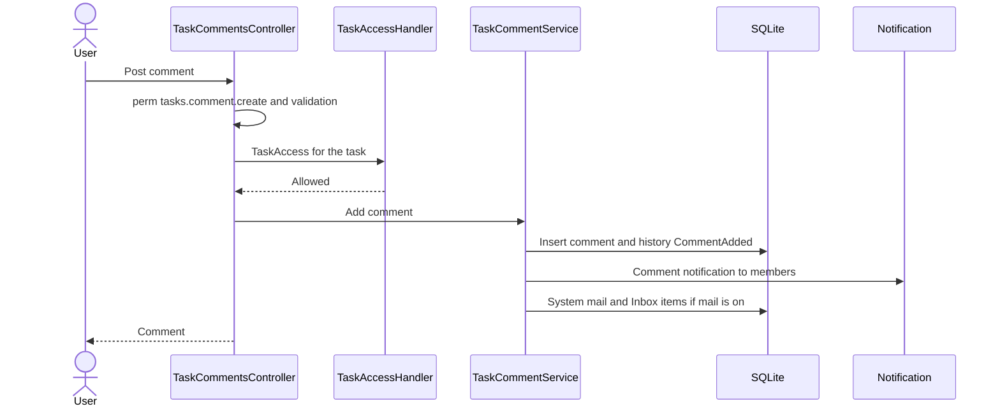
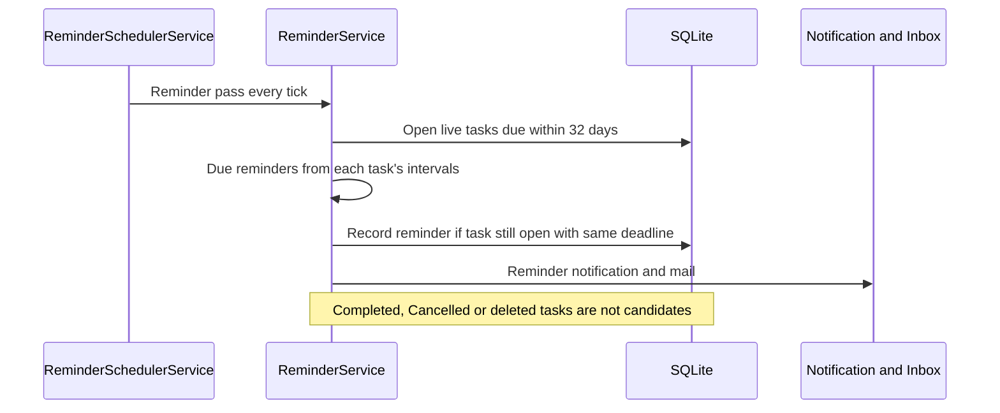
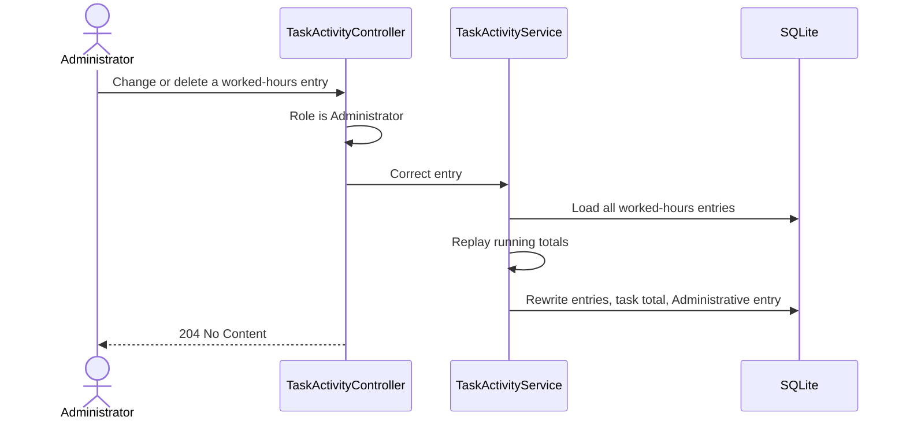

# High-Level Design – Task Management

## TaskFlow – Intelligent Task Allocation & Tracking System

> **Document:** High-Level Design (sub-module 02.1 Task Management, code `TASK`)  ·  **Version:** 1.0  ·  **Status:** Draft
> **Project type:** Personal Project (Skill Development)  ·  **Date:** 31-Oct-2026
> **Author:** Jojo George (jojogeorge3344@gmail.com)
> **Based on:** BRD-Task-Management v1.0, FRD-Task-Management v1.0
> © 2026 Jojo George. All rights reserved.

---

## Document Control

| Version | Date | Author | Summary of changes |
|---|---|---|---|
| 1.0 | 31-Oct-2026 | Jojo George | Initial version, derived from BRD/FRD-Task-Management v1.0, the verified Task Management and Comments & Activity History technical docs, TDD v2.0 and the code |

**Related documents:** 

| Document | Location |
|---|---|
| Overall HLD (stack, deployment, cross-cutting design, Auth) | `../../00-Overall/HLD-TaskFlow-Overall.md` |
| BRD / FRD – Task Management | `../../../BRD/02-TaskFlow-Monitoring/02.1-Task-Management/BRD-Task-Management.md`, `../../../FRD/02-TaskFlow-Monitoring/02.1-Task-Management/FRD-Task-Management.md` |
| LLD – Task Management | `../../../LLD/02-TaskFlow-Monitoring/02.1-Task-Management/LLD-Task-Management.md` |
| Sibling HLDs – Employee Workload, Board | `../02.2-Employee-Workload/HLD-Employee-Workload.md`, `../02.3-Board/HLD-Board.md` |
| Related HLDs – Notification, Mail, Dashboard | `../../04-Communication/04.2-Notification/HLD-Notification.md`, `../../04-Communication/04.1-Mail/HLD-Mail.md`, `../../01-Dashboard/01.1-Dashboard/HLD-Dashboard.md` |
| TDD | `TDD-TaskFlow.md` (v2.0) §6, §7, §10, §11 |

---

## 1. Introduction

### 1.1 Purpose
This HLD describes how the Task Management sub-module of TaskFlow Monitoring is built: its place in the system, its
frontend and backend components, the sub-modules and shared services it talks to, the data it owns, its key flows,
security and the design decisions behind them. Class-, column- and endpoint-level detail is in the LLD.

### 1.2 Scope
In scope: the Task List, Create / Copy Task, Task Details (edit, status, worked hours, delete), Reassign Task, Task
Discussion (comments) and Activity History, and the server components behind them. Out of scope (own HLDs): the Board
and Employee Workload, which reuse this sub-module's task scope and status rules; the reminder engine and Notification
Center (Notification); internal mail (Mail); Authentication (overall HLD).

**Change from original BRD**

| Original BRD | As built (this design) |
|---|---|
| Statuses To Do, In Progress, Blocked, Completed, Cancelled | **In QA** added; one shared transition table (D-TASK-2) |
| "Initial status" on create | Every task starts as To Do |
| Screen 14 SMTP email for task messages | Internal Mail and in-app notifications (no SMTP) |
| Not in original | Copy task, worked-hours tracking with Administrator correction, soft delete, edit/delete own comments, dashboard drill-down |

### 1.3 Audience
Developer, reviewer and tester of TaskFlow (Jojo George); anyone maintaining the Monitoring module.

### 1.4 Definitions & Abbreviations

| Term | Meaning |
|---|---|
| SPA | Single Page Application (Angular frontend) |
| Task scope | Own (assigned, created or recipient), Team (Manager) or Organization – the tasks a caller may see |
| Manager-scoped | A role holding `tasks.view.all` plus the team dashboard key but not the organization dashboard key; sees team tasks plus own |
| Recipient | A user notified about a task; the assignee is always one |
| Stage | Upcoming, Due today, Overdue or Completed, computed when a task is read |
| Activity history | Append-only audit trail of a task (`TaskActivityLog`) |
| Best effort | A side effect (notification, mail) whose failure is logged and never undoes the main change |
| `perm:<key>` | The server authorization policy for one permission key |

---

## 2. System Context

### 2.1 Context Diagram

### 2.2 Actors & External Systems

| Actor / system | Interaction | Protocol |
|---|---|---|
| Administrator, Manager, Employee, Custom role | Use the six task screens in the browser | HTTPS / JSON (Bearer JWT) |
| Dashboard (DASH) | Opens the Task List with drill-down criteria; shares the counting rules | In-process (shared rule classes), SPA navigation |
| Employee Workload (WORK) | **Tasks →** opens the Task List for one employee | SPA navigation |
| Board (BOARD) | Uses the board, status and assignee endpoints of this sub-module | HTTPS / JSON |
| Notification (NOTIF) | Receives event notifications; the reminder engine reads task data | In-process service calls, shared database |
| Mail (MAIL) | Receives reassignment, worked-hours and comment mail | In-process service / repository calls |
| Management (EMP, PROJ, DEPT) | Supplies assignees, recipients, projects and a Manager's team | In-process repository calls |
| Settings (APP, REM, ROLE) | Default priority, time zone, notification switches, reminder defaults, permissions | In-process service calls |
| TFA Assistant (TFA) | Reads the caller's tasks through the same task service | In-process service calls |

No external (third-party) system is called by this sub-module.

---

## 3. Architecture Goals, Constraints & Principles

### 3.1 Quality Goals

| Goal | How the architecture supports it |
|---|---|
| Security | Task scope and every action permission are checked on the server (policy + resource check + service re-check), not only by hiding buttons (NFR-TASK-02) |
| Data integrity | One transaction for create; optimistic concurrency on worked hours (NFR-TASK-05); soft delete keeps history |
| Auditability | Every change goes through one history writer; history is append-only except the recorded Administrator correction |
| Consistency | One status transition table for Task Details and Board (NFR-TASK-06); stage and overdue rules shared with Dashboard, Reports and reminders |
| Reliability | Notifications and mail after a change are best effort (NFR-TASK-04) |
| Maintainability | Layered Controller → Service → Repository, rules in small static classes, structure enforced by architecture tests |

### 3.2 Constraints
- Single API process and a single SQLite file (overall HLD); no message broker, so side effects run in-process.
- No SMTP: all task mail is internal Mail.
- Reminder intervals and additional recipients are fixed after creation (no edit screen).

### 3.3 Architecture Principles
- Thin controllers: HTTP, claims and policies only; business rules live in services.
- Defence in depth: route guard (UX) → `perm:<key>` policy → `TaskAccess` resource policy → service scope and permission re-check.
- Derived values (stage, overdue, remaining hours) are computed at read time and never stored.
- History and comments are never physically deleted with the task (soft delete).
- Cross-module side effects go through the owning module's service (`NotificationPublisher`, `MailService`) or repository, never by duplicating its logic.

---

## 4. Architecture Overview

### 4.1 Architecture Style
Task Management follows the system-wide style – Angular SPA + REST API, layered backend, SQLite via EF Core – described
in the overall HLD (`../../00-Overall/HLD-TaskFlow-Overall.md`). Inside that style it is a vertical slice: three
controllers, three services, three repositories, a set of rule classes and one resource-authorization handler, all
under the `Monitoring` / `TaskManagement` folders of each layer.

### 4.2 Logical Architecture

### 4.3 Layers & Responsibilities

| Layer | Responsibility (this sub-module) | May call |
|---|---|---|
| Presentation | Six task screens, route guards on create / reassign / activity, permission-gated buttons, debounced search, return URLs (back to list, board or project) | API |
| API / Controllers | `TasksController` (12 actions), `TaskCommentsController` (4), `TaskActivityController` (3): read caller id and role from the JWT, apply policies, call services | Services, `IAuthorizationService` |
| Authorization | `perm:<key>` policies; `TaskAccess` resource policy (`TaskAccessHandler` → `TaskAccessService`) | Repositories (read) |
| Services | Task scope, create / edit / status / hours / reassign / delete rules, comments, history, notifications and mail | Repositories, rule classes, Notification, Mail, Settings, Management repositories |
| Rules | Pure functions: transition table, access scope, display stage, reminder interval order, drill-down buckets | – |
| Repositories | Task, comment and history queries; visibility filter; paging; drill-down filters | Database (EF Core) |
| Integrations | None of its own; mail and notifications go through the Communication module | – |

---

## 5. Component / Module Design

| Component | Responsibility | Key components (high level) | Depends on |
|---|---|---|---|
| Task List (frontend) | Paged, filtered, searched list; drill-down banner; copy and delete actions | `TaskListComponent`, Angular `TaskService` | Tasks API, Projects API (filter) |
| Create / Copy Task (frontend) | Create form with recipients and reminders; copy prefill | `TaskCreateComponent` | Tasks API, Employees API, Projects API, Reminder Settings API, Application Settings (default priority) |
| Task Details (frontend) | Details, edit form, Move to, Time tracking, delete, Discussion and Activity summary tabs | `TaskDetailsComponent` | Tasks, comments and activity APIs |
| Reassign Task (frontend) | People picker, reason, "What happens next", confirmation | `ReassignComponent` | Tasks API, Employees API |
| Discussion / Activity pages (frontend) | Full comment thread; filtered history; Administrator hours correction | `TaskDiscussionComponent`, `ActivityComponent`, `activity-meta` (event labels) | Comments and activity APIs |
| Tasks API + task service | Task scope, list and drill-down, create, edit, status, worked hours, reassign, recipients, soft delete | `TasksController`, `TaskService`, `TaskRepository` | Management repositories, `IReminderSettingsService`, `IAppClock`, Notification, Mail, history |
| Comments API + comment service | Add, edit, soft-delete own comments; notify members; system mail | `TaskCommentsController`, `TaskCommentService`, `TaskCommentRepository` | `TaskRepository`, Notification, Mail repository, Application Settings |
| Activity API + history service | Single writer of the history; filtered read; Administrator worked-hours correction | `TaskActivityController`, `TaskActivityService`, `TaskActivityRepository` | `TaskRepository` |
| Task access | Resource check: view-all holder, assignee, creator or recipient of a live task | `TaskAccessRequirement`, `TaskAccessHandler`, `TaskAccessService` | `TaskRepository` |
| Rules | Transition table, access scope, stage, interval order, bucket rules | `TaskStatusTransitions`, `TaskAccessScope`, `TaskStageCalculator`, `ReminderIntervals`, `TaskBucketRules`, `DeadlineBucketRules` | – |

API surface (high level): `/api/v1/tasks` and its sub-resources for status, hours, reassign, recipients, comments and
activity – 19 controller actions in total (12 + 4 + 3); the full list is in the LLD.

### 5.1 Module Interaction

| Partner | Direction | What is exchanged |
|---|---|---|
| Notification | Out | `TaskAssigned`, `Reassigned`, `System` (worked hours) and `TaskComment` notifications via `NotificationPublisher` |
| Mail | Out | "Task reassigned", "Worked hours changed" (through `MailService`); "Comment added / edited / deleted" system mail (through the mail repository) |
| Reminder engine (Notification) | In (reads) | Open tasks, deadlines, per-task intervals, recipients and creator |
| Management | Out (reads) | Live and active users, active projects, a Manager's team (department managers, project-manager flags) |
| Settings | Out (reads) | Reminder defaults, application time zone, in-app and mail switches, default priority (frontend) |
| Dashboard | In | Drill-down criteria; shared bucket and date-range rules so the list equals the chart count |
| Board, Workload, Reports, TFA | In | Reuse task data, scope and status rules (Board, TFA) or read the `Tasks` table (Workload, Reports) |

---

## 6. Data Architecture (high level)

### 6.1 Data Stores

| Store | Technology | Holds (this sub-module) | Notes |
|---|---|---|---|
| Main database | SQLite `taskflow.db` (EF Core migrations) | Tasks, task recipients, task comments, task activity history | Shared file with all modules; backup policy in the overall HLD |
| File storage | – | – | Task Management stores no files |

| Data domain | Owned / used |
|---|---|
| `Task`, `TaskRecipient` | Owned (Task core) |
| `TaskComment`, `TaskActivityLog` | Owned (Comments & Activity) |
| `User`, `Project`, `DepartmentManager`, `UserProjectAllocation` | Used (Management) |
| `Role`, `Permission`, `RolePermission` | Used (Role Configuration) |
| `Notification`, `MailMessage`, `MailRecipient`, `MailboxItem` | Written through Communication |
| `ApplicationSetting` | Used (Settings) |
| `ReminderHistory` | Read and written by the reminder engine for these tasks |

### 6.2 Main Data Domains

### 6.3 Data Flow
1. **Create:** the form posts a task → one transaction inserts the task, assigns the `TSK-` code, adds recipients (assignee
   always), writes two history entries and the assignee's notification.
2. **Work:** status changes and worked hours update the task and append history; worked-hours changes also write
   notifications and internal mail for the assignee and recipients.
3. **Remind:** the reminder engine (Notification) reads open, live tasks and their intervals on every pass and writes
   reminder history, notifications and Inbox mail; completed, cancelled or deleted tasks are no longer candidates.
4. **Discuss / audit:** comments are stored with the task; each change appends history and notifies members.
5. **Read:** list, board, details, dashboard drill-down, workload, reports and the assistant all read the same `Tasks`
   rows, each adding `!IsDeleted` and its own scope.

---

## 7. Integration Design

| Integration | Direction | Purpose | Failure behaviour |
|---|---|---|---|
| `NotificationPublisher` (Notification) | Outbound, in-process | Task assigned, reassigned, worked hours changed, comment events | Create: inside the transaction (a failure rolls the create back). Others: best effort, logged. Skipped while in-app notifications are off |
| `MailService` (Mail) | Outbound, in-process | "Task reassigned: …", "Worked hours changed: …" internal mail | Best effort, logged, never rolls back the change |
| Mail repository (Mail) | Outbound, in-process | System mail "Comment …: …" with Inbox items | Skipped when mail is switched off; on failure the staged mail is discarded and a warning logged |
| Reminder engine (Notification) | Inbound, shared database | Reads open tasks and per-task intervals | Engine re-checks the task is still open with the same deadline before delivering |
| Management repositories | Outbound, in-process | Active assignee / recipients / project checks; Manager team | Validation error (400) when a person or project is not active |
| Reminder Settings / `IAppClock` | Outbound, in-process | Reminder defaults on create; time zone for stage and drill-down bounds | Unknown time zone falls back to UTC (logged) |
| Dashboard rules | Inbound, in-process | `TaskBucketRules`, `DeadlineBucketRules`, date-range and entity filters | Reversed dates → 400 "The end date cannot be before the start date." |
| TFA Assistant | Inbound, in-process | `get_my_tasks`, `prioritise_tasks`, creator lookup for mail drafts | Same scope as the caller; no extra access |

There are no external (HTTP) integrations in this sub-module.

---

## 8. Key Flows (high level)

Sign-in, token refresh and the MFA gate are shared flows described in the overall HLD.

### 8.1 Create and assign a task (main business flow)

### 8.2 Log worked hours (concurrency and side effects)

### 8.3 Reassign a task (integration with Notification and Mail)

### 8.4 Post a comment

### 8.5 Reminder engine reads task data (background job)

### 8.6 Administrator worked-hours correction

---

## 9. Security Architecture

| Concern | Approach |
|---|---|
| Authentication | Shared: JWT bearer with session validation and mandatory MFA (overall HLD). Every task controller is `[Authorize]` |
| Authorization – endpoint | `perm:<key>` policies: `tasks.create`, `tasks.update`, `tasks.delete`, `tasks.status.change`, `tasks.reassign`, `tasks.recipients.manage`, `tasks.comment.create`, `tasks.comment.edit`, `tasks.comment.delete`, `tasks.activity.view`; `board.view` on the board read |
| Authorization – resource | `TaskAccess` policy: live task and caller holds `tasks.view.all`, or is assignee, creator or recipient (`tasks.view.own` is always on) |
| Authorization – service | `TaskService` re-checks the permission and applies the Manager team scope on details, edit, status, hours and reassign; author-only rule for comments; worked-hours correction limited to the Administrator role |
| Frontend | `permissionGuard` on `/tasks/new` (`tasks.create`), `/tasks/:id/reassign` (`tasks.reassign`), `/tasks/:id/activity` (`tasks.activity.view`); buttons and tabs gated by the same keys (UX only) |
| Data protection | No secrets or personal data beyond names; request bodies are not logged; comment text kept only in the database |
| Transport | HTTPS and CORS as the overall HLD |
| Auditing | Activity history records every change with actor and UTC time; refused authorizations are logged by `DeniedActionAuditHandler` |
| Known gaps | Delete and set-recipients have no task-scope check; `TaskAccess` lacks the Manager team scope (comments, activity); "Move to" buttons not gated (§14) |

---

## 10. Technology Stack

The sub-module uses the system stack unchanged (ASP.NET Core / .NET 10, EF Core 10.0.12 with SQLite, FluentValidation
12.2.0, Angular ^19.2.0, RxJS ~7.8.0); versions and reasons are in the overall HLD
(`../../00-Overall/HLD-TaskFlow-Overall.md`). Parts that matter most here:

| Area | Technology | Version | Reason |
|---|---|---|---|
| Validation | `FluentValidation` | 12.2.0 | Create, update, status, reassign, recipients and comment request validators |
| Data access | `Microsoft.EntityFrameworkCore.Sqlite` | 10.0.12 | Task queries, transactions, concurrency token on worked hours |
| Frontend | Angular standalone components, `@angular/forms` | ^19.2.0 | Task screens and reactive forms |

---

## 11. Deployment Architecture

Task Management has no deployment unit of its own: it runs inside the single `TaskFlow.Api` process and the Angular SPA,
with its data in the shared `taskflow.db`. Hosting, environments, ports and the data folder are described once in the
overall HLD (`../../00-Overall/HLD-TaskFlow-Overall.md`).

---

## 12. Non-Functional Design

| Area | Design decision |
|---|---|
| Performance | List paged on the server (20 per page, at most 100), ordered by deadline with indexes on `Deadline` and `AssignedToUserId`; search debounced 300 ms in the SPA (NFR-TASK-01) |
| Scalability | Single instance; board and assignee reads are unpaged (accepted for current volumes) |
| Reliability | Create is one transaction; worked hours use optimistic concurrency (409, NFR-TASK-05); side effects best effort (NFR-TASK-04) |
| Availability | As the overall system (single process) |
| Maintainability | One transition table (NFR-TASK-06); rule classes unit-tested; architecture tests enforce layer and folder rules |
| Usability | Confirmation for delete and reassign; field messages from validators (NFR-TASK-03) |
| Observability | Request log per call; warnings for failed notifications / mail; denied-action audit |
| Backup & Recovery | Part of the database backup (overall HLD); soft delete means a deleted task can be recovered from the row |

---

## 13. Design Decisions

| ID | Decision | Alternatives considered | Rationale |
|---|---|---|---|
| D-TASK-1 | Task scope is computed in the service (`TaskVisibility`: Own / Team plus own / Organization) and checked again by the `TaskAccess` resource policy | Policy only; filtering in the SPA | One rule set for list, board, details, assistant; the policy guards task-scoped endpoints that do not load the task through the service |
| D-TASK-2 | One static transition table (`TaskStatusTransitions`) used by Task Details and the Board | Free status change; per-screen rules | Same rules everywhere (NFR-TASK-06); In QA added in one place |
| D-TASK-3 | Stage and overdue are derived at read time in the application time zone (`TaskStageCalculator`), never stored | Stored stage updated by a job | Cannot go stale; no extra job; matches the reminder engine's day logic |
| D-TASK-4 | Soft delete for tasks and comments, with explicit `!IsDeleted` in every task query (no global filter) | Hard delete; global query filter | Keeps comments, history and reminder history (BR-TASK-08); explicit filter lets history and names still load deleted parents |
| D-TASK-5 | Task code `TSK-` + 6-digit id, set inside the create transaction after the insert (placeholder first) | Separate sequence table; GUID codes | Unique, readable, never reused, no extra table; unique index guards it |
| D-TASK-6 | `TaskActivityService` is the single writer of an append-only history; the caller owns the transaction | Each service writes its own log rows; database triggers | One format and event list; history saved with the change it describes |
| D-TASK-7 | Worked total (`ActualHours`) is an optimistic concurrency token | Locking; last write wins | Two simultaneous saves never lose hours; the loser gets 409 "Please try again" |
| D-TASK-8 | The assignment notification is written inside the create transaction; reassign, hours and comment notifications and mail are best effort after the save | All inside the transaction; all best effort; a message queue | A task is never created without telling the assignee; later side effects must not undo a valid change (NFR-TASK-04); no broker in a single-process design |
| D-TASK-9 | Per-task reminder intervals are stored on the task; nothing is pre-scheduled | Pre-generated reminder rows | Completion, cancellation, deadline or recipient changes take effect on the next pass with nothing to cancel |
| D-TASK-10 | Dashboard drill-down reuses the dashboard's bucket and date-range rules inside the task repository | Separate list query per chart | The list holds exactly the tasks the chart counted (BR-22) |
| D-TASK-11 | Worked-hours correction replays all entries and is limited to the Administrator role, recorded as an `Administrative` entry | Edit the total only; a permission key | Keeps every running total consistent; the correction itself stays auditable |
| D-TASK-12 | Comment notifications go to assignee, recipients and author; comment mail is a system message (no sender) placed in Inbox | Personal mail from the author; no mail | Everyone on the task sees the change; system mail can be switched off with the mail setting |

---

## 14. Risks, Assumptions & Open Issues

| Type | Description | Mitigation / owner |
|---|---|---|
| Risk | R-TASK-01: delete has no task-scope check; any `tasks.delete` holder can delete any live task | Only Administrators hold the key by default; add the scope check – Jojo George |
| Risk | R-TASK-02: `TaskAccess` lacks the Manager team scope, so a Manager can read and write comments and history of another team's task by direct request | Add the team check to the handler – Jojo George |
| Risk | R-TASK-03: "Move to" buttons are shown without `tasks.status.change`; the API refuses | Gate the buttons – Jojo George |
| Risk | Set-recipients endpoint has no task-scope check and no user-existence check (no UI caller) | Add both checks before a screen uses it – Jojo George |
| Risk | R-TASK-04: Create lists only Employee-role users as assignees; the API accepts any active user | Widen the list in a later release – Jojo George |
| Risk | Board and assignee reads are unpaged | Acceptable for current volumes; revisit with paging – Jojo George |
| Assumption | Creators also hold `employees.view`, `projects.view` and Reminder Settings read access (true for Administrator and Manager) | Role defaults – Jojo George |
| Open issue | R-TASK-05 / R-TASK-06: reminder intervals not editable after create; clearing worked hours on edit records a change to 0 | Later release; Administrator correction – Jojo George |
| Open issue | Picking a Project in the normal list filter is treated as a drill-down, so a Manager loses own non-team tasks | Separate the two filters – Jojo George |
| Open issue | The Task List "Board view" button is not gated by `board.view` | Gate the button – Jojo George |
| Open issue | Two overdue rules: instant rule (board, dashboard, reports) vs day rule (list stage) differ on the deadline day | Documented in TDD §7.5 – Jojo George |

---

## 15. Traceability (requirements → components)

| BRD/FRD item | Module / component | Section |
|---|---|---|
| FR-TASK-01, FR-TASK-02, FR-TASK-09 | Tasks API › `TaskService` task scope (`TaskVisibility`, Manager team from Management) › `TaskRepository` | §5, §9, D-TASK-1 |
| FR-TASK-03, FR-TASK-04, FR-TASK-05, FR-TASK-06, FR-TASK-12, FR-TASK-13 | `TaskListComponent` › Tasks API list › `TaskRepository` paging and filters | §5, §12 |
| FR-TASK-07, FR-TASK-33 | `TaskStageCalculator` with `IAppClock` time zone | §5, D-TASK-3 |
| FR-TASK-08 | Tasks API list with dashboard bucket rules (`TaskBucketRules`, `DeadlineBucketRules`) | §7, D-TASK-10 |
| FR-TASK-10, FR-TASK-11 | `TaskListComponent` navigation and permission-gated actions | §5, §9 |
| FR-TASK-14, FR-TASK-15, FR-TASK-16, FR-TASK-17, FR-TASK-18, FR-TASK-19, FR-TASK-20, FR-TASK-21 | `TaskCreateComponent` › `TasksController` › create validator › `TaskService` create transaction | §8.1, D-TASK-5 |
| FR-TASK-22, FR-TASK-23, FR-TASK-24, FR-TASK-25 | `TaskService` checks via Management repositories, `IReminderSettingsService`, `ReminderIntervals` | §7, §8.1 |
| FR-TASK-26, FR-TASK-27, FR-TASK-28 | `TaskService` › `TaskActivityService` › `NotificationPublisher` (inside the create transaction) | §8.1, D-TASK-8 |
| FR-TASK-29, FR-TASK-30 | `TaskCreateComponent` copy prefill (reads task details) | §5 |
| FR-TASK-31, FR-TASK-32 | `TaskDetailsComponent` › Tasks API details › `TaskService` scope and team check | §5, §9 |
| FR-TASK-34, FR-TASK-35, FR-TASK-36 | `TaskDetailsComponent` edit form › update validator › `TaskService` edit › history | §5, D-TASK-6 |
| FR-TASK-37, FR-TASK-38, FR-TASK-39, FR-TASK-40 | `TaskDetailsComponent` Move to › Tasks API status › `TaskStatusTransitions` › history | §5, D-TASK-2 |
| FR-TASK-41, FR-TASK-42, FR-TASK-43, FR-TASK-44 | Time tracking › Tasks API hours › `TaskService` (concurrency token) › Notification and `MailService` | §8.2, D-TASK-7 |
| FR-TASK-45 | `TaskDetailsComponent` Discussion and Activity tabs › comments and activity APIs | §5 |
| FR-TASK-46 | Tasks API delete › `TaskService` soft delete › history | §5, D-TASK-4 |
| FR-TASK-47 | Reminder engine (Notification) – open-task candidate rule | §8.5, D-TASK-9 |
| FR-TASK-48, FR-TASK-49, FR-TASK-50, FR-TASK-51, FR-TASK-52, FR-TASK-53, FR-TASK-54, FR-TASK-55, FR-TASK-56 | `ReassignComponent` › Tasks API reassign › reassign validator › `TaskService` › history › Notification and `MailService` | §8.3 |
| FR-TASK-57, FR-TASK-58, FR-TASK-59, FR-TASK-60, FR-TASK-61, FR-TASK-62 | Discussion page › `TaskCommentsController` › `TaskAccess` › `TaskCommentService` › `TaskCommentRepository`, Notification, Mail repository | §8.4, D-TASK-12 |
| FR-TASK-63, FR-TASK-64, FR-TASK-65, FR-TASK-66, FR-TASK-67, FR-TASK-69 | `TaskActivityService` (single writer) › `TaskActivityController` › `TaskActivityRepository` filters; Activity page | §5, D-TASK-6 |
| FR-TASK-68 | `TaskActivityController` Administrator check › `TaskActivityService` replay | §8.6, D-TASK-11 |
| FR-TASK-70, FR-TASK-71 | `NotificationPublisher` switch, live-user filter, best-effort side effects | §7, D-TASK-8 |
| FR-TASK-72, FR-TASK-73 | `perm:<key>` policies, `TaskAccessHandler`, service re-checks; `permissionGuard` on routes | §9 |
| NFR-TASK-01 … NFR-TASK-08 | See §12 | §12 |

---
© 2026 Jojo George. All rights reserved. Unauthorized copying or distribution of this document is prohibited.
