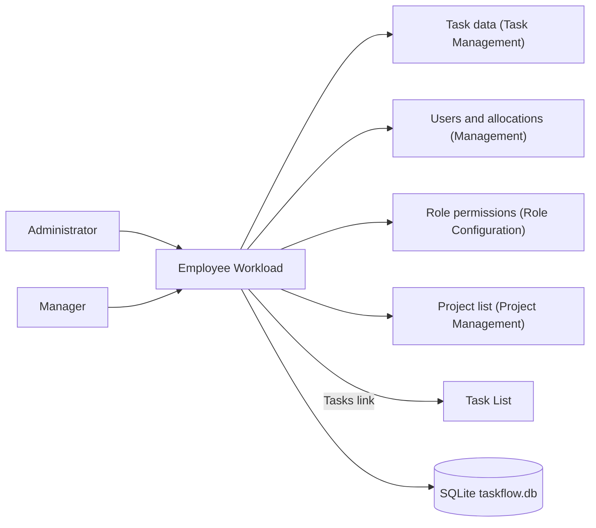
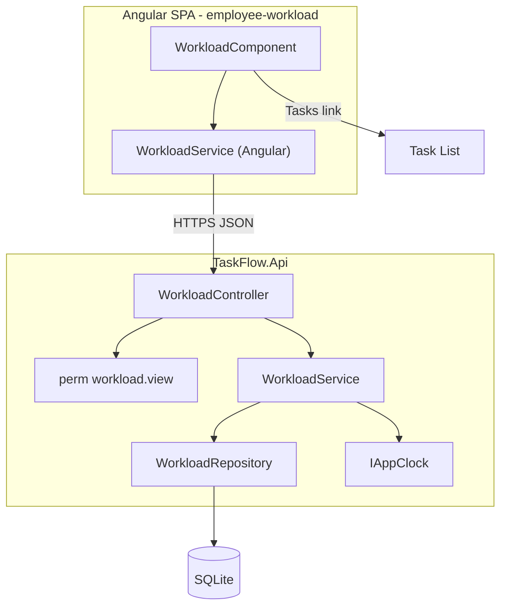
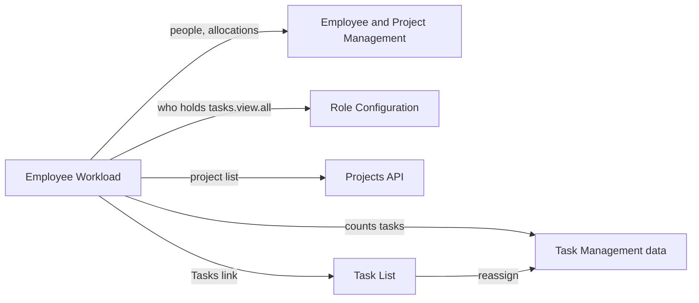
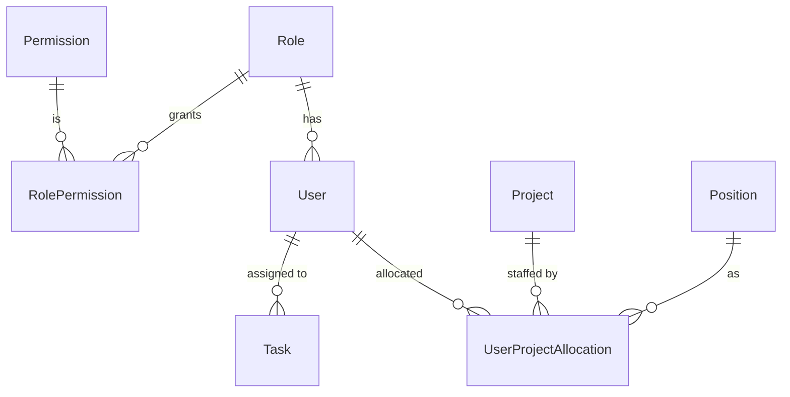
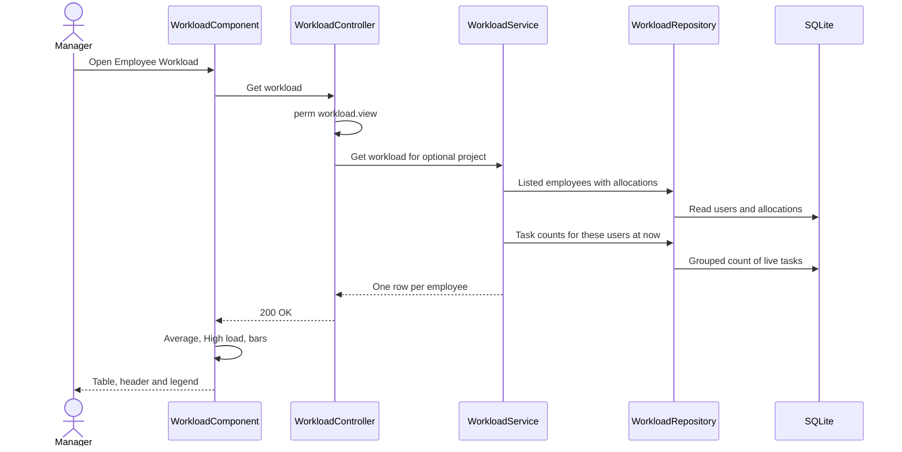
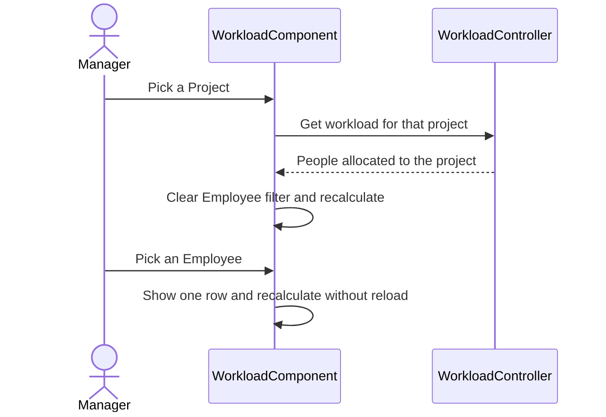
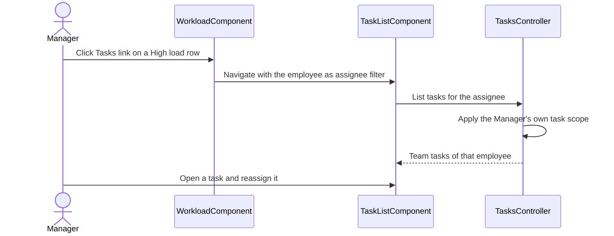

# High-Level Design – Employee Workload

## TaskFlow – Intelligent Task Allocation & Tracking System

> **Document:** High-Level Design (sub-module 02.2 Employee Workload, code `WORK`)  ·  **Version:** 1.0  ·  **Status:** Draft
> **Project type:** Personal Project (Skill Development)  ·  **Date:** 31-Oct-2026
> **Author:** Jojo George (jojogeorge3344@gmail.com)
> **Based on:** BRD-Employee-Workload v1.0, FRD-Employee-Workload v1.0
> © 2026 Jojo George. All rights reserved.

---

## Document Control

| Version | Date | Author | Summary of changes |
|---|---|---|---|
| 1.0 | 31-Oct-2026 | Jojo George | Initial version, derived from BRD/FRD-Employee-Workload v1.0, the verified Employee Workload technical doc, TDD v2.0 and the code |

**Related documents:**

| Document | Location |
|---|---|
| Overall HLD (stack, deployment, cross-cutting design, Auth) | `../../00-Overall/HLD-TaskFlow-Overall.md` |
| BRD / FRD – Employee Workload | `../../../BRD/02-TaskFlow-Monitoring/02.2-Employee-Workload/BRD-Employee-Workload.md`, `../../../FRD/02-TaskFlow-Monitoring/02.2-Employee-Workload/FRD-Employee-Workload.md` |
| LLD – Employee Workload | `../../../LLD/02-TaskFlow-Monitoring/02.2-Employee-Workload/LLD-Employee-Workload.md` |
| Sibling HLDs – Task Management, Board | `../02.1-Task-Management/HLD-Task-Management.md`, `../02.3-Board/HLD-Board.md` |
| Related HLDs – Employee Management, Project Management, Role Configuration | `../../03-TaskFlow-Management/03.1-Employee-Management/HLD-Employee-Management.md`, `../../03-TaskFlow-Management/03.2-Project-Management/HLD-Project-Management.md`, `../../06-Settings/06.4-Role-Configuration/HLD-Role-Configuration.md` |
| TDD | `TDD-TaskFlow.md` (v2.0) §6.6, §7.5, §7.6 |

---

## 1. Introduction

### 1.1 Purpose
This HLD describes how the Employee Workload screen is built: its place in the system, its components, the sub-modules
whose data it reads, its flows, security and design decisions. Class, query and column detail is in the LLD.

### 1.2 Scope
In scope: the Employee Workload screen (`/workload`) – per-employee task counts, project allocations, average and
"High load" highlighting, Project and Employee filters and the **Tasks →** link – and the single read endpoint behind
it. Out of scope: changing or reassigning tasks (Task Management HLD), workload charts (Dashboard HLD), exportable
reports (Reports HLD).

**Change from original BRD (Screen 16)**

| Original BRD | As built (this design) |
|---|---|
| Department column and Department filter | Projects column (name and %), Allocated % total, Project filter |
| Workload summary chart | Header summary and a workload bar per row |
| "Unusually high" active count | "High load" = active count at least twice the average of the rows shown |

### 1.3 Audience
Developer, reviewer and tester of TaskFlow (Jojo George); anyone maintaining the Monitoring module.

### 1.4 Definitions & Abbreviations

| Term | Meaning |
|---|---|
| SPA | Single Page Application (Angular frontend) |
| Listed employee | An active user whose role has no stored grant of `tasks.view.all` (the Employee role by default) |
| Active / High priority / Overdue / Completed | Counts per assignee: not Completed or Cancelled / active and High or Critical / active and deadline passed / status Completed; deleted tasks never counted |
| High load | Active count at least twice the average of the rows shown (no badge when the average is 0) |
| Allocation | A person's percentage share of a project, with a position |

---

## 2. System Context

### 2.1 Context Diagram

### 2.2 Actors & External Systems

| Actor / system | Interaction | Protocol |
|---|---|---|
| Administrator, Manager, Custom role with `workload.view` | Review load, filter, open an employee's tasks | HTTPS / JSON (Bearer JWT) |
| Task Management (TASK) | Source of the `Tasks` rows that are counted; target of the **Tasks →** link | Shared database (read), SPA navigation |
| Employee / Project Management (EMP, PROJ) | Users, project allocations, positions; project list for the filter | Shared database (read), Projects API |
| Role Configuration (ROLE) | Which roles hold `tasks.view.all` decides who is listed; grants the workload keys | Shared database (read), session claims |

No external (third-party) system is involved.

---

## 3. Architecture Goals, Constraints & Principles

### 3.1 Quality Goals

| Goal | How the architecture supports it |
|---|---|
| Performance | One request for all listed employees: one people query plus one grouped count query (NFR-WORK-01); Employee filter applied in the SPA without reloading |
| Security | The data endpoint requires `workload.view` on the server (NFR-WORK-02) |
| Consistency | Same active, overdue and priority definitions as Dashboard, Task List and Reports (NFR-WORK-05) |
| Reliability | Read-only: no writes, no side effects (NFR-WORK-04) |
| Usability | High load and overdue highlighting computed for the rows on screen (NFR-WORK-03) |

### 3.2 Constraints
- Single API process and SQLite file (overall HLD).
- Workload owns no data; it depends on Management for allocations and on Task Management for tasks.
- Organization-wide by requirement (REQ-WORK-16): not narrowed to a Manager's team.

### 3.3 Architecture Principles
- Thin controller, aggregation in the service, queries in the repository.
- Server returns raw counts; presentation-only values (average, High load, bar width) are computed in the SPA.
- The **Tasks →** link never widens access: the Task List applies the caller's own task scope.

---

## 4. Architecture Overview

### 4.1 Architecture Style
Employee Workload follows the system-wide style (Angular SPA + REST API, layered backend, SQLite via EF Core) described
in the overall HLD (`../../00-Overall/HLD-TaskFlow-Overall.md`). It is the smallest Monitoring slice: one page, one
controller action, one service and one repository, all read-only.

### 4.2 Logical Architecture

### 4.3 Layers & Responsibilities

| Layer | Responsibility (this sub-module) | May call |
|---|---|---|
| Presentation | Table, header summary, legend, average and High load, client-side Employee filter, Project filter, workload bars, **Tasks →** link; `permissionGuard` on `/workload` | Workload API, Projects API |
| API / Controller | `WorkloadController` (1 action), class-level `workload.view` policy | `WorkloadService` |
| Service | Get listed employees with allocations, get counts, join (zeros for people without tasks), sum allocations | `WorkloadRepository`, `IAppClock` |
| Repository | People query (active, no stored `tasks.view.all` grant, optional project) and grouped task counts | Database (EF Core) |
| Integrations | None | – |

---

## 5. Component / Module Design

| Component | Responsibility | Key components (high level) | Depends on |
|---|---|---|---|
| Workload page (frontend) | Show rows, compute average and High load for the rows shown, filters, bars, link to tasks | `WorkloadComponent`, Angular `WorkloadService` | Workload API, Projects API (`projects.view`), Task List route |
| Workload API | Authorize and return the per-employee list, optionally for one project | `WorkloadController` | `WorkloadService` |
| Workload service | Aggregate people, allocations and counts into one row per employee | `WorkloadService` | `WorkloadRepository`, `IAppClock` |
| Workload repository | Read listed employees with allocations; count live tasks per assignee | `WorkloadRepository`, `WorkloadEmployee`, `WorkloadCounts` | `Users`, `UserProjectAllocations`, `Tasks` data |

API surface (high level): `/api/v1/workload` – 1 controller action, optional project parameter; detail in the LLD.

### 5.1 Module Interaction

| Partner | Direction | What is exchanged |
|---|---|---|
| Task Management | Out (reads) | Live tasks by assignee, status, priority and deadline; **Tasks →** opens the Task List with an assignee filter |
| Employee / Project Management | Out (reads) | Active users, project allocations with project and position names; project list for the filter |
| Role Configuration | Out (reads) | Role permission grants (decide who is listed); workload keys in the session claims |

---

## 6. Data Architecture (high level)

### 6.1 Data Stores

| Store | Technology | Holds (this sub-module) | Notes |
|---|---|---|---|
| Main database | SQLite `taskflow.db` | Nothing owned – reads only | Shared file; backup in the overall HLD |

| Data domain | Owned / used |
|---|---|
| `User`, `UserProjectAllocation`, `Project`, `Position` | Used (Management) |
| `Role`, `RolePermission`, `Permission` | Used (Role Configuration) |
| `Task` | Used (Task Management) |

### 6.2 Main Data Domains

### 6.3 Data Flow
1. The SPA requests the workload (optionally for one project).
2. The service reads the listed employees with their allocations, then one grouped count of live tasks per assignee
   using the current UTC time for Overdue.
3. The service joins both (zeros for employees without tasks) and sums the allocation percentages.
4. The SPA computes header, average, High load and bars for the rows shown; the Employee filter only narrows the rows
   on screen; a Project change reloads from the server.

---

## 7. Integration Design

| Integration | Direction | Purpose | Failure behaviour |
|---|---|---|---|
| Task data (shared database) | Inbound read | Four counts per employee | Deleted tasks never counted |
| Management data (shared database) | Inbound read | Listed people, allocations, project and position names | Inactive users never listed |
| Projects API (Project Management) | SPA call | Project filter options | Without `projects.view` the filter has no options |
| Task List (Task Management) | SPA navigation | **Tasks →** opens the list for one employee | The list applies the caller's own scope; empty state if nothing is in scope |

There are no notifications, mail or external integrations.

---

## 8. Key Flows (high level)

Sign-in and the MFA gate are shared flows (overall HLD). There is no background job in this sub-module.

### 8.1 Load the workload

### 8.2 Filter by project or employee

### 8.3 Open an employee's tasks and rebalance (integration with Task Management)

---

## 9. Security Architecture

| Concern | Approach |
|---|---|
| Authentication | Shared JWT bearer, session validation and mandatory MFA (overall HLD) |
| Authorization – endpoint | Class-level `workload.view` policy on `WorkloadController`; refused without it (403) |
| Authorization – UI | `permissionGuard` on `/workload` (`workload.view`); filters need `workload.filters.use`; the **Tasks →** link needs `workload.tasks.open`; the menu item needs `workload.view` |
| Data scope | Organization for every holder of `workload.view` (by requirement); the Task List opened from a row keeps the caller's task scope (`tasks.view.own` / `tasks.view.all`) |
| Data protection | Names, allocation percentages and counts only; read-only |
| Auditing | Request log; refused authorizations logged by the denied-action audit |
| Known gaps | `workload.filters.use` and `workload.tasks.open` are not checked on the server (§14) |

---

## 10. Technology Stack

The sub-module uses the system stack unchanged (ASP.NET Core / .NET 10, EF Core 10.0.12 with SQLite, Angular ^19.2.0,
RxJS ~7.8.0); versions and reasons are in the overall HLD (`../../00-Overall/HLD-TaskFlow-Overall.md`). No library is
specific to this sub-module.

---

## 11. Deployment Architecture

Employee Workload has no deployment unit of its own: it runs inside the single `TaskFlow.Api` process and the Angular
SPA and reads the shared `taskflow.db`. Hosting, environments and the data folder are described in the overall HLD
(`../../00-Overall/HLD-TaskFlow-Overall.md`).

---

## 12. Non-Functional Design

| Area | Design decision |
|---|---|
| Performance | Two queries per load regardless of headcount; counts grouped in the database; index on `Tasks(AssignedToUserId)`; Employee filter on the client (NFR-WORK-01) |
| Scalability | Single instance; the list is not paged (one row per listed employee) |
| Reliability | Read-only endpoint, no side effects (NFR-WORK-04) |
| Availability | As the overall system |
| Maintainability | Counting definitions aligned with Dashboard and Reports (NFR-WORK-05); unit and integration tests for counts and custom roles |
| Usability | High load badge, highlighted Overdue and legend (NFR-WORK-03) |
| Observability | Request log per call |
| Backup & Recovery | No own data; covered by the database backup |

---

## 13. Design Decisions

| ID | Decision | Alternatives considered | Rationale |
|---|---|---|---|
| D-WORK-1 | One read endpoint returns every listed employee; the service joins a people query with one grouped count query | One request per employee; reuse the task list endpoint | Constant number of queries; counts computed in SQL |
| D-WORK-2 | "Listed employee" = active user whose role has no stored grant of `tasks.view.all` | Filter by role name "Employee" | Works for custom roles; managers and administrators (who see all tasks) are not listed as workers |
| D-WORK-3 | Average, High load and bar width are computed in the SPA for the rows shown | Computed on the server | They depend on the rows currently shown, so they follow the Employee filter without a reload |
| D-WORK-4 | Project filter on the server, Employee filter on the client | Both on the server; both on the client | Project needs allocation data the client does not have; Employee only narrows loaded rows |
| D-WORK-5 | Organization-wide scope for every holder of `workload.view`; the **Tasks →** link relies on the Task List scope | Narrow to the Manager's team | Required by REQ-WORK-16; the task list still protects task details |
| D-WORK-6 | Owns no tables and writes nothing | Stored workload snapshot | Always current; nothing to keep in sync |
| D-WORK-7 | Overdue uses the instant rule (deadline before now, task open), Active excludes Completed and Cancelled | Day rule (stage) | Same definitions as Dashboard and Reports (BR-WORK-01, NFR-WORK-05) |
| D-WORK-8 | `workload.filters.use` and `workload.tasks.open` are enforced in the SPA only | Server checks | The data already needs `workload.view`; the filter and link reveal nothing beyond it (accepted, R-WORK-01) |

---

## 14. Risks, Assumptions & Open Issues

| Type | Description | Mitigation / owner |
|---|---|---|
| Risk | R-WORK-01: the project parameter works by direct request without `workload.filters.use` | Data still needs `workload.view`; add a server check later – Jojo George |
| Risk | R-WORK-02: a Manager sees counts of employees outside the team | Accepted for this release (REQ-WORK-16) – Jojo George |
| Risk | R-WORK-03: a role holding `tasks.view.all` only through a legacy key could still be listed | Keep role grants current – Jojo George |
| Risk | R-WORK-04: no Department view (original BRD) | Use the Project filter; department charts on the Dashboard – Jojo George |
| Assumption | Users of the screen also hold `projects.view` so the Project filter has options | Role defaults – Jojo George |
| Open issue | High load is relative to the rows shown, so a single selected employee never shows the badge | By design (D-WORK-3) – Jojo George |

---

## 15. Traceability (requirements → components)

| BRD/FRD item | Module / component | Section |
|---|---|---|
| FR-WORK-01, FR-WORK-02 | `WorkloadRepository` people query (active, no `tasks.view.all` grant) | §5, D-WORK-2 |
| FR-WORK-03, FR-WORK-04, FR-WORK-05, FR-WORK-06, FR-WORK-07, FR-WORK-22 | `WorkloadRepository` grouped counts › `WorkloadService` join with `IAppClock` | §6.3, D-WORK-1, D-WORK-7 |
| FR-WORK-08 | `WorkloadService` allocation sum › `WorkloadComponent` Projects column | §5 |
| FR-WORK-09, FR-WORK-10, FR-WORK-11, FR-WORK-12 | `WorkloadComponent` summary, High load, legend, bars | §8.1, D-WORK-3 |
| FR-WORK-13, FR-WORK-14 | `WorkloadComponent` filters › Workload API project parameter | §8.2, D-WORK-4 |
| FR-WORK-15, FR-WORK-17 | `WorkloadComponent` **Tasks →** link › Task List (Task Management scope) | §8.3, D-WORK-5 |
| FR-WORK-16 | `WorkloadComponent` filter gating (`workload.filters.use`) | §9, D-WORK-8 |
| FR-WORK-18 | `WorkloadController` `workload.view` policy, `permissionGuard`, menu item | §9 |
| FR-WORK-19 | `WorkloadService` organization-wide scope | D-WORK-5 |
| FR-WORK-20 | Read-only API and service | D-WORK-6 |
| FR-WORK-21 | `WorkloadComponent` empty and error states | §5 |
| NFR-WORK-01 … NFR-WORK-07 | See §12 | §12 |

---
© 2026 Jojo George. All rights reserved. Unauthorized copying or distribution of this document is prohibited.
