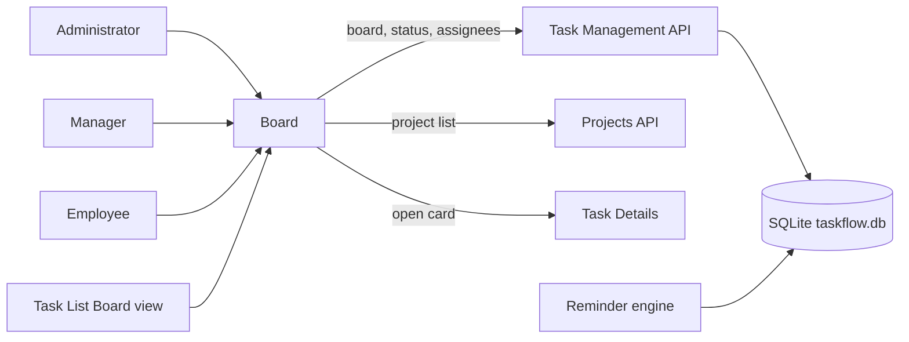
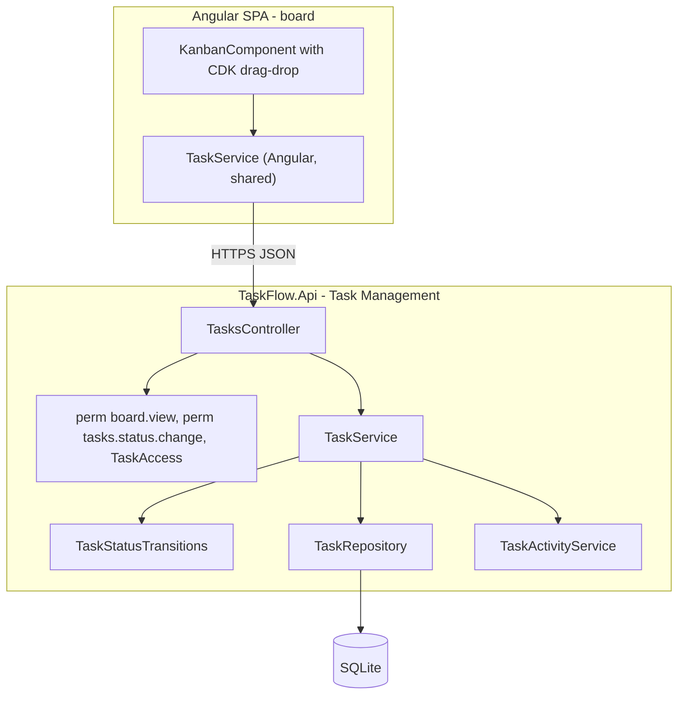
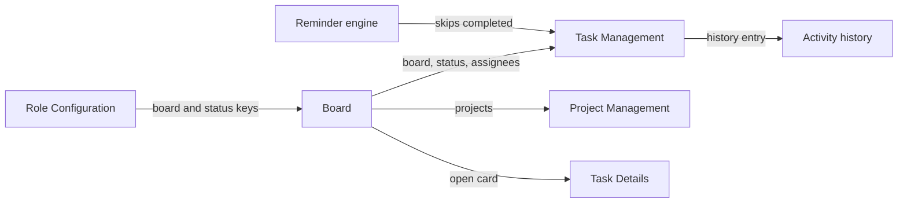
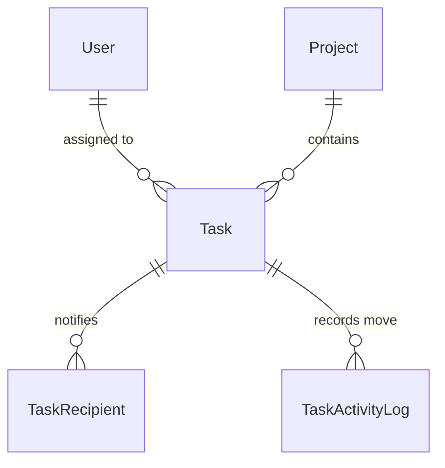
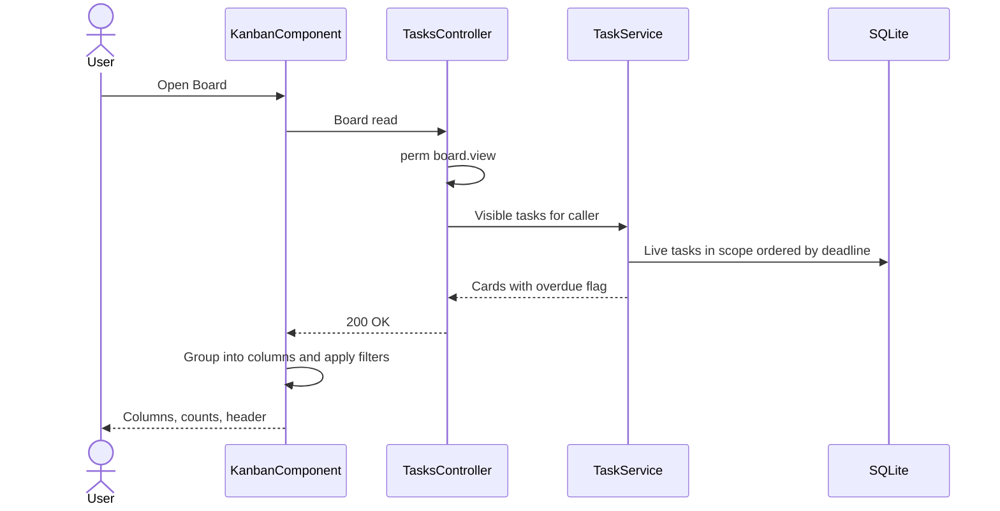
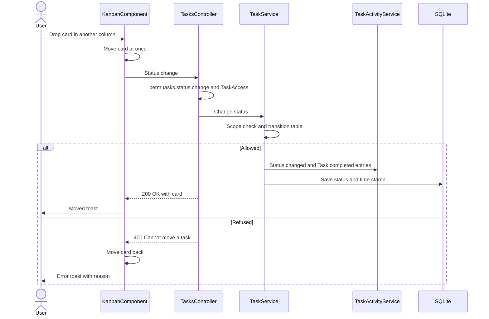
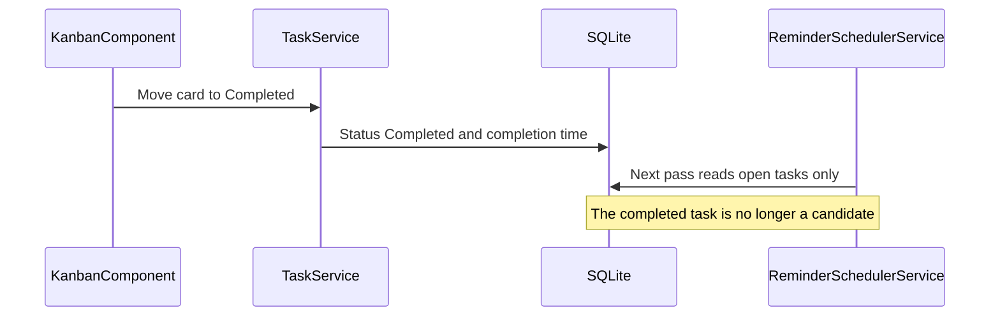

# High-Level Design – Board

## TaskFlow – Intelligent Task Allocation & Tracking System

> **Document:** High-Level Design (sub-module 02.3 Board, code `BOARD`)  ·  **Version:** 1.0  ·  **Status:** Draft
> **Project type:** Personal Project (Skill Development)  ·  **Date:** 31-Oct-2026
> **Author:** Jojo George (jojogeorge3344@gmail.com)
> **Based on:** BRD-Board v1.0, FRD-Board v1.0
> © 2026 Jojo George. All rights reserved.

---

## Document Control

| Version | Date | Author | Summary of changes |
|---|---|---|---|
| 1.0 | 31-Oct-2026 | Jojo George | Initial version, derived from BRD/FRD-Board v1.0, the verified Kanban Board technical doc, TDD v2.0 and the code |

**Related documents:**

| Document | Location |
|---|---|
| Overall HLD (stack, deployment, cross-cutting design, Auth) | `../../00-Overall/HLD-TaskFlow-Overall.md` |
| BRD / FRD – Board | `../../../BRD/02-TaskFlow-Monitoring/02.3-Board/BRD-Board.md`, `../../../FRD/02-TaskFlow-Monitoring/02.3-Board/FRD-Board.md` |
| LLD – Board | `../../../LLD/02-TaskFlow-Monitoring/02.3-Board/LLD-Board.md` |
| Sibling HLDs – Task Management (owner of the endpoints and rules used here), Employee Workload | `../02.1-Task-Management/HLD-Task-Management.md`, `../02.2-Employee-Workload/HLD-Employee-Workload.md` |
| Related HLD – Notification (reminder engine) | `../../04-Communication/04.2-Notification/HLD-Notification.md` |
| TDD | `TDD-TaskFlow.md` (v2.0) §7.5, §10.2, §12 |

---

## 1. Introduction

### 1.1 Purpose
This HLD describes how the Board (Kanban) is built: its place in the system, its frontend component, the Task
Management services it reuses, its flows, security and design decisions. Class- and endpoint-level detail is in the LLD.

### 1.2 Scope
In scope: the Board screen (`/board`) – five status columns, cards, drag-and-drop status change, Project / Assignee /
Status / Deadline filters, Refresh and opening a card. The server components it uses (task scope, transition table,
history) are owned by Task Management and only summarised here.

**Change from original BRD (Screen 10)**

| Original BRD | As built (this design) |
|---|---|
| Four columns: To Do, In Progress, Blocked, Completed | Five columns, **In QA** added; no Cancelled column |
| Card shows status | Column gives the status; card adds the project |
| No filters | Project, Assignee, Status and Deadline filters (client-side) |

### 1.3 Audience
Developer, reviewer and tester of TaskFlow (Jojo George); anyone maintaining the Monitoring module.

### 1.4 Definitions & Abbreviations

| Term | Meaning |
|---|---|
| SPA | Single Page Application (Angular frontend) |
| Card | One task on the board |
| Optimistic move | The card moves on screen at once and moves back if the server refuses |
| Overdue card | Deadline before now and task neither Completed nor Cancelled (instant rule) |
| Task scope | Own, Team or Organization – the same scope as the Task List |
| CDK | `@angular/cdk`, the Angular Component Dev Kit (drag-and-drop) |

---

## 2. System Context

### 2.1 Context Diagram

### 2.2 Actors & External Systems

| Actor / system | Interaction | Protocol |
|---|---|---|
| Administrator, Manager, Employee, Custom role with `board.view` | View, filter and drag cards | HTTPS / JSON (Bearer JWT) |
| Task Management (TASK) | Board read, status change and assignee list endpoints; task scope; transition table; history | HTTPS / JSON |
| Project Management (PROJ) | Project list for the Project filter | HTTPS / JSON |
| Notification – reminder engine (NOTIF) | Stops reminding a task once a move makes it Completed | Shared database |

No external (third-party) system is involved.

---

## 3. Architecture Goals, Constraints & Principles

### 3.1 Quality Goals

| Goal | How the architecture supports it |
|---|---|
| Responsiveness | Optimistic move; filters applied in the SPA without reloading (NFR-BOARD-01, NFR-BOARD-03) |
| Correctness | Server is authoritative: permission, task access and transition table checked on every move; refused moves are rolled back on screen (NFR-BOARD-02, NFR-BOARD-04) |
| Consistency | One transition table with Task Details (NFR-BOARD-05) |
| Maintainability | No backend code of its own; reuses Task Management services |
| Compatibility | Drag-and-drop from the Angular CDK (NFR-BOARD-06) |

### 3.2 Constraints
- Single API process and SQLite file (overall HLD).
- The board read is not paged: every visible task is loaded at once.
- Columns are fixed to the board statuses; cards are ordered by deadline and cannot be re-ordered.

### 3.3 Architecture Principles
- Reuse, do not duplicate: the board calls the Task Management endpoints and rules.
- The SPA never decides whether a move is allowed; it sends the move and follows the server's answer.
- Filtering only narrows data the user may already see.

---

## 4. Architecture Overview

### 4.1 Architecture Style
The Board follows the system-wide style (Angular SPA + REST API, layered backend, SQLite via EF Core) described in the
overall HLD (`../../00-Overall/HLD-TaskFlow-Overall.md`). It is a frontend-heavy slice: one standalone page with
client-side grouping, filtering and drag-and-drop, backed by three Task Management endpoints.

### 4.2 Logical Architecture

### 4.3 Layers & Responsibilities

| Layer | Responsibility (this sub-module) | May call |
|---|---|---|
| Presentation | Load, group into five columns, filter, count, highlight overdue, drag-and-drop with rollback, toasts, open card; `permissionGuard` on `/board` | Tasks API, Projects API |
| API / Controller | `TasksController` board, status and assignee actions (owned by Task Management) | `TaskService` |
| Service | Task scope for the board read; transition check, time stamps and history on a move | `TaskRepository`, `TaskStatusTransitions`, `TaskActivityService` |
| Repository | All visible live tasks with assignee and project, ordered by deadline | Database (EF Core) |
| Integrations | None | – |

---

## 5. Component / Module Design

| Component | Responsibility | Key components (high level) | Depends on |
|---|---|---|---|
| Board page (frontend) | Columns To Do, In Progress, In QA, Blocked, Completed; cards; filters; Refresh; drag-and-drop with optimistic update and rollback; navigation to Task Details with return to the board | `KanbanComponent`, `BoardColumn` model, `BOARD_STATUSES` | Angular `TaskService`, `ProjectService`, `AuthService` permissions, `@angular/cdk` |
| Board read (backend, shared) | Visible live tasks as cards with an overdue flag | `TasksController`, `TaskService`, `TaskRepository` | Task scope (Task Management) |
| Status change (backend, shared) | Permission, task access, transition table, completion / cancel time, history | `TasksController`, `TaskAccessHandler`, `TaskService`, `TaskStatusTransitions`, `TaskActivityService` | Task Management |
| Assignee list (backend, shared) | Distinct assignees of visible tasks for the Assignee filter | `TasksController`, `TaskService` | Task scope |

API surface (high level): three actions under `/api/v1/tasks` (board read, status change, assignees), all owned and
counted by Task Management; the board has no controller of its own. Detail in the LLD.

### 5.1 Module Interaction

| Partner | Direction | What is exchanged |
|---|---|---|
| Task Management | Out | Board read, status change and assignee list; task scope and transition rules |
| Project Management | Out (reads) | Project list for the Project filter |
| Task Details (Task Management) | Out (navigation) | Opens the task with a return URL to the board |
| Activity history (Task Management) | Indirect | "Status changed from X to Y" and "Task completed" written by the status change |
| Reminder engine (Notification) | Indirect | A task moved to Completed is no longer a reminder candidate |
| Role Configuration | In (claims) | `board.view`, `board.filters.use`, `tasks.status.change`, `tasks.view.all` |

---

## 6. Data Architecture (high level)

### 6.1 Data Stores

| Store | Technology | Holds (this sub-module) | Notes |
|---|---|---|---|
| Main database | SQLite `taskflow.db` | Nothing owned; reads and updates `Task` status, appends `TaskActivityLog` through Task Management | Shared file; backup in the overall HLD |
| Browser memory | Angular signals | The loaded cards and filter state for the open page | Reloaded on open and Refresh |

| Data domain | Owned / used |
|---|---|
| `Task` | Used and updated (status, completion / cancel time) via Task Management |
| `TaskActivityLog` | Appended via Task Management |
| `User`, `Project` | Used (card assignee and project names) |
| `TaskRecipient` | Used for the Own scope |

### 6.2 Main Data Domains

### 6.3 Data Flow
1. Open or Refresh: the SPA loads every visible live task as a card (with overdue flag) and, for view-all users, the
   assignee list; it loads the project list for the filter.
2. The SPA groups cards into the five board statuses (Cancelled cards are not shown), ordered by deadline, and applies
   the filters in memory.
3. A drop sends one status change; the server updates the task and appends history; the SPA keeps the new column or
   moves the card back.

---

## 7. Integration Design

| Integration | Direction | Purpose | Failure behaviour |
|---|---|---|---|
| Task Management board read | Outbound HTTPS | Cards in the caller's scope | "Could not load the board. Try again." |
| Task Management status change | Outbound HTTPS | Move a card | Card returns to its column; server reason or "Could not move {code}." |
| Task Management assignees | Outbound HTTPS | Assignee filter (view-all users only) | Filter stays empty |
| Projects API | Outbound HTTPS | Project filter options | Filter stays empty |
| Reminder engine | Indirect (database) | Stop reminders after Completed | Engine re-checks the task is still open before each delivery |

No notifications or mail are sent for a move.

---

## 8. Key Flows (high level)

Sign-in and the MFA gate are shared flows (overall HLD).

### 8.1 Open the board

### 8.2 Move a card (main business flow)

### 8.3 Completed move and the reminder engine (background job)

---

## 9. Security Architecture

| Concern | Approach |
|---|---|
| Authentication | Shared JWT bearer, session validation and mandatory MFA (overall HLD) |
| Authorization – board read | `board.view` policy; content limited to the caller's task scope (`tasks.view.own` always on, `tasks.view.all` for Team / Organization) |
| Authorization – move | `tasks.status.change` policy + `TaskAccess` resource policy + service scope check (Manager team) + transition table |
| Authorization – UI | `permissionGuard` on `/board` (`board.view`); dragging disabled without `tasks.status.change`; filter row needs `board.filters.use`; Assignee filter needs `tasks.view.all`; menu item needs `board.view` |
| Data protection | Card data only (code, title, project, assignee, priority, deadline, status) |
| Auditing | Every accepted move is recorded in the task's activity history; refused authorizations logged by the denied-action audit |
| Known gaps | `board.filters.use` checked in the SPA only (filters are client-side); the Task List "Board view" button is not gated by `board.view` (§14) |

---

## 10. Technology Stack

The sub-module uses the system stack (ASP.NET Core / .NET 10, EF Core 10.0.12 with SQLite, Angular ^19.2.0, RxJS
~7.8.0); versions and reasons are in the overall HLD (`../../00-Overall/HLD-TaskFlow-Overall.md`). Specific to the board:

| Area | Technology | Version | Reason |
|---|---|---|---|
| Drag and drop | `@angular/cdk` (drag-drop) | ^19.2.19 | Accessible, maintained drag-and-drop lists for the columns |
| State | Angular signals (`@angular/core`) | ^19.2.0 | Cards, filters and computed column lists in memory |

---

## 11. Deployment Architecture

The Board has no deployment unit of its own: it is a page of the Angular SPA and calls endpoints of the single
`TaskFlow.Api` process. Hosting, environments and the data folder are described in the overall HLD
(`../../00-Overall/HLD-TaskFlow-Overall.md`).

---

## 12. Non-Functional Design

| Area | Design decision |
|---|---|
| Performance | One load per open or Refresh; grouping and filtering in memory (NFR-BOARD-01); index on `Tasks(Deadline)` for ordering |
| Scalability | Not paged: all visible tasks are loaded (R-BOARD-01) |
| Reliability | Optimistic move rolled back on any refusal or failure, so the board never shows an unaccepted status (NFR-BOARD-04) |
| Availability | As the overall system |
| Maintainability | No backend code of its own; shared transition table (NFR-BOARD-05) |
| Usability | Immediate card movement, toasts, empty-column and filtered-empty texts (NFR-BOARD-03) |
| Observability | Request log per call; history entry per accepted move |
| Backup & Recovery | No own data; covered by the database backup |

---

## 13. Design Decisions

| ID | Decision | Alternatives considered | Rationale |
|---|---|---|---|
| D-BOARD-1 | The board has no backend of its own; it uses the Task Management board read, status change and assignee endpoints | A separate board controller and service | One task scope and one set of status rules; less code |
| D-BOARD-2 | Load all visible tasks unpaged and group / filter them in the SPA | Server-side paging and filtering per column | Instant filtering; simple API; acceptable for current volumes (R-BOARD-01) |
| D-BOARD-3 | Optimistic move with rollback on refusal | Wait for the server before moving the card | Moves feel immediate while the server stays authoritative (NFR-BOARD-03, NFR-BOARD-04) |
| D-BOARD-4 | The SPA does not check transitions; the server's transition table decides | Duplicate the table in the SPA | One source of truth (NFR-BOARD-05); the refusal message comes from the server |
| D-BOARD-5 | Five columns (To Do, In Progress, In QA, Blocked, Completed); Cancelled tasks are not shown | A Cancelled column | Cancelled is final and has no next status; the Task List Status filter finds them (R-BOARD-03) |
| D-BOARD-6 | Overdue card flag computed on the server with the instant rule | Use the Task List day-based stage | Same overdue rule as the Dashboard and Reports; known difference with the list stage on the deadline day |
| D-BOARD-7 | A move sends no notification; it is recorded in the activity history only | Notify recipients on each move | Avoids noise; history keeps the audit trail |
| D-BOARD-8 | `board.filters.use` is enforced in the SPA only | Server-side filter check | Filters run on data already returned to the caller; they reveal nothing extra (R-BOARD-02) |
| D-BOARD-9 | Cards are ordered by deadline and in-column re-ordering is ignored | User-defined card order | No order field to store; deadline order matches the Task List |

---

## 14. Risks, Assumptions & Open Issues

| Type | Description | Mitigation / owner |
|---|---|---|
| Risk | R-BOARD-01: large task volumes slow the board, because it is not paged | Use filters; add paging or server filtering later – Jojo George |
| Risk | R-BOARD-02: `board.filters.use` enforced only on the screen | Filters only narrow visible data – Jojo George |
| Risk | R-BOARD-03: Cancelled tasks are invisible on the board | Task List Status filter – Jojo George |
| Risk | R-BOARD-04: the Task List "Board view" button is shown without `board.view` | Gate the button – Jojo George |
| Assumption | Accessible task volume stays small enough to load at once | Revisit with paging – Jojo George |
| Open issue | The deadline filter compares dates in the browser time zone while overdue uses UTC now and the stage uses the application time zone | Align on the application time zone – Jojo George |
| Open issue | ⚠️ To be confirmed: whether `TasksEndpointsTests.cs` covers the board read; no board-specific or frontend spec test is in the file list | Add board tests – Jojo George |

---

## 15. Traceability (requirements → components)

| BRD/FRD item | Module / component | Section |
|---|---|---|
| FR-BOARD-01, FR-BOARD-02 | Task Management board read (task scope) › `KanbanComponent` grouping into `BOARD_STATUSES` | §5, D-BOARD-1, D-BOARD-5 |
| FR-BOARD-03, FR-BOARD-05, FR-BOARD-06 | `KanbanComponent` cards, deadline order, header count | §5, D-BOARD-9 |
| FR-BOARD-04 | `TaskService` card overdue flag (instant rule) | D-BOARD-6 |
| FR-BOARD-07 | `KanbanComponent` CDK drag-drop, disabled without `tasks.status.change` | §9, §10 |
| FR-BOARD-08 | `TasksController` status change › `TaskAccessHandler` › `TaskService` › `TaskStatusTransitions` | §8.2, D-BOARD-4 |
| FR-BOARD-09, FR-BOARD-10, FR-BOARD-11 | `KanbanComponent` drop handling, optimistic move and rollback, toasts | §8.2, D-BOARD-3 |
| FR-BOARD-12 | `TaskService` status change › `TaskActivityService` | §8.2, D-BOARD-7 |
| FR-BOARD-13, FR-BOARD-16, FR-BOARD-17 | `KanbanComponent` client-side filters and empty states | §6.3, D-BOARD-2 |
| FR-BOARD-14 | `KanbanComponent` Assignee filter › Task Management assignee list (view-all only) | §7, §9 |
| FR-BOARD-15 | `KanbanComponent` filter row gating (`board.filters.use`) | §9, D-BOARD-8 |
| FR-BOARD-18, FR-BOARD-19 | `KanbanComponent` load and Refresh › board read | §8.1 |
| FR-BOARD-20 | `KanbanComponent` navigation to Task Details with return URL | §5.1 |
| FR-BOARD-21, FR-BOARD-22 | `board.view` policy, `permissionGuard` on `/board`, menu item placement | §9 |
| NFR-BOARD-01 … NFR-BOARD-07 | See §12 | §12 |

---
© 2026 Jojo George. All rights reserved. Unauthorized copying or distribution of this document is prohibited.
