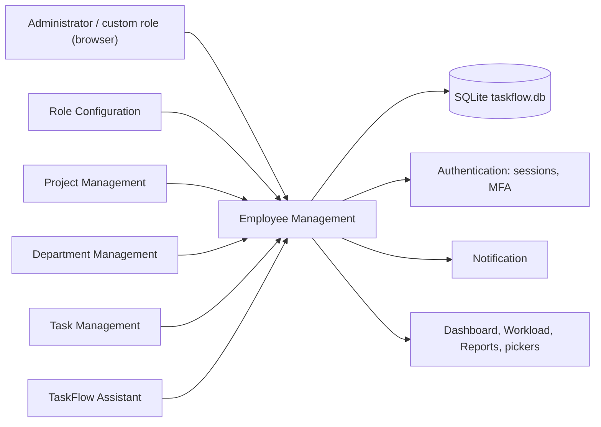
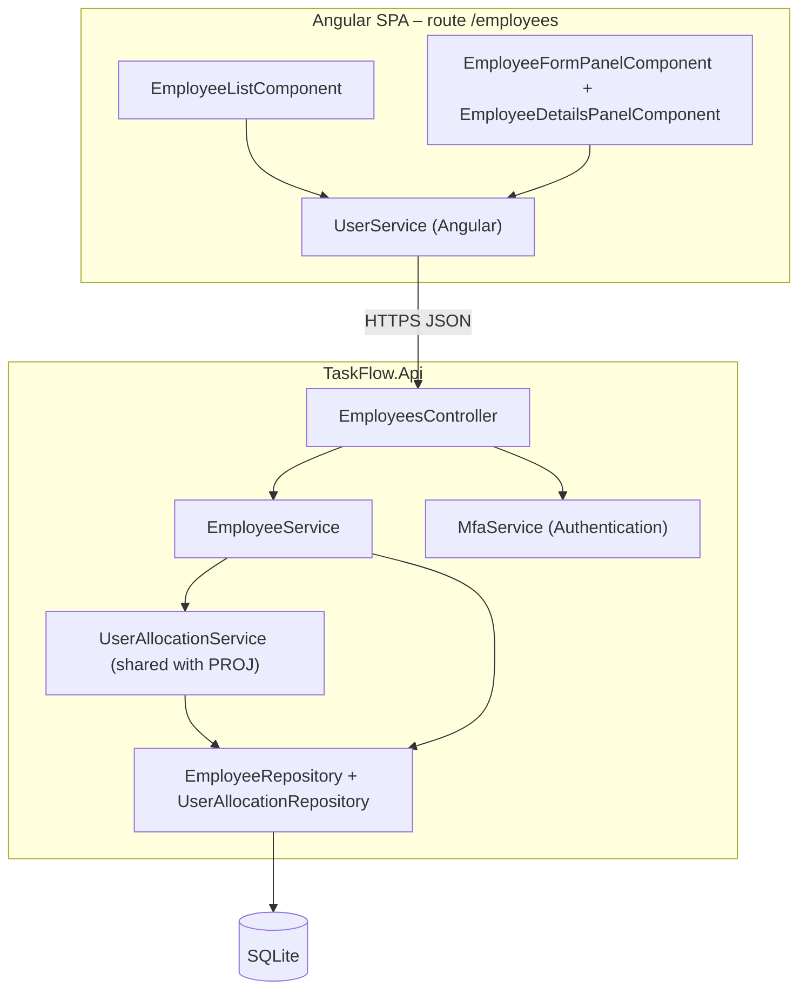
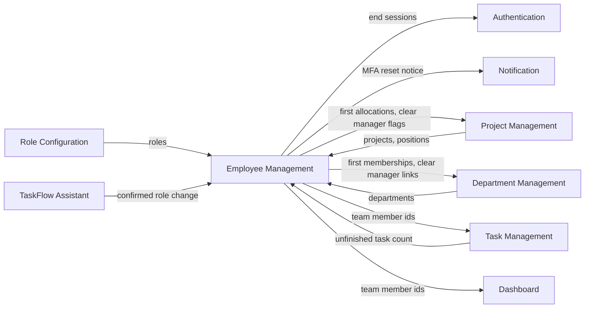
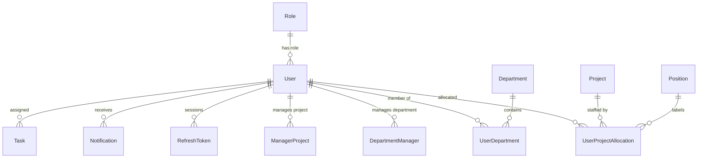
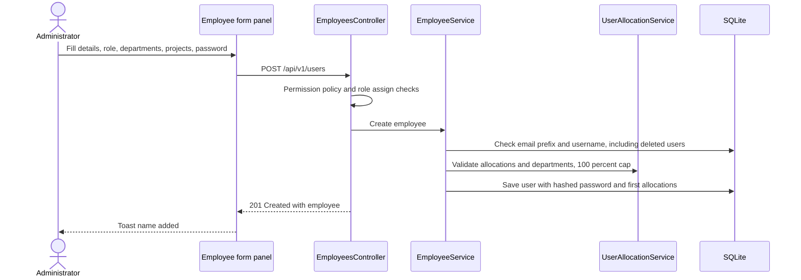
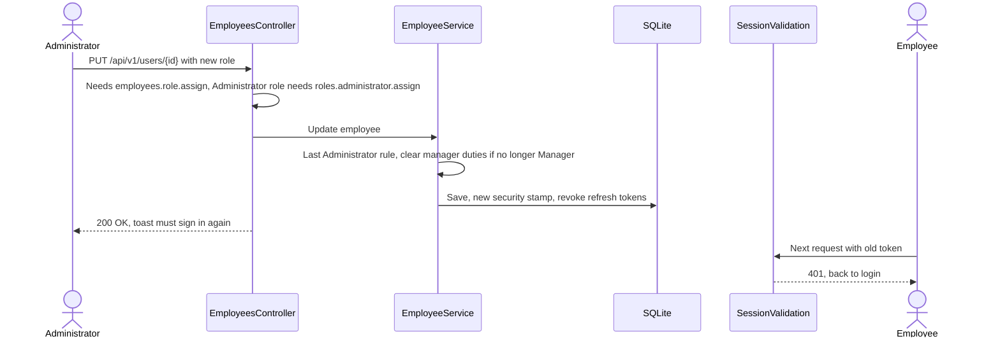
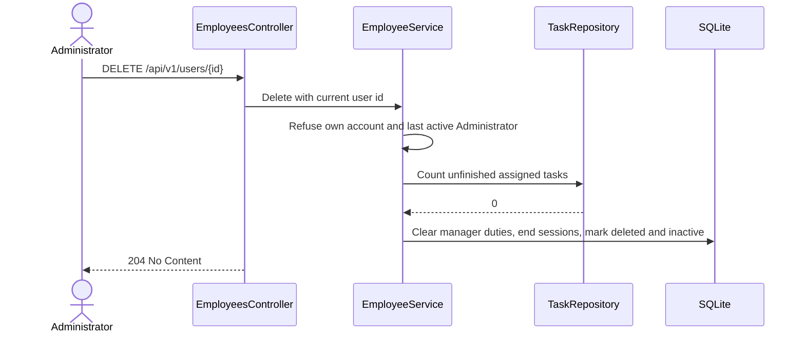
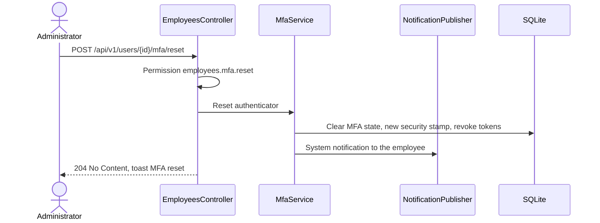

# High-Level Design – Employee Management

## TaskFlow – Intelligent Task Allocation & Tracking System

> **Document:** High-Level Design (sub-module EMP)  ·  **Version:** 1.0  ·  **Status:** Draft
> **Project type:** Personal Project (Skill Development)  ·  **Date:** 31-Oct-2026
> **Author:** Jojo George (jojogeorge3344@gmail.com)
> **Module:** TaskFlow Management  ·  **Sub-module:** 03.1 Employee Management (code `EMP`)
> **Based on:** BRD-Employee-Management v1.0, FRD-Employee-Management v1.0, TaskFlow as built
> © 2026 Jojo George. All rights reserved.

---

## Document Control

| Version | Date | Author | Summary of changes |
|---|---|---|---|
| 1.0 | 31-Oct-2026 | Jojo George | Initial version, derived from the Employee Management BRD/FRD and the code |

**Related documents:**

| Document | Location |
|---|---|
| Overall HLD (stack, deployment, cross-cutting design) | `../../00-Overall/HLD-TaskFlow-Overall.md` |
| BRD – Employee Management | `../../../BRD/03-TaskFlow-Management/03.1-Employee-Management/BRD-Employee-Management.md` |
| FRD – Employee Management | `../../../FRD/03-TaskFlow-Management/03.1-Employee-Management/FRD-Employee-Management.md` |
| LLD – Employee Management | `../../../LLD/03-TaskFlow-Management/03.1-Employee-Management/LLD-Employee-Management.md` |
| Sibling HLDs | `../03.2-Project-Management/HLD-Project-Management.md`, `../03.3-Department-Management/HLD-Department-Management.md` |
| TDD | `TF - Documents/TF - TDD/TDD-TaskFlow.md` (§3 architecture, §6.6 authorization, §7 data model) |

---

## 1. Introduction

### 1.1 Purpose
This HLD describes how Employee Management is built: where it sits in TaskFlow, its frontend and backend components,
how it works with the other sub-modules, the data it owns and uses, its key flows, its security design and the design
decisions behind it. Classes, methods, columns and the full endpoint list are in the LLD.

### 1.2 Scope
**In scope:** the employee list (search and filters), the employee details side panel (derived managers, Manager's
team, MFA reset), the add / edit employee side panel (role, departments, project allocations on create, temporary
password, status), activation / deactivation, soft delete and the effect of these actions on sessions, manager links
and notifications.

**Out of scope:** sign-in, token issue and the MFA set-up flow (overall HLD, Authentication); department membership
after creation (Department Management HLD); project teams after creation and positions (Project Management HLD); role
and permission editing (Role Configuration HLD); the user's own profile (My Profile HLD).

**Change from original BRD (Screen 5):** the design serves the current requirement – Project / Role / Status filters
instead of a Department filter, soft delete blocked only by **unfinished** tasks, last-Administrator and own-account
protection, project allocations, MFA reset and immediate session end (see BRD-Employee-Management §5).

### 1.3 Audience
Developer, reviewer and tester of TaskFlow (Jojo George); anyone maintaining the account and access logic.

### 1.4 Definitions & Abbreviations

| Term | Meaning |
|---|---|
| SPA | Single Page Application (Angular frontend) |
| EMP / PROJ / DEPT | Employee, Project and Department Management sub-modules |
| Live employee | A `User` row that is not soft-deleted |
| Security stamp | A per-user random value carried in the access token; changing it invalidates every session |
| Derived manager | A manager computed from a person's department managers and project-manager flags |
| Allocation | A person's whole percentage (1–100) on one project, with a position |
| Employee action permission | Any of `employees.create`, `employees.edit`, `employees.status.change`, `employees.delete`, `employees.role.assign`, `employees.mfa.reset` |

---

## 2. System Context

### 2.1 Context Diagram

### 2.2 Actors & External Systems

| Actor / system | Interaction | Protocol |
|---|---|---|
| Administrator | Uses the Employee Management screen | HTTPS (JSON REST, Bearer JWT) |
| Custom role user | Uses the screen when holding at least one employee action permission | HTTPS |
| Manager | No screen; reads the people list through other screens (task assignee picker, team pickers) with `employees.view` | HTTPS |
| TaskFlow Assistant | Applies a confirmed role change through `EmployeeService` | In-process call |
| Employee whose access changes | Next request with an old session is rejected; receives the MFA-reset notification | HTTPS / in-app notification |
| External systems | None – no email, no third-party service | – |

---

## 3. Architecture Goals, Constraints & Principles

### 3.1 Quality Goals

| Goal | How the architecture supports it |
|---|---|
| Security – immediate effect | Access changes rotate the user's security stamp and revoke refresh tokens; `SessionValidation` checks the stamp on every request (NFR-EMP-01) |
| Security – server enforcement | Every action has a permission policy; role-sensitive changes have extra server-side checks (NFR-EMP-02) |
| Data integrity | Unique indexes on email and username over all rows (including deleted) back the service checks, so a race ends in 409, not a duplicate (NFR-EMP-06) |
| History preservation | Soft delete keeps the account row, so tasks, comments and mail keep their author (BR-EMP-07) |
| Lock-out protection | The last-Administrator rule sits in the service layer and guards role change, deactivation and deletion (BR-EMP-04) |
| Maintainability | Layer-first structure with module sub-folders; allocation rules live in one shared service used by EMP and PROJ |

### 3.2 Constraints
- Single API process and one SQLite file; no paging of the employee list (all live users are returned).
- Fixed email domain `taskflow.com` (code constant in `EmailPolicy`).
- Only the system roles Administrator (id 1), Manager (id 2) and Employee (id 3) have built-in meaning (`SystemRoles`).
- Shared cross-cutting pipeline (JWT, MFA gate, validation, error mapping) – see the overall HLD.

### 3.3 Architecture Principles
- Controller → Service → Repository; the service commits through `IUnitOfWork`.
- The server decides access; the SPA only hides what the user cannot do.
- One owner per table: EMP owns `User`; it writes allocation and membership rows only when an employee is created and
  when manager duties are cleared.
- Reporting lines are derived data, never stored as a typed value.

---

## 4. Architecture Overview

### 4.1 Architecture Style
Part of the TaskFlow three-tier design: Angular SPA → ASP.NET Core REST API (`/api/v1/users`) → SQLite through EF Core.
The sub-module is a vertical slice: one lazy SPA route with a list page and two side panels, one controller, one
domain service plus the shared allocation service, and repositories.

### 4.2 Logical Architecture

### 4.3 Layers & Responsibilities

| Layer | Responsibility in EMP | May call |
|---|---|---|
| Presentation | Route guard, menu item, list with filters, details and form panels, permission-driven buttons, client checks (100% bar, password strength) | API |
| API / Controller | Permission policies, inline role-assignment checks, current-user id, HTTP status mapping | Services |
| Services | Uniqueness, email policy, role existence, last-Administrator and self-delete rules, unfinished-task check, session end, manager-duty clean-up, allocation validation | Repositories, Authentication (MFA), Notification publisher |
| Repositories | Live-user queries, filtered list, derived managers / team, uniqueness lookups ignoring the soft-delete filter | Database |
| Integrations | None of its own; uses the shared password hasher and the Authentication MFA service | – |

---

## 5. Component / Module Design

| Component | Responsibility | Key parts (high level) | Depends on |
|---|---|---|---|
| Route and menu | Show the screen only to holders of an employee action permission; others go to their dashboard | `/employees` route with `permissionGuard`, `EmployeeScreenPermissions`, menu item in `nav-items.ts` | `AuthService` permission claims |
| Employee list page | Organisation-wide list, server-side search and filters, row actions, confirmations | `EmployeeListComponent` (debounced search, latest-request-wins) | `UserService`, Angular `ProjectService` / `DepartmentService` / Role Configuration `RoleService` for filter and form lists |
| Details panel | Read-only view with derived managers, Manager's projects and team, two-step status, Reset MFA | `EmployeeDetailsPanelComponent` | `UserService` |
| Form panel | Add (all fields, departments, allocation rows, temporary password, status) and Edit (identity and role only) | `EmployeeFormPanelComponent`, `PositionComboboxComponent` (owned by PROJ) | `UserService`, positions API |
| Employee API | Eight actions on `/api/v1/users`: list, role options, one user, create, update, status, delete, MFA reset | `EmployeesController` with `[RequirePermission]` and inline checks for `employees.role.assign` / `roles.administrator.assign` | `EmployeeService`, `IMfaService` |
| Request validation | Required fields, lengths, password length, email format | FluentValidation validators run by `ValidationFilter` | `EmailPolicy` |
| Employee domain service | All account rules and side effects (uniqueness, last Administrator, self delete, unfinished tasks, session end, manager-duty clean-up) | `EmployeeService` | `EmployeeRepository`, `RoleRepository`, `RefreshTokenRepository`, `TaskRepository`, `UserAllocationService`, password hasher, `IUnitOfWork` |
| Allocation service (shared) | Validate and stage allocations and department memberships given on create; 100% cap | `UserAllocationService`, `UserAllocationRepository` | Project, position and department repositories |
| Employee repository | Filtered list, DTO projection with derived managers and team (batched joins), uniqueness lookups, team member ids for other modules | `EmployeeRepository` | `AppDbContext` |
| MFA reset (Authentication) | Clear the authenticator, end sessions, publish a System notification | `MfaService` | `NotificationPublisher`, `RefreshTokenRepository` |

### 5.1 Module Interaction

| Interaction | Direction | What flows |
|---|---|---|
| Authentication | EMP → AUTH | Security-stamp rotation and refresh-token revocation; MFA reset is executed by the Authentication `MfaService` |
| Notification | EMP → NOTIF | One System notification after an MFA reset; no other EMP action notifies |
| Role Configuration | ROLE → EMP | Assignable roles for the form and filter (`/api/v1/users/roles`; Administrator listed only with `roles.administrator.assign`) |
| Project / Department Management | both ways | Lists for filters and the form; on create EMP writes the first allocation and membership rows; on demotion or deletion EMP clears project-manager flags, manager-project links and department-manager links |
| Task Management | both ways | EMP asks for the unfinished-task count before delete; Task Management and the manager dashboard read a manager's team from `EmployeeRepository` |
| TaskFlow Assistant | TFA → EMP | After the administrator confirms, `AssistantActionService` applies a role change through `EmployeeService` |

---

## 6. Data Architecture (high level)

### 6.1 Data Stores

| Store | Technology | Holds (for EMP) | Notes |
|---|---|---|---|
| Main database | SQLite `taskflow.db` (EF Core) | `User` (owned); allocation, membership and manager-link rows (shared); refresh tokens; notifications | Single file in the TaskFlow data folder; backup per the overall HLD |
| File storage | – | Nothing | EMP stores no files |

### 6.2 Main Data Domains

| Entity | Owner | EMP use |
|---|---|---|
| `User` | EMP | Create, update, status, soft delete; MFA state is managed by Authentication |
| `Role` | Role Configuration | Read (role of a user, role options) |
| `UserProjectAllocation`, `ManagerProject`, `Position`, `Project` | PROJ | Rows written on create; project-manager flag and links cleared on demotion / delete; read for the list and details |
| `UserDepartment`, `DepartmentManager`, `Department` | DEPT | Memberships written on create; manager links cleared on demotion / delete; read to derive managers |
| `RefreshToken` | Authentication | Revoked when sessions end |
| `Task` | Task Management | Unfinished assigned tasks counted before delete |
| `Notification` | Notification | One System notification on MFA reset |

### 6.3 Data Flow
1. **Create:** form → validated request → `EmployeeService` checks uniqueness (including deleted users), role and
   allocation / department rules → one save writes the `User` (hashed password, new security stamp) and its first
   allocation and membership rows.
2. **Read:** the list query filters live users and projects them with allocations, departments, MFA state and the
   derived managers and team, which are loaded in separate batched queries.
3. **Access change** (username or role change, deactivation, delete, MFA reset): the same save rotates the security
   stamp and revokes refresh tokens; the person's next request fails in `SessionValidation`.
4. **Delete:** soft delete; manager duties are removed, other link rows stay but are hidden by query filters, and the
   person's tasks, comments and mail keep pointing at the row.

---

## 7. Integration Design

| Integration | Direction | Purpose | Failure behaviour |
|---|---|---|---|
| Authentication (sessions) | Internal, outbound | End sessions after access changes | Part of the same database save; if the save fails nothing changes and the SPA shows "Could not update the employee." |
| Authentication (MFA) | Internal, outbound | Reset the authenticator | 404 when the user is not live; the SPA shows "Could not reset MFA." |
| Notification publisher | Internal, outbound | MFA-reset notice | Published after the reset is saved |
| Role Configuration | Internal, inbound | Role options | The SPA falls back to the three standard roles and shows "Custom roles could not be loaded. Only the standard roles are listed." |
| Project / Department lists | Internal, inbound | Filter and form options | Errors are swallowed; lists stay empty (see §14) |
| External systems | – | None | – |

---

## 8. Key Flows (high level)

Sign-in and the request pipeline are shown in the overall HLD. EMP has no background job (_not applicable for this
sub-module_).

### 8.1 Add an employee

### 8.2 Role change ends sessions

### 8.3 Delete an employee

### 8.4 Reset MFA (integration with Authentication and Notification)

---

## 9. Security Architecture

| Concern | Approach |
|---|---|
| Authentication | Shared JWT + refresh cookie and mandatory MFA (overall HLD). EMP endpoints sit behind the MFA set-up gate |
| Authorization | One permission policy per action (`employees.view`, `employees.create`, `employees.edit`, `employees.status.change`, `employees.delete`, `employees.mfa.reset`). Inline checks: a non-Employee role needs `employees.role.assign`; giving or removing the Administrator role needs `roles.administrator.assign` (not assignable to custom roles). Reading another person's single record needs `employees.edit`. Legacy `employees.manage` expands to the finer keys |
| Business guards | Last active Administrator, self delete, unfinished tasks – all in `EmployeeService`, so every caller (UI, API, Assistant) is covered |
| Session control | Security-stamp rotation plus refresh-token revocation on username or role change, deactivation, delete and MFA reset; `SessionValidation` also refreshes role and permission claims on every request |
| Data protection | Temporary password stored only as a hash (`IPasswordHasher<User>`); passwords are ignored on update; MFA secrets are protected by Authentication |
| Data scope | None – the list is organisation-wide for any holder of `employees.view` |
| Transport | HTTPS and the `SpaClient` CORS policy (overall HLD) |
| Auditing | Refused requests are audited by the shared denied-action handler; request logging records each call; there is no change history for employee edits (§14) |

---

## 10. Technology Stack

EMP uses the shared TaskFlow stack without additions – ASP.NET Core on .NET 10 (`net10.0`) with EF Core SQLite 10.0.12
and FluentValidation 12.2.0 on the server, and Angular 19.2 standalone components with signals and RxJS 7.8 in the
browser. Versions and reasons are in the overall HLD (`../../00-Overall/HLD-TaskFlow-Overall.md`, §10).

---

## 11. Deployment Architecture

EMP has no deployment unit of its own: it ships inside the single `TaskFlow.Api` process and the Angular bundle, and its
data lives in `taskflow.db` in the TaskFlow data folder. See the overall HLD (`../../00-Overall/HLD-TaskFlow-Overall.md`,
§11) for hosts, environments and ports.

---

## 12. Non-Functional Design

| Area | Design decision |
|---|---|
| Performance | List filtering happens on the server; derived managers and team are loaded with batched join queries (correlated subqueries do not translate on SQLite); the SPA debounces search and cancels outdated requests |
| Scalability | No paging; suitable for one organisation's staff list on a single server |
| Reliability | Every action is one unit-of-work save; unique indexes turn a uniqueness race into 409 "That value is already in use." |
| Availability | Same as the API process (overall HLD) |
| Security | Immediate session end (NFR-EMP-01) and server-side checks (NFR-EMP-02); hashed passwords (NFR-EMP-03) |
| Usability | Confirmation dialogs for deactivate, delete and MFA reset (NFR-EMP-04); every refusal returns a plain-language `detail` shown in a toast (NFR-EMP-05) |
| Maintainability | Layer and folder structure enforced by architecture tests; allocation rules in one shared service |
| Observability | Shared request logging; no dedicated audit trail |
| Backup & Recovery | Covered by the data-folder backup in the overall HLD |

---

## 13. Design Decisions

| ID | Decision | Alternatives considered | Rationale |
|---|---|---|---|
| D-EMP-1 | Soft delete for users; email (by local part) and username stay reserved for ever | Hard delete; anonymise and free the identifiers | Tasks, comments and mail keep a valid author and reports stay correct (BR-EMP-07); reserved identifiers avoid mixing a new person with an old history (BR-EMP-03) |
| D-EMP-2 | End sessions by rotating the security stamp and revoking refresh tokens, checked on every request | Wait for the access token to expire; a token deny-list | Takes effect on the next request without extra storage (NFR-EMP-01) |
| D-EMP-3 | Derive managers and a Manager's team from department managers and project-manager flags | A typed "reports to" field on the user | One source of truth that cannot drift from the organisation structure (BR-EMP-12) |
| D-EMP-4 | Departments and allocations can be set only on create; afterwards DEPT and PROJ own them | Editable in the employee form | One writer per relationship after creation and a simpler edit form (BR-EMP-11) |
| D-EMP-5 | Allocation rules live in the shared `UserAllocationService` (used by EMP and PROJ) | Separate checks per screen | The 100% cap and per-row rules cannot diverge between the two entry points (BR-EMP-10) |
| D-EMP-6 | Last-Administrator, self-delete and unfinished-task guards in the service layer | Checks only in the UI or the controller | Covers the Assistant path and direct API calls as well as the screen (BR-EMP-04 – BR-EMP-06) |
| D-EMP-7 | Role-assignment rights checked inline in the controller on top of the action policy | Separate "change role" endpoint | Keeps one update call while still requiring `employees.role.assign` and `roles.administrator.assign` (BR-EMP-09) |
| D-EMP-8 | Server-side search and filters, no paging, debounced in the SPA | Client-side filtering; server paging | The filter query also serves other screens; list sizes are small for one organisation |
| D-EMP-9 | MFA reset is delegated to the Authentication `MfaService`, which also publishes the notice | Reset logic inside `EmployeeService` | Authentication owns MFA state and protection of secrets |

---

## 14. Risks, Assumptions & Open Issues

| Type | Description | Mitigation / owner |
|---|---|---|
| Risk | ⚠️ To be confirmed: the Assistant role-change tool needs only `roles.manage`; neither it nor `AssistantActionService` checks `employees.role.assign` or `roles.administrator.assign` (R-EMP-05) | Decide whether the Assistant path must apply the controller's inline checks – Jojo George |
| Risk | The details panel always shows **Edit**; the server refuses the save without `employees.edit` (R-EMP-06) | ⚠️ To be confirmed whether the button should be hidden – Jojo George |
| Risk | A custom role without `projects.view` / `departments.view` gets empty filter and form lists, because load errors are swallowed (R-EMP-04) | Grant the view keys together with employee keys |
| Risk | No audit trail of employee changes (who changed a role or deactivated someone) | Request logging only; ⚠️ To be confirmed whether an audit log is needed |
| Open issue | Reading another person's single record needs `employees.edit`, while the list returns the same data with `employees.view` | Jojo George |
| Open issue | ⚠️ To be confirmed: the role-permission matrix lists `roles.administrator.assign` as configurable, the permission catalogue marks it not assignable; this design follows the catalogue | Jojo George |
| Assumption | One organisation, one email domain; list sizes allow an unpaged list | – |

---

## 15. Traceability (requirements → components)

| FRD items | Module / component | Section |
|---|---|---|
| FR-EMP-01 – FR-EMP-11 (list, columns, count, search, filters, empty states) | `EmployeeListComponent` › `UserService` › `EmployeesController` › `EmployeeService` › `EmployeeRepository` (filtered list); Role Configuration role options | §5, §6.3 |
| FR-EMP-12, FR-EMP-13, FR-EMP-15 (menu, route, buttons, no Delete on own row) | Route `permissionGuard` with `EmployeeScreenPermissions`, menu item, permission-driven buttons in `EmployeeListComponent` | §5, §9 |
| FR-EMP-14 (server-side refusal) | `[RequirePermission]` policies and inline checks in `EmployeesController` | §9 |
| FR-EMP-16 – FR-EMP-19 (activate / deactivate) | `EmployeeListComponent` › `EmployeesController` › `EmployeeService` (last-Administrator rule, session end) | §8.2, §9 |
| FR-EMP-20 – FR-EMP-27 (delete) | `EmployeesController` › `EmployeeService` (guards, soft delete, session end, manager-duty clean-up) › `TaskRepository` | §8.3, D-EMP-1 |
| FR-EMP-28 – FR-EMP-33 (details, derived managers, team) | `EmployeeDetailsPanelComponent` › `EmployeeRepository` (batched derivation) | §6.3, D-EMP-3 |
| FR-EMP-34 – FR-EMP-38 (MFA reset) | `EmployeeDetailsPanelComponent` › `EmployeesController` › `MfaService` › `NotificationPublisher` | §8.4, D-EMP-9 |
| FR-EMP-39 – FR-EMP-45 (create, email policy, uniqueness, password, status) | `EmployeeFormPanelComponent` › validators › `EmployeeService` (`EmailPolicy`, uniqueness incl. deleted, password hasher); unique indexes | §8.1, §12 |
| FR-EMP-46, FR-EMP-47 (role assignment rights) | Inline checks in `EmployeesController`; role select locked in `EmployeeFormPanelComponent` | §9, D-EMP-7 |
| FR-EMP-48 – FR-EMP-52 (departments and allocations on create) | `EmployeeFormPanelComponent` (100% bar, `PositionComboboxComponent`) › `UserAllocationService` | §5, D-EMP-5 |
| FR-EMP-53 – FR-EMP-55 (edit scope, password ignored, sign-out notice) | `EmployeeFormPanelComponent` (view-only allocations) › `EmployeeService` | D-EMP-4 |
| FR-EMP-56 – FR-EMP-59 (session end, self sign-out, last Administrator, manager duties) | `EmployeeService` › `SessionValidation`; SPA signs out the current user after a self change | §8.2, D-EMP-2, D-EMP-6 |
| FR-EMP-60 (save confirmation) | `EmployeeFormPanelComponent` / `EmployeeListComponent` toasts | §5 |

**Coverage:** FR-EMP-01 – FR-EMP-60 (60 of 60) map to at least one component.

---
© 2026 Jojo George. All rights reserved. Unauthorized copying or distribution of this document is prohibited.
