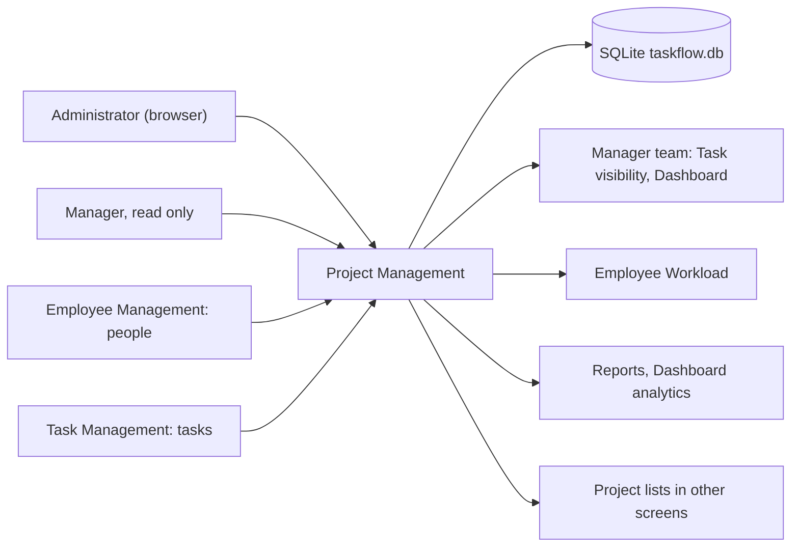
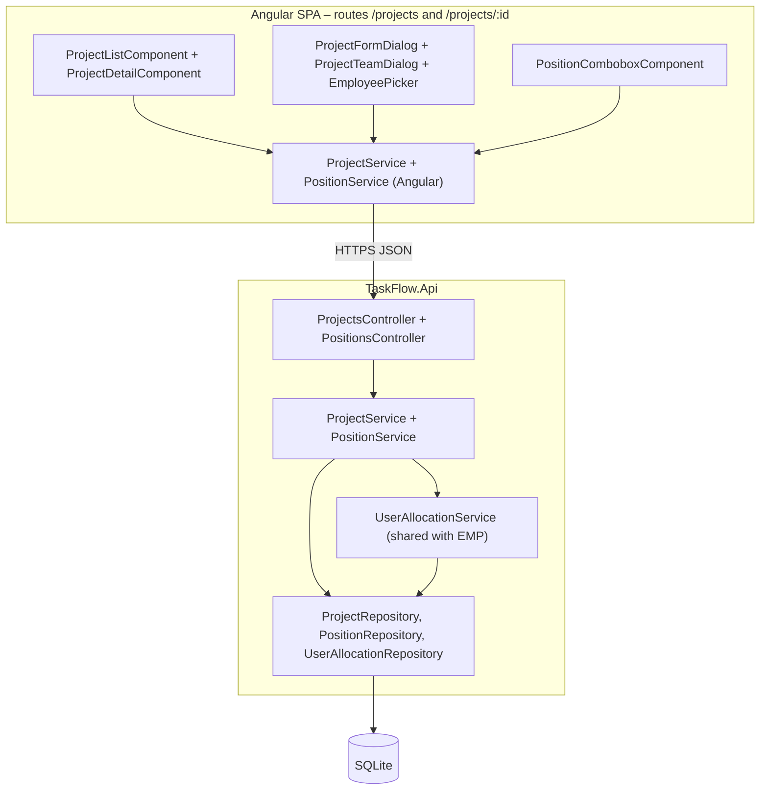
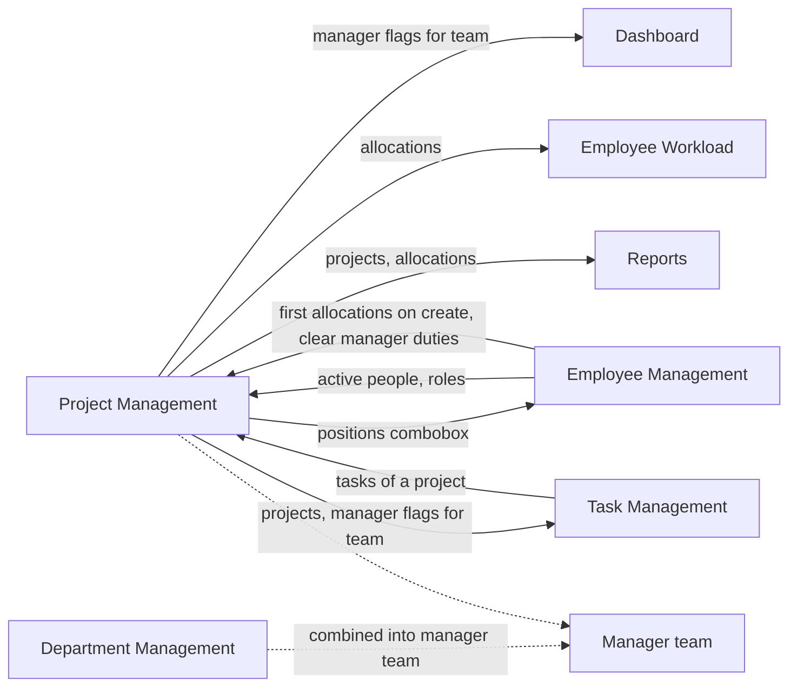
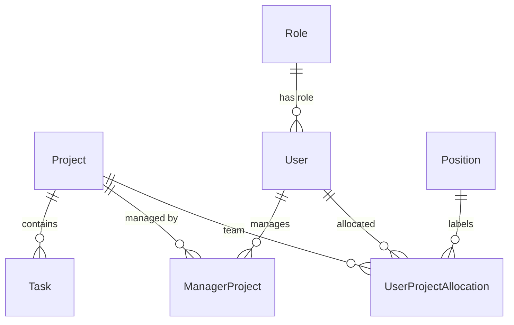
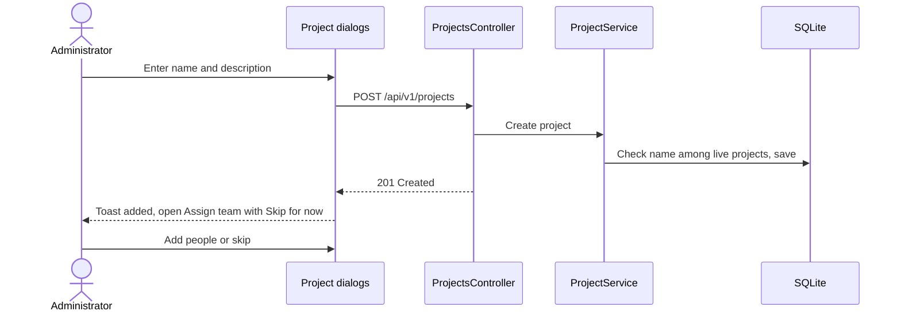
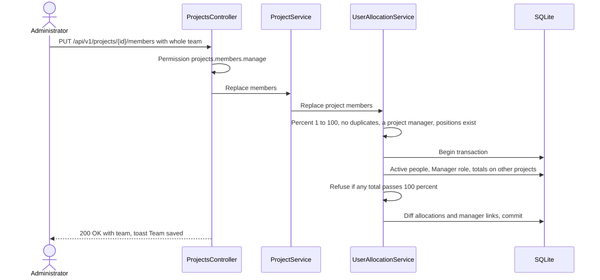
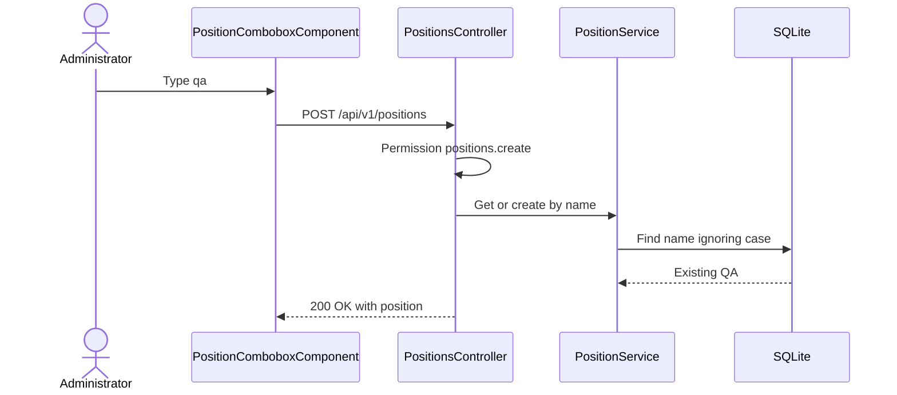
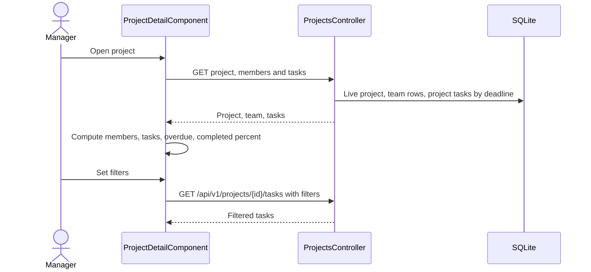
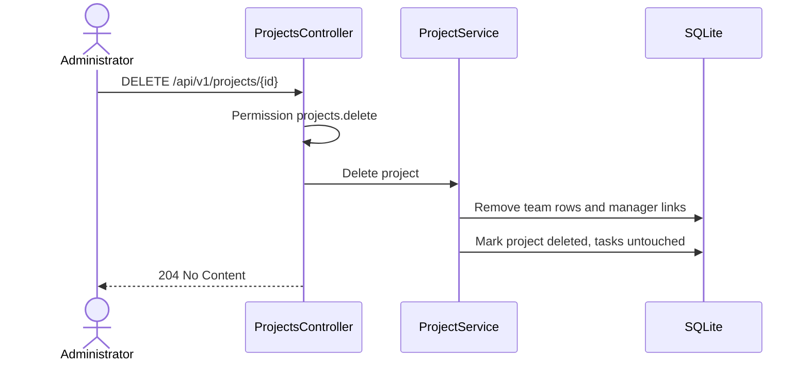

# High-Level Design – Project Management

## TaskFlow – Intelligent Task Allocation & Tracking System

> **Document:** High-Level Design (sub-module PROJ)  ·  **Version:** 1.0  ·  **Status:** Draft
> **Project type:** Personal Project (Skill Development)  ·  **Date:** 31-Oct-2026
> **Author:** Jojo George (jojogeorge3344@gmail.com)
> **Module:** TaskFlow Management  ·  **Sub-module:** 03.2 Project Management, including Positions (code `PROJ`)
> **Based on:** BRD-Project-Management v1.0, FRD-Project-Management v1.0, TaskFlow as built
> © 2026 Jojo George. All rights reserved.

---

## Document Control

| Version | Date | Author | Summary of changes |
|---|---|---|---|
| 1.0 | 31-Oct-2026 | Jojo George | Initial version, derived from the Project Management BRD/FRD and the code |

**Related documents:**

| Document | Location |
|---|---|
| Overall HLD (stack, deployment, cross-cutting design) | `../../00-Overall/HLD-TaskFlow-Overall.md` |
| BRD – Project Management | `../../../BRD/03-TaskFlow-Management/03.2-Project-Management/BRD-Project-Management.md` |
| FRD – Project Management | `../../../FRD/03-TaskFlow-Management/03.2-Project-Management/FRD-Project-Management.md` |
| LLD – Project Management | `../../../LLD/03-TaskFlow-Management/03.2-Project-Management/LLD-Project-Management.md` |
| Sibling HLDs | `../03.1-Employee-Management/HLD-Employee-Management.md`, `../03.3-Department-Management/HLD-Department-Management.md` |
| TDD | `TF - Documents/TF - TDD/TDD-TaskFlow.md` (§3 architecture, §7.2.2 organisation data) |

---

## 1. Introduction

### 1.1 Purpose
This HLD describes how Project Management is built: its place in TaskFlow, its frontend and backend components, how
project teams, allocations, project managers and positions work with the other sub-modules, the data it owns, its key
flows, security and design decisions. Classes, methods, columns and the full endpoint list are in the LLD.

### 1.2 Scope
**In scope:** the project list, add / edit project, delete project, the project team dialog (people, position,
percentage, project-manager flag, 100% cap), positions (pick or create), and Project Details (summary figures, team,
filtered task list).

**Out of scope:** creating and editing tasks (Task Management HLD); people and their accounts (Employee Management
HLD); workload and reports that read allocations (their own HLDs).

**Change from original BRD:** the original BRD has no Project Management screen; projects, teams, allocations,
project managers and positions were added during development and are the current requirement
(BRD-Project-Management §1.2).

### 1.3 Audience
Developer, reviewer and tester of TaskFlow (Jojo George); anyone maintaining staffing and allocation logic.

### 1.4 Definitions & Abbreviations

| Term | Meaning |
|---|---|
| SPA | Single Page Application (Angular frontend) |
| Team | The allocation rows of one project |
| Allocation | A person's whole percentage (1–100) on one project, with a position and a project-manager flag |
| 100% cap | A person's allocations across all projects never total more than 100 |
| Project manager | A team member with the Manager system role, flagged as manager of the project |
| Manager link | A row stating that a Manager manages a project, kept in step with the project-manager flag |
| Position | A shared label (for example Developer) for a person's job on a project; grants no access |

---

## 2. System Context

### 2.1 Context Diagram

### 2.2 Actors & External Systems

| Actor / system | Interaction | Protocol |
|---|---|---|
| Administrator | Manages projects, teams and positions | HTTPS (JSON REST, Bearer JWT) |
| Manager | Views the list, Project Details, teams and positions read only; may be flagged as project manager | HTTPS |
| Custom role user | As granted; needs `projects.view` for any screen | HTTPS |
| Other sub-modules | Read projects, allocations and manager links (task forms, workload, reports, dashboards) | In-process (shared database) |
| External systems | None – no email, no notifications, no third-party service | – |

---

## 3. Architecture Goals, Constraints & Principles

### 3.1 Quality Goals

| Goal | How the architecture supports it |
|---|---|
| Data integrity – cap | The team save checks every member's totals on other projects inside one database transaction, so two concurrent saves cannot both pass the 100% cap (NFR-PROJ-01) |
| Data integrity – atomic team | The whole team is replaced in one call; any rule failure changes nothing (NFR-PROJ-02) |
| Data integrity – storage | Composite key (one row per person per project), check constraint 1–100 on the percentage, unique filtered index on live project names, unique NOCASE index on position names |
| Security | One permission policy per endpoint (NFR-PROJ-03) |
| History preservation | Projects are soft-deleted; tasks are never touched by a project delete |
| Consistency | Allocation rules live in the shared `UserAllocationService`, also used by Employee Management on create |

### 3.2 Constraints
- Single API process and one SQLite file; project and position lists are not paged.
- Only the Manager system role (`SystemRoles` id 2) can be a project manager.
- Positions can only be listed or got-or-created; no rename or delete.
- Shared cross-cutting pipeline (JWT, MFA gate, validation, error mapping) – see the overall HLD.

### 3.3 Architecture Principles
- Controller → Service → Repository; the service commits through `IUnitOfWork`.
- PROJ owns `Project`, `Position`, `UserProjectAllocation` and `ManagerProject`; Employee Management writes allocation
  rows only on employee create and clears manager duties on demotion or delete.
- Whole-team replacement instead of row-by-row edits, so every rule can be checked against the final state.
- The server decides access; the SPA only hides what the user cannot do.

---

## 4. Architecture Overview

### 4.1 Architecture Style
Part of the TaskFlow three-tier design: Angular SPA → ASP.NET Core REST API (`/api/v1/projects`, `/api/v1/positions`)
→ SQLite through EF Core. The sub-module is a vertical slice with two lazy SPA routes (list and details), two dialogs,
two controllers, two domain services plus the shared allocation service, and repositories.

### 4.2 Logical Architecture

### 4.3 Layers & Responsibilities

| Layer | Responsibility in PROJ | May call |
|---|---|---|
| Presentation | Routes and menu gated by `projects.view`, card list with client-side search, dialogs, remaining-percentage hints, summary figures, task filters | API |
| API / Controllers | Permission policies, 404 when a project is not live, HTTP status mapping | Services |
| Services | Name uniqueness, team rules (percent, duplicates, project manager, Manager role, active people, 100% cap) in one transaction, manager-link sync, position get-or-create, delete clean-up | Repositories |
| Repositories | Projects with counts and managers, team rows, totals on other projects, filtered project tasks, positions by name | Database |
| Integrations | None | – |

---

## 5. Component / Module Design

| Component | Responsibility | Key parts (high level) | Depends on |
|---|---|---|---|
| Routes and menu | Open `/projects` and `/projects/:id` only with `projects.view`; others go to their dashboard | `management.routes.ts` with `permissionGuard`, menu item in `nav-items.ts` | `AuthService` permission claims |
| Project list page | Cards with team size and manager names, search over name and description, Team / Edit / Delete, **View employees** link | `ProjectListComponent` | Angular `ProjectService` |
| Project form dialog | Add or edit name and description; after create, opens the team dialog as **Assign team** | `ProjectFormDialogComponent` | Angular `ProjectService` |
| Project team dialog | Rows of person, position, percentage, project-manager flag; remaining-percentage hints; one save for the team | `ProjectTeamDialogComponent`, `EmployeePickerComponent`, `PositionComboboxComponent` | Angular `ProjectService`, positions API, EMP `UserService` (people list) |
| Project details page | Summary figures, team, task list with combined filters | `ProjectDetailComponent` | Angular `ProjectService` |
| Project API | Nine actions on `/api/v1/projects`: list, one project, employees, members, tasks, replace members, create, update, delete | `ProjectsController` with `[RequirePermission]` | `ProjectService` |
| Position API | Two actions on `/api/v1/positions`: list and get-or-create | `PositionsController` | `PositionService` |
| Request validation | Name required (≤ 200), description ≤ 500 | FluentValidation validators run by `ValidationFilter` | – |
| Project domain service | Create / update with unique names, read team and tasks, delete with team clean-up, delegate team replacement | `ProjectService` | `ProjectRepository`, `UserAllocationService`, `IUnitOfWork` |
| Allocation service (shared) | All team rules and the 100% cap inside a transaction; diff of allocation rows and manager links | `UserAllocationService`, `UserAllocationRepository` | `EmployeeRepository` (active people), `PositionRepository` |
| Position service | Normalise the name, reuse a match ignoring case, otherwise create | `PositionService`, `PositionRepository` | `IUnitOfWork` |

### 5.1 Module Interaction

| Interaction | Direction | What flows |
|---|---|---|
| Employee Management | both ways | PROJ reads active people and their role for the picker and the Manager-role rule; EMP writes the first allocations when an employee is created and clears project-manager flags and manager links when a Manager is demoted or deleted; EMP's form uses PROJ's position combobox |
| Department Management | combined | A Manager's team = members of departments they manage + members of projects they are flagged on (computed by `EmployeeRepository`) |
| Task Management | both ways | Every task belongs to a project; Project Details reads a project's tasks; task visibility uses the manager team |
| Dashboard / Workload / Reports | PROJ → readers | Projects, allocations and manager flags are read for analytics, workload and report filters |
| TaskFlow Assistant | – | No tools for projects or positions |

---

## 6. Data Architecture (high level)

### 6.1 Data Stores

| Store | Technology | Holds (for PROJ) | Notes |
|---|---|---|---|
| Main database | SQLite `taskflow.db` (EF Core) | `Project`, `Position`, `UserProjectAllocation`, `ManagerProject` (owned); `User`, `Task` (read) | Single file in the TaskFlow data folder; six positions are seeded |
| File storage | – | Nothing | PROJ stores no files |

### 6.2 Main Data Domains

| Entity | Owner | PROJ use |
|---|---|---|
| `Project` | PROJ | Create, update, soft delete; unique live name |
| `Position` | PROJ | List, get-or-create; seeded Member, Manager, QA, Developer, DevOps, System Admin |
| `UserProjectAllocation` | PROJ | Team rows with percentage, position and project-manager flag; replaced as a whole |
| `ManagerProject` | PROJ | Kept in step with the project-manager flags |
| `User`, `Role` | EMP, Role Configuration | Read: active check, Manager role, names |
| `Task` | Task Management | Read for Project Details; never changed by PROJ |

### 6.3 Data Flow
1. **Create project:** dialog → validated request → unique-name check among live projects → save → the SPA opens the
   team dialog.
2. **Replace team:** dialog sends the complete team → simple row rules → transaction: active people, Manager role for
   flagged rows, totals on other projects vs. the 100% cap → diff of allocation rows and manager links → commit.
3. **Read:** list query adds team size and project-manager names; Project Details loads the project, its team and all
   its tasks; the SPA computes the summary figures from the unfiltered task list and re-queries the server when task
   filters change.
4. **Delete project:** remove all allocation rows and manager links of the project, mark the project deleted; tasks keep
   their project reference.

---

## 7. Integration Design

| Integration | Direction | Purpose | Failure behaviour |
|---|---|---|---|
| Employee people list | Internal, inbound | People for the team picker | Needs `employees.view`; without it the picker stays empty |
| Position get-or-create | Internal (SPA → own API) | Typed positions in the team dialog and the employee form | "The position could not be created." in the SPA |
| Task data | Internal, inbound | Project Details task list | "Could not load the project tasks." / "Could not load the tasks." |
| External systems | – | None (no email, no notification) | – |

---

## 8. Key Flows (high level)

Sign-in and the request pipeline are shown in the overall HLD. PROJ has no background job (_not applicable for this
sub-module_).

### 8.1 Add a project and assign its team

### 8.2 Replace a project team (main business flow)

### 8.3 Pick or create a position

### 8.4 View Project Details

### 8.5 Delete a project

---

## 9. Security Architecture

| Concern | Approach |
|---|---|
| Authentication | Shared JWT + refresh cookie and mandatory MFA (overall HLD); endpoints sit behind the MFA set-up gate |
| Authorization | One permission policy per endpoint: `projects.view` (all reads, incl. positions), `projects.create`, `projects.edit`, `projects.delete`, `projects.members.manage`, `positions.create`; no inline checks. Legacy `projects.manage` expands to the finer keys |
| Business guards | Only active people on a team; only Manager-role people as project managers – enforced in `UserAllocationService`, not in the UI |
| Data scope | None – projects, teams and project tasks are organisation-wide for any holder of `projects.view`; the project task list does not apply the task-view scope (see §14) |
| Data protection | No secrets or personal data beyond names and emails of team members |
| Transport | HTTPS and the `SpaClient` CORS policy (overall HLD) |
| Auditing | Refused requests are audited by the shared denied-action handler; request logging records each call; no change history for projects or teams |

---

## 10. Technology Stack

PROJ uses the shared TaskFlow stack without additions – ASP.NET Core on .NET 10 (`net10.0`) with EF Core SQLite 10.0.12
(transactions, check constraint, NOCASE collation) and FluentValidation 12.2.0 on the server, and Angular 19.2
standalone components with signals in the browser. Versions and reasons are in the overall HLD
(`../../00-Overall/HLD-TaskFlow-Overall.md`, §10).

---

## 11. Deployment Architecture

PROJ has no deployment unit of its own: it ships inside the single `TaskFlow.Api` process and the Angular bundle, and
its data lives in `taskflow.db` in the TaskFlow data folder. See the overall HLD
(`../../00-Overall/HLD-TaskFlow-Overall.md`, §11) for hosts, environments and ports.

---

## 12. Non-Functional Design

| Area | Design decision |
|---|---|
| Performance | Team size and manager names are returned with the project list in one call; search runs on the client; project tasks are filtered on the server and ordered by deadline |
| Scalability | No paging; sized for one organisation on one server |
| Reliability | Team replacement runs in a transaction (cap holds under concurrency); unique-index races end in 409 "That value is already in use." |
| Availability | Same as the API process (overall HLD) |
| Usability | Remaining-percentage hints and over-capacity flags before saving (NFR-PROJ-04); plain-language refusals (NFR-PROJ-05) |
| Maintainability | Shared allocation service for EMP and PROJ; layer and folder structure enforced by architecture tests |
| Observability | Shared request logging; no audit trail |
| Backup & Recovery | Covered by the data-folder backup in the overall HLD |

---

## 13. Design Decisions

| ID | Decision | Alternatives considered | Rationale |
|---|---|---|---|
| D-PROJ-1 | Replace the whole team in one PUT, all-or-nothing | Add / remove / update one member at a time | Every rule (one manager at least, no duplicates, cap) is checked against the final team; no half-saved team (BR-PROJ-07) |
| D-PROJ-2 | Check the 100% cap inside a database transaction against totals on other projects; a check constraint keeps each row 1–100 | Check only in the SPA; check without a transaction | Two administrators saving at the same time cannot over-book a person (NFR-PROJ-01) |
| D-PROJ-3 | One shared `UserAllocationService` for team saves and for allocations given when an employee is created | Separate rule code in EMP and PROJ | The cap and row rules cannot diverge (BR-PROJ-03 shared with BR-EMP-10) |
| D-PROJ-4 | Keep the manager link table in step with the project-manager flag on every team save | Flag only | Readers of the link (a Manager's projects in Employee details) and readers of the flag (manager team) always agree |
| D-PROJ-5 | Only the Manager system role can be a project manager | Any role; a configurable "can manage" permission | Matches the manager-team model and the manager dashboard (BR-PROJ-05); see §14 |
| D-PROJ-6 | Positions are get-or-create by name under a NOCASE unique index; no rename or delete | A full position administration screen | Fast team building with no duplicates by case; labels grant no access (BR-PROJ-08) |
| D-PROJ-7 | Soft-delete projects, remove their team and manager links, leave tasks unchanged | Hard delete; block delete while tasks exist | Frees people's percentages at once and keeps task history (BR-PROJ-09) |
| D-PROJ-8 | Project Details summary is computed in the SPA from the unfiltered task list; filters query the server | A summary endpoint | No extra endpoint; figures stay stable while filters change |
| D-PROJ-9 | Project data is organisation-wide for `projects.view`, with no team scope | Team-scoped project views | Managers plan across projects (BR-PROJ-11) |

---

## 14. Risks, Assumptions & Open Issues

| Type | Description | Mitigation / owner |
|---|---|---|
| Risk | ⚠️ To be confirmed: Project Details shows every task of a project to anyone with `projects.view`, regardless of their task-view scope (R-PROJ-02) | Decide whether the project task list must apply the task-view scope – Jojo George |
| Risk | ⚠️ To be confirmed: tasks of a deleted project keep a reference to a hidden project (R-PROJ-03) | Decide how such tasks are shown – Jojo George |
| Risk | ⚠️ To be confirmed: the team dialog opens after create and the position combobox always offers creation, without checking `projects.members.manage` / `positions.create`; `positions.create` has no frontend reference (R-PROJ-04) | The server refuses; hide the options in the SPA if wanted |
| Risk | Duplicate or misspelt positions cannot be renamed or deleted (R-PROJ-06) | Case-insensitive reuse and space collapsing |
| Risk | The team picker silently needs `employees.view` | Grant it with `projects.members.manage` |
| Open issue | ⚠️ To be confirmed: the delete confirmation says "permanently deleted" although it is a soft delete (R-PROJ-05) | Jojo George |
| Open issue | `/api/v1/projects/{id}/employees` has no SPA caller and returns 200 with an empty list for an unknown project | Keep or remove – Jojo George |
| Open issue | ⚠️ To be confirmed: the Angular positions service file imported by the combobox, team dialog and employee form is missing from the source snapshot | Jojo George |
| Assumption | 100% means a person's full working time; only Manager-role people manage projects | – |

---

## 15. Traceability (requirements → components)

| FRD items | Module / component | Section |
|---|---|---|
| FR-PROJ-01 – FR-PROJ-03, FR-PROJ-12, FR-PROJ-13 (list, count, search, empty states, organisation-wide) | `ProjectListComponent` › Angular `ProjectService` › `ProjectsController` › `ProjectService` › `ProjectRepository` | §5, §6.3, D-PROJ-9 |
| FR-PROJ-04, FR-PROJ-05, FR-PROJ-07 (menu, routes, buttons, View employees) | Routes with `permissionGuard`, menu item, permission-driven buttons in `ProjectListComponent` | §5, §9 |
| FR-PROJ-06 (server-side refusal) | `[RequirePermission]` policies on `ProjectsController` and `PositionsController` | §9 |
| FR-PROJ-08 – FR-PROJ-11 (delete) | `ProjectListComponent` › `ProjectsController` › `ProjectService` › `ProjectRepository` (team clean-up, soft delete) | §8.5, D-PROJ-7 |
| FR-PROJ-14 – FR-PROJ-18 (add / edit, unique name, Assign team) | `ProjectFormDialogComponent` › validators › `ProjectService`; unique filtered index | §8.1 |
| FR-PROJ-19 – FR-PROJ-21 (team load, remaining hints) | `ProjectTeamDialogComponent`, `EmployeePickerComponent` › EMP `UserService` | §5, §7 |
| FR-PROJ-22 – FR-PROJ-29 (row rules, manager, Manager role, active people, cap, atomic save) | `ProjectTeamDialogComponent` › `ProjectsController` › `ProjectService` › `UserAllocationService` (transaction) › `UserAllocationRepository`, `EmployeeRepository` | §8.2, D-PROJ-1, D-PROJ-2, D-PROJ-3 |
| FR-PROJ-30 (manager links and manager team) | `UserAllocationService` (link sync) › `EmployeeRepository` team derivation used by Task Management and Dashboard | §5.1, D-PROJ-4 |
| FR-PROJ-31 – FR-PROJ-36 (positions) | `PositionComboboxComponent` › `PositionsController` › `PositionService` › `PositionRepository`; seeded positions | §8.3, D-PROJ-6 |
| FR-PROJ-37 – FR-PROJ-45 (Project Details) | `ProjectDetailComponent` › `ProjectsController` › `ProjectService` › `ProjectRepository` (filtered project tasks) | §8.4, D-PROJ-8 |

**Coverage:** FR-PROJ-01 – FR-PROJ-45 (45 of 45) map to at least one component.

---
© 2026 Jojo George. All rights reserved. Unauthorized copying or distribution of this document is prohibited.
